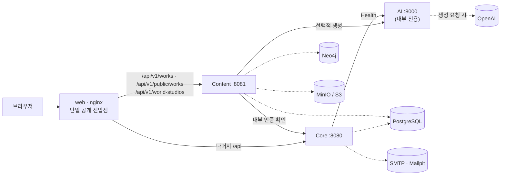
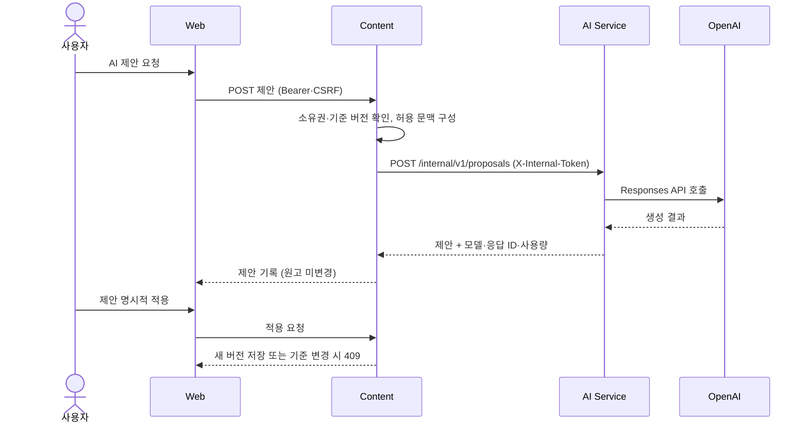

# 📖 STORYFORK

**원작을 나만의 이야기로 — 다중 AI 에이전트 기반 독자 참여형 스토리 창작·피드백 플랫폼**

> **현재 상태:** Core(회원·인증·세션·알림)와 Content(작품·회차·세계관·Fork·첨부·AI 제안)를 분리한 소스가 반영되어 있습니다. 운영 서비스는 서비스 토큰으로 보호하는 독립 공지·이벤트·문의/답변 CRUD와 `operations` schema를 소스에 추가했습니다. hosted CI·실제 DB 전환·배포는 확인 대기입니다. 기능별 개발 완료 여부는 [개발 기능표](docs/feature-roadmap.md)(✅ = PR 병합 + 최신 `Required CI` 성공)를 기준으로 합니다.

## 1. 팀 소개

| <a href="https://github.com/Seongho-haru"></a> | <a href="https://github.com/moonsungho"></a> | <a href="https://github.com/masquerade0425-hash"></a> | <a href="https://github.com/kyo-135"></a> | <a href="https://github.com/yerin816"></a> |
|:---:|:---:|:---:|:---:|:---:|
| [@Seongho-haru](https://github.com/Seongho-haru) | [@moonsungho](https://github.com/moonsungho) | [@masquerade0425-hash](https://github.com/masquerade0425-hash) | [@kyo-135](https://github.com/kyo-135) | [@yerin816](https://github.com/yerin816) |

## 2. 프로젝트 개요

### 2.1 어떤 서비스인가요?

STORYFORK는 작가와 독자가 함께 이야기를 확장하는 창작 플랫폼입니다.
작가는 세계관과 등장인물을 관리하며 AI와 함께 집필하고, 독자는 이용이 허용된 원작의 특정
회차에서 이야기를 분기(Fork)하여 독립적인 전개와 결말을 창작하는 것을 목표로 합니다.
AI는 창작 방향을 대신 확정하는 주체가 아니라, 사용자의 선택·집필·검토를 돕는 도구입니다.

기획 기준은 **「SKN34 4Team 프로젝트 기획서」 v1.4**([PDF](<docs/deliverables/SKN34-final-4Team_기획서.pdf>))이며, 최신 MVP 결정은 [결정 기록](docs/design/decisions.md#결정-목록)을 따릅니다. 충돌하는 과거 유스케이스 세부 정책은 현행 계약이 아닙니다.

### 2.2 해결하려는 문제

| 사용자가 겪는 문제 | STORYFORK의 해결 방법 |
|---|---|
| 원작의 다른 전개를 상상해도 원작 맥락을 유지하며 직접 써 보기 어려움 | 허용된 기준 회차에서 Fork하고, 그 회차까지 공개된 세계관을 참조하며 독립 작품으로 집필 |
| 장편의 세계관·인물·관계 설정이 흩어져 일관성을 유지하기 어려움 | 설정 항목별 버전·공개 범위 관리와 인물 관계도, 회차별 원고 버전·체크포인트 |
| AI가 원고를 덮어쓰거나 비공개 설정·미발행 원고가 섞일 우려 | 권한 안의 최소 문맥만 AI에 전달하고, AI 제안과 사용자 승인·실제 반영을 분리 |
| 독자 피드백을 분류·응대하는 작가의 부담 *(기획 목표)* | 독자가 유형을 고르고 단순 오류·질문은 공개 근거로 AI가 수정안·답변, 스토리 오류·제안은 작가 검토로 연결 |

### 2.3 사용자와 핵심 가치

| 사용자 | 지원하려는 경험 |
|---|---|
| 창작 의향이 있는 독자 | 허용된 원작에서 다른 선택과 사건을 탐색하고 독립 작품으로 완성 |
| 신입 작가 | 세계관·인물·줄거리 구상을 장면과 회차로 구체화 |
| 연재 작가 | 다른 플랫폼에서 연재한 기존 원고를 가져와 설정을 정리하고, 맥락을 유지하며 후속 회차 집필 및 피드백 검토 |

초기에는 창작 의향이 있는 독자와 신입 작가의 **짧은 장면·회차 집필 경험**을 중심으로
유용성을 검증합니다. 장편 연재 지원은 설정의 정확성과 검토 부담을 함께 확인하며 확장합니다.

## 3. 주요 기능과 사용 흐름

### 3.1 주요 사용자 흐름

1. **독자의 Fork 창작:** 허용 기준 회차에서 작품 Fork → 기준까지 공개된 세계관을 참조하며 직접 집필 또는 선택적 AI 대화. 설정을 처음 수정하면 전체 세계관을 자기 소유로 Fork하고, 이후 원본 변경 알림에서 반영 여부를 선택합니다(DEC-29·32~34). 발행은 별도입니다.
2. **작가의 회차 집필:** 기존 세계관·회차 확인 → 장면·사건 설정 → 직접 원고 작성 또는 선택적 시뮬레이션·AI 제안 → 사용자 검토·발행. 별도의 설정 충돌·개연성 검토는 MVP 이후입니다.
3. **피드백 응대:** 독자가 유형을 골라 무료로 등록 → 1차 필터 → 단순 오류·질문은 공개 근거로 수정안·답변
   (단순 오류는 작품 설정에 따라 자동 승인·발행), 스토리 오류(선택적으로 독자 크레딧으로 검증 시뮬레이션)·제안은 작가 검토
   → 실제 처리 상태 안내. 검증한 스토리 오류가 반영되면 독자에게 보상 크레딧.

### 3.2 기능별 상세 설명

기획서 범위에는 MVP 이후 기능도 포함됩니다. [MVP 범위](docs/design/design.md#포함과-제외)를 우선하며, AI 실행은 모든 집필의 필수 절차가 아닙니다. 아래 "현재 소스"는 코드 반영 범위이며 완료 판정은 [개발 기능표](docs/feature-roadmap.md)를 따릅니다.

| 기능 | 기획 내용 | 현재 소스 |
|---|---|---|
| **작품·세계관 관리** | 세계관을 먼저 만들고 작품에 1~5개 연결, 기존 원고(.txt·.epub·에디터 입력, 이미지 포함)에서 설정 추출, 장소·시대·규칙·사건 관리. 공유 세계관과 작품별 변화는 구분 | 작품 생성·삭제, 설정 항목 초안·확정·이전 버전 복원, 항목별 공개 여부·회차 범위, 설정 이미지·파일 첨부. 원고 기반 설정 자동 추출은 미구현 |
| **캐릭터·관계 관리** | 성격·목표·기억·능력·관계·감정과 특정 시점에 알고 있는 사실 관리 | WorldStudio 인물 카드와 Neo4j 현재 관계 CRUD·관계도. 관계 이력·시점 복원은 MVP에서 제외 |
| **다중 인물 시뮬레이션** | 캐릭터별 AI가 허용된 기억·정보에 따라 행동하고, 스토리 계획 역할이 사건·환경을 조정하여 전개 탐색 | 미구현 |
| **Fork 기반 독립 창작** | 허용된 회차 종료 시점의 공개 설정에서 분기하고, 이후 사건과 인물 상태를 원작과 분리 | 공개 회차에서 Fork 생성, 기준 회차·버전 보존, 설정 최초 수정 시 독립, 원본 변경 반영·거절 |
| **집필·편집 지원** | 직접 집필, AI 협업 집필(일러스트 생성 포함), AI 자율 연재의 세 가지 방식. `.txt`·`.epub` 내보내기 | 회차 원고 저장·불변 버전·복원·저장본 선택 발행, 플롯·장면 계획, 표지·본문 이미지, AI 이어쓰기 제안과 명시적 적용 |
| **독자 피드백 분석·응대** | 독자가 유형(댓글·단순 오류·스토리 오류·질문·제안)을 고르고, 단순 오류·질문은 AI가 공개 근거로 수정안·답변, 스토리 오류·제안은 작가 검토로 연결. 등록 전 유해 콘텐츠 1차 필터 | 미구현 |
| **알림·운영** | 사이트 안 알림함, 정기 작업(크레딧 초기화·탈퇴 처리 등) 실행 감시, LLMOps(Langfuse 추적·평가, MVP 이후) | Core 알림함 API·수신 설정·SSE 변경 신호. 운영 업무·LLMOps 미구현 |
| **회원·인증** | 이메일 가입·로그인·세션·비밀번호 복구·회원 정보 관리 | 이메일 인증 가입, 로그인·refresh 세션·기기별 로그아웃, 비밀번호 재설정, 프로필·이메일 변경 |

**AI 자율 연재**는 작품 소유자(원작·Fork 모두)가 켜면 정한 조건과 독자 반응을 바탕으로 다음 회차를 생성하고
발행 확인을 거쳐 자동 발행하는 것으로 정했습니다. 크레딧은 작품 소유자가 부담합니다. 소유자가 정한 요일·시각에 콘텐츠 서비스의 업무 실행 경계에서 실행하고 Core가 정산·알림을 담당하는 목표이며, 아직 구현되지 않았습니다.

### 3.3 지켜야 할 제품 경계

- **원작과 Fork 분리:** 기준 회차·버전을 보존합니다. 세계관은 수정 전 허용된 원본 변경을 따르고 최초 수정 시 독립됩니다. 독립 후 원본 변경은 알림과 사용자 선택으로만 반영하며 원작은 수정하지 않습니다.
- **공개 범위와 인물 지식 분리:** 작가 비공개 정보, 독자에게 공개된 정보, 각 캐릭터가 아는 사실은 서로 다릅니다.
- **생성과 확정 분리:** 시뮬레이션·AI 초안은 확정 원고가 아닙니다. 선택·승인 없이 정본이나 인물 상태를 덮어쓰지 않습니다.
- **수정안과 작가 승인 분리:** 오타·맞춤법·명백한 수치 오류는 근거와 함께 수정안을 제시하고 작가 승인 후 반영합니다.
  작가가 작품 설정에서 자동 승인·발행을 켠 경우만 예외이며, 피드백·수정안은 세계관을 바꾸지 않습니다.
  여기서 PR은 작품 내 변경 제안이며 GitHub 연동을 전제하지 않습니다.
- **단순 오류와 스토리 오류 구분:** 독자가 고른 유형으로 처리하며 AI가 유형을 분류하지 않습니다. 단순 오류만 수정안·자동 승인 경로를 타고,
  스토리 오류는 언제나 작가가 판단합니다. 전개 선호(제안)를 오류로 단정하지 않으며 허용된 Fork를 선택적으로 안내합니다.

### 3.4 이용 권한·비용·데이터 — 기획 방향

- 허용된 작품의 **Fork 생성·직접 집필·피드백 등록은 무료**입니다. AI 기능은 실행 전에 예상 상한을 안내하고,
  실행 후 실제 토큰 사용량을 크레딧으로 환산해 차감합니다. 실패한 작업은 차감하지 않습니다.
- 크레딧은 무료(가입 체험·보상·이벤트)와 유료(월 구독·추가 구매)로 나눕니다. 요청 속도는 토큰 버킷으로 제한합니다.
  플랜·가격·환산 비율·수익 배분은 후속 확정 대상이며, MVP에서는 실결제 없이 가입 체험·보상·이벤트 크레딧만 씁니다.
  추가 저장 공간은 유료 확장 방안을 검토하며, 한도 초과를 이유로 기존 작품을 자동 삭제하지 않습니다.
- 작품 등록이나 Fork 허용 설정만으로 외부 IP의 이용 권한이 생기지 않습니다. Fork·공개·유료 공개 허용을 구분하며,
  AI 이용은 별도 허용 항목 없이 Fork·세계관 이용 허용 범위에 포함됩니다. 권리 침해·유해 콘텐츠 신고는 24시간 내 1차 조치하고 소명 절차를 엽니다(UC-20).
- 공개 데이터셋과 저작권 만료 작품은 **조사·검증 후보**입니다. 라이선스와 관련 권리를 확인하기 전에는
  수집·학습·상업적 이용을 승인된 것으로 간주하지 않습니다.

## 4. 기술 스택

| 영역 | 적용 기술 |
|---|---|
| 구현 언어 | Kotlin 2.4, TypeScript 6, Python 3.11+ |
| 웹 프론트엔드 | React 19, Vite 8, Tailwind CSS 4, React Router, Redux Toolkit, Awilix, Zod |
| 업무 API (Core·Content·운영) | Spring Boot 4.1, JDK 21, Spring Security(OAuth2 Resource Server·JWT), Spring Data JPA, Flyway |
| AI API | FastAPI, OpenAI Python SDK(Responses API). 최종 모델·에이전트 프레임워크는 미정(DEC-28) |
| 데이터 저장 | PostgreSQL 17, Neo4j 5.26(WorldStudio 현재 관계), S3 호환 object storage(로컬 MinIO) |
| 메일·메시징 | SMTP(로컬 Mailpit), RabbitMQ 4.1(알림 사건 검증용 선택 profile) |
| 실행·배포 | Docker Compose, nginx, GitHub Container Registry(`:develop` 이미지 게시) |
| 검증 | GitHub Actions, Vitest, JUnit(Gradle), pytest |
| 패키지 관리 | pnpm 11, Gradle, uv |

버전 기준은 [Frontend](frontend/package.json), [Core](backend/core-api/build.gradle), [Content](backend/content-service/build.gradle), [AI](backend/ai-service/pyproject.toml)와 각 잠금 파일, [로컬 Compose](infrastructure/docker-compose.local.yaml)입니다. 남아 있는 `openai-agents` 의존성은 MVP 모델·프레임워크 선정 완료를 뜻하지 않습니다.

## 5. 시스템 아키텍처

기존 **서비스 책임을 분리한 MSA 구조**를 발전시킵니다. Frontend는 TypeScript로 **Clean Architecture·MVVM**을,
백엔드는 **기능 중심 레이어드 구조**를 따릅니다. 기능별 서버 복제는 전제하지 않습니다.

### 5.1 서비스 연결



실선은 서비스 호출, 점선은 저장소·외부 접근입니다. Operations(:8082)는 서비스 토큰으로 보호하는 독립 CRUD(PostgreSQL `operations` schema)이며 Frontend/Core/Content 연결·공개 proxy·Compose/CD 대상이 아닙니다.
브라우저는 AI·DB·외부 모델을 직접 호출하지 않으며 OpenAI 키는 AI 런타임에만 전달합니다.

### 5.2 구성별 책임

| 구성 | 현재 기술 | STORYFORK 목표 책임 — 구현 범위는 [콘텐츠 통합 안내](docs/content-integration.md) 참고 |
|---|---|---|
| Frontend | React·TypeScript·Vite, Redux Toolkit·Awilix·Zod·Tailwind CSS | 실제 인증·일부 콘텐츠/첨부와 메모리 데모 공존. 기존 URL로 Core/Content 분기 |
| Core Service (`core-api` 모듈) | Kotlin·Spring Boot, JDK 21 | Auth·세션·Health·서비스 인증 확인·알림함. 크레딧은 목표 |
| Content Service | Kotlin·Spring Boot, JDK 21 | 기존 작품·회차·버전·발행·세계관/Studio·Fork·제안·문맥·첨부·플롯 계획 |
| Operations Service | Kotlin·Spring Boot·JPA·Flyway, JDK 21 | 서비스 자격의 독립 공지·이벤트·문의/답변 CRUD 소스. `operations` schema, 실제 DB 적용·CI·배포 확인 대기; 공개 proxy·Compose/CD 미연결 |
| AI Service | 현재 Python·FastAPI; MVP 모델·프레임워크 미정 | 선택적 설정 추출·인물 시뮬레이션·집필 제안. 정본 직접 변경 금지 |
| 실행 환경 | Docker Compose, Vite 개발 서버, nginx 정적 배포 이미지 | 로컬 개발 및 서비스 연결·배포 이미지 검증 |

Core·Content는 기능별 `Controller → Service → Repository` 또는 `Controller → Service → (필요한 경우 Facade) → Client` 흐름을 사용합니다.
Frontend는 `View → ViewModel → UseCase → Repository 구현 → HTTP API` 흐름과 `Presentation → Domain ← Data` 의존 방향을 따릅니다.
Redis·큐 worker는 도입하지 않았습니다. 합의된 향후 구성요소는 [아키텍처 문서](docs/architecture.md#합의된-향후-구성요소-미구현)에 정리했습니다.

### 5.3 목표 서비스 분리 — DEC-41

| 서비스 | 소유 업무 | 현재와의 차이 |
|---|---|---|
| Core | 회원·인증·세션·크레딧·회원 알림 | 기존 core-api의 Auth·Health 유지. 콘텐츠 writer/migration 제거 |
| 콘텐츠 | 작품·세계관·회차·버전·Fork·발행·독서·검색·피드백·첨부 | [독립 Content 앱](backend/content-service/README.md)으로 구현된 업무·테스트 추출. hosted CI·실제 DB/배포 전환 대기 |
| 운영 | 문의·공지·이벤트·신고·소명·운영 판단·감사·작업 감시 | [독립 공지·이벤트·문의/답변 CRUD](backend/operations-service/README.md) 소스 구현. 신고·소명·감사·작업 감시·실제 DB 적용·배포 미구현 |
| AI | 요청된 생성·추출·시뮬레이션·검토 실행 | 기존 FastAPI 재사용 |

LLMOps는 운영 영역입니다. Langfuse는 도입 시 별도 제품으로 배포하며 자체 UI와 운영 화면 API 통합 중 선택은 미정입니다. 정기 작업은 업무 소유 서비스가 실행하고 운영이 감시합니다. 콘텐츠 제한은 콘텐츠, 회원 제한·크레딧은 Core가 적용합니다. 상세 소유권·DB·통신·이전 절차는 [서비스 구조](docs/design/service-boundaries.md)를 따릅니다.

### 5.4 실행 환경

| 구성 | 사용 이미지·데이터 | 상태 |
|---|---|---|
| 로컬 (`compose.yaml`) | 소스 빌드한 web·Core·Content·AI, 내부 PostgreSQL·Mailpit | 개발용. 선택 overlay로 MinIO, 선택 profile로 Neo4j·RabbitMQ |
| 개발 서버 (`docker-compose.dev.yaml`) | 게시된 `:develop` 이미지, 내부 PostgreSQL·Mailpit | CI 이후 CD로 게시·배포 |
| 운영 (`docker-compose.prod.yaml`) | `:main` 이미지, 외부 PostgreSQL·SMTP | 설정 준비만. main 이미지 게시·운영 배포 미확인 |

TLS·공개 ingress는 제공하지 않으며 운영 준비 완료가 아닙니다. 상세는 [개발·실행·검증 안내](docs/development.md)와 [인프라 안내](infrastructure/README.md)를 참고하세요.

## 6. ERD와 데이터 소유권

PostgreSQL은 설정·원고 원문과 버전·체크포인트·Fork를, Neo4j는 인물 관계의 **현재 상태**를 정본으로 저장합니다(#132). 관계 이력·과거 snapshot·관계를 포함한 세계관 시점 복원은 이번 MVP에서 지원하지 않으며, `pg_git`은 MVP에서 제외합니다. 같은 PostgreSQL을 사용하되 서비스·기능별로 writer와 Flyway 이력을 분리합니다.

| 소유 서비스 | 정본 데이터 | 저장소 | Flyway 위치 (`db/migration/…`) |
|---|---|---|---|
| Core | 회원·가입 후보·refresh 세션·복구/이메일 변경 challenge·탈퇴 요청·알림 | PostgreSQL | `auth`, `notification` |
| Content | 작품·회차·원고 버전·발행·세계관 설정·Fork·AI 제안·플롯 계획 | PostgreSQL | `work`, `episode`, `episode_version`, `publication`, `world`, `fork`, `proposal`, `plan` |
| Content 첨부 | 설정 첨부·작품 표지·회차 이미지 메타데이터 / 파일 본문 | PostgreSQL / MinIO·S3(비공개 버킷) | `settingattachment`, `contentimage` |
| Content WorldStudio | 카드 원문·버전·소유권·관계 요청 상태 / 현재 관계 내용 | PostgreSQL / Neo4j | `worldstudio` |

- [ERD 문서 목차](docs/design/erd/README.md): 전체 요구사항 기준 143개 테이블 논리 후보와 업무 영역별 부분 ERD (전체 모델이 구현된 것은 아님)
- [콘텐츠 물리 대응·보존 경계](docs/content-erd-migration.md) · [현재 관계 MVP 계약](docs/design/worldstudio-independent-schema.md#현재-관계-mvp-계약--132) · [콘텐츠 이관 계약](docs/design/content-service-migration-contract.md)

## 7. AI 처리 흐름

### 7.1 이어쓰기 제안 — 현재 구현



- 문맥에는 기준 회차까지의 최근 3개 회차에서 질의 관련 단락과 말미를 발췌합니다(회차당 최대 10,000자, 전체 48,000자). 공개·인물 문맥에는 비공개 설정과 미발행 원고를 포함하지 않습니다.
- 제공사 키·모델 미설정이나 호출 실패는 503으로 드러내며 임의 결과로 대체하지 않습니다. AI 제안은 자동 발행되지 않습니다.
- Health는 OpenAI 인증·모델 접근·생성 품질 검증이 아니며 키 없이 동작합니다. 상세는 [Agent 구현 경계](backend/ai-service/docs/agent-structure.md)와 [콘텐츠 통합 안내](docs/content-integration.md#문맥과-저장-한계)를 참고하세요.

### 7.2 확장 예정 AI 역할 — 미구현

| 역할 | 기획 내용 |
|---|---|
| 설정 추출 | 기존 원고에서 세계관·인물 설정 후보를 추출하고 사용자 승인 후 반영 |
| 다중 인물 시뮬레이션 | 인물별 허용 기억·관찰 정보만으로 행동을 생성하고, 스토리 계획 역할이 사건을 조정 |
| 피드백 응대 | 단순 오류 수정안·질문 답변을 공개 근거로 생성하고 스토리 오류 검증 시뮬레이션 수행 |
| AI 자율 연재 | 소유자 조건에 따라 다음 회차를 생성. 일정·발행은 콘텐츠, 정산·알림은 Core가 판단 |

역할은 실제 입력·출력·책임이 다를 때만 나누며 인물마다 클래스나 서버를 만들지 않습니다. 모델·프레임워크·Langfuse 도입은 미정입니다.

## 8. 저장소 구성

```text
SKN34-FINAL-4TEAM/
├─ frontend/                 React 웹 (storyfork-web)
├─ backend/
│  ├─ core-api/              Core: 회원·인증·세션·알림·Health
│  ├─ content-service/       Content: 작품·회차·세계관·Fork·첨부·AI 제안
│  ├─ operations-service/    운영: 공지·이벤트·문의 CRUD
│  └─ ai-service/            AI: 내부 Health·이어쓰기 제안
├─ infrastructure/           Compose·nginx·MinIO, CI 변경 선택기, HTTP 시스템 테스트
├─ docs/                     설계·결정·ERD·유스케이스·조사·산출물
├─ .github/workflows/        CI(ci.yml)·이미지 게시/배포(publish-images.yml)
└─ compose.yaml              로컬 통합 실행 진입점
```

### 빠른 시작

Docker와 Compose v2.24.4 이상이 필요합니다. 실제 `.env`가 이미 있으면 덮어쓰지 마세요.

```bash
cp -n .env.example .env       # 빈 DB 자격증명·JWT 키를 직접 설정
docker compose up -d --build  # http://127.0.0.1:5173
docker compose down           # DB volume은 보존
```

콘텐츠 기능 활성화, 포트 변경, 네이티브 실행, 로컬 단위 테스트와 CI 구성은 [개발·실행·검증 안내](docs/development.md)를 따릅니다.

## 9. 문서 안내

| 보고 싶은 내용 | 문서 |
|---|---|
| 전체 문서 목록 | [docs 문서 안내](docs/README.md): 현재 기준 문서와 작성 시점 기록 구분 |
| 기획 산출물 | [기획서](<docs/deliverables/SKN34-final-4Team_기획서.pdf>) · [요구사항 정의서](<docs/deliverables/SKN34-final-4Team_요구사항정의서.xlsx>)([기능 ID 색인](docs/requirements.md)) · [WBS](docs/deliverables/SKN34-final-4Team_WBS.xlsx) · [화면 설계서](<docs/deliverables/SKN34-final-4Team_화면설계서.pdf>) · [시스템 구상도](<docs/deliverables/SKN34-final-4Team_시스템 구상도.pdf>) · [AI 시스템 아키텍처](<docs/deliverables/SKN34-final-4Team_AI 시스템 아키텍처.pdf>) |
| 개발 현황 | [개발 기능표](docs/feature-roadmap.md) · [콘텐츠 통합 안내](docs/content-integration.md) · [이슈 #50 대응](docs/issue-50-alignment.md) |
| 설계·결정 | [MVP 설계](docs/design/design.md) · [결정 기록](docs/design/decisions.md) · [서비스 구조(DEC-41)](docs/design/service-boundaries.md) · [현재 아키텍처](docs/architecture.md) · [ERD](docs/design/erd/README.md) |
| 유스케이스·화면 | [유스케이스](docs/usecase.md) · [유스케이스 명세](docs/usecase-spec/README.md) · [보조 다이어그램](docs/diagrams/README.md) · [UI 프로토타입 대응](docs/prototype-alignment.md) |
| 조사 | [작가 도구 조사·온보딩](docs/research/writer-tools/README.md) · [펜시브 기능 조사](docs/research/pensiv/README.md) |
| 실행·검증 | [개발·실행·검증 안내](docs/development.md) · [인프라 안내](infrastructure/README.md) |
| 서비스별 | [Frontend](frontend/README.md) · [Core](backend/core-api/README.md) · [Content](backend/content-service/README.md) · [운영](backend/operations-service/README.md) · [AI](backend/ai-service/README.md) |
| 구현 규칙 | [공통 구현 지침](AGENTS.md) |
