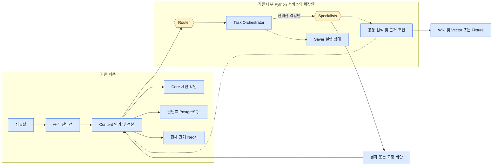
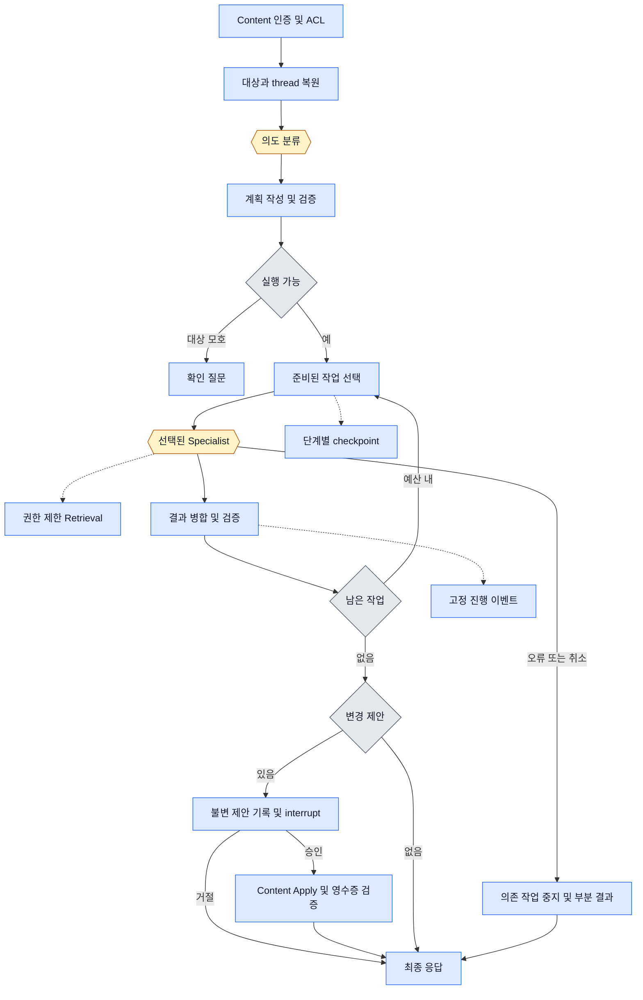
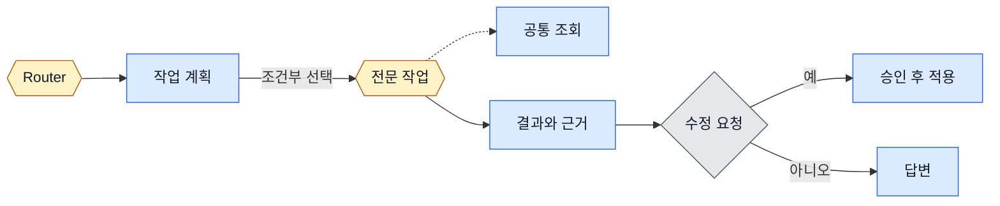
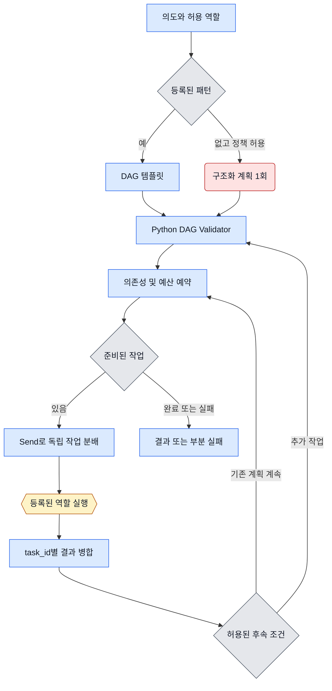

# 작업 계획과 LangGraph 실행

**권장 구조는 하나의 Python StateGraph가 검증된 작업 DAG를 실행하는 방식이다.** 예를 들어 “3화의 카이를 검수하고 문제가 있으면 고쳐 줘”는 검수 결과가 있어야 수정 여부가 정해진다. Router는 의도와 가능한 작업을 분류하고, Python이 선행 조건과 비용을 검사하며, 근거 있는 지적이 있을 때만 편집 작업에 원문 구간을 넘긴다. 새 서버는 필요하지 않다.

모든 흐름도의 파란 사각형은 모델 호출 0회, 노란 육각형은 조건부 호출, 빨간 둥근 노드는 실행 시 모델 호출, 회색 마름모는 결정적 분기다. 점선은 조회 도구·선택적 의존·이벤트를 뜻한다.

### 1. 시스템 경계



### 2. Main StateGraph 상세



### 3. Main StateGraph 간단 버전



### 4. Task Orchestrator 내부



## 라우팅과 대상 식별

`RouterPort.classify(request, allowed_operations, ui_mode) → Classification`. `Classification` 필드는 `in_scope, risk_flags, primary_intent, task_pattern, capabilities[], missing_slots[], wants_change, approval_intent`. 명시적인 기능 버튼·단순 숫자/명칭 점검은 Python 규칙으로 분류한다. 자유문이 모호하면 선택한 분류기 한 곳에만 요청한다. 독자 피드백 유형은 사용자의 선택을 유지한다. 대화에서 “승인”을 인식해도 승인 화면과 인증된 결정 API를 거친다.

| 방식 | 한국어 복합 요청·유연성 | 비용·지연 | 안전·테스트·복구 |
|---|---|---|---|
| 등록 규칙만 | 단일 의도·명시 패턴은 명확. 예상 밖 조합에 약함 | 모델 0회 | 재현 쉬움. 등록되지 않은 입력은 명확화 |
| 자유형 LLM planner | 표현 폭 넓음. 임의 작업명·잘못된 순서 가능 | 계획 생성 매회 | 형식과 의미 검증 부담. 재계획 복구 어려움 |
| Specialist 직접 호출형 Supervisor | 중간 결과를 보고 유연하게 위임 | 단계마다 분류 가능, 중복 호출 위험 | 호출 경로·권한·비용을 한곳에서 제한하기 어려움 |
| **등록 DAG + 제한 분류·계획** | 알려진 복합 의도는 패턴, 결과 기반 분기. 낯선 조합은 허용 집합 내 계획 또는 질문 | 고정 경로 0회, 모호한 분류 최대 1회, 별도 planner는 평가 뒤 활성화 | 권한·예산·승인은 결정적 검사. 역할 추가 시 I/O·의존 조건·평가 예제 등록 |

**분류 제공사 선택.** `RuleBasedRouter`를 기준선으로 둔다. `JEVRouterAdapter`는 state 한 개에 예컨대 지원 여부(noul), 의심 신호(noul), 주 의도(choice), 복합 패턴(choice), 명확성(score), 변경 요청(noul)의 **6문항**을 묶는다. 역할 조합·승인 절차는 코드로 도출한다. 지시서의 8문항 한도 안에서 동작한다. TypeSafe 원 API는 Choice·Score·Noul과 이미지 Box를 문서화하고 공식 예제에는 13문항 일괄 호출도 있다. 8을 모든 endpoint의 고정 제품 사양으로 전제하지 않고 도입할 endpoint와 버전을 재확인한다. [TypeSafe API](https://docs.typesafe.ai/api/system-one) · [공식 병렬 질문 예제](https://docs.typesafe.ai/cookbooks/parallel_questions)

`OpenAIDecisionsRouterAdapter`는 `POST /v1/decisions`의 정형 분류·점수 결과를 같은 enum으로 매핑한다. `ResponsesRouterAdapter`는 구조화된 복합 출력이나 제한 후보 선택이 필요할 때의 대안이다. refusal·incomplete·미등록 값은 명확화 또는 실패다. 기존 OpenAI 연결 재사용 이점이 있지만 모델 지원·계정 권한·한글 성능·가격은 별도 검증 대상이다. 제공사 우열은 동일한 블라인드 한국어 세트로 판단한다. [Decisions](https://developers.openai.com/api/reference/resources/decisions/methods/create) · [Structured Outputs](https://developers.openai.com/api/docs/guides/structured-outputs)

Slot Resolver는 인증된 UI 대상 → 같은 scope의 이전 대상 → 회차·이름 parser → Content의 허용 후보 → 후보 내 선택 → 필요 시 구조화 추출 → 사용자 확인 순으로 진행한다. “5화”와 UI의 “3화”가 다르면 명시한 범위를 Content에서 다시 확인한다. 다른 작품·Fork나 동명이인은 확인 전 실행을 멈춘다. 검색 문구는 인가 정보나 tool 이름으로 해석하지 않는다.

## Registry와 작업 상태 계약

| capability | 허용 입력 → 출력 | 허용 후속 조건 |
|---|---|---|
| context / QA | Scope·질문 → ContextPacket 또는 Answer | Evidence가 부족하면 제한된 보강 또는 partial |
| mechanical / review | 고정 원문·설정·검사종류 → Findings | 행동 개연성에만 simulation. 수정 요청과 유효 지적이 함께 있으면 editing |
| simulation | 격리된 인물별 packet·상황 → SimulationReport | review·development·writing·world가 가상 결과로 참조 |
| development / writing | Coverage·콘티·가상 결과 → BeatPlan 또는 Text/Patch | 초안 모드만 writing, 생성 후 연속성 점검 |
| world_plot / template | 정본 대상·영향 범위 또는 라이선스 필터 → ChangeSet 또는 Recommendations | 수정 요청만 승인으로 이동. 추천은 조회로 종료 |

Registry는 Python 고정 매핑 `operation → handler, reads, input_schema, output_schema, allowed_successors, model_cap`. 모델이 임의 함수·URL·쿼리·파일 경로를 선택할 수 없다. `run_if`는 `always / has_confirmed_findings / simulation_required / draft_requested` 같은 enum이다. 코드 실행식은 허용하지 않는다.

```yaml
task_id: edit-1
agent_type: writing
operation: patch_dialogue
input_refs: [review-1.findings, context-1.source_span]
depends_on: [review-1, context-1]
run_if: has_confirmed_findings
output_schema: ChangeSet.v1
budget: {model_calls: 1, max_output_tokens: 1200}
retry_policy: {max_extra_attempts: 0}
timeout_ms: 30000
execution_status: pending
evidence_refs: []
result: null
```

검증기는 위상 정렬로 cycle·중복 ID·미등록 참조·출력 타입 불일치·의존 없는 결과 접근을 거부한다. 모든 대상은 동일 허용 scope의 고정 버전에 속해야 한다. 동일 문서의 겹치는 범위는 한 편집에 합치고, 순서에 따라 결과가 달라지면 대안을 사용자에게 돌려준다. 단순 순차화로 오래된 patch를 적용하지 않는다.

`MainState`에는 `thread_id/run_id, request_ref, messages(허용된 최근 참조), conversation_summary_ref, scope, security_decision_ref, classification, task_plan, task_results, evidence_refs, coverage, simulation_ref, generated_content_ref, change_set_ref, approval_ref, response_ref, execution_status, budget_usage, errors`를 둔다. task는 pending → running → succeeded/partial/failed/cancelled/skipped. `Send`는 필요한 읽기 전용 slice만 전달한다. reducer는 `(run_id,task_id,attempt)`로 중복 병합을 방지하고 고정된 task 순서로 결과를 조립한다. 병렬 작업끼리 messages를 덮어쓰지 않는다. `Command`는 검증된 다음 노드와 일부 상태만 갱신한다. [LangGraph Graph API](https://docs.langchain.com/oss/python/langgraph/graph-api)

## 비용·실패 제어

새 채팅 턴은 같은 thread에서 최근 대상 참조와 승인된 대화 요약만 복원한다. 이전 턴의 분류, 선택 에이전트, 시뮬레이션, 승인 및 비용 예약은 새 run의 초기값으로 재사용하지 않는다. 동일 run의 장애 복구에서는 반대로 이미 사용한 예산·완료 task를 유지한다.

초기 **실험값**은 run당 DAG 작업 12개, 동시 2개, dynamic 확장 1회, 전체 모델 시도 20회(분류·재시도 포함), 누적 입력 48k·출력 12k 토큰, 실행 시간 120초다. 승인 대기 시간은 실행 deadline에서 분리한다. 실제 모델 문맥 길이와 사용자 한도 중 작은 값을 쓴다. 다음 호출의 최대 출력을 먼저 예약한 뒤 실제 사용량으로 정산한다. 타임아웃·사용량 미보고는 0원으로 집계하지 않는다.

| 상황 | 처리 |
|---|---|
| 독립 검색·작업 | 필요한 경로만 병렬화. task 시작 전에 공통 예산 원자 예약. 다른 분기 결과·쓰기 권한에 접근 불가. |
| 일시적 장애 | 조회만 deadline 안에서 jitter를 둔 1회 재시도. 연속 장애 시 해당 제공사 회로를 열고 냉각 후 1개 probe. 모델 수신 여부 불명은 자동 재호출 금지. |
| 누락·모순 | 필수 근거 실패는 후속 쓰기 차단. 선택적 원문 예시만 누락되면 경고와 확보한 근거로 partial. 충돌은 출처와 버전을 함께 제시. |
| 취소·재시작 | 실행 lease와 attempt로 중복 스케줄 차단. 매 경계와 모델 호출 전 취소 검사. 진행 중 비용 기록, 늦게 온 결과 폐기. 적용 결과는 Content 영수증으로 대조. |
| 긴 문맥 | 회차 manifest는 전체 확인, 모델 입력은 관련 사건·가까운 회차·원문 구간 순으로 선택. 잘린 범위 표시. 권한·revision 키가 같은 run에서 공통 ContextPacket을 재사용. |

응답 합성은 기본 결정적 템플릿이다. Output Validator가 citation 대상·권한·시점·원문 일치·simulation 태그·생성 스키마를 확인한 결과만 내보낸다. 사용자에게 보일 근거가 부족한 판단은 `insufficient_evidence`로 표시한다. [기능별 흐름](03-rag-simulation-design.md) · [승인과 재개](04-infrastructure-integration.md)
