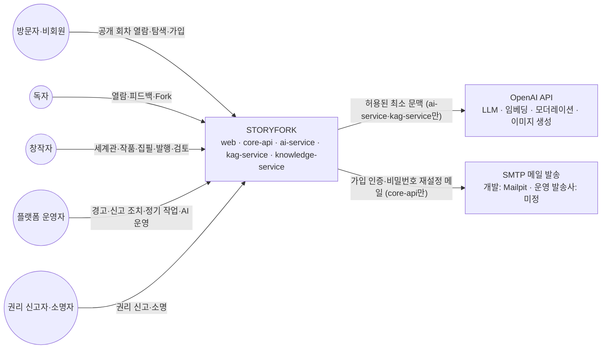
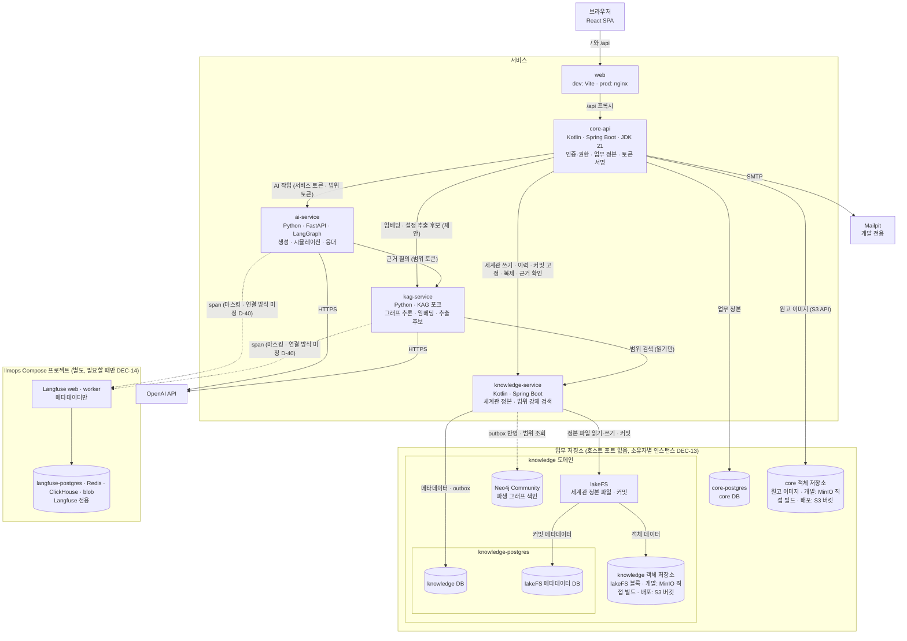
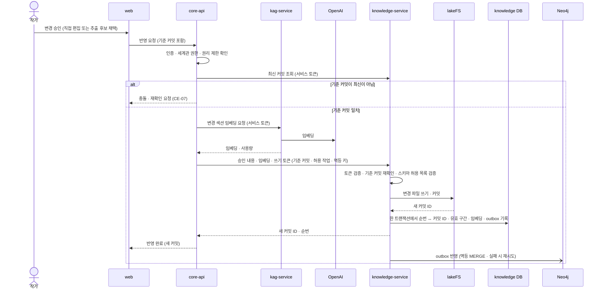
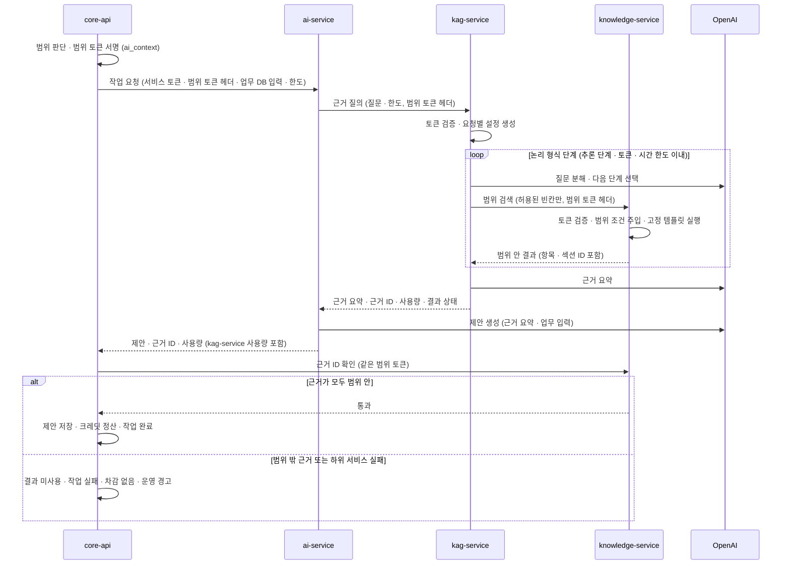
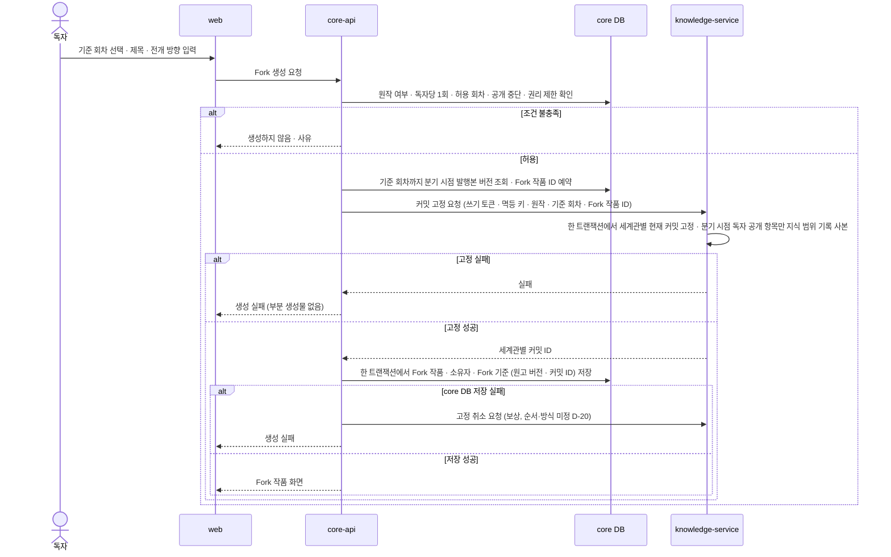

> **보관 문서(2026-10-30):** KAG·lakeFS·Neo4j를 전제로 한 이전 설계안입니다. MVP는 [DEC-16](../../decisions.md#결정-목록)에서 MVP용 RDB 저장 방향을 검토하며, 새 설계는 [docs/design](../../design.md)에 있습니다. 이 문서는 비교·후속 검토용으로만 보관합니다.

# 설계 문서: STORYFORK 시스템 아키텍처 (High-Level)

> **문서 상태: 설계 초안 — 구현 없음**
> 유스케이스 v7(UC-01~28)·유스케이스 명세·요구사항 정의서(REQ01~16, 기능 116개)를 시스템 구조로 옮긴 상위 수준 설계입니다. 함수 시그니처·의사코드·DTO 스키마·DB 스키마·실제 쿼리는 다루지 않습니다.
>
> **이번 개정(2026-10-29):** 서비스 분리를 `채택`했습니다. 세계관 정본은 knowledge-service(lakeFS·PostgreSQL·Neo4j)가, 그래프 추론은 kag-service(OpenSPG KAG 포크)가 맡는 다섯 서비스 구성입니다. kag-service를 ai-service에 합칠지는 통합 시험([V-01](#검증-과제))을 해 본 뒤 정합니다. 같은 날 참고 프로젝트 GovBiz의 DB·Langfuse 운영 방식(저장소 인스턴스 소유자별 분리, Langfuse 별도 Compose 프로젝트, 추적 규칙)을 적용했습니다(DEC-13~15). 이 문서는 시스템 전체 개요와 색인이고, 서비스별 상세는 [문서 구성](#문서-구성)의 서비스 문서에, 결정 근거는 [decisions.md](decisions.md)에 있습니다.

## Overview

STORYFORK는 다중 AI 에이전트 기반 독자 참여형 스토리 창작·피드백 플랫폼입니다. 작가는 세계관·인물을 관리하며 직접 또는 AI와 함께 집필하고, 독자는 허용된 원작 회차에서 Fork해 독립 작품을 만들거나 피드백을 남깁니다. AI는 추출·시뮬레이션·집필·검토·응대 결과를 **제안**으로만 돌려줍니다. 정본 반영·권한·발행·과금은 정본을 소유한 서비스가 판단합니다.

현재 구현은 web·core-api·ai-service 세 서비스의 시작 화면과 Health 확인뿐입니다(`현재`). 목표 구성은 여기에 kag-service와 knowledge-service를 더한 다섯 서비스입니다(`채택`). core-api는 유일한 인증·권한 판단 주체이고 업무 정본을 소유합니다. knowledge-service는 세계관 정본과 지식 그래프를 소유하며 모든 조회에 범위를 강제합니다. kag-service는 그래프를 읽어 추론만 하고, ai-service는 그 근거로 제안을 만듭니다. 하위 서비스는 core-api가 서명한 토큰만 믿습니다.

이 문서에는 서비스 사이에서 모두 지켜야 하는 것만 둡니다. 시스템 컨텍스트, 컨테이너 구성, 허용 호출 방향, 서비스 간 공통 계약(토큰·범위 집행·실패·멱등·관측성), 서비스를 가로지르는 핵심 흐름, 시스템 수준 정확성 속성, 테스트 전략 요약, 미정 사항 총괄, 검증 과제, 후속 문서 갱신 목록입니다.

### 표기

확정된 내용과 제안·미정을 섞지 않으려고 아래 표기를 씁니다. 서비스 문서와 결정 기록도 같은 표기를 씁니다.

| 표기 | 의미 | 근거 |
|---|---|---|
| `현재` | 코드에 구현되어 동작함 | 소스, [아키텍처 문서](../../../../docs/architecture.md) |
| `확정` | 팀이 확정한 정책·기술 결정 | [유스케이스 6.2절](../../../../docs/usecase.md#62-확정된-정책과-기술-결정), 명세 BR·업무 규칙 |
| `합의` | 도입하기로 합의했지만 코드·Compose에 없음 | 아키텍처 문서 "합의된 향후 구성요소" |
| `채택` | 사용자가 이번 설계 중 잠정 채택한 결정. 팀 재검토 가능 | [decisions.md](decisions.md) |
| `제안` | 이 설계가 제안하는 구조. 팀 검토 후 확정 | 이 문서와 서비스 문서 |
| `미정` | 후속 결정 필요. 이 설계에서 값·방식을 정하지 않음 | [위험·미정](#위험미정-사항과-후속-결정) |

기존 `확정`·`합의`를 바꾸는 `채택`은 "`채택` — 기존 `확정`(근거 문서) 대체, 팀 재결정 필요"로 적습니다. 바뀌는 기존 문서는 [후속 문서 갱신 필요](#후속-문서-갱신-필요)에 모았습니다.

### 범위

| 포함 | 제외 |
|---|---|
| 서비스 경계·책임·허용 호출 방향 | 함수 시그니처, 의사코드, 클래스 설계 |
| 서비스 간 계약(토큰 종류·범위 집행·실패 전파·멱등) | 요청·응답 DTO, 상태 코드 상세, 토큰 클레임 형식 |
| 저장소 배치, 개념 모델, 그래프 모델 개념 스케치 | DB 테이블·ERD·인덱스 정의, 실제 Cypher, lakeFS 파일 형식 상세 |
| 공개·내부 API의 자원 범주(가칭 경로) | 프롬프트 내용, 모델 선택 값 |
| 권한·공개 범위·AI 문맥 규칙, 크레딧 처리 구조 | 플랜·가격·환산 비율·한도 값 |
| 로컬 실행·배포 실습 구성의 목표 모습, 라이선스 확인 사항 | 운영 배포 확정, 법률 판단 |
| 결정 기록과 검증 과제 | 통합 시험 실행(이번 작업은 문서 작성만) |

### 문서 구성

| 문서 | 내용 |
|---|---|
| [design.md](design.md) (이 문서) | 개요·색인, 설계 원칙, 시스템 컨텍스트·컨테이너, 허용 호출 방향, 서비스 간 공통 계약, 핵심 흐름, 시스템 정확성 속성, 테스트 요약, 미정 총괄, 검증 과제, 후속 문서 갱신 목록 |
| [services/web.md](services/web.md) | React SPA. 화면 영역, 상태 배치, 사용자 토큰 취급, AI 작업 표시 |
| [services/core-api.md](services/core-api.md) | 인증·권한·업무 정본. 기능 모듈, 공개 API, 권한 판단, 범위 토큰 발급, AI 작업 수명주기, 크레딧, 피드백·자율 연재·정기 작업 흐름 |
| [services/ai-service.md](services/ai-service.md) | 생성 기능, 에이전트 역할, 시뮬레이션 그래프, kag-service 근거 질의 |
| [services/kag-service.md](services/kag-service.md) | KAG 포크 추론 엔진. 포크 수정 목록, 질의 유형, 임베딩·설정 추출 후보 |
| [services/knowledge-service.md](services/knowledge-service.md) | 세계관 정본(lakeFS)·메타데이터(PostgreSQL)·그래프(Neo4j), 범위 검색 API, 커밋 고정·복제 |
| [services/infrastructure.md](services/infrastructure.md) | 저장소·객체 저장소·네트워크·Compose·환경설정·비밀값·라이선스·배포 |
| [decisions.md](decisions.md) | 이번 결정, 검토 후 제외한 대안, 조사·시험 근거 |

### 근거 문서

- [README](../../../../README.md), [공통 지침](../../../../AGENTS.md), [Frontend 지침](../../../../frontend/AGENTS.md), [Core API 지침](../../../../backend/core-api/AGENTS.md), [AI Service 지침](../../../../backend/ai-service/AGENTS.md)
- [아키텍처 문서](../../../../docs/architecture.md), [AI Agent 구현 경계](../../../../backend/ai-service/docs/agent-structure.md), [인프라 안내](../../../../infrastructure/README.md)
- [유스케이스](../../../../docs/usecase.md), [유스케이스 명세](../../../../docs/usecase-spec/README.md)(UC-01~28, CE-01~07, BR-01~15, 0.4절 상태 이름)
- [보조 다이어그램](../../../../docs/diagrams/README.md): [상태](../../../../docs/diagrams/state.md)·[활동](../../../../docs/diagrams/activity.md)·[시퀀스](../../../../docs/diagrams/sequence.md)·[도메인 클래스](../../../../docs/diagrams/class.md)
- [UI 프로토타입 대응](../../../../docs/prototype-alignment.md), 요구사항 정의서(`docs/SKN34-final-4Team_요구사항정의서.xlsx`)
- 외부 자료(조사 일자·한계는 [decisions.md 조사·시험 근거](decisions.md#조사시험-근거)): [KAG 논문(arXiv 2409.13731)](https://arxiv.org/abs/2409.13731), [OpenSPG KAG 저장소](https://github.com/OpenSPG/KAG), [OpenSPG 저장소](https://github.com/OpenSPG/openspg), [lakeFS 문서](https://docs.lakefs.io/), Neo4j 블로그의 LLM wiki 그래프 모델(Document → Section 포함 트리, `NEXT_SECTION`, `LINKS_TO`, 결정적·멱등 재동기화. 모델 참고만)
- 참고 사례(조사 근거는 [decisions.md R-08](decisions.md#r-08-govbiz-참고-프로젝트의-dblangfuse-운영-방식)): [GovBiz(SKN34-4th-1Team) 저장소](https://github.com/SKNETWORKS-FAMILY-AICAMP/SKN34-4th-1Team). 같은 부트캠프의 참고 프로젝트이며 DB·Langfuse 운영 방식만 적용

상태 이름·업무 규칙·흐름의 세부는 위 문서가 기준입니다. 이 설계는 그 규칙을 어느 서비스가 어떻게 지키는지를 정합니다.

### 설계 원칙

| ID | 원칙 | 설계 반영 | 상태 |
|---|---|---|---|
| DP-01 | 서비스는 책임 단위로 나눔 | web·core-api·ai-service·kag-service·knowledge-service 다섯 서비스. 새 기능은 기존 서비스 안의 기능 모듈로 추가하고, 서비스는 정본·규칙 집행 경계가 실제로 다를 때만 나눕니다 | `채택` — 기존 `확정`(세 서비스 유지, [AGENTS.md](../../../../AGENTS.md) 서비스 책임·[usecase.md 6.3절](../../../../docs/usecase.md#63-서비스-책임)) 대체, 팀 재결정 필요 |
| DP-02 | 단방향 호출 | [허용 호출 방향](#허용-호출-방향)의 여섯 방향만 둡니다. 역방향 호출과 web의 Core 외 호출은 없습니다 | `채택` — 기존 `확정`(`Frontend → Core → AI → OpenAI`) 확장, 팀 재결정 필요 |
| DP-03 | 정본마다 소유 서비스는 하나 | 업무 정본은 core-api, 세계관 정본은 knowledge-service가 소유합니다. 저장소 접근도 소유 서비스만 합니다 | `채택` — 기존 `확정`(작품·세계관·회차 버전·Fork 정본은 Core 소유, [AGENTS.md](../../../../AGENTS.md)) 대체, 팀 재결정 필요 |
| DP-04 | 제안 → 승인 → 반영 분리 | AI 결과는 제안으로 저장하고, 사용자 채택(또는 소유자가 켠 자동 처리)과 권한·기준 버전 재확인 뒤에만 정본에 반영합니다(BR-01). AI 추출도 후보만 만듭니다 | `확정` |
| DP-05 | 상태 분리와 Fork 고정 | 원작·Fork·초안·발행본·시뮬레이션 결과를 나눕니다. Fork는 원고 버전과 세계관별 lakeFS 커밋 ID를 고정합니다(BR-04) | 원칙 `확정`, 고정 수단 `채택` |
| DP-06 | 범위는 Core가 정하고 knowledge-service가 집행 | Core가 요청마다 범위를 판단해 범위 토큰에 서명하고, knowledge-service가 모든 조회에 그 범위를 주입합니다(BR-02, BR-10) | `채택` |
| DP-07 | 실패를 숨기지 않음 | 실패·시간 초과·취소를 성공·빈 결과·임의 fallback으로 바꾸지 않습니다. KAG 원본의 실패 은폐 코드는 포크에서 제거합니다. 실패한 작업은 차감하지 않습니다(CE-04, UC-17) | `확정`(원칙), 적용 `채택` |
| DP-08 | 필요한 때 필요한 구성요소만 | 우리 서비스에는 큐·worker를 두지 않습니다. Redis는 Langfuse 의존 구성요소로만 둡니다([DEC-12](decisions.md#결정-목록)). 합의된 구성요소도 처음 쓰는 기능을 구현할 때 도입합니다 | `채택` — 기존 `확정`(Redis 두지 않음, [AGENTS.md](../../../../AGENTS.md) 변경 원칙·[architecture.md](../../../../docs/architecture.md)) 일부 대체, 팀 재결정 필요 |
| DP-09 | 비밀값 런타임 격리 | OpenAI 키는 AI 런타임(ai-service·kag-service)에만, 저장소 자격 증명은 소유 서비스에만, 토큰 서명 개인키는 core-api에만 둡니다 | `채택` — 기존 `확정`(OpenAI 키는 AI Service에만, [AGENTS.md](../../../../AGENTS.md) 보안과 데이터) 범위 재정의, 팀 재결정 필요 |
| DP-10 | 단순성 | 기능 폴더 안의 `controller → service → repository/client`. 공통 추상화는 실제 사용처가 둘 이상이거나 외부 경계 격리가 필요할 때만 둡니다 | `확정` |
| DP-11 | LLM은 쿼리를 쓰지 않음 | LLM이 Cypher·SQL·KGDSL을 만들거나 실행하지 않습니다. 고정 템플릿의 허용된 빈칸만 채웁니다 | `채택` |
| DP-12 | 인증·권한 판단 주체는 하나 | core-api만 사용자를 인증하고 권한을 판단합니다. 하위 서비스는 Core 공개키로 토큰만 검증합니다 | `채택` |
| DP-13 | 추론과 저장 분리 | ai-service·kag-service는 저장소 계정이 없고 그래프에 쓰지 않습니다. 세계관 쓰기는 core-api가 조율하고 knowledge-service가 실행합니다 | `채택` |

### 현재 상태와 목표 상태

| 영역 | 현재 (`현재`) | 목표 |
|---|---|---|
| web | React 시작 화면과 Core·AI Health 표시. `frontend/index.html`은 Core를 호출하지 않는 정적 UI 프로토타입 | 업무 화면 `View → ViewModel → UseCase → Repository → HTTP DTO`(`확정`). 공개 Core API만 호출 |
| core-api | `_health`, `_health_ai_service`, `_common`(RestClient·통신 실패 분류·ProblemDetail·CORS) | 기능 모듈 15개(가칭, `제안`), 내장 스케줄러(`합의`), 사용자 인증·권한 판단·토큰 서명(`채택`), 업무 DB는 core-postgres 인스턴스의 PostgreSQL core DB와 Flyway 마이그레이션(`채택`, DEC-13) |
| ai-service | `app/main.py → health/router.py → HealthResponse`. 모델 호출 없음. `openai-agents` 의존성만 남음 | `router → service → (필요할 때만 LangGraph) → LangChain OpenAI 모델`, Langfuse 추적(`확정`). 설정 근거는 kag-service에 질의(`채택`) |
| kag-service | 없음 | OpenSPG KAG 포크. 무상태 그래프 추론·임베딩·설정 추출 후보(`채택`). ai-service 통합 여부는 V-01 뒤 결정 |
| knowledge-service | 없음 | Kotlin·Spring Boot 직접 구현. 세계관 정본·이력·커밋 고정·복제, 그래프 반영, 범위 강제 검색(`채택`) |
| 저장소 | 없음 | 정본 소유 도메인별 PostgreSQL 인스턴스(core-postgres: core DB, knowledge-postgres: knowledge DB·lakeFS 메타데이터 DB), lakeFS, Neo4j Community, 소유자별 객체 저장소(개발 MinIO 직접 빌드 인스턴스, 배포 AWS S3 소유자별 버킷)(`채택`, DEC-13). Gitea는 쓰지 않음 |
| 외부 연동 | 없음 | OpenAI(LLM·임베딩·모더레이션·이미지 생성), SMTP(개발 Mailpit), Langfuse self-host(`합의`. 업무와 다른 llmops Compose 프로젝트에 전용 PostgreSQL·Redis·ClickHouse·blob과 함께 둠, `채택` DEC-12·DEC-14) |
| 실행 | Docker Compose dev(Vite)·prod 검증(nginx), 루트 `.env` 단일 관리, 인증·TLS 없는 로컬 검증용 | 같은 방식으로 구성요소를 기능 구현 시점마다 추가. Langfuse 묶음은 별도 llmops 프로젝트로 필요할 때만 켬(`채택`). 배포 실습 객체 저장소는 AWS S3(`채택`), 나머지 운영 배포는 `미정` |

## Architecture

### 시스템 컨텍스트

- 액터 정의와 권한 계층은 [유스케이스 1.2·2.1절](../../../../docs/usecase.md)을 따릅니다. 독자·신입 작가·연재 작가는 계정 등급이 아니라 이용 상황이며, 권한은 대상 작품·세계관마다 판단합니다(BR-07).
- 외부 연재 플랫폼은 연동 대상이 아닙니다. 로그인·스크래핑·자동 게시·댓글 수집을 하지 않습니다(`확정`).
- 결제 제공자는 MVP에 없습니다. MVP는 실결제 없이 가입 체험·보상·이벤트 크레딧만 씁니다(`확정`).

### 컨테이너 구성

| 컨테이너 | 기술 | 책임 | 접근 가능한 주체 | 상태 |
|---|---|---|---|---|
| web | React 19·TypeScript·Vite 8. prod는 nginx 정적 런타임 | 화면·입력·상태 표시, `/api`를 Core로 중계 | 브라우저 | `현재`(시작 화면만) |
| core-api | Kotlin 2.4·Spring Boot 4.1·JDK 21 | 인증·권한·업무 정본·크레딧·AI 작업 수명주기·토큰 서명·근거 재검증·정기 작업 | web | `현재`(Health만) |
| ai-service | Python 3.11~3.14·FastAPI·LangChain·LangGraph·Langfuse | 모더레이션·집필·검토·응대·시뮬레이션·자율 연재 회차 생성 | core-api | `현재`(Health만) |
| kag-service | Python·OpenSPG KAG 포크 | 범위 토큰 안의 그래프 추론, 임베딩, 설정 추출 후보 | ai-service, core-api | `채택` |
| knowledge-service | Kotlin·Spring Boot | 세계관 정본·이력·커밋 고정·복제, 그래프 반영, 범위 강제 검색. LLM 미사용 | core-api(관리·근거 확인), kag-service(범위 검색) | `채택` |
| core-postgres | PostgreSQL 인스턴스(core-data 내부 네트워크) | core DB. 스키마는 core-api의 Flyway | core-api만 | `채택`(DEC-13) — 기존 `미정`(업무 DB 제품) 해소, 기존 `제안`(인스턴스 하나에 DB 분리) 대체 |
| knowledge-postgres | PostgreSQL 인스턴스(knowledge-internal). 한 인스턴스에 DB·계정 분리(`제안`) | knowledge DB(스키마는 knowledge-service의 Flyway), lakeFS 메타데이터 DB(lakeFS 자체 마이그레이션) | DB마다 소유자만(knowledge-service, lakeFS) | `채택`(DEC-13) |
| lakeFS | lakeFS(1.88.0으로 시험, BSL 1.1) | 세계관 정본 파일과 커밋 | knowledge-service | `채택` — 기존 `합의`·`확정`(Gitea) 대체, 팀 재결정 필요 |
| Neo4j Community | Neo4j(GPLv3) | 파생 그래프 색인. 정본에서 언제든 다시 만듦 | knowledge-service | `채택` |
| 객체 저장소 | 소유자별. 개발은 core·knowledge 인스턴스(MinIO 공식 소스 마지막 태그 직접 빌드), 배포는 AWS S3 소유자별 버킷. Langfuse blob은 llmops 프로젝트 전용(아래 행) | 원고 이미지(core), lakeFS 객체 데이터(knowledge) | core-api, lakeFS(각자 자기 것만) | `채택`(DEC-08·DEC-13) — 기존 `합의`(MinIO) 갱신 |
| Langfuse | self-host(Docker), 업무와 다른 llmops Compose 프로젝트(가칭). web(화면·API)·worker(수신 이벤트 비동기 처리). 화면만 `127.0.0.1` 공개 | AI 호출 추적 메타데이터 | ai-service·kag-service(web 수집 엔드포인트에 기록) | `합의`, 배치 `채택`(DEC-14) |
| langfuse-postgres·Langfuse blob | Langfuse 전용 PostgreSQL 인스턴스와 blob 저장소(이벤트·미디어) | Langfuse 트랜잭션 데이터, 수신 이벤트·미디어 | Langfuse web·worker만 | `채택`(DEC-14) |
| Redis(Langfuse 전용) | Langfuse 의존 구성요소. 비밀번호 필수, `noeviction` | Langfuse 캐시·작업 큐. Langfuse 소유 | Langfuse web·worker만. 우리 서비스는 접속하지 않음 | `채택`(DEC-12·DEC-14) — 기존 `확정`(Redis 두지 않음) 일부 대체, 팀 재결정 필요 |
| ClickHouse(Langfuse 전용) | Langfuse 의존 구성요소. 단일 노드, 메모리 상한 | Langfuse 추적·관측 데이터 저장. Langfuse 소유 | Langfuse web·worker만 | `채택`(DEC-12·DEC-14) |
| Mailpit | 로컬 SMTP 수신기 | 개발 환경 인증 메일 확인 | core-api | `합의` |
| Elasticsearch | — | 작품 검색(공개 정보만). MVP는 DB 검색 | core-api | `합의`·MVP 제외 |

저장소별 구성·네트워크·라이선스는 [인프라 문서](services/infrastructure.md)에 있습니다. 인스턴스 배치는 [인프라 PostgreSQL 배치](services/infrastructure.md#postgresql-배치), Langfuse 묶음의 구성·자원·포트는 [인프라 Langfuse](services/infrastructure.md#langfuse)에 있습니다. Gitea, OpenSPG 서버(Java)·MySQL·Pemja는 쓰지 않습니다(근거는 [decisions.md](decisions.md#검토-후-제외한-대안)).

### 허용 호출 방향

서비스 사이의 호출은 아래 여섯 방향만 허용합니다(`채택`).

| # | 호출자 → 대상 | 용도 | 인증 | 상태 |
|---|---|---|---|---|
| 1 | web → core-api | 공개 API | 사용자 접근 토큰 | `현재`(Health) · `확정` |
| 2 | core-api → ai-service | AI 작업 실행 | 서비스 토큰 + 범위 토큰 | `현재`(Health) · `채택`(토큰) |
| 3 | ai-service → kag-service | 설정 근거 질의 | 범위 토큰 | `채택` |
| 4 | kag-service → knowledge-service | 범위 검색(읽기 API만) | 범위 토큰 | `채택` |
| 5 | core-api → kag-service | 임베딩, 설정 추출 후보 | 서비스 토큰(추출은 범위 토큰도) | `제안`. ai-service 경유 여부 `미정`(D-33) |
| 6 | core-api → knowledge-service | 세계관 쓰기·이력·커밋 고정·복제, 근거 확인, 공개 전환 통지, 메타데이터 조회 | 서비스 토큰 · 쓰기 토큰 · 범위 토큰 | `채택` |

- **금지:** 역방향 호출(ai-service·kag-service·knowledge-service → core-api, kag-service → ai-service), knowledge-service의 다른 서비스 호출, ai-service의 knowledge-service 직접 호출, kag-service의 knowledge-service 쓰기 API 호출, web의 Core 외 호출.
- **외부 호출:** ai-service·kag-service → OpenAI·Langfuse 수집 엔드포인트. core-api → core-postgres·core 객체 저장소·SMTP. knowledge-service → knowledge-postgres(knowledge DB)·lakeFS·Neo4j. lakeFS → knowledge-postgres(lakeFS 메타데이터 DB)·knowledge 객체 저장소.
- 하위 서비스가 Core를 부르지 않으므로, 토큰 검증은 Core 공개키로 각 서비스가 직접 합니다([공통 계약: 인증·토큰](#공통-계약-인증토큰)).
- V-01에서 kag-service를 ai-service에 합치면 3·4번이 "ai-service → knowledge-service(범위 검색)" 하나로 바뀝니다. knowledge-service의 범위 검색 API는 그대로 씁니다.

### 서비스 책임 요약

| 서비스 | 한 줄 정의 | 소유 정본 | 하지 않는 일 | 상세 |
|---|---|---|---|---|
| web | 사용자 상호작용과 상태 표시 | 없음 | AI·하위 서비스 직접 호출, 버튼 숨김으로 권한 검사 대체, 제안 도착을 저장·발행 완료로 표시 | [web.md](services/web.md) |
| core-api | 업무 정본과 모든 인증·권한·과금 판단의 주인 | 계정·작품·회차·원고 버전·Fork 기준·크레딧·피드백·수정안·자율 연재·신고·알림·운영 기록·AI 작업·원고 이미지 | 세계관 정본 저장, knowledge DB·lakeFS·Neo4j 접근, LLM 호출 | [core-api.md](services/core-api.md) |
| ai-service | Core가 맡긴 생성 작업을 처리해 제안을 돌려주는 무상태 서비스 | 없음 | 저장소 접근, 그래프 직접 검색, Core 역호출, 정본 수정, 권한·발행·과금 확정, 피드백 유형 분류 | [ai-service.md](services/ai-service.md) |
| kag-service | 그래프를 읽어 추론하는 무상태 엔진 | 없음 | 그래프·정본 쓰기, 저장소 계정 보유, 쿼리 문자열 생성·실행, 범위 판단 | [kag-service.md](services/kag-service.md) |
| knowledge-service | 세계관 정본과 지식 그래프의 주인. 모든 조회에 범위를 강제 | 세계관 항목·섹션·관계, 커밋 이력, 세계관 메타데이터, 지식 범위 기록(`제안`), 그래프 색인 | LLM 호출, 다른 서비스 호출, 권한 판단, 토큰 없는 조회, 토큰 범위를 넘는 결과 반환 | [knowledge-service.md](services/knowledge-service.md) |

## Components and Interfaces

서비스별 구성요소·모듈·API는 각 서비스 문서에 있습니다. 여기에는 API 경계의 색인과, 모든 서비스가 지켜야 하는 공통 계약만 둡니다.

### API 경계 요약

경로는 자원 범주를 보여 주는 **가칭**이며 확정 계약이 아닙니다. 접두어는 현재 Health 규칙(`/api/v1`, `/internal/v1`)을 따릅니다.

| 경계 | 접두어(가칭) | 주요 범주 | 상세 |
|---|---|---|---|
| web → core-api 공개 API | `/api/v1` | `auth`·`me`·`discover`·`worldviews`·`works`·`episodes`·`forks`·`ai-tasks`·`assist`·`feedback`·`reviews`·`serialization`·`notifications`·`reports`·`admin` | [core-api 공개 API](services/core-api.md#공개-api) |
| core-api → ai-service | `/internal/v1` | `moderations`·`simulations`·`writing-suggestions`·`reviews`·`feedback-responses`·`serial-episodes` | [ai-service 제공 API](services/ai-service.md#제공-api) |
| ai-service·core-api → kag-service | `/internal/v1` | `reasoning`·`lookups`·`embeddings`·`extractions` | [kag-service 제공 API](services/kag-service.md#제공-api) |
| core-api → knowledge-service | `/internal/v1` | `worldviews`·`commits`·`worldview-copies`·`pins`·`work-knowledge`·`restrictions`·`evidence-checks` | [knowledge-service 관리 API](services/knowledge-service.md#관리-api) |
| kag-service → knowledge-service | `/internal/v1/search` | `schema`·`entities`·`text-search`·`vector-search`·`expand`·`paths`·`sections`·`character-knowledge` | [knowledge-service 범위 검색 API](services/knowledge-service.md#범위-검색-api) |

### 공통 계약: 인증·토큰

core-api만 사용자를 인증하고 권한을 판단합니다. 하위 서비스는 Core가 서명한 토큰을 Core 공개키로 검증해 요청을 받습니다(`채택`). 요청마다 Core에 묻지 않으므로 역호출 금지를 지킵니다.

| 토큰 | 발급·서명 | 담는 값(개념) | 경로 | 검증 | 상태 |
|---|---|---|---|---|---|
| 사용자 접근 토큰 | core-api, JWT 30분 | 회원 ID | 브라우저 ↔ core-api만. 하위 서비스로 보내지 않음 | core-api | `확정` |
| 갱신 토큰 | core-api, 14일, 기기별·회전 | 기기 | 브라우저 ↔ core-api만 | core-api(해시 저장) | `확정` |
| 서비스 토큰 | core-api, 비대칭 서명, 짧은 만료 | 호출자(core-api), 대상 서비스(`aud`), AI 작업 ID 또는 요청 ID | core-api → ai-service·kag-service·knowledge-service | 대상 서비스 | `채택`, 발급 방식 `미정`(D-23) |
| 쓰기 토큰 | core-api, 비대칭 서명, 짧은 만료 | 대상 세계관, 허용 작업(예: 항목 쓰기·되돌리기·복제·커밋 고정), 기준 커밋, 행위자 ID, 멱등 키, `aud`=knowledge-service | core-api → knowledge-service | knowledge-service | `채택` |
| 범위 토큰 | core-api `ai_context`, 비대칭 서명(JWT), 짧은 만료 | 아래 표 | core-api → ai-service → kag-service → knowledge-service | kag-service, knowledge-service(ai-service는 전달만) | `채택` |

**범위 토큰이 담는 값**

| 값 | 의미 |
|---|---|
| 목적 | 피드백 응대·스토리 오류 검증·시뮬레이션 계획·인물·집필·검토·설정 추출·자율 연재. 목적마다 쓸 수 있는 작업이 다름 |
| 세계관 목록 | 이 작업이 볼 수 있는 세계관과 연결 종류(이용자 노출 항목만 볼지 포함, `제안`) |
| 세계관별 고정 커밋 | 읽을 lakeFS 커밋. "최신"으로 읽는 연결도 Core가 발급 직전 현재 커밋을 적음(`제안`) |
| 작품 ID | 회차 축 정보(독자 공개·인물 인지·작품 전용 교차 관계)를 읽을 작품 |
| 독자 공개 기준 회차 | 독자 대상 목적이면 독자가 본 회차. 작가 목적이면 비움 |
| 시점 인물 | 인물 역할용 토큰이면 그 인물 하나 |
| 허용 작업 | 쓸 수 있는 검색 작업 목록(예: 인물 토큰은 인물 지식 조회만) |
| `aud`·만료 | 받을 수 있는 서비스(kag-service·knowledge-service), 짧은 만료(값 `미정`) |

- 범위 토큰은 HTTP 헤더로만 전달합니다. 프롬프트·LLM 문맥·Langfuse·로그에 넣지 않습니다. LLM은 토큰을 볼 수 없습니다.
- 하위 서비스는 토큰을 만들거나 바꾸지 않고 받은 그대로 다음 서비스에 넘깁니다.
- 고정 커밋을 토큰에 적어 두므로, 같은 토큰으로 하는 Core의 근거 재검증이 검색 때와 같은 시점을 봅니다.
- 공개키 배포 방식, 서명 알고리즘, 키 교체, 만료 값, 서비스 토큰 발급 방식, ai-service → kag-service 호출자 증명은 `미정`(D-23)입니다.

### 공통 계약: 범위 집행

"누가 무엇을 볼 수 있는가"는 core-api가 정하고, 그 범위를 데이터에 적용하는 일은 knowledge-service가 합니다(`채택`).

- **Core:** 대상 권한·연결 종류·독자 공개 기준·시점 인물을 판단해 범위 토큰에 서명합니다. 정보 범위의 네 축과 목적별 허용 문맥은 [core-api 문서](services/core-api.md#ai-허용-문맥-목적별)에 있습니다.
- **knowledge-service:** 범위 조건은 토큰에서만 꺼내 서버가 조회 조건에 주입합니다. 요청이 줄 수 있는 값은 허용된 빈칸(검색어, 이전 결과에 나온 시작 ID, 허용 목록 안의 관계 유형, 단계 1~2, 개수 상한)뿐이며 파라미터로만 전달합니다. 범위 밖은 "없음"과 같게 응답해 존재 여부를 알리지 않습니다.
- **kag-service·ai-service:** 범위를 넓힐 경로가 없습니다. 토큰을 바꿀 수 없고, 쿼리 문자열을 보내지 않으며, 저장소 계정이 없습니다.
- **Core 재검증:** AI 결과의 근거 ID가 같은 범위 토큰 안인지 knowledge-service로 다시 확인합니다. 벗어나면 결과를 쓰지 않고 작업을 실패로 처리합니다.

| 방어 층 | 막는 것 | 담당 |
|---|---|---|
| 토큰 서명·`aud`·만료·허용 작업 검증 | 위조·재사용·목적 밖 사용 | kag-service, knowledge-service |
| 서버 측 범위 주입, 파라미터 쿼리, 1단계·2단계 고정 템플릿 | 요청 값으로 범위 넓히기, 쿼리 주입 | knowledge-service |
| Text2Cypher·KGDSL 금지 | LLM이 만든 쿼리의 범위 누락 | kag-service, knowledge-service |
| 내부 네트워크 격리, 호스트 포트 없음 | 외부에서 하위 서비스 직접 호출 | 인프라 |
| 근거 ID 재검증 | 집행 결함이 있어도 범위 밖 근거가 저장·표시되는 것 | core-api |

### 공통 계약: 실패 처리

- 하위 서비스의 실패는 빈 결과나 성공으로 바꾸지 않고 호출자에게 실패로 전파합니다. "검색했지만 범위 안에 근거가 없음"은 실패가 아닌 별도 결과 상태입니다.
- 시간 제한은 아래 계층이 위 계층보다 먼저 끝나게 둡니다: core-api 작업 시간 제한 > ai-service 처리 > kag-service 질의 한도 > knowledge-service 요청 시간 제한(`제안`, 값 `미정`).
- 내부 통신 실패 분류는 현재 Core 규칙(연결 불가 503, 시간 초과 504, 잘못된 응답·예상하지 않은 상태 502)을 모든 내부 호출에 같은 뜻으로 씁니다(`현재` 규칙 확장, `제안`).
- 전파 경로와 사용자 고지는 [Error Handling](#error-handling)에 있습니다.

### 공통 계약: 멱등·동시성

| 대상 | 규칙 | 상태 |
|---|---|---|
| AI 작업 | Core의 AI 작업 ID를 모든 하위 호출의 상관·중복 방지 키로 씁니다 | `제안` |
| 세계관 쓰기 | 쓰기 토큰에 기준 커밋을 넣습니다. 현재 최신 커밋과 다르면 반영하지 않고 충돌로 응답합니다(CE-07). 같은 멱등 키의 재요청은 같은 결과를 돌려줍니다 | `채택`(기준 커밋), `제안`(멱등 키) |
| 커밋 고정 | 작품 Fork·이용 허가 철회의 고정 요청은 멱등 키로 한 번만 고정합니다 | `제안` |
| 그래프 반영 | outbox 행을 멱등 `MERGE`로 반영하고 실패하면 다시 시도합니다 | `채택` |
| 크레딧 정산 | AI 작업마다 한 번만 정산합니다 | `제안` |
| 공개 요청 | AI 작업 시작·발행·Fork 생성·제보 등록은 같은 요청을 한 번만 처리합니다(방식은 Low-Level에서 결정) | `제안` |

### 공통 계약: 관측성

- **상관 ID(`traceparent`):** core-api가 요청 진입 때 W3C `traceparent`를 정하고 core-api → ai-service → kag-service 호출 헤더에 싣습니다(`채택`, DEC-15. 기존 `제안` 상관 ID를 이 형식으로 구체화). 받는 쪽은 형식만 검증해 자기 span의 부모로 연결하고, baggage·임의 속성은 받지 않습니다. AI 호출에는 Core의 AI 작업 ID를 함께 싣습니다. knowledge-service로 가는 호출에도 같은 헤더를 실어 로그 상관에만 쓰며, knowledge-service는 Langfuse에 기록하지 않습니다(`제안`).
- **Langfuse 추적 규칙(`채택`, DEC-15):** ai-service와 kag-service가 같은 규칙을 씁니다. 원고 원문·작가 비공개 설정·개인정보·비밀값·범위 토큰을 보내지 않는 원칙(`확정`)을 아래 장치로 지킵니다(Property 32·33).

| 규칙 | 내용 |
|---|---|
| 계측 | Langfuse SDK + OTEL. kag-service의 KAG 자체 LLM 호출(계획·판단·요약)과 임베딩 호출도 같은 규칙으로 계측([kag-service 포크 수정 목록](services/kag-service.md#포크-수정-목록) K-14) |
| 내보내기 | span 이름 허용 목록에 있는 span만 내보냄 |
| 마스킹 | 입력·출력 본문 속성과 예외 속성을 지우고 사용량 속성은 남김 |
| 금지 정보 | 범위 토큰·원고 원문·작가 비공개 설정·개인정보·비밀값은 어떤 속성에도 넣지 않음 |
| 기록하는 값 | 작업 ID·단계·모델·프롬프트 버전·토큰·지연·비용·결과 상태 같은 메타데이터 |
| 전송 시간 제한 | 짧게 둠. 출발값은 GovBiz와 같은 2초 |
| 전송 실패 | 작업 결과를 바꾸지 않고, 숨기지도 않고 서비스 로그·운영 지표에 남김 |

- **사용량:** kag-service 사용량은 ai-service 응답에 합산되어 Core로 갑니다. Core가 직접 부른 kag-service 작업 사용량은 Core가 따로 받습니다. Core가 둘을 정산 입력으로 씁니다.
- **운영 경고:** 하위 서비스는 Core를 호출하지 않으므로, Core가 받은 실패 분류와 Core `ops`의 상태 조회(하위 서비스 Health, 그래프 반영 지연)로 경고를 만듭니다(`제안`).

## Data Models

개념 모델·버전 모델·그래프 모델·상태 모델은 그 데이터를 소유한 서비스 문서에 있습니다. 여기에는 소유와 저장 위치만 요약합니다.

### 정본 소유와 저장 위치

| 데이터 | 소유 서비스 | 저장소 | 상태 |
|---|---|---|---|
| 회원·인증 기기, 작품·세계관 연결·작품 설정, 회차·원고 버전·발행본, Fork 기준(원고 버전·세계관별 커밋 ID), 지식 범위 외 회차 기록 | core-api | core-postgres의 core DB | `확정`(DB 저장), 제품·인스턴스 `채택` |
| 피드백·수정안, AI 작업·AI 결과, 크레딧 지급분·예약·내역, 자율 연재, 신고·조치, 알림, 운영 경고·오류 로그·정기 작업 기록 | core-api | core-postgres의 core DB | `제안`(배치), 보관 기간은 `확정` |
| 원고 이미지 파일 / 위치·메타데이터 | core-api | core 객체 저장소(Core 버킷) / core DB | `확정`(분리 저장), 저장소 `채택` |
| 세계관 위키 항목 본문·섹션·관계 정본 | knowledge-service | lakeFS(세계관 하나 = 저장소 하나). 커밋 메타데이터는 knowledge-postgres의 lakeFS 메타데이터 DB, 객체 데이터는 knowledge 객체 저장소 | `채택` — 기존 `확정`(Gitea 세계관당 저장소 하나, [usecase.md 6.2절](../../../../docs/usecase.md#62-확정된-정책과-기술-결정) 저장) 대체, 팀 재결정 필요 |
| 세계관 메타데이터(소유·공개·이용·Fork 조건·출처), 항목 안정 ID·복제 대응, 커밋 순번 ↔ lakeFS 커밋 ID, 항목·섹션·관계 유효 구간, 커밋 고정, 임베딩 보관, outbox | knowledge-service | knowledge-postgres의 knowledge DB | `채택` |
| 지식 범위 기록(섹션·항목별 독자 공개 회차, 인물별 인지 회차, 작품 전용 교차 관계) | knowledge-service | knowledge-postgres의 knowledge DB | `제안`, 경계 `미정`(D-31) — 기존 `확정`(작품별 회차 기록은 업무 DB) 대체 시 팀 재결정 필요 |
| 그래프 색인·임베딩 색인 | knowledge-service | Neo4j(파생) | `채택` |
| AI 호출 추적 | ai-service·kag-service | llmops 프로젝트의 Langfuse(langfuse-postgres·ClickHouse·Langfuse blob) | `확정`(메타데이터만), 추적 규칙 `채택`(DEC-15), 배치 `채택`(DEC-14) |
| 실행 중 상태 | ai-service·kag-service | 없음(요청이 끝나면 남기지 않음) | `확정`(F-OPS-04) |

### 개념 모델 위치

| 모델 | 문서 |
|---|---|
| 작품·회차·Fork, 피드백·AI 작업·크레딧·운영 개념 모델 | [core-api 소유 데이터](services/core-api.md#소유-데이터와-저장소) |
| 원고·버전 모델, 업무 상태 모델(피드백·수정안·회차·자율 연재·AI 작업) | [core-api 원고·버전 모델](services/core-api.md#원고버전-모델), [상태 모델](services/core-api.md#상태-모델) |
| 위키형 세계관 형식, 세계관 버전 모델, 두 시간 축, 세계관 개념 모델 | [knowledge-service 소유 데이터](services/knowledge-service.md#소유-데이터와-저장소) |
| 그래프 모델(Neo4j) | [knowledge-service 그래프 모델](services/knowledge-service.md#그래프-모델-neo4j-파생-색인) |

### 서비스 경계를 넘는 참조

- 서비스 경계를 넘는 참조는 ID로만 합니다. core-api는 세계관 ID·커밋 ID·항목 ID를, knowledge-service는 작품 ID·회차 번호를 저장합니다. 서로의 DB에 외래 키를 두지 않습니다.
- 항목 ID는 전역 UUID입니다. 이름 변경·파일 이동 뒤에도 회차 기록·Fork 고정이 유지됩니다(`제안`).
- 외래 키가 없으므로 정합성은 흐름으로 지킵니다. 작품 Fork의 커밋 고정([흐름](#서비스에-걸친-쓰기-작품-fork-생성)), 발행 회차의 공개 전환 통지(D-21), 세계관 삭제 전 연결 작품 확인이 여기에 해당합니다.

## 핵심 흐름

서비스를 가로지르는 흐름만 둡니다. 메시지 이름은 동작 설명이며 API 경로·DTO가 아닙니다. 한 서비스 안의 흐름은 [그 밖의 흐름](#그-밖의-흐름)의 서비스 문서에 있습니다.

### 쓰기: 승인한 세계관 변경 반영

작가가 직접 편집한 내용이나 AI 추출 후보 중 채택한 내용을 세계관 정본에 반영합니다(`채택`).

- lakeFS 커밋과 knowledge DB 기록은 한 트랜잭션이 아닙니다. knowledge DB에 등록되지 않은 커밋은 조회·고정에 쓰지 않고, 중간 실패의 복구 순서는 `미정`(D-03)입니다. 세부는 [knowledge-service 세계관 쓰기](services/knowledge-service.md#세계관-쓰기)에 있습니다.
- 그래프 반영 전에 그 커밋을 읽는 조회는 "그래프 준비 중" 상태로 응답합니다. 오래된 그래프를 표시 없이 쓰지 않습니다(Property 31).
- knowledge-service는 다른 서비스를 부르지 않으므로, 그래프를 다시 만들 때 쓸 임베딩을 knowledge DB에 보관합니다(`제안`). 임베딩 비용 부담과 모델 교체 시 재계산 방식은 `미정`(D-27)입니다.
- **설정 추출 후보(UC-04):** core-api가 원고와 작가 범위 토큰을 kag-service에 보내면, kag-service는 기존 항목과 대조한 후보만 돌려줍니다. Core가 후보를 제안으로 저장하고, 작가가 채택한 것만 위 흐름으로 반영합니다(BR-01). 이 호출을 ai-service로 거칠지는 `미정`(D-33)입니다.

### 읽기: AI 작업의 범위 안 근거 검색

설정 근거가 필요한 AI 작업(설정 검토, 피드백 응대, 스토리 오류 검증, 시뮬레이션, 협업 집필, 자율 연재)이 이 흐름을 탑니다(`채택`). 비용 동의·예약·상태 조회는 [core-api AI 작업 수명주기](services/core-api.md#1-ai-작업-공통-수명주기와-크레딧)를 따릅니다.

- 범위 토큰은 처음부터 끝까지 HTTP 헤더로만 다닙니다. LLM 입력에 들어가지 않습니다.
- 회차 원고 본문·피드백 텍스트·독자 반응처럼 core DB에 있는 입력은 지금처럼 Core가 요청에 담아 보냅니다. kag-service 질의는 세계관 지식에만 씁니다.
- 모더레이션처럼 세계관 지식이 필요 없는 작업은 범위 토큰 없이 ai-service만 호출합니다.

### 서비스에 걸친 쓰기: 작품 Fork 생성

작품 Fork 생성은 core-api와 knowledge-service에 걸칩니다(`채택`). Fork 자격 규칙은 [core-api Fork 생성](services/core-api.md#3-작품-fork-생성)에 있습니다.

- 같은 멱등 키로 다시 요청하면 같은 고정 결과를 돌려주므로 재시도해도 고정이 둘 생기지 않습니다. 원작 데이터는 읽기만 합니다(UC-08 최소 보장).
- 기존 설계의 "DB 트랜잭션 하나로 원자성"은 서비스 분리로 성립하지 않습니다. Core 저장 실패 시 고정을 바로 취소할지, 연결되지 않은 고정을 정기 작업으로 정리할지는 `미정`(D-20)입니다.
- 회차별 설정 이력이 없는 원작은 현재 공개 상태로 고정하고 독자 경고·동의를 받습니다(BR-14).

### 그 밖의 흐름

| 흐름 | 문서 |
|---|---|
| AI 작업 공통 수명주기와 크레딧, 회차 집필·발행, 독자 피드백 처리, 자율 연재 1회 실행, 정기 작업 | [core-api 주요 흐름](services/core-api.md#이-서비스-관점의-주요-흐름) |
| 시뮬레이션 그래프, 근거가 필요한 작업 하나의 처리 | [ai-service 주요 흐름](services/ai-service.md#이-서비스-관점의-주요-흐름) |
| 추론 질의 한 번, 설정 추출 후보 생성 | [kag-service 주요 흐름](services/kag-service.md#이-서비스-관점의-주요-흐름) |
| 세계관 쓰기 내부 순서, 범위 검색 한 번, 커밋 고정, 세계관 복제, 공개 전환 반영, 그래프 재생성 | [knowledge-service 주요 흐름](services/knowledge-service.md#이-서비스-관점의-주요-흐름) |
| AI 작업 진행 표시 | [web 주요 흐름](services/web.md#이-서비스-관점의-주요-흐름) |

## Correctness Properties

*속성(property)은 시스템의 모든 유효한 실행에서 참이어야 하는 특성이나 동작입니다. 사람이 읽는 명세와 기계가 검증할 수 있는 정확성 보장을 잇는 역할을 합니다.*

아래는 설계 수준의 속성입니다. 각 속성은 근거 규칙과 그것을 지키는 서비스·모듈을 함께 적습니다. 서비스 문서의 "관련 정확성 속성"은 이 목록의 번호를 가리킵니다. 요구사항 문서를 도출하면 해당 요구사항 번호로 다시 연결합니다. Property 1~20은 기존 속성을 서비스 분리에 맞게 고친 것이고, 21~31은 서비스 분리 개정에서, 32·33은 추적 규칙(DEC-15)에서 추가했습니다.

### Property 1: Fork 고정본 불변

*임의의* Fork 작품 f와 f 생성 이후 원작의 *임의의* 변경(회차 수정·재발행·세계관 저장·공개 전환·조건 철회·비공개 전환·회차 공개 중단)에 대해, f의 고정 원고 버전 목록·세계관별 커밋 ID 목록·지식 범위 기록 사본은 변경 전후가 같아야 합니다.

**근거:** BR-04, UC-08 · **담당:** core-api `fork`·`episode`(버전 추가만), knowledge-service(커밋 불변·고정)

### Property 2: Fork 범위는 분기 시점의 독자 공개 항목 이하

*임의의* 원작 o와 기준 회차 n에 대해, n 기준 Fork가 볼 수 있는 세계관 항목 집합은 "분기 시점에 o에서 n화까지 독자 공개된 항목 집합"의 부분집합이어야 합니다(회차별 설정 이력이 없는 원작은 현재 공개 상태로 고정하고 경고·동의를 기록).

**근거:** BR-04, BR-14, UC-08 6단계 · **담당:** core-api `fork`·`ai_context`, knowledge-service(지식 범위 기록 사본·범위 검색)

### Property 3: Fork 생성은 원작을 바꾸지 않고, 실패하면 Fork가 남지 않는다

*임의의* Fork 생성 요청에 대해 결과가 성공이든 실패든 원작의 회차·원고 버전·세계관 커밋·지식 범위 기록은 바뀌지 않아야 합니다. 실패하면 core DB에 Fork 작품·Fork 기준이 하나도 남지 않아야 하고, knowledge-service에 남은 고정은 어떤 Fork 작품의 조회에도 쓰이지 않아야 합니다.

**근거:** UC-08 최소 보장·E4 · **담당:** core-api `fork`, knowledge-service `pins`

### Property 4: Fork 생성 제한

*임의의* 회원 u와 원작 o에 대해 u가 소유한 o 기준 Fork는 최대 1개이며, *임의의* Fork 작품을 기준으로 한 Fork는 존재하지 않아야 합니다.

**근거:** BR-14 · **담당:** core-api `fork`

### Property 5: AI 결과는 채택 없이 정본을 바꾸지 않는다

*임의의* AI 작업 결과 r에 대해, 원고 버전·발행본·세계관 커밋·지식 범위 기록(인물 인지 포함)이 r 때문에 바뀌었다면 그 변경에는 (a) 사용자 채택 기록 또는 (b) 작품 소유자가 켠 자동 처리 설정(세계관 자동 업데이트·표기 오류 자동 승인·발행·자율 연재)이 연결되어 있고, 변경 이력이 남아 있어야 합니다. 세계관 커밋은 core-api가 발급한 쓰기 토큰이 있을 때만 생겨야 합니다. 폐기한 실행의 내용은 정본과 다른 실행에 나타나지 않아야 합니다.

**근거:** BR-01, UC-09 최소 보장, F-OPS-04 · **담당:** core-api `assist`·`feedback`·`serialization`·`worldview`, knowledge-service(쓰기 토큰 검증), ai-service·kag-service 무상태

### Property 6: 실패한 작업은 과금하지 않는다

*임의의* AI 작업이 `실패`로 끝나면 그 작업의 차감 합은 0이고 예약 잔량도 0이어야 합니다. `취소됨`으로 끝난 작업의 차감은 중단 시점까지의 사용분을 넘지 않아야 합니다.

**근거:** UC-17 E2·A5, CE-04 · **담당:** core-api `ai_task`·`credit`

### Property 7: 동의한 상한 이내 차감

*임의의* 사용자 부담 AI 작업에 대해 차감 합(ai-service 사용량과 kag-service 사용량 합산)은 동의한 예상 상한 이하이고, 동의 기록이 없는 작업(자동 실행은 설정 시 동의)에는 차감이 없어야 합니다.

**근거:** UC-17 성공·최소 보장 · **담당:** core-api `credit`

### Property 8: 크레딧 원장 보존

*임의의* 동시 요청 순서에 대해 각 지급분의 잔량은 0 이상이고, 회원의 사용 가능 잔액(잔여 − 예약)은 0 이상이어야 합니다. 각 지급분에서 지급량 = 잔량 + 차감 합 + 소멸량 + 예약 중인 양이 항상 성립해야 하며, 같은 AI 작업은 한 번만 정산되어야 합니다.

**근거:** UC-17, UC-28 최소 보장 · **담당:** core-api `credit`

### Property 9: 차감 순서

*임의의* 지급분 집합과 차감액에 대해, 차감·예약은 소멸 시각이 빠른 지급분부터 쓰고 소멸 시각이 같으면 무료 지급분을 먼저 써야 합니다. 예약 중인 양은 정산 전까지 소멸되지 않아야 합니다.

**근거:** UC-17 업무 규칙 · **담당:** core-api `credit`

### Property 10: 독자 대상 AI 문맥과 응답은 독자 공개 범위 이하

*임의의* 피드백 응대·스토리 오류 검증 작업에 대해, AI에 보낸 문맥·kag-service가 받은 검색 결과·응답의 근거 참조는 "그 작품에서 독자가 본 회차(피드백에 고정된 발행본 버전)까지 독자 공개된 정보"의 부분집합이어야 합니다. 작가 비공개 설정, 이후 회차, 인물의 비공개 지식, 이미지, 작성자 정보는 포함되지 않아야 합니다.

**근거:** BR-02, BR-10, UC-09 A5, UC-15 · **담당:** core-api `ai_context`(토큰·재검증), knowledge-service(범위 주입)

### Property 11: 인물 지식 분리

*임의의* 시뮬레이션과 그 안의 인물 c에 대해, c의 인물 역할이 받은 사실 집합은 기준 시점에 c가 인지한 사실(작품별 인지 기록 기준)과 c가 관찰할 수 있는 상황의 합집합 이하여야 하며, 다른 인물만 아는 사실이나 기준 시점 이후 사건을 포함하지 않아야 합니다.

**근거:** BR-02, F-SIM-04, UC-06 · **담당:** core-api `ai_context`(인물별 토큰), knowledge-service(인물 지식 조회), ai-service 시뮬레이션 그래프

### Property 12: 피드백은 세계관을 바꾸지 않는다

*임의의* 피드백·수정안 처리(응대, 승인, 자동 승인·발행, 거절, 보상)에 대해 연결된 세계관의 최신 커밋은 바뀌지 않아야 하며, 수정안 반영에 따른 재발행은 세계관 자동 업데이트(UC-04)를 시작하지 않아야 합니다.

**근거:** BR-11 · **담당:** core-api `feedback`·`episode`(발행 이벤트의 재발행 구분)·`assist`

### Property 13: 자동 승인 경계

*임의의* 자동 승인·발행된 수정안에 대해, 변경 전·후 차이는 오탈자·맞춤법·띄어쓰기·문장부호 변경만으로 이루어져야 하고(숫자·고유명사·단어 교체 없음), 적용 기준은 독자가 본 발행본 버전이며, 적용 시점에 그 회차의 작업 초안이 발행본과 같아야 합니다. 판정은 core-api가 하고 AI의 판단을 근거로 쓰지 않아야 합니다.

**근거:** BR-15, UC-16 A4, 6.2절 표기 오류 처리 · **담당:** core-api `feedback`

### Property 14: 독자는 발행본만 보고, 실패는 공개 상태를 바꾸지 않는다

*임의의* 독자 열람 응답에 담긴 원고는 그 회차의 발행본 버전이어야 하며(작업 초안·미발행 버전 제외), *임의의* 실패한 발행 요청 뒤의 발행 상태는 요청 전과 같아야 합니다.

**근거:** UC-13 성공·최소 보장 · **담당:** core-api `episode`·`reading`

### Property 15: 필터를 통과하지 않은 글은 공개되지 않는다

*임의의* 댓글·제보가 `필터 대기` 또는 `숨김` 상태이면, 작성자·해당 작품 소유자·운영자 외의 사용자에게 보이는 응답에 그 글이 포함되지 않아야 합니다. 자율 연재가 생성한 회차도 필터를 통과하지 않으면 발행되지 않아야 합니다.

**근거:** UC-14 최소 보장, UC-18 최소 보장 · **담당:** core-api `feedback`·`serialization`

### Property 16: 정본 변경은 추가만 하고 기준 버전을 지킨다

*임의의* 세계관 저장·되돌리기·원고 저장·복원에 대해 이전 버전(lakeFS 커밋, 원고 버전)은 삭제·변경되지 않고 새 버전이 추가되어야 합니다. 요청의 기준 버전(기준 커밋·기준 원고 버전)이 현재 최신과 다르면 변경을 반영하지 않아야 합니다.

**근거:** BR-10, CE-07, UC-10 A4 · **담당:** knowledge-service(세계관), core-api `episode`·`feedback`

### Property 17: 권리 제한 우선

*임의의* 권리 제한 중인 대상(작품·회차·세계관)에 대해 공개·AI 작업·Fork 생성 요청은 실행되지 않아야 하며, 원작 작품이 권리 신고로 조치되면 그 작품의 모든 Fork에도 같은 조치가 적용되어야 합니다.

**근거:** CE-06, BR-04, UC-20 · **담당:** core-api 권한 판단·`report`, knowledge-service `restrictions`

### Property 18: 정기 작업은 같은 대상을 두 번 처리하지 않는다

*임의의* 정기 작업과 수동 재실행의 *임의의* 반복에 대해, 각 대상(지급분 소멸, 탈퇴 계정 처리, 로그·알림 정리 등)의 처리 효과는 한 번만 일어나야 하며, 일부 대상이 실패한 실행은 성공으로 기록되지 않아야 합니다.

**근거:** UC-28 최소 보장 · **담당:** core-api 각 작업 소유 모듈·`ops`

### Property 19: 상태 표시의 정직성

*임의의* 피드백에 대해 `처리 완료`는 연결된 수정안이 `발행 완료`이거나 작가가 직접 수정해 발행한 회차 버전이 연결된 경우에만 성립해야 하며, AI 작업이 `실패`면 연결된 피드백은 `처리 실패`가 되어 대기 상태로 남지 않아야 합니다.

**근거:** BR-05, UC-14·16, state.md 1절 · **담당:** core-api `feedback`, web(표시)

### Property 20: 비밀값·관측 데이터 경계

*임의의* 실행 구성에서 OpenAI 키는 ai-service·kag-service 런타임 환경에만 있어야 합니다. knowledge DB·lakeFS·Neo4j 자격 증명은 knowledge-service에만, core DB 자격 증명·토큰 서명 개인키는 core-api에만 있어야 합니다. 브라우저 번들·`VITE_*`·build ARG에는 비밀값이 없어야 합니다. *임의의* Langfuse 기록·오류 로그·알림 문구·LLM 입력에는 원고 원문(작업에 필요한 입력 제외), 작가 비공개 설정, 비밀번호·토큰·키, 다른 회원의 개인정보가 없어야 합니다.

**근거:** 공통 지침 보안, UC-21·26·27 최소 보장 · **담당:** 인프라 실행 설정, ai-service·kag-service 추적, core-api `ops`·`notification`

### Property 21: 범위 밖 데이터는 검색 결과에 없다

*임의의* 범위 토큰 t와 *임의의* 요청 값(검색어·시작 ID·관계 유형·단계·개수)에 대해, knowledge-service 범위 검색 결과의 모든 노드·섹션·관계는 t의 세계관 목록·고정 커밋·독자 공개 기준 회차·시점 인물·이용자 노출 조건을 모두 만족해야 합니다. 범위 밖 ID를 요청하면 존재하지 않는 ID와 같은 응답이어야 합니다.

**근거:** BR-02, BR-10, CE-02 · **담당:** knowledge-service `search`·`scope`

### Property 22: 세계관 사이 엣지는 없다

*임의의* 그래프 반영 순서에 대해, 양 끝의 `worldviewId`가 다른 엣지는 작품 범위 교차 관계(`WORK_LINK`) 말고는 0개여야 합니다. `WORK_LINK`는 그 작품의 토큰으로만 따라갈 수 있어야 합니다.

**근거:** BR-10(세계관 정본과 작품 기록 분리) · **담당:** knowledge-service `graph_sync`·`search`

### Property 23: 그래프 재생성과 반영은 결정적이다

*임의의* 정본 상태(lakeFS 커밋과 knowledge DB 기록)에 대해 그래프를 처음부터 다시 만든 결과와, 같은 outbox 행을 *임의의* 횟수·순서로 다시 반영한 결과는 노드·엣지·속성이 모두 같아야 합니다.

**근거:** 파생 색인 원칙(정본에서 언제든 재생성) · **담당:** knowledge-service `graph_sync`

### Property 24: 커밋 시점 재현은 불변이다

*임의의* 세계관과 커밋 X에 대해, X 시점으로 읽은 항목·섹션·관계 집합은 X 이후의 *임의의* 커밋·되돌리기·복제·고정이 일어난 뒤에도 같아야 합니다.

**근거:** BR-04, BR-10 · **담당:** knowledge-service `worldview`(lakeFS 커밋 경로 읽기 전용·유효 구간)

### Property 25: 세계관 복제 결과에 비노출 항목과 끊긴 관계가 없다

*임의의* 세계관 복제(세계관 Fork·조합·장르 기본) 결과에 대해, 복사된 항목은 모두 그 시점 최신 커밋의 이용자 노출 항목이어야 하고, 복사된 관계는 양 끝 항목이 모두 복사된 것이어야 합니다. 원본 이력과 원작 작품의 지식 범위 기록은 복사되지 않아야 하며, 출처(원본 세계관·커밋)가 기록되어야 합니다.

**근거:** BR-12, UC-02, UC-05 · **담당:** knowledge-service `worldview`

### Property 26: AI 결과의 근거는 범위의 부분집합이다

*임의의* AI 작업에 대해, Core가 저장하는 결과의 근거 ID 집합은 그 작업의 범위 토큰이 허용한 항목·섹션 ID와 Core가 보낸 회차·구절 ID의 합집합의 부분집합이어야 합니다. 그렇지 않으면 결과는 저장·표시되지 않고 작업은 `실패`여야 합니다.

**근거:** BR-02, UC-15 · **담당:** core-api `ai_context`, knowledge-service `evidence-checks`

### Property 27: 추론 서비스는 저장소를 바꾸지 않는다

*임의의* kag-service·ai-service 요청 순서에 대해, knowledge-service의 커밋 이력·knowledge DB·그래프는 요청 전후가 같아야 합니다. 범위 토큰으로는 어떤 쓰기 API도 성공하지 않아야 합니다.

**근거:** BR-01, DP-13 · **담당:** knowledge-service `scope`, 인프라(저장소 계정 미보유)

### Property 28: 동시 요청의 설정과 범위는 섞이지 않는다

*임의의* 동시 요청 집합에 대해, 각 요청의 결과는 그 요청의 범위 토큰·설정·한도만으로 만든 결과여야 하며, 다른 요청의 토큰·프로젝트 설정·중간 결과가 섞이지 않아야 합니다.

**근거:** BR-02, KAG 원본의 전역 설정 덮어쓰기([kag-service 포크 수정 목록](services/kag-service.md#포크-수정-목록)) · **담당:** kag-service, ai-service, knowledge-service

### Property 29: 하위 서비스 실패는 실패로 전파된다

*임의의* 하위 실패(knowledge-service 거부·연결 불가·시간 초과, OpenAI 오류, 한도 초과, 스키마 위반)에 대해, kag-service의 결과 상태는 실패여야 하고 빈 근거의 성공이 아니어야 합니다. Core의 AI 작업은 `실패`로 끝나고 차감이 없어야 합니다.

**근거:** CE-04, BR-05, DP-07 · **담당:** kag-service, ai-service, core-api `ai_task`

### Property 30: 허용된 호출 방향만 존재한다

*임의의* 실행 구성(Compose·배포)에서, 네트워크 연결과 서비스별 자격 증명·주소 설정은 [허용 호출 방향](#허용-호출-방향)의 여섯 방향과 각 서비스의 자기 저장소·외부 API 접근만 가능하게 해야 합니다.

**근거:** DP-02 · **담당:** 인프라(네트워크·환경 변수 허용 목록)

### Property 31: 오래된 그래프를 표시 없이 쓰지 않는다

*임의의* 범위 검색에 대해, 토큰의 고정 커밋이 그래프에 아직 반영되지 않았다면 응답은 "그래프 준비 중" 상태를 담아야 하며, 반영된 이전 커밋 기준 결과를 표시 없이 돌려주지 않아야 합니다.

**근거:** CE-04, DP-07 · **담당:** knowledge-service `graph_sync`·`search`

### Property 32: Langfuse로 내보내는 span에는 본문과 범위 토큰이 없다

*임의의* AI 작업과 *임의의* 입력(원고·피드백·프롬프트·검색 결과·모델 출력·예외 메시지)에 대해, ai-service·kag-service가 Langfuse로 내보내는 모든 span의 속성에는 원고·프롬프트 입력·모델 출력 본문, 예외 속성, 범위 토큰, 작가 비공개 설정, 개인정보, 비밀값이 없어야 합니다. span 이름 허용 목록에 없는 이름의 span은 내보내지 않아야 하며, 사용량 속성은 남아야 합니다.

**근거:** AI Service 지침 Langfuse 규칙(`확정`), Property 20, DEC-15 · **담당:** ai-service·kag-service 추적 계층(span 허용 목록·마스킹. kag-service는 KAG 자체 LLM·임베딩 호출 포함, K-14)

### Property 33: Langfuse 전송 실패는 AI 작업 결과를 바꾸지 않는다

*임의의* AI 작업과 *임의의* Langfuse 전송 실패(연결 불가·시간 초과·거부, llmops 프로젝트 중지 포함)에 대해, 작업의 결과 상태·제안·근거 ID·사용량과 Core의 차감은 전송이 성공했을 때와 같아야 합니다. 전송 실패는 서비스 로그·운영 지표에 남아야 합니다.

**근거:** UC-26 E1, DP-07, DEC-15 · **담당:** ai-service·kag-service 추적 계층(짧은 전송 시간 제한), 인프라(llmops 분리)

## Error Handling

### 원칙

- 실패·시간 초과·취소·미완료를 서로 구분하고, 성공·빈 결과·임의 fallback으로 바꾸지 않습니다(CE-04, BR-05).
- 실패해도 기존 원고·확정 설정·발행 상태·세계관 커밋을 덮어쓰거나 삭제하지 않습니다(BR-06).
- AI 처리 실패는 대기 상태로 두지 않고 즉시 사용자에게 알리며, 오류 로그와 운영 경고를 남깁니다. 자동 재처리는 하지 않습니다(UC-21).
- 오류 로그·경고에는 비공개 원고 전문, 비밀값, 토큰 원문, 비밀번호를 남기지 않습니다.
- 사용자에게 보내는 오류는 안전한 ProblemDetail로 만들고, 하위 서비스의 원문 오류·내부 주소를 노출하지 않습니다(`현재` 규칙 확장).

### 서비스 사이의 실패 전파

| 발생 위치 | 다음 서비스가 받는 것 | core-api가 하는 일 | 사용자에게 |
|---|---|---|---|
| knowledge-service 토큰 거부(서명·만료·`aud`·허용 작업) | kag-service: 실패(범위 거부) → ai-service: 실패 | AI 작업 `실패`, 차감 없음·예약 해제, 운영 경고 | 즉시 실패 고지 |
| knowledge-service 연결 불가·시간 초과 | kag-service: 실패(하위 실패). 빈 검색 결과로 바꾸지 않음 | 위와 같음 | 즉시 실패 고지 |
| knowledge-service "그래프 준비 중" | kag-service: 결과 상태에 그대로 담음 | 작업 `실패`로 끝내고 잠시 뒤 재요청 안내(대기 시간 `미정`) | 준비 중 안내 |
| kag-service 추론 한도 초과(단계·토큰·시간) | ai-service: 실패(한도 초과). 부분 결과를 정답처럼 쓰지 않음 | AI 작업 `실패`, 차감 없음 | 즉시 실패 고지 |
| kag-service·ai-service의 OpenAI 오류 | 실패(모델 오류) | AI 작업 `실패`, 차감 없음, 운영 경고 | 즉시 실패 고지 |
| ai-service 출력 스키마 위반 | core-api: 실패(잘못된 응답, 502) | 결과 미사용, AI 작업 `실패` | 즉시 실패 고지 |
| core-api 근거 재검증 위반 | — | 결과 미사용, AI 작업 `실패`, 누설 위험 경고 | 실패 고지(위반 내용은 노출 안 함) |
| knowledge-service 세계관 쓰기 실패(기준 커밋 불일치 포함) | core-api: 실패 또는 충돌 | 정본 변경 없음. 충돌이면 재확인 요청 | 미저장 안내·재확인 |
| 작품 Fork 커밋 고정 뒤 core DB 저장 실패 | — | Fork 생성 실패, 고정 보상 또는 정리(D-20) | 생성 실패 |
| 근거가 필요 없는 결과("범위 안 근거 없음") | 실패 아님. 결과 상태로 전달 | 피드백 응대는 "근거 부족 · 작가 검토 필요"로 처리 | 근거 부족 안내 |

서비스별 실패 시나리오는 각 문서에 있습니다: [core-api](services/core-api.md#실패-처리) · [ai-service](services/ai-service.md#실패-처리) · [kag-service](services/kag-service.md#실패-처리) · [knowledge-service](services/knowledge-service.md#실패-처리) · [web](services/web.md#실패-처리).

## Security Considerations

| 경계 | 위협 | 대응 | 상세 |
|---|---|---|---|
| 브라우저 ↔ core-api | 토큰 탈취·계정 존재 노출·권한 우회 | JWT 30분·갱신 토큰 회전·해시 저장, 존재 비노출, 모든 권한 판단은 Core | [core-api 인증·보안](services/core-api.md#인증보안) |
| core-api → 하위 서비스 | 토큰 위조·재사용·범위 확대 | 비대칭 서명·`aud`·짧은 만료·허용 작업, 근거 재검증 | [공통 계약: 인증·토큰](#공통-계약-인증토큰) |
| LLM 입력 | 프롬프트 주입, 비공개 정보 누설 | 입력을 데이터로 구분, 토큰을 LLM에 넣지 않음, 쿼리 생성 금지, 고정 템플릿 | [ai-service](services/ai-service.md#인증보안), [kag-service](services/kag-service.md#인증보안) |
| knowledge-service 조회 | 범위 밖 조회, Cypher 주입 | 서버 측 범위 주입, 파라미터 전달, 1·2단계 템플릿 분리, 스키마 허용 목록 | [knowledge-service 인증·보안](services/knowledge-service.md#인증보안) |
| 네트워크·저장소 | 하위 서비스·저장소 직접 접근 | 내부 네트워크 분리, 소유자별 저장소 인스턴스(DEC-13), 호스트 포트 없음, 기본 계정 금지, DB·버킷별 자격 증명 분리 | [인프라 네트워크](services/infrastructure.md#네트워크) |
| 관측 데이터 | 추적에 본문·토큰·개인정보가 남음, 추적 저장소 직접 접근 | Langfuse에는 메타데이터만 보냄. span 이름 허용 목록·마스킹(DEC-15). Langfuse 묶음은 별도 llmops 프로젝트의 llmops-internal 네트워크에 두고 저장소(langfuse-postgres·Redis·ClickHouse·blob)는 호스트 포트 없음, Langfuse 화면만 `127.0.0.1` 공개. Langfuse 저장소 자격 증명은 Langfuse 런타임에만 전달(DEC-14) | [공통 계약: 관측성](#공통-계약-관측성), [인프라 Langfuse](services/infrastructure.md#langfuse) |
| 비밀값 | 키 유출 | 루트 `.env` 단일 관리, 서비스별 허용 변수만 전달, 배포 S3는 IAM 역할 | [인프라 환경설정·비밀값](services/infrastructure.md#환경설정비밀값) |
| 라이선스 | lakeFS BSL·MinIO AGPL·Neo4j GPL 조건 위반 | 개발·시연 범위에서 사용, 실제 사용자 서비스 전환 시 재확인 | [인프라 라이선스](services/infrastructure.md#라이선스-요약) |

현재 Compose는 인증·TLS 없는 로컬 검증용이며 인터넷 운영 준비가 된 배포가 아닙니다(`확정`).

## Testing Strategy

모든 자동 테스트는 실제 OpenAI를 호출하지 않습니다. 실제 호출 없이 검증한 범위와 실제 모델로 확인한 범위를 구분해 보고합니다(`확정`). 기능 구현은 TDD(Red → Green → Refactor)로 진행합니다(`확정`).

### 현재 테스트 기반 (`현재`)

| 서비스 | 도구 | 명령 |
|---|---|---|
| web | Vitest·Testing Library(jsdom), oxlint | `pnpm test`, `pnpm lint`, `pnpm build` |
| core-api | JUnit Platform·Spring Boot test | `./gradlew clean test --no-daemon` |
| ai-service | pytest | `uv run --locked --extra dev python -m pytest` |
| 실행 설정 | Python 표준 라이브러리·Compose 검증 스크립트 | `check-compose-config.py`, `verify-compose.sh dev·prod` |
| kag-service·knowledge-service | 없음 | 서비스를 만들 때 정함. kag-service는 KAG 원본 테스트를 먼저 실행해 기준선을 잡습니다(`제안`) |

### 서비스별 테스트 초점

| 서비스 | 초점 | 상세 |
|---|---|---|
| web | 제안 도착과 저장·발행 완료 구분, 실패 즉시 표시, 중복 전송 방지·요청 취소·늦은 응답 무시 | [web.md](services/web.md) |
| core-api | 권한 판단 순서, Fork 자격, 범위 토큰 내용, 자동 승인 판정, 크레딧 예약·정산·소멸, 상태 전이, 근거 재검증 | [core-api.md](services/core-api.md) |
| ai-service | 구조화 출력 검증, 인물 역할 입력 분리, 범위 토큰이 LLM 입력·Langfuse에 없음 | [ai-service.md](services/ai-service.md) |
| kag-service | 실패 은폐 제거, 동시 요청 격리, 스키마 허용 목록, 한도 초과 처리, 쿼리 문자열 미생성 | [kag-service.md](services/kag-service.md) |
| knowledge-service | 범위 주입, 커밋 시점 재현, 복제 무결성, 그래프 재생성 결정성, 세계관 사이 엣지 없음, 기준 커밋 충돌 | [knowledge-service.md](services/knowledge-service.md) |

### 속성 기반 테스트

[Correctness Properties](#correctness-properties) 중 입력 공간이 넓은 규칙을 무작위 입력으로 검증합니다.

| 대상 속성 | 생성할 입력 |
|---|---|
| Property 6~9 크레딧 | 지급분 집합(종류·소멸 시각), 동시 예약·정산·취소·실패·소멸의 무작위 순서 |
| Property 13 자동 승인 | 원문과 무작위 편집(문장부호·띄어쓰기·숫자·고유명사·단어 교체 섞기) |
| Property 2·10·11·21 범위 | 무작위 세계관·항목·섹션·관계·독자 공개 회차·인물 인지 회차·기준 회차·토큰과 요청 빈칸 값 |
| Property 1·16·24 버전 | 무작위 원작 변경·커밋·되돌리기 순서 뒤의 Fork 고정본·과거 커밋 비교 |
| Property 22·23 그래프 | 무작위 커밋 순서, outbox 중복·순서 바꿈 반영, 재생성 결과 비교 |
| Property 25 복제 | 무작위 노출·비노출 항목과 관계 구성 |
| Property 28 동시성 | 서로 다른 토큰·설정의 동시 요청 묶음 |
| Property 18 정기 작업 | 같은 작업의 무작위 반복·중단 후 재실행 |
| Property 32 추적 마스킹 | 무작위 span 이름과 속성 키(`input`·`output`·`usage`·`exception` 조합), 본문·범위 토큰·비밀값 형태의 값. 마스킹·허용 목록을 거친 결과에 금지 키·값이 없고 사용량 속성은 남는지 확인 |
| Property 33 추적 전송 실패 | 무작위 시점에 전송 계층의 연결 불가·시간 초과·거부·지연을 주입. 작업 결과가 전송 성공 때와 같고 실패가 로그·지표에 남는지 확인 |

**속성 테스트 라이브러리:** 현재 저장소에는 없습니다. 후보는 Python Hypothesis(ai-service·kag-service), Kotlin jqwik 또는 Kotest property(core-api·knowledge-service), TypeScript fast-check(web)이며, 새 dev 의존성이므로 해당 기능 구현 때 팀에 알리고 정합니다(`미정`).

### 서비스 간 계약·통합 테스트

- **계약:** 각 경계에서 토큰 없음·위조·만료·`aud` 불일치·허용 작업 밖 요청을 거부하는지, 하위 실패가 실패로 전파되는지(Property 29) 테스트 대역으로 확인합니다.
- **저장소 통합:** PostgreSQL·lakeFS·Neo4j·객체 저장소를 Compose로 띄워 세계관 쓰기·커밋 고정·복제·그래프 재생성·저장소 실패 시 데이터 보존을 확인합니다. 기존 `verify-compose.sh`처럼 실행마다 별도 프로젝트를 쓰고 자기 리소스만 정리합니다.
- **실행 설정:** 네트워크·환경 변수 허용 목록이 허용 호출 방향만 열어 두는지(Property 30)와 비밀값 경계(Property 20)를 `check-compose-config.py` 확장으로 검사합니다(`제안`).
- **E2E:** 변경한 사용자 흐름마다 실행 중인 앱에서 실제 입력·클릭·API 결과·화면 상태의 정상·실패 경로를 확인합니다(`확정`, 공통 지침의 Aside 절차). 유료 호출은 별도 승인을 따릅니다.

## Dependencies

| 서비스·구성요소 | 주요 의존성 | 상태 | 상세 |
|---|---|---|---|
| web | React 19, TypeScript 6, Vite 8, Redux Toolkit, Awilix, Zod 4, Tailwind CSS 4 | `현재` | [web.md](services/web.md#기술-스택) |
| core-api | Kotlin 2.4, Spring Boot 4.1, JDK 21. 마이그레이션은 Flyway(`채택`, DEC-13). PostgreSQL 드라이버·JWT·S3·SMTP 클라이언트 선택은 `미정` | `현재` · `채택`(PostgreSQL·Flyway) | [core-api.md](services/core-api.md#기술-스택) |
| ai-service | FastAPI, Pydantic, LangChain·LangGraph·Langfuse(`openai-agents` 교체). 추적은 Langfuse SDK + OTEL(DEC-15) | `현재` · `합의` | [ai-service.md](services/ai-service.md#기술-스택) |
| kag-service | KAG 포크(원본 고정 버전 그대로), OpenAI, Langfuse SDK + OTEL(DEC-15) | `채택` | [kag-service.md](services/kag-service.md#기술-스택) |
| knowledge-service | Kotlin·Spring Boot·Spring Security, lakeFS·PostgreSQL·Neo4j 클라이언트, Flyway(DEC-13) | `채택` | [knowledge-service.md](services/knowledge-service.md#기술-스택) |
| 저장소·외부 | PostgreSQL(core-postgres·knowledge-postgres·langfuse-postgres), lakeFS, Neo4j Community, MinIO(개발, 소유자별 인스턴스)·AWS S3(배포, 소유자별 버킷), Langfuse(별도 llmops 프로젝트. Langfuse 전용 PostgreSQL·Redis·ClickHouse·blob 포함, 모든 이미지 digest 고정, DEC-14), Mailpit, OpenAI | `채택` · `합의` | [infrastructure.md](services/infrastructure.md#구성요소) |

새 production 의존성·외부 서비스·실행 계층은 도입 전에 팀에 알립니다(`확정`). core-api·knowledge-service의 Flyway도 새 의존성이므로 도입 전에 팀에 공유합니다(DEC-13).

## 위험·미정 사항과 후속 결정

기존 번호(D-01~D-32)를 유지하고 이번 개정에서 생긴 항목을 D-33부터 더했습니다. 해소된 항목은 지우지 않고 해소 내용을 적습니다.

| ID | 주제 | 결정할 내용 | 상태 | 상세 |
|---|---|---|---|---|
| D-01 | 업무 DB | 제품은 PostgreSQL로 해소(`채택`, DEC-03). 인스턴스는 정본 소유 도메인마다 분리하고(core-postgres, knowledge-postgres), 마이그레이션은 core-api·knowledge-service 모두 Flyway로 해소(`채택`, DEC-13) | 해소(DEC-03·DEC-13) | [인프라](services/infrastructure.md#postgresql-배치) |
| D-02 | 세계관 파일 형식 | Gitea 제거로 Gitea 파일 형식·브랜치 운용·자체 저장 방식은 소멸. lakeFS 파일 형식(상단 메타데이터 항목, 섹션 표기, 관계 기록 위치, 안정 ID와 경로 규칙)으로 대체 | `미정`(V-03) | [knowledge-service](services/knowledge-service.md#위키형-세계관-형식) |
| D-03 | 저장소 간 정합성 | lakeFS 커밋과 knowledge DB 기록 사이 실패의 복구 순서, 세계관 복제 중간 실패 시 남은 lakeFS 저장소 정리, 참조되지 않는 이미지 정리 | `미정` | [knowledge-service](services/knowledge-service.md#실패-처리), [core-api](services/core-api.md#서비스저장소-사이의-정합성) |
| D-04 | 토큰 보관 | 브라우저의 접근·갱신 토큰 보관 위치와 CSRF·XSS 대응, 로그인 실패 잠금 기준 | `미정` | [web](services/web.md#인증보안) |
| D-05 | 운영자 계정 | 운영자 계정 생성·권한 부여 방식, 역할 분리 시점 | `미정` | [core-api](services/core-api.md#운영자) |
| D-06 | 내부 API 인증 | 서비스 토큰·범위 토큰·쓰기 토큰 도입으로 해소(`채택`). 남은 세부는 D-23 | 해소 | [공통 계약](#공통-계약-인증토큰) |
| D-07 | AI 작업 진행 표시 | 주기적 조회 유지 또는 서버 전송 이벤트 | `미정` | [web](services/web.md#이-서비스-관점의-주요-흐름) |
| D-08 | 취소 시 사용량 | 중단 신호를 ai-service·kag-service까지 전달하는 방식과 사용 토큰 회수, 회수 불가 시 차감 기준 | `미정` | [core-api](services/core-api.md#크레딧비용-처리) |
| D-09 | 장시간 내부 호출 | 최대 10분 동기 HTTP의 한계(동시 실행 수, 재시작 시 유실) 수용 여부. 호출이 core-api → ai-service → kag-service로 길어짐 | `미정` | [core-api](services/core-api.md#성능) |
| D-10 | 속도 제한 상태 | 저장 위치(프로세스 메모리·core DB), 한도 값. Redis는 후보로만 기록하고, 단일 인스턴스 전제가 깨지거나 실제 필요가 확인될 때 별도로 정함. Langfuse용 Redis와 공유할지 따로 둘지도 그때 정함(DEC-12) | `미정` | [core-api](services/core-api.md#크레딧비용-처리) |
| D-11 | 다중 인스턴스 | 스케줄러 중복 실행 방지, 속도 제한 공유. Redis는 후보 중 하나이며 도입은 D-10과 같은 조건으로 별도 결정(DEC-12) | `미정` | [core-api](services/core-api.md#성능) |
| D-12 | Langfuse 운영 | Langfuse v3 self-host 구성을 그대로 도입하고 의존 구성요소 Redis·ClickHouse를 Langfuse 전용으로 추가하는 것으로 해소(`채택`). 우리 서비스는 이 Redis·ClickHouse에 접속하지 않음. 남은 운영 세부는 D-40 | 해소(DEC-12) | [인프라](services/infrastructure.md#langfuse) |
| D-13 | 이미지 전달 | Core 프록시 또는 짧은 서명 URL | `미정` | [core-api](services/core-api.md#호출하는-대상) |
| D-14 | 문맥 축약 | 세계관 지식은 kag-service 검색으로 줄임. 장편 원고 본문(core DB 입력)의 축약 방식은 남음 | 일부 해소 | [ai-service](services/ai-service.md#위험미정) |
| D-15 | 숨긴 본문 인용 한도 | 원작 삭제 후 Fork AI 출력이 분기 전 본문을 옮길 수 있는 길이 | `미정` | [core-api](services/core-api.md#ai-허용-문맥-목적별) |
| D-16 | 정책 값 | 환산 비율, 플랜·가격, 가입 체험 지급량, 월 보상 상한, 속도 한도, 인물 수·진행 횟수·분량 한도, 경고 기준 값, 필터 재검사 주기, 정기 작업 주기 | `미정` | [core-api](services/core-api.md#크레딧비용-처리) |
| D-17 | 운영 배포 | 배포 실습 객체 저장소는 AWS S3로 해소(`채택`). 호스팅·TLS·도메인·백업 운영·운영 메일 발송사는 남음 | 일부 해소 | [인프라](services/infrastructure.md#배포) |
| D-18 | 프론트엔드 진입점 | 정적 프로토타입(`index.html`)과 React 진입점 정리 방식 | `미정` | [web](services/web.md#결정) |
| D-19 | 모듈 경계 확정 | core-api 모듈 15개(가칭)·ai-service 기능 구성·knowledge-service 모듈 채택 여부 | `미정` | [core-api](services/core-api.md#기능-모듈-가칭-제안) |
| D-20 | 작품 Fork 보상 | 커밋 고정 뒤 core DB 저장 실패 시 즉시 취소 또는 정리 작업, 순서 | `미정` | [흐름](#서비스에-걸친-쓰기-작품-fork-생성) |
| D-21 | 공개 전환 통지 | 회차 발행 → knowledge-service 공개 회차 갱신 방식(core DB 통지 outbox + 커밋 후 호출·재시도, 또는 동기 호출 + 재시도). 큐 없음 | `미정` | [core-api](services/core-api.md#모듈-의존-관계-제안) |
| D-22 | 세계관 권한 판단 주체 | Core가 판단하고, knowledge-service는 쓰기 토큰에 적힌 작업만 실행하는 것으로 해소(`채택`) | 해소 | [core-api](services/core-api.md#권한-판단) |
| D-23 | 토큰 세부 | 공개키 배포 방식, 서명 알고리즘, 키 교체, 만료 값, 서비스 토큰 발급 방식, ai-service → kag-service 호출자 증명 | `미정` | [공통 계약](#공통-계약-인증토큰) |
| D-24 | 스키마 목록 | 항목 종류·관계 유형 허용 목록 | `미정` | [knowledge-service](services/knowledge-service.md#내부-구조-모듈) |
| D-25 | 섹션 단위 공개 표시 | 섹션별 독자 공개 회차·인물 인지의 표기와 그래프 속성 표현 | `미정`(V-04) | [knowledge-service](services/knowledge-service.md#그래프-모델-neo4j-파생-색인) |
| D-26 | 검색·추론 상한 값 | 추론 단계·토큰·시간, 검색 호출 수, 결과 크기, 확장 단계 상한. 크레딧 비용과 연결 | `미정` | [kag-service](services/kag-service.md#성능) |
| D-27 | 임베딩 | 임베딩 모델·차원, knowledge DB 보관 형식, 모델 교체 시 재계산 순서(Core 조율), 쓰기 시 임베딩 비용 부담(세계관 직접 편집은 무료이므로 플랫폼 부담이 기본 후보) | `미정` | [kag-service](services/kag-service.md#제공-api) |
| D-28 | Neo4j 도입 | Neo4j Community 파생 색인 채택으로 해소(`채택`). knowledge-service와 함께 도입(`제안`) | 해소 | [인프라](services/infrastructure.md#neo4j) |
| D-29 | knowledge-service 구현 언어 | Kotlin·Spring Boot로 해소(`채택`) | 해소 | [knowledge-service](services/knowledge-service.md#기술-스택) |
| D-30 | OpenSPG KAG 재검토 | KAG 포크로 kag-service를 두는 것으로 해소(`채택`). ai-service 통합 여부는 V-01 뒤 결정 | 해소 | [kag-service](services/kag-service.md) |
| D-31 | 지식 범위 기록 소유 경계 | 독자 공개 회차·인물 인지 회차·작품 전용 교차 관계를 knowledge-service가 가질지(`제안`), 작품별 인물 상태를 지식 범위에 쓸지 | `미정` | [knowledge-service](services/knowledge-service.md#작품별-지식-범위-기록) |
| D-32 | 복제 세부 | 노출 항목 본문 속 비노출 항목 `[[링크]]`, 본문 문장 속 비노출 내용 언급의 책임, 조합 시 같은 이름 항목 | `미정` | [knowledge-service](services/knowledge-service.md#세계관-복제) |
| D-33 | Core → kag-service 직접 호출 | 임베딩·설정 추출 후보를 core-api가 직접 부를지(`제안`), ai-service를 거칠지 | `미정` | [kag-service](services/kag-service.md#제공-api) |
| D-34 | 개발 네트워크 배치 | 같은 PostgreSQL 인스턴스·객체 저장소를 core-api와 knowledge-service가 함께 쓸 때의 네트워크 빈틈. 저장소 인스턴스를 소유자별로 나눠 core-postgres·core 객체 저장소는 core-data에만, knowledge 저장소는 knowledge-internal에만 두는 것으로 해소(`채택`) | 해소(DEC-13) | [인프라](services/infrastructure.md#네트워크) |
| D-35 | lakeFS 운영 사용 | 실제 사용자 서비스로 바꿀 때 BSL 조건(수정하지 않은 원본, 조직 내부 목적) 재확인, 이전 Apache 2.0 버전 또는 상용 문의 | `미정` | [인프라](services/infrastructure.md#lakefs) |
| D-36 | 개발 객체 저장소 | MinIO 직접 빌드 이미지의 유지(보안 패치 없음) 또는 다른 S3 호환 저장소로 교체. GovBiz가 digest 고정해 쓰는 Chainguard MinIO 이미지도 대안 후보(무료 이미지의 이용 조건·버전 고정 방식은 확인하지 않음). Langfuse blob을 직접 빌드 이미지와 통일할지도 함께 정함 | `미정` | [인프라](services/infrastructure.md#객체-저장소) |
| D-37 | 한국어 처리 | KAG의 언어 감지(한자 있으면 zh, 없으면 en)와 프롬프트를 한국어에 맞게 바꾸는 방식 | `미정`(V-01) | [kag-service](services/kag-service.md#한국어) |
| D-38 | 시작 ID 규칙 집행 위치 | "이전 결과에 나온 ID만 시작 ID로" 규칙을 kag-service와 knowledge-service 중 어디서 확인할지. 범위 밖 ID는 어느 경우든 "없음" | `미정` | [knowledge-service](services/knowledge-service.md#범위-검색-api) |
| D-39 | kag-service 실행 환경 | HTTP 서버 프레임워크(FastAPI 후보)와 Python 버전 | `미정` | [kag-service](services/kag-service.md#기술-스택) |
| D-40 | Langfuse 운영 세부 | PostgreSQL 배치(langfuse-postgres)·blob 저장소(개발 전용 인스턴스, 배포 실습 전용 버킷은 `제안`)·ClickHouse 자원 설정(메모리 상한 설정 파일)은 별도 llmops 프로젝트로 해소(`채택`, DEC-14). 남은 것: ai-service·kag-service가 수집 엔드포인트에 닿는 프로젝트 간 연결(external 네트워크 공유 또는 호스트 경유), 운영자 조회 방식(Langfuse 화면 직접 또는 Core 운영 화면 경유)과 로그인 관리, 추적 보관 기간, llmops 묶음 백업, 운영 기준 자원값(ClickHouse 개발 출발값 3g·2GiB·128MiB는 GovBiz 값). blob 이미지 선택은 D-36 | 일부 해소(DEC-14) | [인프라](services/infrastructure.md#langfuse) |

### 주요 위험

- **비공개 정보 누설:** 범위 규칙이 흩어지면 작가 비공개 설정이나 이후 회차가 독자 응답에 섞일 수 있습니다. 범위 판단은 Core `ai_context` 한곳에서, 집행은 knowledge-service 한곳에서 하고, Core가 근거를 다시 확인합니다. Property 10·11·21·26을 속성 기반 테스트로 검증합니다.
- **포크 유지 부담:** kag-service는 KAG 원본의 검색 관문·DSL 생성부·스키마 의존·실패 처리를 고칩니다. 원본 갱신을 따라가기 어렵고, 고친 부분이 원본 동작을 깨뜨릴 수 있습니다. V-01에서 고장 수·수정량을 측정합니다.
- **한국어 품질 근거 없음:** KAG는 중국어·영어 기준으로 만들어졌습니다. 한국어 질의·프롬프트 품질은 검증 전입니다(V-01, D-37).
- **호출 경로 길이:** 근거가 필요한 작업은 core-api → ai-service → kag-service → knowledge-service로 이어집니다. 지연과 실패 지점이 늘어납니다. 시간 제한 계층과 묶음 검색 API로 줄입니다(D-09, D-26).
- **서비스 간 정합성:** 세계관 쓰기(lakeFS ↔ knowledge DB), 작품 Fork(core DB ↔ knowledge-service), 공개 전환 통지는 하나의 트랜잭션이 아닙니다(D-03, D-20, D-21).
- **라이선스:** lakeFS 1.87.0 이상은 BSL 1.1입니다. 개발·시연은 허용되지만 운영 사용은 조건이 있습니다(D-35). MinIO CE는 유지보수가 끝났습니다(D-36). 이 문서의 라이선스 요약은 법률 판단이 아닙니다.
- **구성요소 증가에 따른 로컬 부담:** PostgreSQL·lakeFS·Neo4j·MinIO·Langfuse 묶음이 더해지고, 소유자별 인스턴스 분리(DEC-13)로 PostgreSQL·MinIO 컨테이너도 늘어 개발 머신 자원과 Compose 검증 시간이 늘어납니다. Langfuse 묶음은 별도 llmops 프로젝트로 필요할 때만 켜고, 그중 가장 무거운 ClickHouse는 메모리 상한으로 최대 약 3GB까지만 씁니다(DEC-14). 업무 프로젝트에서도 Compose profile 등으로 필요한 구성요소만 띄우는 방식을 도입 때 검토합니다(`미정`). 기능 구현 시점에만 도입합니다.
- **긴 작업과 단일 인스턴스:** 큐·worker 없이 긴 AI 작업을 Core 안에서 실행하므로 재시작 시 실행 중 작업이 끊깁니다. 실패로 전환하고 차감하지 않아 사용자 손해는 막지만 동시 실행 규모에는 한계가 있습니다(D-09).

## 검증 과제

이번 작업은 문서 작성만 했습니다. 아래 시험은 실행하지 않았으며, 결과에 따라 이 설계를 고칩니다. 조사·시험 근거는 [decisions.md](decisions.md#조사시험-근거)에 있습니다.

| ID | 과제 | 확인할 것 | 결과에 따른 결정 |
|---|---|---|---|
| V-01 | ai-service 통합 시험(사용자 요청) | 아래 (a)·(b)를 같은 기준으로 비교 | 성공하면 kag-service를 ai-service로 통합, 아니면 분리 유지 |
| V-02 | 묶음 검색 API로 KAG 기본 파이프라인 동작 | knowledge-service의 묶음 1단계 확장·엔티티 조회·텍스트·벡터 검색만으로 KAG 기본 solver 파이프라인 하나가 끝까지 도는지 | 부족한 API를 더하거나 파이프라인 구성을 바꿈 |
| V-03 | lakeFS 파일 형식·커밋 단위·규모 | 항목 파일 형식(D-02), 한 번의 승인 = 한 커밋 단위, 세계관 수만큼의 저장소 규모, JVM SDK로 S3 게이트웨이 동작 재확인 | 파일 형식 확정, 저장소 배치 조정 |
| V-04 | 섹션 단위 공개와 KAG 검색 | 섹션별 독자 공개·인물 인지 표시(D-25)가 KAG 검색 결과와 근거 ID에 맞물리는지 | 표시 방식 확정, 범위 검색 API 조정 |

**V-01 비교 대상**

- **(a) 포크한 KAG를 ai-service 패키지로 포함:** 의존성을 함께 해석하면 KAG의 고정 버전을 그대로 둘 때는 실패합니다(예: `langchain-openai>=1.5.0`의 `certifi>=2024.6.2` 요구와 KAG의 `certifi==2023.11.17`). KAG 고정을 풀면 188개 패키지로 해석되지만 20개 버전이 바뀝니다(주요: `urllib3` 1.26.16→2.8.0, `python-dateutil` 2.8.2→3.0.0, `cachetools` 5.3.2→7.2.7, `protobuf` 3.20.1→5.29.6, `mcp` 1.6.0→2.3.0, `networkx` 3.1→3.6.1, `nltk` 3.8.1→3.10.4 등). 해석 성공은 실행 보장이 아니므로 KAG 테스트를 실행해야 합니다. ai-service 지침의 "LangChain·LangGraph·Langfuse 외 LLM wrapper 금지"와 충돌하므로 통합하면 지침 개정이 필요합니다.
- **(b) ai-service에서 LangGraph로 KAG 방식 직접 구현:** 계획 노드 → knowledge-service 범위 검색 도구 → 판단 노드. KAG 프롬프트·검색 조합을 참고하며 Apache 2.0 고지를 지킵니다. 이 경우 호출 방향은 ai-service → knowledge-service가 됩니다.
- **판단 기준:** 표본 세계관 질문(다단계·범위 제한)의 근거 정확도, 한국어 품질, 지연, 사용량 계측 가능 여부, 고장 수·수정량. 표본 세계관·질문 구성과 통과 기준 값은 `미정`입니다.
- 어느 쪽이든 knowledge-service 범위 검색 API는 그대로 재사용합니다.

## 후속 문서 갱신 필요

이번 작업에서는 스펙 디렉터리 밖 파일을 고치지 않았습니다. 팀이 결정을 확정하면 아래 문서를 같은 변경에서 갱신합니다.

| 문서 | 갱신할 내용 |
|---|---|
| [AGENTS.md](../../../../AGENTS.md) | 세 서비스 전제, 서비스 책임(세계관 정본 소유 → knowledge-service), 기본 AI 호출 방향, OpenAI 키 전달 대상(ai-service·kag-service), 서비스별 지침 목록에 kag-service·knowledge-service 추가, 변경 원칙의 "DB·Redis·큐·worker·K8s·cloud 등 미래 인프라를 미리 추가하지 않는다"에 Langfuse 의존 Redis·ClickHouse 예외 반영(DEC-12) |
| [backend/ai-service/AGENTS.md](../../../../backend/ai-service/AGENTS.md) | "Core가 전달한 허용 문맥만 사용" → 범위 토큰 기반 kag-service 질의 반영, 범위 토큰을 LLM 입력에 넣지 않는 규칙, LLM 프레임워크 제한과 kag-service(KAG 자체 LLM 클라이언트)의 관계, V-01 통합 시 지침 개정 |
| [backend/ai-service/docs/agent-structure.md](../../../../backend/ai-service/docs/agent-structure.md) | "tool 없음" 서술과 kag-service 질의의 관계 |
| [backend/core-api/AGENTS.md](../../../../backend/core-api/AGENTS.md) | 세계관 정본 경계, 토큰 서명 책임, knowledge-service·kag-service 호출, 자율 연재 조건(유스케이스 v7 확정 반영 여부) |
| 신규 서비스 지침 | `kag-service` 지침(포크 수정 원칙, 쿼리 생성 금지, 실패 은폐 금지), `knowledge-service` 지침(범위 주입, 템플릿, 다른 서비스 호출 금지) 작성 |
| [docs/architecture.md](../../../../docs/architecture.md) | 합의된 향후 구성요소(Gitea 삭제, lakeFS·PostgreSQL·Neo4j 추가, MinIO 개발 전용·배포 S3, Langfuse 의존 Redis·ClickHouse 추가, 저장소 인스턴스 소유자별 분리(core-postgres·knowledge-postgres·langfuse-postgres, 소유자별 객체 저장소)·서비스별 Flyway(DEC-13), Langfuse 별도 llmops Compose 프로젝트(DEC-14)), 저장 경계, 실행·보안 경계의 세 서비스 서술, 현재 상태의 "DB·Redis·큐·worker… 없음" 중 Redis 서술을 DEC-12에 맞게 갱신 |
| [docs/usecase.md](../../../../docs/usecase.md) | 6.2절 "저장"(Gitea 저장·DB·Gitea 접근), "Fork 범위"(Gitea 커밋 ID), 6.3절 서비스 책임, 2.1절 "저장소(DB·Gitea)" 서술 |
| [docs/usecase-spec](../../../../docs/usecase-spec/README.md) | UC-02·UC-06의 Gitea 저장 서술, UC-08의 Gitea 커밋 ID·"Gitea 브랜치 운용" 미정, UC-05의 저장 서술 확인 |
| [docs/diagrams](../../../../docs/diagrams/README.md) | `class.md`의 Gitea 표기, `sequence.md`의 Gitea 참여자와 "DB·Gitea에 직접 쓰지 않음" 서술 |
| [infrastructure/README.md](../../../../infrastructure/README.md) | 서비스 표·변수 표(새 서비스·저장소·키 경계), 세 서비스 서술, 소유자별 저장소 인스턴스(core-postgres·knowledge-postgres·소유자별 객체 저장소)와 서비스별 Flyway 마이그레이션(DEC-13), llmops 별도 Compose 프로젝트와 실행 방법(DEC-14) |
| [README.md](../../../../README.md) | 아키텍처와 현재 기술 기반 절 |

모듈·구성요소를 실제로 도입할 때는 위 문서와 서비스별 README를 같은 변경에서 갱신합니다(Core 지침). 이 설계의 `채택`·`제안` 항목은 팀 검토 후 `확정`으로 바꾸거나 고칩니다.
