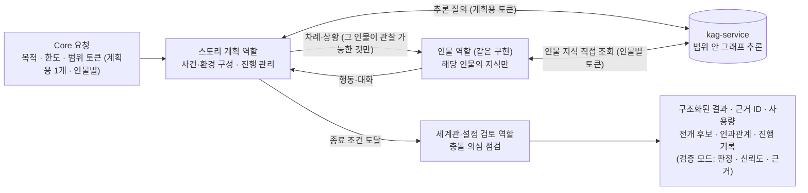
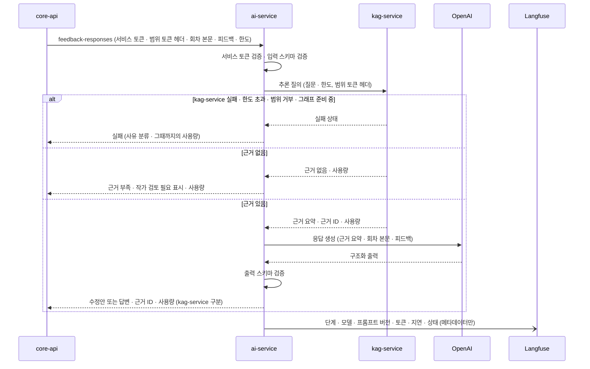

> **보관 문서(2026-10-30):** KAG·lakeFS·Neo4j를 전제로 한 이전 설계안입니다. MVP는 [DEC-16](../../../decisions.md#결정-목록)에서 MVP용 RDB 저장 방향을 검토하며, 새 설계는 [docs/design](../../../design.md)에 있습니다. 이 문서는 비교·후속 검토용으로만 보관합니다.

# ai-service (`storyfork-ai-service`)

> 상위 문서: [시스템 아키텍처](../design.md). 상태 표기는 [표기](../design.md#표기)를 따릅니다. 이 서비스에 kag-service를 합칠지는 [V-01](../design.md#검증-과제) 결과로 정합니다([V-01과의 관계](#v-01과의-관계)).

## 목적과 한 줄 정의

**Core가 맡긴 생성 작업을 처리해 제안을 돌려주는 무상태 서비스입니다.** 설정 근거가 필요하면 kag-service에 범위 토큰과 질문을 보내 근거 요약·근거 ID를 받고, 그 근거와 Core가 보낸 입력만으로 제안을 만듭니다(`채택`). 저장소 계정이 없고, 요청이 끝나면 실행 중 데이터를 남기지 않습니다(F-OPS-04).

## 책임과 하지 않는 일

| 하는 일 | 하지 않는 일 |
|---|---|
| 모더레이션, 협업 집필 제안, 설정·개연성 검토, 피드백 응대, 다중 인물 시뮬레이션·스토리 오류 검증, 자율 연재 회차 생성 | DB·lakeFS·Neo4j·객체 저장소 접근(계정 없음) |
| 설정 근거가 필요할 때 kag-service에 질의(범위 토큰은 헤더로 전달만) | knowledge-service 직접 호출, 그래프 직접 검색 |
| 구조화된 제안·근거 ID·사용량(kag-service 사용량 합산) 반환 | Core 역호출, 정본 수정, 권한·승인·발행·과금 확정 |
| Langfuse에 메타데이터만 기록 | 범위 토큰을 만들거나 바꾸기, 범위 토큰을 프롬프트·문맥·로그에 넣기 |
| 출력 스키마 검증과 명시적 오류 반환 | 피드백 유형 분류, 자율 연재 일정·중지 판단, OpenAI 외 provider·규칙 기반 fallback |

설정 추출 후보 생성(UC-04)은 kag-service로 옮겼습니다(`채택`, 기존 `제안`의 ai-service `extractions` 대체).

## 기술 스택

| 항목 | 내용 | 상태 |
|---|---|---|
| 런타임 | Python 3.11~3.14, FastAPI, Pydantic, Uvicorn | `현재` |
| LLM | LangChain(OpenAI 연동), LangGraph(여러 단계·역할이 실제로 필요할 때만), Langfuse SDK(OTEL 기반 추적, 규칙은 DEC-15) | `합의`(첫 AI 기능 때 `openai-agents` 교체, 교체 전 lockfile 변경 금지) |
| 외부 API | OpenAI LLM·모더레이션 모델(예: `omni-moderation-latest`)·이미지 생성 모델(일러스트, MVP 제외) | `확정` |
| 근거 질의 | kag-service 내부 HTTP 클라이언트 | `채택` |

## 내부 구조

`router → service → (여러 단계·역할이 실제로 필요할 때만 LangGraph 그래프) → LangChain OpenAI 모델`(`확정`). 단일 호출로 끝나는 기능은 그래프 없이 직접 호출합니다. 범용 오케스트레이터·handoff·큐·worker는 두지 않습니다. 근거가 필요한 기능의 service는 kag-service 클라이언트를 직접 씁니다.

kag-service 질의를 LLM 도구 호출로 노출할지, service 코드가 정해진 시점에 부를지는 기능마다 정합니다(`제안`). 어느 경우든 LLM이 고를 수 있는 것은 질문 내용뿐이고, 범위 토큰·한도는 service 코드가 붙입니다. 기존 [Agent 구현 경계](../../../../../backend/ai-service/docs/agent-structure.md)의 "tool 없음"과의 관계는 [후속 문서 갱신](../design.md#후속-문서-갱신-필요) 대상입니다.

### 기능 구성 (`제안`)

| 기능 | 처리 | 쓰는 역할 | LangGraph | kag-service 질의 | 호출 UC | 상태 |
|---|---|---|---|---|---|---|
| 모더레이션 | 댓글·제보·생성 회차·회차 본문 신고의 유해 콘텐츠 1차 판정 | — (모더레이션 모델) | 없음 | 없음(해당 글만) | UC-14, UC-18, UC-20 A5 | MVP |
| 다중 인물 시뮬레이션 | 사건 구성 → 인물별 행동·대화 반복 → 전개 후보·인과·충돌 의심 | 스토리 계획, 인물, 세계관·설정 검토 | 사용 | 계획: 추론 질의(계획용 토큰), 인물: 직접 조회(인물별 토큰) | UC-09 | MVP |
| 스토리 오류 검증 | 독자 공개 범위로 시뮬레이션해 오류 가능성·신뢰도·근거 | 스토리 계획, 인물, 세계관·설정 검토 | 사용(시뮬레이션과 같은 그래프, 검증 모드) | 위와 같음(독자 공개 범위 토큰) | UC-09 A5 | MVP |
| 협업 집필 | 장면 제안·대화문·원고 초안·문장 개선 | 집필 및 피드백 응대 | 없음 | 필요한 설정만 직접 조회 또는 추론 질의 | UC-11 | MVP |
| 설정·개연성 검토 | 충돌 의심·창작적 해석·문맥 한계 분류와 근거 | 세계관·설정 검토 | 구현 시 판단(다단계 대조가 필요하면 사용) | 추론 질의 | UC-12 | MVP |
| 피드백 응대 | 근거 찾기 → 단순 오류 수정안 또는 질문 답변, 근거 부족 표시 | 세계관·설정 검토 → 집필 및 피드백 응대 | 구현 시 판단(2단계 순차 호출로 충분하면 그래프 없음) | 추론 질의(독자 공개 범위 토큰) | UC-15 | MVP |
| 자율 연재 회차 생성 | 허용 범위·허용 독자 반응으로 다음 회차 초안 | 스토리 계획, 집필 및 피드백 응대 | 구현 시 판단 | 추론 질의 | UC-18 | MVP |
| 일러스트 생성 | 지정 장면과 작가가 정리한 외형만으로 이미지 | — (이미지 생성 모델) | 없음 | 없음(Core가 외형만 전달) | UC-11 A3 | MVP 제외 |
| 캐릭터 챗 | — | 인물 | — | — | UC-25 | MVP 제외 |

회차 원고 본문·피드백 텍스트·독자 반응처럼 core DB에 있는 입력은 Core가 요청에 담아 보냅니다. kag-service 질의는 세계관 지식(항목·섹션·관계·인물 인지)에만 씁니다. 질의 유형(추론 질의·직접 조회)은 [kag-service 질의 유형](kag-service.md#질의-유형)에 있습니다.

### 에이전트 역할 배치

기획서의 네 에이전트는 서버·클래스 계층이 아니라 **같은 서비스 안의 역할(프롬프트와 구조화 출력 단위)**입니다(`확정`: 인물마다 클래스·서버를 만들지 않음).

| 기획서 역할 | 구현 위치 | 입력 경계 |
|---|---|---|
| 인물 에이전트 | 시뮬레이션 그래프의 인물 노드 하나. 인물별 문맥만 바꿔 주입 | 해당 인물이 기준 시점에 아는 사실·성격·목표·기억·능력만. 인물마다 시점 인물을 담은 별도 범위 토큰으로 kag-service 직접 조회(인물 지식)만 함 |
| 스토리 계획 에이전트 | 시뮬레이션 그래프의 계획 노드, 자율 연재 생성 | 사건·환경·진행 조건. 설정 사실이 필요하면 계획용 토큰으로 kag-service에 추론 질의. 검증 모드에서는 독자 공개 범위 토큰만 |
| 세계관·설정 검토 에이전트 | 설정 검토·시뮬레이션 결과 점검·피드백 근거 찾기 | 목적별 범위 토큰 안의 kag-service 결과 |
| 집필 및 피드백 응대 에이전트 | 협업 집필·피드백 응답 구성·자율 연재 원고 | 목적별 범위 토큰 안의 kag-service 결과. 피드백은 독자가 본 회차까지 공개 근거만 |

ai-service의 계획 노드는 **이야기 진행**(사건·차례·종료 조건)을 계획합니다. 설정 질문을 검색 단계로 나누는 일은 kag-service의 논리 형식 계획기가 합니다. 두 계획을 섞지 않습니다.

### 시뮬레이션 그래프 (`제안`)

- 인물 노드는 다른 인물의 지식을 받지 않습니다. 인물별 토큰은 그 인물만 시점 인물로 담고 허용 작업이 인물 지식 조회뿐이므로, 인물 노드가 다른 인물의 비밀을 검색할 경로가 없습니다. 계획 노드가 인물에게 넘기는 상황도 그 인물이 관찰할 수 있는 사건으로 제한합니다(BR-02, F-SIM-04).
- 실행 중 생긴 임시 기억·관계 변화는 응답에만 담기고 ai-service에 남지 않습니다. 정본 반영은 사용자가 Core에서 채택할 때만 일어납니다(UC-09 최소 보장).
- 인물 수·진행 횟수·분량 한도는 `미정`(UC-09, D-16)입니다. Core가 요청에 한도를 담아 보내고 ai-service는 그 안에서만 실행합니다. kag-service 질의 한도도 이 한도에서 나눠 씁니다.

### 공통 처리 규칙 (`확정`·`채택`·`제안`)

- 입출력은 기능별 구조화 스키마(Pydantic)로 검증합니다. 모델 출력이 스키마를 어기면 임의 보정하지 않고 오류로 돌려줍니다(`확정`).
- 응답에는 제안 본문, 근거 참조(kag-service 결과의 항목·섹션 ID와 Core가 보낸 회차·구절 ID), 사용량(모델·입력·출력 토큰, kag-service 사용량 구분), 결과 상태를 담습니다(`제안`). 사용량은 Core 정산의 입력일 뿐 금전성 원장이 아닙니다(`확정`).
- 범위 토큰은 HTTP 헤더로 받고 kag-service에 헤더로 그대로 넘깁니다. 내용을 바꾸거나 새로 만들지 않고, 프롬프트·LLM 문맥·Langfuse·로그에 넣지 않습니다(`채택`).
- kag-service가 "근거 없음"을 돌려주면 그대로 근거 부족으로 표시합니다. 실패를 근거 없음으로 바꾸지 않습니다.
- 사용자 식별자·연락처·작성자 정보는 받지 않습니다. 추적 상관에는 Core가 보낸 W3C `traceparent`와 AI 작업 ID만 씁니다(`채택`, DEC-15).
- 피드백 유형을 분류하지 않고, 제안 생성을 반영 완료로 표현하지 않습니다(`확정`).

## 소유 데이터와 저장소

없습니다. 저장소 계정이 없고, 요청이 끝나면 시뮬레이션 상태 등 실행 중 데이터를 남기지 않습니다(F-OPS-04). 추적 메타데이터는 Langfuse에 기록합니다.

## 제공 API

core-api → ai-service, 접두어 `/internal/v1`. 경로는 **가칭**입니다.

| 범주(가칭 경로) | 기능 | 호출 모듈 | 범위 토큰 | 시간 제한 기준(UC-21) |
|---|---|---|---|---|
| `health` | 내부 상태 | `_health_ai_service` | 없음 | `현재`(Core 읽기 12초 설정) |
| `moderations` | 유해 콘텐츠 1차 판정 | `feedback`, `serialization`, `report` | 없음 | `미정` |
| `simulations` | 다중 인물 시뮬레이션, 스토리 오류 검증 모드 | `assist`, `feedback` | 계획용 1개 + 인물별 | 10분 |
| `writing-suggestions` | 장면·대화·초안·문장 개선 | `assist` | 작가 범위 | 3분 |
| `reviews` | 설정·개연성 검토 | `assist` | 작가 범위 | `미정` |
| `feedback-responses` | 단순 오류 수정안·질문 답변 | `feedback` | 독자 공개 범위 | 2분 |
| `serial-episodes` | 자율 연재 다음 회차 생성 | `serialization` | 작가 범위 | 10분 |

- 기존 `extractions`(설정 추출)는 kag-service로 옮겼습니다([kag-service 제공 API](kag-service.md#제공-api)).
- **요청 공통 요소:** AI 작업 ID(추적 상관·중복 방지), 목적, Core가 보내는 core DB 입력(회차 원고·피드백 텍스트·허용 독자 반응 등 필요한 범위만), 생성 한도(최대 토큰·kag-service 질의 수·추론 단계 등 Core가 정한 상한), 시간 제한. 헤더: 서비스 토큰, 범위 토큰(근거가 필요한 작업), 상관 ID(W3C `traceparent`, DEC-15). 사용자 식별 정보는 넣지 않습니다(`제안`).
- **응답 공통 요소:** 구조화된 제안, 근거 참조, 사용량(ai-service 모델 사용량과 kag-service 사용량 구분), 결과 상태(성공·근거 부족·실패 사유 분류). Core는 근거 ID를 knowledge-service로 다시 확인합니다.

## 호출하는 대상

| 대상 | 용도 | 인증 |
|---|---|---|
| kag-service(`reasoning`·`lookups`) | 설정 근거 질의 | 범위 토큰(헤더 전달) |
| OpenAI | LLM·모더레이션·이미지 생성 | OpenAI 키(이 런타임에만) |
| Langfuse | 추적 메타데이터(Langfuse web 수집 엔드포인트만. Langfuse 묶음은 별도 llmops 프로젝트이며 연결 방식은 `미정` D-40. Langfuse 전용 Redis·ClickHouse에는 접속하지 않음) | Langfuse 키 |

knowledge-service·Core는 호출하지 않습니다([허용 호출 방향](../design.md#허용-호출-방향)).

## 인증·보안

- **호출자 확인:** Core의 서비스 토큰을 Core 공개키로 검증합니다(`채택`). 내부 네트워크 전용이며 호스트 포트를 공개하지 않습니다(`현재` 규칙 유지).
- **범위 토큰:** 검증 주체는 kag-service·knowledge-service이고 ai-service는 전달만 합니다. 토큰 없이 kag-service를 부를 수 없고, 토큰을 바꿀 수 없으므로 ai-service가 범위를 넓힐 경로가 없습니다.
- **LLM 입력:** 범위 토큰·서비스 토큰을 프롬프트·문맥에 넣지 않습니다. 원고·피드백·방향 입력은 지시가 아닌 데이터로 구분해 전달합니다. 모델에는 저장소 쓰기 권한이 없고 출력은 제안일 뿐이므로, 주입된 지시가 정본·권한·과금·검색 범위를 바꿀 수 없습니다.
- **LLM 관련 위험:**

| 위험 | 대응 |
|---|---|
| 원고·피드백에 섞인 지시(프롬프트 주입) | 입력을 데이터로 구분. 저장소 쓰기 권한 없음. 출력은 스키마 검증 후 제안으로만 저장 |
| 비공개 정보·스포일러 누설 | 범위 밖 지식은 kag-service 결과에 오지 않음(knowledge-service 집행). Core가 근거를 재검증. 정보 누설 표본 검사는 MVP 이후(UC-26 A3) |
| 지어낸 인용 | 근거는 kag-service 결과 ID와 Core가 보낸 회차·구절 ID로만 참조. 범위 밖이면 Core가 실패 처리 |
| 과도한 비용 | 요청별 생성 한도와 상한, kag-service 질의 한도, 사용자·전체 속도 제한(Core) |

## 이 서비스 관점의 주요 흐름

### 근거가 필요한 작업 하나 (피드백 응대 예)

### 근거가 필요 없는 작업 (모더레이션)

Core가 해당 글 텍스트만 보내고 범위 토큰은 없습니다. ai-service는 모더레이션 모델을 한 번 호출해 판정만 돌려줍니다. 호출이 실패하면 실패로 돌려주고, Core가 그 글을 `필터 대기`로 둡니다.

## 실패 처리

| 상황 | ai-service가 돌려주는 것 | 비고 |
|---|---|---|
| 서비스 토큰 없음·위조·만료 | 거부 | Core 설정 오류이므로 운영 경고 대상 |
| 입력 스키마 위반 | 거부 | — |
| kag-service 실패(범위 거부·연결 불가·시간 초과·한도 초과·그래프 준비 중) | 실패와 사유 분류. 빈 근거로 바꿔 계속 진행하지 않음 | Property 29 |
| kag-service "근거 없음" | 근거 부족 결과(실패 아님) | 피드백 응대는 작가 검토 필요 표시 |
| OpenAI 오류·시간 초과·안전 정책 거부 | 실패와 사유 분류 | 대체 결과를 만들지 않음 |
| 모델 출력 스키마 위반 | 실패 | 임의 보정 금지 |
| Langfuse 기록 실패 | 작업은 계속하고 결과는 바꾸지 않음. 짧은 전송 시간 제한으로 작업을 붙잡지 않고, 실패는 서비스 로그·운영 지표에 남김 | UC-26 E1, Property 33 |

## 관측성

- Langfuse에 작업 ID·작업 유형·LangGraph 단계·모델·프롬프트 버전·토큰·지연·비용·결과 상태를 기록합니다(`확정`, MVP는 추적만). kag-service 단계는 kag-service가 같은 작업 ID로 따로 기록합니다(`제안`).
- 원고 원문·작가 비공개 설정·개인정보·비밀값·범위 토큰은 기록하지 않습니다(`확정`).
- **추적 규칙(`채택`, DEC-15):** [공통 계약: 관측성](../design.md#공통-계약-관측성)의 규칙을 따릅니다.
  - Langfuse SDK + OTEL로 계측하고, span 이름 허용 목록에 있는 span만 내보냅니다.
  - 마스킹으로 입력·출력 본문 속성과 예외 속성을 지우고 사용량 속성은 남깁니다(Property 32).
  - Core가 보낸 W3C `traceparent`는 형식만 검증해 이 서비스 span의 부모로 연결하고, baggage·임의 속성은 받지 않습니다. kag-service를 부를 때 이 서비스의 `traceparent`를 헤더로 넘깁니다.
  - 전송 시간 제한을 짧게 둡니다(출발값은 GovBiz와 같은 2초). 전송 실패는 작업 결과를 바꾸지 않고 서비스 로그·운영 지표에 남깁니다(Property 33).
- 사용량은 ai-service 자신의 것과 kag-service가 돌려준 것을 구분해 Core에 보냅니다.

## 설정·비밀값

| 설정 | 내용 | 상태 |
|---|---|---|
| `OPENAI_API_KEY`·`OPENAI_MODEL` | OpenAI 키·모델. 이 런타임과 kag-service에만 | `현재`(예약), 범위 `채택` |
| Langfuse 키·주소·전송 시간 제한 | 추적 기록. 시간 제한은 짧게(출발값 2초, DEC-15) | `합의`, 시간 제한 `채택` |
| kag-service 주소·시간 제한 | 근거 질의 | `제안`, 변수 이름 `미정` |
| Core 공개키 | 서비스 토큰 검증 | `채택`, 배포 방식 `미정`(D-23) |
| 받지 않는 것 | 저장소 자격 증명, 토큰 서명 개인키 | `채택` |

## V-01과의 관계

V-01은 kag-service를 이 서비스에 합쳐도 잘 작동하는지 시험합니다(사용자 요청, 미실행). 결과에 따라 이 서비스의 구조가 아래처럼 바뀝니다.

| 시험안 | 이 서비스의 변화 | 지켜야 할 것 |
|---|---|---|
| (a) KAG 포크를 패키지로 포함 | kag-service 클라이언트 대신 KAG solver를 프로세스 안에서 호출. knowledge-service 범위 검색 API를 직접 호출(새 호출 방향 ai-service → knowledge-service) | 의존성 충돌 해소(KAG 고정 버전 해제 시 20개 버전 변경), KAG 테스트 통과, ai-service 지침의 LLM wrapper 제한 개정 |
| (b) LangGraph로 KAG 방식 직접 구현 | 계획 노드 → knowledge-service 범위 검색 도구 → 판단 노드를 이 서비스의 LangGraph로 구현. KAG 프롬프트·검색 조합은 참고만 하고 Apache 2.0 고지를 지킴 | 범위 토큰은 도구 호출 헤더로만, 쿼리 문자열 생성 금지 |
| 실패하면 | 분리 유지. 이 문서의 현재 설계 그대로 | — |

어느 경우든 범위 집행은 knowledge-service가 하고, 범위 토큰은 LLM 입력에 들어가지 않습니다. 비교 기준과 근거는 [검증 과제](../design.md#검증-과제)와 [decisions.md](../decisions.md#r-06-kag-의존성-해석)에 있습니다.

## 관련 정확성 속성

[Correctness Properties](../design.md#correctness-properties) 중 ai-service가 담당하거나 함께 지키는 것: Property 5(무상태), 10·11(독자 공개 범위·인물 지식 분리), 20(키·관측 데이터 경계), 27(저장소 미변경), 28(동시 요청 격리), 29(실패 전파), 32(span에 본문·범위 토큰 없음), 33(Langfuse 전송 실패가 결과를 바꾸지 않음).

## 위험·미정

- D-09(호출 경로가 길어져 긴 작업의 지연·실패 지점 증가), D-14(장편 원고 본문 축약), D-16(시뮬레이션 한도 값), D-37(한국어 처리, kag-service와 함께).
- kag-service 근거 요약이 제안 생성에 필요한 세부를 잃을 수 있습니다. 요약 대신 섹션 본문 일부를 받을지는 V-01·V-02 결과로 정합니다(`미정`).
- 전체 목록은 [위험·미정 총괄](../design.md#위험미정-사항과-후속-결정)에 있습니다.
