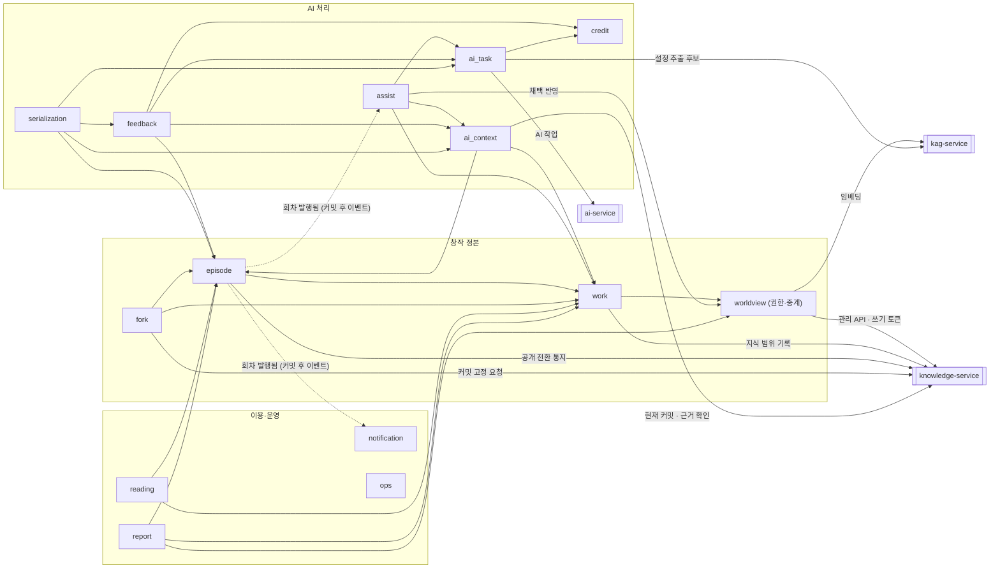
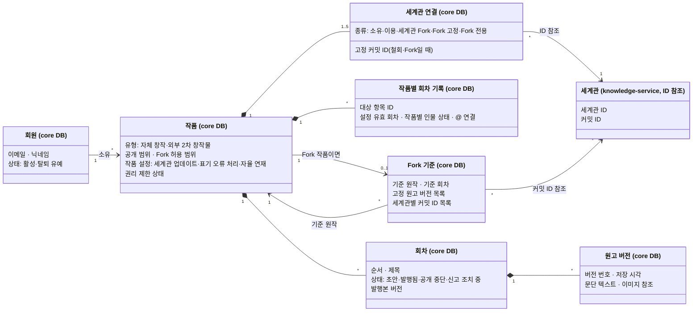
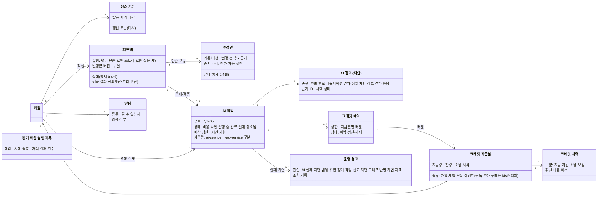
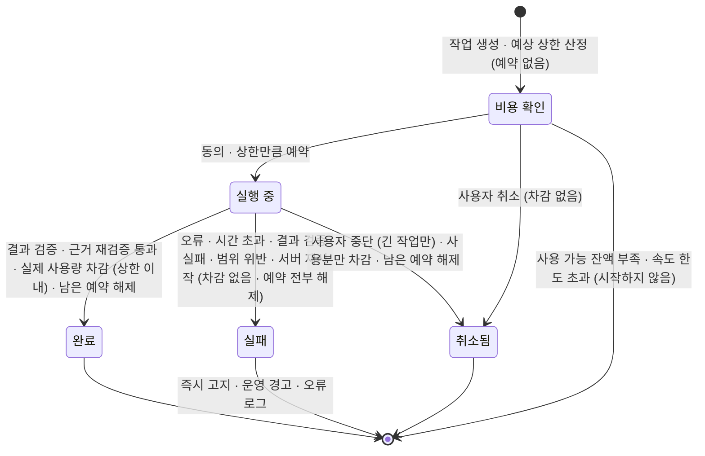
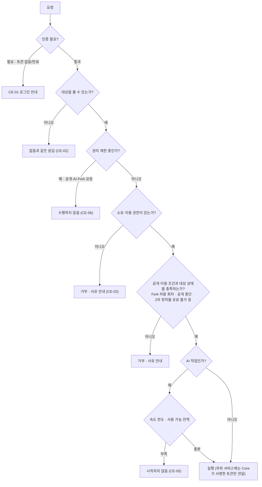
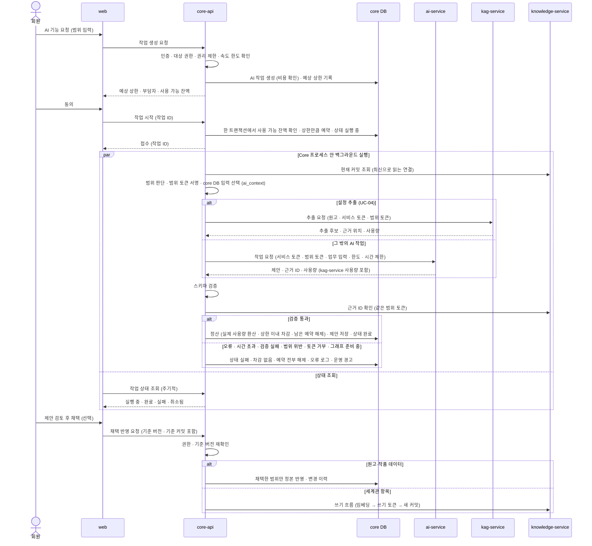
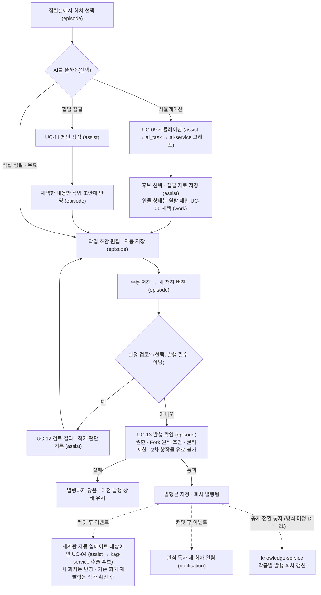
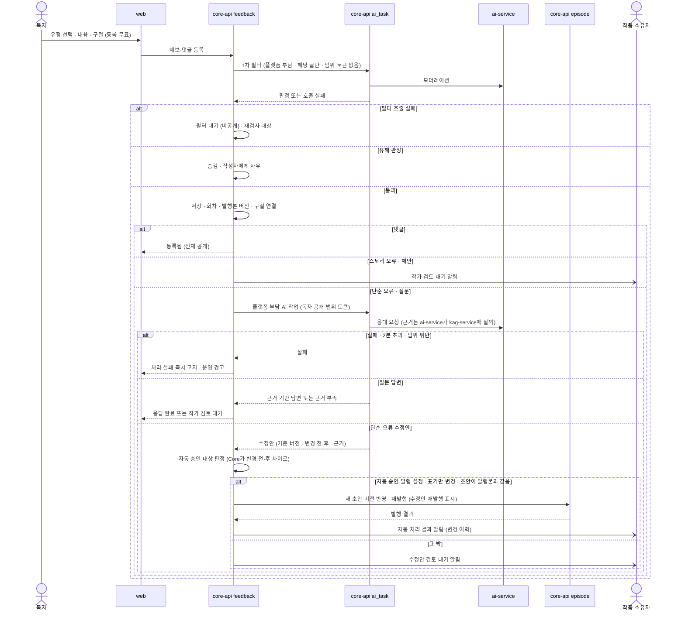
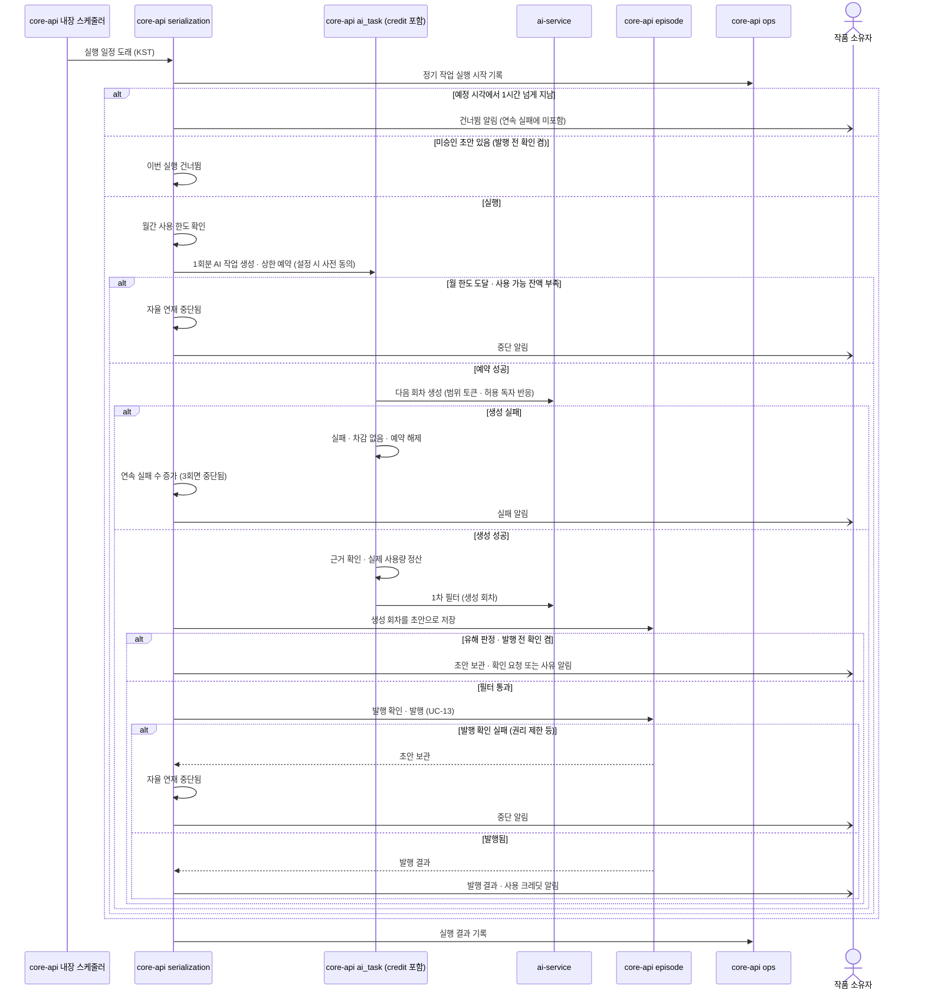

> **보관 문서(2026-10-30):** KAG·lakeFS·Neo4j를 전제로 한 이전 설계안입니다. MVP는 [DEC-16](../../../decisions.md#결정-목록)에서 MVP용 RDB 저장 방향을 검토하며, 새 설계는 [docs/design](../../../design.md)에 있습니다. 이 문서는 비교·후속 검토용으로만 보관합니다.

# core-api (`storyfork-core-api`)

> 상위 문서: [시스템 아키텍처](../design.md). 상태 표기는 [표기](../design.md#표기)를 따릅니다. 서비스 간 토큰·범위 집행·실패 전파 규칙은 [공통 계약](../design.md#components-and-interfaces)에 있고, 이 문서는 core-api 쪽 책임만 다룹니다.

## 목적과 한 줄 정의

**업무 정본과 모든 인증·권한·과금 판단의 주인입니다.** 사용자를 인증하는 유일한 서비스이며, 하위 서비스가 믿는 토큰(서비스·쓰기·범위 토큰)에 서명하는 유일한 서비스입니다(`채택`). 세계관 정본은 knowledge-service로 옮겼고(`채택` — 기존 `확정`(Core가 세계관 정본 소유, [AGENTS.md](../../../../../AGENTS.md) 서비스 책임) 대체, 팀 재결정 필요), Core에는 세계관 권한 판단과 knowledge-service 호출만 남습니다.

## 책임과 하지 않는 일

| 하는 일 | 하지 않는 일 |
|---|---|
| 사용자 인증, 사용자 접근 토큰·갱신 토큰 발급(브라우저 ↔ Core만) | 사용자 토큰을 하위 서비스로 전달 |
| 대상별 권한·공개·이용 조건·권리 제한 판단. 세계관 권한도 Core가 판단 | 세계관 정본 저장, knowledge DB·lakeFS·Neo4j 직접 접근 |
| 업무 정본 저장: 계정, 작품, 회차·원고 버전·발행, 작품 Fork 기준(세계관 커밋 ID 기록), 크레딧, 피드백·수정안, 자율 연재, 신고, 알림, 운영 기록, AI 작업 | LLM 호출, OpenAI 키 보유 |
| 범위 판단 → 범위 토큰 서명 → AI 결과 근거 ID 재검증 | 문맥 본문을 직접 조립해 세계관 지식을 보내는 것(세계관 지식은 kag-service가 범위 안에서 검색) |
| 세계관 쓰기 조율: 권한·기준 커밋 확인 → 임베딩 요청 → 쓰기 토큰과 함께 knowledge-service에 반영 요청 | AI 결과를 검증 없이 정본·과금 결과로 취급 |
| AI 작업 수명주기, 크레딧 예약·정산(ai-service·kag-service 사용량 합산) | 실패를 성공 차감으로 숨김 |
| 원고 이미지 저장(객체 저장소, Core 소유 버킷), 인증 메일 발송, 내장 스케줄러 정기 작업 | 외부 원본 JSON·예외를 공개 API에 노출 |

## 기술 스택

| 항목 | 내용 | 상태 |
|---|---|---|
| 런타임 | Kotlin 2.4, Spring Boot 4.1(webmvc·restclient·validation), Jackson Kotlin, JDK 21 | `현재` |
| 업무 DB | PostgreSQL core DB. core-api 전용 인스턴스 core-postgres(core-data 내부 네트워크) | `채택` — 기존 `미정`(D-01 제품 선택) 해소. 인스턴스 분리는 DEC-13 |
| 스키마 마이그레이션 | Flyway. 버전 파일은 core-api 안에 두고 core DB 스키마만 바꿈 | `채택`(DEC-13, D-01 해소). 새 의존성이므로 도입 전 공유 |
| 스케줄러 | Spring 내장 스케줄러. 별도 worker·큐 없음, 일정은 KST | `합의` |
| 구현 요소 | JWT 처리·토큰 서명, DB 접근, S3·SMTP 클라이언트 | 라이브러리 선택 `미정`(새 production 의존성은 도입 전 공유) |

## 내부 구조

패키지 `ai.storyfork.core` 아래 기능 디렉터리입니다. 각 기능 안에서 `controller → service → repository` 또는 `controller → service → (선택적 facade) → client`를 씁니다. 공개 계약은 `controller/dto`, 외부 계약은 `client/dto`, 내부 결과는 `service/dto`, 업무 모델은 `domain`에 둡니다. 폴더는 해당 기능을 구현할 때만 만듭니다(`확정`, [Core API 지침](../../../../../backend/core-api/AGENTS.md)).

### 기능 모듈 (가칭, `제안`)

| 모듈 | 책임 | 주요 UC | 소유 데이터 | 외부 접근 |
|---|---|---|---|---|
| `account` | 가입·이메일 인증·로그인·JWT 발급·갱신 토큰 회전·기기 관리·비밀번호 재설정·탈퇴 유예 | UC-22 | 회원, 인증 기기(갱신 토큰), 인증·재설정 토큰 | SMTP |
| `worldview` | 축소 모듈(`채택`). 세계관 공개 API를 받아 권한을 판단하고 knowledge-service 관리 API로 중계합니다. 소유·이용·세계관 Fork·조합·장르 기본 복제 허용과 권리 제한을 판단하고 쓰기 토큰을 발급합니다. 세계관 쓰기 조율(최신 커밋 확인 → 임베딩 요청 → 반영 요청)을 맡습니다. 판단 근거인 세계관 메타데이터(소유자·공개·이용·Fork 조건)는 knowledge-service에서 읽습니다 | UC-02, UC-05, UC-07(세계관) | 없음 | knowledge-service, kag-service(임베딩) |
| `work` | 작품 생성·세계관 1~5개 연결 규칙, 작품 설정(세계관 업데이트·표기 오류 처리·자율 연재 켬/끔), 작품 공개·Fork 허용 조건, 지식 범위와 무관한 작품별 회차 기록(설정 유효 회차·작품별 인물 상태·`@` 연결·타임라인·보드·개요·메모), 공유 저작물 등록. 지식 범위용 기록은 knowledge-service에 요청(`제안`, D-31) | UC-06(시점), UC-07(작품), UC-23, UC-24 | 작품, 세계관 연결(연결 종류·고정 커밋 ID), 작품 설정, 지식 범위 외 회차 기록 | knowledge-service |
| `episode` | 회차·작업 초안·저장 버전·발행본 지정, 발행 확인(권한·Fork 원작 조건·권리 제한·2차 창작물 유료 불가), 공개 중단, 원고 가져오기(`.txt`·`.epub`)·내보내기, 원고 이미지, 발행 시 공개 전환 통지 | UC-03, UC-10, UC-13 | 회차, 원고 버전, 이미지 메타데이터 | 객체 저장소, knowledge-service |
| `fork` | Fork 자격 판단(원작만·독자당 1회·허용 회차·권리 제한), 고정본 생성(원고 버전은 Core에 기록, 세계관 커밋 고정과 지식 범위 기록 사본은 knowledge-service에 요청), Fork 기준 저장, 원작 변화 표시(삭제된 원작·비공개 원작) | UC-08 | Fork 기준(원고 버전·세계관별 커밋 ID) | knowledge-service |
| `reading` | 공개 작품·회차 열람, 검색(MVP: DB), 좋아요·관심 소설·이어 읽기·조회수 | UC-01 | 좋아요, 관심, 이어 읽기, 조회 집계 | — |
| `ai_context` | 재정의(`채택`). **범위 판단 → 범위 토큰 서명 → 결과 근거 ID 재검증.** 목적별로 세계관 목록·세계관별 고정 커밋·작품 ID·독자 공개 기준 회차·시점 인물·허용 작업을 정해 토큰에 담고, AI 결과의 근거 ID가 범위 안인지 knowledge-service로 확인합니다. 업무 DB 입력(원고·피드백 텍스트 등)의 선택도 맡습니다. 세계관 지식 본문을 직접 조립하지 않습니다 | UC-04, 09, 11, 12, 14, 15, 18 공통 | 없음(토큰은 저장하지 않음, 발급 기록은 `ops` 로그) | knowledge-service(현재 커밋 조회·근거 확인) |
| `ai_task` | AI 작업 공통 수명주기(비용 확인 → 실행 중 → 완료/실패/취소됨), 견적·동의·예약·정산 호출, ai-service 호출, 설정 추출 후보 요청(kag-service, `제안`), 작업 유형별 시간 제한, 결과 구조 검증, 사용량 합산 | CE-04, UC-17, UC-21 | AI 작업 | ai-service, kag-service |
| `credit` | 크레딧 지급분·예약·정산·소멸·보상 지급, 사용자별·전체 속도 제한 | UC-17 | 크레딧 지급분, 예약, 크레딧 내역 | — |
| `assist` | 설정 추출·시뮬레이션·협업 집필·설정 검토의 요청과 결과(추출 후보·집필 재료·검토 판단) 보관, 채택 항목만 정본 반영(세계관 항목은 `worldview`의 쓰기 조율로), 자동 설정 추출 | UC-04, UC-09, UC-11, UC-12 | 추출 후보, 시뮬레이션 결과, AI 제안, 검토 결과 | — |
| `feedback` | 댓글·제보 등록, 1차 필터 상태(필터 대기·숨김·복원), 응대 요청, 수정안, 표기 오류 자동 승인 판정(변경 전·후 차이), 검토 대기 목록, 반영 보상 요청 | UC-14, UC-15, UC-16 | 피드백, 수정안 | — |
| `serialization` | 자율 연재 설정·상태(꺼짐·실행 중·일시 중지·중단됨), 1회 실행, 연속 실패·월 한도 판단 | UC-18 | 자율 연재 설정·실행 기록 | — |
| `report` | 권리·유해 콘텐츠 신고, 조치 적용(대상 모듈 서비스 호출, 세계관 대상은 `worldview`를 거쳐 knowledge-service에 제한 상태 요청), 소명·기한, 허위 신고 제한 | UC-20 | 권리 신고·조치·소명 기록 | — |
| `notification` | 알림 생성(설정에서 끈 종류 제외), 알림함, 읽음, 알림 설정 | UC-27 | 알림, 알림 설정 | — |
| `ops` | 운영 경고·오류 로그(90일), 정기 작업 실행 기록, 운영 화면 조회, 이벤트 크레딧 지급 요청, 하위 서비스 Health·그래프 반영 지연 조회 경고(`제안`) | UC-21, UC-26(조회), UC-28 | 운영 경고, 오류 로그, 정기 작업 실행 기록 | 하위 서비스 Health·상태 API |

`_common`에는 기존 HTTP 설정·오류 격리·CORS에 더해, 둘 이상의 모듈이 실제로 쓰는 것만 추가합니다(`제안`): 인증 필터(사용자 접근 토큰 검증), 요청 상관 ID, 토큰 서명(`ai_context`·`worldview`·`fork`·`ai_task`가 사용), knowledge-service Client(`worldview`·`work`·`episode`·`fork`·`ai_context`가 사용), kag-service Client(`worldview`·`ai_task`가 사용). UC-19 저장 공간 관리, UC-25 캐릭터 챗, 구독·추가 구매는 MVP 제외이므로 모듈을 만들지 않습니다.

**`ai_context`를 별도 모듈로 두는 이유:** 같은 정보 범위 규칙(BR-02·BR-04·BR-10)을 7개 이상의 유스케이스가 쓰고, 이 규칙이 비공개 정보 유출을 막는 보안 경계입니다(DP-10의 공통화 조건 충족). 범위를 한곳에서 정해 토큰으로 만들고, 집행은 knowledge-service가 합니다. 호출 모듈이 각자 범위를 정하면 규칙이 흩어집니다.

**`worldview` 모듈을 남기는 이유:** 세계관 공개 API의 진입점과 권한 판단은 Core에 있어야 하고(DP-12), 세계관 쓰기는 임베딩 요청과 쓰기 토큰 발급을 함께 조율해야 합니다. 정본은 갖지 않습니다.

### 모듈 의존 관계 (`제안`)

- 화살표는 호출 방향입니다. 순환 의존은 두지 않습니다. 모든 모듈은 `notification`(알림 생성)과 `ops`(경고·오류 로그·작업 실행 기록)를 호출할 수 있으며 그림에서는 생략했습니다. `notification`·`ops`는 다른 업무 모듈을 호출하지 않습니다. 하위 서비스는 Core를 호출하지 않습니다.
- **세계관 쓰기 경로는 하나:** 직접 편집(공개 API)과 AI 후보 채택(`assist`)이 모두 `worldview`의 쓰기 조율을 거칩니다. 흐름은 [쓰기: 승인한 세계관 변경 반영](../design.md#쓰기-승인한-세계관-변경-반영)에 있습니다.
- **권리 제한 상태:** `report`가 조치를 정하면 대상 모듈(`work`·`episode`)의 서비스 또는 `worldview`(knowledge-service에 제한 상태 요청)로 대상의 제한 상태를 바꿉니다. 대상 모듈은 자기 데이터의 제한 상태만 읽으므로 `report`를 호출하지 않습니다.
- **발행 후 처리:** 회차 발행 트랜잭션이 커밋된 뒤 프로세스 안의 이벤트(Spring 애플리케이션 이벤트)로 `assist`(세계관 자동 업데이트 대상이면 UC-04)와 `notification`(관심 독자 새 회차 알림)에 알립니다. 새 인프라가 아니며, 발행 결과는 후속 처리의 성공 여부와 무관하게 확정됩니다. 후속 처리 실패는 오류 로그·경고·소유자 알림으로 남깁니다. 수정안 반영에 따른 재발행은 이벤트에 "수정안 재발행"을 표시해 UC-04를 시작하지 않습니다(BR-11).
- **공개 전환 통지(`제안`, 방식 `미정` D-21):** 회차 발행으로 독자 공개 기준 회차가 바뀌면 `episode`가 knowledge-service에 "작품 W의 발행 회차가 n이 됨"을 알립니다. 큐는 두지 않으므로 core DB에 통지 outbox 행을 발행과 같은 트랜잭션으로 남기고 커밋 후 호출·재시도하는 방식과, 단순 동기 호출 + 실패 시 재시도 방식 중에서 정합니다. 통지가 늦어도 범위 토큰의 독자 공개 기준 회차는 Core가 정하므로, 늦은 통지가 독자에게 더 많은 정보를 보이게 하지 않습니다.
- **정기 작업:** 규칙을 소유한 모듈이 자기 정기 작업을 정의하고(예: `credit`의 월간 초기화, `account`의 탈퇴 유예 종료, `serialization`의 실행 일정), 실행 시작·건수·결과는 `ops`에 기록합니다. 스케줄러는 Core 프로세스 하나 안에서만 동작합니다(다중 인스턴스 중복 방지는 `미정`, D-11).

## 소유 데이터와 저장소

### 저장 위치

| 데이터 | 저장소 | 소유 모듈 | 상태 |
|---|---|---|---|
| 회원, 인증 기기(갱신 토큰 해시), 인증·재설정 토큰 | core DB | `account` | `제안` |
| 작품, 세계관 연결(연결 종류·고정 커밋 ID), 작품 설정, 공개·Fork 허용 조건 | core DB | `work` | `확정`(작품 소유 데이터는 DB) |
| 작품별 회차 기록 중 지식 범위와 무관한 것(설정 유효 회차·작품별 인물 상태·`@` 연결), 타임라인·보드·개요·메모 | core DB(세계관 항목 ID 참조) | `work` | `확정`. 인물 상태를 지식 범위에 쓸지는 `미정`(D-31) |
| 회차, 작업 초안, 저장 버전, 발행본 지정 | core DB | `episode` | `확정` |
| 원고 이미지 파일 / 이미지 위치·메타데이터 | 객체 저장소(Core 버킷) / core DB | `episode` | `확정`(분리 저장), 저장소 `채택` |
| Fork 기준(기준 원작·회차, 고정 원고 버전, 세계관별 커밋 ID) | core DB | `fork` | 고정 `확정`, 커밋 ID가 lakeFS 커밋인 점은 `채택` |
| 피드백, 수정안 | core DB | `feedback` | `제안` |
| AI 작업, 추출 후보·시뮬레이션 결과·AI 제안·검토 결과 | core DB | `ai_task`·`assist` | `제안` |
| 크레딧 지급분·예약·내역 | core DB | `credit` | `제안`(원장 구조), 정책은 `확정` |
| 자율 연재 설정·실행 기록 | core DB | `serialization` | `제안` |
| 권리 신고·조치·소명(1년 보관) | core DB | `report` | `확정`(보관 기간) |
| 알림(90일), 알림 설정 | core DB | `notification` | `확정`(보관 기간) |
| 운영 경고, 오류 로그(90일), 정기 작업 실행 기록 | core DB | `ops` | `확정`(보관 기간), 위치 `제안` |
| 좋아요·관심 소설·이어 읽기·조회 집계 | core DB | `reading` | `제안` |
| 공개 전환 통지 outbox(방식 D-21에 따라) | core DB | `episode` | `제안` |

세계관 정본·메타데이터·지식 범위 기록·그래프는 [knowledge-service](knowledge-service.md#소유-데이터와-저장소)가 소유합니다. 검색 색인(Elasticsearch)은 MVP 이후 공개 정보만 담는 파생 데이터입니다.

### 개념 모델 ① 작품·회차·Fork

아래는 **개념 모델**입니다. DB 테이블·ERD·코드 클래스가 아닙니다. 업무 개념의 관계는 [도메인 클래스 다이어그램](../../../../../docs/diagrams/class.md)을 따르고, 세계관은 knowledge-service의 ID로만 참조합니다.

### 개념 모델 ② 피드백·AI 작업·크레딧·운영

### 원고·버전 모델

| 개념 | 규칙 | 상태 |
|---|---|---|
| 작업 초안 | 회차마다 하나. 자동 저장은 이것만 갱신하고 버전을 만들지 않음 | `확정` |
| 저장 버전 | 수동 저장 때만 생성, 무기한 보관. 복원은 선택 버전을 새 버전으로 쌓음 | `확정` |
| 발행본 | 저장 버전 중 하나를 가리킴. 재발행은 다른 버전을 가리키게 바꿈. 독자는 발행본만 봄 | `확정` |
| 수정안 기준 | 독자가 본 발행본 버전. 작업 초안이 발행본과 다르면 자동 처리하지 않음 | `확정` |
| Fork 고정 | 기준 회차까지 각 회차의 분기 시점 발행본 버전을 기록. 원작이 고쳐도 새 버전이 생길 뿐 고정 버전은 그대로 | 고정 대상이 발행본이라는 점은 `제안`(작가 미발행 초안은 독자 비공개이므로 제외) |
| 이미지 | 원고 버전에 포함. 파일은 객체 저장소, 위치·메타데이터는 core DB. AI에 보내지 않음 | `확정` |

### 상태 모델

상태 이름과 전이는 [명세 0.4절](../../../../../docs/usecase-spec/README.md#04-처리-상태-이름)과 [상태 다이어그램](../../../../../docs/diagrams/state.md)이 기준입니다. 모두 core DB에 두며, 상태를 바꾸는 모듈은 하나로 정합니다(`제안`).

| 대상 | 상태 | 상태를 바꾸는 모듈 |
|---|---|---|
| 피드백(제보) | 필터 대기 · 숨김 · 접수됨 · 분석 중 · 응답 완료 · 작가 검토 대기 · 수정 진행 중 · 처리 완료 · 보류 · 처리 실패 · 철회됨 | `feedback` |
| 피드백(댓글) | 필터 대기 · 등록됨 · 숨김 | `feedback` |
| 수정안 | 검토 대기 · 승인됨 · 거절됨 · 보류 · 초안 반영됨 · 반영 실패 · 발행 대기 · 발행 완료 · 발행 실패 | `feedback`(초안 반영·발행은 `episode` 결과로 갱신) |
| 회차 | 초안 · 발행됨 · 공개 중단 · 신고 조치 중 | `episode`(신고 조치는 `report` 요청으로) |
| 자율 연재 | 꺼짐 · 실행 중 · 일시 중지 · 중단됨 | `serialization` |
| AI 작업 | 비용 확인 · 실행 중 · 완료 · 실패 · 취소됨 | `ai_task` |

AI 작업과 크레딧 예약은 함께 움직이므로 아래처럼 묶어 정합니다(`제안`, [state.md 5절](../../../../../docs/diagrams/state.md)과 일치).

- 플랫폼 부담 작업(1차 필터, 단순 오류·질문 응대)은 사용자 동의·예약 없이 `실행 중`으로 시작하고 사용량을 플랫폼 부담으로만 기록합니다(`제안`, BR-08).
- 자동 실행(세계관 자동 업데이트, 자율 연재)은 설정할 때 회당 상한에 한 번 동의하고, 매 실행 직전에 1회분만 예약합니다(UC-17 A4).
- 서버가 `실행 중` 작업을 남긴 채 다시 시작되면, 기동 후 시간 초과 감시가 그 작업을 `실패`로 바꾸고 예약을 해제합니다(UC-28, `제안`).

## 제공 API

### 공개 API

web → core-api, 접두어 `/api/v1`. 경로는 자원 범주를 보여 주는 **가칭**입니다. 요청·응답 스키마와 상태 코드는 Low-Level 설계에서 정합니다.

| 범주(가칭 경로) | 주요 기능 | UC | 인증 |
|---|---|---|---|
| `health` | Core·AI 연결 확인 | — | 없음 (`현재`) |
| `auth` | 가입·이메일 인증·로그인·토큰 갱신·로그아웃·비밀번호 재설정 | UC-22 | 일부 없음 |
| `me` | 내 정보·기기·탈퇴, 내 서재(관심·이어 읽기), 내 피드백, 크레딧 잔액·소멸 예정·사용 내역 | UC-01, 14, 17, 22 | 필요 |
| `discover`·`works/{id}`(읽기)·`episodes/{id}`(읽기) | 탐색·검색·작품 상세·회차 열람·좋아요·관심 | UC-01 | 공개 회차는 없음, 나머지 필요 |
| `worldviews` | 세계관·항목·섹션·관계·변경 이력·차이·되돌리기·세계관 Fork·조합·장르 기본 세계관·공개/이용 조건·영향 작품. Core가 인증·권한을 판단하고 쓰기 토큰을 붙여 knowledge-service 관리 API로 중계합니다. 쓰기는 기준 커밋 필수(`채택`) | UC-02, 05, 06, 07 | 필요 |
| `works` | 작품 생성·세계관 연결·작품 설정·공개/Fork 허용 조건·작품별 회차 기록(인물 상태·인지·독자 공개 전환. 지식 범위용 기록은 knowledge-service로 중계, `제안`) | UC-06, 07, 24 | 필요 |
| `works/{id}/episodes` | 회차·작업 초안·저장 버전·복원·발행·공개 중단·가져오기·내보내기·이미지 업로드 | UC-03, 10, 13 | 필요 |
| `works/{id}/forks` | Fork 가능 회차 조회·Fork 생성 | UC-08 | 필요 |
| `ai-tasks` | AI 작업 상태·결과 조회, 동의(시작), 취소 | UC-17 및 AI 기능 공통 | 필요 |
| `works/{id}/assist` | 설정 추출·시뮬레이션·협업 집필·설정 검토 작업 생성, 결과 채택(추출 후보 확정·시뮬레이션 결과 선택·검토 판단 기록) | UC-04, 09, 11, 12 | 필요 |
| `feedback` | 댓글·제보 등록·수정·철회, 스토리 오류 검증 작업 생성, 댓글 신고 | UC-09 A5, UC-14 | 필요(공개 댓글 읽기는 없음) |
| `works/{id}/reviews` | 검토 대기 목록, 수정안 승인·거절·보류·수정 후 승인, 작가 답변, 직접 수정 연결, 숨긴 글 복원 | UC-14 A7, UC-16 | 필요 |
| `works/{id}/serialization` | 자율 연재 설정·시작·일시 중지·재개·종료·실행 기록 | UC-18 | 필요 |
| `notifications` | 알림함·읽음·모두 읽음·알림 설정 | UC-27 | 필요 |
| `reports` | 권리·유해 콘텐츠 신고, 소명 제출·기한 연장 요청 | UC-20 | 필요 |
| `admin` | 경고 목록·오류 로그·정기 작업 상태·수동 재실행, 신고 검토·조치·결정, 숨긴 글 복원, 공유 저작물 등록, 이벤트 크레딧 지급, AI 운영 지표 | UC-20, 21, 23, 26, 28 | 운영자 |

**공통 계약 원칙(`제안`)**

- 오류는 현재처럼 안전한 ProblemDetail로 돌려주고 내부 URL·하위 서비스 원본 오류를 노출하지 않습니다(`현재` 규칙 확장).
- 볼 권한이 없는 대상은 "없음"과 같은 응답으로 처리해 존재 여부를 노출하지 않습니다(CE-02).
- 정본을 바꾸는 요청(초안 저장·채택 반영·수정안 승인·세계관 저장)은 기준 버전(세계관은 기준 커밋)을 함께 보내고, 현재 버전과 다르면 덮어쓰지 않고 충돌로 응답합니다(CE-07).
- 중복 전송으로 두 번 실행되면 안 되는 요청(AI 작업 시작·발행·Fork 생성·제보 등록)은 같은 요청을 한 번만 처리합니다(방식은 Low-Level에서 결정).
- AI 기능 요청은 즉시 결과를 기다리지 않고 AI 작업 ID를 돌려받은 뒤 `ai-tasks`로 상태를 조회합니다(진행 표시 방식 `미정`, D-07).

## 호출하는 대상

| 대상 | 용도 | 인증 | 상세 |
|---|---|---|---|
| ai-service(`/internal/v1`) | 모더레이션·시뮬레이션·집필·검토·피드백 응대·자율 연재 회차 생성 | 서비스 토큰 + 범위 토큰(근거가 필요한 작업) | [ai-service 제공 API](ai-service.md#제공-api) |
| kag-service(`/internal/v1`) | 세계관 쓰기 전 임베딩, 설정 추출 후보 | 서비스 토큰(추출은 범위 토큰도) | [kag-service 제공 API](kag-service.md#제공-api). 직접 호출은 `제안`, 경유 여부 `미정`(D-33) |
| knowledge-service(`/internal/v1`) | 세계관 쓰기·이력·차이·되돌리기·복제·커밋 고정·지식 범위 기록·공개 전환 통지·제한 상태·메타데이터 조회·현재 커밋 조회·근거 확인 | 서비스 토큰 · 쓰기 토큰 · 범위 토큰 | [knowledge-service 관리 API](knowledge-service.md#관리-api) |
| core-postgres(core DB) | 업무 정본. core-data 내부 네트워크로만 접속 | DB 계정(core 전용) | [인프라](infrastructure.md#postgresql-배치) |
| core 객체 저장소(Core 버킷) | 원고 이미지. 비공개 버킷이며 권한 확인 뒤 Core가 전달(프록시 또는 짧은 서명 URL, `미정` D-13). 개발은 core 전용 MinIO 인스턴스(core-data), 배포는 Core 전용 S3 버킷 | 개발: 접근 키, 배포: IAM 역할 | [인프라](infrastructure.md#객체-저장소) |
| SMTP | 인증·보안 메일만. 알림은 사이트 안 알림함만(`확정`) | SMTP 자격 증명 | [인프라](infrastructure.md#환경설정비밀값) |

- **호출 방식(`제안`):** Core가 프로세스 안의 백그라운드 실행으로 ai-service를 동기 HTTP 호출하고, 작업 유형별 읽기 시간 제한을 둡니다. 현재 Core → AI 읽기 시간 제한은 12초 하나(`AI_SERVICE_READ_TIMEOUT`)이므로 작업 유형별 설정이 필요합니다.
- **취소:** 사용자가 긴 작업을 중단할 때 ai-service·kag-service 실행을 멈추고 그때까지의 사용량을 회수하는 방식은 `미정`(D-08)입니다.
- **통신 실패 분류(`현재` 확장):** 연결 불가 503, 시간 초과 504, 잘못된 응답·예상하지 않은 상태 502를 Core 내부 예외로 바꾸고, 사용자에게는 AI 작업 `실패` 또는 안전한 오류로 알립니다. 같은 분류를 kag-service·knowledge-service 호출에도 씁니다.

## 인증·보안

### 인증·세션

| 항목 | 설계 | 상태 |
|---|---|---|
| 로그인 | 이메일·비밀번호, 이메일 인증 후 계정 생성. 소셜 로그인은 추후 | `확정` |
| 토큰 | JWT 접근 토큰 30분, 갱신 토큰 14일. 갱신 때 갱신 토큰도 새로 발급하고 이전 것은 폐기. 폐기된 갱신 토큰이 다시 쓰이면 그 계정의 갱신 토큰을 모두 폐기 | `확정`(기준 값은 보안 검토 후 조정) |
| 서버 측 관리 | 갱신 토큰은 기기별로 서버에 두어 폐기할 수 있게 하고, 원문 대신 해시로 저장 | 서버 관리 `확정`, 해시 저장 `제안` |
| 비밀번호 | 평문 저장 금지. 검증된 적응형 해시 사용(알고리즘은 구현 시 결정) | 평문 금지 `확정`, 방식 `제안` |
| 브라우저 보관 | 토큰 보관 위치와 CSRF·XSS 대응 | `미정`(D-04) |
| 실패 응답 | 계정 존재 여부를 노출하지 않음 | `확정` |
| 로그인 실패 잠금 | 반복 실패 시 잠금 기준 | `미정`(D-04) |

### 하위 서비스용 토큰 발급

- Core만 서비스 토큰·쓰기 토큰·범위 토큰에 서명합니다. 토큰 종류와 내용은 [공통 계약: 인증·토큰](../design.md#공통-계약-인증토큰)에 있습니다(`채택`).
- `ai_context`가 범위 토큰을, `worldview`·`fork`가 쓰기 토큰을, `ai_task`·`worldview`가 서비스 토큰을 발급합니다. 서명은 `_common`의 한 구현을 씁니다(`제안`).
- 서명 개인키는 core-api 런타임에만 있습니다. 하위 서비스에는 공개키만 배포합니다(배포 방식 `미정`, D-23).
- "최신"으로 읽는 연결도 Core가 발급 직전에 knowledge-service에서 현재 커밋을 받아 토큰에 적습니다. 그래서 근거 재검증이 검색 때와 같은 시점을 봅니다(`제안`).
- 사용자 접근 토큰은 하위 서비스로 보내지 않습니다. 하위 서비스 요청에는 Core가 확인한 행위자 ID만 담습니다.

### 권한 판단

권한은 계정 유형이 아니라 **대상(작품·세계관·회차·피드백)별 소유·이용 권한**으로 판단합니다(BR-07). 판단은 세계관을 포함해 모두 Core가 합니다(`채택`, D-22 해소). knowledge-service는 쓰기 토큰에 적힌 작업만 실행합니다. 클라이언트가 보낸 ID·범위·프롬프트를 그대로 신뢰하지 않습니다.

| 행위 | 허용 주체 | 핵심 조건 |
|---|---|---|
| 공개 회차 열람·탐색 | 누구나(비회원 포함) | 작품 공개 · 회차 발행됨 · 권리 조치 없음 |
| 세계관·작품 편집, 회차 집필·발행 | 해당 소유자(Fork는 Fork 소유자) | 원작자 권한은 Fork에 미치지 않음, 그 반대도 같음. 세계관 편집은 Core가 판단한 뒤 쓰기 토큰 발급 |
| 다른 사용자 세계관 이용 | 회원 | 세계관 공개 · 이용 허용 · 이용자 노출 항목만 |
| 세계관 Fork | 회원 | 원본 소유자가 세계관 Fork 허용. 판단은 Core, 복제는 knowledge-service |
| 작품 Fork 생성 | 회원 | 원작(Fork 아님) · 독자당 1회 · 허용 회차 · 공개 중단 회차 아님 · 권리 제한 없음. 원작 세계관의 세계관 공개는 요구하지 않음 |
| Fork 작품 공개·유료 공개 | Fork 소유자 | 원작이 허용한 범위 안(유료는 MVP 제외) |
| AI 기능 | 대상 편집 권한자(검증 시뮬레이션은 열람 가능한 독자) | 별도 AI 허용 항목 없음. 권리 제한만 차단 |
| 피드백 등록 | 회원 | 대상 회차 열람 가능 |
| 수정안 승인·검토 | 작품 소유자 | 기준 버전 일치 |
| 운영 기능 | 운영자 | 운영자 권한은 일반 가입으로 얻지 않음. 비공개 원고 임의 열람 금지(로그는 필요한 범위만) |

세계관 권한 판단에 쓰는 메타데이터(소유자·공개·이용·Fork 조건)는 knowledge-service가 저장하므로 Core가 읽어 판단합니다. 읽은 뒤 조건이 바뀌는 경우는 쓰기 토큰의 기준 커밋과 짧은 만료로 범위를 줄입니다(`제안`). 세계관 조건 변경도 Core를 거치므로 Core가 모르는 변경은 없습니다.

### 정보 범위의 네 축

| 축 | 단위 | 의미 | 저장 |
|---|---|---|---|
| 세계관 공개 | 세계관 | 다른 작가가 세계관을 보고 이용할 수 있는지 | knowledge DB 세계관 메타데이터(`채택`) |
| 항목 이용자 노출 | 세계관 항목 | 세계관을 공개해도 이용 작가에게 숨길지(기본 노출) | lakeFS 항목 파일 메타데이터와 knowledge DB(`채택`, 형식 `미정` D-02) |
| 독자 공개 | 작품 × 항목(또는 섹션) | 그 작품에서 몇 화부터 독자에게 보이는지. 언제나 작품 단위 | knowledge DB 지식 범위 기록(`제안`, D-31 — 기존 `확정`: 업무 DB) |
| 인물별 인지 | 작품 × 인물 × 사실(또는 섹션) | 어떤 인물이 몇 화부터 그 사실을 아는지. 독자 공개와 독립 | knowledge DB 지식 범위 기록(`제안`, D-31 — 기존 `확정`: 업무 DB) |

다른 작품에서 공개된 항목도 이용 작품에는 독자 비공개로 들어오며, 그 작품의 작가가 자기 회차 기준으로 공개 전환해야 독자 정보·Fork 범위·피드백 근거가 됩니다(BR-10).

### AI 허용 문맥 (목적별)

`ai_context`가 아래 규칙으로 범위 토큰의 값과 요청에 담을 core DB 입력을 정합니다. 세계관 지식에 대한 집행은 knowledge-service가 합니다(규칙은 `확정` 정책에서 나왔고, 토큰 발급·집행 분리는 `채택`).

| 목적 | 기준 시점 | 포함 | 제외 | 근거 |
|---|---|---|---|---|
| 1차 필터 | — | 해당 글 텍스트(범위 토큰 없음) | 작성자 정보, 작품 비공개 정보 | UC-14 |
| 피드백 응대(단순 오류·질문) | 피드백에 고정된 발행본 버전의 회차 끝 | 그 회차까지의 발행본, 그 작품에서 그 회차까지 독자 공개된 설정·사건·인물 정보 | 작가 비공개 설정, 이후 회차(이미 공개됐어도), 인물별 비공개 지식, 이미지 | UC-15, BR-02 |
| 스토리 오류 검증(독자) | 독자가 본 회차 끝 | 위와 같은 독자 공개 범위 | 작가 비공개 설정, 인물의 비공개 지식, 이후 회차 | UC-09 A5 |
| 창작 시뮬레이션 | 작가가 고른 회차·시점 | 작가 권한 범위의 세계관·사건 이력. 인물 역할에는 그 인물이 그 시점에 아는 사실만(인물별 범위 토큰) | 다른 인물의 비밀·미래 사건(인물 역할), 빌려 쓴 세계관의 이용자 비노출 항목 | UC-09, BR-02 |
| 협업 집필·설정 검토 | 대상 회차 | 허용된 설정·필요한 이전 원고·선택한 시뮬레이션 결과 중 필요한 범위 | 이미지, 빌려 쓴 세계관의 이용자 비노출 항목 | UC-11, UC-12 |
| 설정 추출(kag-service) | 대상 회차 | 선택한 범위의 회차 원고, 기존 항목 대조용 작가 범위 토큰 | 등록하지 않은 회차, 이미지 | UC-04 |
| 자율 연재 | 직전 회차 끝 | 세계관 허용 범위, 켠 경우 직전 회차 발행 이후 필터 통과 공개 댓글·제안 | 작성자 정보, 단순 오류·스토리 오류 제보 | UC-18 |
| Fork 작품의 모든 목적 | Fork 기준 | 고정본(분기 시점 독자 공개 항목만) + 분기 이후 Fork 데이터 | 원작의 분기 이후 변경, 분기 시점 비공개 항목 | BR-04 |

- **원작 삭제·작가 탈퇴 후 Fork:** 고정본은 Fork 소유자의 집필 참고와 AI 문맥으로만 씁니다. AI 출력이 숨긴 분기 전 본문을 길게 그대로 옮기지 않도록 하며, 허용 길이는 `미정`(D-15)입니다(UC-08).
- **근거 재검증(`채택`):** AI 결과의 근거 참조(항목·섹션 ID, 회차·구절 ID)가 범위 토큰과 Core가 보낸 입력 범위 밖이면 그 결과를 쓰지 않고 실패로 처리합니다. 독자에게 보이는 응답만이 아니라 모든 목적에 적용합니다.
- **입력 텍스트 취급(`제안`):** 원고·피드백·방향 입력은 모델에 지시가 아닌 데이터로 구분해 전달합니다. 모델에는 저장소 쓰기 권한이 없고 출력은 제안일 뿐이므로, 주입된 지시가 정본·권한·과금·검색 범위를 바꿀 수 없습니다.

### 운영자

- 운영자 권한은 일반 가입·로그인 선택으로 얻지 않습니다(`확정`). 운영자 계정을 만드는 방식은 `미정`(D-05)입니다.
- 운영자는 개별 피드백 응답·창작 결정을 하지 않고, 비공개 원고를 임의로 열람하지 않습니다. 오류 로그 확인 시 원고는 필요한 범위만 보여 줍니다(`확정`).

### 파일 업로드·가져오기

- 허용 형식·크기만 받습니다(`.txt` 10MB, `.epub` 50MB, 한 번에 300회차, 이미지 JPG·PNG·WebP 장당 10MB — 기준 값, `확정`).
- `.epub`은 압축 파일이므로 압축 해제 크기·항목 수 상한, 경로 조작 차단, DRM 파일 거부를 가져오기 단계에서 처리합니다(`제안`). 이미지 형식은 확장자가 아니라 내용으로 확인합니다(`제안`).
- 이미지 버킷은 비공개로 두고, 권한 확인 뒤에만 전달합니다(전달 방식 `미정`, D-13).

### 데이터 최소화·개인정보

- AI에는 목적별 최소 문맥만 보냅니다. 이미지와 작성자 정보는 보내지 않습니다(BR-02). 하위 서비스 요청에는 사용자 식별자·연락처를 넣지 않고, 추적 상관에는 AI 작업 ID만 씁니다(`제안`).
- 알림 문구에 비공개 원고·설정, 신고자 정보, 다른 회원의 개인정보를 넣지 않습니다(UC-27).
- 탈퇴는 30일 유예 후 작품·세계관을 삭제하되 다른 Fork가 참조하는 고정본은 유지하고, 댓글·피드백은 익명화합니다(`확정`). 세계관 삭제는 knowledge-service에 요청하며, 고정이 참조하는 커밋은 보관됩니다. 삭제를 동반한 정기 작업은 처리 기록을 남깁니다.

## 이 서비스 관점의 주요 흐름

서비스 사이의 호출 순서와 Core의 책임을 보여 줍니다. 업무 분기의 세부는 [시퀀스 다이어그램](../../../../../docs/diagrams/sequence.md)·[활동 다이어그램](../../../../../docs/diagrams/activity.md)·각 UC 명세가 기준입니다. 메시지 이름은 동작 설명이며 API 경로·DTO가 아닙니다.

### 1. AI 작업 공통 수명주기와 크레딧

설정 추출·시뮬레이션·협업 집필·설정 검토·스토리 오류 검증이 모두 이 흐름을 탑니다(UC-17, CE-04). 근거 검색 내부는 [읽기 흐름](../design.md#읽기-ai-작업의-범위-안-근거-검색)에 있습니다.

- 실패는 즉시 실패로 표시하며 기다리게 두지 않습니다. 자동 재처리는 없고 사용자가 다시 요청합니다(UC-21).
- 제안 저장과 정본 반영은 다른 단계입니다. 제안을 받아도 원고·세계관·인물 상태는 바뀌지 않습니다(BR-01).
- 세계관 항목 반영은 [쓰기 흐름](../design.md#쓰기-승인한-세계관-변경-반영)을 따릅니다.
- 모더레이션처럼 세계관 지식이 필요 없는 작업은 현재 커밋 조회·범위 토큰·근거 확인 없이 ai-service만 호출합니다.

### 2. 회차 집필·시뮬레이션·검토·발행 (작가)

자동 처리 연쇄와 크레딧 부족 시 건너뛰기는 [활동 다이어그램 1절](../../../../../docs/diagrams/activity.md)을 따릅니다. 세계관 자동 업데이트도 추출 후보를 만든 뒤 작품 설정(자동 반영)을 사전 승인으로 보고 [쓰기 흐름](../design.md#쓰기-승인한-세계관-변경-반영)으로 반영합니다.

### 3. 작품 Fork 생성

서비스 사이의 순서는 [서비스에 걸친 쓰기: 작품 Fork 생성](../design.md#서비스에-걸친-쓰기-작품-fork-생성)에 있습니다. Core가 지키는 규칙은 아래와 같습니다.

| 규칙 | 내용 | 상태 |
|---|---|---|
| 자격 | 원작(Fork 아님)만, 한 독자는 한 원작에서 1번만, Fork 허용 회차, 공개 중단 회차 아님, 권리 제한 없음. 원작 세계관의 세계관 공개는 요구하지 않음 | `확정`(BR-14) |
| 기준 | 기준 회차 종료 시점에서 분기하고 다음 회차부터 작성. 기준 회차까지 읽었는지는 확인하지 않고 스포일러 경고만 표시 | `확정` |
| 고정 | 기준 회차까지 회차별 분기 시점 발행본 버전(Core), 연결된 세계관마다 lakeFS 커밋 ID(knowledge-service가 고정하고 Core가 Fork 기준에 기록), 분기 시점 독자 공개 항목만 담은 지식 범위 기록 사본(knowledge-service) | 고정 `확정`, 수단 `채택` |
| 넘기지 않는 것 | 작품 운영 설정·공개 조건 | `확정` |
| 원작 변화 | 원작 삭제·작가 탈퇴 시 Fork 유지("삭제된 원작" 표시, 분기 전 본문은 Fork 독자에게 숨김). 허용 철회·비공개 전환·공개 중단은 기존 Fork 유지·새 행위만 차단. 원작 권리 신고 조치는 Fork에도 적용 | `확정` |
| 실패 | 커밋 고정은 멱등 키로 먼저, Core 저장은 그 뒤. Core 저장 실패 시 보상 순서·방식은 `미정`(D-20) | `채택`(순서), `미정`(보상) |

### 4. 독자 피드백 처리

- 피드백·수정안 처리는 세계관을 바꾸지 않고, 수정안 재발행은 세계관 자동 업데이트를 시작하지 않습니다(BR-11).
- 독자 스토리 오류 검증(UC-09 A5)은 [흐름 1](#1-ai-작업-공통-수명주기와-크레딧)을 독자 크레딧과 독자 공개 범위 토큰으로 실행하고, 결과는 제보에만 붙습니다.
- 반영 보상은 검증된 스토리 오류가 작가 승인으로 실제 반영될 때 `feedback`이 `credit`에 보상 지급을 요청합니다(UC-14 A4, UC-16 A7).

### 5. AI 자율 연재 1회 실행

- 일정·중지·발행 판단은 Core가 하고, ai-service는 요청받은 회차 생성만 합니다(`확정`). 세계관 자동 업데이트는 발행 후 이벤트([흐름 2](#2-회차-집필시뮬레이션검토발행-작가))로 이어집니다.
- 스케줄러는 Core 인스턴스 하나에서만 동작한다는 전제입니다. 여러 인스턴스로 늘릴 때의 중복 실행 방지는 `미정`(D-11)입니다.

### 6. 정기 작업

정기 작업 목록은 [UC-28](../../../../../docs/usecase-spec/UC-28.md)이 기준입니다. 공통 처리는 아래와 같습니다(`제안`).

- 규칙을 소유한 모듈이 작업을 정의하고, 대상 선정·처리를 자기 트랜잭션 안에서 합니다. 처리한 대상에는 처리 표시를 남겨 같은 대상을 두 번 처리하지 않습니다(크레딧 이중 소멸·중복 삭제 방지).
- 시작·건수·실패 대상·종료를 `ops`에 기록하고, 일부라도 실패하면 성공으로 기록하지 않고 운영 경고를 냅니다.
- 서버 중단으로 실행하지 못한 작업은 다음 기동 때 확인해 실행하고 지연을 경고합니다. 자율 연재만 1시간 규칙으로 건너뜁니다.
- `ops`는 하위 서비스 Health와 knowledge-service 그래프 반영 지연을 주기적으로 조회해 기준을 넘으면 경고합니다(`제안`, 기준 값 `미정`). 하위 서비스는 Core를 호출하지 않으므로 Core가 조회하는 방식입니다.
- 작업별 실행 주기는 `미정`입니다. 기한·일정은 모두 KST이며 크레딧 월간 초기화는 매월 1일 00:00입니다(`확정`).

## 크레딧·비용 처리

크레딧 잔액·사용 확정·복구는 Core(`credit`)만 판단합니다. ai-service·kag-service의 사용량 보고는 정산 입력일 뿐 원장이 아닙니다(`확정`).

### 원장 구조 (`제안`)

- **지급분:** 지급할 때마다 하나씩 생깁니다. 종류(가입 체험·보상·이벤트, MVP 이후 구독·추가 구매), 지급량, 잔량, 소멸 시각, 지급 사유를 가집니다. 소멸·차감 순서를 지급분 단위로 계산할 수 있습니다.
- **예약:** AI 작업 하나에 하나. 동의한 상한과, 차감 순서에 따라 어느 지급분에서 얼마를 잡았는지(배분)를 가집니다. 정산이 끝날 때까지 예약된 지급분은 소멸 대상에서 뺍니다.
- **내역:** 지급·차감·소멸·보상을 모두 남깁니다. 차감 내역에는 부담자·AI 작업·사용 토큰(ai-service·kag-service 구분)·적용한 환산 비율 버전을 남겨 나중에 비율이 바뀌어도 당시 계산을 설명할 수 있게 합니다.

### 정산 입력 (`채택`)

| 출처 | 내용 |
|---|---|
| ai-service 응답 | ai-service 자신의 모델 사용량 + 그 작업에서 ai-service가 부른 kag-service 사용량(합산하되 구분해 보고) |
| kag-service 직접 응답 | Core가 직접 부른 설정 추출 후보 작업의 사용량 |
| 임베딩 | 세계관 쓰기 전 임베딩 사용량. 직접 편집은 무료(BR-08)이므로 플랫폼 부담으로 기록하는 것이 기본 후보(`미정`, D-27) |

### 규칙

| 규칙 | 내용 | 상태 |
|---|---|---|
| 부담 주체 | 요청자 부담. 자율 연재·세계관 자동 업데이트는 작품 소유자. 독자가 고른 스토리 오류 검증은 독자. 1차 필터·단순 오류·질문 응대는 플랫폼. 피드백 등록·Fork 생성·세계관 Fork·직접 집필은 무료 | `확정`(BR-08) |
| 실행 전 동의 | 예상 상한·부담자·잔액을 보여 주고 동의를 받은 뒤 상한만큼 예약 | `확정` |
| 사용 가능 잔액 | 잔여 − 예약. 상한보다 적으면 시작하지 않음 | `확정` |
| 정산 | 실행 후 실제 토큰을 모델별 환산 비율로 계산해 차감. 상한을 넘지 않음. 남은 예약 즉시 해제 | `확정` |
| 실패·시간 초과 | 차감 없음, 예약 전부 해제. 이미 쓴 토큰 비용은 플랫폼 부담 | `확정` |
| 사용자 중단 | 긴 작업만. 중단 시점까지 사용분만 차감. 사용량 회수 방식은 `미정`(D-08) | 규칙 `확정` |
| 차감 순서 | 소멸 시각이 빠른 지급분부터, 같으면 무료 먼저 | `확정` |
| 자동 실행 | 설정 시 회당 상한에 동의(예약 없음), 매 실행 직전 1회분만 예약 | `확정` |
| 소멸·초기화 | 가입 체험 30일, 보상·이벤트는 지급한 달의 월간 초기화, 월간 초기화는 매월 1일 00:00 KST | `확정` |
| 반영 보상 | 검증 시뮬레이션에 쓴 크레딧 이내(기준 50%), 자기 작품 제보 제외, 같은 수정에 연결된 제보는 먼저 검증된 1건만, 독자별 월 상한 | 규칙 `확정`, 월 상한 값 `미정` |
| 속도 제한 | 사용자별 분당 요청·토큰 수(토큰 버킷)와 플랫폼 전체 한도. 플랫폼 부담 작업에도 적용 | `확정`, 한도 값·상태 저장 방식 `미정`(D-10) |
| 환산 비율 | 모델별 Core API 설정값 | 방식 `확정`, 값 `미정` |
| 플랜·가격·지급량 | 구독 플랜·가격, 가입 체험 지급량, 추가 구매 단위 | `미정`(MVP는 실결제 없음) |

### 정합성 (`제안`)

- 예약·정산·소멸·보상 지급은 core DB 트랜잭션 안에서 원자적으로 처리합니다. 같은 회원의 동시 요청이 사용 가능 잔액을 함께 넘지 않도록 회원 단위로 직렬화합니다(잠금 방식은 Low-Level에서 결정).
- 정산은 AI 작업마다 한 번만 일어납니다. 같은 작업의 정산 요청이 두 번 와도 두 번 차감하지 않습니다.
- 월간 초기화·소멸 정기 작업은 지급분마다 처리 표시를 남겨 두 번 소멸시키지 않습니다.
- 속도 제한 상태는 지금 Redis 없이 둡니다. 단일 Core 인스턴스 전제에서 프로세스 메모리 또는 core DB 중 무엇을 쓸지는 `미정`(D-10)이며, 다중 인스턴스로 늘릴 때 다시 정합니다. Redis는 그때의 후보로만 기록하고, 단일 인스턴스 전제가 깨지거나 실제 필요가 확인될 때 별도로 결정합니다. Langfuse용 Redis와 공유할지 따로 둘지도 그때 정합니다([DEC-12](../decisions.md#결정-목록)).

## 실패 처리

서비스 사이의 전파 규칙은 [Error Handling](../design.md#error-handling)에 있습니다. 아래는 Core가 감지하거나 마무리하는 시나리오입니다.

| 시나리오 | 감지 위치 | 사용자에게 | 상태·데이터 | 크레딧 | 운영 경고 |
|---|---|---|---|---|---|
| ai-service 연결 불가·시간 초과·잘못된 응답 | `ai_task` Client(503·504·502 분류) | 즉시 실패 고지 | AI 작업 `실패`. 피드백이면 `처리 실패` | 차감 없음·예약 해제 | 있음 |
| ai-service가 전한 kag-service·knowledge-service 실패(범위 거부·한도 초과·그래프 준비 중 포함) | `ai_task` | 즉시 실패 고지 또는 준비 중 안내 | AI 작업 `실패` | 차감 없음 | 있음(준비 중은 지연 기준 초과 시) |
| 모델 출력 스키마 위반 | ai-service 검증 / Core 구조 검증 | 즉시 실패 고지 | 결과를 쓰지 않음 | 차감 없음 | 있음 |
| 근거 ID 범위 위반 | `ai_context` 재검증 | 즉시 실패 고지(위반 내용은 노출하지 않음) | 결과 미사용 | 차감 없음 | 있음(누설 위험 경고) |
| 모델 안전 정책 거부(일러스트 등) | ai-service | 실패와 사유 | 빈·대체 결과 없음 | 차감 없음 | 있음 |
| 1차 필터 호출 실패 | `feedback` | 비공개로 대기 중 안내 | `필터 대기`, 재검사 | 플랫폼 부담 | 정기 재검사 실패 시 |
| 사용 가능 잔액 부족·속도 한도 초과 | `credit` | 필요 조건·재시도 시점 안내 | 작업을 시작하지 않음 | 없음 | 없음 |
| 권한 없음·권리 제한 | 권한 판단 | 사유 안내(존재 비노출) | 변경 없음 | 없음 | 없음 |
| 기준 버전·기준 커밋 변경(동시 편집·수정안 기준 변경) | 해당 모듈 / knowledge-service | 재확인 요청 | 덮어쓰지 않음. 자동 처리 중이면 작가 검토로 전환 | — | 없음 |
| knowledge-service 연결 불가(세계관 화면·쓰기) | `worldview` Client | 세계관 저장·조회 실패 안내 | 직전 커밋 유지 | — | 있음 |
| kag-service 임베딩 실패(세계관 쓰기 전) | `worldview` | 미저장 안내 | 쓰기 요청을 보내지 않음, 직전 커밋 유지 | — | 반복 시 |
| core DB 저장 실패 | 해당 모듈 | 미저장 안내 | 직전 저장본 유지 | 예약은 정산 또는 해제로 마무리 | 반복 시 |
| 작품 Fork 커밋 고정 뒤 core DB 저장 실패 | `fork` | 생성 실패 | 연결되지 않은 고정 남음 → 보상 또는 정리(D-20) | — | 있음 |
| 공개 전환 통지 실패 | `episode` | — | 발행 결과 유지, 재시도. 통지 전에도 토큰 기준 회차는 Core가 정함 | — | 반복 시 |
| 객체 저장소 업로드 실패 | `episode` | 그 이미지만 실패 표시 | 원고 본문 유지 | — | 반복 시 |
| SMTP 발송 실패 | `account` | 재발송 안내 | 계정 미생성(인증 전) | — | 있음 |
| 발행 확인 실패·발행 실패 | `episode` | 발행 안 됨 안내 | 이전 발행 상태 유지. 자동 발행이면 초안 보관·알림 | — | 자동 발행이면 |
| 발행 후 처리(자동 추출·알림) 실패 | `assist`·`notification` | 소유자 알림 | 발행 결과는 유지 | 자동 추출 실패는 차감 없음 | 있음 |
| 알림 생성 실패 | `notification` | — | 원래 처리 결과 유지 | — | 끌 수 없는 종류면 |
| 서버 재시작으로 끊긴 AI 작업 | 기동 후 시간 초과 감시 | 실패 알림 | `실패`로 전환 | 차감 없음·예약 해제 | 있음 |
| 정기 작업 미실행·일부 실패 | `ops` | 해당 시 소유자 알림 | 다음 기동 때 실행, 실패 대상 기록 | 이중 처리 없음 | 있음 |

### 서비스·저장소 사이의 정합성

core DB, knowledge-service, 객체 저장소는 하나의 트랜잭션으로 묶이지 않습니다. 아래 원칙으로 범위를 좁힙니다(`제안`, 세부는 `미정`).

| 경우 | 원칙 |
|---|---|
| 세계관 쓰기 | 정본은 knowledge-service 하나에만 쓰므로 Core 쪽 저장이 없습니다. lakeFS 커밋과 knowledge DB 기록 사이의 정합성은 knowledge-service 안의 문제입니다([knowledge-service 실패 처리](knowledge-service.md#실패-처리), D-03) |
| 작품 Fork | 커밋 고정(knowledge-service, 멱등) → Fork 기준 저장(core DB, 한 트랜잭션). Core 저장 실패 시 보상은 D-20 |
| 세계관 Fork·조합 | knowledge-service가 복제를 끝낸 뒤 Core가 작품 연결 교체를 core DB에 기록합니다. 복제 중 실패하면 연결을 바꾸지 않습니다. 남은 lakeFS 저장소 정리는 D-03 |
| 공개 전환 통지 | 발행은 core DB에서 확정되고 통지는 그 뒤에 갑니다. 방식은 D-21 |
| 이미지 | 객체 저장소 업로드가 끝난 뒤 원고 버전에서 참조합니다. 참조되지 않는 이미지 정리 방식은 `미정`(D-03) |

## 관측성

| 대상 | 내용 | 위치 | 상태 |
|---|---|---|---|
| 요청 상관 | 요청 진입 때 W3C `traceparent`를 정하고 하위 호출 헤더에 싣습니다(ai-service·kag-service는 이것을 Langfuse span의 부모로 씀). baggage·임의 속성은 싣지 않습니다. AI 호출에는 AI 작업 ID를 함께 싣습니다 | `_common` | `채택`(DEC-15). 기존 `제안` 상관 ID를 이 형식으로 구체화 |
| 운영 경고 | AI 실패·시간 초과, 범위 위반, 권리 신고 24시간 미조치, 정기 작업 실패·지연, 하위 서비스 Health 실패, 그래프 반영 지연, AI 지표 이상. 운영 화면 경고 목록과 사이트 안 알림으로만 | core DB(`ops`) | `확정`(경고 기준 값 `미정`), 하위 서비스 항목은 `제안` |
| 오류 로그 | 실패 단계·오류 분류·대상 기능·하위 서비스 실패 분류. 90일 보관 | core DB(`ops`) | 보관 `확정`, 위치 `제안` |
| 토큰 발급 기록 | AI 작업 ID·목적·대상 세계관 목록·만료(토큰 원문 없음) | core DB(`ops`) | `제안` |
| 정기 작업 | 작업별 마지막 실행·처리·실패 건수 | core DB(`ops`) | `확정` |
| 플랫폼 부담 비용 | AI 작업 사용량 기록(ai-service·kag-service·임베딩 구분)에서 일·월 집계 | core DB(`credit`·`ops`) | 집계 `확정`, 출처 구분 `제안` |
| 품질 지표 | 시뮬레이션·집필 제안 채택률, 수정안 승인률, 검증 스토리 오류 반영률, 필터 숨김 후 복원률, 실패율 | Core 업무 기록에서 계산 | `확정`(항목), 계산 위치 `제안` |

Langfuse 추적은 ai-service·kag-service가 기록하며, core-api는 Langfuse 키를 받지 않고 span을 보내지 않습니다. 운영자가 Langfuse 화면(`127.0.0.1` 공개, DEC-14)을 직접 볼지 Core 운영 화면에서 볼지는 `미정`(D-40)입니다.

## 성능

- **긴 AI 작업:** 시뮬레이션·자율 연재 회차 생성은 최대 10분(기준 값)입니다. 브라우저 요청은 즉시 작업 ID로 응답하고, Core 프로세스 안의 백그라운드 실행이 ai-service를 호출합니다. 큐·worker가 없으므로 동시에 실행할 수 있는 긴 작업 수가 Core 인스턴스의 실행 자원에 묶입니다. 동시 실행 상한은 사용자·전체 속도 제한으로 조절하고 값은 `미정`입니다(D-09).
- **시간 제한 계층:** 작업 유형별 시간 제한(응대 2분, 집필 3분, 시뮬레이션·자율 연재 10분)을 Core에 두고, ai-service·kag-service·knowledge-service는 그보다 먼저 끝나도록 자기 한도를 둡니다([공통 계약: 실패 처리](../design.md#공통-계약-실패-처리)).
- **토큰 발급 비용:** 범위 토큰 발급 전 현재 커밋 조회가 knowledge-service 호출 하나를 더합니다. 묶어서 한 번에 조회합니다(`제안`).
- **검색:** MVP는 core DB 검색(공개 정보: 제목·작가 닉네임·해시태그·장르, 본문 제외)이며 한국어 분석 방식은 `미정`입니다. Elasticsearch는 MVP 이후입니다.
- **확장:** 이 설계는 단일 Core 인스턴스 전제입니다. 수평 확장 시 스케줄러 중복 실행 방지와 속도 제한 상태 공유를 함께 정해야 합니다(`미정`, D-11). Redis는 그때의 후보 중 하나이며 별도로 결정합니다(Langfuse용 Redis와 공유 여부 포함, [DEC-12](../decisions.md#결정-목록)).

## 설정·비밀값

| 설정 | 내용 | 상태 |
|---|---|---|
| `AI_SERVICE_CONNECT_TIMEOUT`·`AI_SERVICE_READ_TIMEOUT` | Core → ai-service 시간 제한. 작업 유형별 설정으로 넓혀야 함 | `현재` |
| kag-service·knowledge-service 주소와 시간 제한 | 하위 서비스 호출 | `제안`, 변수 이름 `미정` |
| core DB 접속 정보 | core-postgres의 core DB 전용 계정 | `채택` |
| 사용자 JWT 서명 키 | 사용자 접근 토큰 | `확정` |
| 하위 서비스용 토큰 서명 개인키 | 서비스·쓰기·범위 토큰. core-api에만 | `채택`, 형식·교체 `미정`(D-23) |
| 객체 저장소 | 개발: core 객체 저장소(core 전용 MinIO 인스턴스) 접근 키, 배포: IAM 역할(키를 코드·`.env`에 두지 않음) | `채택` |
| SMTP 자격 증명 | 개발 Mailpit, 운영 발송사 `미정` | `합의` |
| 받지 않는 것 | OpenAI·Langfuse 키, knowledge DB·lakeFS·Neo4j 자격 증명 | `채택` |

환경설정 관리 원칙(루트 `.env` 단일 관리, 서비스별 허용 변수만 전달)은 [인프라 환경설정·비밀값](infrastructure.md#환경설정비밀값)을 따릅니다.

## 관련 정확성 속성

[Correctness Properties](../design.md#correctness-properties) 중 core-api가 담당하거나 함께 지키는 것: Property 1~19(업무 규칙 전반), 20(서명 개인키·core DB 자격 증명 경계), 26(근거 재검증), 29(실패 시 작업 `실패`·차감 없음).

## 위험·미정

D-03(이미지 정리), D-04, D-05, D-07~D-11, D-13, D-15, D-16, D-19, D-20, D-21, D-23, D-27(임베딩 비용 부담), D-31, D-33. D-01(마이그레이션 도구)은 Flyway로 해소했습니다(DEC-13). 전체 목록은 [위험·미정 총괄](../design.md#위험미정-사항과-후속-결정)에 있습니다.
