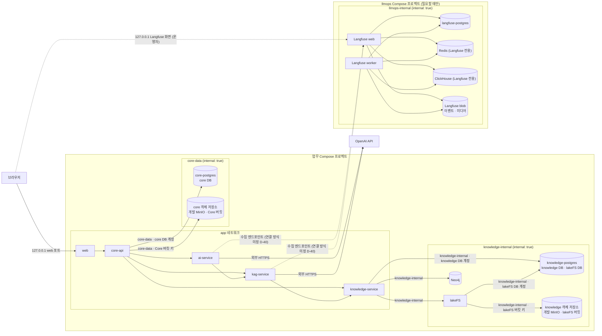

> **보관 문서(2026-10-30):** KAG·lakeFS·Neo4j를 전제로 한 이전 설계안입니다. MVP는 [DEC-16](../../../decisions.md#결정-목록)에서 MVP용 RDB 저장 방향을 검토하며, 새 설계는 [docs/design](../../../design.md)에 있습니다. 이 문서는 비교·후속 검토용으로만 보관합니다.

# 인프라 (저장소·네트워크·실행·배포)

> 상위 문서: [시스템 아키텍처](../design.md). 상태 표기는 [표기](../design.md#표기)를 따릅니다. 이 문서의 라이선스 요약은 설계 판단용 메모이며 법률 판단이 아닙니다. 조사 일자와 출처는 [decisions.md 조사·시험 근거](../decisions.md#조사시험-근거)에 있습니다.

## 목적

다섯 서비스가 쓰는 저장소·객체 저장소·네트워크·Compose 구성·환경설정·비밀값·라이선스·배포의 목표 모습을 정합니다. 현재 Compose에는 `web`·`core-api`·`ai-service` 세 서비스만 있습니다(`현재`, [인프라 안내](../../../../../infrastructure/README.md)). 아래 구성요소는 처음 쓰는 기능을 구현할 때 하나씩 추가합니다(DP-08).

저장소는 정본 소유 도메인마다 인스턴스를 나누고(DEC-13), Langfuse 운영 묶음은 업무와 다른 Compose 프로젝트로 둡니다(DEC-14). 두 결정은 참고 프로젝트 GovBiz의 운영 방식을 적용한 것이며, 같게 한 것과 다르게 한 것은 [GovBiz 대비 차이](#govbiz-대비-차이)에 있습니다.

## 구성요소

| 구성요소 | 용도 | 접근 주체 | 라이선스 | 상태 |
|---|---|---|---|---|
| core-postgres | PostgreSQL 인스턴스. core DB(업무 정본) | core-api만 | PostgreSQL License | `채택`(DEC-13) — 기존 `미정`(업무 DB 제품) 해소, 기존 `제안`(인스턴스 하나에 DB 분리) 대체 |
| knowledge-postgres | PostgreSQL 인스턴스. knowledge DB와 lakeFS 메타데이터 DB(DB·계정 분리) | knowledge DB는 knowledge-service만, lakeFS DB는 lakeFS만 | PostgreSQL License | `채택`(DEC-13). 한 인스턴스에 두 DB는 `제안` |
| langfuse-postgres | PostgreSQL 인스턴스. Langfuse 트랜잭션 데이터. llmops 프로젝트 | Langfuse web·worker만 | PostgreSQL License | `채택`(DEC-14) |
| lakeFS | 세계관 정본 파일·커밋. 1.88.0으로 시험 | knowledge-service | 1.87.0 이상 BSL 1.1 | `채택` — 기존 `합의`·`확정`(Gitea) 대체, 팀 재결정 필요 |
| Neo4j Community | 파생 그래프 색인 | knowledge-service | GPLv3 | `채택` |
| core 객체 저장소(개발) | 원고 이미지(Core 버킷). MinIO를 공식 GitHub 소스의 마지막 태그로 직접 빌드한 이미지 | core-api만 | AGPLv3 | `채택`(DEC-08·DEC-13) — 기존 `합의`(MinIO) 갱신 |
| knowledge 객체 저장소(개발) | lakeFS 블록 저장(lakeFS 버킷). core 객체 저장소와 같은 직접 빌드 이미지 | lakeFS만 | AGPLv3 | `채택`(DEC-08·DEC-13) |
| Langfuse blob(개발) | Langfuse 수신 이벤트·미디어. llmops 프로젝트. 이미지는 `미정`(D-36) | Langfuse web·worker만 | 이미지에 따라 도입 시 확인 | `채택`(DEC-14) |
| 객체 저장소(배포 실습) | AWS S3. 소유자별 버킷(Core·lakeFS·Langfuse)과 서비스별 IAM 역할 | 버킷마다 소유자만 | 관리형 서비스 | `채택`. Langfuse 버킷은 `제안` |
| Langfuse(web·worker) | AI 호출 추적 메타데이터(self-host). web은 화면·API, worker는 수신 이벤트 비동기 처리. llmops 프로젝트 | 기록: ai-service·kag-service(web 수집 엔드포인트만) | 도입 시 확인 | `합의`. 운영 묶음 배치는 `채택`(DEC-14) |
| Redis(Langfuse 전용) | Langfuse 캐시·작업 큐. 소유: Langfuse. 비밀번호 필수, `noeviction` | Langfuse web·worker만. 우리 서비스는 접속하지 않음 | 도입 시 확인 | `채택`(DEC-12·DEC-14) — 기존 `확정`(Redis 두지 않음) 일부 대체, 팀 재결정 필요 |
| ClickHouse(Langfuse 전용) | Langfuse 추적·관측 데이터 저장(분석용 DB). 소유: Langfuse. 단일 노드 | Langfuse web·worker만 | 도입 시 확인 | `채택`(DEC-12·DEC-14) |
| Mailpit | 개발 환경 인증 메일 확인 | core-api | 도입 시 확인 | `합의` |
| Elasticsearch | 작품 검색(공개 정보만). MVP는 DB 검색 | core-api | 도입 시 확인 | `합의`·MVP 제외 |

**쓰지 않는 것:** Gitea(`채택` — 기존 `합의`·`확정` 대체, 팀 재결정 필요), OpenSPG 서버(Java·JDK 8)·MySQL·Pemja, 우리 서비스용 Redis·메시지 큐·별도 worker(큐·worker는 `확정` 유지. Redis는 Langfuse 전용만 둠, `채택` DEC-12), K8s·클라우드 관리형 서비스(배포 실습의 S3 제외). 제외 근거는 [decisions.md](../decisions.md#검토-후-제외한-대안)에 있습니다. GovBiz가 쓰는 업무 Redis·RabbitMQ·Qdrant도 적용하지 않습니다([GovBiz 대비 차이](#govbiz-대비-차이)).

## 구성요소 도입 시점

아래 순서는 의존 관계에서 나온 것이며 일정 확정이 아닙니다.

| 구성요소 | 도입 계기(처음 쓰는 기능) | 상태 |
|---|---|---|
| core-postgres | 첫 업무 기능(계정 UC-22) | `채택` |
| SMTP·Mailpit | 가입 이메일 인증(UC-22) | `합의` |
| knowledge-service·knowledge-postgres·lakeFS·knowledge 객체 저장소 | 세계관 생성·관리(UC-02) | `채택` |
| Neo4j Community | knowledge-service와 함께(`제안`). 정본 DB만으로 시작하는 단계적 도입은 대안으로 남음([decisions.md X-03](../decisions.md#검토-후-제외한-대안)) | `채택`(D-28 해소) |
| core 객체 저장소 | `.epub` 이미지 가져오기(UC-03)·원고 이미지 삽입(UC-10) | `채택` |
| kag-service | 설정 근거가 필요한 첫 AI 기능 또는 설정 추출(UC-04). V-01 결과에 따라 ai-service로 통합될 수 있음 | `채택` |
| LangChain·LangGraph·Langfuse | 첫 AI 기능(예: 피드백 1차 필터 UC-14). LangGraph는 다중 인물 시뮬레이션(UC-09)부터 | `합의` |
| llmops 프로젝트(Langfuse web·worker, langfuse-postgres, Redis, ClickHouse, Langfuse blob) | Langfuse와 함께. 위 행의 Langfuse 도입 시점(`합의`)을 따르며 구성요소를 따로 먼저 도입하지 않음 | `채택`(DEC-12·DEC-14) |
| Core 내장 스케줄러 | 첫 정기 작업(크레딧 소멸 UC-17, 탈퇴 유예 UC-22, 필터 재검사 UC-14, 자율 연재 UC-18) | `합의`, 새 실행 계층이므로 구현 전 팀 공유 |
| Elasticsearch | MVP 이후 검색 고도화 | `합의`·MVP 제외 |

## 공통 규칙

| 규칙 | 내용 | 상태 |
|---|---|---|
| 소유자별 인스턴스 | 저장소 인스턴스는 정본 소유 도메인마다 둡니다. 서비스 사이에 FK를 두지 않고, 다른 서비스의 DB·객체 저장소에 직접 접근하지 않습니다 | `채택`(DEC-13) |
| 이미지 digest 고정 | 외부에서 받는 인프라 이미지는 태그와 함께 digest를 고정합니다. 직접 빌드하는 MinIO는 기존대로 소스 태그를 고정합니다 | `제안`. llmops 프로젝트는 `채택`(DEC-14) |
| 기본 계정 금지 | DB·Neo4j·lakeFS·MinIO·Redis·ClickHouse에 기본 계정·빈 비밀번호를 쓰지 않습니다 | `채택` |

## PostgreSQL 배치

| 인스턴스 | DB | 계정 | 스키마 마이그레이션 | 네트워크 | 상태 |
|---|---|---|---|---|---|
| core-postgres | core DB | core-api 전용 | Flyway, 버전 파일은 core-api 안 | core-data | `채택`(DEC-13) |
| knowledge-postgres | knowledge DB, lakeFS 메타데이터 DB | knowledge-service 전용, lakeFS 전용(서로의 DB 권한 없음) | knowledge DB는 Flyway(버전 파일은 knowledge-service 안), lakeFS DB는 lakeFS 자체 | knowledge-internal | `채택`(DEC-13). 한 인스턴스에 두 DB는 `제안` |
| langfuse-postgres | langfuse DB | Langfuse 전용 | Langfuse 자체(시작할 때) | llmops-internal | `채택`(DEC-14) |

- 정본 소유 도메인마다 인스턴스를 나눕니다(`채택`, DEC-13). 기존 "인스턴스 하나에 DB 셋 분리"(`제안`)를 대체합니다([decisions.md X-18](../decisions.md#검토-후-제외한-대안)).
- knowledge DB와 lakeFS 메타데이터 DB는 둘 다 knowledge 도메인 소유이고 같은 시점으로 복구해야 하므로([백업·복구](#백업복구)) 한 인스턴스에 두고 DB·계정만 나눕니다(`제안`). lakeFS DB를 별도 인스턴스로 두는 대안도 있으며, 격리는 강해지고 컨테이너가 하나 늘어납니다.
- 서비스 사이에는 FK를 두지 않고 ID로만 참조합니다. 다른 서비스 DB에 직접 접근하지 않습니다(`채택`, [design.md 서비스 경계를 넘는 참조](../design.md#서비스-경계를-넘는-참조)).
- **스키마 마이그레이션(`채택`, DEC-13):** core-api와 knowledge-service는 Flyway를 쓰고 버전 파일을 각 서비스 안에 둡니다. 각 서비스는 자기 DB 스키마만 바꾸고 다른 서비스 스키마를 건드리지 않습니다. lakeFS·Langfuse는 자체 마이그레이션을 씁니다. Flyway는 두 서비스의 새 의존성이므로 도입 전에 팀에 알립니다. 기존 `미정` D-01(마이그레이션 도구)을 해소합니다.
- lakeFS는 운영 시 PostgreSQL 11 이상이 필요합니다.

## 저장소별 구성

### lakeFS

- **구성:** 메타데이터는 knowledge-postgres의 lakeFS DB, 객체 데이터는 knowledge 객체 저장소의 lakeFS 버킷에 둡니다. 개발 환경은 배포와 구성을 맞추려고 MinIO를 쓰는 것이 기본이고, 더 가볍게 하려면 local blockstore도 쓸 수 있습니다(`제안`).
- **쓰는 방식:** 세계관 하나 = 저장소 하나, `main` 브랜치만. 저장소는 쓰기 전에 lakeFS API로 미리 만듭니다(S3 게이트웨이 CreateBucket 미지원). 객체 읽기·쓰기는 S3 게이트웨이의 `main/` 접두 경로, 과거 버전은 커밋 ID 경로로 읽습니다.
- **시험 결과(요약):** 1.88.0 S3 게이트웨이에서 존재 확인·읽기·조회·목록·삭제·presigned GET·`main/` 접두 쓰기·커밋 ID로 과거 버전 읽기가 됐고, 브랜치 접두 없는 키(NoSuchBucket)·버킷 생성(501)·버킷 정책 설정·커밋 ID 경로 쓰기는 거부됐습니다. Python MinIO SDK 7.2.20으로 한 시험이라 JVM SDK와 동작이 완전히 같다고 보장할 수 없습니다(V-03). 상세는 [decisions.md R-03](../decisions.md#r-03-lakefs-1880-s3-게이트웨이-시험)에 있습니다.
- **보관:** 이력은 무기한 보관합니다. lakeFS 가비지 수집 규칙이 이력을 지우지 않도록 설정합니다(`제안`).
- **라이선스(BSL 1.1, 1.87.0 이상):** 운영이 아닌 사용(개발·테스트·학습·시연)은 수정 포함 허용됩니다. 운영 사용은 ① 수정하지 않은 원본이고 ② 조직 내부 목적이며 외부에 lakeFS 기능을 제공하지 않을 때 허용됩니다. STORYFORK를 실제 사용자 서비스로 바꿀 때 다시 확인합니다. 선택지는 공식 BSL 안내 확인, 1.87.0 이전 Apache 2.0 버전 사용, 상용 문의입니다(`미정`, D-35).

### Neo4j

- Community 판 하나, DB 하나에 `worldviewId`로 세계관을 구분합니다(`채택`). 세계관마다 DB·라벨을 만들지 않습니다.
- 온라인 백업·RBAC가 없습니다. 정본이 아닌 파생 색인이고 접근 주체가 knowledge-service 하나라 수용합니다(`채택`). 백업하지 않고 필요하면 정본에서 다시 만듭니다.
- 기본 계정을 쓰지 않고, 호스트 포트를 공개하지 않습니다. 관리 화면 포트도 열지 않습니다(`제안`).
- GPLv3입니다. 수정하지 않은 이미지를 네트워크 너머에서 쓰는 방식입니다(D-35와 함께 운영 전환 시 확인).

### 객체 저장소

| 환경 | 구성 | 규칙 | 상태 |
|---|---|---|---|
| 개발 | 소유자별 인스턴스 셋. core 객체 저장소(Core 버킷, 원고 이미지), knowledge 객체 저장소(lakeFS 버킷), Langfuse blob(llmops 프로젝트). core·knowledge는 MinIO를 공식 GitHub 소스의 마지막 태그로 직접 빌드한 이미지 | 개발 전용, `127.0.0.1` 바인딩(콘솔 포함), 태그 고정, 기본 계정 금지. Dockerfile은 `infrastructure/`에 두는 것을 제안(후속 작업, 이번에는 만들지 않음) | `채택`(DEC-08·DEC-13) |
| 배포 실습 | AWS S3. 소유자별 버킷(Core·lakeFS·Langfuse) | 서비스별 IAM 역할로 접근, 비공개 버킷, 키를 코드·`.env`에 두지 않음 | `채택` — 기존 "운영 배포 `미정`" 갱신. Langfuse 버킷은 `제안` |

- **인스턴스·버킷 분리(`채택`, DEC-13):** 개발은 소유자마다 인스턴스를, 배포 실습은 소유자마다 버킷과 IAM 역할을 둡니다. core-api는 knowledge 객체 저장소·lakeFS 버킷에, lakeFS는 core 객체 저장소·Core 버킷에 자격 증명도 네트워크 경로도 없습니다. 기존 "MinIO 하나에 버킷·자격 증명 분리"(`제안`)를 대체합니다.
- **MinIO 상태:** MinIO CE는 2025-10 바이너리·이미지 배포를 멈췄고, 2026-02 "더 이상 유지보수하지 않음"으로 바뀌어 보관 처리됐습니다. 2026-09 Docker Hub 이미지 저장소 삭제 보고도 있습니다. AGPLv3입니다. 보안 패치가 나오지 않으므로 개발 전용으로만 쓰고, 다른 S3 호환 저장소로 바꿀지는 `미정`(D-36)입니다. GovBiz가 digest를 고정해 쓰는 Chainguard MinIO 이미지(`cgr.dev/chainguard/minio`)도 직접 빌드의 대안 후보입니다. Chainguard 무료 이미지의 이용 조건·버전 고정 방식은 확인하지 않았습니다.
- **Langfuse blob(`채택`, DEC-14):** 개발은 llmops 프로젝트 안의 전용 인스턴스, 배포 실습은 전용 버킷을 씁니다. 수신 이벤트와 미디어를 경로로 나눕니다. 이미지를 core·knowledge와 같은 직접 빌드 MinIO로 통일할지, GovBiz처럼 Chainguard MinIO 이미지를 digest 고정해 쓸지는 `미정`(D-36)입니다.

### Langfuse

- self-host(Docker)로 직접 운영하고 클라우드로 추적 데이터를 보내지 않습니다(`확정`). 기록 주체는 ai-service와 kag-service입니다.
- **구성(`채택`, DEC-12):** Langfuse v3 self-host 구성을 그대로 도입합니다. web(화면·API)·worker(수신 이벤트 비동기 처리) 컨테이너와 함께 PostgreSQL·Redis·ClickHouse·S3 호환 blob 저장소를 씁니다. 이 중 Redis(캐시·작업 큐)와 ClickHouse(추적·관측 데이터)를 Langfuse 의존 구성요소로 추가합니다. 기존 `확정`("Redis 두지 않음", DP-08)을 일부 대체하므로 팀 재결정이 필요합니다.
- **별도 Compose 프로젝트(`채택`, DEC-14):** 업무 Compose와 분리한 llmops 프로젝트(가칭)에 Langfuse 묶음 전체를 둡니다. 필요할 때만 켜서 개발 PC 메모리 부담을 줄입니다. 파일 위치는 도입 때 정합니다(예: `infrastructure/llmops/`, `제안`).

| 구성 | 설정 | 상태 |
|---|---|---|
| Langfuse web·worker | 텔레메트리 끔. web만 화면 포트를 `127.0.0.1`에 공개(운영자 조회) | `채택`(DEC-14) |
| langfuse-postgres | Langfuse 전용 인스턴스·계정. 스키마는 Langfuse 자체 마이그레이션 | `채택`(DEC-14) |
| ClickHouse | 단일 노드(클러스터 기능 끔). 컨테이너 메모리 상한과, 서버 메모리 상한·mark 캐시 크기를 정한 설정 파일. 개발 출발값은 3g·2GiB·128MiB(GovBiz 값이며 운영 기준값이 아님). 스키마는 Langfuse가 시작할 때 마이그레이션 | `채택`(DEC-14), 운영 기준값 `미정`(D-40) |
| Redis | 비밀번호 필수. `noeviction`(메모리가 차도 키를 지우지 않고 쓰기를 거부) | `채택`(DEC-14) |
| Langfuse blob | 전용 인스턴스, 이벤트·미디어 경로. 이미지는 `미정`(D-36) | `채택`(DEC-14) |
| 이미지 | 모든 이미지 digest 고정. 도입할 Langfuse 버전은 도입 때 정함(GovBiz는 4.46.0) | `채택`(DEC-14) |

- **적용 범위(`채택`):** Redis·ClickHouse는 Langfuse가 소유하고 Langfuse web·worker만 접속합니다. core-api·ai-service·kag-service·knowledge-service는 이 Redis·ClickHouse에 접속하지 않고 자격 증명도 받지 않습니다. Langfuse worker는 Langfuse 구성요소이며, 우리 서비스에 큐·worker를 두지 않는 원칙(`확정`)은 그대로입니다.
- **우리 서비스의 Redis 사용(`미정`):** core-api의 속도 제한 상태 저장(D-10)과 다중 인스턴스 스케줄러 중복 방지(D-11)에 Redis를 후보로만 기록합니다. 단일 인스턴스 전제가 깨지거나 실제 필요가 확인될 때 별도로 결정하고, 그때 Langfuse용 Redis와 공유할지 따로 둘지도 함께 정합니다. 지금은 우리 서비스에 Redis를 넣지 않습니다.
- **수집 경로(`미정`, D-40):** 프로젝트가 나뉘므로 ai-service·kag-service가 Langfuse web 수집 엔드포인트에 닿는 방식을 정해야 합니다. 후보는 [네트워크](#네트워크)에 있습니다.
- **접근·비밀값:** ai-service·kag-service는 Langfuse web의 수집 엔드포인트만 부릅니다. langfuse-postgres·Redis·ClickHouse·Langfuse blob은 호스트 포트를 공개하지 않고, 기본 계정·비밀번호를 쓰지 않습니다(`채택`). Langfuse 자체 비밀값과 저장소 자격 증명은 루트 `.env`에서 관리하고 llmops 프로젝트의 Langfuse 런타임에만 전달합니다(`채택`). 빈 비밀값을 만들어 채우는 초기화 보조 스크립트는 선택 사항이며, 실제 `.env`를 덮어쓰지 않습니다(`제안`). 비밀값 표는 [환경설정·비밀값](#환경설정비밀값)에 있습니다.
- **자원:** ClickHouse는 무거운 분석용 DB입니다. 위 메모리 상한으로 ClickHouse만 최대 약 3GB를 쓰고, llmops 프로젝트는 AI 기능을 개발·확인할 때만 켭니다(`채택`). 운영 기준 자원값은 `미정`(D-40)입니다.
- **추적 규칙:** span으로 무엇을 내보내고 무엇을 지우는지는 [design.md 공통 계약: 관측성](../design.md#공통-계약-관측성)(DEC-15)에 있습니다. 인프라는 수집 엔드포인트 외의 경로를 열지 않습니다.
- 운영자 조회 방식(Langfuse 화면 직접 또는 Core 운영 화면 경유)과 추적 보관 기간은 `미정`(D-40)입니다. Langfuse 화면은 `127.0.0.1`에만 공개하며(DEC-14), 직접 본다면 Langfuse 자체 로그인 계정 관리를 함께 정합니다.

## 네트워크

| 네트워크 | Compose 프로젝트 | 구성원 | 외부·호스트 연결 | 상태 |
|---|---|---|---|---|
| app | 업무 | web, core-api, ai-service, kag-service, knowledge-service(API) | web(dev·prod)과 core-api(dev만)만 loopback 공개. ai-service·kag-service는 OpenAI로 나가는 연결이 필요 | `채택` |
| core-data(`internal: true`) | 업무 | core-api, core-postgres, core 객체 저장소 | 없음 | `채택`(DEC-13) — 기존 `제안`(D-34) 해소 |
| knowledge-internal(`internal: true`) | 업무 | knowledge-service, Neo4j, lakeFS, knowledge-postgres, knowledge 객체 저장소 | 없음 | `채택` |
| llmops-internal(`internal: true`, 가칭) | llmops | Langfuse web·worker, langfuse-postgres, Redis, ClickHouse, Langfuse blob | 없음. Langfuse 화면 공개는 아래 참고 | `채택`(DEC-14) — 기존 langfuse-internal을 llmops 프로젝트로 옮김 |
| 수집 경로 | 두 프로젝트 사이 | Langfuse web, ai-service, kag-service | 아래 후보 중 하나 | `미정`(D-40) |

**D-34 해소(DEC-13):** 이전 설계는 PostgreSQL 인스턴스 하나와 개발 MinIO 하나를 core-api와 knowledge-service가 함께 썼습니다. 이를 knowledge-internal에 두면 core-api가 닿지 못하고, core-api를 knowledge-internal에 넣으면 Neo4j·lakeFS까지 닿는 빈틈이 있었습니다. 이제 인스턴스를 소유자별로 나눠 core-postgres·core 객체 저장소는 core-data에만, knowledge-postgres·knowledge 객체 저장소는 knowledge-internal에만 둡니다. 두 내부 네트워크에 함께 연결되는 저장소가 없습니다. DB 계정·버킷 자격 증명 분리도 그대로 둡니다.

**수집 경로 후보(`미정`, D-40):** Langfuse가 별도 프로젝트로 나뉘어, 같은 Compose 안의 langfuse-ingest 내부 네트워크(이전 `제안`)를 그대로 쓸 수 없습니다.

| 후보 | 방식 | 장점 | 확인할 것 |
|---|---|---|---|
| (a) external 네트워크 공유 | 한 프로젝트가 만든 내부 네트워크(가칭 langfuse-ingest, `internal: true`)를 다른 프로젝트가 `external`로 붙임. 구성원은 Langfuse web, ai-service, kag-service만 | 수집 엔드포인트에 닿는 주체를 네트워크로 좁힘. 이전 langfuse-ingest 제안과 같은 경계 | 네트워크를 어느 쪽이 만들지. llmops를 끈 상태에서도 업무 프로젝트가 시작되는지 |
| (b) 호스트 경유 | ai-service·kag-service가 호스트에 공개된 Langfuse 포트를 호스트 주소로 부름 | 프로젝트 사이 네트워크 의존이 없음 | 닿는 주체를 네트워크로 좁히지 못함. Docker 환경에 따라 `127.0.0.1` 공개 포트에 컨테이너가 닿는 방식이 달라 도입 때 확인 |

- llmops를 끈 동안의 전송 실패는 AI 작업 결과를 바꾸지 않습니다(DEC-15, Property 33).
- Langfuse 화면은 `127.0.0.1`에만 공개합니다(`채택`, DEC-14). `internal: true` 네트워크에만 연결된 컨테이너는 호스트 포트 공개가 되지 않을 수 있으므로, Langfuse web의 화면 공개용 연결 구성은 도입 때 확인합니다.

- kag-service·knowledge-service·저장소는 호스트 포트를 공개하지 않습니다(`채택`). ai-service도 지금처럼 내부 전용입니다(`현재`).
- 기본 계정(DB·Neo4j·lakeFS·MinIO·Redis·ClickHouse)을 쓰지 않습니다(`채택`).
- app 네트워크 안에서는 서로 닿을 수 있으므로, 허용 호출 방향은 네트워크만이 아니라 토큰 검증과 서비스별 주소 설정(받지 않은 주소는 부를 수 없음)으로 지킵니다(Property 30). 네트워크를 호출 방향별로 더 잘게 나눌지는 `미정`입니다.
- Mailpit을 어느 네트워크에 둘지는 도입 때 정합니다(`미정`). Langfuse 묶음은 llmops 프로젝트의 llmops-internal에 둡니다(`채택`, DEC-14).

## 목표 로컬 구성

| Compose 프로젝트 | 파일 | 구성 | 켜는 때 | 상태 |
|---|---|---|---|---|
| 업무 | 현재 `compose.yaml`(dev)·`compose.prod.yaml`(배포 이미지 검증) | 다섯 서비스와 core-data·knowledge-internal의 저장소 | 평소 개발·검증 | 파일 `현재`, 구성요소 추가는 `채택` |
| llmops(가칭) | 업무와 다른 파일(위치는 도입 때 정함, 예: `infrastructure/llmops/`) | Langfuse web·worker, langfuse-postgres, Redis, ClickHouse, Langfuse blob | AI 추적을 개발·확인할 때만 | `채택`(DEC-14), 위치 `제안` |

- 현재 두 Compose(`compose.yaml` dev, `compose.prod.yaml` 배포 이미지 검증)와 세 서비스는 그대로 두고, 구성요소를 해당 기능 구현 시점에 하나씩 추가합니다. 저장소 데이터는 named volume에 둡니다(`제안`).
- 루트 `.env` 단일 관리와 서비스별 허용 변수 전달, `verify-compose.sh`의 자기 리소스만 정리하는 검증 방식을 유지합니다(`확정`). llmops 프로젝트도 루트에서 `--env-file .env`를 명시하고 Langfuse에 허용한 변수만 받습니다(`채택`).
- `check-compose-config.py`를 넓혀 새 서비스의 비밀값 경계(Property 20), 호스트 포트 없음, 네트워크 구성원, 허용 호출 방향 설정(Property 30)을 검사합니다. llmops 파일의 이미지 digest 고정과 호스트 포트(Langfuse 화면만 `127.0.0.1`)도 같은 방식으로 검사합니다(`제안`).
- 저장소가 추가되면 검증은 실제 OpenAI 없이 서비스·저장소 연결과 실패·복구(하위 서비스 중지 시 실패 전파, 재시작 후 복구, 그래프 재생성)를 확인하도록 넓힙니다. llmops를 끈 상태에서 AI 작업 결과가 바뀌지 않는지도 확인합니다(Property 33, `제안`).
- 인스턴스 분리로 업무 프로젝트에 PostgreSQL·MinIO 컨테이너가 둘씩 생기고, 개발 머신 자원과 Compose 검증 시간이 늘어납니다. Compose profile 등으로 필요한 구성요소만 띄우는 방식을 도입 때 검토합니다(`미정`).

## 환경설정·비밀값

개발 설정은 루트 `.env` 한 곳에서 관리하고 루트 `.env.example`만 공유합니다. Compose는 `--env-file .env`를 명시하고, 서비스에는 허용한 변수만 전달합니다. 네이티브 실행은 `run-native.py`가 서비스별 허용 변수만 넘깁니다(`확정`). 서비스별 `.env`를 새로 만들지 않으며, llmops 프로젝트도 같은 루트 `.env`를 씁니다.

| 비밀값 | 받는 런타임 | 받지 않는 곳 | 상태 |
|---|---|---|---|
| OpenAI API 키 | ai-service, kag-service | web, core-api, knowledge-service, build ARG, `VITE_*` | `채택` — 기존 `확정`(AI Service에만, [AGENTS.md](../../../../../AGENTS.md)) 범위 재정의, 팀 재결정 필요 |
| Langfuse 키(SDK 수집용) | ai-service, kag-service | web, core-api, knowledge-service | `합의`(kag-service 추가는 `제안`) |
| Langfuse 자체 비밀값, langfuse-postgres·Redis·ClickHouse·Langfuse blob 자격 증명 | llmops 프로젝트의 Langfuse web·worker(각 저장소는 자기 자격 증명만) | web, core-api, ai-service, kag-service, knowledge-service | `채택`(DEC-12·DEC-14) |
| 하위 서비스용 토큰 서명 개인키 | core-api | 나머지 전부 | `채택` |
| Core 공개키 | ai-service, kag-service, knowledge-service | — (비밀값 아님, 무결성은 지켜야 함) | `채택`, 배포 방식 `미정`(D-23) |
| 사용자 JWT 서명 키, core-postgres(core DB) 자격 증명, SMTP 자격 증명, core 객체 저장소 키(개발) | core-api | web, ai-service, kag-service, knowledge-service | `확정`·`채택` |
| knowledge-postgres의 knowledge DB 자격 증명, lakeFS·Neo4j 자격 증명 | knowledge-service | 나머지 전부 | `채택` |
| knowledge-postgres의 lakeFS DB 자격 증명, knowledge 객체 저장소 키(개발) | lakeFS | knowledge-service 외 서비스 | `채택` |
| AWS 자격 증명(배포 실습) | 없음. 서비스별 IAM 역할로 접근 | 코드, `.env` | `채택` |

- 실제 `.env`는 덮어쓰거나 커밋하지 않습니다(`확정`).
- 구성요소를 추가할 때 `.env.example`, 서비스별 허용 목록(`run-native.py`), 설정 회귀 검사(`check-compose-config.py`)를 같은 변경에서 갱신합니다(`제안`).

## 배포

- **배포 실습 환경:** 객체 저장소는 AWS S3를 씁니다(`채택`). 소유자별 버킷(Core·lakeFS·Langfuse)을 두고 서비스별 IAM 역할로 접근하며, 비공개 버킷을 씁니다(DEC-13). 기존 "운영 배포 `미정`" 중 객체 저장소 부분을 갱신합니다.
- 호스팅·TLS·도메인·백업 운영·운영 메일 발송사는 `미정`(D-17)입니다. GovBiz의 EKS 구성(저장소마다 StatefulSet·EBS gp3 볼륨, 암호화한 백업의 S3 보관)은 참고로만 기록하고 적용하지 않습니다([decisions.md R-08](../decisions.md#r-08-govbiz-참고-프로젝트의-dblangfuse-운영-방식)).
- 현재 Compose는 인증·TLS 없는 로컬 검증용이며 인터넷 운영 준비가 된 배포가 아닙니다(`확정`). 배포 실습도 운영 준비 완료로 표현하지 않습니다.
- 이 설계는 단일 core-api 인스턴스 전제입니다. 다중 인스턴스는 스케줄러 중복 실행과 속도 제한 상태를 함께 다시 정해야 합니다(D-11).

## 백업·복구

| 대상 | 백업 | 이유 |
|---|---|---|
| core-postgres(core DB) | 함 | 업무 정본 |
| knowledge-postgres(knowledge DB, lakeFS DB) | 함 | 세계관 메타데이터·커밋 메타데이터 |
| lakeFS 데이터 저장소(knowledge 객체 저장소, 배포는 lakeFS 버킷) | 함 | 세계관 정본 파일 |
| core 객체 저장소(Core 버킷) | 함 | 원고 이미지 |
| Neo4j | 하지 않음 | 파생 색인. 정본에서 재생성(Property 23) |
| llmops 묶음(langfuse-postgres·ClickHouse·Langfuse blob·Redis) | `미정`(D-40) | 추적 메타데이터 |

knowledge DB와 lakeFS(메타데이터 DB + 데이터 저장소)는 서로를 참조하므로 같은 시점으로 복구해야 합니다. 둘 다 knowledge 도메인의 인스턴스(knowledge-postgres, knowledge 객체 저장소)에 있어 함께 복구할 대상이 한 도메인 안에 모입니다. 복구 시점 맞춤 방식은 `미정`(D-03, D-17)입니다.

## 라이선스 요약

법률 판단이 아닙니다. 실제 사용자 서비스로 바꿀 때 다시 확인합니다.

| 구성요소 | 라이선스 | 이 설계의 사용 방식 | 확인할 것 |
|---|---|---|---|
| lakeFS 1.87.0 이상 | BSL 1.1 | 개발·테스트·학습·시연(수정 포함 허용) | 운영 사용 조건(수정하지 않은 원본, 조직 내부 목적, 외부 기능 제공 금지), D-35 |
| Neo4j Community | GPLv3 | 수정하지 않은 이미지를 서비스 뒤에서 사용 | 운영 전환 시 배포 형태 확인 |
| MinIO CE | AGPLv3 | 개발 전용(core·knowledge 객체 저장소), 공식 소스 마지막 태그를 수정 없이 빌드 | 유지보수 종료, D-36 |
| Chainguard MinIO 이미지 | 도입 시 확인 | Langfuse blob과 직접 빌드 대안의 후보(GovBiz가 digest 고정해 사용). 채택 여부 `미정` | 무료 이미지의 이용 조건·버전 고정 방식(확인하지 않음), D-36 |
| OpenSPG KAG | Apache 2.0 | 포크해 kag-service로 수정 | LICENSE·NOTICE 유지, 수정 사실 표시 |
| PostgreSQL | PostgreSQL License | 인스턴스 셋(core·knowledge·langfuse)에서 그대로 사용 | — |
| Langfuse | 도입 시 확인 | self-host 구성 그대로 사용 | 도입하는 버전 기준으로 확인 |
| Redis(Langfuse 전용) | 도입 시 확인 | Langfuse 의존 구성요소로 수정 없이 사용 | 도입하는 버전 기준으로 확인 |
| ClickHouse(Langfuse 전용) | 도입 시 확인 | Langfuse 의존 구성요소로 수정 없이 사용 | 도입하는 버전 기준으로 확인 |
| Mailpit·Elasticsearch | 도입 시 확인 | — | 도입 시 확인 |

## 관련 정확성 속성

[Correctness Properties](../design.md#correctness-properties) 중 인프라 설정이 지키는 것: Property 20(비밀값 경계), 23(Neo4j를 백업하지 않아도 재생성 가능), 27(추론 서비스에 저장소 계정 없음), 30(허용된 호출 방향만), 33(llmops를 꺼도 AI 작업 결과가 바뀌지 않음).

## 위험·미정

- D-03(복구 시점 맞춤), D-10·D-11(우리 서비스의 Redis 후보), D-17(운영 배포), D-23(공개키 배포), D-35(lakeFS 운영 사용), D-36(개발 객체 저장소 이미지, Chainguard 대안 포함), D-40(Langfuse 운영 세부: 수집 경로, 운영자 조회, 보관 기간, 백업, 운영 기준 자원값). D-01(마이그레이션 도구)·D-34(개발 네트워크 배치)는 DEC-13으로 해소했습니다.
- 로컬 구성요소가 늘어 개발 머신 부담이 커집니다. 인스턴스 분리로 PostgreSQL·MinIO 컨테이너가 늘고, llmops 묶음 중 ClickHouse는 메모리 상한 기준 최대 약 3GB를 씁니다. llmops는 필요할 때만 켭니다(DEC-14).
- 전체 목록은 [위험·미정 총괄](../design.md#위험미정-사항과-후속-결정)에 있습니다.

## GovBiz 대비 차이

참고 프로젝트 GovBiz([SKN34-4th-1Team](https://github.com/SKNETWORKS-FAMILY-AICAMP/SKN34-4th-1Team), 커밋 `a07e8d1`)의 DB·Langfuse 운영 방식을 적용했습니다. 조사 근거와 한계는 [decisions.md R-08](../decisions.md#r-08-govbiz-참고-프로젝트의-dblangfuse-운영-방식)에 있습니다.

| 항목 | GovBiz | STORYFORK | 비교 |
|---|---|---|---|
| 업무 DB 인스턴스 | 서비스마다 별도 MySQL 8.4 | 정본 소유 도메인마다 별도 PostgreSQL(core-postgres, knowledge-postgres) | 방식은 같음. 제품은 PostgreSQL 유지(DEC-03) |
| 서비스 사이 참조 | FK 없음, 다른 서비스 DB 직접 접근 금지 | 같음 | 같음 |
| 스키마 마이그레이션 | Flyway(core·catalog), Django 마이그레이션(ops) | Flyway(core-api·knowledge-service), lakeFS·Langfuse는 자체 | 같음(서비스마다 자기 스키마만) |
| LLMOps 배치 | 업무와 분리한 별도 Compose 프로젝트 | 별도 Compose 프로젝트(가칭 llmops) | 같음 |
| Langfuse 저장소 | 전용 PostgreSQL 17, ClickHouse 25.12(메모리 상한), Redis 7.4(`noeviction`), Chainguard MinIO, digest 고정 | 같은 구성. 버전은 도입 때 정하고, blob 이미지는 `미정`(D-36) | 같음. 이미지 선택만 남음 |
| 추적 | OTEL, span 이름 허용 목록, 마스킹, `traceparent`, 전송 시간 제한 2초 | 같은 규칙을 ai-service·kag-service에 적용(DEC-15) | 같음. kag-service의 KAG 자체 LLM 호출까지 넓힘 |
| 업무 Redis·RabbitMQ·Elasticsearch·Qdrant | 사용 | 적용하지 않음. 우리 서비스에 Redis·큐·worker를 두지 않고(DP-08), Elasticsearch는 MVP 이후(`합의`) | 다름 |
| 벡터·그래프 색인 소유 | ai-service(Qdrant 검색 벡터·근거 청크) | knowledge-service(Neo4j 그래프·벡터 색인) | 다름. 우리 데이터는 요청마다 공개 범위(고정 커밋·독자 공개 기준 회차·시점 인물)가 달라, 범위 집행을 데이터 주인이 해야 함(DP-06, Property 21) |
| 배포 | EKS, 저장소마다 StatefulSet·EBS gp3 PVC, 암호화한 백업의 S3 보관 | EKS 미적용. 배포 실습은 객체 저장소만 S3로 정했고 나머지는 `미정`(D-17) | 다름 |
