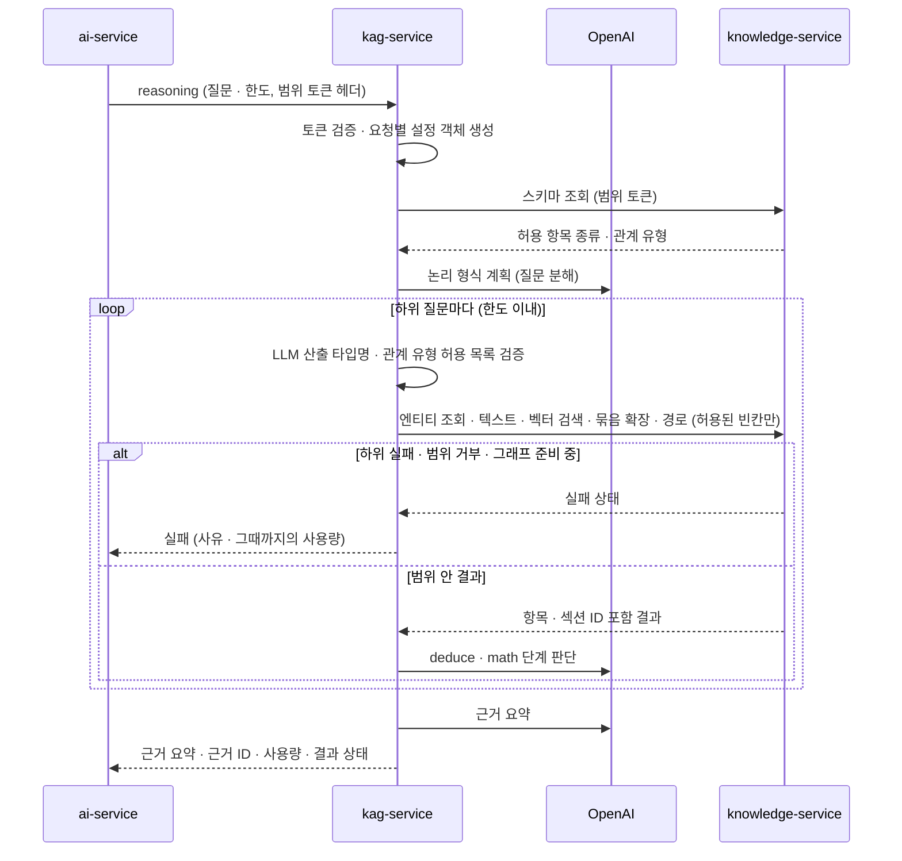

> **보관 문서(2026-10-30):** KAG·lakeFS·Neo4j를 전제로 한 이전 설계안입니다. MVP는 [DEC-16](../../../decisions.md#결정-목록)에서 MVP용 RDB 저장 방향을 검토하며, 새 설계는 [docs/design](../../../design.md)에 있습니다. 이 문서는 비교·후속 검토용으로만 보관합니다.

# kag-service (가칭 `storyfork-kag-service`)

> 상위 문서: [시스템 아키텍처](../design.md). 상태 표기는 [표기](../design.md#표기)를 따릅니다. 신규 서비스이며 분리는 `채택`입니다. ai-service에 합칠지는 [V-01](../design.md#검증-과제) 결과로 다시 정합니다. 이 문서의 포크 수정 목록은 KAG 소스 판독 근거이며, KAG를 실행해 확인한 것이 아닙니다([decisions.md R-01](../decisions.md#r-01-kag-소스-조사)).

## 목적과 한 줄 정의

**그래프를 읽어 추론하는 무상태 엔진입니다.** OpenSPG KAG(Apache 2.0)를 포크해, knowledge-service의 범위 검색 API 위에서 논리 형식 기반 단계 추론을 합니다. 그래프에 쓰지 않고, 저장소 계정이 없습니다.

## 책임과 하지 않는 일

| 하는 일 | 하지 않는 일 |
|---|---|
| 범위 토큰 안에서 질문을 하위 단계로 나눠 knowledge-service를 검색하고 근거를 요약(추론 질의) | 그래프·정본 쓰기, knowledge-service 쓰기 API 호출 |
| 계획 없이 정해진 검색만 하는 직접 조회(인물 지식 등) | 저장소 계정 보유, lakeFS·Neo4j·DB 접근 |
| 임베딩 생성(색인과 질의에 같은 모델을 쓰기 위해) | Cypher·SQL·KGDSL 문자열 생성·실행 |
| UC-04 설정 추출 후보 생성(기존 항목과 대조, 후보만 반환) | 추출 후보를 그래프에 쓰기(KAG builder의 writer 사용 안 함) |
| 근거 요약·근거 ID·토큰 사용량·결과 상태 반환 | 실패를 빈 답으로 숨기기, 범위 판단, 범위 토큰 생성·변경 |
| Langfuse에 메타데이터만 기록 | OpenAI 외 LLM 공급자 사용 |

## 기술 스택

| 항목 | 내용 | 상태 |
|---|---|---|
| 기반 | OpenSPG KAG 포크(Apache 2.0). solver(계획기·검색기·실행기·프롬프트), 임베딩, 추출 구성요소 | `채택` |
| 언어 | Python. 버전은 KAG 원본 요구를 따름 | `채택`(언어), 버전 `미정`(D-39) |
| HTTP 서버 | FastAPI가 후보(ai-service와 같은 방식) | `미정`(D-39) |
| LLM·임베딩 | OpenAI만. KAG의 OpenAI 클라이언트와 `token_meter` 사용량 계측 활용 | `채택` |
| 추적 | Langfuse SDK + OTEL. 메타데이터만, 규칙은 DEC-15 | `제안`(새 의존성, 도입 시 공유), 규칙 `채택` |
| 의존성 | KAG 원본 고정 버전 그대로 단독 해석 가능(144개 패키지). 분리 상태에서는 의존성 업그레이드가 필요 없음. 쓰지 않는 SDK(dashscope, ollama, pyodps, aliyun-log, mcp)는 제거 | `채택` |

## KAG 적용 방식

KAG(Knowledge Augmented Generation)는 지식 기반 추론 **방식**입니다. GraphRAG는 그래프를 검색해 문맥을 만드는 방식이고, Neo4j는 저장소입니다. 이 설계는 OpenSPG의 서버 묶음(Java 서버·MySQL·KGDSL 추론 엔진)을 가져오지 않고, KAG의 Python solver만 포크해 knowledge-service 위에서 돌립니다(`채택`).

| KAG 요소 | 이 설계의 위치 |
|---|---|
| 스키마로 제한한 지식 | knowledge-service 스키마 API의 항목 종류·관계 유형 허용 목록(목록 자체는 `미정`, D-24). kag-service는 LLM 산출 타입명을 이 목록으로 검증 |
| 지식 ↔ 원문 상호 색인 | 항목·섹션과 본문 `[[링크]]`(`LINKS_TO`), 섹션 순서(`NEXT_SECTION`), 회차 근거 위치. knowledge-service 그래프 모델 |
| 논리 형식 기반 단계 추론 | kag-service의 논리 형식 계획기가 질문을 하위 질문과 연산(검색·추론·계산·출력)으로 나누고, 각 검색 단계에서 knowledge-service 구조화 API를 부름 |
| 지식 정렬 | 설정 추출 후보를 기존 항목 ID에 맞춤. 작가 승인 후에만 Core가 knowledge-service에 반영 |

## 내부 구조 (모듈)

| 구성 | 출처 | 하는 일 | 상태 |
|---|---|---|---|
| 논리 형식 계획기 | KAG solver | 질문을 하위 질문·연산(검색·deduce·math·output)으로 분해 | `채택` |
| 하이브리드 검색기 | KAG solver, 검색 관문 교체 | 엔티티 연결·텍스트·벡터 검색과 그래프 1~2단계 확장을 조합. PageRank 검색기는 MVP 제외 | `채택` |
| deduce·math 실행기 | KAG solver | 검색 결과로 판단·계산 | `채택` |
| 프롬프트 | KAG solver | 계획·판단·요약 프롬프트. 한국어 검토 필요(D-37) | `채택` |
| knowledge-service 클라이언트 | 신규 | KAG의 검색 관문 인터페이스(`GraphApiABC`·`SearchApiABC`) 구현. 범위 토큰을 헤더로 붙여 구조화 API 호출 | `채택` |
| 스키마 클라이언트 | 신규 | KAG의 스키마 서버 의존을 knowledge-service 스키마 API로 대체 | `채택` |
| 요청 설정 | 신규 | `ProjectClient` 대신 로컬 설정. 요청마다 독립된 설정 객체를 만들어 전역값을 덮어쓰지 않음 | `채택` |
| 임베딩 | KAG 임베딩 구성 + OpenAI | 색인용(Core 요청)·질의용(벡터 검색) 임베딩을 같은 모델로 생성 | `채택` |
| 설정 추출 후보 | KAG 추출 구성요소 참고 | 원고에서 항목·관계·사건·공개 전환 후보와 근거 위치를 만들고 기존 항목과 대조. 쓰기 단계는 쓰지 않음 | `채택`(위치), 재사용 범위 `제안` |
| 진행 보고 | KAG reasoner dialog report | 우리 메타데이터 기록(Langfuse)으로 바꾸거나 제거 | `채택` |

### 질의 유형

| 유형 | 계획기 | 쓰는 곳 | 상태 |
|---|---|---|---|
| 추론 질의 | 사용 | 설정 검토, 피드백 근거, 시뮬레이션 계획, 자율 연재, 집필 근거 | `채택` |
| 직접 조회 | 사용 안 함. 정해진 검색 하나(예: 인물 지식, 항목 대조) | 시뮬레이션 인물 역할, 협업 집필의 단순 설정 확인 | `제안` |

직접 조회를 두는 이유: 인물 노드는 차례마다 자기 지식을 확인해야 하는데, 매번 계획기를 돌리면 LLM 호출과 지연이 늘어납니다. 범위 집행은 두 유형 모두 knowledge-service가 같은 방식으로 합니다.

## 포크 수정 목록

KAG(마지막 커밋 2026-01-28)와 OpenSPG(마지막 커밋 2025-06-29) 소스를 읽어 정한 목록입니다(`채택`). 근거와 한계는 [decisions.md R-01](../decisions.md#r-01-kag-소스-조사)에 있습니다.

| ID | 원본 동작 | 바꿀 내용 | 이유 |
|---|---|---|---|
| K-01 | 검색 관문 2곳(`GraphApiABC`·`SearchApiABC`)의 기본 구현 이름 `"openspg_graph_api"`·`"openspg_search_api"`가 25곳에 하드코딩 | 이름을 쓰는 25곳을 고치지 않고, 그 이름에 등록된 구현 자체를 knowledge-service HTTP 클라이언트로 교체 | 수정 범위를 줄이고 모든 검색이 한 관문을 지나게 함 |
| K-02 | DSL 문자열 생성부 3곳: `openspg_graph_api.py`, path_selection의 `path_utils.py`, `exact_one_hop_select.py`. OpenSPG 전용 `rdf_expand()` 포함 | 구조화 호출(엔티티 조회·묶음 1단계 확장·경로 찾기)로 변경 | 쿼리 문자열을 만들지 않음(DP-11). knowledge-service는 KGDSL을 실행하지 않음 |
| K-03 | 스키마 서버 의존 15개 파일 | knowledge-service 스키마 API로 교체 | OpenSPG 서버를 두지 않음 |
| K-04 | `ProjectClient`로 프로젝트 설정 조회 | 로컬 설정으로 교체 | 프로젝트 관리 서버 없음 |
| K-05 | reasoner dialog report 진행 보고기 | Langfuse 메타데이터 기록으로 바꾸거나 제거 | 외부 보고 경로 없음 |
| K-06 | 실패 은폐: `execute_dsl` 실패 시 빈 `TableData` 반환, `get_entity_one_hop` 예외 삼킴, KB 설정 초기화 실패를 로그만 남기고 계속 | 모두 명시적 오류로 바꿔 결과 상태에 실패로 담음 | 실패를 빈 결과로 숨기지 않음(DP-07, Property 29) |
| K-07 | `main_solver.qa()`가 `KAG_PROJECT_CONF`·`KAG_CONFIG` 전역값을 요청마다 덮어씀 | 요청별 설정 객체로 격리 | 동시 요청의 설정·범위가 섞이지 않게 함(Property 28) |
| K-08 | LLM이 만든 타입명(`un_std_entity_type`)이 쿼리에 그대로 끼워짐 | 스키마 허용 목록으로 검증. 구조화 호출로 바뀐 뒤에도 knowledge-service가 다시 검증 | 쿼리 주입·범위 밖 타입 차단 |
| K-09 | PageRank 검색기 | MVP 제외 | 필요성 미확인, 비용 |
| K-10 | dashscope, ollama, pyodps, aliyun-log, mcp SDK | 제거 | 쓰지 않음. 공급자는 OpenAI만 |
| K-11 | 여러 LLM 공급자 구성 | OpenAI만 남김 | AI Service 지침과 같은 원칙 |
| K-12 | 답 문자열 중심 반환 | 근거 요약·근거 ID(항목·섹션)·토큰 사용량(`token_meter`)·결과 상태 반환 | Core 근거 재검증·정산 |
| K-13 | 질문에 한자가 있으면 zh, 없으면 en으로 처리 | 한국어 처리 방식 결정(D-37) | 한국어 품질 근거 없음 |
| K-14 | LLM 호출은 KAG 자체 OpenAI 클라이언트(`openai_client`), 임베딩은 KAG 임베딩 구성을 거치며, 우리 추적 규칙이 적용되어 있지 않음 | 이 호출(계획·판단·요약·임베딩)에 DEC-15 추적 규칙(span 허용 목록·마스킹·`traceparent` 부모 연결·짧은 전송 시간 제한)을 적용. 계측 지점은 포크에서 정함 | 별도 프로세스라 ai-service의 계측이 닿지 않음. 본문이 추적에 남지 않게 함(Property 32) |

## 소유 데이터와 저장소

없습니다. 저장소 계정이 없고 요청 사이에 상태를 남기지 않습니다. 프롬프트는 코드와 함께 버전 관리하고, 프롬프트 버전은 Langfuse 메타데이터에 남깁니다(`합의` 방식 적용).

## 제공 API

접두어 `/internal/v1`. 경로는 **가칭**입니다(`제안`).

| 범주(가칭 경로) | 기능 | 호출자 | 인증 |
|---|---|---|---|
| `health` | 내부 상태 | core-api `ops` | 서비스 토큰 |
| `reasoning` | 추론 질의 | ai-service | 범위 토큰 |
| `lookups` | 직접 조회(인물 지식·항목 대조 등) | ai-service | 범위 토큰(허용 작업 확인) |
| `embeddings` | 세계관 쓰기 전 변경 섹션 임베딩 | core-api `worldview` | 서비스 토큰 |
| `extractions` | 설정 추출 후보(UC-04) | core-api `ai_task`(ai-service 경유 여부 `미정`, D-33) | 서비스 토큰 + 작가 범위 토큰(기존 항목 대조) |

- **요청 요소:** AI 작업 ID, 목적, 질문(또는 원고·변경 섹션), 한도(추론 단계·LLM 토큰·검색 호출 수·시간). 헤더: 범위 토큰 또는 서비스 토큰, 상관 ID(W3C `traceparent`, DEC-15).
- **응답 요소:** 근거 요약, 근거 ID 목록(항목·섹션), 사용량(LLM 토큰·임베딩 토큰·검색 호출 수), 결과 상태(성공·근거 없음·한도 초과·범위 거부·그래프 준비 중·하위 실패·모델 실패). 추출은 후보 목록과 근거 위치·대조한 항목 ID를 돌려줍니다.
- 한도 값은 `미정`(D-26)입니다. 임베딩 모델·차원·비용 부담은 `미정`(D-27)입니다.

## 호출하는 대상

| 대상 | 용도 | 인증 |
|---|---|---|
| knowledge-service 범위 검색 API(읽기만) | 스키마·엔티티 조회·텍스트·벡터 검색·확장·경로·섹션·인물 지식 | 받은 범위 토큰을 헤더로 그대로 전달 |
| OpenAI | LLM·임베딩 | OpenAI 키(이 런타임과 ai-service에만) |
| Langfuse | 추적 메타데이터(Langfuse web 수집 엔드포인트만. 별도 llmops 프로젝트이며 연결 방식은 `미정` D-40) | Langfuse 키 |

knowledge-service의 쓰기 API, ai-service, core-api는 호출하지 않습니다([허용 호출 방향](../design.md#허용-호출-방향)).

## 인증·보안

- **호출자:** ai-service와 core-api만 받습니다. 범위 토큰 또는 서비스 토큰을 Core 공개키로 검증합니다(`채택`). ai-service가 보낸 요청의 호출자 증명 방식은 `미정`(D-23)입니다.
- **네트워크:** 내부 네트워크 전용, 호스트 포트 없음(`채택`).
- **토큰:** 범위 토큰의 서명·`aud`·만료·허용 작업을 확인한 뒤 처리합니다. 토큰을 바꾸지 않고 knowledge-service에 그대로 넘깁니다. LLM 입력·Langfuse·로그에 넣지 않습니다.
- **쿼리:** Cypher·SQL·KGDSL 문자열을 만들지 않습니다. LLM이 고른 값은 허용된 빈칸(검색어, 이전 결과의 ID, 허용 목록 안의 관계 유형·타입, 단계 1~2, 개수)뿐이며, 타입명은 스키마 허용 목록으로 먼저 검증합니다(K-08).
- **비밀값:** OpenAI 키와 Langfuse 키만 받습니다. 저장소 자격 증명·토큰 서명 개인키는 없습니다. OpenAI 키를 AI 런타임(ai-service·kag-service)에 두는 것은 `채택` — 기존 `확정`(OpenAI 키는 AI Service에만, [AGENTS.md](../../../../../AGENTS.md)) 범위 재정의, 팀 재결정 필요.
- **라이선스 고지:** KAG는 Apache 2.0입니다. 포크에는 원본 LICENSE·NOTICE를 유지하고 수정한 파일에 수정 사실을 표시합니다(`채택`).

## 이 서비스 관점의 주요 흐름

### 추론 질의 한 번

- 한도(단계·토큰·시간)를 넘으면 그때까지의 부분 결과를 정답처럼 돌려주지 않고 "한도 초과" 실패로 끝냅니다.
- 범위 안에서 찾은 근거가 없으면 "근거 없음"으로 돌려줍니다. 이것은 실패가 아닙니다.
- 실패 상태를 받은 뒤에는 남은 단계를 진행하지 않습니다.

### 설정 추출 후보 생성

core-api가 선택한 회차 원고와 작가 범위 토큰을 보냅니다. kag-service는 원고에서 설정·인물·관계·사건·공개 전환 후보와 근거 위치를 만들고, knowledge-service 엔티티 조회·텍스트 검색으로 기존 항목과 대조해 맞는 항목 ID를 붙입니다. 결과는 후보 목록뿐이며 그래프에 쓰지 않습니다. Core가 후보를 제안으로 저장하고, 작가가 채택한 것만 [쓰기 흐름](../design.md#쓰기-승인한-세계관-변경-반영)으로 반영합니다(BR-01).

### 임베딩

core-api가 세계관 쓰기 직전에 변경 섹션 텍스트를 보내면 임베딩과 사용량을 돌려줍니다. kag-service는 결과를 저장하지 않습니다. 색인과 질의에 같은 모델을 쓰려고 임베딩을 이 서비스 한곳에서 만듭니다.

## 실패 처리

| 상황 | 결과 상태 | 원본 KAG와 다른 점 |
|---|---|---|
| 토큰 없음·위조·만료·`aud` 불일치·허용 작업 밖 | 거부 | — |
| knowledge-service 거부·연결 불가·시간 초과 | 실패(하위 실패·범위 거부) | 원본은 `execute_dsl` 실패 시 빈 결과, `get_entity_one_hop` 예외 삼킴(K-06) |
| knowledge-service "그래프 준비 중" | 실패(그래프 준비 중) | — |
| 스키마 조회·설정 초기화 실패 | 실패 | 원본은 로그만 남기고 계속(K-06) |
| LLM 산출 타입명이 허용 목록 밖 | 그 단계 실패 처리(또는 다시 계획, 횟수는 한도 안) | 원본은 쿼리에 그대로 삽입(K-08) |
| 한도 초과(단계·토큰·시간) | 실패(한도 초과) | — |
| OpenAI 오류·시간 초과 | 실패(모델 실패) | — |
| 범위 안 근거 없음 | 근거 없음(성공 아님, 실패도 아님) | — |
| Langfuse 기록 실패 | 결과는 그대로. 짧은 전송 시간 제한으로 작업을 붙잡지 않고, 실패는 서비스 로그·운영 지표에 남김(Property 33) | — |

## 관측성

- Langfuse에 작업 ID·단계(계획·검색·판단·요약)·모델·프롬프트 버전·토큰·검색 호출 수·지연·결과 상태를 기록합니다(`제안`). 질문 원문·검색 결과 본문·범위 토큰은 기록하지 않습니다.
- **추적 규칙(`채택`, DEC-15):** ai-service와 같은 규칙을 씁니다([공통 계약: 관측성](../design.md#공통-계약-관측성)). Langfuse SDK + OTEL, span 이름 허용 목록, 마스킹(입력·출력 본문 속성과 예외 속성 제거, 사용량 유지), 짧은 전송 시간 제한(출발값 2초)입니다. ai-service가 보낸 W3C `traceparent`는 형식만 검증해 부모로 연결하고 baggage·임의 속성은 받지 않습니다. core-api가 직접 부른 작업(임베딩·설정 추출)은 core-api의 `traceparent`를 부모로 씁니다.
- **KAG 자체 LLM 호출 계측:** KAG 원본은 자체 OpenAI 클라이언트로 계획·판단·요약을, KAG 임베딩 구성으로 임베딩을 호출합니다. 이 호출에도 같은 규칙을 적용해야 하며, 포크 수정 목록 K-14로 관리합니다. 계측이 빠진 호출은 추적에서 누락되고, 마스킹 없이 계측하면 본문이 남을 수 있습니다(Property 32).
- 사용량은 KAG OpenAI 클라이언트의 `token_meter`로 요청마다 따로 셉니다. 요청별 설정 격리(K-07) 없이 전역 계측기를 쓰면 요청 사이에 사용량이 섞일 수 있으므로 함께 고칩니다(`제안`).

## 성능

- KAG는 1단계 이웃 조회를 자주 부릅니다. knowledge-service는 여러 시작 ID를 한 번에 받는 묶음 확장 API를 제공하고, kag-service 클라이언트는 같은 단계의 조회를 묶어 보냅니다(`채택`). 이 묶음 API만으로 기본 파이프라인이 도는지는 V-02에서 확인합니다.
- 한 요청 안에서 같은 조회를 반복하지 않도록 요청 범위 안에서만 결과를 재사용합니다(`제안`). 요청 사이 캐시는 두지 않습니다(범위가 요청마다 다르므로).
- 지연은 LLM 호출 수에 가장 크게 좌우됩니다. 직접 조회 유형으로 계획 단계를 줄이고, 한도(D-26)로 상한을 둡니다.
- 호출 경로(core-api → ai-service → kag-service → knowledge-service)가 길어 시간 제한을 계층으로 둡니다. kag-service는 ai-service 처리 시간보다 먼저 끝나야 합니다([공통 계약: 실패 처리](../design.md#공통-계약-실패-처리)).

## 설정·비밀값

| 설정 | 내용 | 상태 |
|---|---|---|
| `OPENAI_API_KEY`·모델·임베딩 모델 | OpenAI 키와 모델 | `채택`(키 전달 대상), 모델 값 `미정` |
| knowledge-service 주소·시간 제한 | 범위 검색 | `제안`, 변수 이름 `미정` |
| Core 공개키 | 범위 토큰·서비스 토큰 검증 | `채택`, 배포 방식 `미정`(D-23) |
| Langfuse 키·주소·전송 시간 제한 | 추적 기록. 시간 제한은 짧게(출발값 2초, DEC-15) | `제안`, 시간 제한 `채택` |
| 받지 않는 것 | 저장소 자격 증명, 토큰 서명 개인키, KAG 원본의 다른 공급자 키 | `채택` |

KAG 원본의 프로젝트 설정 파일·전역 환경 변수 방식은 쓰지 않고, 루트 `.env`에서 이 서비스에 허용한 변수만 받습니다([인프라 환경설정·비밀값](infrastructure.md#환경설정비밀값)).

## 한국어

KAG는 질문에 한자가 있으면 zh, 없으면 en으로 처리합니다. 한국어 질문은 en으로 처리되고, 프롬프트도 중국어·영어 기준입니다. 한국어 품질을 뒷받침하는 근거는 아직 없습니다(위험). 언어 감지를 바꿀지, 한국어 프롬프트를 둘지, 프롬프트는 영어로 두고 입출력만 한국어로 할지는 V-01 결과로 정합니다(`미정`, D-37).

## 관련 정확성 속성

[Correctness Properties](../design.md#correctness-properties) 중 kag-service가 담당하거나 함께 지키는 것: Property 10·11(범위 안 결과만 사용), 20(키·관측 데이터 경계), 27(그래프를 바꾸지 않음), 28(요청 간 설정 격리), 29(하위 실패를 실패로 전파), 32(KAG 자체 LLM 호출을 포함해 span에 본문·범위 토큰 없음), 33(Langfuse 전송 실패가 결과를 바꾸지 않음).

## 위험·미정

- **포크 유지 부담:** 검색 관문·DSL 생성부·스키마 의존·실패 처리·전역 설정을 고칩니다. 원본 갱신을 따라가기 어렵습니다. 원본 KAG 테스트를 먼저 돌려 기준선을 잡고, V-01에서 고장 수·수정량을 셉니다.
- **실행하지 않은 근거:** 수정 목록은 코드 판독 결과입니다. KAG를 실행해 확인하지 않았습니다.
- **한국어:** D-37.
- **통합 여부:** V-01. 통합하면 이 서비스는 없어지고 ai-service가 knowledge-service를 직접 부릅니다.
- D-26(한도 값), D-27(임베딩), D-33(Core 직접 호출), D-38(시작 ID 규칙 집행 위치), D-39(실행 환경). 전체 목록은 [위험·미정 총괄](../design.md#위험미정-사항과-후속-결정)에 있습니다.
