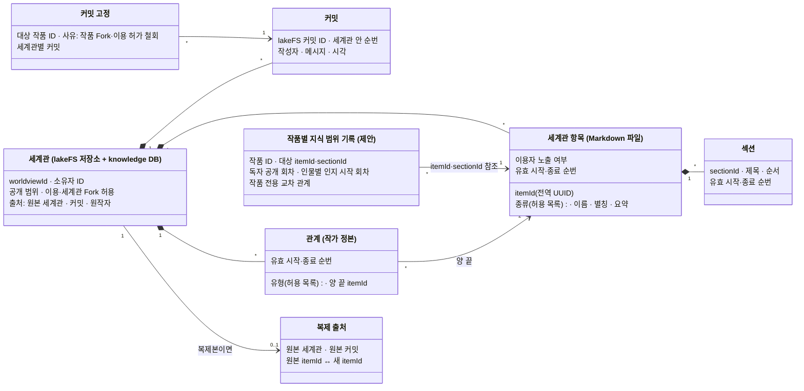
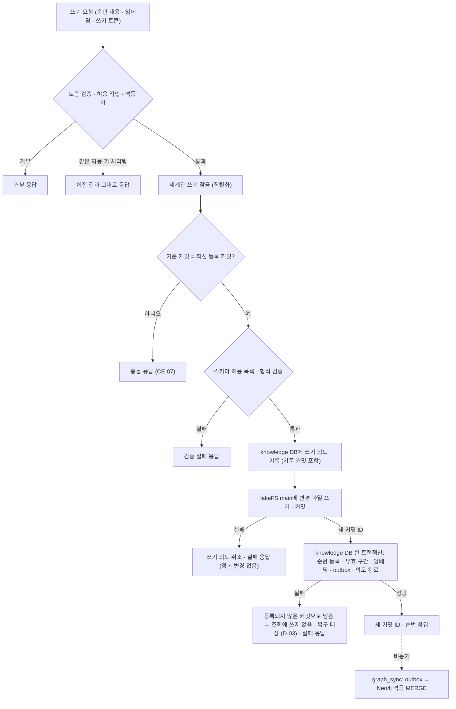
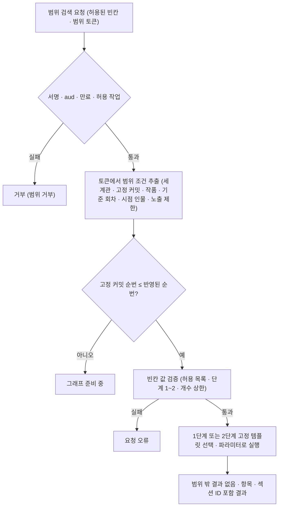

> **보관 문서(2026-10-30):** KAG·lakeFS·Neo4j를 전제로 한 이전 설계안입니다. MVP는 [DEC-16](../../../decisions.md#결정-목록)에서 MVP용 RDB 저장 방향을 검토하며, 새 설계는 [docs/design](../../../design.md)에 있습니다. 이 문서는 비교·후속 검토용으로만 보관합니다.

# knowledge-service (가칭 `storyfork-knowledge-service`)

> 상위 문서: [시스템 아키텍처](../design.md). 상태 표기는 [표기](../design.md#표기)를 따릅니다. 신규 서비스이며 분리와 저장 방식은 `채택`입니다. 세계관 정본을 Core에서 이 서비스로 옮기는 것은 `채택` — 기존 `확정`(Core가 세계관 정본 소유, [AGENTS.md](../../../../../AGENTS.md) 서비스 책임) 대체, 팀 재결정 필요입니다.

## 목적과 한 줄 정의

**세계관 정본과 지식 그래프의 주인입니다.** LLM을 쓰지 않고 다른 서비스를 호출하지 않습니다. 모든 조회에 Core가 서명한 범위를 강제합니다. OpenSPG 서버(Java)를 가져오지 않고, KAG가 필요로 하는 기능만 Kotlin으로 새로 구현합니다(`채택`).

## 책임과 하지 않는 일

| 하는 일 | 하지 않는 일 |
|---|---|
| 세계관 위키 항목·섹션·관계 CRUD, 커밋, 되돌리기, 차이, 특정 커밋 조회 | LLM·임베딩 모델 호출 |
| 작품 Fork·이용 허가 철회 시 커밋 고정, 세계관 복제(세계관 Fork·조합·장르 기본) | 다른 서비스 호출(Core 포함) |
| 세계관 메타데이터(소유·공개·이용·Fork 조건·출처) 저장 | 권한 판단(쓰기 토큰에 적힌 작업만 실행) |
| 작품별 지식 범위 기록 저장(`제안`, D-31), 공개 전환 통지 반영 | 작품·회차·크레딧 정본 저장 |
| 커밋 → Neo4j 그래프 반영, 그래프 재생성 | 오래된 그래프를 표시 없이 사용 |
| 범위 검색 API: 토큰에서 범위를 꺼내 모든 조회에 주입 | 토큰 없는 조회, 토큰 범위를 넘는 결과, 쿼리 문자열(Cypher·KGDSL) 실행 |
| 근거 확인: 근거 ID 집합이 범위 토큰 안인지 판정 | 범위 밖 데이터의 존재 여부 노출 |

## 기술 스택

| 항목 | 내용 | 상태 |
|---|---|---|
| 런타임 | Kotlin·Spring Boot. JDK·Spring 버전은 core-api와 맞춤 | `채택`(언어·프레임워크, D-29 해소), 버전 맞춤 `제안` |
| 토큰 검증 | Spring Security(리소스 서버 방식, Core 공개키) | `채택` |
| 정본 파일 | lakeFS. 객체 읽기·쓰기는 S3 게이트웨이, 저장소 생성·커밋·차이는 lakeFS API | `채택`(lakeFS), 인터페이스 배분 `제안` |
| 메타데이터 | PostgreSQL knowledge DB. 인스턴스는 knowledge-postgres(lakeFS 메타데이터 DB와 같은 인스턴스, DB·계정 분리) | `채택`(DEC-13), 같은 인스턴스는 `제안` |
| 스키마 마이그레이션 | Flyway. 버전 파일은 이 서비스 안에 두고 knowledge DB 스키마만 바꿈. lakeFS DB는 lakeFS 자체 마이그레이션 | `채택`(DEC-13). 새 의존성이므로 도입 전 공유 |
| 그래프 | Neo4j Community, 공식 드라이버, 고정 쿼리 템플릿만 | `채택` |
| 클라이언트 라이브러리 | lakeFS·S3·Neo4j·DB 접근 라이브러리 선택 | `미정`(새 의존성은 도입 전 공유) |

## OpenSPG와의 관계 (부분 호환)

KAG가 부르던 OpenSPG 기능 중 필요한 것만 **의미가 같게** 제공합니다. kag-service의 검색 관문 구현을 교체하므로(K-01) 경로·형식까지 OpenSPG와 같을 필요는 없습니다(`제안`).

| KAG가 부르던 OpenSPG 기능 | 이 서비스의 대응 | 상태 |
|---|---|---|
| 스키마 조회 | 스키마 API(항목 종류·관계 유형 허용 목록) | 호환 `채택` |
| 노드 조회(`query_node`) | 엔티티 조회(여러 ID 묶음) | 호환 `채택` |
| 텍스트·벡터 검색 | 텍스트 검색·벡터 검색 | 호환 `채택` |
| KGDSL 실행(`reason/run`) | 호환하지 않음. 구조화 그래프 API(엔티티 조회, 묶음 1단계 확장, 2단계 확장, 경로 찾기)로 대체 | `채택` |
| KGDSL 추론 엔진, 빌드 파이프라인, 스키마 화면, 프로젝트 관리, `writerGraph`, `search_custom` | 만들지 않음 | `채택` |

## 내부 구조 (모듈)

기능 중심 레이어드(`controller → service → repository/client`)를 따릅니다. 모듈 이름은 가칭입니다(`제안`).

| 모듈 | 책임 | 저장소 |
|---|---|---|
| `worldview` | 세계관 정본: 위키 항목 CRUD, 커밋, 되돌리기, 차이, 특정 커밋 조회, 커밋 고정, 세계관 복제, 세계관 메타데이터, 삭제(연결 작품이 없을 때만) | lakeFS, knowledge DB |
| `schema` | 항목 종류·관계 유형 허용 목록과 검증. 목록 자체는 `미정`(D-24) | knowledge DB 또는 설정 |
| `work_knowledge` | 작품별 지식 범위 기록(섹션·항목별 독자 공개 회차, 인물별 인지 회차, 작품 전용 교차 관계), 공개 전환 통지 반영, Fork용 사본(`제안`, D-31) | knowledge DB |
| `graph_sync` | outbox를 읽어 Neo4j에 멱등 반영, 재시도, 전체 재생성, 반영된 커밋 순번 기록 | knowledge DB, Neo4j |
| `search` | 범위 검색 API. 토큰 범위를 고정 템플릿에 주입해 실행 | Neo4j, knowledge DB, lakeFS(본문) |
| `scope` | 토큰 검증(Spring Security), 토큰 종류별 허용 API·허용 작업 확인, 범위 조건 추출 | — |

## 소유 데이터와 저장소

### 저장소 배치

| 저장소 | 담는 것 | 성격 |
|---|---|---|
| lakeFS | 세계관 하나 = 저장소 하나. 항목 하나 = 위키 Markdown 파일 하나. 관계 정본(기록 위치 `미정`, D-02) | 정본 |
| knowledge DB(knowledge-postgres) | 세계관 메타데이터, 항목 안정 ID와 복제 원본 ID 대응, 커밋 순번 ↔ lakeFS 커밋 ID, 항목·섹션·관계 유효 시작·종료 순번, 커밋 고정, 임베딩 보관, 작품별 지식 범위 기록(`제안`), outbox, 반영된 커밋 순번 | 정본(메타데이터)·파생(임베딩) |
| Neo4j | 그래프 색인: 구조·메타데이터·짧은 요약·임베딩 색인, 필요하면 검색용 최신 본문 사본 | 파생. lakeFS + knowledge DB에서 언제든 재생성. 백업은 정본만 |
| knowledge 객체 저장소 | lakeFS가 쓰는 객체 데이터. 개발은 knowledge 전용 MinIO 인스턴스, 배포는 lakeFS 전용 S3 버킷(DEC-13) | lakeFS 소유 |

### 위키형 세계관 형식

- 설정집·세계관·인물관계는 위키형 메모로 씁니다. 작가가 메모처럼 항목을 만들고 고치고 지웁니다(CRUD).
- **세계관 = lakeFS 저장소 하나(`채택`).** 저장소는 쓰기 전에 lakeFS API로 미리 만듭니다. S3 게이트웨이의 CreateBucket은 지원되지 않습니다([decisions.md R-03](../decisions.md#r-03-lakefs-1880-s3-게이트웨이-시험)).
- **항목 = Markdown 파일 하나(`채택`).** 상단 메타데이터(안정 ID·종류·이름·별칭·요약·이용자 노출), 본문 안 `[[항목]]` 링크, 제목 단위 섹션. 파일 경로는 이름이 아니라 안정 ID 기준으로 두어 이름 변경이 경로를 바꾸지 않게 합니다(`제안`). 섹션 ID 표기, 관계를 항목 메타데이터에 둘지 별도 파일에 둘지 등 형식 상세는 `미정`(D-02, V-03)입니다.
- **AI는 쓰지 않습니다.** 일반적인 LLM wiki와 달리 LLM이 페이지를 직접 쓰지 않습니다. AI 추출(UC-04)은 후보만 만들고, 작가가 승인한 것만 커밋합니다(BR-01).
- **링크와 관계를 구분합니다.** 본문 `[[링크]]`는 본문에서 계산한 파생 연결(`LINKS_TO`)이고, 관계(`RELATES`, 예: 적대·혈연)는 작가가 정한 정본입니다. 링크는 관계로 자동 승격하지 않습니다.
- **섹션 단위 공개:** 한 페이지 안의 스포일러 문제 때문에 독자 공개 회차와 인물별 인지를 섹션 단위로 둘 수 있게 합니다(표시 방식 `미정`, D-25, V-04). 비공개 섹션 안의 링크는 범위 밖에서 따라가지 않습니다.
- Neo4j 블로그의 LLM wiki 그래프 모델(Document → Section 포함 트리, `NEXT_SECTION`, `LINKS_TO`, 결정적·멱등 재동기화)은 모델 참고로만 씁니다. 해당 도구는 도입하지 않습니다.

### 세계관 버전 모델

Gitea 대신 lakeFS 커밋으로 세계관을 형상관리합니다(`채택` — 기존 `확정`(Gitea, [usecase.md 6.2절](../../../../../docs/usecase.md#62-확정된-정책과-기술-결정) 저장·[architecture.md](../../../../../docs/architecture.md) 합의된 향후 구성요소) 대체, 팀 재결정 필요). 기존 확정 정책상 세계관 이력은 덮어쓰기·머지가 없고 세계관 Fork는 새 세계관으로 복사하므로, 세계관마다 이력이 일직선입니다. 그래서 `main` 브랜치 하나만 씁니다(`제안`).

| 개념 | 내용 | 상태 |
|---|---|---|
| 커밋 | lakeFS 커밋 ID와, 세계관 안에서 1부터 증가하는 순번. 대응은 knowledge DB에 둠. lakeFS 커밋 ID는 해시라 순서 비교가 안 되므로 그래프 필터에는 순번을 씀 | `채택`(대응), 순번 사용 `제안` |
| 등록된 커밋 | knowledge DB에 순번이 기록된 커밋만 조회·고정·차이에 씀 | `제안` |
| 항목 | 경로·이름과 무관한 안정 ID(전역 UUID) | `제안` |
| 유효 구간 | 항목·섹션·관계마다 유효 시작 순번과 종료 순번(없으면 현재). knowledge DB | `채택` |
| 시점 조회 | 순번 X 시점 = 시작 ≤ X 그리고 (종료 없음 또는 종료 > X). 본문은 lakeFS 커밋 ID 경로로 읽음(커밋 경로는 읽기 전용임을 시험으로 확인) | `채택` |
| 되돌리기 | 예전 내용을 복사한 새 커밋. 이력은 지우지 않음 | 규칙 `확정`, 방식 `제안` |
| 차이 | 두 커밋 사이의 lakeFS 변경 목록과 유효 구간 변화 | `제안` |
| 커밋 고정 | 작품 Fork·이용 허가 철회 때 세계관별 커밋을 고정 기록. Core도 Fork 기준에 커밋 ID를 기록 | 고정 `확정`, 수단 `채택` |
| 보관 | 이력 무기한. lakeFS 가비지 수집은 이력을 지우지 않게 설정 | 보관 `확정`, 설정 `제안` |
| 삭제 | 연결된 작품이 없을 때만 삭제. 고정이 참조하는 커밋은 보관하고 소유자 목록에서만 숨김 | `확정` |
| 소멸한 미정 | Gitea 파일 형식·디렉터리 구성·브랜치 운용·Gitea 자체 저장 방식은 Gitea 제거로 소멸. lakeFS 파일 형식으로 대체(`미정`, D-02) | — |

### 두 시간 축

세계관 조회에는 서로 다른 시간 축 두 개가 함께 적용됩니다. 조회는 두 조건을 모두 만족해야 합니다.

| 축 | 의미 | 예 | 저장 |
|---|---|---|---|
| 커밋 순번 | 편집 이력. 작가가 언제 무엇을 고쳤는가 | "커밋 12 시점의 세계관" | lakeFS 커밋 + knowledge DB 유효 구간 |
| 회차 번호 | 이야기 속 시점. 그 작품에서 언제 유효하고, 독자에게 공개되고, 인물이 알게 되는가 | "작품 W 5화까지 독자 공개" | 작품별 지식 범위 기록 |

범위 토큰은 두 축을 함께 담습니다(세계관별 고정 커밋 + 독자 공개 기준 회차·시점 인물).

### 연결 종류별 읽는 버전

| 연결 종류 | 읽는 버전 | 보이는 항목 |
|---|---|---|
| 자기 세계관 | 최신 커밋(Core가 토큰 발급 직전 확인) | 전체 |
| 다른 사용자의 공개 세계관 이용 | 최신 커밋(최신 공개본) | 이용자 노출 항목만 |
| 이용 허가 철회·세계관 비공개 전환 이후 | 철회 시점 고정 커밋 | 이용자 노출 항목만 |
| 세계관 Fork | 자기 Fork 세계관의 최신 커밋 | 복사된 항목 전체 |
| Fork 작품의 고정 세계관 | 분기 시점 고정 커밋 | 분기 시점에 원작에서 독자 공개된 항목만(Fork 작품의 지식 범위 기록 사본 기준) |
| Fork 작품 전용 세계관 | 자기 세계관의 최신 커밋 | 전체(다른 작품에 연결·공개 불가) |

### 작품별 지식 범위 기록

- 섹션·항목별 독자 공개 회차, 인물별 인지 시작 회차, 작품 전용 교차 관계를 작품 ID와 세계관 항목·섹션 ID로 기록합니다.
- 이 기록을 knowledge-service가 소유하는 것은 `제안`이고 경계는 `미정`(D-31)입니다. 범위 집행이 이 기록을 매 조회에 쓰므로 같은 서비스에 두는 편이 단순합니다. 기존 `확정`(작품별 회차 기록은 업무 DB, [usecase.md 6.2절](../../../../../docs/usecase.md#62-확정된-정책과-기술-결정) 저장)을 바꾸므로 팀 재결정이 필요합니다.
- 작품별 인물 상태·설정 유효 회차·`@` 연결은 core DB에 남습니다. 인물 상태를 지식 범위에 쓸지는 `미정`(D-31)입니다.
- 회차 발행으로 공개 기준이 바뀌면 Core가 통지합니다(방식 `미정`, D-21, 큐 없음).

### 세계관 복제

세계관 Fork·조합·장르 기본 복제의 규칙은 기존 확정 정책을 유지합니다. 원본 소유자가 허용한 경우만(판단은 Core), 그 시점 최신 커밋의 이용자 노출 항목만 복사하고, 비노출 항목·원작 작품의 지식 범위 기록·원본 이력은 복사하지 않으며, 출처를 기록합니다(BR-12, `확정`).

- **브랜치가 아니라 새 저장소에 복사합니다(`채택`).** lakeFS 브랜치는 원본 이력을 공유하므로 비노출 항목이 이력에 남습니다.
- **처리 순서(`제안`):** 새 lakeFS 저장소와 새 `worldviewId`를 만들고, 복사할 항목마다 새 `itemId`를 만들어 원본 ID와의 대응을 knowledge DB에 남깁니다. 그 시점 내용을 새 저장소의 커밋 1(메시지에 출처 세계관·커밋)로 씁니다. 관계는 양 끝 항목이 모두 복사된 경우만 새 ID로 다시 만듭니다. 원본의 임베딩을 같은 모델이면 그대로 복사합니다. 끝나면 outbox로 그래프에 반영합니다.
- **미정(D-32):** 복사한 노출 항목 본문 속 비노출 항목 `[[링크]]` 처리, 본문 문장 속 비노출 내용 언급의 책임, 조합 시 같은 이름 항목 처리(기본은 따로 두고 UC-12 설정 검토로 해결).
- 복제 중 실패하면 Core가 작품 연결을 바꾸지 않습니다. 남은 lakeFS 저장소 정리는 `미정`(D-03)입니다.

### 개념 모델 (세계관)

아래는 **개념 모델**입니다. 테이블·파일 형식이 아닙니다. 작품은 core-api의 작품 ID로만 참조합니다.



### 그래프 모델 (Neo4j 파생 색인)

정본(lakeFS + knowledge DB)에서 만든 파생 색인입니다(`채택`). 언제든 정본에서 다시 만들 수 있고, 백업은 정본만 합니다. 아래는 개념 스케치이며 실제 쿼리가 아닙니다.

```text
(:Worldview {worldviewId})
  -[:CONTAINS]-> (:Item {worldviewId, itemId, kind, name, aliases, summary, from, to})
  -[:HAS]-> (:Section {sectionId, title, summary, order, 공개 회차·인지 정보, from, to})
(:Section)-[:NEXT_SECTION]->(:Section)
(:Section)-[:LINKS_TO]->(:Item)                    본문 [[링크]], 파생
(:Item)-[:RELATES {type, from, to}]->(:Item)       작가가 정한 관계, 정본 반영
(:Work)-[:USES {linkType, pinnedSeq}]->(:Worldview)
(:Item)-[:WORK_LINK {workId, ...}]->(:Item)        세계관 사이 교차 관계는 이것만
```

- **두 시간 축:** `from`·`to`는 커밋 순번 유효 구간입니다. 회차 축 정보(독자 공개 회차·인지)는 작품마다 다르므로 작품별 속성으로 둡니다(표현 방식 `미정`, D-25).
- **격리:** 세계관마다 DB·라벨을 따로 만들지 않고 DB 하나에 `worldviewId`로 구분합니다. 모든 조회는 토큰의 세계관 루트(`Worldview`)에서 시작합니다. `CONTAINS`·`HAS`·`NEXT_SECTION`·`LINKS_TO`·`RELATES`는 같은 세계관 안에서만 만들고, 반영 코드가 양 끝 `worldviewId` 일치를 확인합니다(Property 22). 세계관 사이 연결은 작품 범위의 `WORK_LINK`만 허용하며 그 작품의 토큰일 때만 따라갑니다. `itemId` 고유 제약과 `worldviewId` 인덱스를 둡니다.
- **노드 내용:** 구조·메타데이터·짧은 요약·임베딩 중심입니다. 본문 정본은 lakeFS에 있습니다. 검색용 최신 본문 사본은 필요할 때만 파생으로 추가하고, 과거 시점 본문은 lakeFS 커밋 경로에서 읽습니다. AI가 만든 요약은 항목 버전에 묶인 파생 데이터이고, 작가가 쓴 요약은 정본입니다.
- **반영:** knowledge DB 트랜잭션에 outbox 행을 함께 기록하고, 커밋 뒤 `graph_sync`가 Neo4j에 `MERGE`로 멱등 반영합니다. 실패하면 다시 시도합니다. 세계관마다 "반영된 커밋 순번"을 기록하고, 토큰의 고정 커밋이 그보다 새로우면 그래프 조회를 하지 않고 "그래프 준비 중"으로 응답합니다(Property 31). 고정 커밋이 반영된 순번 이하면 이후 커밋이 밀려 있어도 유효 구간으로 정확히 조회할 수 있습니다.
- **임베딩:** Core가 쓰기 요청에 함께 보낸 임베딩을 knowledge DB에 보관하고 Neo4j 벡터 색인에 반영합니다. knowledge-service는 다른 서비스를 부르지 않으므로, 재생성에 필요한 임베딩을 스스로 보관해야 합니다(`제안`, 형식 `미정` D-27).
- **Community 판의 한계:** 온라인 백업·RBAC가 없습니다. 접근 주체가 knowledge-service 하나이고 정본이 아니므로 수용합니다(`채택`). 범위 집행을 Neo4j 권한 기능에 맡기지 않습니다([decisions.md](../decisions.md#검토-후-제외한-대안)).

## 제공 API

접두어 `/internal/v1`. 경로는 **가칭**입니다(`제안`). 쿼리 문자열을 받는 API는 없습니다.

### 관리 API

core-api만 호출합니다.

| 범주(가칭 경로) | 기능 | 토큰 | 호출 모듈 |
|---|---|---|---|
| `health`·`status` | 내부 상태, 세계관별 그래프 반영 지연·outbox 적체 | 서비스 토큰 | `ops` |
| `worldviews` | 세계관 생성·메타데이터(공개·이용·Fork 조건) 조회·변경·삭제, 항목·섹션·관계 CRUD(커밋 생성), 영향 작품, 현재 커밋 조회 | 쓰기 토큰(변경), 서비스 토큰(조회) | `worldview`, `ai_context`(현재 커밋) |
| `worldviews/{id}/commits` | 이력·특정 커밋 조회·차이·되돌리기 | 서비스 토큰(조회), 쓰기 토큰(되돌리기) | `worldview` |
| `worldview-copies` | 세계관 Fork·조합·장르 기본 복제 | 쓰기 토큰 | `worldview` |
| `pins` | 작품 Fork·이용 허가 철회 시 세계관별 커밋 고정, 지식 범위 기록 사본, 고정 취소(보상) | 쓰기 토큰(멱등 키 필수) | `fork`, `work` |
| `work-knowledge` | 지식 범위 기록(독자 공개·인물 인지·작품 전용 교차 관계) 변경, 발행 회차 통지 | 쓰기 토큰 | `work`, `episode` |
| `restrictions` | 세계관 권리 제한 상태 | 쓰기 토큰 | `worldview`(`report` 요청) |
| `evidence-checks` | 근거 ID 집합이 범위 토큰 안인지 판정 | 서비스 토큰 + 검증할 범위 토큰 | `ai_context` |

- 쓰기 토큰에는 대상 세계관·허용 작업·기준 커밋·행위자 ID·멱등 키가 있습니다. 토큰에 없는 작업은 실행하지 않습니다(D-22 해소).
- 쓰기는 기준 커밋이 현재 최신 등록 커밋과 같을 때만 반영합니다(CE-07). 같은 세계관의 쓰기는 직렬화합니다(`제안`).

### 범위 검색 API

kag-service만 호출합니다. 모두 읽기 전용이며 범위 토큰이 필수입니다(`채택`).

| 범주(가칭 경로) | 기능 | 허용된 빈칸 | 비고 |
|---|---|---|---|
| `search/schema` | 항목 종류·관계 유형 허용 목록 | 없음 | KAG 스키마 서버 대체(K-03) |
| `search/entities` | 엔티티 조회(여러 ID 묶음) | 항목 ID 목록 | `query_node` 대응 |
| `search/text-search` | 이름·별칭·요약 텍스트 검색 | 검색어, 항목 종류(허용 목록), 개수 | 한국어 분석기 `미정` |
| `search/vector-search` | 임베딩 유사도 검색 | 질의 벡터(kag-service 생성), 개수 | Neo4j 벡터 색인 |
| `search/expand` | 묶음 1단계 확장, 2단계 확장 | 시작 항목 ID 목록, 관계 유형(허용 목록), 단계(1 또는 2), 개수 | 단계마다 다른 고정 템플릿 |
| `search/paths` | 두 항목 사이 경로 | 두 항목 ID, 최대 단계(1~2) | 고정 템플릿 |
| `search/sections` | 항목의 섹션 본문 | 항목 ID, 섹션 제목 또는 ID | 본문은 고정 커밋의 lakeFS 경로에서 읽음 |
| `search/character-knowledge` | 토큰의 시점 인물이 아는 사실 | 없음(인물·시점은 토큰에서) | 인물 토큰의 허용 작업은 이것뿐 |

**허용된 빈칸 규칙**

- 범위 조건(세계관 목록, 세계관별 고정 커밋, 작품 ID, 독자 공개 기준 회차, 시점 인물, 허용 작업, 이용자 노출 제한)은 토큰에서만 꺼내 서버가 주입합니다. 요청 본문에 같은 이름의 값이 있어도 쓰지 않습니다.
- 요청 값은 파라미터로만 전달합니다. 관계 유형·항목 종류는 허용 목록으로 다시 검증합니다(K-08 재검증).
- Cypher의 가변 길이 단계 수는 파라미터로 넘길 수 없으므로 1단계·2단계 템플릿을 따로 둡니다. 3단계 이상은 없습니다.
- 시작 ID는 이전 결과에 나온 것이어야 합니다. 이 규칙을 kag-service와 이 서비스 중 어디서 확인할지는 `미정`(D-38)입니다. 어느 경우든 범위 밖 ID는 존재하지 않는 ID와 같은 응답이라 추측한 ID로 범위를 넓힐 수 없습니다.
- 비공개 섹션 안의 링크는 범위 밖에서 따라가지 않습니다.
- 결과에는 항목·섹션 ID와 결과 상태(성공·근거 없음·그래프 준비 중)를 담습니다. 개수·크기 상한 값은 `미정`(D-26)입니다.
- KAG의 잦은 1단계 조회를 고려해 묶음 API로 설계합니다. 이 묶음만으로 KAG 기본 파이프라인이 도는지는 V-02에서 확인합니다.

## 호출하는 대상

다른 서비스는 호출하지 않습니다(`채택`). 자기 저장소만 씁니다. 아래 저장소는 모두 knowledge-internal 내부 네트워크에만 있습니다([인프라 네트워크](infrastructure.md#네트워크)).

| 대상 | 용도 | 인증 |
|---|---|---|
| lakeFS | 정본 파일 읽기·쓰기·커밋·차이, 저장소 생성 | lakeFS 자격 증명(이 서비스 전용) |
| knowledge DB(knowledge-postgres) | 메타데이터·유효 구간·지식 범위 기록·outbox·임베딩 | DB 계정(knowledge 전용) |
| Neo4j | 그래프 반영·범위 조회(고정 템플릿만) | Neo4j 계정(기본 계정 금지) |

## 인증·보안

- **토큰 검증:** Spring Security로 Core 공개키 서명·`aud`(knowledge-service)·만료를 확인합니다. API마다 받을 수 있는 토큰 종류가 정해져 있습니다. 범위 토큰으로는 어떤 쓰기 API도 성공하지 않습니다(Property 27).
- **범위 주입:** 범위 조건은 토큰에서만 가져옵니다. 템플릿은 모든 조회를 토큰의 세계관 루트에서 시작하고, 커밋 순번 유효 구간·독자 공개 기준 회차·시점 인물·이용자 노출 조건을 항상 붙입니다.
- **쿼리 주입 방지:** 요청 값은 파라미터로만 넣고, 쿼리 문자열을 받지 않으며, Text2Cypher를 쓰지 않습니다(DP-11). 타입·관계 유형은 허용 목록으로 검증합니다.
- **존재 비노출:** 범위 밖 ID·세계관은 없는 것과 같은 응답을 돌려줍니다(CE-02).
- **네트워크:** 범위 검색 API·관리 API는 서비스 네트워크에만, 저장소 연결은 knowledge-internal 내부 네트워크에만 둡니다. 이 네트워크의 저장소(knowledge-postgres·knowledge 객체 저장소·lakeFS·Neo4j)는 knowledge 도메인 전용이며 core-api가 닿지 않습니다(DEC-13). 호스트 포트를 공개하지 않습니다([인프라 네트워크](infrastructure.md#네트워크)).
- **저장소 자격 증명:** lakeFS·knowledge DB·Neo4j 자격 증명은 이 서비스에만 있습니다. 기본 계정은 쓰지 않습니다.
- **로그:** 토큰 원문·본문 내용을 로그에 남기지 않습니다. 거부 사유 분류와 요청 ID만 남깁니다.

## 이 서비스 관점의 주요 흐름

### 세계관 쓰기

서비스 사이의 순서는 [쓰기: 승인한 세계관 변경 반영](../design.md#쓰기-승인한-세계관-변경-반영)에 있습니다. 이 서비스 안의 순서와 실패 지점은 아래와 같습니다(`제안`, 복구 세부는 `미정` D-03).



- 등록되지 않은 lakeFS 커밋이 남으면 다음 쓰기의 기준 커밋 비교가 맞지 않게 됩니다. 쓰기 의도 기록으로 이 상태를 찾아 되돌리거나 등록을 마치는 복구 순서가 필요합니다(D-03).

### 범위 검색 한 번



### 커밋 고정

- **작품 Fork:** Core가 쓰기 토큰(멱등 키·원작·기준 회차·Fork 작품 ID)으로 요청하면, 한 knowledge DB 트랜잭션에서 원작에 연결된 세계관마다 현재 등록 커밋을 고정하고, 분기 시점 독자 공개 항목만 담은 지식 범위 기록 사본을 Fork 작품 ID로 만듭니다. 세계관별 커밋 ID를 돌려줍니다. 같은 멱등 키는 같은 결과를 돌려줍니다. 서비스 사이 순서는 [작품 Fork 생성](../design.md#서비스에-걸친-쓰기-작품-fork-생성)에 있습니다.
- **이용 허가 철회·세계관 비공개 전환:** 그 세계관을 이용 중인 작품마다 철회 시점 커밋을 고정합니다.
- **고정 취소(보상):** Core 저장이 실패했을 때 쓰는 취소 요청을 받습니다. 바로 취소할지 연결되지 않은 고정을 정리 작업으로 지울지는 `미정`(D-20)입니다.
- 고정이 참조하는 커밋은 세계관을 삭제해도 보관합니다.

### 세계관 복제 처리

[세계관 복제](#세계관-복제)의 순서를 따릅니다. 원본은 읽기만 하고, 새 저장소 생성 → 항목·관계 복사 → 커밋 1 → knowledge DB 등록(새 ID·원본 대응·출처·유효 구간·임베딩 복사·outbox) 순으로 진행합니다. knowledge DB 등록 전에 실패하면 새 세계관은 조회되지 않고, 남은 lakeFS 저장소는 정리 대상입니다(D-03).

### 공개 전환 반영

Core가 "작품 W의 발행 회차가 n이 됨"을 통지하면 그 작품의 지식 범위 기록에 반영합니다(방식 `미정`, D-21). 같은 통지를 여러 번 받아도 결과가 같게 처리합니다(`제안`). 통지가 늦어도 범위 토큰의 독자 공개 기준 회차는 Core가 정하므로, 늦은 반영이 독자에게 더 많은 정보를 보이게 하지 않습니다.

### 그래프 재생성

Neo4j를 비우고 lakeFS 등록 커밋과 knowledge DB에서 다시 만듭니다. 재생성 중인 세계관은 "그래프 준비 중"으로 응답합니다. 같은 정본 상태에서 몇 번을 다시 만들어도 결과가 같아야 합니다(Property 23).

## 실패 처리

| 상황 | 응답·상태 | 정본 영향 |
|---|---|---|
| 토큰 없음·위조·만료·`aud` 불일치·허용 작업 밖 | 거부 | 없음 |
| 기준 커밋 불일치 | 충돌 | 없음 |
| 스키마·형식 검증 실패 | 검증 실패 | 없음 |
| lakeFS 쓰기·커밋 실패 | 실패 | 없음(쓰기 의도 취소) |
| lakeFS 커밋 뒤 knowledge DB 등록 실패 | 실패 | 등록되지 않은 커밋이 남음. 조회에 쓰지 않고 복구 대상(D-03) |
| outbox 반영 실패 | 쓰기 응답은 성공. 반영은 재시도. 그 커밋을 읽는 조회는 "그래프 준비 중" | 없음(그래프는 파생) |
| 고정 커밋이 반영되지 않음 | "그래프 준비 중" | 없음 |
| Neo4j 연결 불가 | 범위 검색 실패(하위 실패). 빈 결과로 바꾸지 않음 | 없음 |
| knowledge DB 연결 불가 | 모든 API 실패 | 없음 |
| 복제 중 실패 | 실패. 새 세계관은 등록되지 않음 | 원본 변경 없음. 남은 저장소 정리 대상(D-03) |
| 범위 안 결과 없음 | "근거 없음" 결과(실패 아님) | 없음 |

## 관측성

- 세계관별 반영된 커밋 순번과 최신 등록 순번의 차이, outbox 적체 수, 토큰 거부 수(사유 분류), 쓰기 충돌 수, 등록되지 않은 커밋 수를 `status` API로 내놓습니다(`제안`). 이 서비스는 Core를 부르지 않으므로 Core `ops`가 주기적으로 조회해 경고합니다.
- 로그에는 요청 ID·상관 ID·결과 상태만 남기고 토큰 원문·본문은 남기지 않습니다. 상관 ID는 받은 W3C `traceparent`를 그대로 씁니다. 이 서비스는 Langfuse에 기록하지 않습니다(`제안`, [공통 계약: 관측성](../design.md#공통-계약-관측성)).

## 성능

- **묶음 API:** KAG의 잦은 1단계 조회를 묶어 받습니다(`채택`). 개수 상한으로 한 요청의 크기를 제한합니다(D-26).
- **인덱스:** `itemId` 고유 제약, `worldviewId` 인덱스, 유효 구간 필터에 쓰는 속성 인덱스, 텍스트·벡터 색인을 둡니다(`제안`). 한국어 전문 검색 분석기 선택은 `미정`입니다.
- **단계 상한:** 확장·경로는 2단계까지입니다. 3단계 이상은 템플릿이 없습니다.
- **본문 읽기:** 과거 시점 본문은 lakeFS 커밋 경로에서 읽습니다. 커밋은 불변이므로 커밋 ID 기준 캐시가 단순하지만, 측정 전에는 만들지 않습니다(`제안`).
- **규모:** 세계관 수만큼 lakeFS 저장소가 생깁니다. 저장소 수가 많을 때의 lakeFS 동작은 V-03에서 확인합니다.

## 설정·비밀값

| 설정 | 내용 | 상태 |
|---|---|---|
| knowledge DB 접속 정보 | knowledge-postgres의 knowledge DB 전용 계정 | `채택` |
| lakeFS 주소·자격 증명 | 이 서비스 전용 | `채택` |
| Neo4j 주소·계정 | 기본 계정 금지 | `채택` |
| Core 공개키 | 토큰 검증 | `채택`, 배포 방식 `미정`(D-23) |
| 받지 않는 것 | OpenAI·Langfuse 키, core DB 자격 증명, 토큰 서명 개인키 | `채택` |

환경설정 원칙은 [인프라 환경설정·비밀값](infrastructure.md#환경설정비밀값)을 따릅니다.

## 관련 정확성 속성

[Correctness Properties](../design.md#correctness-properties) 중 knowledge-service가 담당하거나 함께 지키는 것: Property 1·2(Fork 고정·범위), 3(고정 보상), 5(쓰기 토큰 없이 커밋 없음), 10·11(범위 주입), 16(추가만 하는 커밋·기준 커밋), 17(세계관 권리 제한), 21(범위 밖 데이터 없음), 22(세계관 사이 엣지 없음), 23(재생성 결정성), 24(커밋 시점 재현 불변), 25(복제 무결성), 26(근거 확인), 27(범위 토큰으로 쓰기 불가), 28(동시 요청 격리), 31(오래된 그래프 미사용).

## 위험·미정

- **lakeFS ↔ knowledge DB 정합성:** 두 저장소는 한 트랜잭션이 아닙니다. 복구 순서가 정해지기 전까지 등록되지 않은 커밋이 생길 수 있습니다(D-03).
- **lakeFS 라이선스:** 1.87.0 이상은 BSL 1.1입니다. 운영 사용은 조건이 있습니다(D-35, [인프라 lakeFS](infrastructure.md#lakefs)).
- **SDK 차이:** S3 게이트웨이 시험은 Python MinIO SDK로 했습니다. 이 서비스는 JVM SDK를 쓰므로 V-03에서 다시 확인합니다.
- **한국어 검색:** Neo4j 전문 색인의 한국어 분석기 품질은 확인 전입니다.
- D-02(파일 형식), D-20(고정 보상), D-21(통지 방식), D-24(스키마 목록), D-25(섹션 공개 표시), D-26(상한 값), D-27(임베딩 보관), D-31(지식 범위 기록 경계), D-32(복제 세부), D-38(시작 ID 규칙). 전체 목록은 [위험·미정 총괄](../design.md#위험미정-사항과-후속-결정)에 있습니다.
