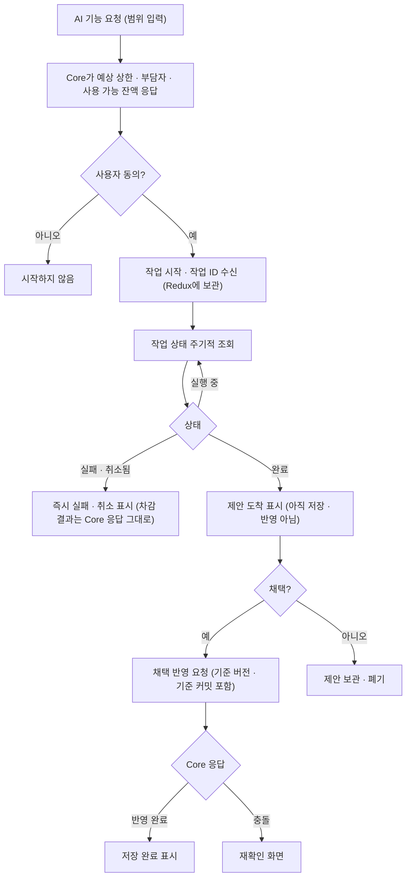

> **보관 문서(2026-10-30):** KAG·lakeFS·Neo4j를 전제로 한 이전 설계안입니다. MVP는 [DEC-16](../../../decisions.md#결정-목록)에서 MVP용 RDB 저장 방향을 검토하며, 새 설계는 [docs/design](../../../design.md)에 있습니다. 이 문서는 비교·후속 검토용으로만 보관합니다.

# web (`storyfork-web`)

> 상위 문서: [시스템 아키텍처](../design.md). 상태 표기(`현재`·`확정`·`합의`·`채택`·`제안`·`미정`)는 [표기](../design.md#표기)를 따릅니다. 서비스 분리(`채택`)로 web이 바뀌는 점은 없습니다. 호출 대상은 계속 공개 Core API 하나입니다.

## 목적과 한 줄 정의

**브라우저에서 사용자 상호작용과 상태 표시를 맡는 React SPA입니다.** 판단은 core-api 결과를 따릅니다.

## 책임과 하지 않는 일

| 하는 일 | 하지 않는 일 |
|---|---|
| 입력·열람·편집·검토·선택·상태 표시 | ai-service·kag-service·knowledge-service·OpenAI 직접 호출 |
| 로딩·실패·완료를 실제 API 결과와 일치시켜 표시 | 내부 DTO를 공개 계약으로 사용 |
| 중복 전송 방지, 화면 이탈 시 요청 취소, 늦은 응답 무시 | 버튼 숨김으로 서버 권한 검사 대체 |
| 세계관 저장 요청에 기준 커밋을 함께 보내고 충돌 응답을 재확인 화면으로 보여 줌 | AI 제안 도착을 원고 저장·승인·발행 완료로 표시 |
| `/api`를 Core로 중계(dev Vite, prod nginx) | `VITE_*`·브라우저 번들에 비밀값·비공개 원고 보관 |

## 기술 스택

| 항목 | 내용 | 상태 |
|---|---|---|
| 프레임워크 | React 19, TypeScript 6, Vite 8, React Router, React Hook Form | `현재` |
| 상태·DI·검증 | Redux Toolkit, Awilix `app/di`, Zod 4 | `현재` |
| 스타일 | Tailwind CSS 4, 기존 디자인 토큰 | `현재` |
| 테스트·검사 | Vitest·Testing Library(jsdom), oxlint | `현재` |
| prod 런타임 | pnpm locked build → nginx 정적 런타임 | `현재` |

## 내부 구조

- **현재:** `App`은 `/` 시작 화면과 알 수 없는 UI 경로의 홈 이동만 담당합니다. 상태 UI는 `CoreApiConnectionStatus → useCoreApiHealth → appContainer 외부 함수 → Fetch·Zod`입니다(`현재`).
- **업무 화면(`확정`):** 업무 화면이 생길 때부터 `View → ViewModel → UseCase → Repository → HTTP DTO`. ViewModel은 전역 `appContainer`에서 필요한 UseCase만 조회하고, Fetch와 Zod 응답 검증은 Data Layer에 둡니다.
- **상태 배치(`확정`):** 화면 전용 상태는 React Hook, 화면 간 유지할 작업 상태(예: 진행 중인 AI 작업 ID, 읽지 않은 알림 수)는 Redux Toolkit에 둡니다. 같은 상태를 양쪽에 두지 않고 Redux에는 직렬화 가능한 값만 넣습니다.

### 화면 영역 (`제안`)

기능 폴더는 실제 화면을 구현할 때만 만듭니다.

| 화면 영역 | 주요 화면(프로토타입 ID) | 관련 UC |
|---|---|---|
| 열람·탐색 | 홈·검색·작품 상세·회차 뷰어·관심 소설(U01~U05, U26, U29, U32, U36) | UC-01 |
| 계정 | 가입·로그인·프로필·기기·탈퇴(L01, U30, U31) | UC-22 |
| 세계관 | 내 세계관·공개 세계관·이력(WLD). Core가 knowledge-service로 중계하지만 web이 보는 계약은 공개 Core API뿐 | UC-02, UC-05, UC-07 |
| 작품·작품 설정 | 새 작품·작품 설정·공개 설정(U21, U28) | UC-07, UC-24 |
| 집필실 | 편집기·버전·이미지·내보내기·보조 화면(U13, U18, U19, U37~U41) | UC-03, UC-10 |
| 창작 AI 지원 | 설정 추출·시뮬레이션·AI 제안·설정 검사(U14~U17, U24) | UC-04, UC-09, UC-11, UC-12 |
| 발행 | 회차 공개·공개 중단(U22) | UC-13 |
| Fork | Fork 폼·생성 완료(U09, U10) | UC-08 |
| 피드백 | 댓글·제보·검증 시뮬레이션·내 피드백·독자 피드백함(U06, U08, U20) | UC-14~16 |
| 자율 연재 | 작품 설정 안의 자율 연재 설정·상태 | UC-18 |
| 크레딧 | 잔액·소멸 예정·사용 내역·실행 전 동의(U23) | UC-17 |
| 알림 | 알림함·알림 설정 | UC-27 |
| 권리 신고 | 신고·소명 제출 | UC-20 |
| 운영 | 경고 목록·로그·정기 작업·신고 처리·숨김 복원·AI 운영(A03~A05) | UC-20, UC-21, UC-23, UC-26, UC-28 |

### 결정

- 운영 화면은 별도 앱이 아니라 같은 SPA의 운영자 전용 경로로 둡니다(`제안`). 화면 접근 제어는 표시용이며, 모든 운영 API는 Core가 운영자 권한을 검사합니다.
- AI 작업은 작업 ID로 상태를 주기적으로 조회해 `실행 중 → 완료/실패/취소됨`을 표시합니다(`제안`). 결과 도착은 "제안 도착"으로만 표시하고, 채택·저장은 별도 사용자 행동입니다.
- 세계관 그래프·관계 화면을 만들면, Core가 돌려준 "그래프 준비 중" 상태를 그대로 보여 주고 이전 결과를 최신처럼 보여 주지 않습니다(`제안`).
- 정적 프로토타입(`frontend/index.html`)은 React 진입점을 불러오지 않습니다. 첫 업무 화면 구현 시 진입점 정리와 프로토타입 보존 방식을 정합니다(`미정`, D-18). 프로토타입 동작은 정책 근거가 아니며 정정 목록(P-02~P-17)은 문서 기준을 따릅니다.

## 소유 데이터와 저장소

업무 정본이 없습니다. 브라우저 메모리의 화면 상태와 Redux의 작업 상태만 가집니다. 사용자 토큰을 어디에 둘지(메모리·HttpOnly 쿠키 등)는 `미정`(D-04)입니다.

## 제공 API

정적 자원과 `/api` 프록시만 제공합니다(`현재`). 브라우저는 `/api`를 쓰고 Vite(dev)·nginx(prod)가 내부 Core 주소로 중계합니다. API 404는 SPA HTML로 바꾸지 않고, 알 수 없는 UI deep link만 홈 화면으로 보냅니다.

## 호출하는 대상

| 대상 | 범주 | 상세 |
|---|---|---|
| 공개 Core API(`/api/v1`) | 인증·탐색·세계관·작품·회차·Fork·AI 작업·피드백·자율 연재·알림·신고·운영 | [core-api 공개 API](core-api.md#공개-api) |

다른 서비스는 호출하지 않습니다([허용 호출 방향](../design.md#허용-호출-방향)).

## 인증·보안

- 사용자 접근 토큰과 갱신 토큰만 다룹니다. 서비스 토큰·쓰기 토큰·범위 토큰은 web에 오지 않습니다([공통 계약: 인증·토큰](../design.md#공통-계약-인증토큰)).
- 토큰 보관 위치와 그에 따른 CSRF·XSS 대응, 로그인 실패 잠금 기준은 `미정`(D-04)입니다.
- `VITE_*`와 브라우저 번들에는 공개 설정만 둡니다. 비공개 원고·API 키를 넣지 않습니다(`확정`).
- 권한·승인·크레딧은 Core 결과를 따릅니다. 화면에서 버튼을 숨기는 것은 표시용입니다(`확정`).

## 이 서비스 관점의 주요 흐름

### AI 작업 진행 표시

- 진행 표시를 주기적 조회로 할지 서버 전송 이벤트로 할지는 `미정`(D-07)이며, 가장 단순한 주기적 조회를 기본으로 둡니다.
- 작업은 작업 ID로 조회하므로 브라우저가 긴 HTTP 연결을 유지하지 않습니다. 현재 Fetch 20초 제한(`현재`)은 그대로 둡니다.

## 실패 처리

| 상황 | 표시 | 상태 |
|---|---|---|
| 공개 API 실패(Core의 안전한 ProblemDetail) | 화면 오류 안내와 재시도. 하위 서비스 원문 오류는 오지 않음 | `현재` 규칙 확장 |
| AI 작업 `실패` | 즉시 실패 표시. 대기 상태로 두지 않음 | `확정` |
| "그래프 준비 중"으로 끝난 작업 | 준비 중 안내와 잠시 뒤 재요청 안내 | `제안` |
| 기준 버전·기준 커밋 충돌 | 덮어쓰지 않고 재확인 화면 | `확정`(CE-07) |
| 중복 클릭·화면 이탈·늦은 응답 | 중복 전송 방지, 요청 취소, 요청 ID로 늦은 응답 무시 | `확정` |

## 관측성

Core가 요청 진입 때 정한 상관 ID를 오류 화면에 참조 번호로 보여 줄 수 있습니다(`제안`). web은 별도 추적 시스템을 두지 않습니다.

## 설정·비밀값

| 설정 | 내용 |
|---|---|
| 공개 설정 | 루트 `.env.example`의 web 공개 설정(`VITE_*`). Compose는 `/`와 내부 프록시를 지정(`현재`) |
| 비밀값 | 없음. OpenAI·Langfuse·저장소 자격 증명·토큰 서명 키를 받지 않음 |

## 관련 정확성 속성

[Property 14](../design.md#correctness-properties)(독자는 발행본만), Property 19(상태 표시의 정직성), Property 20(번들에 비밀값 없음).

## 위험·미정

D-04(토큰 보관), D-07(진행 표시 방식), D-18(프론트엔드 진입점). 전체 목록은 [위험·미정 총괄](../design.md#위험미정-사항과-후속-결정)에 있습니다.
