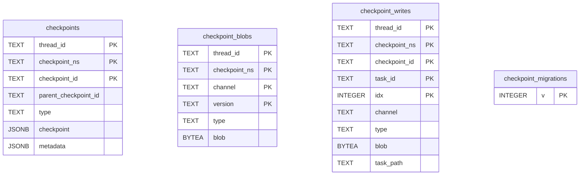

# AI Service 참고 — LangGraph PostgreSQL Saver

> **외부 라이브러리 참고 스키마.** STORYFORK 업무 테이블이 아니며, 도입·DB 배치·보관 정책은 미정입니다. Core의 업무 데이터와 소유권은 [전체 업무 ERD](../overview.md), [Core의 AI 작업·대화 연결](../core/ai-work.md)을 따릅니다.

## 3. LangGraph PostgresSaver의 실제 테이블

### 조사 범위와 버전

사용자가 말한 Saver를 **LangGraph의 Python PostgreSQL 체크포인터**로 해석해 조사했습니다. 이는 도입 후보이지 확정이나 설치 완료가 아닙니다. 2026-11-01 기준 PyPI의 `langgraph-checkpoint-postgres` **3.2.0 배포본**을 확인하고, wheel의 SHA-256을 PyPI 메타데이터와 대조했습니다.[8]

배포본의 `base.py`·`__init__.py`는 공식 저장소 고정 커밋 `e5c961d7fbe7ca6fdd4c94c84d90511372514d55`의 같은 파일과 바이트 단위로 일치했습니다.[4][7] `aio.py`·`shallow.py`도 해당 커밋과 일치했습니다.[6][9]

아래는 이 버전의 **일반 `PostgresSaver`와 `AsyncPostgresSaver`**가 빈 PostgreSQL에서 `setup()`으로 마이그레이션 0~9를 정상 적용한 뒤의 스키마입니다.[4]

`setup()`은 라이브러리의 테이블을 생성하고 마이그레이션을 적용합니다. 실제 STORYFORK DB에 접속하거나 이 메서드를 실행한 것은 아닙니다.[3][7] 버전이 달라지면 SQL을 다시 확인해야 하며, DB와 스키마를 업무 데이터와 어떻게 분리할지는 미정입니다.



위 네 테이블에는 소스 SQL상 **서로를 참조하는 FK가 없으므로 관계선을 그리지 않았습니다.** 아래 연결은 라이브러리의 식별자·조회 방식이지 DB가 강제하는 FK가 아닙니다.[4]

| 실제 테이블 | 역할 | 기본키 | 중요한 연결·속성 |
|---|---|---|---|
| `checkpoints` | 각 thread의 그래프 실행 상태와 메타데이터 | `(thread_id, checkpoint_ns, checkpoint_id)` | `parent_checkpoint_id`는 이전 상태의 ID. `checkpoint`·`metadata`는 JSONB이며 `metadata` 기본값은 `{}`. |
| `checkpoint_blobs` | 채널별 버전의 직렬화된 값 | `(thread_id, checkpoint_ns, channel, version)` | 상태에 기록된 채널 버전과 같은 thread·namespace·channel·version으로 조회. `blob`은 nullable `BYTEA`; 메시지 전용 테이블은 아닙니다. |
| `checkpoint_writes` | 실행 단계의 작업별 중간 쓰기 | `(thread_id, checkpoint_ns, checkpoint_id, task_id, idx)` | 공통 thread·namespace·checkpoint ID로 상태와 연결되는 데이터. `blob`은 NOT NULL `BYTEA`, `type`은 nullable. `task_path`는 마이그레이션 9로 추가됩니다. |
| `checkpoint_migrations` | Saver 자체 마이그레이션 진행 버전 | `v` | 업무 버전 이력이나 Flyway 이력과 별개입니다. |

PK 컬럼은 모두 NOT NULL입니다. 그 밖에 `checkpoints.checkpoint`·`checkpoints.metadata`, `checkpoint_blobs.type`, `checkpoint_writes.channel`·`checkpoint_writes.blob`·`checkpoint_writes.task_path`도 NOT NULL입니다. `checkpoints.parent_checkpoint_id`·`checkpoints.type`·`checkpoint_blobs.blob`·`checkpoint_writes.type`은 nullable입니다. `checkpoint_ns`와 `task_path`의 기본값은 빈 문자열, `metadata`의 기본값은 `{}`입니다. 실제 SQL에는 각 데이터 테이블의 `thread_id`에 대한 별도 인덱스 `checkpoints_thread_id_idx`, `checkpoint_blobs_thread_id_idx`, `checkpoint_writes_thread_id_idx`도 있습니다. `checkpoint_blobs.blob`은 마이그레이션 4 적용 후 nullable입니다.[4]

- **실제 동작:** `thread_id`로 대화·작업에 쓰는 실행 스레드를 구별하고, `checkpoint_ns`는 그래프/서브그래프 네임스페이스, `checkpoint_id`는 특정 상태 버전을 식별합니다. Saver는 그래프 상태를 단계별로 저장하므로 저장하는 상태에 메시지가 포함되면 대화 지속에도 쓸 수 있습니다. 단, 대화마다 반드시 행 하나만 저장하거나 사람이 읽을 수 있는 `messages` 테이블을 별도로 만든다는 뜻은 아닙니다.[2][4]
- **변형 주의:** 동기·비동기 일반 Saver는 같은 기본 스키마를 사용합니다. `ShallowPostgresSaver`는 최신 상태만 유지하며 같은 테이블명에 **다른 키 구조**를 사용하므로 위 그림을 그대로 적용할 수 없습니다. 일반 Saver와 섞어 쓸 때는 별도 분리·이관 검토가 필요합니다.[6][7]
- **별개 기능:** LangGraph의 장기 메모리 `PostgresStore`는 checkpointer와 다른 기능입니다. 이를 선택하지 않았으므로 Store의 테이블이나 벡터 검색을 위 네 테이블에 포함하지 않습니다.[2]
- **보안:** thread ID 자체는 사용자 인증이나 작품 접근 권한이 아닙니다. Core가 회원·작품·허용된 원고/설정 범위와 대화 소유권을 확인하고, Saver 내용의 개인정보·미발행 원고 보존·삭제·백업을 별도로 설계해야 합니다. 역직렬화 허용 타입 제한 등 선택 버전의 보안 권고도 확인합니다.[8]

### STORYFORK와의 연결 후보

```text
MEMBER ── 소유 ── CHAT_SESSION(id, context_work_id, 선택적 target_fork_work_id)
                         │
                         └ ┄ saver_thread_ref → thread_id ┄ LangGraph checkpoints / blobs / writes

STORYFORK CHECKPOINT = 회차·세계관·관계의 기준점
LangGraph checkpoints = AI 실행 상태. 위 업무 기준점과 별개
```

점선은 **애플리케이션이 식별자를 전달해 연결하는 후보**이지 Saver SQL에 실제 존재하는 FK가 아닙니다. 다른 저장소/스키마에 둘 수도 있으므로 DB 간 FK도 가정하지 않습니다. 사용자의 허용 문맥·기준 버전과 Saver 상태의 범위가 맞는지 확인하고, 저장된 대화에서 과거에 허용했던 내용이 나중에 권한 변경이나 Fork 기준을 넘어 노출되지 않도록 처리 방식을 정해야 합니다.

## Sources

[2] https://docs.langchain.com/oss/python/langgraph/persistence
[3] https://docs.langchain.com/oss/python/langgraph/add-memory
[4] https://github.com/langchain-ai/langgraph/blob/e5c961d7fbe7ca6fdd4c94c84d90511372514d55/libs/checkpoint-postgres/langgraph/checkpoint/postgres/base.py
[6] https://github.com/langchain-ai/langgraph/blob/e5c961d7fbe7ca6fdd4c94c84d90511372514d55/libs/checkpoint-postgres/langgraph/checkpoint/postgres/shallow.py
[7] https://github.com/langchain-ai/langgraph/blob/e5c961d7fbe7ca6fdd4c94c84d90511372514d55/libs/checkpoint-postgres/langgraph/checkpoint/postgres/__init__.py
[8] https://pypi.org/pypi/langgraph-checkpoint-postgres/3.2.0/json
[9] https://github.com/langchain-ai/langgraph/blob/e5c961d7fbe7ca6fdd4c94c84d90511372514d55/libs/checkpoint-postgres/langgraph/checkpoint/postgres/aio.py
