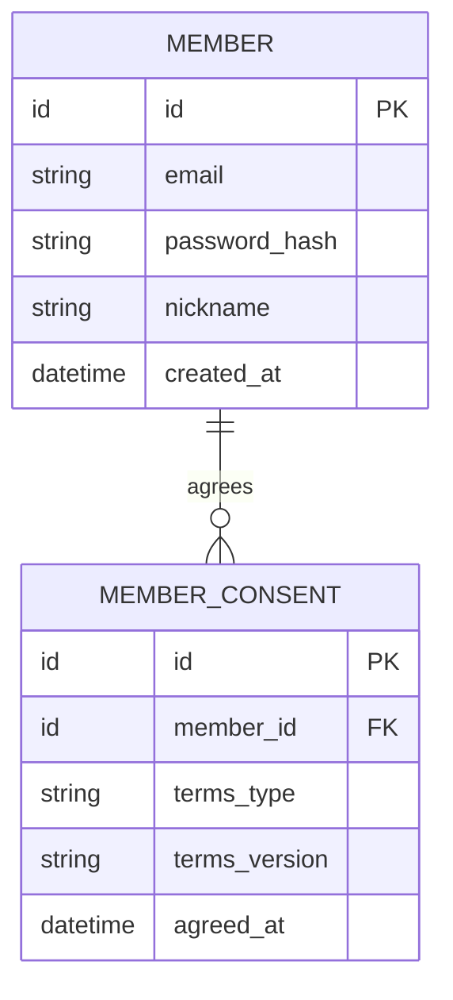

# Core 업무 ERD — 회원·인증

> **전체 ERD의 부분 뷰 · 논리 초안 · 미구현.** [ERD 목차](../README.md) · [전체 업무 ERD](../overview.md). 업무 영역 구분은 별도 배포 서비스나 구현 클래스의 확정이 아닙니다.

회원 식별과 약관 동의를 다루는 Core 업무 영역입니다. 독자와 작가는 별도 계정 등급이 아닙니다.

중심: `MEMBER`, `MEMBER_CONSENT`.

## 이 그림의 테이블

- 중심: [`MEMBER` 회원](../tables.md#member), [`MEMBER_CONSENT` 약관 동의](../tables.md#member-consent).

## 유스케이스와 데이터

- [UC-22 가입·로그인](../../../usecase-spec/UC-22.md): 이메일·비밀번호·닉네임과 필수 약관 동의를 다룹니다. 이메일 중복 방지와 안전한 비밀번호 해시가 필요합니다.
- 같은 회원이 독자이자 작가일 수 있으며, 세계관·작품별 소유권과 접근 권한은 별도로 판단합니다. 공개 회차 열람은 비회원도 가능하지만 Fork·피드백은 로그인해야 합니다.
- 약관 종류·버전·동의 시각은 동의 확인을 위한 후보 데이터입니다. 실제 동의 기록 방식과 보존 정책은 정하지 않았습니다.

## 경계와 미정 사항

- 이메일·비밀번호·닉네임 가입과 필수 약관 동의가 대상입니다. 비밀번호는 평문으로 저장하지 않습니다.
- 약관 동의를 별도 테이블로 둘지, 동의 버전과 보존 방식은 미정입니다. 갱신 토큰·이메일 인증·탈퇴는 MVP 이후입니다.
- 회원은 세계관·작품의 소유자이자 피드백 작성자일 수 있습니다. 그 연결은 [전체 ERD](../overview.md)에서 확인합니다.
