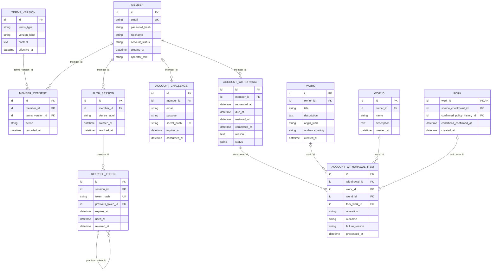

# Core 업무 ERD — 회원·인증

> **전체 서비스 논리 후보 · 분리 구현 전.** [목차](../README.md) · [전체 ERD](../overview.md) · [정규화 검증](../normalization.md) · [요구사항 추적](../requirements-matrix.md). 영역은 서비스 배포 단위가 아닙니다.

근거: [UC-22](../../../usecase-spec/UC-22.md). 최신 결정과 충돌하는 과거 상세는 적용하지 않습니다.

이 뷰의 중심 후보 **8개**, 다른 영역 참조 **3개**입니다. 이 뷰의 중심 테이블 관계만 표시하며 참조 테이블에서 다른 영역으로 나가는 선은 의도적으로 생략합니다.

## 정본 소유와 서비스 경계

[DEC-41 정본 소유·현행 구현과 논리 참조 해석](../README.md#dec-41-적용과-현재-구현)을 따릅니다. `core/`는 기존 문서 경로이며 각 표의 소유 구분이 목표 책임입니다. 그림의 엔티티·컬럼·관계는 그대로 보존하며 회원 인증 비밀을 다른 서비스에 복제하지 않습니다.

Core가 회원·인증·세션·탈퇴 요청/진행을 소유합니다. 작품 소유권·Fork 독립·콘텐츠 삭제/익명화의 실제 처리는 콘텐츠에 요청하고 결과를 확인합니다. `MEMBER.operator_role`은 기존 논리 속성 후보이며 운영 권한 검사·모델·검증 계약을 이 속성 하나로 확정하지 않습니다.

## 이 그림의 테이블

| 뷰 구분 | 테이블 | 범위 | 목표 정본 소유 |
|---|---|---|---|
| 중심 후보 | [`MEMBER`](../tables.md#member) | MVP | Core |
| 중심 후보 | [`TERMS_VERSION`](../tables.md#terms-version) | MVP | Core |
| 중심 후보 | [`MEMBER_CONSENT`](../tables.md#member-consent) | MVP | Core |
| 중심 후보 | [`AUTH_SESSION`](../tables.md#auth-session) | MVP 이후 | Core |
| 중심 후보 | [`REFRESH_TOKEN`](../tables.md#refresh-token) | MVP 이후 | Core |
| 중심 후보 | [`ACCOUNT_CHALLENGE`](../tables.md#account-challenge) | MVP 이후 | Core |
| 중심 후보 | [`ACCOUNT_WITHDRAWAL`](../tables.md#account-withdrawal) | MVP 이후 | Core |
| 중심 후보 | [`ACCOUNT_WITHDRAWAL_ITEM`](../tables.md#account-withdrawal-item) | MVP 이후 | Core |
| 다른 영역 참조 | [`WORLD`](../tables.md#world) | MVP | 콘텐츠 |
| 다른 영역 참조 | [`WORK`](../tables.md#work) | MVP | 콘텐츠 |
| 다른 영역 참조 | [`FORK`](../tables.md#fork) | MVP | 콘텐츠 |

## 데이터 역할과 무결성

- 독자·신입 작가·연재 작가는 이용 상황입니다. 계정 하나에 작품별 소유권을 확인하며 운영자 단일 역할만 별도로 확인합니다. 임의 RBAC 계층을 추가하지 않습니다.
- 약관 **정의/버전**과 회원의 **동의 사실**, 기기 세션과 여러 번 회전한 토큰을 분리했습니다. 토큰·비밀번호는 해시만 저장합니다.
- 이메일 인증 전 회원이 없으므로 확인 요청의 회원 연결은 선택입니다. 아직 가입하지 않은 방문자의 입력을 어떻게 안전하게 보관할지는 물리 설계 사항입니다.
- 탈퇴 요청, 유예, 복구, 대상별 독립 복사·삭제·익명화 결과는 별개입니다. Fork 전환이 실패하면 원본부터 삭제하지 않습니다. 다른 회원이 참조하는 원고 기준본은 보호하며 분기 이전 원고의 독자 노출을 막습니다.
- 갱신 토큰·메일·탈퇴는 MVP 이후입니다. 단순 가입·로그인에 이 전체 테이블을 한꺼번에 구현한다는 뜻이 아닙니다.

각 테이블의 PK·FK·고유키·조건부 필수값과 예시는 [전체 테이블 가이드](../tables.md)에 있습니다. 그림만으로 권한·동시성·삭제 안전성이 보장되지 않습니다.
