# 콘텐츠 업무 ERD — AI 작업·대화·시뮬레이션

> **전체 서비스 논리 후보 · 분리 구현 전.** [목차](../README.md) · [전체 ERD](../overview.md) · [정규화 검증](../normalization.md) · [요구사항 추적](../requirements-matrix.md). 영역은 서비스 배포 단위가 아닙니다.

근거: [UC-04](../../../usecase-spec/UC-04.md), [UC-09](../../../usecase-spec/UC-09.md), [UC-11](../../../usecase-spec/UC-11.md), [UC-12](../../../usecase-spec/UC-12.md), [UC-25](../../../usecase-spec/UC-25.md), [UC-26](../../../usecase-spec/UC-26.md). 최신 결정과 충돌하는 과거 상세는 적용하지 않습니다.

이 뷰의 중심 후보 **23개**, 다른 영역 참조 **10개**입니다. 이 뷰의 중심 테이블 관계만 표시하며 참조 테이블에서 다른 영역으로 나가는 선은 의도적으로 생략합니다.

```mermaid
erDiagram
    MEMBER ||--o{ CHAT_SESSION : "owner_id"
    WORK ||--o{ CHAT_SESSION : "context_work_id"
    FORK o|--o{ CHAT_SESSION : "target_fork_work_id"
    CHAT_SESSION ||--o{ CHAT_MESSAGE : "session_id"
    AI_JOB o|--o{ CHAT_MESSAGE : "ai_job_id"
    MEMBER ||--o{ AI_JOB : "requester_id"
    WORK o|--o{ AI_JOB : "work_id"
    CHAT_SESSION o|--o{ AI_JOB : "session_id"
    AI_JOB o|--o{ AI_JOB : "retry_of_job_id"
    CHECKPOINT o|--o{ AI_JOB : "base_checkpoint_id"
    AI_JOB ||--o{ AI_MODEL_CALL : "job_id"
    AI_MODEL_CALL o|--o{ AI_MODEL_CALL : "retry_of_call_id"
    AI_JOB ||--o{ AI_INPUT_SNAPSHOT : "job_id"
    EPISODE o|--o{ AI_INPUT_SNAPSHOT : "episode_id"
    EPISODE_VERSION o|--o{ AI_INPUT_SNAPSHOT : "episode_version_id"
    SETTING_VERSION o|--o{ AI_INPUT_SNAPSHOT : "setting_version_id"
    AI_JOB ||--o{ AI_PROPOSAL : "job_id"
    AI_INPUT_SNAPSHOT o|--o{ AI_PROPOSAL : "input_snapshot_id"
    EPISODE_VERSION o|--o{ AI_EVIDENCE : "episode_version_id"
    SETTING_VERSION o|--o{ AI_EVIDENCE : "setting_version_id"
    AI_PROPOSAL ||--o{ PROPOSAL_EVIDENCE : "proposal_id"
    AI_EVIDENCE ||--o{ PROPOSAL_EVIDENCE : "evidence_id"
    AI_PROPOSAL ||--o{ PROPOSAL_DECISION : "proposal_id"
    MEMBER o|--o{ PROPOSAL_DECISION : "actor_id"
    WORK_AUTOMATION_VERSION o|--o{ PROPOSAL_DECISION : "automation_policy_id"
    PROPOSAL_DECISION ||--o{ PROPOSAL_APPLICATION : "decision_id"
    PROPOSAL_APPLICATION ||--o{ PROPOSAL_EPISODE_CHANGE : "application_id"
    EPISODE ||--o{ PROPOSAL_EPISODE_CHANGE : "episode_id"
    EPISODE_VERSION o|--o{ PROPOSAL_EPISODE_CHANGE : "result_version_id"
    PROPOSAL_APPLICATION ||--o{ PROPOSAL_SETTING_CHANGE : "application_id"
    SETTING_DOCUMENT ||--o{ PROPOSAL_SETTING_CHANGE : "setting_document_id"
    SETTING_VERSION o|--o{ PROPOSAL_SETTING_CHANGE : "result_version_id"
    PROPOSAL_APPLICATION ||--o{ PROPOSAL_GRAPH_CHANGE : "application_id"
    AI_PROPOSAL ||--o{ PROPOSAL_IMAGE : "proposal_id"
    MANUSCRIPT_ASSET ||--o{ PROPOSAL_IMAGE : "asset_id"
    AI_JOB ||--o| SIMULATION_RUN : "job_id"
    SETTING_DOCUMENT o|--o{ SIMULATION_RUN : "location_setting_id"
    SIMULATION_RUN ||--o{ SIMULATION_PARTICIPANT : "run_id"
    SETTING_DOCUMENT ||--o{ SIMULATION_PARTICIPANT : "character_id"
    AI_PROPOSAL ||--o| SIMULATION_CANDIDATE : "proposal_id"
    SIMULATION_RUN ||--o{ SIMULATION_CANDIDATE : "run_id"
    SIMULATION_CANDIDATE ||--o{ SIMULATION_RECORD : "candidate_id"
    SIMULATION_RECORD ||--o{ SIMULATION_RECORD_PARTICIPANT : "record_id"
    SIMULATION_PARTICIPANT ||--o{ SIMULATION_RECORD_PARTICIPANT : "participant_id"
    SIMULATION_RECORD ||--o{ SIMULATION_CAUSAL_LINK : "cause_record_id"
    SIMULATION_RECORD ||--o{ SIMULATION_CAUSAL_LINK : "effect_record_id"
    AI_JOB ||--o| VERIFICATION_RESULT : "job_id"
    VERIFICATION_RESULT ||--o{ VERIFICATION_EVIDENCE : "verification_job_id"
    AI_EVIDENCE ||--o{ VERIFICATION_EVIDENCE : "evidence_id"
    CHAT_SESSION ||--o| CHARACTER_CHAT : "session_id"
    SETTING_DOCUMENT ||--o{ CHARACTER_CHAT : "character_id"

    CHAT_SESSION {
        id id PK
        id owner_id FK
        id context_work_id FK
        id target_fork_work_id FK
        string saver_thread_ref
        datetime created_at
    }
    CHAT_MESSAGE {
        id id PK
        id session_id FK
        integer sequence
        string speaker
        text content
        id ai_job_id FK
        datetime created_at
    }
    AI_JOB {
        id id PK
        id requester_id FK
        id work_id FK
        id session_id FK
        id retry_of_job_id FK
        id base_checkpoint_id FK
        string kind
        text request_text
        string status
        string failure_reason
        datetime created_at
        datetime started_at
        datetime finished_at
    }
    AI_MODEL_CALL {
        id id PK
        id job_id FK
        integer sequence
        id retry_of_call_id FK
        string role
        string provider
        string model
        string prompt_version_ref
        string trace_ref
        string status
        string usage_status
        integer input_tokens
        integer output_tokens
        decimal provider_cost
        datetime started_at
        datetime finished_at
        string failure_code
    }
    AI_INPUT_SNAPSHOT {
        id id PK
        id job_id FK
        id episode_id FK
        id episode_version_id FK
        id setting_version_id FK
        string graph_state_ref
        string source_kind
        string position
        text content_snapshot
        integer draft_revision
        datetime captured_at
    }
    AI_PROPOSAL {
        id id PK
        id job_id FK
        id input_snapshot_id FK
        integer sequence
        string kind
        text content
        datetime created_at
    }
    AI_EVIDENCE {
        id id PK
        id episode_version_id FK
        id setting_version_id FK
        string graph_state_ref
        string kind
        string position
        text excerpt_snapshot
        datetime captured_at
    }
    PROPOSAL_EVIDENCE {
        id proposal_id PK,FK
        id evidence_id PK,FK
    }
    PROPOSAL_DECISION {
        id id PK
        id proposal_id FK
        integer sequence
        id actor_id FK
        id automation_policy_id FK
        string decision
        string selected_range
        text approved_content
        datetime decided_at
    }
    PROPOSAL_APPLICATION {
        id id PK
        id decision_id FK
        integer attempt_no
        string outcome
        string failure_reason
        datetime attempted_at
    }
    PROPOSAL_EPISODE_CHANGE {
        id id PK
        id application_id FK
        id episode_id FK
        id result_version_id FK
        string position
        text before_content
        text after_content
        integer base_draft_revision
        integer result_draft_revision
    }
    PROPOSAL_SETTING_CHANGE {
        id id PK
        id application_id FK
        id setting_document_id FK
        id result_version_id FK
        string outcome
    }
    PROPOSAL_GRAPH_CHANGE {
        id id PK
        id application_id FK
        string before_state_ref
        string after_state_ref
        string outcome
        string failure_reason
    }
    PROPOSAL_IMAGE {
        id proposal_id PK,FK
        id asset_id PK,FK
        integer position
    }
    SIMULATION_RUN {
        id job_id PK,FK
        string purpose
        id location_setting_id FK
        text situation
        text direction
        integer requested_characters
    }
    SIMULATION_PARTICIPANT {
        id id PK
        id run_id FK
        id character_id FK
        text allowed_context_snapshot
    }
    SIMULATION_CANDIDATE {
        id proposal_id PK,FK
        id run_id FK
        integer sequence
    }
    SIMULATION_RECORD {
        id id PK
        id candidate_id FK
        integer sequence
        string kind
        text content
    }
    SIMULATION_RECORD_PARTICIPANT {
        id record_id PK,FK
        id participant_id PK,FK
    }
    SIMULATION_CAUSAL_LINK {
        id cause_record_id PK,FK
        id effect_record_id PK,FK
        text explanation
    }
    VERIFICATION_RESULT {
        id job_id PK,FK
        string verdict
        decimal confidence
        text content
    }
    VERIFICATION_EVIDENCE {
        id verification_job_id PK,FK
        id evidence_id PK,FK
    }
    CHARACTER_CHAT {
        id session_id PK,FK
        id character_id FK
    }
    MEMBER {
        id id PK
        string email UK
        string password_hash
        string nickname
        string account_status
        datetime created_at
        string operator_role
    }
    SETTING_DOCUMENT {
        id id PK
        id world_id FK
        datetime created_at
    }
    SETTING_VERSION {
        id id PK
        id setting_document_id FK
        integer revision_no
        string name
        id category_id FK
        text content
        id restored_from_id FK
        string lifecycle
        datetime created_at
    }
    WORK {
        id id PK
        id owner_id FK
        string title
        text description
        string origin_kind
        string audience_rating
        datetime created_at
    }
    EPISODE {
        id id PK
        id work_id FK
        integer sequence
    }
    EPISODE_VERSION {
        id id PK
        id episode_id FK
        id work_world_history_id FK
        integer revision_no
        string title
        text content
        id restored_from_id FK
        datetime created_at
    }
    MANUSCRIPT_ASSET {
        id id PK
        id owner_id FK
        string object_url
        string media_type
        integer byte_size
        datetime created_at
    }
    CHECKPOINT {
        id id PK
        id work_id FK
        id basis_episode_version_id FK
        string graph_state_ref
        string status
        datetime created_at
    }
    FORK {
        id work_id PK,FK
        id source_checkpoint_id FK
        id confirmed_policy_history_id FK
        datetime conditions_confirmed_at
        datetime created_at
    }
    WORK_AUTOMATION_VERSION {
        id id PK
        id work_id FK
        integer revision_no
        string world_update_mode
        string proofreading_mode
        string autoserial_state
        datetime changed_at
    }
```

## 정본 소유와 서비스 경계

[DEC-41 정본 소유·현행 구현과 논리 참조 해석](../README.md#dec-41-적용과-현재-구현)을 따릅니다. `core/`는 기존 문서 경로이며 각 표의 소유 구분이 목표 책임입니다. 그림의 엔티티·컬럼·관계는 그대로 보존하며 회원 인증 비밀을 다른 서비스에 복제하지 않습니다.

콘텐츠 대화·시뮬레이션·입력·근거·제안·채택·반영은 콘텐츠 업무입니다. `AI_JOB`·`AI_MODEL_CALL`의 운영 검사/평가 기록은 운영 요청 업무로 구분하며 단일 Core 작업 저장소나 동일 테이블 공유 writer를 확정하지 않습니다. 목적별 물리 분리·AI 실행 상태와 업무 상태의 전달/보관 계약은 후속 설계입니다. AI(Python)는 실행, Core는 최종 정산을 담당합니다. Langfuse는 운영 영역의 별도 제품 도입 방향이며 자체 UI/API 통합은 미정입니다.

## 이 그림의 테이블

| 뷰 구분 | 테이블 | 범위 | 목표 정본 소유 |
|---|---|---|---|
| 중심 후보 | [`CHAT_SESSION`](../tables.md#chat-session) | MVP | 콘텐츠 |
| 중심 후보 | [`CHAT_MESSAGE`](../tables.md#chat-message) | MVP | 콘텐츠 |
| 중심 후보 | [`AI_JOB`](../tables.md#ai-job) | MVP | 요청 업무 소유 서비스 (콘텐츠/운영) |
| 중심 후보 | [`AI_MODEL_CALL`](../tables.md#ai-model-call) | MVP | 요청 업무 소유 서비스 (콘텐츠/운영) |
| 중심 후보 | [`AI_INPUT_SNAPSHOT`](../tables.md#ai-input-snapshot) | MVP | 콘텐츠 |
| 중심 후보 | [`AI_PROPOSAL`](../tables.md#ai-proposal) | MVP | 콘텐츠 |
| 중심 후보 | [`AI_EVIDENCE`](../tables.md#ai-evidence) | MVP | 콘텐츠 |
| 중심 후보 | [`PROPOSAL_EVIDENCE`](../tables.md#proposal-evidence) | MVP | 콘텐츠 |
| 중심 후보 | [`PROPOSAL_DECISION`](../tables.md#proposal-decision) | MVP | 콘텐츠 |
| 중심 후보 | [`PROPOSAL_APPLICATION`](../tables.md#proposal-application) | MVP | 콘텐츠 |
| 중심 후보 | [`PROPOSAL_EPISODE_CHANGE`](../tables.md#proposal-episode-change) | MVP | 콘텐츠 |
| 중심 후보 | [`PROPOSAL_SETTING_CHANGE`](../tables.md#proposal-setting-change) | MVP | 콘텐츠 |
| 중심 후보 | [`PROPOSAL_GRAPH_CHANGE`](../tables.md#proposal-graph-change) | MVP | 콘텐츠 |
| 중심 후보 | [`PROPOSAL_IMAGE`](../tables.md#proposal-image) | MVP 이후 | 콘텐츠 |
| 중심 후보 | [`SIMULATION_RUN`](../tables.md#simulation-run) | MVP | 콘텐츠 |
| 중심 후보 | [`SIMULATION_PARTICIPANT`](../tables.md#simulation-participant) | MVP | 콘텐츠 |
| 중심 후보 | [`SIMULATION_CANDIDATE`](../tables.md#simulation-candidate) | MVP | 콘텐츠 |
| 중심 후보 | [`SIMULATION_RECORD`](../tables.md#simulation-record) | MVP | 콘텐츠 |
| 중심 후보 | [`SIMULATION_RECORD_PARTICIPANT`](../tables.md#simulation-record-participant) | MVP | 콘텐츠 |
| 중심 후보 | [`SIMULATION_CAUSAL_LINK`](../tables.md#simulation-causal-link) | MVP | 콘텐츠 |
| 중심 후보 | [`VERIFICATION_RESULT`](../tables.md#verification-result) | MVP 이후 | 콘텐츠 |
| 중심 후보 | [`VERIFICATION_EVIDENCE`](../tables.md#verification-evidence) | MVP 이후 | 콘텐츠 |
| 중심 후보 | [`CHARACTER_CHAT`](../tables.md#character-chat) | MVP 이후 | 콘텐츠 |
| 다른 영역 참조 | [`MEMBER`](../tables.md#member) | MVP | Core |
| 다른 영역 참조 | [`SETTING_DOCUMENT`](../tables.md#setting-document) | MVP | 콘텐츠 |
| 다른 영역 참조 | [`SETTING_VERSION`](../tables.md#setting-version) | MVP | 콘텐츠 |
| 다른 영역 참조 | [`WORK`](../tables.md#work) | MVP | 콘텐츠 |
| 다른 영역 참조 | [`EPISODE`](../tables.md#episode) | MVP | 콘텐츠 |
| 다른 영역 참조 | [`EPISODE_VERSION`](../tables.md#episode-version) | MVP | 콘텐츠 |
| 다른 영역 참조 | [`MANUSCRIPT_ASSET`](../tables.md#manuscript-asset) | 전체·범위확인 | 콘텐츠 |
| 다른 영역 참조 | [`CHECKPOINT`](../tables.md#checkpoint) | MVP | 콘텐츠 |
| 다른 영역 참조 | [`FORK`](../tables.md#fork) | MVP | 콘텐츠 |
| 다른 영역 참조 | [`WORK_AUTOMATION_VERSION`](../tables.md#work-automation-version) | MVP 이후 | 콘텐츠 |

## 데이터 역할과 무결성

- **작업→여러 모델 호출**, **대화→여러 메시지**, **제안→여러 근거/선택/반영 시도**로 분리했습니다. 입력·출력 토큰 합계는 호출 기록에서 산출하며 미보고는 0이 아닙니다. 재생성·재요청은 새 작업, 내부 호출 재시도는 호출 이력으로 구별합니다.
- `AI_JOB.work_id`는 작품 작업에서는 필수이고, 작품에 연결되지 않은 세계관·설정 신고 검사에서는 선택입니다. 후자의 실제 대상은 `CONTENT_MODERATION_ASSESSMENT → RIGHTS_CASE_TARGET`에서 검증하여 무관한 작품을 끼워 넣지 않습니다.
- 요청 시 미저장 초안도 바뀔 수 있어 `AI_INPUT_SNAPSHOT`에 최소 허용 범위의 당시 원문을 보관합니다. 저장 버전 ID나 hash만으로 원문 보존을 대체하지 않습니다. 현재 초안이 바뀌면 자동 덮어쓰지 않습니다.
- 검토 발견사항은 `AI_PROPOSAL`의 유형으로 재사용하고 판단 이력은 `PROPOSAL_DECISION`으로 보관합니다. 오류 수정/설정 보완/의도 유지라는 판단은 반영이 아닙니다. 원안·수정 승인내용·원고/설정별 실제 결과를 별도로 유지합니다.
- 인물·행동·대화·사건·대안 후보·인과관계를 정규화했습니다. 임시 시뮬레이션은 정본이 아닙니다. 인물에게 다른 인물 비밀을 전달하지 않습니다. 일부 생성 후 실패하면 부분 기록·중단 이유를 보존하고 완료/충돌없음으로 바꾸지 않습니다.
- UC-09 시뮬레이션·검증, UC-11 대화·제안, UC-12 검토 결과는 소유자 삭제 전 재조회합니다. 거절 결과도 남고 재선택할 수 있습니다. 모든 종류의 AI 작업에 같은 보관기간을 임의 확대하지 않습니다.
- 독자 검증은 제출 전 본인만 조회하고 제보시 결과·복수 근거를 별도 복사합니다. 개인 기록 삭제가 제출 증거를 삭제하지 않습니다. 신뢰도는 독자 오류검증 결과에만 사용하고 일반 답변에는 확대하지 않습니다.
- 일러스트는 MVP 이후입니다. 생성제안의 파일참조와 저장원고 이미지참조는 수명이 다릅니다. 제안을 삭제해도 저장 버전의 이미지는 보존합니다.
- 캐릭터 챗은 MVP 이후이며 각 메시지의 연결 작업/스냅샷으로 당시 회차 기준을 보존합니다. 보관기간·기준 선택 정책은 UC-25의 미정 그대로입니다.
- Saver의 thread와 Langfuse의 trace/prompt 참조는 외부 키입니다. 업무 FK·인증·공개권한이 아니며 외부 제품·라이브러리 테이블을 업무 서비스에 복제하지 않습니다. 정산은 [크레딧](credit.md), 자동 연재는 [자동 처리](automation.md), 경고·알림·정기 작업은 [운영](operations.md)에 있습니다.

각 테이블의 PK·FK·고유키·조건부 필수값과 예시는 [전체 테이블 가이드](../tables.md)에 있습니다. 그림만으로 권한·동시성·삭제 안전성이 보장되지 않습니다.
