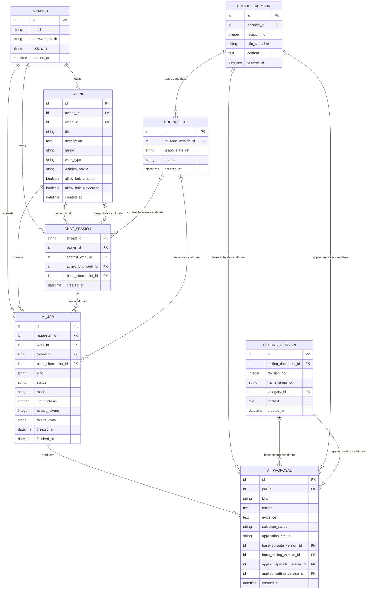

# Core 업무 ERD — AI 작업과 대화의 업무 연결

> **전체 ERD의 부분 뷰 · 논리 초안 · 미구현.** [ERD 목차](../README.md) · [전체 업무 ERD](../overview.md). 업무 영역 구분은 별도 배포 서비스나 구현 클래스의 확정이 아닙니다.

AI Service 내부 실행 상태가 아니라, Core가 다루는 사용자·작품·AI 작업의 업무 연결을 검토합니다.

중심 후보: `CHAT_SESSION`, `AI_JOB`, `AI_PROPOSAL`. `MEMBER`와 `WORK`는 요청자·대상 참조입니다.

## 이 그림의 테이블

- Core 업무 연결: [`CHAT_SESSION`](../tables.md#chat-session), [`AI_JOB`](../tables.md#ai-job), [`AI_PROPOSAL`](../tables.md#ai-proposal).
- 다른 영역의 참조: [`MEMBER`](../tables.md#member), [`WORK`](../tables.md#work), [`CHECKPOINT`](../tables.md#checkpoint), [`EPISODE_VERSION`](../tables.md#episode-version), [`SETTING_VERSION`](../tables.md#setting-version). [LangGraph Saver 테이블](../ai-service/postgres-saver.md#3-langgraph-postgressaver의-실제-테이블)은 별도 외부 라이브러리 스키마입니다.

## 유스케이스와 데이터

- [UC-04](../../../usecase-spec/UC-04.md)·[UC-09](../../../usecase-spec/UC-09.md)·[UC-11](../../../usecase-spec/UC-11.md): 작가가 수동 설정 추출, 선택적 시뮬레이션 또는 집필 지원을 요청합니다. Core는 요청자·대상·처리 상태·사용량·실패를 구분할 필요가 있습니다(DEC-18).
- `AI_JOB`의 `model`, `input_tokens`, `output_tokens`, `failure_code`, 기록·종료 시각은 실제 보고된 상태·사용량과 오류를 구분하기 위한 후보입니다. 값 미보고를 사용량 0으로 취급하지 않으며, 이 기록은 크레딧 정산 기능이 아닙니다. `created_at`은 요청 기록 시각이고 실행 시작 시각과 같다고 가정하지 않습니다.
- `AI_PROPOSAL`의 `selection_status`와 `application_status`는 사용자의 선택과 실제 반영을 별도로 확인하기 위한 후보입니다. 거절한 제안도 소유자가 다시 열어 채택할 수 있어, 단일 상태만으로 선택 이력을 보장하지 않습니다. `base_*`와 `applied_*`는 대상 버전 연결 예시이며 모든 작업이 체크포인트·원고·설정 연결을 반드시 갖는다는 뜻이 아닙니다.
- 수동 설정 추출은 대상 회차·범위와 근거 원고 위치가, 시뮬레이션은 기준 시점·장소·참여 인물·사건·진행 방향과 결과가 필요합니다(UC-04·09). 이를 작업과 어떻게 연결하고 실제로 어디까지 저장할지는 미정입니다. `base_checkpoint_id`만으로 각 작업의 원고 범위나 요청 조건이 표현되지는 않습니다.
- AI 제안은 사용자가 채택·거절할 수 있으며 채택만으로 저장·발행이 보장되지 않습니다. 기준 콘텐츠가 바뀌었다면 기존 내용을 묵시적으로 덮어쓰지 않아야 합니다.
- [UC-08](../../../usecase-spec/UC-08.md)의 원작 옆 대화는 선택적이고, 대화만으로 원작이나 Fork 설정을 변경하지 않습니다. UC-11의 대화·요청·제안과 선택·반영 상태는 소유자가 삭제하기 전까지 재조회할 수 있어야 하며, 메시지 및 이력의 물리 저장은 미정입니다.
- UC-11 원고 수정 제안은 요청 당시 대상 원문과 제안을 나란히 확인할 수 있어야 합니다. 저장된 버전뿐 아니라 갱신되는 작업 초안도 기준이 될 수 있으므로 현재 `base_episode_version_id`만으로 당시 초안 원문을 보존한다고 가정하지 않습니다. 구체적인 원문 저장 범위·모델과 변경 감지 방식은 미정입니다.
- AI 일러스트는 선택하지 않은 제안도 기록으로 보관하며 채택·초안 반영·버전 저장·발행을 구분합니다. 제안 기록을 삭제해도 저장된 원고 버전에 쓰이는 이미지는 조회·복원할 수 있어야 합니다. 이미지 참조 및 실제 보존 모델은 별도 설계 대상입니다.

## UC-12 검토 결과의 논리 관계

- 한 검토 작업에는 여러 발견 사항이 있고, 각 발견에는 여러 근거 회차·설정과 창작자의 판단 및 변경 이력이 연결됩니다. 검토 당시 대상 원고와 근거를 다시 확인할 수 있어야 합니다. 작업 초안은 변경될 수 있으므로 현재 버전 참조만으로 당시 내용을 보존한다고 가정하지 않습니다.
- 판단은 나중에 변경할 수 있으나 판단만으로 원고·설정이 변경되지는 않습니다. 창작자가 별도로 수정·반영하며 저장과 발행은 구분합니다. 검토 결과와 판단 이력은 창작자가 삭제하기 전까지 재조회합니다.
- MVP에서 여러 세계관 검토는 개발하지 않지만 전체 서비스에서는 한 검토에 여러 세계관과 비교 기준이 연결될 수 있어야 합니다. 연결 정책·한도는 별도 확인합니다.
- 위 관계는 **현재 그림에 모델링되지 않았습니다**. `AI_JOB`·`AI_PROPOSAL`의 기존 필드만으로 다중 근거와 판단 이력 보존을 보장하지 않으며 논리 모델 및 구체적인 보존 범위·저장 방식은 후속 설계 대상입니다.

## 경계와 미정 사항

- AI 작업 상태·사용량·실패 기록은 Core가 관리하는 MVP 방향입니다(DEC-18). UC-11 대화·제안은 소유자 삭제 전까지 보관하며, 실제 저장 주체와 물리 테이블·삭제 방식은 미정입니다.
- 채팅 없이도 설정 추출·시뮬레이션·집필 작업을 요청할 수 있고, AI 제안·채택·정본 반영·발행은 구분합니다.
- `thread_id`로 [Saver](../ai-service/postgres-saver.md)를 찾는 연결은 후보이며 인증이나 작품 권한을 자동 보장하지 않습니다.
- Fork 생성 전 원작 문맥의 대화와 자기 Fork 연결 방식, 제안의 기준 버전·반영 결과 연결은 미정입니다.
