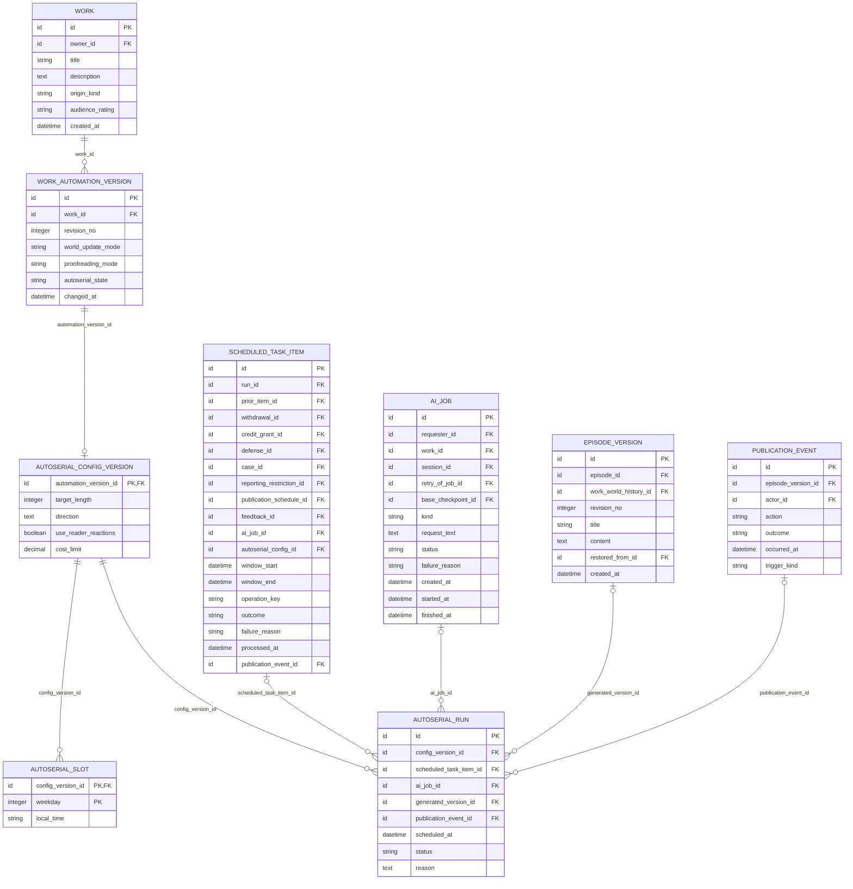

# Core 업무 ERD — 자동 처리·자율 연재

> **전체 서비스 논리 후보 · 미구현.** [목차](../README.md) · [전체 ERD](../overview.md) · [정규화 검증](../normalization.md) · [요구사항 추적](../requirements-matrix.md). 영역은 서비스 배포 단위가 아닙니다.

근거: [UC-18](../../../usecase-spec/UC-18.md), [UC-24](../../../usecase-spec/UC-24.md). 최신 결정과 충돌하는 과거 상세는 적용하지 않습니다.

소유 후보 **4개**, 다른 영역 참조 **5개**입니다. 이 영역 소유 테이블의 FK 관계만 표시하며 참조 테이블에서 다른 영역으로 나가는 선은 의도적으로 생략합니다.

## 이 그림의 테이블

| 소유/참조 | 테이블 | 범위 |
|---|---|---|
| 소유 | [`WORK_AUTOMATION_VERSION`](../tables.md#work-automation-version) | MVP 이후 |
| 소유 | [`AUTOSERIAL_CONFIG_VERSION`](../tables.md#autoserial-config-version) | MVP 이후 |
| 소유 | [`AUTOSERIAL_SLOT`](../tables.md#autoserial-slot) | MVP 이후 |
| 소유 | [`AUTOSERIAL_RUN`](../tables.md#autoserial-run) | MVP 이후 |
| 다른 영역 참조 | [`WORK`](../tables.md#work) | MVP |
| 다른 영역 참조 | [`EPISODE_VERSION`](../tables.md#episode-version) | MVP |
| 다른 영역 참조 | [`PUBLICATION_EVENT`](../tables.md#publication-event) | MVP |
| 다른 영역 참조 | [`AI_JOB`](../tables.md#ai-job) | MVP |
| 다른 영역 참조 | [`SCHEDULED_TASK_ITEM`](../tables.md#scheduled-task-item) | 전체·범위확인 |

## 데이터 역할과 무결성

- 작품 설정 변경을 불변 버전으로 두고, 자율 연재 상세 조건과 요일별 시각을 분리했습니다. 실행은 당시 설정을 참조하므로 이후 설정 변경으로 과거 조건이 바뀌지 않습니다.
- 비용 안내 동의는 `AI_COST_CONSENT`, 실행별 실제 사용량은 `AI_MODEL_CALL`, 정산은 `CREDIT_SETTLEMENT`입니다. 자율 연재에만 사용자 비용상한이 있으며 상한 범위·초과 방지 방식은 미정입니다. 사전 크레딧 예약은 없습니다.
- 생성 버전과 발행 결과는 별도 연결입니다. 권한·Fork 조건·권리·필터를 통과해야 자동 발행합니다. 소유자가 켠 것을 사전 승인으로 보며 회차별 승인 옵션을 추가하지 않습니다.
- 일시중지는 다음 실행부터 적용하고 진행중 작업은 별도 중단합니다. 1시간 초과 지연은 건너뜀이고 연속 실패에 포함하지 않습니다. 연속3회 실패·발행조건 실패의 상태 전이는 UC-18을 따릅니다.
- 소유자 삭제 전 실행기록을 보관하되 삭제가 발행원고 삭제로 전파되지 않습니다. 일정은 KST, 하루최대1회입니다. worker·큐·분산락 테이블은 선제 추가하지 않습니다.
- 자동 추출은 MVP 이후이며 최신 DEC-36과 옛 UC-04의 무검토 자동반영이 충돌하는 범위는 보류합니다. 피드백 수정안 재발행은 자동추출을 유발하지 않습니다.

각 테이블의 PK·FK·고유키·조건부 필수값과 예시는 [전체 테이블 가이드](../tables.md)에 있습니다. 그림만으로 권한·동시성·삭제 안전성이 보장되지 않습니다.
