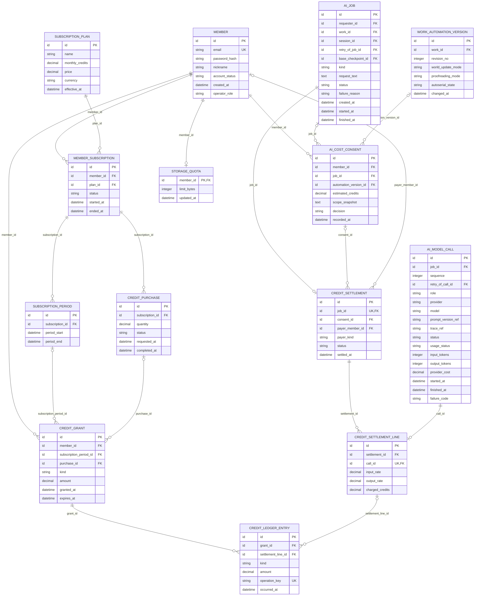

# Core 업무 ERD — 크레딧·구독·저장 한도

> **전체 서비스 논리 후보 · 분리 구현 전.** [목차](../README.md) · [전체 ERD](../overview.md) · [정규화 검증](../normalization.md) · [요구사항 추적](../requirements-matrix.md). 영역은 서비스 배포 단위가 아닙니다.

근거: [UC-17](../../../usecase-spec/UC-17.md), [UC-19](../../../usecase-spec/UC-19.md). 최신 결정과 충돌하는 과거 상세는 적용하지 않습니다.

이 뷰의 중심 후보 **10개**, 다른 영역 참조 **4개**입니다. 이 뷰의 중심 테이블 관계만 표시하며 참조 테이블에서 다른 영역으로 나가는 선은 의도적으로 생략합니다.

## 정본 소유와 서비스 경계

[DEC-41 정본 소유·현행 구현과 논리 참조 해석](../README.md#dec-41-적용과-현재-구현)을 따릅니다. `core/`는 기존 문서 경로이며 각 표의 소유 구분이 목표 책임입니다. 그림의 엔티티·컬럼·관계는 그대로 보존하며 회원 인증 비밀을 다른 서비스에 복제하지 않습니다.

Core가 크레딧·구독·지급·정산·원장을 소유합니다. 작업/모델 사용량·성공 여부는 요청 업무 소유 서비스와 AI가 전달하는 정산 입력이며 정산 정본이 아닙니다. `STORAGE_QUOTA`는 기존 한도 후보를 보존하되 콘텐츠 파일·사용량 집계와의 책임/강제 계약은 미정으로 둡니다. 운영의 이벤트 보상도 Core에 요청하며 원장을 직접 수정하지 않습니다.

## 이 그림의 테이블

| 뷰 구분 | 테이블 | 범위 | 목표 정본 소유 |
|---|---|---|---|
| 중심 후보 | [`AI_COST_CONSENT`](../tables.md#ai-cost-consent) | MVP 이후 | Core |
| 중심 후보 | [`SUBSCRIPTION_PLAN`](../tables.md#subscription-plan) | MVP 이후 | Core |
| 중심 후보 | [`MEMBER_SUBSCRIPTION`](../tables.md#member-subscription) | MVP 이후 | Core |
| 중심 후보 | [`SUBSCRIPTION_PERIOD`](../tables.md#subscription-period) | MVP 이후 | Core |
| 중심 후보 | [`CREDIT_PURCHASE`](../tables.md#credit-purchase) | MVP 이후 | Core |
| 중심 후보 | [`CREDIT_GRANT`](../tables.md#credit-grant) | MVP 이후 | Core |
| 중심 후보 | [`CREDIT_SETTLEMENT`](../tables.md#credit-settlement) | MVP 이후 | Core |
| 중심 후보 | [`CREDIT_SETTLEMENT_LINE`](../tables.md#credit-settlement-line) | MVP 이후 | Core |
| 중심 후보 | [`CREDIT_LEDGER_ENTRY`](../tables.md#credit-ledger-entry) | MVP 이후 | Core |
| 중심 후보 | [`STORAGE_QUOTA`](../tables.md#storage-quota) | MVP 이후 | 한도·집계 계약 미정 (Core/콘텐츠 협력) |
| 다른 영역 참조 | [`MEMBER`](../tables.md#member) | MVP | Core |
| 다른 영역 참조 | [`AI_JOB`](../tables.md#ai-job) | MVP | 요청 업무 소유 서비스 (콘텐츠/운영) |
| 다른 영역 참조 | [`AI_MODEL_CALL`](../tables.md#ai-model-call) | MVP | 요청 업무 소유 서비스 (콘텐츠/운영) |
| 다른 영역 참조 | [`WORK_AUTOMATION_VERSION`](../tables.md#work-automation-version) | MVP 이후 | 콘텐츠 |

## 데이터 역할과 무결성

- 최신 UC-17에 따라 **예상 상한 예약 없음**, 성공한 실제 사용량에 대한 후차감입니다. 예측 비용과 사용자가 정한 상한은 다릅니다. 일반 채팅·시뮬레이션·검증에 사용자 상한을 추가하지 않습니다.
- 지급분→모델호출별 정산명세→지급분별 차감/소멸 장부를 분리했습니다. 회원 총잔액, 정산합계, 남은 지급분을 별도 원천으로 중복 저장하지 않습니다. 동일 정산에 여러 지급분을 사용할 수 있습니다.
- 회원 차감은 지급분 소유 회원과 정산 부담 회원이 같아야 합니다. 동의는 해당 작업 또는 그 실행의 자동 설정·동일 부담 회원에 연결되어야 하며 확정 정산명세의 금액과 연결 사용 장부 합계가 일치해야 합니다. 유효한 FK만으로 다른 회원의 지급분을 사용하지 못하게 되지는 않습니다.
- 소멸이 빠른 지급분부터, 같은 소멸시각이면 무료 먼저입니다. 가입체험30일·보상/이벤트 월간·구독월간·추가구매12개월, KST 초기화는 UC-17의 방향입니다. 가격·지급량·환산값은 정하지 않았습니다.
- 실제 사용량 미보고를 0으로 처리하지 않습니다. 서비스 오류·시간초과는 사용자 차감 없이 플랫폼이 공급자 비용을 부담합니다. 사용자 중단 차감·동시실행·초과잔액·미보고 정산·입장 기준은 미정입니다.
- 구독 계약, 월 지급 기간, 추가 구매, 실제 지급은 각각 다른 사실입니다. 결제사별 주문/거래/웹훅/환불 테이블은 미정 정책을 확정하게 되므로 만들지 않았습니다.
- 저장한도는 AI 비용과 별개입니다. 원본 참조세계관은 원본 소유자, 독립 세계관과 Fork 원고는 해당 소유자에게 귀속합니다. AI 대화/시뮬레이션은 저장한도 제외, 이미지/과거버전 계산과 독립복사 수신자 용량부족은 미정입니다.
- 크레딧·구독·구매·저장한도는 MVP 이후입니다. 속도제한은 런타임 책임이며 토큰버킷 저장소를 관계형 테이블로 선제 확정하지 않습니다.

각 테이블의 PK·FK·고유키·조건부 필수값과 예시는 [전체 테이블 가이드](../tables.md)에 있습니다. 그림만으로 권한·동시성·삭제 안전성이 보장되지 않습니다.

## 구현된 1차 스키마 (#258)

위 그림은 전체 서비스 논리 후보이고, 구현된 것은 그중 일부를 단순화한 두 테이블이다(`db/migration/credit/V12`). MVP는 가입 체험·보상·이벤트 크레딧만 쓴다(F-CRD-04).

| 구현 테이블 | 대응하는 논리 후보 | 차이 |
|---|---|---|
| `credit_grant` | `CREDIT_GRANT` | `kind`는 `signup-trial`·`reward`·`event`만 쓴다. 구독 기간·구매 참조 열은 없다. 가입 체험은 회원당 1회(고유 인덱스). |
| `credit_ledger_entry` | `CREDIT_LEDGER_ENTRY` | 사용(`spend`)·소멸(`expire`) 행만 두고, 같은 작업의 중복을 `(operation_key, grant_id)` 고유 제약으로 막는다. 잔액은 지급량에서 이 장부의 합계를 뺀 값이다. |

아직 구현하지 않은 것: `AI_COST_CONSENT`, `CREDIT_SETTLEMENT`·`CREDIT_SETTLEMENT_LINE`(작업 정산 단위), 구독·구매 테이블, 실행 전 예약.
실행 전 예약 여부는 요구사항정의서 F-CRD-01(예약)과 UC-17·ERD(예약 없음)가 서로 달라 팀 확인 후 정한다.
