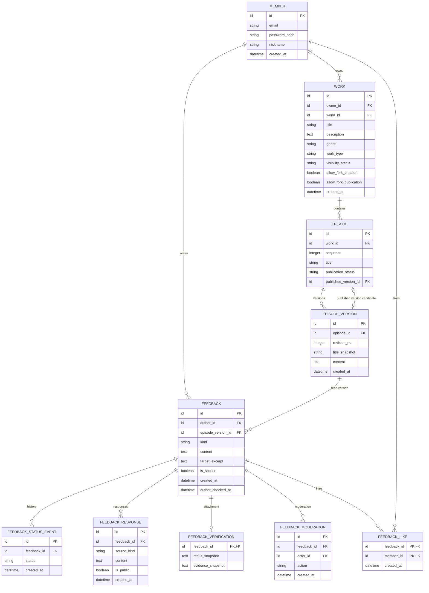

# Core 업무 ERD — 독자 피드백

> **전체 ERD의 부분 뷰 · 논리 초안 · 미구현.** [ERD 목차](../README.md) · [전체 업무 ERD](../overview.md). 업무 영역 구분은 별도 배포 서비스나 구현 클래스의 확정이 아닙니다.

독자가 작성한 댓글·제보와 대상 회차 버전을 다루는 Core 업무 영역입니다.

중심: `FEEDBACK`. 회원·작품·회차·원고 버전은 작성자와 대상 참조입니다.

## 이 그림의 테이블

- 피드백: [`FEEDBACK`](../tables.md#feedback), [`FEEDBACK_STATUS_EVENT`](../tables.md#feedback-status-event), [`FEEDBACK_RESPONSE`](../tables.md#feedback-response), [`FEEDBACK_VERIFICATION`](../tables.md#feedback-verification), [`FEEDBACK_MODERATION`](../tables.md#feedback-moderation), [`FEEDBACK_LIKE`](../tables.md#feedback-like).
- 다른 영역의 참조: [`MEMBER`](../tables.md#member), [`WORK`](../tables.md#work), [`EPISODE`](../tables.md#episode), [`EPISODE_VERSION`](../tables.md#episode-version).

## 유스케이스와 데이터

- [UC-14](../../../usecase-spec/UC-14.md): 독자는 회차를 읽은 뒤 댓글 또는 제보를 남기고, 작가는 자기 작품의 목록을 확인합니다.
- 작성자와 실제 대상 회차·발행 버전, 독자가 선택한 피드백 유형·내용을 연결합니다. 특정 구절과 스포일러 가리기는 UC의 항목이며 MVP 입력·저장 범위는 검토가 필요합니다.
- 댓글과 제보는 공개 범위가 다르므로, 같은 엔티티에 담더라도 접근 제어를 다르게 적용해야 합니다. 회차 버전 ID만 아는 것으로 열람 권한을 인정하지 않습니다.

## 경계와 미정 사항

- 피드백 유형을 한 테이블로 구분하는 것은 후보입니다. 독자가 본 발행본 버전을 연결해 대상 작품과 회차를 확인합니다.
- MVP는 댓글·제보 등록과 작가 확인까지입니다. AI 응대·수정안·보상은 이후입니다.
- `target_excerpt`·`is_spoiler`는 UC에 등장하는 선택 기능의 후보이고 실제 MVP 저장·노출 여부는 미정입니다. `author_checked_at`은 작가가 개별 확인 사실을 보관할 때의 후보이며, MVP에서 작가가 목록을 조회한 것만으로 개별 확인 상태가 생긴다고 가정하지 않습니다.
- 댓글과 제보의 접근 범위는 구분해야 하며, 세부 상태·구절·저장 형태는 미정입니다.

## UC-14 전체 서비스 후보

- 처리 상태·응답·제출된 검증 첨부를 구분합니다. 공개 응답은 제보 원문을 자동 공개하지 않으며 AI 응답과 작가 응답을 구분합니다.
- 독자가 검증 기록을 삭제해도 이미 제출된 결과와 근거는 첨부로 보존합니다. 댓글 신고·필터·숨김·복원과 좋아요를 별도 관계로 표현합니다. 실제 접근 제어와 상태 전이는 관계만으로 보장되지 않습니다.
- 제보 제출 후에는 철회 대신 독자가 정정 의견을 추가합니다. 의견은 제보자와 작가가 확인하며 관계 모델은 후속 설계 대상입니다. 필터·AI 응대 등은 MVP 이후이며 그림은 전체 서비스의 미구현 후보입니다.
