# 콘텐츠 업무 ERD — 독자 피드백

> **전체 서비스 논리 후보 · 분리 구현 전.** [목차](../README.md) · [전체 ERD](../overview.md) · [정규화 검증](../normalization.md) · [요구사항 추적](../requirements-matrix.md). 영역은 서비스 배포 단위가 아닙니다.

근거: [UC-14](../../../usecase-spec/UC-14.md), [UC-15](../../../usecase-spec/UC-15.md), [UC-16](../../../usecase-spec/UC-16.md). 최신 결정과 충돌하는 과거 상세는 적용하지 않습니다.

이 뷰의 중심 후보 **17개**, 다른 영역 참조 **10개**입니다. 이 뷰의 중심 테이블 관계만 표시하며 참조 테이블에서 다른 영역으로 나가는 선은 의도적으로 생략합니다.

```mermaid
erDiagram
    MEMBER o|--o{ FEEDBACK : "author_id"
    EPISODE_VERSION ||--o{ FEEDBACK : "episode_version_id"
    FEEDBACK ||--o{ FEEDBACK_AMENDMENT : "feedback_id"
    MEMBER o|--o{ FEEDBACK_AMENDMENT : "actor_id"
    FEEDBACK ||--o{ FEEDBACK_STATUS_EVENT : "feedback_id"
    MEMBER o|--o{ FEEDBACK_STATUS_EVENT : "actor_id"
    AI_JOB o|--o{ FEEDBACK_STATUS_EVENT : "ai_job_id"
    FEEDBACK ||--o{ FEEDBACK_AI_JOB : "feedback_id"
    AI_JOB ||--o{ FEEDBACK_AI_JOB : "job_id"
    FEEDBACK ||--o{ FEEDBACK_RESPONSE : "feedback_id"
    AI_JOB o|--o{ FEEDBACK_RESPONSE : "ai_job_id"
    MEMBER o|--o{ FEEDBACK_RESPONSE : "author_id"
    FEEDBACK_RESPONSE ||--o{ FEEDBACK_RESPONSE_EVIDENCE : "response_id"
    AI_EVIDENCE ||--o{ FEEDBACK_RESPONSE_EVIDENCE : "evidence_id"
    FEEDBACK ||--o{ FEEDBACK_COMMENT : "feedback_id"
    MEMBER o|--o{ FEEDBACK_COMMENT : "author_id"
    FEEDBACK o|--o| FEEDBACK_VERIFICATION : "feedback_id"
    FEEDBACK_COMMENT o|--o| FEEDBACK_VERIFICATION : "comment_id"
    AI_JOB o|--o{ FEEDBACK_VERIFICATION : "original_job_id"
    FEEDBACK_VERIFICATION ||--o{ FEEDBACK_VERIFICATION_EVIDENCE : "verification_id"
    EPISODE_VERSION o|--o{ FEEDBACK_VERIFICATION_EVIDENCE : "episode_version_id"
    SETTING_VERSION o|--o{ FEEDBACK_VERIFICATION_EVIDENCE : "setting_version_id"
    FEEDBACK ||--o{ FEEDBACK_REPORT : "feedback_id"
    MEMBER ||--o{ FEEDBACK_REPORT : "reporter_id"
    FEEDBACK ||--o{ FEEDBACK_MODERATION_CHECK : "feedback_id"
    AI_JOB ||--o{ FEEDBACK_MODERATION_CHECK : "job_id"
    FEEDBACK_REPORT o|--o{ FEEDBACK_MODERATION_CHECK : "report_id"
    FEEDBACK ||--o{ FEEDBACK_MODERATION : "feedback_id"
    FEEDBACK_MODERATION_CHECK o|--o{ FEEDBACK_MODERATION : "check_id"
    MEMBER o|--o{ FEEDBACK_MODERATION : "actor_id"
    FEEDBACK ||--o{ FEEDBACK_LIKE : "feedback_id"
    MEMBER ||--o{ FEEDBACK_LIKE : "member_id"
    FEEDBACK ||--o{ FEEDBACK_PROPOSAL : "feedback_id"
    AI_PROPOSAL ||--o{ FEEDBACK_PROPOSAL : "proposal_id"
    FEEDBACK ||--o{ FEEDBACK_REVIEW : "feedback_id"
    MEMBER ||--o{ FEEDBACK_REVIEW : "actor_id"
    PROPOSAL_DECISION o|--o{ FEEDBACK_REVIEW : "proposal_decision_id"
    FEEDBACK ||--o{ FEEDBACK_RESOLUTION : "feedback_id"
    FEEDBACK_REVIEW ||--o{ FEEDBACK_RESOLUTION : "review_id"
    EPISODE_VERSION ||--o{ FEEDBACK_RESOLUTION : "episode_version_id"
    PUBLICATION_EVENT o|--o{ FEEDBACK_RESOLUTION : "publication_event_id"
    PROPOSAL_APPLICATION o|--o{ FEEDBACK_RESOLUTION : "application_id"
    FEEDBACK_RESOLUTION ||--o{ FEEDBACK_REWARD : "resolution_id"
    CREDIT_GRANT ||--o| FEEDBACK_REWARD : "credit_grant_id"

    FEEDBACK {
        id id PK
        id author_id FK
        id episode_version_id FK
        string kind
        text content
        text target_excerpt
        string position
        string visibility
        boolean is_spoiler
        datetime created_at
        datetime delivered_at
        datetime author_checked_at
    }
    FEEDBACK_AMENDMENT {
        id id PK
        id feedback_id FK
        id actor_id FK
        string action
        text content
        datetime created_at
    }
    FEEDBACK_STATUS_EVENT {
        id id PK
        id feedback_id FK
        id actor_id FK
        id ai_job_id FK
        string status
        datetime created_at
    }
    FEEDBACK_AI_JOB {
        id feedback_id PK,FK
        id job_id PK,FK
        string purpose
    }
    FEEDBACK_RESPONSE {
        id id PK
        id feedback_id FK
        id ai_job_id FK
        id author_id FK
        text content
        boolean is_public
        datetime created_at
    }
    FEEDBACK_RESPONSE_EVIDENCE {
        id response_id PK,FK
        id evidence_id PK,FK
    }
    FEEDBACK_COMMENT {
        id id PK
        id feedback_id FK
        id author_id FK
        text content
        datetime created_at
    }
    FEEDBACK_VERIFICATION {
        id id PK
        id feedback_id UK,FK
        id comment_id UK,FK
        id original_job_id FK
        string outcome
        string verdict
        decimal confidence
        text result_snapshot
        datetime submitted_at
    }
    FEEDBACK_VERIFICATION_EVIDENCE {
        id id PK
        id verification_id FK
        integer sequence
        id episode_version_id FK
        id setting_version_id FK
        string graph_state_ref
        string position
        text excerpt_snapshot
    }
    FEEDBACK_REPORT {
        id id PK
        id feedback_id FK
        id reporter_id FK
        text reason
        datetime created_at
    }
    FEEDBACK_MODERATION_CHECK {
        id id PK
        id feedback_id FK
        id job_id FK
        id report_id FK
        string outcome
        string verdict
        text reason
        datetime checked_at
    }
    FEEDBACK_MODERATION {
        id id PK
        id feedback_id FK
        id check_id FK
        id actor_id FK
        string action
        string outcome
        text reason
        datetime created_at
    }
    FEEDBACK_LIKE {
        id feedback_id PK,FK
        id member_id PK,FK
        datetime created_at
    }
    FEEDBACK_PROPOSAL {
        id feedback_id PK,FK
        id proposal_id PK,FK
    }
    FEEDBACK_REVIEW {
        id id PK
        id feedback_id FK
        id actor_id FK
        id proposal_decision_id FK
        string decision
        text reason
        datetime created_at
    }
    FEEDBACK_RESOLUTION {
        id id PK
        id feedback_id FK
        id review_id FK
        id episode_version_id FK
        id publication_event_id FK
        id application_id FK
        datetime linked_at
    }
    FEEDBACK_REWARD {
        id id PK
        id resolution_id FK
        id credit_grant_id UK,FK
        string correction_key UK
        datetime awarded_at
    }
    MEMBER {
        id id PK
        string email UK
        string password_hash
        string nickname
        string account_status
        datetime created_at
        string operator_role
    }
    SETTING_VERSION {
        id id PK
        id setting_document_id FK
        integer revision_no
        string name
        id category_id FK
        text content
        id restored_from_id FK
        string lifecycle
        datetime created_at
    }
    EPISODE_VERSION {
        id id PK
        id episode_id FK
        id work_world_history_id FK
        integer revision_no
        string title
        text content
        id restored_from_id FK
        datetime created_at
    }
    PUBLICATION_EVENT {
        id id PK
        id episode_version_id FK
        id actor_id FK
        string action
        string outcome
        datetime occurred_at
        string trigger_kind
    }
    AI_JOB {
        id id PK
        id requester_id FK
        id work_id FK
        id session_id FK
        id retry_of_job_id FK
        id base_checkpoint_id FK
        string kind
        text request_text
        string status
        string failure_reason
        datetime created_at
        datetime started_at
        datetime finished_at
    }
    AI_PROPOSAL {
        id id PK
        id job_id FK
        id input_snapshot_id FK
        integer sequence
        string kind
        text content
        datetime created_at
    }
    AI_EVIDENCE {
        id id PK
        id episode_version_id FK
        id setting_version_id FK
        string graph_state_ref
        string kind
        string position
        text excerpt_snapshot
        datetime captured_at
    }
    PROPOSAL_DECISION {
        id id PK
        id proposal_id FK
        integer sequence
        id actor_id FK
        id automation_policy_id FK
        string decision
        string selected_range
        text approved_content
        datetime decided_at
    }
    PROPOSAL_APPLICATION {
        id id PK
        id decision_id FK
        integer attempt_no
        string outcome
        string failure_reason
        datetime attempted_at
    }
    CREDIT_GRANT {
        id id PK
        id member_id FK
        id subscription_period_id FK
        id purchase_id FK
        string kind
        decimal amount
        datetime granted_at
        datetime expires_at
    }
```

## 정본 소유와 서비스 경계

[DEC-41 정본 소유·현행 구현과 논리 참조 해석](../README.md#dec-41-적용과-현재-구현)을 따릅니다. `core/`는 기존 문서 경로이며 각 표의 소유 구분이 목표 책임입니다. 그림의 엔티티·컬럼·관계는 그대로 보존하며 회원 인증 비밀을 다른 서비스에 복제하지 않습니다.

작품 댓글·오류 제보·작가 검토·수정 반영·실제 숨김/복원은 콘텐츠, 플랫폼 문의와 권리/유해 신고 접수·운영 판단은 운영입니다. `FEEDBACK_REPORT`는 댓글 신고 접수 후보로 운영에 분류하고 실제 `FEEDBACK_MODERATION` 적용은 콘텐츠가 합니다. 검사 결과는 콘텐츠 초기 필터인지 운영 신고 검사인지에 따라 요청 업무를 구분하며 물리 분리·전달 계약은 미정입니다. 보상 근거 연결은 콘텐츠, 실제 크레딧 지급·정산은 Core입니다.

## 이 그림의 테이블

| 뷰 구분 | 테이블 | 범위 | 목표 정본 소유 |
|---|---|---|---|
| 중심 후보 | [`FEEDBACK`](../tables.md#feedback) | MVP | 콘텐츠 |
| 중심 후보 | [`FEEDBACK_AMENDMENT`](../tables.md#feedback-amendment) | MVP | 콘텐츠 |
| 중심 후보 | [`FEEDBACK_STATUS_EVENT`](../tables.md#feedback-status-event) | MVP | 콘텐츠 |
| 중심 후보 | [`FEEDBACK_AI_JOB`](../tables.md#feedback-ai-job) | MVP 이후 | 콘텐츠 |
| 중심 후보 | [`FEEDBACK_RESPONSE`](../tables.md#feedback-response) | MVP 이후 | 콘텐츠 |
| 중심 후보 | [`FEEDBACK_RESPONSE_EVIDENCE`](../tables.md#feedback-response-evidence) | MVP 이후 | 콘텐츠 |
| 중심 후보 | [`FEEDBACK_COMMENT`](../tables.md#feedback-comment) | 전체·범위확인 | 콘텐츠 |
| 중심 후보 | [`FEEDBACK_VERIFICATION`](../tables.md#feedback-verification) | MVP 이후 | 콘텐츠 |
| 중심 후보 | [`FEEDBACK_VERIFICATION_EVIDENCE`](../tables.md#feedback-verification-evidence) | MVP 이후 | 콘텐츠 |
| 중심 후보 | [`FEEDBACK_REPORT`](../tables.md#feedback-report) | MVP 이후 | 운영 (신고 접수) |
| 중심 후보 | [`FEEDBACK_MODERATION_CHECK`](../tables.md#feedback-moderation-check) | MVP 이후 | 목적별 콘텐츠/운영 (검사 결과) |
| 중심 후보 | [`FEEDBACK_MODERATION`](../tables.md#feedback-moderation) | MVP 이후 | 콘텐츠 |
| 중심 후보 | [`FEEDBACK_LIKE`](../tables.md#feedback-like) | 전체·범위확인 | 콘텐츠 |
| 중심 후보 | [`FEEDBACK_PROPOSAL`](../tables.md#feedback-proposal) | MVP 이후 | 콘텐츠 |
| 중심 후보 | [`FEEDBACK_REVIEW`](../tables.md#feedback-review) | MVP 이후 | 콘텐츠 |
| 중심 후보 | [`FEEDBACK_RESOLUTION`](../tables.md#feedback-resolution) | MVP 이후 | 콘텐츠 |
| 중심 후보 | [`FEEDBACK_REWARD`](../tables.md#feedback-reward) | MVP 이후 | 콘텐츠 |
| 다른 영역 참조 | [`MEMBER`](../tables.md#member) | MVP | Core |
| 다른 영역 참조 | [`SETTING_VERSION`](../tables.md#setting-version) | MVP | 콘텐츠 |
| 다른 영역 참조 | [`EPISODE_VERSION`](../tables.md#episode-version) | MVP | 콘텐츠 |
| 다른 영역 참조 | [`PUBLICATION_EVENT`](../tables.md#publication-event) | MVP | 콘텐츠 |
| 다른 영역 참조 | [`AI_JOB`](../tables.md#ai-job) | MVP | 요청 업무 소유 서비스 (콘텐츠/운영) |
| 다른 영역 참조 | [`AI_PROPOSAL`](../tables.md#ai-proposal) | MVP | 콘텐츠 |
| 다른 영역 참조 | [`AI_EVIDENCE`](../tables.md#ai-evidence) | MVP | 콘텐츠 |
| 다른 영역 참조 | [`PROPOSAL_DECISION`](../tables.md#proposal-decision) | MVP | 콘텐츠 |
| 다른 영역 참조 | [`PROPOSAL_APPLICATION`](../tables.md#proposal-application) | MVP | 콘텐츠 |
| 다른 영역 참조 | [`CREDIT_GRANT`](../tables.md#credit-grant) | MVP 이후 | Core |

## 데이터 역할과 무결성

- 댓글과 제보의 기본 내용은 `FEEDBACK`을 재사용하되 제보 공개 여부와 응답 공개 여부를 독립 보관합니다. 원문은 읽은 발행 버전·구절에 고정합니다. 제보 유형은 독자가 고르고 AI가 재분류하지 않습니다.
- 전달 후 정정·철회는 별도 이력이며 원래 제보·기존 원고를 자동 삭제/되돌리지 않습니다. 전달 전 검증 중단은 작가에게 전달하지 않습니다. 댓글의 수정·삭제와 제보 보존을 구별합니다.
- AI 재시도·응답·복수 근거·작가 판단·실제 저장/발행 연결을 분리했습니다. 승인내용은 `PROPOSAL_DECISION`을 재사용하고 여기서 중복 저장하지 않습니다. 직접 수정도 제보에 결과 버전을 연결할 수 있습니다.
- 제보/토론 댓글에 제출한 검증 결과와 근거는 개인 AI 기록에서 분리한 스냅샷입니다. 개인 기록 삭제 후에도 남습니다. 다중 첨부 확대를 임의 확정하지 않고 대상당 최대 하나를 후보로 둡니다. 제보/댓글 FK의 XOR와 각각 non-NULL 조건부 UNIQUE 및 0..1 관계로 이를 표현합니다.
- 신고 접수, 모델 검사, 실제 숨김·복원은 다른 사건입니다. 필터 호출 실패는 통과가 아니라 비공개 대기이며 숨김은 삭제가 아닙니다. 회차·세계관 권리 신고는 [권리 영역](rights.md)입니다.
- 공개 제보의 토론 참여도 열람 권한을 확인합니다. 비공개 제보 응답을 공개해도 제보 원문이 자동 공개되지 않습니다. 이미 공개된 후속 회차라도 독자가 본 기준 이후의 내용은 응답 근거로 사용하지 않습니다.
- 보상은 제보·실제 수정·지급분을 연결합니다. 같은 수정의 최초 검증 1건만, 자기작품 제외, 실제 검증비용 이내의 기준50% 및 월상한은 UC-14를 따릅니다. 같은 수정 식별·악용 방지는 미정입니다.
- MVP는 등록과 작가 목록 확인입니다. 필터·독자검증·AI 응대·수정안·보상은 MVP 이후입니다. 숫자/고유명사/단어 교체를 포함한 수정과 작업초안 충돌은 자동 승인하지 않으며 자동 예외 판단은 콘텐츠 서비스가 합니다.

각 테이블의 PK·FK·고유키·조건부 필수값과 예시는 [전체 테이블 가이드](../tables.md)에 있습니다. 그림만으로 권한·동시성·삭제 안전성이 보장되지 않습니다.
