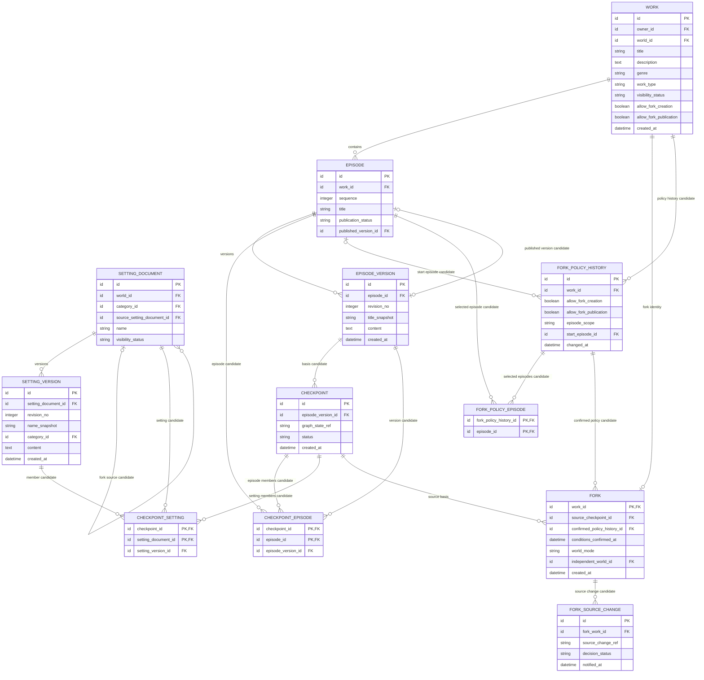

# Core 업무 ERD — 체크포인트·Fork

> **전체 ERD의 부분 뷰 · 논리 초안 · 미구현.** [ERD 목차](../README.md) · [전체 업무 ERD](../overview.md). 업무 영역 구분은 별도 배포 서비스나 구현 클래스의 확정이 아닙니다.

분기의 기준이 되는 콘텐츠 버전과 독립 Fork 작품을 다루는 Core 업무 영역입니다.

중심: `CHECKPOINT`, `CHECKPOINT_EPISODE`, `CHECKPOINT_SETTING`, `FORK`. 작품·회차·원고·설정 버전은 기준을 설명하는 참조입니다.

## 이 그림의 테이블

- 기준·분기: [`CHECKPOINT`](../tables.md#checkpoint), [`CHECKPOINT_EPISODE`](../tables.md#checkpoint-episode), [`CHECKPOINT_SETTING`](../tables.md#checkpoint-setting), [`FORK`](../tables.md#fork), [`FORK_SOURCE_CHANGE`](../tables.md#fork-source-change), [`FORK_POLICY_HISTORY`](../tables.md#fork-policy-history), [`FORK_POLICY_EPISODE`](../tables.md#fork-policy-episode).
- 다른 영역의 참조: [`WORK`](../tables.md#work), [`EPISODE`](../tables.md#episode), [`EPISODE_VERSION`](../tables.md#episode-version), [`SETTING_DOCUMENT`](../tables.md#setting-document), [`SETTING_VERSION`](../tables.md#setting-version).

## 유스케이스와 데이터

- [UC-08](../../../usecase-spec/UC-08.md): 독자는 읽을 수 있고 Fork가 허용된 원작 회차를 기준으로 자기 Fork를 만듭니다. 원작 원고 옆 AI 채팅과 자기 설정 수정은 선택할 수 있으며 AI는 필수가 아닙니다.
- `CHECKPOINT.episode_version_id`는 기준 회차의 원고 버전을, `CHECKPOINT_EPISODE`는 필요한 회차별 버전 목록을 표시하는 후보입니다. `CHECKPOINT_SETTING`은 설정 항목별 버전 목록의 후보입니다. Fork는 기준 회차에 공개된 세계관 전체를 이어받으며, 이 모델의 완전성 검증과 체크포인트 생성 시점은 미정입니다.
- `graph_state_ref`는 당시 관계 상태를 찾기 위한 논리 식별자 **후보**이고 `status`는 준비·실패를 구분하기 위한 후보입니다. 그래프의 저장 모델·키와 완료 기준은 아직 정하지 않았으며, 이 값만으로 그래프가 고정되거나 양쪽 저장소가 원자적으로 일치하지 않습니다.
- 작품 Fork의 세계관은 독자가 수정하기 전 원본의 허용된 변경을 따라가며, 최초 수정 때 전체를 독자 소유로 복사합니다. 복사 이후에는 원본 변경을 알리고 사용자 선택으로 반영합니다(DEC-32·34). `world_mode`와 변경 기록은 그 흐름의 논리 후보입니다.

## 경계와 미정 사항

- `CHECKPOINT`는 회차와 당시 설정·관계를 묶는 업무 기준점이며 LangGraph의 실행 상태 `checkpoints`와 다릅니다.
- 회차·설정 멤버 후보를 추가해도 목록 누락과 시점 일치, 그래프 반영까지 자동으로 보장되지는 않습니다. `CHECKPOINT_EPISODE.episode_version_id`는 같은 행의 `episode_id`에, `CHECKPOINT_SETTING.setting_version_id`는 같은 행의 `setting_document_id`에 속해야 합니다. 멤버가 기준 원작에 속하는지도 함께 검증해야 합니다. 기준 회차를 `CHECKPOINT_EPISODE`에도 포함한다면 그 버전은 `CHECKPOINT.episode_version_id`와 일치해야 합니다.
- 현재 이미지 최대 10개는 텍스트 버전과 별개이며 과거 이미지 이력·복원은 없습니다. 공유 참조를 끊지 않는 물리 정리 시점은 미정입니다.
- 체크포인트 생성 시점, 기준까지 공개된 본문의 판정, 전체 복사·rebase 충돌 처리와 그래프 동기화·복구는 미정입니다. 세계관·설정·상태·관계 이력은 삭제 대신 revert로 정정합니다(DEC-33).
- Core는 선택한 기준이 허용된 원작·회차·버전에 속하는지 검증합니다. 수정 전 원본 참조와 독립 후 선택적 변경 반영을 구분하며 독자 수정은 원작에 반영하지 않습니다.
- 기존 UC-08·BR-14의 독자별 원작 Fork 1회와 재Fork 금지는 아직 존재합니다. 복수 Fork는 후속 결정 사항입니다.

## 공개와 원작 정책

기준 회차에서 공개된 세계관 전체에는 인물 기본 설정, 회차 상태·지식, 인물관계도가 포함됩니다. 독자는 받은 설정을 제한 없이 수정할 수 있습니다. 수정 전 기준 회차에 영향을 주는 원작 변경을 즉시 추종하고, 최초 수정 때 전체가 독립합니다. 이후 알림과 선택적 반영을 제공하며 거절 후 재반영할 수 있습니다. 10화에서 변경해도 5화에 적용·공개되면 5화 Fork에 영향을 줍니다. 미발행 원고와 권한 밖 지식 등 민감 본문은 노출하지 않습니다.

원작의 Fork 생성 허용과 Fork 작품 공개 허용은 별개이며 변경 이력을 남기는 후보입니다. 일반적으로 생성 허용 철회 후에도 기존 Fork는 계속 창작할 수 있습니다. 공개 허용 철회 후 이미 공개된 Fork는 계속 공개·발행하고, 미공개 Fork의 최초 공개만 제한합니다. 법적 제한이 있는 경우는 별도로 판단합니다.

`FORK_POLICY_HISTORY.episode_scope`와 `start_episode_id`, `FORK_POLICY_EPISODE`는 전체 공개 회차·특정 회차 이후·회차별 선택을 나타내는 논리 후보입니다. 시작 회차의 포함 여부, 현재 조건 선택과 물리 제약은 미정입니다. 조건 변경마다 이력과 개별 선택 목록을 보존합니다. `FORK.confirmed_policy_history_id`와 `conditions_confirmed_at`은 생성 시 창작자가 확인한 조건의 연결 후보입니다. 생성 전 조건이 달라지면 보여주고 재확인한 뒤 현재 권한을 판정하며, 이 기록만으로 나중 공개가 허용되지는 않습니다. 정책의 원작과 선택 회차·체크포인트의 원작이 일치하고 열람 가능한 발행 회차인지 검증해야 합니다.

상세와 변경 경계는 [전체 ERD](../overview.md#fork와-권한에서-그림만으로-보장되지-않는-것)를 참고합니다. 그래프 실제 스키마·물리 보존, 정책 판정 시점과 반영 충돌 처리는 미정입니다.
