# 콘텐츠 업무 ERD — 체크포인트·Fork

> **전체 서비스 논리 후보 · 분리 구현 전.** [목차](../README.md) · [전체 ERD](../overview.md) · [정규화 검증](../normalization.md) · [요구사항 추적](../requirements-matrix.md). 영역은 서비스 배포 단위가 아닙니다.

근거: [UC-07](../../../usecase-spec/UC-07.md), [UC-08](../../../usecase-spec/UC-08.md). 최신 결정과 충돌하는 과거 상세는 적용하지 않습니다.

이 뷰의 중심 후보 **12개**, 다른 영역 참조 **9개**입니다. 이 뷰의 중심 테이블 관계만 표시하며 참조 테이블에서 다른 영역으로 나가는 선은 의도적으로 생략합니다.

```mermaid
erDiagram
    WORK ||--o{ CHECKPOINT : "work_id"
    EPISODE_VERSION ||--o{ CHECKPOINT : "basis_episode_version_id"
    CHECKPOINT ||--o{ CHECKPOINT_EPISODE : "checkpoint_id"
    EPISODE ||--o{ CHECKPOINT_EPISODE : "episode_id"
    EPISODE_VERSION ||--o{ CHECKPOINT_EPISODE : "episode_version_id"
    CHECKPOINT ||--o{ CHECKPOINT_SETTING : "checkpoint_id"
    SETTING_DOCUMENT ||--o{ CHECKPOINT_SETTING : "setting_document_id"
    SETTING_VERSION ||--o{ CHECKPOINT_SETTING : "setting_version_id"
    CHECKPOINT ||--o{ CHECKPOINT_CHARACTER_STATE : "checkpoint_id"
    SETTING_DOCUMENT ||--o{ CHECKPOINT_CHARACTER_STATE : "character_id"
    CHARACTER_STATE_VERSION ||--o{ CHECKPOINT_CHARACTER_STATE : "state_version_id"
    CHECKPOINT ||--o{ CHECKPOINT_CHARACTER_KNOWLEDGE : "checkpoint_id"
    SETTING_DOCUMENT ||--o{ CHECKPOINT_CHARACTER_KNOWLEDGE : "character_id"
    SETTING_DOCUMENT ||--o{ CHECKPOINT_CHARACTER_KNOWLEDGE : "fact_setting_id"
    CHARACTER_KNOWLEDGE_VERSION ||--o{ CHECKPOINT_CHARACTER_KNOWLEDGE : "knowledge_version_id"
    WORK ||--o{ FORK_POLICY_HISTORY : "work_id"
    EPISODE o|--o{ FORK_POLICY_HISTORY : "start_episode_id"
    FORK_POLICY_HISTORY ||--o{ FORK_POLICY_EPISODE : "policy_history_id"
    EPISODE ||--o{ FORK_POLICY_EPISODE : "episode_id"
    WORK ||--o| FORK : "work_id"
    CHECKPOINT ||--o{ FORK : "source_checkpoint_id"
    FORK_POLICY_HISTORY ||--o{ FORK : "confirmed_policy_history_id"
    FORK ||--o| FORK_WORLD_REFERENCE : "fork_work_id"
    WORLD ||--o{ FORK_WORLD_REFERENCE : "source_world_id"
    CHECKPOINT o|--o{ FORK_WORLD_REFERENCE : "last_followed_checkpoint_id"
    FORK ||--o{ FORK_SOURCE_CHANGE : "fork_work_id"
    CHECKPOINT ||--o{ FORK_SOURCE_CHANGE : "before_checkpoint_id"
    CHECKPOINT ||--o{ FORK_SOURCE_CHANGE : "after_checkpoint_id"
    FORK_SOURCE_CHANGE ||--o{ FORK_CHANGE_DECISION : "source_change_id"
    MEMBER ||--o{ FORK_CHANGE_DECISION : "actor_id"
    FORK_CHANGE_DECISION ||--o{ FORK_CHANGE_APPLICATION : "decision_id"
    CHECKPOINT o|--o{ FORK_CHANGE_APPLICATION : "result_checkpoint_id"

    CHECKPOINT {
        id id PK
        id work_id FK
        id basis_episode_version_id FK
        string graph_state_ref
        string status
        datetime created_at
    }
    CHECKPOINT_EPISODE {
        id checkpoint_id PK,FK
        id episode_id PK,FK
        id episode_version_id FK
    }
    CHECKPOINT_SETTING {
        id checkpoint_id PK,FK
        id setting_document_id PK,FK
        id setting_version_id FK
    }
    CHECKPOINT_CHARACTER_STATE {
        id checkpoint_id PK,FK
        id character_id PK,FK
        id state_version_id FK
    }
    CHECKPOINT_CHARACTER_KNOWLEDGE {
        id checkpoint_id PK,FK
        id character_id PK,FK
        id fact_setting_id PK,FK
        id knowledge_version_id FK
    }
    FORK_POLICY_HISTORY {
        id id PK
        id work_id FK
        integer revision_no
        boolean allow_creation
        boolean allow_publication
        string episode_scope
        id start_episode_id FK
        datetime changed_at
    }
    FORK_POLICY_EPISODE {
        id policy_history_id PK,FK
        id episode_id PK,FK
    }
    FORK {
        id work_id PK,FK
        id source_checkpoint_id FK
        id confirmed_policy_history_id FK
        datetime conditions_confirmed_at
        datetime created_at
    }
    FORK_WORLD_REFERENCE {
        id fork_work_id PK,FK
        id source_world_id FK
        string reference_status
        id last_followed_checkpoint_id FK
        datetime detached_at
    }
    FORK_SOURCE_CHANGE {
        id id PK
        id fork_work_id FK
        id before_checkpoint_id FK
        id after_checkpoint_id FK
        datetime detected_at
    }
    FORK_CHANGE_DECISION {
        id id PK
        id source_change_id FK
        id actor_id FK
        string decision
        datetime decided_at
    }
    FORK_CHANGE_APPLICATION {
        id id PK
        id decision_id FK
        id result_checkpoint_id FK
        string outcome
        string reason
        datetime applied_at
    }
    MEMBER {
        id id PK
        string email UK
        string password_hash
        string nickname
        string account_status
        datetime created_at
        string operator_role
    }
    WORLD {
        id id PK
        id owner_id FK
        string name
        text description
        datetime created_at
    }
    SETTING_DOCUMENT {
        id id PK
        id world_id FK
        datetime created_at
    }
    SETTING_VERSION {
        id id PK
        id setting_document_id FK
        integer revision_no
        string name
        id category_id FK
        text content
        id restored_from_id FK
        string lifecycle
        datetime created_at
    }
    CHARACTER_STATE_VERSION {
        id id PK
        id character_id FK
        integer revision_no
        id basis_episode_id FK
        text content
        id restored_from_id FK
        datetime created_at
    }
    CHARACTER_KNOWLEDGE_VERSION {
        id id PK
        id character_id FK
        id fact_setting_id FK
        integer revision_no
        boolean known
        id basis_episode_id FK
        datetime created_at
    }
    WORK {
        id id PK
        id owner_id FK
        string title
        text description
        string origin_kind
        string audience_rating
        datetime created_at
    }
    EPISODE {
        id id PK
        id work_id FK
        integer sequence
    }
    EPISODE_VERSION {
        id id PK
        id episode_id FK
        id work_world_history_id FK
        integer revision_no
        string title
        text content
        id restored_from_id FK
        datetime created_at
    }
```

## 정본 소유와 서비스 경계

[DEC-41 정본 소유·현행 구현과 논리 참조 해석](../README.md#dec-41-적용과-현재-구현)을 따릅니다. `core/`는 기존 문서 경로이며 각 표의 소유 구분이 목표 책임입니다. 그림의 엔티티·컬럼·관계는 그대로 보존하며 회원 인증 비밀을 다른 서비스에 복제하지 않습니다.

콘텐츠 서비스가 체크포인트·Fork 기준·변경 비교·사용자 선택·실제 적용을 소유합니다. 원본 변경 사건은 Core 알림으로 전달하되 선택·반영 정본은 콘텐츠에 남습니다. 공유 PostgreSQL만으로 별도 그래프·서비스 호출의 원자성을 보장하지 않습니다.

## 이 그림의 테이블

| 뷰 구분 | 테이블 | 범위 | 목표 정본 소유 |
|---|---|---|---|
| 중심 후보 | [`CHECKPOINT`](../tables.md#checkpoint) | MVP | 콘텐츠 |
| 중심 후보 | [`CHECKPOINT_EPISODE`](../tables.md#checkpoint-episode) | MVP | 콘텐츠 |
| 중심 후보 | [`CHECKPOINT_SETTING`](../tables.md#checkpoint-setting) | MVP | 콘텐츠 |
| 중심 후보 | [`CHECKPOINT_CHARACTER_STATE`](../tables.md#checkpoint-character-state) | MVP | 콘텐츠 |
| 중심 후보 | [`CHECKPOINT_CHARACTER_KNOWLEDGE`](../tables.md#checkpoint-character-knowledge) | MVP | 콘텐츠 |
| 중심 후보 | [`FORK_POLICY_HISTORY`](../tables.md#fork-policy-history) | MVP | 콘텐츠 |
| 중심 후보 | [`FORK_POLICY_EPISODE`](../tables.md#fork-policy-episode) | MVP | 콘텐츠 |
| 중심 후보 | [`FORK`](../tables.md#fork) | MVP | 콘텐츠 |
| 중심 후보 | [`FORK_WORLD_REFERENCE`](../tables.md#fork-world-reference) | MVP | 콘텐츠 |
| 중심 후보 | [`FORK_SOURCE_CHANGE`](../tables.md#fork-source-change) | MVP | 콘텐츠 |
| 중심 후보 | [`FORK_CHANGE_DECISION`](../tables.md#fork-change-decision) | MVP | 콘텐츠 |
| 중심 후보 | [`FORK_CHANGE_APPLICATION`](../tables.md#fork-change-application) | MVP | 콘텐츠 |
| 다른 영역 참조 | [`MEMBER`](../tables.md#member) | MVP | Core |
| 다른 영역 참조 | [`WORLD`](../tables.md#world) | MVP | 콘텐츠 |
| 다른 영역 참조 | [`SETTING_DOCUMENT`](../tables.md#setting-document) | MVP | 콘텐츠 |
| 다른 영역 참조 | [`SETTING_VERSION`](../tables.md#setting-version) | MVP | 콘텐츠 |
| 다른 영역 참조 | [`CHARACTER_STATE_VERSION`](../tables.md#character-state-version) | MVP | 콘텐츠 |
| 다른 영역 참조 | [`CHARACTER_KNOWLEDGE_VERSION`](../tables.md#character-knowledge-version) | MVP | 콘텐츠 |
| 다른 영역 참조 | [`WORK`](../tables.md#work) | MVP | 콘텐츠 |
| 다른 영역 참조 | [`EPISODE`](../tables.md#episode) | MVP | 콘텐츠 |
| 다른 영역 참조 | [`EPISODE_VERSION`](../tables.md#episode-version) | MVP | 콘텐츠 |

## 데이터 역할과 무결성

- `CHECKPOINT`는 LangGraph 실행 체크포인트와 다릅니다. 기준 회차 원고, 회차별 버전, 설정별 버전, 인물별 상태와 인지 버전을 묶습니다. `graph_state_ref`는 외부 관계 상태 참조이며 FK도 스냅샷 보증도 아닙니다.
- 회차 체크포인트는 발행본입니다(DEC-43). 작가가 저장 버전을 골라 발행할 때만 생기며, 저장 버전 생성만으로는 만들지 않습니다. 독자는 회차마다 현재 활성 체크포인트만 보고, 작가는 이전 체크포인트로 되돌릴 수 있습니다(새 기록, 이력 보존). `FORK.source_checkpoint_id`는 생성 시점에 기준 회차까지 각 회차의 활성 체크포인트를 묶으며, 원작이 이후 새 체크포인트를 발행하거나 되돌려도 Fork 원고 기준은 바뀌지 않습니다. 세계관 추종·독립(`FORK_WORLD_REFERENCE`, `FORK_SOURCE_CHANGE`)은 DEC-37 그대로입니다. 회차 체크포인트는 별도 테이블 없이 `PUBLICATION_EVENT`(publish·applied)로 표현하고, `CHECKPOINT`는 Fork 기준·세계관 변경 반영 기준점에만 씁니다. 이전 코드가 버전 저장 시 만든 `CHECKPOINT` 행은 보존합니다.
- 멤버 PK는 **(기준점, 항목)**입니다. (기준점, 버전)만 유일하게 두면 한 항목에 두 버전이 들어갈 수 있습니다. 항목 ID·버전 ID의 복합 소속 제약을 검사해야 합니다. 이 소속키의 의도적 중복은 [정규화 예외](../normalization.md#정규화-예외와-멈춘-지점)로 표시합니다.
- `CHECKPOINT.work_id`는 소유 문맥이며 기준 원고 버전의 작품과 반드시 같지는 않습니다. 자기 회차 없이 설정부터 수정하는 Fork는 원작 기준 회차를 유지한 Fork 소유 기준점을 만들고 `source_checkpoint_id`의 계보를 검증합니다.
- 최초 기준 `FORK.source_checkpoint_id`와 현재 추종·독립 상태 `FORK_WORLD_REFERENCE`를 분리했습니다. Fork 전용 세계관은 작품 연결 이력에서 유도하므로 독립세계관 ID를 세 테이블에 중복하지 않습니다.
- 기준 회차에 공개된 허용 세계관 전체(상태·지식·관계 포함)를 이어받습니다. 첫 수정 전에는 그 회차에 영향을 주는 원본 변경을 따르고, 첫 수정에 전체 독립합니다. 독립 뒤에는 변경 감지/사용자 결정/실제 적용을 분리하며 거절 후 재선택할 수 있습니다. 10화 작업 중 5화에 적용·공개한 변경도 5화 Fork의 대상입니다.
- 생성·공개 허용과 전체/특정 회차 이후/개별 선택 정책은 이력으로 보관합니다. `WORK`에 동일 허용 boolean을 다시 두지 않습니다. 생성시 확인한 조건과 현재 권한 판정은 별개이며 조건 변경시 재확인합니다.
- 생성 허용 철회는 새 Fork만 차단합니다. 공개 허용 철회 후에도 공개 중인 Fork는 계속 공개·발행하며 비공개인 Fork의 새 공개(공개 중단 뒤 재공개 포함)만 제한합니다. 법적 제한은 별도입니다.
- 원작당 독자 1회·Fork의 Fork 금지는 유효합니다. 이는 도출 관계를 통한 동시성 제약이 필요하며 여러 기준점을 가리키는 FK만으로 강제되지 않습니다. 기준 불완전·복사 실패를 성공으로 표시하지 않습니다.
- 원작 삭제는 소프트 삭제이므로 Fork는 원본 참조를 유지하고 독립 전환이 필요 없습니다(DEC-42). 원작 삭제·탈퇴시 기존 기준본은 보호하되 독자에게 분기 전 원고를 숨깁니다. 공개 중단·권리 제한 등에서 현재 접근 재검증이 필요합니다.

## 작가의 세계관 체크포인트

- 2026-11-10 사용자 결정에 따라 작가는 작품에 연결된 저장 설정의 현재 목록을 수동으로 고정합니다. 작품 설정 읽기와 같은 유효 범위를 사용합니다. 작성 중 초안, 이전 버전, Neo4j 관계는 제외합니다.
- `world_checkpoint`는 작품 ID, 저장 시각, 설정 스냅샷을 보관합니다. 소유자 전용 `POST /api/v1/works/{id}/world/checkpoints`로 생성하고, 동일 경로의 GET으로 목록을, `/{checkpointId}`의 GET으로 읽기 전용 상세를 조회합니다.
- 집필실의 설정 버전 이력에서 세계관 체크포인트를 관리합니다. 원고 저장본·공개 탭에서는 발행 체크포인트가 가리키는 저장 버전의 제목과 본문을 확인할 수 있습니다.
- 한계: 스냅샷은 스키마 버전 없는 `SettingPayload` JSON이므로, 그 필수 필드를 바꾸면 저장된 스냅샷을 변환하는 마이그레이션이 필요합니다.

각 테이블의 PK·FK·고유키·조건부 필수값과 예시는 [전체 테이블 가이드](../tables.md)에 있습니다. 그림만으로 권한·동시성·삭제 안전성이 보장되지 않습니다.
