# Core 업무 ERD — 운영·알림·정기 작업

> **전체 서비스 논리 후보 · 미구현.** [목차](../README.md) · [전체 ERD](../overview.md) · [정규화 검증](../normalization.md) · [요구사항 추적](../requirements-matrix.md). 영역은 서비스 배포 단위가 아닙니다.

근거: [UC-21](../../../usecase-spec/UC-21.md), [UC-27](../../../usecase-spec/UC-27.md), [UC-28](../../../usecase-spec/UC-28.md). 최신 결정과 충돌하는 과거 상세는 적용하지 않습니다.

소유 후보 **10개**, 다른 영역 참조 **13개**입니다. 이 영역 소유 테이블의 FK 관계만 표시하며 참조 테이블에서 다른 영역으로 나가는 선은 의도적으로 생략합니다.

```mermaid
erDiagram
    SCHEDULED_TASK_RUN o|--o{ SCHEDULED_TASK_RUN : "retry_of_run_id"
    MEMBER o|--o{ SCHEDULED_TASK_RUN : "requested_by"
    SCHEDULED_TASK_RUN ||--o{ SCHEDULED_TASK_ITEM : "run_id"
    SCHEDULED_TASK_ITEM o|--o{ SCHEDULED_TASK_ITEM : "prior_item_id"
    ACCOUNT_WITHDRAWAL o|--o{ SCHEDULED_TASK_ITEM : "withdrawal_id"
    CREDIT_GRANT o|--o{ SCHEDULED_TASK_ITEM : "credit_grant_id"
    RIGHTS_DEFENSE o|--o{ SCHEDULED_TASK_ITEM : "defense_id"
    RIGHTS_CASE o|--o{ SCHEDULED_TASK_ITEM : "case_id"
    REPORTING_RESTRICTION o|--o{ SCHEDULED_TASK_ITEM : "reporting_restriction_id"
    PUBLICATION_SCHEDULE o|--o{ SCHEDULED_TASK_ITEM : "publication_schedule_id"
    FEEDBACK o|--o{ SCHEDULED_TASK_ITEM : "feedback_id"
    AI_JOB o|--o{ SCHEDULED_TASK_ITEM : "ai_job_id"
    AUTOSERIAL_CONFIG_VERSION o|--o{ SCHEDULED_TASK_ITEM : "autoserial_config_id"
    PUBLICATION_EVENT o|--o{ SCHEDULED_TASK_ITEM : "publication_event_id"
    AI_JOB o|--o{ OPERATION_ALERT : "ai_job_id"
    RIGHTS_CASE o|--o{ OPERATION_ALERT : "rights_case_id"
    SCHEDULED_TASK_RUN o|--o{ OPERATION_ALERT : "scheduled_run_id"
    OPERATION_ALERT ||--o{ OPERATION_ACTION : "alert_id"
    MEMBER ||--o{ OPERATION_ACTION : "operator_id"
    AI_JOB o|--o{ TECHNICAL_ERROR_LOG : "ai_job_id"
    SCHEDULED_TASK_RUN o|--o{ TECHNICAL_ERROR_LOG : "scheduled_run_id"
    OPERATION_ALERT o|--o{ TECHNICAL_ERROR_LOG : "alert_id"
    AI_JOB o|--o{ NOTICE_EVENT : "ai_job_id"
    FEEDBACK o|--o{ NOTICE_EVENT : "feedback_id"
    FORK_SOURCE_CHANGE o|--o{ NOTICE_EVENT : "source_change_id"
    PUBLICATION_EVENT o|--o{ NOTICE_EVENT : "publication_event_id"
    RIGHTS_CASE o|--o{ NOTICE_EVENT : "rights_case_id"
    CREDIT_GRANT o|--o{ NOTICE_EVENT : "credit_grant_id"
    ACCOUNT_WITHDRAWAL o|--o{ NOTICE_EVENT : "withdrawal_id"
    AUTH_SESSION o|--o{ NOTICE_EVENT : "auth_session_id"
    OPERATION_ALERT o|--o{ NOTICE_EVENT : "alert_id"
    MEMBER ||--o{ USER_NOTICE : "recipient_id"
    USER_NOTICE ||--o{ USER_NOTICE_EVENT : "notice_id"
    NOTICE_EVENT ||--o{ USER_NOTICE_EVENT : "event_id"
    MEMBER ||--o{ NOTICE_PREFERENCE : "member_id"
    USER_NOTICE ||--o{ NOTICE_DELIVERY_ATTEMPT : "notice_id"

    SCHEDULED_TASK_RUN {
        id id PK
        id retry_of_run_id FK
        id requested_by FK
        string kind
        datetime scheduled_at
        datetime started_at
        datetime finished_at
        string outcome
    }
    SCHEDULED_TASK_ITEM {
        id id PK
        id run_id FK
        id prior_item_id FK
        id withdrawal_id FK
        id credit_grant_id FK
        id defense_id FK
        id case_id FK
        id reporting_restriction_id FK
        id publication_schedule_id FK
        id feedback_id FK
        id ai_job_id FK
        id autoserial_config_id FK
        datetime window_start
        datetime window_end
        string operation_key
        string outcome
        string failure_reason
        datetime processed_at
        id publication_event_id FK
    }
    OPERATION_ALERT {
        id id PK
        id ai_job_id FK
        id rights_case_id FK
        id scheduled_run_id FK
        string kind
        string status
        datetime created_at
        datetime checked_at
        datetime resolved_at
    }
    OPERATION_ACTION {
        id id PK
        id alert_id FK
        id operator_id FK
        string result
        text summary
        datetime created_at
    }
    TECHNICAL_ERROR_LOG {
        id id PK
        id ai_job_id FK
        id scheduled_run_id FK
        id alert_id FK
        string stage
        string error_code
        text safe_message
        datetime occurred_at
    }
    NOTICE_EVENT {
        id id PK
        id ai_job_id FK
        id feedback_id FK
        id source_change_id FK
        id publication_event_id FK
        id rights_case_id FK
        id credit_grant_id FK
        id withdrawal_id FK
        id auth_session_id FK
        id alert_id FK
        string kind
        text safe_summary
        datetime occurred_at
    }
    USER_NOTICE {
        id id PK
        id recipient_id FK
        datetime created_at
        datetime read_at
    }
    USER_NOTICE_EVENT {
        id notice_id PK,FK
        id event_id PK,FK
    }
    NOTICE_PREFERENCE {
        id member_id PK,FK
        string kind PK
        boolean enabled
    }
    NOTICE_DELIVERY_ATTEMPT {
        id id PK
        id notice_id FK
        datetime attempted_at
        string outcome
        string failure_reason
    }
    MEMBER {
        id id PK
        string email UK
        string password_hash
        string nickname
        string account_status
        datetime created_at
        string operator_role
    }
    AUTH_SESSION {
        id id PK
        id member_id FK
        string device_label
        datetime created_at
        datetime revoked_at
    }
    ACCOUNT_WITHDRAWAL {
        id id PK
        id member_id FK
        datetime requested_at
        datetime due_at
        datetime restored_at
        datetime completed_at
        text reason
        string status
    }
    PUBLICATION_EVENT {
        id id PK
        id episode_version_id FK
        id actor_id FK
        string action
        string outcome
        datetime occurred_at
        string trigger_kind
    }
    PUBLICATION_SCHEDULE {
        id id PK
        id episode_version_id FK
        datetime scheduled_at
        string status
        datetime created_at
    }
    FORK_SOURCE_CHANGE {
        id id PK
        id fork_work_id FK
        id before_checkpoint_id FK
        id after_checkpoint_id FK
        datetime detected_at
    }
    AI_JOB {
        id id PK
        id requester_id FK
        id work_id FK
        id session_id FK
        id retry_of_job_id FK
        id base_checkpoint_id FK
        string kind
        text request_text
        string status
        string failure_reason
        datetime created_at
        datetime started_at
        datetime finished_at
    }
    FEEDBACK {
        id id PK
        id author_id FK
        id episode_version_id FK
        string kind
        text content
        text target_excerpt
        string position
        string visibility
        boolean is_spoiler
        datetime created_at
        datetime delivered_at
        datetime author_checked_at
    }
    AUTOSERIAL_CONFIG_VERSION {
        id automation_version_id PK,FK
        integer target_length
        text direction
        boolean use_reader_reactions
        decimal cost_limit
    }
    CREDIT_GRANT {
        id id PK
        id member_id FK
        id subscription_period_id FK
        id purchase_id FK
        string kind
        decimal amount
        datetime granted_at
        datetime expires_at
    }
    RIGHTS_CASE {
        id id PK
        string kind
        string status
        datetime opened_at
        datetime first_reviewed_at
    }
    RIGHTS_DEFENSE {
        id id PK
        id case_target_id FK
        id owner_id FK
        datetime notified_at
        datetime due_at
        datetime extended_at
        datetime submitted_at
        text response
        string status
    }
    REPORTING_RESTRICTION {
        id id PK
        id member_id FK
        datetime starts_at
        datetime ends_at
        text reason
    }
```

## 이 그림의 테이블

| 소유/참조 | 테이블 | 범위 |
|---|---|---|
| 소유 | [`SCHEDULED_TASK_RUN`](../tables.md#scheduled-task-run) | 전체·범위확인 |
| 소유 | [`SCHEDULED_TASK_ITEM`](../tables.md#scheduled-task-item) | 전체·범위확인 |
| 소유 | [`OPERATION_ALERT`](../tables.md#operation-alert) | 전체·범위확인 |
| 소유 | [`OPERATION_ACTION`](../tables.md#operation-action) | MVP |
| 소유 | [`TECHNICAL_ERROR_LOG`](../tables.md#technical-error-log) | 전체·범위확인 |
| 소유 | [`NOTICE_EVENT`](../tables.md#notice-event) | 전체·범위확인 |
| 소유 | [`USER_NOTICE`](../tables.md#user-notice) | 전체·범위확인 |
| 소유 | [`USER_NOTICE_EVENT`](../tables.md#user-notice-event) | 전체·범위확인 |
| 소유 | [`NOTICE_PREFERENCE`](../tables.md#notice-preference) | 전체·범위확인 |
| 소유 | [`NOTICE_DELIVERY_ATTEMPT`](../tables.md#notice-delivery-attempt) | 전체·범위확인 |
| 다른 영역 참조 | [`MEMBER`](../tables.md#member) | MVP |
| 다른 영역 참조 | [`AUTH_SESSION`](../tables.md#auth-session) | MVP 이후 |
| 다른 영역 참조 | [`ACCOUNT_WITHDRAWAL`](../tables.md#account-withdrawal) | MVP 이후 |
| 다른 영역 참조 | [`PUBLICATION_EVENT`](../tables.md#publication-event) | MVP |
| 다른 영역 참조 | [`PUBLICATION_SCHEDULE`](../tables.md#publication-schedule) | 전체·범위확인 |
| 다른 영역 참조 | [`FORK_SOURCE_CHANGE`](../tables.md#fork-source-change) | MVP |
| 다른 영역 참조 | [`AI_JOB`](../tables.md#ai-job) | MVP |
| 다른 영역 참조 | [`FEEDBACK`](../tables.md#feedback) | MVP |
| 다른 영역 참조 | [`AUTOSERIAL_CONFIG_VERSION`](../tables.md#autoserial-config-version) | MVP 이후 |
| 다른 영역 참조 | [`CREDIT_GRANT`](../tables.md#credit-grant) | MVP 이후 |
| 다른 영역 참조 | [`RIGHTS_CASE`](../tables.md#rights-case) | 전체·범위확인 |
| 다른 영역 참조 | [`RIGHTS_DEFENSE`](../tables.md#rights-defense) | 전체·범위확인 |
| 다른 영역 참조 | [`REPORTING_RESTRICTION`](../tables.md#reporting-restriction) | 전체·범위확인 |

## 데이터 역할과 무결성

- 운영 경고의 발생·확인·해결과 조치 이력, 기술로그90일을 구분합니다. 사용자 취소·잔액부족은 사용자 안내이지 매번 운영장애가 아닙니다. 경고/조치의 잠정1년은 개인정보·법률 검토 전 기준입니다.
- 알림 사건→수신자 알림→묶음 연결→전달 시도를 분리했습니다. 읽음은 해결이 아니며 원본이 삭제되어도 안전한 알림 기록은 회원 삭제 전 유지합니다. 알림 삭제·알림끄기는 원본 제보/변경제안 삭제가 아닙니다.
- 권리·실패·크레딧·보안 알림은 끌 수 없고 기본 모두 켜짐입니다. 알림 문구에는 비공개 원문·신고자 개인정보를 담지 않으며 클릭 시 현재 권한을 확인합니다. 사이트 내 알림만 지원합니다.
- 정기 실행과 처리 대상을 분리하고 이전 실행/실패대상에 새 결과를 연결합니다. 이미 성공한 대상의 업무효과는 다시 적용하지 않습니다. `operation_key`는 실행 간 동일하게 유지하되 실패 재시도 기록 자체를 막는 전역 유일키가 아닙니다.
- 대상은 구체 FK로 표현하고 로그정리·비용집계만 기간 대상으로 둡니다. 실행건수는 대상 결과에서 계산하며 0건 정상 실행도 기록합니다. 예약발행 결과는 `publication_event_id`에 연결합니다.
- 중단 뒤 밀린 정기작업은 규칙에 따라 재검증하고, 자율연재1시간초과는 건너뜁니다. AI 사용자 작업의 무단 자동재실행과 정기작업 복구는 구분합니다.
- 스케줄러 설정을 DB에 넣는 별도 정의 테이블, worker·큐·Redis·분산락은 추가하지 않았습니다. 도입/구현 방식·다중서버 중복방지는 미정입니다. 업무 테이블 후보가 실제 실행계층 추가 승인은 아닙니다.

각 테이블의 PK·FK·고유키·조건부 필수값과 예시는 [전체 테이블 가이드](../tables.md)에 있습니다. 그림만으로 권한·동시성·삭제 안전성이 보장되지 않습니다.
