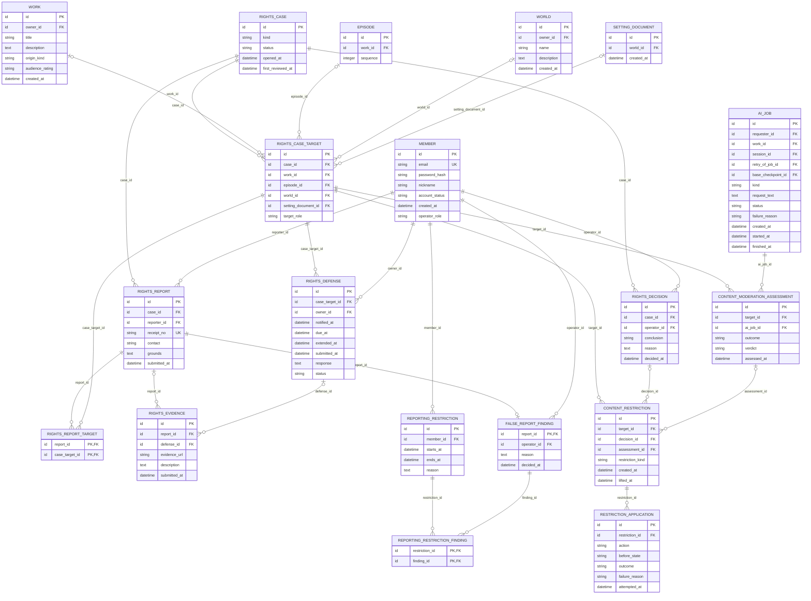

# 서비스 경계 업무 ERD — 권리 신고·판정·제한

> **전체 서비스 논리 후보 · 분리 구현 전.** [목차](../README.md) · [전체 ERD](../overview.md) · [정규화 검증](../normalization.md) · [요구사항 추적](../requirements-matrix.md). 영역은 서비스 배포 단위가 아닙니다.

근거: [UC-20](../../../usecase-spec/UC-20.md), [UC-23](../../../usecase-spec/UC-23.md). 최신 결정과 충돌하는 과거 상세는 적용하지 않습니다.

이 뷰의 중심 후보 **13개**, 다른 영역 참조 **6개**입니다. 이 뷰의 중심 테이블 관계만 표시하며 참조 테이블에서 다른 영역으로 나가는 선은 의도적으로 생략합니다.

## 정본 소유와 서비스 경계

[DEC-41 정본 소유·현행 구현과 논리 참조 해석](../README.md#dec-41-적용과-현재-구현)을 따릅니다. `core/`는 기존 문서 경로이며 각 표의 소유 구분이 목표 책임입니다. 그림의 엔티티·컬럼·관계는 그대로 보존하며 회원 인증 비밀을 다른 서비스에 복제하지 않습니다.

운영이 신고 사건·개별 접수·증빙·소명·유해 검사·최종 운영 판단·허위 신고 판단을 소유합니다. `CONTENT_RESTRICTION`·`RESTRICTION_APPLICATION`의 실제 제한·해제·열람/발행 차단은 콘텐츠 서비스 책임이며 운영은 조치 요청/결과를 관리합니다. 계정·세션 제한 적용은 Core에 요청합니다. `REPORTING_RESTRICTION`은 운영 신고 기능의 제한 후보이며 이를 Core 계정 상태와 동일하게 취급하지 않습니다. 사건·판정 참조는 콘텐츠에 사건 전체나 비공개 증빙을 복제하라는 뜻이 아니며 전달·멱등성·재시도 계약은 미정입니다.

## 이 그림의 테이블

| 뷰 구분 | 테이블 | 범위 | 목표 정본 소유 |
|---|---|---|---|
| 중심 후보 | [`RIGHTS_CASE`](../tables.md#rights-case) | 전체·범위확인 | 운영 |
| 중심 후보 | [`RIGHTS_REPORT`](../tables.md#rights-report) | 전체·범위확인 | 운영 |
| 중심 후보 | [`RIGHTS_CASE_TARGET`](../tables.md#rights-case-target) | 전체·범위확인 | 운영 |
| 중심 후보 | [`RIGHTS_REPORT_TARGET`](../tables.md#rights-report-target) | 전체·범위확인 | 운영 |
| 중심 후보 | [`RIGHTS_DEFENSE`](../tables.md#rights-defense) | 전체·범위확인 | 운영 |
| 중심 후보 | [`RIGHTS_EVIDENCE`](../tables.md#rights-evidence) | 전체·범위확인 | 운영 |
| 중심 후보 | [`RIGHTS_DECISION`](../tables.md#rights-decision) | 전체·범위확인 | 운영 |
| 중심 후보 | [`CONTENT_MODERATION_ASSESSMENT`](../tables.md#content-moderation-assessment) | 전체·범위확인 | 운영 |
| 중심 후보 | [`CONTENT_RESTRICTION`](../tables.md#content-restriction) | 전체·범위확인 | 콘텐츠 (실제 제한) |
| 중심 후보 | [`RESTRICTION_APPLICATION`](../tables.md#restriction-application) | 전체·범위확인 | 콘텐츠 (실제 적용 시도) |
| 중심 후보 | [`FALSE_REPORT_FINDING`](../tables.md#false-report-finding) | 전체·범위확인 | 운영 |
| 중심 후보 | [`REPORTING_RESTRICTION`](../tables.md#reporting-restriction) | 전체·범위확인 | 운영 |
| 중심 후보 | [`REPORTING_RESTRICTION_FINDING`](../tables.md#reporting-restriction-finding) | 전체·범위확인 | 운영 |
| 다른 영역 참조 | [`MEMBER`](../tables.md#member) | MVP | Core |
| 다른 영역 참조 | [`WORLD`](../tables.md#world) | MVP | 콘텐츠 |
| 다른 영역 참조 | [`SETTING_DOCUMENT`](../tables.md#setting-document) | MVP | 콘텐츠 |
| 다른 영역 참조 | [`WORK`](../tables.md#work) | MVP | 콘텐츠 |
| 다른 영역 참조 | [`EPISODE`](../tables.md#episode) | MVP | 콘텐츠 |
| 다른 영역 참조 | [`AI_JOB`](../tables.md#ai-job) | MVP | 요청 업무 소유 서비스 (콘텐츠/운영) |

## 데이터 역할과 무결성

- AI 묶음 검토 건, 개별 신고, 원신고 대상, 여러 증빙, 소명, 운영 판단, 실제 제한·적용 시도를 분리했습니다. 묶여도 개별 신고자·접수·근거·대상은 남습니다.
- 저작권 신고 접수나 권리자 확인만으로 자동비공개하지 않습니다. 공개 상태에서 검토하고 침해판정 후 조치합니다. 24시간은 1차 검토 목표입니다. 미소명은 침해 자동확정이 아니며 운영자에게 알립니다.
- 유해 모델 판정시 자동숨김 방향을 반영하되 성인등급만으로 유해하다고 판정하지 않습니다. 모델 실패·오판·허용금지 경계는 미정입니다. 성인 연령확인 방식·법적 기준을 임의 테이블로 확정하지 않았습니다.
- 한 제한의 해제는 다른 활성 제한을 지우지 않습니다. 각 대상의 적용 전 상태·성공/실패를 보존하고 하위 Fork도 개별 기록합니다. 세계관/항목 신고의 파급범위는 미정입니다.
- 단순 기각과 명시적 허위판정은 다릅니다. 허위3회·30일 신고제한은 판단 근거들을 연결하되 집계기간·정정처리는 미정입니다.
- 신고 연락처·증빙은 제한된 권한만 조회합니다. 기록을 1년이 지났다는 이유만으로 자동삭제하지 않으며 법률·개인정보 보존/삭제 의무는 별도 검토합니다. 운영 경고의 잠정1년과 혼동하지 않습니다.

각 테이블의 PK·FK·고유키·조건부 필수값과 예시는 [전체 테이블 가이드](../tables.md)에 있습니다. 그림만으로 권한·동시성·삭제 안전성이 보장되지 않습니다.
