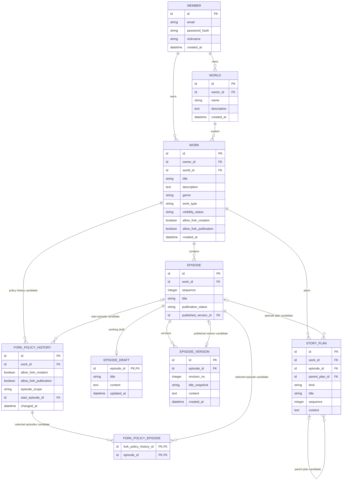

# Core 업무 ERD — 작품·집필·발행

> **전체 ERD의 부분 뷰 · 논리 초안 · 미구현.** [ERD 목차](../README.md) · [전체 업무 ERD](../overview.md). 업무 영역 구분은 별도 배포 서비스나 구현 클래스의 확정이 아닙니다.

작품, 스토리 계획, 회차 원고와 발행 기준을 다루는 Core 업무 영역입니다.

중심: `WORK`, `EPISODE`, `EPISODE_DRAFT`, `EPISODE_VERSION`, `STORY_PLAN`. `MEMBER`와 `WORLD`는 소유자·세계관 참조입니다.

## 이 그림의 테이블

- 작품·집필: [`WORK`](../tables.md#work), [`FORK_POLICY_HISTORY`](../tables.md#fork-policy-history), [`FORK_POLICY_EPISODE`](../tables.md#fork-policy-episode), [`EPISODE`](../tables.md#episode), [`EPISODE_DRAFT`](../tables.md#episode-draft), [`EPISODE_VERSION`](../tables.md#episode-version), [`STORY_PLAN`](../tables.md#story-plan).
- 다른 영역의 참조: [`MEMBER`](../tables.md#member), [`WORLD`](../tables.md#world).

## 유스케이스와 데이터

- [UC-24](../../../usecase-spec/UC-24.md): 소유자가 세계관을 연결하고 작품 제목·장르·소개를 입력합니다. 작품 생성만으로 공개되지 않습니다.
- [UC-03](../../../usecase-spec/UC-03.md)·[UC-10](../../../usecase-spec/UC-10.md): 회차를 순서대로 등록하고 직접 원고를 작성·저장합니다. 확정 콘텐츠의 변경·되돌리기는 새 버전으로 남기는 방향입니다.
- [UC-01](../../../usecase-spec/UC-01.md)·[UC-13](../../../usecase-spec/UC-13.md): 독자는 공개된 작품의 발행 회차만 읽으며, 소유자는 선택한 원고 버전을 발행하거나 공개를 중단할 수 있습니다. 원고를 저장한 사실은 발행이 아닙니다.
- 큰 줄거리·회차 플롯·장면 계획은 집필을 돕는 선택적 데이터이며, 계획된 미래 사건은 실제 관계에 자동 적용되지 않습니다.

## UC-13 발행 이력과 예약

- 소유자는 저장된 원고 버전을 발행하며, 발행·교체·공개 중단·재공개 이력을 확인합니다. 현재 발행 버전 포인터만으로 이력을 보장하지 않으며, 과거 발행본의 독자 공개는 별도 정책입니다.
- 공개 중단 후에도 기존 Fork의 기준 버전은 보존하고 해당 회차를 새 Fork의 기준으로 고르지 않습니다. 독립 전 원본 참조 자료 처리 세부는 별도 결정 대상입니다.
- 예약 발행은 저장 버전과 발행 시각을 대상으로 하며 예약과 실제 발행은 구분합니다. 예약 변경·취소·실패 처리와 MVP 포함 여부는 미정입니다.
- **발행 이력과 예약 관계는 현재 그림에 모델링되지 않았습니다.** 논리 모델 및 저장 방식은 후속 설계 대상입니다.

## 경계와 미정 사항

- **원고 이미지·인물 연결:** 원고 초안과 저장 버전은 이미지 및 `@`로 선택한 인물 항목을 포함할 수 있습니다. 저장 버전별 당시 이미지와 인물 연결을 보존하여 조회·복원하고 발행한 버전의 이미지는 독자에게 표시합니다. 인물 연결은 표시 위치와 선택한 실제 항목을 구분하며, 연결 자체는 인물 설정을 변경하지 않습니다. 원고 이미지 파일의 참조·보존과 연결의 버전별 저장 모델은 아직 그림에 추가되지 않은 논리 설계 대상입니다. 설정 이미지의 과거 파일 미보존(DEC-39)과 구분하고, AI 조회와 독자 표시에는 권한·기준 시점을 적용합니다. 사건·장소 `@` 연결은 미정입니다.
- 큰 줄거리·회차 플롯·장면 계획을 `STORY_PLAN` 하나로 표현한 것은 후보이며, 계획된 사건은 확정 관계가 아닙니다.
- `WORK`의 공개 상태와 Fork 생성·공개 허용, `EPISODE`의 발행 상태와 발행 버전은 서로 다른 판단을 위한 후보입니다. `FORK_POLICY_HISTORY`는 회차 범위와 조건 이력, `FORK_POLICY_EPISODE`는 회차별 선택을 나타내는 후보입니다. `published_version_id`는 반드시 같은 회차의 버전을 가리켜야 합니다.
- `EPISODE.sequence`는 작품 내 회차 순서의 후보입니다. 동일 작품에서 충돌하지 않게 검토해야 하며, `EPISODE_VERSION.title_snapshot`과 `revision_no`는 과거 제목·버전을 식별하는 후보입니다. 정확한 번호·제목의 이력 정책은 미정입니다.
- `STORY_PLAN`의 회차·부모 계획은 같은 작품에 속해야 합니다. 장르 목록·작품 유형·공개·Fork 조건과 계획의 순서·이력 형태는 미정이며 자동 발행·유료 공개는 MVP 이후입니다.
- 원고 자동저장은 회차별 작업 초안을 갱신하고 저장 버튼은 새 버전을 만듭니다. 복원은 새 버전이며 발행본을 자동으로 바꾸지 않습니다. `EPISODE_DRAFT`는 별도 논리 후보이며 회차당 최대 하나입니다. 저장 실패 시 기존 저장본을 보호하고 동시 편집 시 묵시적으로 덮어쓰지 않습니다. 자동저장 간격·동시성 처리와 현재/발행 포인터·발행 이력의 물리 방식은 미정입니다.

- 원작의 Fork 생성 허용과 Fork 작품 공개 허용은 별개이며 정책 이력을 둡니다. 일반적으로 생성 허용 철회 후 기존 Fork는 계속 창작합니다. 공개 허용 철회 후 이미 공개된 Fork는 계속 공개·발행하고 미공개 Fork의 최초 공개만 제한합니다. 법적 제한은 별도로 판단합니다.
