# 콘텐츠 업무 ERD — 작품·독서·집필·발행

> **전체 서비스 논리 후보 · 분리 구현 전.** [목차](../README.md) · [전체 ERD](../overview.md) · [정규화 검증](../normalization.md) · [요구사항 추적](../requirements-matrix.md). 영역은 서비스 배포 단위가 아닙니다.

근거: [UC-01](../../../usecase-spec/UC-01.md), [UC-03](../../../usecase-spec/UC-03.md), [UC-10](../../../usecase-spec/UC-10.md), [UC-13](../../../usecase-spec/UC-13.md), [UC-23](../../../usecase-spec/UC-23.md), [UC-24](../../../usecase-spec/UC-24.md). 최신 결정과 충돌하는 과거 상세는 적용하지 않습니다.

이 뷰의 중심 후보 **30개**, 다른 영역 참조 **3개**입니다. 이 뷰의 중심 테이블 관계만 표시하며 참조 테이블에서 다른 영역으로 나가는 선은 의도적으로 생략합니다.

```mermaid
erDiagram
    MEMBER ||--o{ WORK : "owner_id"
    WORK ||--o{ WORK_WORLD_HISTORY : "work_id"
    WORLD ||--o{ WORK_WORLD_HISTORY : "world_id"
    WORK ||--o{ WORK_GENRE : "work_id"
    GENRE ||--o{ WORK_GENRE : "genre_id"
    WORK ||--o{ WORK_HASHTAG : "work_id"
    HASHTAG ||--o{ WORK_HASHTAG : "hashtag_id"
    WORK ||--o{ WORK_PUBLICATION_HISTORY : "work_id"
    WORK ||--o{ WORK_RIGHTS_DECLARATION : "work_id"
    MEMBER ||--o{ WORK_RIGHTS_DECLARATION : "member_id"
    WORK ||--o{ WORK_LIKE : "work_id"
    MEMBER ||--o{ WORK_LIKE : "member_id"
    MEMBER ||--o{ WORK_FAVORITE : "member_id"
    WORK ||--o{ WORK_FAVORITE : "work_id"
    MEMBER ||--o{ READING_PROGRESS : "member_id"
    WORK ||--o{ READING_PROGRESS : "work_id"
    EPISODE_VERSION ||--o{ READING_PROGRESS : "episode_version_id"
    EPISODE ||--o{ EPISODE_VIEW_DAY : "episode_id"
    WORK ||--o{ EPISODE : "work_id"
    EPISODE ||--o| EPISODE_DRAFT : "episode_id"
    EPISODE ||--o{ EPISODE_VERSION : "episode_id"
    WORK_WORLD_HISTORY ||--o{ EPISODE_VERSION : "work_world_history_id"
    EPISODE_VERSION o|--o{ EPISODE_VERSION : "restored_from_id"
    MEMBER ||--o{ MANUSCRIPT_ASSET : "owner_id"
    EPISODE_DRAFT ||--o{ EPISODE_DRAFT_IMAGE : "episode_id"
    MANUSCRIPT_ASSET ||--o{ EPISODE_DRAFT_IMAGE : "asset_id"
    EPISODE_VERSION ||--o{ EPISODE_VERSION_IMAGE : "episode_version_id"
    MANUSCRIPT_ASSET ||--o{ EPISODE_VERSION_IMAGE : "asset_id"
    EPISODE_DRAFT ||--o{ EPISODE_DRAFT_MENTION : "episode_id"
    SETTING_DOCUMENT ||--o{ EPISODE_DRAFT_MENTION : "character_id"
    EPISODE_VERSION ||--o{ EPISODE_VERSION_MENTION : "episode_version_id"
    SETTING_DOCUMENT ||--o{ EPISODE_VERSION_MENTION : "character_id"
    EPISODE_VERSION ||--o{ PUBLICATION_EVENT : "episode_version_id"
    MEMBER o|--o{ PUBLICATION_EVENT : "actor_id"
    EPISODE_VERSION ||--o{ PUBLICATION_SCHEDULE : "episode_version_id"
    WORK ||--o{ STORY_PLAN : "work_id"
    EPISODE o|--o{ STORY_PLAN : "episode_id"
    STORY_PLAN o|--o{ STORY_PLAN : "parent_plan_id"
    WORK ||--o{ WRITING_NOTE : "work_id"
    EPISODE o|--o{ WRITING_NOTE : "episode_id"
    WORK ||--o{ MANUSCRIPT_IMPORT : "work_id"
    MANUSCRIPT_IMPORT ||--o{ MANUSCRIPT_IMPORT_ITEM : "import_id"
    EPISODE_VERSION o|--o{ MANUSCRIPT_IMPORT_ITEM : "episode_version_id"
    MANUSCRIPT_IMPORT_ITEM ||--o{ MANUSCRIPT_IMPORT_ISSUE : "import_item_id"
    WORK ||--o| WORK_EXTERNAL_SOURCE : "work_id"
    EXTERNAL_IP ||--o{ WORK_EXTERNAL_SOURCE : "external_ip_id"
    WORK ||--o| PUBLIC_DOMAIN_SOURCE : "work_id"

    WORK {
        id id PK
        id owner_id FK
        string title
        text description
        string origin_kind
        string audience_rating
        datetime created_at
    }
    WORK_WORLD_HISTORY {
        id id PK
        id work_id FK
        id world_id FK
        integer revision_no
        datetime changed_at
    }
    GENRE {
        id id PK
        string code UK
        string name
    }
    WORK_GENRE {
        id work_id PK,FK
        id genre_id PK,FK
    }
    HASHTAG {
        id id PK
        string name UK
    }
    WORK_HASHTAG {
        id work_id PK,FK
        id hashtag_id PK,FK
        string moderation_status
    }
    WORK_PUBLICATION_HISTORY {
        id id PK
        id work_id FK
        integer revision_no
        string visibility
        datetime changed_at
    }
    WORK_RIGHTS_DECLARATION {
        id id PK
        id work_id FK
        id member_id FK
        string notice_version
        string response
        datetime confirmed_at
    }
    WORK_LIKE {
        id work_id PK,FK
        id member_id PK,FK
        datetime created_at
    }
    WORK_FAVORITE {
        id member_id PK,FK
        id work_id PK,FK
        datetime created_at
    }
    READING_PROGRESS {
        id member_id PK,FK
        id work_id PK,FK
        id episode_version_id FK
        string position
        datetime updated_at
    }
    EPISODE_VIEW_DAY {
        id episode_id PK,FK
        string viewer_key PK
        date viewed_date PK
    }
    EPISODE {
        id id PK
        id work_id FK
        integer sequence
    }
    EPISODE_DRAFT {
        id episode_id PK,FK
        string title
        text content
        integer edit_revision
        datetime updated_at
    }
    EPISODE_VERSION {
        id id PK
        id episode_id FK
        id work_world_history_id FK
        integer revision_no
        string title
        text content
        id restored_from_id FK
        datetime created_at
    }
    MANUSCRIPT_ASSET {
        id id PK
        id owner_id FK
        string object_url
        string media_type
        integer byte_size
        datetime created_at
    }
    EPISODE_DRAFT_IMAGE {
        id id PK
        id episode_id FK
        id asset_id FK
        string position
        string alt_text
    }
    EPISODE_VERSION_IMAGE {
        id id PK
        id episode_version_id FK
        id asset_id FK
        string position
        string alt_text
    }
    EPISODE_DRAFT_MENTION {
        id id PK
        id episode_id FK
        id character_id FK
        string position
    }
    EPISODE_VERSION_MENTION {
        id id PK
        id episode_version_id FK
        id character_id FK
        string position
    }
    PUBLICATION_EVENT {
        id id PK
        id episode_version_id FK
        id actor_id FK
        string action
        string outcome
        datetime occurred_at
        string trigger_kind
    }
    PUBLICATION_SCHEDULE {
        id id PK
        id episode_version_id FK
        datetime scheduled_at
        string status
        datetime created_at
    }
    STORY_PLAN {
        id id PK
        id work_id FK
        id episode_id FK
        id parent_plan_id FK
        string kind
        string title
        integer sequence
        text content
    }
    WRITING_NOTE {
        id id PK
        id work_id FK
        id episode_id FK
        text content
        datetime updated_at
    }
    MANUSCRIPT_IMPORT {
        id id PK
        id work_id FK
        string input_kind
        datetime created_at
        string status
    }
    MANUSCRIPT_IMPORT_ITEM {
        id id PK
        id import_id FK
        integer sequence
        id episode_version_id FK
        string status
        string failure_reason
    }
    MANUSCRIPT_IMPORT_ISSUE {
        id id PK
        id import_item_id FK
        string source_position
        string reason
    }
    EXTERNAL_IP {
        id id PK
        string name
        string reference_url
    }
    WORK_EXTERNAL_SOURCE {
        id work_id PK,FK
        id external_ip_id FK
        string source_url
        datetime registered_at
    }
    PUBLIC_DOMAIN_SOURCE {
        id work_id PK,FK
        text bibliographic_info
        text rights_basis
        datetime verified_at
    }
    MEMBER {
        id id PK
        string email UK
        string password_hash
        string nickname
        string account_status
        datetime created_at
        string operator_role
    }
    WORLD {
        id id PK
        id owner_id FK
        string name
        text description
        datetime created_at
    }
    SETTING_DOCUMENT {
        id id PK
        id world_id FK
        datetime created_at
    }
```

## 정본 소유와 서비스 경계

[DEC-41 정본 소유·현행 구현과 논리 참조 해석](../README.md#dec-41-적용과-현재-구현)을 따릅니다. `core/`는 기존 문서 경로이며 각 표의 소유 구분이 목표 책임입니다. 그림의 엔티티·컬럼·관계는 그대로 보존하며 회원 인증 비밀을 다른 서비스에 복제하지 않습니다.

작품·독서·검색·회차·집필·발행·파일 참조 정본과 실제 예약 발행은 콘텐츠 서비스 책임입니다. 회원 알림은 콘텐츠가 사건을 제공하고 Core가 수신·전달을 담당합니다. 현재 해당 구현이 `core-api`에 있는 것과 별도 콘텐츠 앱으로의 이전 목표를 구분합니다.

## 이 그림의 테이블

| 뷰 구분 | 테이블 | 범위 | 목표 정본 소유 |
|---|---|---|---|
| 중심 후보 | [`WORK`](../tables.md#work) | MVP | 콘텐츠 |
| 중심 후보 | [`WORK_WORLD_HISTORY`](../tables.md#work-world-history) | MVP | 콘텐츠 |
| 중심 후보 | [`GENRE`](../tables.md#genre) | MVP | 콘텐츠 |
| 중심 후보 | [`WORK_GENRE`](../tables.md#work-genre) | MVP | 콘텐츠 |
| 중심 후보 | [`HASHTAG`](../tables.md#hashtag) | MVP | 콘텐츠 |
| 중심 후보 | [`WORK_HASHTAG`](../tables.md#work-hashtag) | MVP | 콘텐츠 |
| 중심 후보 | [`WORK_PUBLICATION_HISTORY`](../tables.md#work-publication-history) | MVP | 콘텐츠 |
| 중심 후보 | [`WORK_RIGHTS_DECLARATION`](../tables.md#work-rights-declaration) | MVP | 콘텐츠 |
| 중심 후보 | [`WORK_LIKE`](../tables.md#work-like) | MVP | 콘텐츠 |
| 중심 후보 | [`WORK_FAVORITE`](../tables.md#work-favorite) | MVP | 콘텐츠 |
| 중심 후보 | [`READING_PROGRESS`](../tables.md#reading-progress) | MVP | 콘텐츠 |
| 중심 후보 | [`EPISODE_VIEW_DAY`](../tables.md#episode-view-day) | MVP | 콘텐츠 |
| 중심 후보 | [`EPISODE`](../tables.md#episode) | MVP | 콘텐츠 |
| 중심 후보 | [`EPISODE_DRAFT`](../tables.md#episode-draft) | MVP | 콘텐츠 |
| 중심 후보 | [`EPISODE_VERSION`](../tables.md#episode-version) | MVP | 콘텐츠 |
| 중심 후보 | [`MANUSCRIPT_ASSET`](../tables.md#manuscript-asset) | 전체·범위확인 | 콘텐츠 |
| 중심 후보 | [`EPISODE_DRAFT_IMAGE`](../tables.md#episode-draft-image) | 전체·범위확인 | 콘텐츠 |
| 중심 후보 | [`EPISODE_VERSION_IMAGE`](../tables.md#episode-version-image) | 전체·범위확인 | 콘텐츠 |
| 중심 후보 | [`EPISODE_DRAFT_MENTION`](../tables.md#episode-draft-mention) | MVP | 콘텐츠 |
| 중심 후보 | [`EPISODE_VERSION_MENTION`](../tables.md#episode-version-mention) | MVP | 콘텐츠 |
| 중심 후보 | [`PUBLICATION_EVENT`](../tables.md#publication-event) | MVP | 콘텐츠 |
| 중심 후보 | [`PUBLICATION_SCHEDULE`](../tables.md#publication-schedule) | 전체·범위확인 | 콘텐츠 |
| 중심 후보 | [`STORY_PLAN`](../tables.md#story-plan) | MVP | 콘텐츠 |
| 중심 후보 | [`WRITING_NOTE`](../tables.md#writing-note) | 전체·범위확인 | 콘텐츠 |
| 중심 후보 | [`MANUSCRIPT_IMPORT`](../tables.md#manuscript-import) | 전체·범위확인 | 콘텐츠 |
| 중심 후보 | [`MANUSCRIPT_IMPORT_ITEM`](../tables.md#manuscript-import-item) | 전체·범위확인 | 콘텐츠 |
| 중심 후보 | [`MANUSCRIPT_IMPORT_ISSUE`](../tables.md#manuscript-import-issue) | MVP 이후 | 콘텐츠 |
| 중심 후보 | [`EXTERNAL_IP`](../tables.md#external-ip) | 전체·범위확인 | 콘텐츠 |
| 중심 후보 | [`WORK_EXTERNAL_SOURCE`](../tables.md#work-external-source) | 전체·범위확인 | 콘텐츠 |
| 중심 후보 | [`PUBLIC_DOMAIN_SOURCE`](../tables.md#public-domain-source) | 테스트 전용 | 콘텐츠 |
| 다른 영역 참조 | [`MEMBER`](../tables.md#member) | MVP | Core |
| 다른 영역 참조 | [`WORLD`](../tables.md#world) | MVP | 콘텐츠 |
| 다른 영역 참조 | [`SETTING_DOCUMENT`](../tables.md#setting-document) | MVP | 콘텐츠 |

## 데이터 역할과 무결성

- 기존 `WORK.genre` 한 칸을 **장르 정의+작품 연결**로 분리했습니다. UC-01의 1~2개 장르와 최대 10개 해시태그를 표현합니다. 좋아요·관심 소설·이어 읽기는 서로 독립된 사용자 선택이며 개수/잔액 같은 파생값을 원천과 중복 저장하지 않습니다.
- 작품은 현재 세계관 하나, 세계관은 현재 최대 한 작품입니다. `WORK_WORLD_HISTORY`의 최신 이력이 현재 연결이고 각 원고 버전은 **당시 연결 이력**을 고정합니다. 변경 후 이전 발행 회차가 새 세계관으로 자동 재해석되지 않습니다. 동시 연결의 유일성은 단순 FK만으로 보장되지 않습니다.
- 회차 식별자에 제목·발행 상태를 중복하지 않습니다. 초안은 자동저장, 버전은 저장 버튼/복원, 발행 사건은 별개입니다. 복원도 새 버전이며 실패는 기존 저장본·발행본을 유지합니다.
- 이미지 파일, 초안의 이미지 배치, 저장 버전의 이미지 배치를 나눴습니다. 저장 버전이 참조하는 파일은 제안·실행 기록 삭제와 독립적으로 보존합니다. `@`는 선택한 실제 인물과 위치를 초안/버전별로 보관하고 연결 자체가 설정을 변경하지 않습니다. 사건·장소 `@`는 확정하지 않았습니다.
- 작품 공개 이력과 회차 발행 이력을 분리합니다. 회차별 직렬화된 성공 발행·교체·중단·재공개 전이만 현재 발행 상태를 바꿉니다. 저장은 `EPISODE_VERSION` 생성이며 발행 사건에 넣지 않고 실패 사건도 발행 상태를 바꾸지 않습니다. 소유자는 발행·교체·공개 중단·재공개 이력을 확인하지만 독자에게 과거 이력을 자동 공개하지 않습니다.
- 예약은 저장 버전+시각이며 실제 실행 결과는 정기 작업 대상과 발행 사건에 연결합니다. 예약 변경·취소 정책과 MVP 포함 여부는 미정입니다. 원고 저장과 발행은 별개입니다.
- `STORY_PLAN`은 줄거리·플롯·장면의 동일한 계층 구조를 재사용합니다. 보드·타임라인·개요는 이 데이터의 표현으로 두고 UI마다 같은 테이블을 복제하지 않습니다. 비공개 메모는 원고와 별도이며 내보내기에서 제외합니다.
- 등록 요청/회차별 결과/이미지별 실패를 분리했습니다. 파일 업로드는 MVP 이후이고 붙여넣기 흐름과 다릅니다. `.txt`·`.epub` 내보내기 자체는 기존 버전·이미지로 계산하므로 별도 내보내기 작업 테이블을 선제 추가하지 않습니다.
- 외부 IP 출처는 등록자 확인과 법적 권리를 구별합니다. 같은 IP의 최초 등록 기준은 플랫폼상의 원본 표시일 뿐 저작권 소유권이 아닙니다. 보호기간 만료 원작은 테스트용 서지·권리 근거만 둡니다.

각 테이블의 PK·FK·고유키·조건부 필수값과 예시는 [전체 테이블 가이드](../tables.md)에 있습니다. 그림만으로 권한·동시성·삭제 안전성이 보장되지 않습니다.
