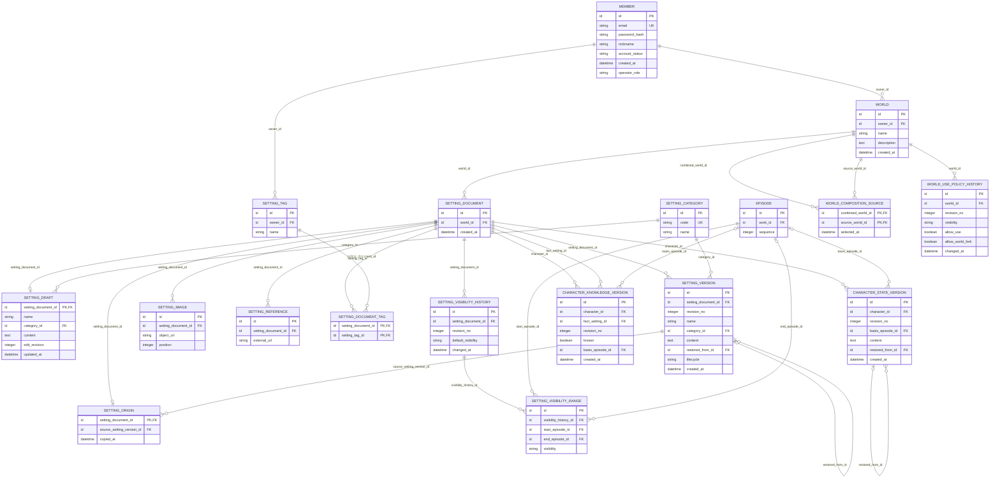

# Core 업무 ERD — 세계관·설정·인물

> **전체 서비스 논리 후보 · 미구현.** [목차](../README.md) · [전체 ERD](../overview.md) · [정규화 검증](../normalization.md) · [요구사항 추적](../requirements-matrix.md). 영역은 서비스 배포 단위가 아닙니다.

근거: [UC-02](../../../usecase-spec/UC-02.md), [UC-05](../../../usecase-spec/UC-05.md), [UC-06](../../../usecase-spec/UC-06.md). 최신 결정과 충돌하는 과거 상세는 적용하지 않습니다.

소유 후보 **16개**, 다른 영역 참조 **2개**입니다. 이 영역 소유 테이블의 FK 관계만 표시하며 참조 테이블에서 다른 영역으로 나가는 선은 의도적으로 생략합니다.

## 이 그림의 테이블

| 소유/참조 | 테이블 | 범위 |
|---|---|---|
| 소유 | [`WORLD`](../tables.md#world) | MVP |
| 소유 | [`SETTING_CATEGORY`](../tables.md#setting-category) | MVP |
| 소유 | [`SETTING_DOCUMENT`](../tables.md#setting-document) | MVP |
| 소유 | [`SETTING_DRAFT`](../tables.md#setting-draft) | MVP |
| 소유 | [`SETTING_VERSION`](../tables.md#setting-version) | MVP |
| 소유 | [`SETTING_ORIGIN`](../tables.md#setting-origin) | MVP |
| 소유 | [`SETTING_IMAGE`](../tables.md#setting-image) | MVP |
| 소유 | [`SETTING_REFERENCE`](../tables.md#setting-reference) | MVP |
| 소유 | [`SETTING_TAG`](../tables.md#setting-tag) | MVP |
| 소유 | [`SETTING_DOCUMENT_TAG`](../tables.md#setting-document-tag) | MVP |
| 소유 | [`SETTING_VISIBILITY_HISTORY`](../tables.md#setting-visibility-history) | MVP |
| 소유 | [`SETTING_VISIBILITY_RANGE`](../tables.md#setting-visibility-range) | MVP |
| 소유 | [`CHARACTER_STATE_VERSION`](../tables.md#character-state-version) | MVP |
| 소유 | [`CHARACTER_KNOWLEDGE_VERSION`](../tables.md#character-knowledge-version) | MVP |
| 소유 | [`WORLD_COMPOSITION_SOURCE`](../tables.md#world-composition-source) | MVP 이후 |
| 소유 | [`WORLD_USE_POLICY_HISTORY`](../tables.md#world-use-policy-history) | 보류·재설계 |
| 다른 영역 참조 | [`MEMBER`](../tables.md#member) | MVP |
| 다른 영역 참조 | [`EPISODE`](../tables.md#episode) | MVP |

## 데이터 역할과 무결성

- 설정 항목의 **식별자 / 가변 초안 / 불변 버전**을 나눴습니다. 이름·카테고리·본문은 버전/초안에 있고 항목에 별도 현재 사본을 두지 않습니다. 설정당 고정 카테고리 하나·여러 자유 태그를 연결합니다.
- 현재 설정 이미지와 외부 참고 URL은 각각 반복 관계입니다. 설정 이미지는 최대 10개이고 RDB에는 URL만 둡니다. 설정 이미지의 과거 파일은 보존하지 않으며 텍스트 revert가 이미지 복원을 보장하지 않습니다. 사용 중 참조가 있는 파일을 임의로 정리하지 않습니다.
- 공개 정책의 변경 이력과 그 이력 안의 회차 범위를 분리합니다. 기본 비공개입니다. 공개·내용 유효 시점의 정확한 표현, 범위 중첩과 경계는 아직 후보입니다. 항목이 공개라도 권한 밖 본문·인물 지식이 노출되어서는 안 됩니다.
- 설정 제거·최초 생성 되돌리기는 `SETTING_VERSION.lifecycle`의 제거 상태를 가진 새 버전입니다. 복원도 새 활성 버전이며 빈 본문·비공개 전환과 구분합니다. 이전 이력을 삭제하지 않습니다.
- 인물 프로필은 설정 문서로 재사용합니다. 상태 버전·인물별 사실 인지 이력은 서로 다른 정보이므로 분리한 **논리 후보**입니다. 성격·능력·목표마다 별도 테이블을 강제하지 않습니다. 인지 단위와 물리 저장은 팀 논의가 필요합니다.
- 인물 및 엔티티 간 관계는 **그래프 DB**의 책임입니다. 관계 테이블을 RDB 정본으로 확정하지 않았습니다. 체크포인트와 동일 시점으로 보존·조회할 관계 모델, 문서 키, 동기화·복구는 여전히 설계가 필요합니다.
- 조합 세계관은 원본 최대 5개와 출처를 연결하며 실제 복사 항목의 원본 버전은 `SETTING_ORIGIN`으로 연결합니다. Fork 세계관의 재Fork·조합 원본 사용 금지, 원본 후속 변경 자동 반영 금지입니다. 타인 세계관 직접 이용은 보류·재설계이며 조합은 MVP 이후입니다.

## 카테고리와 이미지

고정 목록과 태그 이력, 이미지 접근·공유 참조 정리 방식은 미정입니다. 원고 이미지 버전 보존과 설정 이미지의 현재 상태 관리를 혼합하지 않습니다.

각 테이블의 PK·FK·고유키·조건부 필수값과 예시는 [전체 테이블 가이드](../tables.md)에 있습니다. 그림만으로 권한·동시성·삭제 안전성이 보장되지 않습니다.
