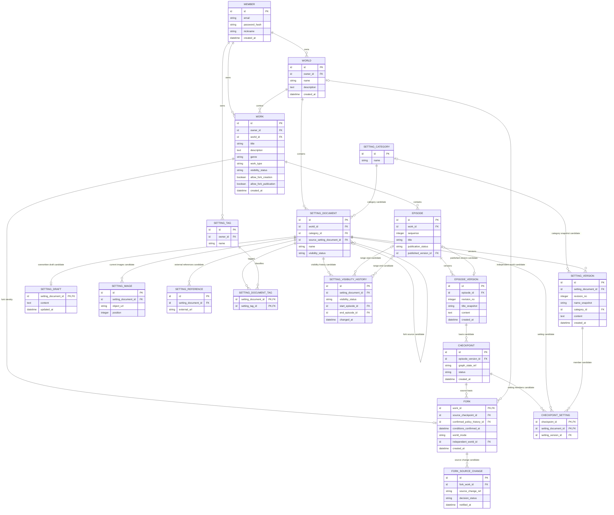

# Core 업무 ERD — 세계관·설정

> **전체 ERD의 부분 뷰 · 논리 초안 · 미구현.** [ERD 목차](../README.md) · [전체 업무 ERD](../overview.md). 업무 영역 구분은 별도 배포 서비스나 구현 클래스의 확정이 아닙니다.

세계관과 인물·장소·규칙 등의 설정 문서 및 버전을 다루는 Core 업무 영역입니다.

중심: `WORLD`, `SETTING_CATEGORY`, `SETTING_DOCUMENT`, `SETTING_VERSION`. 회원·작품·회차·체크포인트·Fork는 세계관의 소유와 분기 기준을 설명하는 참조입니다.

## 이 그림의 테이블

- 세계관과 설정: [`WORLD`](../tables.md#world), [`SETTING_CATEGORY`](../tables.md#setting-category), [`SETTING_DOCUMENT`](../tables.md#setting-document), [`SETTING_DRAFT`](../tables.md#setting-draft), [`SETTING_VERSION`](../tables.md#setting-version).
- 첨부·분류·공개: [`SETTING_IMAGE`](../tables.md#setting-image), [`SETTING_REFERENCE`](../tables.md#setting-reference), [`SETTING_TAG`](../tables.md#setting-tag), [`SETTING_DOCUMENT_TAG`](../tables.md#setting-document-tag), [`SETTING_VISIBILITY_HISTORY`](../tables.md#setting-visibility-history).
- 연결된 기준·분기: [`FORK_SOURCE_CHANGE`](../tables.md#fork-source-change), [`CHECKPOINT`](../tables.md#checkpoint), [`CHECKPOINT_SETTING`](../tables.md#checkpoint-setting), [`FORK`](../tables.md#fork).
- 다른 영역의 참조: [`MEMBER`](../tables.md#member), [`WORK`](../tables.md#work), [`EPISODE`](../tables.md#episode), [`EPISODE_VERSION`](../tables.md#episode-version). 같은 테이블을 이 영역에서 다시 만든다는 뜻은 아닙니다.

## 데이터 역할과 유스케이스

- `WORLD`는 소유자가 관리하는 세계관 단위이고 `SETTING_DOCUMENT`는 그 안의 개별 설정 항목입니다([UC-02](../../../usecase-spec/UC-02.md)). `SETTING_CATEGORY`는 인물·광물·장소 등 고정 분류이며 항목마다 하나를 고릅니다. `SETTING_TAG`와 연결은 사용자가 붙이는 복수 태그의 후보입니다.
- `SETTING_DRAFT`는 덮어쓰는 초안, `SETTING_VERSION`은 확정 텍스트의 새 버전 후보입니다. `revision_no`·이름·카테고리 스냅샷은 당시 내용을 식별하려는 후보이며 현재 항목 값과의 일관성, 태그 이력의 보존 방식은 미정입니다.
- `SETTING_IMAGE`는 현재 설정 이미지 최대 10개를 나타냅니다. 파일은 MinIO에, URL은 RDB에 저장합니다(DEC-39). 과거 이미지 이력·복원은 없으며, 공유 참조를 끊지 않는 물리 정리 시점은 미정입니다. `SETTING_REFERENCE`는 외부 참고 URL 후보입니다. 접근 제어와 URL 검증·안전한 전달은 별도 설계합니다.
- 설정 항목은 기본 비공개이며 회차 범위별 공개·비공개 및 변경 이력을 둡니다. 공개 시점과 내용 유효 시점을 독립 필드로 둘지는 미확정입니다. 이 그림의 범위·시각은 설계 후보입니다.
- `SETTING_DOCUMENT.source_setting_document_id`는 복사 항목의 출처 후보일 뿐 복사·독립 쓰기·권한을 보장하지 않습니다. 기준 버전 연결 후보 `CHECKPOINT_SETTING`은 같은 체크포인트에서 항목별 기준 버전을 하나만 선택하고 그 버전이 같은 항목과 허용된 원작에 속하는지 확인해야 합니다. 그래프 시점의 일치도 별도로 검증해야 합니다.

## 카테고리와 이미지

카테고리 목록·관리 주체와 태그 이력은 미정입니다. 이미지가 텍스트 버전에 종속되거나 과거 이미지가 보존된다고 가정하지 않습니다.

## 원본 삭제와 Fork 보존 (UC-19)

원본 세계관 삭제 전 참조 중인 각 작품 Fork에 기준 회차에서 접근 가능한 세계관 전체를 각각 Fork 소유자의 독립 세계관으로 복사합니다. 비공개·권한 밖 내용은 제외하고 이미 독립한 Fork는 유지합니다. 전환 실패 시 참조 내용을 잃도록 원본을 먼저 없애지 않습니다. 참조 중인 원본 설정은 원본 소유자의 사용량으로, 독립 세계관과 Fork 원고는 각 Fork 소유자의 사용량으로 계산합니다. 복사 시 용량 부족과 안전한 전환 방식은 미정이며 **삭제 전환·사용량 관계는 현재 그림에 없습니다.**

## Fork와 경계

기준 회차에서 공개된 세계관 전체를 포함합니다: 인물 기본 설정, 회차 상태·지식, 인물관계도. 수정 전 기준 회차에 영향을 주는 원작 변경을 즉시 추종하고 최초 설정 수정 시 전체를 독립시킵니다. 독립 후 알림과 선택적 반영을 제공하며 거절 후 재반영할 수 있습니다. 10화에서 변경했더라도 5화에 적용·공개되면 5화 기준 Fork에 영향을 줍니다. 상세는 [Fork](fork-and-checkpoint.md)를 참고합니다.

관계 그래프의 실제 스키마·물리 보존과 동기화는 미정입니다. 항목 공개 여부 외에도 미발행 원고와 권한 밖 인물 지식 등 민감 본문을 노출하지 않아야 합니다. DEC-36의 설정 공개 구분은 MVP 방향으로 확정했지만 이 그림은 실제 구현이나 정합성을 보장하지 않습니다.
