# STORYFORK 전체 MVP 업무 ERD 초안

> **상태: 논의용 설계 후보 · 업무 기능과 DB 미구현.** [현재 MVP 설계](../design.md), [결정 기록](../decisions.md), [유스케이스 명세](../../usecase-spec/README.md)를 기준으로 계정부터 작품·Fork·AI·피드백까지 함께 그렸습니다. 표기된 업무 테이블명·속성·관계는 설명을 위한 후보이지 확정 SQL이나 구현 계약이 아닙니다. [LangGraph Saver](ai-service/postgres-saver.md#3-langgraph-postgressaver의-실제-테이블)는 별도 외부 라이브러리의 확인된 스키마이며 STORYFORK 도입은 검토 중입니다.
>
> 이 그림은 그래프 DB 자체의 노드·관계 모델을 표현하지 않습니다. PostgreSQL과 그래프 DB의 연결·정합성은 미정입니다. `pg_git`은 MVP에서 사용하지 않고 MVP 이후 신중한 도입을 추진합니다(DEC-27·30).

> [ERD 목차](README.md) · [테이블별 설명](tables.md) · [Core 업무 영역별 ERD](README.md#core-업무-영역별-erd) · [AI Saver 참고](ai-service/postgres-saver.md)

## 1. 기준과 읽는 법

- **MVP 흐름:** 회원 가입·로그인 → 세계관과 작품 구성 → 설정·스토리 계획·회차 집필·발행 → 독자의 열람·Fork 및 댓글·제보. AI 집필·인물 시뮬레이션은 선택적이며 직접 집필이나 Fork 생성에 필수가 아닙니다.
- **기준:** 최신 [MVP 범위](../design.md#포함과-제외)와 DEC-22~40이 충돌하는 기존 유스케이스 본문보다 우선합니다. 과거 UC-24의 복수 세계관, UC-14의 AI 응대, UC-22의 갱신 토큰 등을 MVP 물리 스키마로 확정하지 않습니다.
- **저장 경계:** 원문과 콘텐츠 버전·체크포인트·Fork는 PostgreSQL, 인물과 엔티티 간 관계의 저장·조회는 그래프 DB 방향입니다. `STORY_PLAN`의 예정 사건을 확정 관계와 혼동하지 않습니다.
- **업무 ERD:** 선과 카디널리티는 설명을 위한 관계 후보입니다. `id`, `string`, `text`, `datetime` 등은 논리 표기일 뿐 DB 타입을 확정하지 않습니다. `PK`/`FK`도 후보이며 NULL, 인덱스, 삭제·보존·동시성 제약은 후속 설계가 필요합니다.
- **구분:** `CHECKPOINT`는 회차와 당시 세계관·관계를 묶는 **STORYFORK 업무 기준점**입니다. 소문자 `checkpoints`는 LangGraph의 **AI 실행 상태**입니다. 둘은 이름만 비슷하며 자동 연결되지 않습니다.

### 유스케이스별 반영 범위

| 사용자 흐름 | 확인한 근거 | ERD에서 다룰 정보 |
|---|---|---|
| 가입·로그인 | [UC-22](../../usecase-spec/UC-22.md) | 회원, 필수 동의. 갱신 토큰·이메일 인증은 MVP 이후 |
| 세계관·설정 | [UC-02](../../usecase-spec/UC-02.md) · [UC-06](../../usecase-spec/UC-06.md) | 세계관 소유, 항목·카테고리·설정 버전. 인물 관계는 그래프 DB, 인물별 지식 범위는 별도 설계 필요 |
| 기존 원고·설정 추출 | [UC-03](../../usecase-spec/UC-03.md) · [UC-04](../../usecase-spec/UC-04.md) | 작품별 회차 원고 등록, 요청한 원고의 수동 추출과 사용자 채택. 파일 업로드·자동 반영은 MVP 이후 |
| 작품·회차·발행 | [UC-01](../../usecase-spec/UC-01.md) · [UC-07](../../usecase-spec/UC-07.md) · [UC-13](../../usecase-spec/UC-13.md) · [UC-24](../../usecase-spec/UC-24.md) | 소유자·세계관·작품 정보, 회차 순서·원고 버전, 공개와 Fork 허용 판단. 유료 공개·자동 발행은 MVP 이후 |
| Fork 창작 | [UC-08](../../usecase-spec/UC-08.md) · [UC-10](../../usecase-spec/UC-10.md) · [UC-11](../../usecase-spec/UC-11.md) | 원작 기준 회차와 설정·관계의 시점, 독립된 Fork, 선택적 원고 옆 AI 채팅·설정 수정 |
| 스토리 설계·시뮬레이션 | [MVP 설계](../design.md#mvp-범위) · [UC-09](../../usecase-spec/UC-09.md) | 줄거리·회차 플롯·장면 계획과 선택적 시뮬레이션 결과. 예정 사건과 확정 상태 구분 |
| 독자 피드백 | [UC-14](../../usecase-spec/UC-14.md) | 댓글·제보 작성자·내용·대상 회차/버전과 작가의 목록 확인. 필터·AI 응대·보상은 MVP 이후 |
| AI 작업 | [DEC-18](../decisions.md#결정-목록) · [UC-11](../../usecase-spec/UC-11.md) | Core의 작업 상태·사용량·실패 기록과 선택적 제안의 기준·채택. Saver 내부 실행 상태와 별개 |

상세 UC의 옛 공개 항목 필터·복수 세계관·자동 반영과 최신 결정이 충돌하면 최신 MVP 설계를 우선합니다. **세계관 공개 범위와 Fork 정책은 아래 논리 후보로 반영하며 구체 저장 방식은 미정입니다.** 이 표는 **유스케이스 근거의 데이터 범위를 정리한 것**이지 기능 구현이나 물리 테이블을 확정한 것이 아닙니다.

## 2. STORYFORK 업무 ERD — 전체 MVP 관계 후보

`MEMBER` 한 사람이 독자와 창작자를 모두 겸할 수 있습니다. 별도 독자·작가 계정 테이블이나 미정인 결제 테이블은 만들지 않았습니다. `AI_JOB`·`AI_PROPOSAL`·`CHAT_SESSION`은 필요한 논리적 구분과 연결 후보이며, 지속 보관이나 각각의 물리 테이블을 확정한 것은 아닙니다.

```mermaid
erDiagram
    MEMBER ||--o{ MEMBER_CONSENT : agrees
    MEMBER ||--o{ WORLD : owns
    MEMBER ||--o{ WORK : owns
    WORLD ||--o{ WORK : context
    WORLD ||--o{ SETTING_DOCUMENT : contains
    SETTING_CATEGORY ||--o{ SETTING_DOCUMENT : "category candidate"
    SETTING_CATEGORY o|--o{ SETTING_VERSION : "category snapshot candidate"
    SETTING_DOCUMENT ||--o{ SETTING_VERSION : versions
    SETTING_DOCUMENT ||--o| SETTING_DRAFT : "overwritten draft candidate"
    SETTING_DOCUMENT ||--o{ SETTING_IMAGE : "current images candidate"
    SETTING_DOCUMENT ||--o{ SETTING_REFERENCE : "external references candidate"
    SETTING_DOCUMENT ||--o{ SETTING_DOCUMENT_TAG : tagged
    SETTING_TAG ||--o{ SETTING_DOCUMENT_TAG : classifies
    MEMBER ||--o{ SETTING_TAG : owns
    SETTING_DOCUMENT ||--o{ SETTING_VISIBILITY_HISTORY : "visibility history candidate"
    EPISODE o|--o{ SETTING_VISIBILITY_HISTORY : "range start candidate"
    EPISODE o|--o{ SETTING_VISIBILITY_HISTORY : "range end candidate"
    WORK ||--o{ FORK_POLICY_HISTORY : "policy history candidate"
    EPISODE o|--o{ FORK_POLICY_HISTORY : "start episode candidate"
    FORK_POLICY_HISTORY ||--o{ FORK_POLICY_EPISODE : "selected episodes candidate"
    EPISODE ||--o{ FORK_POLICY_EPISODE : "selected episode candidate"
    FORK_POLICY_HISTORY ||--o{ FORK : "confirmed policy candidate"
    FORK ||--o{ FORK_SOURCE_CHANGE : "source change candidate"
    SETTING_DOCUMENT o|--o{ SETTING_DOCUMENT : "fork source candidate"
    WORK ||--o{ EPISODE : contains
    EPISODE ||--o| EPISODE_DRAFT : "working draft"
    EPISODE ||--o{ EPISODE_VERSION : versions
    EPISODE_VERSION o|--o| EPISODE : "published version candidate"
    WORK ||--o{ STORY_PLAN : plans
    EPISODE o|--o{ STORY_PLAN : "episode plan candidate"
    STORY_PLAN o|--o{ STORY_PLAN : "parent plan candidate"
    EPISODE_VERSION ||--o{ CHECKPOINT : "basis candidate"
    CHECKPOINT ||--o{ CHECKPOINT_EPISODE : "episode members candidate"
    EPISODE ||--o{ CHECKPOINT_EPISODE : "episode candidate"
    EPISODE_VERSION ||--o{ CHECKPOINT_EPISODE : "version candidate"
    CHECKPOINT ||--o{ CHECKPOINT_SETTING : "setting members candidate"
    SETTING_DOCUMENT ||--o{ CHECKPOINT_SETTING : "setting candidate"
    SETTING_VERSION ||--o{ CHECKPOINT_SETTING : "member candidate"
    WORK ||--o| FORK : "fork identity"
    CHECKPOINT ||--o{ FORK : "source basis"
    WORLD o|--o{ FORK : "independent world candidate"
    MEMBER ||--o{ CHAT_SESSION : owns
    WORK ||--o{ CHAT_SESSION : "context work"
    WORK o|--o{ CHAT_SESSION : "target fork candidate"
    CHECKPOINT o|--o{ CHAT_SESSION : "context baseline candidate"
    MEMBER ||--o{ AI_JOB : requests
    WORK ||--o{ AI_JOB : context
    CHAT_SESSION o|--o{ AI_JOB : "optional chat"
    CHECKPOINT o|--o{ AI_JOB : "baseline candidate"
    AI_JOB ||--o{ AI_PROPOSAL : produces
    EPISODE_VERSION o|--o{ AI_PROPOSAL : "base episode candidate"
    SETTING_VERSION o|--o{ AI_PROPOSAL : "base setting candidate"
    EPISODE_VERSION o|--o{ AI_PROPOSAL : "applied episode candidate"
    SETTING_VERSION o|--o{ AI_PROPOSAL : "applied setting candidate"
    MEMBER ||--o{ FEEDBACK : writes
    EPISODE_VERSION ||--o{ FEEDBACK : "read version"
    FEEDBACK ||--o{ FEEDBACK_STATUS_EVENT : history
    FEEDBACK ||--o{ FEEDBACK_RESPONSE : responses
    FEEDBACK ||--o| FEEDBACK_VERIFICATION : attachment
    FEEDBACK ||--o{ FEEDBACK_MODERATION : moderation
    FEEDBACK ||--o{ FEEDBACK_LIKE : likes
    MEMBER ||--o{ FEEDBACK_LIKE : likes
    FEEDBACK ||--o{ FEEDBACK_COMMENT : discussion
    MEMBER ||--o{ FEEDBACK_COMMENT : writes
    FEEDBACK ||--o{ FEEDBACK_REVIEW : decisions
    AI_PROPOSAL o|--o{ FEEDBACK_REVIEW : proposal
    EPISODE_VERSION o|--o{ FEEDBACK_REVIEW : applied_version

    MEMBER {
        id id PK
        string email
        string password_hash
        string nickname
        datetime created_at
    }
    MEMBER_CONSENT {
        id id PK
        id member_id FK
        string terms_type
        string terms_version
        datetime agreed_at
    }
    WORLD {
        id id PK
        id owner_id FK
        string name
        text description
        datetime created_at
    }
    WORK {
        id id PK
        id owner_id FK
        id world_id FK
        string title
        text description
        string genre
        string work_type
        string visibility_status
        boolean allow_fork_creation
        boolean allow_fork_publication
        datetime created_at
    }
    SETTING_CATEGORY {
        id id PK
        string name
    }
    SETTING_DOCUMENT {
        id id PK
        id world_id FK
        id category_id FK
        id source_setting_document_id FK
        string name
        string visibility_status
    }
    SETTING_DRAFT {
        id setting_document_id PK,FK
        text content
        datetime updated_at
    }
    SETTING_IMAGE {
        id id PK
        id setting_document_id FK
        string object_url
        integer position
    }
    SETTING_REFERENCE {
        id id PK
        id setting_document_id FK
        string external_url
    }
    SETTING_TAG {
        id id PK
        id owner_id FK
        string name
    }
    SETTING_DOCUMENT_TAG {
        id setting_document_id PK,FK
        id setting_tag_id PK,FK
    }
    SETTING_VISIBILITY_HISTORY {
        id id PK
        id setting_document_id FK
        string visibility_status
        id start_episode_id FK
        id end_episode_id FK
        datetime changed_at
    }
    FORK_POLICY_HISTORY {
        id id PK
        id work_id FK
        boolean allow_fork_creation
        boolean allow_fork_publication
        string episode_scope
        id start_episode_id FK
        datetime changed_at
    }
    FORK_POLICY_EPISODE {
        id fork_policy_history_id PK,FK
        id episode_id PK,FK
    }
    FORK_SOURCE_CHANGE {
        id id PK
        id fork_work_id FK
        string source_change_ref
        string decision_status
        datetime notified_at
    }
    SETTING_VERSION {
        id id PK
        id setting_document_id FK
        integer revision_no
        string name_snapshot
        id category_id FK
        text content
        datetime created_at
    }
    EPISODE {
        id id PK
        id work_id FK
        integer sequence
        string title
        string publication_status
        id published_version_id FK
    }
    EPISODE_DRAFT {
        id episode_id PK,FK
        string title
        text content
        datetime updated_at
    }
    EPISODE_VERSION {
        id id PK
        id episode_id FK
        integer revision_no
        string title_snapshot
        text content
        datetime created_at
    }
    STORY_PLAN {
        id id PK
        id work_id FK
        id episode_id FK
        id parent_plan_id FK
        string kind
        string title
        integer sequence
        text content
    }
    CHECKPOINT {
        id id PK
        id episode_version_id FK
        string graph_state_ref
        string status
        datetime created_at
    }
    CHECKPOINT_EPISODE {
        id checkpoint_id PK,FK
        id episode_id PK,FK
        id episode_version_id FK
    }
    CHECKPOINT_SETTING {
        id checkpoint_id PK,FK
        id setting_document_id PK,FK
        id setting_version_id FK
    }
    FORK {
        id work_id PK,FK
        id source_checkpoint_id FK
        id confirmed_policy_history_id FK
        datetime conditions_confirmed_at
        string world_mode
        id independent_world_id FK
        datetime created_at
    }
    CHAT_SESSION {
        string thread_id PK
        id owner_id FK
        id context_work_id FK
        id target_fork_work_id FK
        id base_checkpoint_id FK
        datetime created_at
    }
    AI_JOB {
        id id PK
        id requester_id FK
        id work_id FK
        string thread_id FK
        id base_checkpoint_id FK
        string kind
        string status
        string model
        integer input_tokens
        integer output_tokens
        string failure_code
        datetime created_at
        datetime finished_at
    }
    AI_PROPOSAL {
        id id PK
        id job_id FK
        string kind
        text content
        text evidence
        string selection_status
        string application_status
        id base_episode_version_id FK
        id base_setting_version_id FK
        id applied_episode_version_id FK
        id applied_setting_version_id FK
        datetime created_at
    }
    FEEDBACK {
        id id PK
        id author_id FK
        id episode_version_id FK
        string kind
        text content
        text target_excerpt
        boolean is_spoiler
        datetime created_at
        datetime author_checked_at
    }
    FEEDBACK_STATUS_EVENT {
        id id PK
        id feedback_id FK
        string status
        datetime created_at
    }
    FEEDBACK_RESPONSE {
        id id PK
        id feedback_id FK
        string source_kind
        text content
        boolean is_public
        datetime created_at
    }
    FEEDBACK_VERIFICATION {
        id feedback_id PK,FK
        text result_snapshot
        text evidence_snapshot
    }
    FEEDBACK_MODERATION {
        id id PK
        id feedback_id FK
        id actor_id FK
        string action
        datetime created_at
    }
    FEEDBACK_LIKE {
        id feedback_id PK,FK
        id member_id PK,FK
        datetime created_at
    }
    FEEDBACK_COMMENT {
        id id PK
        id feedback_id FK
        id author_id FK
        text content
        text verification_snapshot
        text evidence_snapshot
        datetime created_at
    }
    FEEDBACK_REVIEW {
        id id PK
        id feedback_id FK
        id proposal_id FK
        id applied_episode_version_id FK
        string decision
        string decision_source
        text approved_content
        datetime created_at
    }
```

### 영역별 의미와 주의점

| 영역 | 후보 엔티티 | 설명과 미정 사항 |
|---|---|---|
| 계정 | `MEMBER`, `MEMBER_CONSENT` | 이메일·비밀번호·닉네임 가입과 필수 약관 동의(UC-22). 비밀번호는 평문이 아닌 해시. 동의 이력의 별도 테이블·약관 버전·보존은 **후보**이며, 이메일 중복 방지와 인증·접근 제어가 필요합니다. 갱신 토큰·이메일 인증·탈퇴는 MVP 이후입니다. |
| 세계관·설정 | `WORLD`, `SETTING_CATEGORY`, `SETTING_DOCUMENT`, `SETTING_VERSION` | 설정 항목에는 카테고리 하나와 여러 태그를 둡니다(DEC-31). 태그 연결은 후보입니다. 인물의 기본 설정·회차별 상태·지식은 세계관과 이어지고, 관계는 그래프 DB에서 다룹니다. 물리 모델과 관리 범위는 미정입니다. |
| 작품·회차 | `WORK`, `EPISODE`, `EPISODE_DRAFT`, `EPISODE_VERSION` | 회차별 초안은 자동저장으로 갱신하고 저장 버튼은 새 버전을 만듭니다. 발행은 별도입니다. `published_version_id`는 선택적 후보이며 다른 회차의 버전을 가리키지 못하도록 검증해야 합니다. 발행 취소·발행 이력·현재 포인터는 미정입니다. |
| 스토리 계획 | `STORY_PLAN` | 큰 줄거리·회차 플롯·장면 계획을 하나의 개념으로 묶은 후보입니다. 필요할 때 회차와 상위 계획에 연결합니다. 유형·계층·버전과 저장 방법은 미정이며 모든 집필에서 필수 절차는 아닙니다. |
| 기준과 분기 | `CHECKPOINT`, `CHECKPOINT_EPISODE`, `CHECKPOINT_SETTING`, `FORK` | 기준 회차와 필요한 회차·설정별 버전 목록을 연결하는 후보입니다. 멤버 목록과 그래프 참조가 누락 없이 같은 시점을 가리키는지, 생성 시점·포함 범위·보존 방식은 미정입니다. |
| AI 대화 | `CHAT_SESSION` | 회원 소유의 대화와 작품 문맥을 연결하고 `thread_id`로 Saver를 찾는 **후보**입니다. UC-11 대화·제안은 소유자가 삭제하기 전까지 재조회합니다. 생성 전 원작 문맥과 Fork의 연결, 메시지 저장 모델·여러 문맥·실제 키 생성 규칙은 미정입니다. |
| AI 실행과 후보 | `AI_JOB`, `AI_PROPOSAL` | 대화와 독립적인 설정 추출·시뮬레이션·집필 요청도 있으므로 작업과 채팅을 구분합니다. 작업 상태·사용량·실패 기록은 Core가 관리하는 MVP 방향입니다(DEC-18). 결과·채택 여부와 기준 콘텐츠 버전·반영 결과의 연결, 별도 물리 테이블·장기 보관 기간은 미정입니다. 제안 생성, 사용자 채택, 실제 저장·발행은 별개입니다. |
| 피드백 | `FEEDBACK` | 회원의 댓글·제보와 **독자가 본 회차 버전**을 연결하는 후보입니다. 작품은 회차 버전 → 회차 → 작품에서 찾을 수 있습니다. MVP는 등록과 작가 확인에 한정하며(DEC-22), 댓글과 제보의 접근 범위는 구분해야 합니다. 상태·구절·공개 여부와 저장 형태는 미정입니다. |

### 추가 속성의 의미와 범위

- 모든 속성·관계는 후보입니다. `id`, `string`, `integer`, `text`, `datetime`, `boolean`은 설명용 표기로 실제 PostgreSQL 타입·NULL·기본값·인덱스를 확정하지 않습니다. 선택 항목과 상태값도 업무 합의가 필요합니다.
- `WORLD.description`, `WORK.description`·`genre`·`work_type`은 세계관 설명과 작품 생성 정보를, `EPISODE.sequence`는 회차 순서를, 각 버전의 `revision_no`·`created_at`은 변경 이력을 검토하기 위한 후보입니다.
- `SETTING_VERSION.name_snapshot`·`category_id`, `EPISODE_VERSION.title_snapshot`은 당시 설정명·카테고리 식별자·회차 제목을 보존하기 위한 후보입니다. 카테고리 이름 자체의 변경 이력과 현재 항목과 중복되는 값의 일관성 유지 방식은 미정입니다.
- `WORK.visibility_status`와 두 Fork 허용 필드, `EPISODE.publication_status`와 `published_version_id`는 작품 공개, Fork 허용, 회차 발행본을 구별하는 후보입니다. `FORK_POLICY_HISTORY.episode_scope`와 시작 회차·회차별 선택은 조건 이력의 표현 후보이며 소유·열람·Fork 권한을 별도로 검증해야 합니다.
- `CHECKPOINT_EPISODE`, `CHECKPOINT_SETTING`은 기준점에서 회차·설정별 버전을 기록하는 연결 후보입니다. `SETTING_DOCUMENT.source_setting_document_id`는 별도 Fork 설정이 원작의 어느 항목에서 나왔는지 나타내는 선택적 후보이며, 기준 버전은 체크포인트에서 따로 확인합니다. `FORK.world_mode`와 변경 기록은 참조·독립·선택적 반영의 논리 후보입니다. `CHECKPOINT.graph_state_ref`는 그래프 상태를 찾기 위한 후보일 뿐 FK나 그래프 스냅샷 보장이 아닙니다. 멤버의 작품·항목·버전 일치와 허용 범위를 검증해야 합니다.
- `AI_JOB`은 작업 종류·상태·모델·토큰·실패의 후보이며, 사용량 미보고와 0을 구분해야 합니다. `AI_PROPOSAL`의 선택과 실제 반영은 서로 다른 상태입니다. 각각의 기준 및 반영 버전 참조는 선택적 후보로, 작업·시뮬레이션마다 다른 대상과 복수 변경을 어떻게 표현할지는 미정입니다.
- `FEEDBACK.target_excerpt`·`is_spoiler`·`author_checked_at`은 UC에서 검토할 선택적 정보이며 MVP 입력·저장·확인 상태의 확정이 아닙니다.

`SETTING_DOCUMENT.source_setting_document_id`, `STORY_PLAN.episode_id`·`parent_plan_id`, `EPISODE.published_version_id`, `CHAT_SESSION.target_fork_work_id`·`base_checkpoint_id`, `AI_JOB.thread_id`·`base_checkpoint_id`, `AI_PROPOSAL`의 기준·반영 버전은 선택적 관계를 설명하는 후보입니다. `FORK.work_id`는 후보 모델에서 독립 Fork 작품을 식별하는 키이기도 합니다.

`SETTING_DOCUMENT.category_id`는 필수 고정 카테고리 하나이며 사용자별 태그는 연결 후보입니다. `SETTING_DRAFT`는 덮어쓰는 초안, `SETTING_VERSION`은 확정된 새 텍스트 버전입니다. `SETTING_IMAGE`는 현재 항목의 최대 10개 이미지 URL이며 파일은 MinIO에 둡니다. 과거 이미지 이력·복원은 제공하지 않습니다. 공유 참조를 끊지 않는 물리 정리 시점은 미정입니다. `SETTING_REFERENCE`는 외부 참고 URL 후보입니다. URL 접근 검증과 권리는 별도 설계합니다.

설정 항목은 기본 비공개이며 회차 범위별 공개·비공개와 변경 이력을 후보로 둡니다. `SETTING_VISIBILITY_HISTORY`의 범위와 기록 시각은 예시일 뿐, 공개 시점과 내용 유효 시점을 독립 필드로 둘지는 사용자와 미확정입니다. 공개 구분은 DEC-36에서 MVP에 포함하기로 정했지만 이 후보가 구현 완료나 물리 스키마 확정을 뜻하지는 않습니다.

### Fork와 권한에서 그림만으로 보장되지 않는 것

원고에는 이미지와 `@` 인물 연결을 넣을 수 있으며, 저장된 원고 버전의 당시 이미지와 인물 연결은 조회·복원 시 보존해야 합니다. 이미지 파일 참조와 원고 내 인물 연결의 버전별 모델은 현재 그림에 아직 표현되지 않은 설계 대상입니다. 설정 이미지의 과거 파일 미보존(DEC-39)과 구분합니다. 연결 자체는 설정을 변경하지 않으며 접근 권한과 기준 시점은 별도로 확인합니다.

원작의 Fork 생성 허용과 Fork 작품 공개 허용은 별개이며 정책 변경 이력을 둡니다. 일반적으로 생성 허용 철회는 새 Fork만 막으며, 기존 Fork는 계속 창작합니다. 공개 허용 철회 후 이미 공개된 Fork는 계속 공개·발행하고 미공개 Fork의 최초 공개만 제한합니다. 법적 제한은 별도로 판단합니다.

**회차 조건의 논리 후보:** `FORK_POLICY_HISTORY`에는 최초 조건과 변경 때마다 그 시점의 생성·공개 허용 및 `episode_scope`를 함께 기록하고, `FORK_POLICY_EPISODE`에는 해당 이력에서 개별 선택한 회차를 연결합니다. 범위는 **전체 공개 회차**, **특정 회차 이후** 또는 **회차별 선택**을 설명하는 후보입니다. 전체 범위는 이후 발행한 공개 회차도 포함하는 방향이고, 특정 회차 이후의 시작 회차를 포함하는지는 아직 미정입니다. `WORK`의 두 현재값과 최신 이력 사이의 일관성·현재 선택 방식은 검증해야 하며 물리 방식은 미정입니다.

**조건 확인과 검증:** `FORK.confirmed_policy_history_id`와 `conditions_confirmed_at`은 창작자가 Fork 생성 때 확인한 원작 조건과 시각의 후보입니다. 이전 조건과 그에 연결된 회차 목록은 덮어쓰지 않고 보존합니다. 창작자가 확인한 뒤 생성 전에 조건이 변경됐다면 새 조건을 보여주고 재확인한 다음 현재 권한을 다시 판정하는 방향입니다. 확인 당시 조건은 증거일 뿐 현재 공개를 자동 허용하지 않습니다. 원작 정책의 작품, 시작 회차·선택 회차, `source_checkpoint_id`의 원작·회차가 서로 일치하고 Fork 대상 회차가 현재 읽을 수 있는 발행본인지 Core에서 검증해야 합니다. 전체·특정 회차 이후·회차별 선택 각각의 필수·불필요 값 조합과 이력의 일관성도 검증해야 합니다. 조건 변경과 생성이 경합할 때의 처리·화면의 동의 및 보존 방식은 미정입니다.

이 조건은 STORYFORK 내 이용 조건 후보이지 실제 CC·MIT 같은 외부 라이선스의 효력을 뜻하지 않습니다. 공개 Fork의 원작·원작자 표시는 기준 원작을 통해 확인하는 방향이며, 등록자 권리 확인과 법적 권리는 별도로 구분합니다.

기준 회차에서 공개된 세계관 전체에 인물 기본 설정, 회차 상태·지식, 인물관계도가 포함됩니다. 최초 설정 수정 전 기준 회차에 영향을 주는 원작 변경을 즉시 추종하며, 수정 시 전체 독립 이후 알림과 선택적 반영을 제공하고 거절 후 재반영할 수 있습니다. 10화에서 변경해도 5화에 적용·공개되면 5화 Fork에 영향을 줍니다. 독자는 받은 설정을 수정 제한 없이 바꿀 수 있습니다.

1. 후보 경로 `FORK → CHECKPOINT → EPISODE_VERSION → EPISODE → WORK`의 기준이 사용자가 선택한 **허용된 원작·회차·버전**과 일치하는지 Core에서 확인해야 합니다. FK만으로 열람·Fork 권한이나 시점 일치가 보장되지 않습니다.
2. 작품 Fork는 수정 전 허용된 원본 세계관 변경을 따라가고, 최초 수정 시 세계관 전체를 독자 소유로 복사합니다. 독립 이후 원본 변경은 알림 후 사용자 선택으로만 반영합니다. 독자 쓰기는 원작 정본을 변경하지 않습니다(DEC-32·34). 상태·알림·선택 결과는 논리 후보이며 재반영도 가능합니다.
3. 원작의 미발행 원고·미래 회차와 인물별 비공개 지식을 원고 보기·설정 조회·복사·AI 대화에 노출하지 않습니다. 항목 공개 설정을 통과해도 미발행 원고나 권한 밖 지식을 노출할 수 없습니다.
4. 그래프 DB까지 하나의 PostgreSQL FK나 트랜잭션으로 일치한다고 가정하지 않습니다. 관계 정본, 문서/버전 연결 키, 기준 시점, 동기화·실패 복구는 후속 결정입니다.
5. 기존 UC-08·BR-14의 독자별 원작 Fork 1회와 Fork의 Fork 금지는 아직 존재합니다. 복수 Fork는 후속 결정 사항이므로 그림의 카디널리티만으로 이 규칙을 폐기하거나 새로운 횟수를 확정하지 않습니다.

## 3. 결정과 검증이 필요한 항목

1. **계정:** 약관 동의 저장 형태와 보존, 인증·권한의 세부 정책. 독자/작가를 계정 등급으로 분리하지 않습니다.
2. **세계관·Fork:** 고정 카테고리 목록·태그 이력, 현재 이미지의 안전한 접근·정리, 공개 범위의 실제 판정 구현, 전체 복사·선택적 rebase 충돌 처리와 알림, Fork 화면 진입·기준 이전 장면 편집. 공개 시점과 유효 시점의 독립 필드 및 물리 보존 방식은 미정입니다. 기본 비공개, 최대 이미지 10개, 과거 이미지 미보존, 기준 회차에 영향을 주는 변경의 처리 원칙은 이미 결정했습니다(DEC-36~39).
3. **콘텐츠 이력:** 설정 초안(DEC-40)과 원고 초안은 자동저장으로 갱신하고 저장 버튼은 새 버전을 만듭니다. 원고 되돌리기는 새 버전이며 발행과 별개입니다. 자동저장 간격·동시 수정, 현재/발행 포인터, 체크포인트 생성 시점과 포함 범위는 미정입니다.
4. **그래프:** 제품, 관계 정본과 버전 연결 키, 체크포인트와의 일치, 반영 실패·복구·백업. 별도의 그래프 모델이 필요합니다.
5. **AI:** UC-11 대화·제안과 UC-09 시뮬레이션 기록은 소유자 삭제 전까지 재조회합니다. Saver 도입·패키지 버전, 메시지·기준 원문·선택 이력의 저장 모델, 대화와 작품 연결, 기준 변경 검증·채택 방식은 미정입니다. 모델·제공사·프레임워크와 AI 조회 경로는 아직 확정되지 않았습니다.
6. **피드백:** 댓글·제보 구분과 접근 제어, 상태·대상 구절·저장 방식. AI 피드백 응대·크레딧은 MVP 이후입니다.
7. **이후 범위:** `pg_git`의 재사용 범위·테이블 이력 연계·동시 작업 격리. 결제·크레딧·AI 피드백 응대·자율 연재·갱신 토큰 등 MVP 이후 기능은 이 그림에 추가하지 않았습니다.

이 문서는 ERD를 논의하기 위한 설계이며 SQL 마이그레이션, 실제 DB 무결성·성능, 모델 호출 또는 애플리케이션 E2E 검증을 뜻하지 않습니다.
