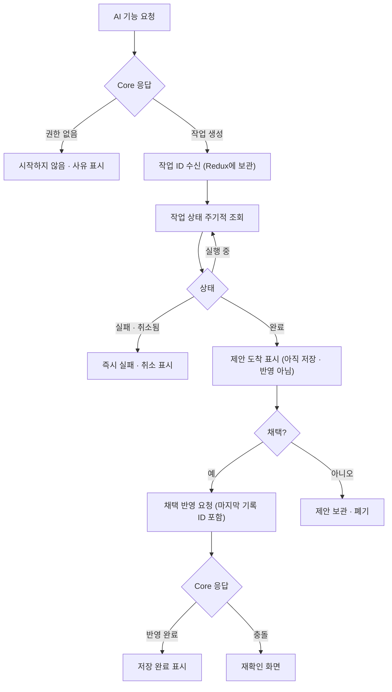

# web (`storyfork-web`)

> 상위 문서: [RDB 기반 MVP 설계](../design.md). 상태 표기는 [표기](../design.md#표기)를 따릅니다. 기존 KAG 설계는 [보관본](../archive/kag-design/services/web.md)입니다. 업무 화면과 API는 아직 구현되지 않았으며, web의 호출 대상은 공개 Core API 하나입니다.

## 목적과 한 줄 정의

**브라우저에서 사용자 상호작용과 상태 표시를 맡는 React SPA입니다.** 판단은 core-api 결과를 따릅니다.

## 책임과 하지 않는 일

| 하는 일 | 하지 않는 일 |
|---|---|
| 입력·열람·편집·검토·선택·상태 표시 | AI Service·OpenAI·저장소 직접 호출 |
| 로딩·실패·완료를 실제 API 결과와 일치시켜 표시 | 내부 DTO를 공개 계약으로 사용 |
| 중복 전송 방지, 화면 이탈 시 요청 취소, 늦은 응답 무시 | 버튼 숨김으로 서버 권한 검사 대체 |
| 세계관 저장 요청에 읽은 마지막 갱신 기록 ID를 함께 보내고 충돌 시 재확인 안내(`제안`) | AI 제안 도착을 원고 저장·승인·발행 완료로 표시 |
| `/api`를 Core로 중계(dev Vite, prod nginx) | `VITE_*`·브라우저 번들에 비밀값·비공개 원고 보관 |

## 기술 스택

| 항목 | 내용 | 상태 |
|---|---|---|
| 프레임워크 | React 19, TypeScript 6, Vite 8, React Router, React Hook Form | `현재` |
| 상태·DI·검증 | Redux Toolkit, Awilix `app/di`, Zod 4 | `현재` |
| 스타일 | Tailwind CSS 4, 기존 디자인 토큰 | `현재` |
| 테스트·검사 | Vitest·Testing Library(jsdom), oxlint | `현재` |
| prod 런타임 | pnpm locked build → nginx 정적 런타임 | `현재` |

## 내부 구조

- **현재:** `App`은 `/` 시작 화면과 알 수 없는 UI 경로의 홈 이동만 담당합니다. 상태 UI는 `CoreApiConnectionStatus → useCoreApiHealth → appContainer 외부 함수 → Fetch·Zod`입니다(`현재`).
- **업무 화면(`확정`):** 업무 화면이 생길 때부터 `View → ViewModel → UseCase → Repository → HTTP DTO`. ViewModel은 전역 `appContainer`에서 필요한 UseCase만 조회하고, Fetch와 Zod 응답 검증은 Data Layer에 둡니다.
- **상태 배치(`확정`):** 화면 전용 상태는 React Hook, 화면 간 유지할 작업 상태(예: 진행 중인 AI 작업 ID, 읽지 않은 알림 수)는 Redux Toolkit에 둡니다. 같은 상태를 양쪽에 두지 않고 Redux에는 직렬화 가능한 값만 넣습니다.

### MVP 화면 영역 (`제안`)

기능 폴더는 실제 화면을 구현할 때만 만듭니다.

| 화면 영역 | 주요 화면(프로토타입 ID) | 관련 UC |
|---|---|---|
| 열람 | 작품 목록·작품 상세·회차 뷰어(U01~U05 중 필요한 것) | UC-01 |
| 계정 | 가입·로그인(L01) | UC-22 |
| 세계관 | 내 세계관, 항목·관계 편집, 항목별 갱신 기록 목록(WLD) | UC-02, UC-06 |
| 작품 | 새 작품·세계관 연결·Fork 허용 설정(U21, U28) | UC-07, UC-24 |
| 집필실 | 편집기·초안 저장(U13), 원작 회차별 붙여넣기 등록 | UC-03, UC-10 |
| 창작 AI 지원 | 설정 추출 후보 검토·채택(새 화면), AI 도움·시뮬레이션·집필 제안(U14~U16) | UC-04, UC-09, UC-11 |
| 발행 | 회차 발행(U22) | UC-13 |
| Fork | Fork 폼·생성 완료(U09, U10) | UC-08 |
| 피드백 | 댓글·제보 등록, 독자 피드백함(U06, U20) | UC-14 |

**시연 이후:** 검색·관심 소설·프로필, 공개 세계관, 버전·보조 화면, 설정 검사(U17, U24), 검증 시뮬레이션·내 피드백·수정안(U08), 자율 연재, 크레딧(U23), 알림, 권리 신고, 운영 화면(A03~A05).

### 결정

- AI 작업은 작업 ID로 상태를 주기적으로 조회해 `실행 중 → 완료/실패/취소됨`을 표시하는 방식이 후보입니다(`제안`). 결과 도착은 "제안 도착"으로 표시하며, 직접 채택과 반영·발행을 구분합니다.
- 세계관 이력·관계 화면은 Core가 반환한 권한 범위의 내용만 표시하고, 갱신 충돌·조회 실패를 감추지 않습니다(`제안`).
- 정적 프로토타입(`frontend/index.html`)은 React 진입점을 불러오지 않습니다. 첫 업무 화면 구현 시 진입점 정리와 프로토타입 보존 방식을 정합니다(`미정`). 프로토타입 동작은 정책 근거가 아니며 정정 목록(P-02~P-17)은 문서 기준을 따릅니다.

## 소유 데이터와 저장소

업무 정본이 없습니다. 브라우저 메모리의 화면 상태와 Redux의 작업 상태만 가집니다. 사용자 토큰을 어디에 둘지(메모리·HttpOnly 쿠키 등)는 `미정`입니다.

## 제공 API

정적 자원과 `/api` 프록시만 제공합니다(`현재`). 브라우저는 `/api`를 쓰고 Vite(dev)·nginx(prod)가 내부 Core 주소로 중계합니다. API 404는 SPA HTML로 바꾸지 않고, 알 수 없는 UI deep link만 홈 화면으로 보냅니다.

## 호출하는 대상

| 대상 | 범주 | 상세 |
|---|---|---|
| 공개 Core API(`/api/v1`) | 인증·탐색·세계관·작품·회차·Fork·AI 작업·피드백 | [core-api 제공 API](core-api.md#제공-api) |

다른 서비스는 호출하지 않습니다([구성과 호출 방향](../design.md#구성과-호출-방향)).

## 인증·보안

- web은 사용자 인증에 필요한 토큰만 다룹니다. Core ↔ AI 내부 통신 인증은 MVP 이후(DEC-19)이며 web은 내부 자격 증명이나 내부 조회 API를 다루지 않습니다([보안 경계](../design.md#security-considerations)).
- 토큰 보관 위치와 그에 따른 CSRF·XSS 대응, 로그인 실패 잠금 기준은 `미정`입니다.
- `VITE_*`와 브라우저 번들에는 공개 설정만 둡니다. 비공개 원고·API 키를 넣지 않습니다(`확정`).
- 공개·인지는 항목 단위입니다(`제안`). 각 정보는 서버가 허용한 범위만 표시하고, 화면에서 일부를 가리는 것으로 데이터 차단을 대신하지 않습니다.
- 권한·승인은 Core 결과를 따릅니다. 화면에서 버튼을 숨기는 것은 표시용입니다(`확정`).

## 이 서비스 관점의 주요 흐름

### AI 작업 진행 표시

- 진행 표시는 주기적 조회로 합니다(`제안`). 서버 전송 이벤트는 쓰지 않습니다.
- 작업은 작업 ID로 조회하므로 브라우저가 긴 HTTP 연결을 유지하지 않습니다. 현재 Fetch 20초 제한(`현재`)은 그대로 둡니다.

## 실패 처리

| 상황 | 표시 | 상태 |
|---|---|---|
| 공개 API 실패(Core의 안전한 ProblemDetail) | 화면 오류 안내와 재시도. 하위 서비스 원문 오류는 오지 않음 | `현재` 규칙 확장 |
| AI 작업 `실패` | 즉시 실패 표시. 대기 상태로 두지 않음 | `확정` |
| 근거 부족 | 근거 부족 안내. 장애와 구분 | `제안` |
| 갱신 충돌 | 덮어쓰지 않고 재확인 화면 | `확정`(CE-07) |
| 중복 클릭·화면 이탈·늦은 응답 | 중복 전송 방지, 요청 취소, 요청 ID로 늦은 응답 무시 | `확정` |

## 관측성

Core가 요청 진입 때 정한 상관 ID를 오류 화면에 참조 번호로 보여 줄 수 있습니다(`제안`). web은 별도 추적 시스템을 두지 않습니다.

## 설정·비밀값

| 설정 | 내용 |
|---|---|
| 공개 설정 | 루트 `.env.example`의 web 공개 설정(`VITE_*`). Compose는 `/`와 내부 프록시를 지정(`현재`) |
| 비밀값 | 없음. OpenAI·Langfuse·저장소 자격 증명·토큰 서명 키를 받지 않음 |

## 관련 정확성 속성

독자는 발행본만 열람하고, 작업 상태는 실제 결과에 맞게 표시하며, 브라우저 번들에 비밀값을 넣지 않습니다. 관련 경계는 [설계 보안](../design.md#security-considerations) 및 [검증 계획](../design.md#testing-strategy)을 따릅니다.

## 위험·미정

토큰 보관 위치·CSRF/XSS 대응, 프론트엔드 진입점 정리. 전체 목록은 [위험·미정 사항](../design.md#위험미정-사항)에 있습니다.
