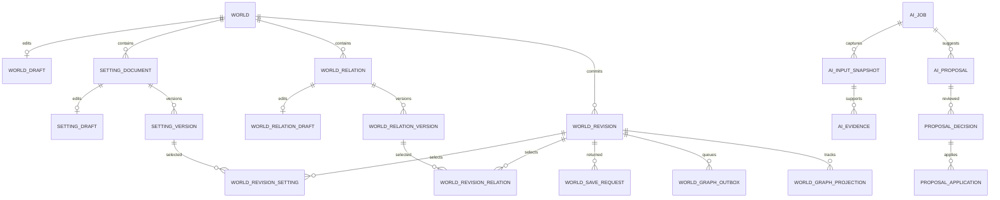

# STORYFORK 초기 세계관 작업실 데이터 모델 및 저장 아키텍처 설계안

작성일: 2026-11-03. 상태: 팀 검토용 제안. 이 문서는 마이그레이션이나 API 구현 완료 선언이 아니다.

## 1. 목적과 작업 범위

초기 세계관을 작품·회차 없이 생성하고, 직접 작성 또는 LLM 후보 검토를 통해 수정·저장한다. 설정 카드 중심이며 관계 입력은 선택적이다. 미등록은 관계가 없다는 확정 사실을 뜻하지 않는다. 회차별 상태 변경, EpisodeCheckpoint, Fork 구현은 제외한다. 미래 연결을 위해 카드·관계의 안정적인 논리 ID와 불변 버전을 확보한다.

이번 변경은 프런트와 이 문서뿐이다. 공통 PostgreSQL·Flyway·Core·기존 PR #76은 변경하지 않는다. 원본 작업실의 관계 편집·지도·설정집·시간선·AI 검토 화면은 유지한다. 미지원 기능의 다른 유형 대체 저장은 하지 않는다.

### 확인 기준

- 프런트 변경 기준: 통합 작업실 `dba4539da6dfc24496ad5d19c3075c9fdf82b9c7`, 격리 브랜치 `codex/world-card-classification`.
- develop 스키마 확인 기준: `017cc48533423ce46e9521ea58ded0f7e2ad1d97`. PostgreSQL content Flyway V1~V7(그중 V5는 Kotlin migration), auth migration 별도 확인.
- PR #76은 최초 검토 시 Draft였으며 이후 별도 사용자 요청으로 closed 처리됐다. head `bb096ebb3146f6bf0faaaa46268fcc6ab08af990`와 브랜치는 보존돼 있다. 이번 문서 최종 검토·공유 작업에서는 PR 상태를 변경하지 않는다.
- 실제 HTTP 검증 대상은 로컬 Core 8098 및 새 격리 Core 8100의 작업실 API다. 이는 develop PostgreSQL 구현을 검증한 것이 아니다. 현재 작업실은 별도 H2 JSON 저장 경로다.

## 2. 현재 저장 계약과 프런트 변경

카드 유형과 설정 영역을 분리했다. 유형은 무엇에 관한 카드인지, 영역은 어느 세계관 주제에 배치할지다. 영역은 `basic, space, history, society, culture, special, conflict` 7종이며 사용자 자유 분류 `userCategory`와 태그는 별도로 보존한다.

| 목표 카드 | 현재 kind | 현재 entityType | 현재 저장·재조회 | 프런트 제공 |
|---|---|---|---|---|
| 인물 character | entity | character | 200, 정확히 복원 | 작성 가능 |
| 장소 location | entity | location | 200, 정확히 복원 | 작성 가능 |
| 조직 organization | entity | organization | 200, 정확히 복원 | 작성 가능 |
| 능력 ability | entity | ability | 200, 정확히 복원 | 작성 가능 |
| 사물 object | entity | object | 409, 미지원 | 준비 중, 새 입력 불가 |
| 규칙 rule | rule | null | 200, 정확히 복원 | 작성 가능 |
| 사건 event | event | null | 200, 정확히 복원 | 작성 가능, 현재 history 영역 제한 |
| 기타 other | other 시도 | null | 409, 미지원 | 준비 중, 새 입력 불가 |

성공 기준은 HTTP 상태만이 아니라 GET 결과의 `id, kind, entityType, category, title, text, tags` 일치다. 실패한 사물·기타 요청 뒤에는 기존 저장 payload가 유지됨을 비교했다. `kind=other`는 현행 계약 코드가 아니라 미지원 확인을 위한 요청이다. 목표 API의 other는 후술한 별도 `cardType`에 둔다.

**별칭은 별도 실패 사례다.** `StudioSetting.aliases`를 전송하면 서버가 200을 반환하지만 GET에서 필드가 사라진다. 저장 성공으로 분류하지 않는다. 별칭 입력을 비활성화하고 준비 중으로 표시한다. 응답에 별칭이 포함되는 경우 프런트 Zod가 이를 버리지 않도록 보존하며, 별칭이 있는 로컬 데이터의 저장 요청은 UseCase에서 차단한다. 이는 유실 방지 임시 보호 장치이고 최종 저장 방식이 아니다. 현재 서버가 이미 버린 별칭은 프런트만으로 복구할 수 없다.

현행 Zod `initialItemSchema.kind`는 `entity/fact/rule/constraint/claim/relation/undetermined/event/note`만 허용한다. `entityType`은 nullable string이므로 프런트에서 통과해도 Core에서 거절될 수 있다. `category`는 위 7종 enum이다. Core의 실제 entityType 검증은 앞의 4종만 허용한다. 이 불일치를 목표 계약의 지원으로 해석하지 않는다.

기존 `fact/claim/constraint/undetermined` 및 알 수 없는 entityType은 ‘분류 확인’, `relation`은 ‘기존 관계’, `note`는 ‘집필 메모’에서 접근한다. 새 other로 일괄 변환하지 않는다. 필터링은 저장 데이터를 변경하지 않는다. 관계의 ID·주체·대상·predicate·polarity와 원문을 유지한다. 연결 또는 의미 필드가 있는 카드의 유형 변경은 막고 이유를 안내한다. 기존 분석 topics와 충돌하는 영역 변경도 거절한다. 직접 수행한 분류 변경 외에 자동 재분류·백필은 없다.

### 실제 분류 필드 왕복 대조 (최종 재검증)

2026-11-03 격리 Core 8100의 새 world `fa512e81-4548-46f9-9c07-bf80181442d4`에서 확인했다. 아래 각 셀은 **요청 = PUT 응답 = GET 응답**이며, 6건 모두 HTTP 200이었다. 기존 테스트에서는 userCategory를 보냈으나 명시적으로 assert하지 않았고, 이번에는 PUT 응답과 GET 응답의 해당 필드까지 비교했다.

| 유형 | kind (3단계 동일) | entityType (3단계 동일) | category (3단계 동일) | userCategory (3단계 동일) | 복원 기준 |
|---|---|---|---|---|---|
| character | `entity` | `character` | `basic` | 기존 분류 | entity + entityType |
| location | `entity` | `location` | `basic` | 기존 분류 | entity + entityType |
| organization | `entity` | `organization` | `basic` | 기존 분류 | entity + entityType |
| ability | `entity` | `ability` | `basic` | 기존 분류 | entity + entityType |
| rule | `rule` | `null` | `basic` | 기존 분류 | kind |
| event | `event` | `null` | `history` | 기존 분류 | kind |

`id/title/text/tags`도 대조했으며 ID와 여러 줄 원문을 보존했다. 원본 요청·응답은 로컬 `output/card-classification/field-roundtrip.json`에 있다. API는 `PUT /api/v1/studio/worlds/{id}`, 재조회는 같은 경로의 GET이다. 실제 요청 필드 위치는 `settings[].item.kind/entityType/category`, `settings[].userCategory`다.

판정은 다음처럼 구분한다.

- **현재 계약에서 안정적으로 복원:** 4종은 `kind=entity`와 고정 entityType 코드로, 규칙/사건은 고정 kind 코드로 식별된다. 여섯 종류를 fact나 자유 텍스트로 대체하지 않았다.
- **목표 모델에 대한 임시 필드 대응:** UI의 `cardType`은 저장 필드가 아니라 위 조합에서 계산한다. `areaCode`는 현재 `item.category`를 사용한다. 규칙/사건은 유형과 문장 의미를 같은 kind에 담는 기존 구조이므로 8종 cardType·의미 분리 모델이 구현됐다는 뜻은 아니다.
- **유형 복원에 사용하지 않는 값:** `userCategory`는 자유 분류 문자열이며 `category`는 7개 영역이다. 이 두 값을 고정 유형 코드나 유형 백업 필드로 해석하지 않는다. 이번 왕복의 `category=basic`은 테스트 입력이며, 모든 인물/장소 등이 basic이어야 한다는 정책이 아니다. 사건만 현 Core에서 history 제한이 있다.
- **지원 아님:** object/other 409, aliases 200 뒤 누락. 텍스트 보존만으로 유형 호환·별칭 저장 성공을 주장하지 않는다. 재시작 내구성과 PostgreSQL 왕복은 이번 추가 검증 범위가 아니다.

## 3. 논리 모델: 확정 방향과 제안 필드

아래는 **목표 모델 제안**이다. 현재 v1 JSON의 구현 필드와 구분한다. ID는 표시 이름과 무관하며 이름·분류 변경으로 재발급하지 않는다. 모든 객체는 world 소유 범위 검증을 받는다.

| 객체 | 필수 | 선택 / 정책 |
|---|---|---|
| World | id, ownerId, name, createdAt | description, currentRevisionId; 작품·회차 FK 불필요 |
| WorldDraft | worldId, name, description, draftRevision, updatedAt | baseWorldRevisionId; 하나의 편집 초안 |
| SettingCard | id, worldId, createdAt | legacyLogicalId; 논리 식별자, 내용은 draft/version |
| SettingDraft | cardId, cardType, areaCode, title, text, aliases[], tags[], lifecycle | userCategory, source references, semantic metadata; 전체 초안 revision으로 동시성 제어 |
| SettingVersion | id, cardId, versionNo, cardType, areaCode, title, text, aliases[], tags[], lifecycle, createdAt | restoredFromId, 승인 근거 연결; 불변 |
| Relationship | id, worldId, createdAt | 안정적인 관계 식별자 |
| RelationshipDraft | relationId, sourceCardId, targetCardId, category, description, lifecycle | label, polarity, direction; 자유 텍스트 |
| RelationshipVersion | id, relationId, versionNo, sourceCardId, targetCardId, category, description, lifecycle | 동일 부가 필드, restoredFromId; 불변 |
| WorldRevision | id, worldId, revisionNo, nameSnapshot, descriptionSnapshot, createdAt | parentRevisionId, restoredFromId; 카드·관계 버전 manifest |
| AnalysisRun | id, worldId, baseDraftRevision, status, input snapshot | model call reference, failure; 현재 ai_job 재사용 검토 |
| Proposal | id, runId, operation, candidate payload, status | 대상 cardId/relationId, 제안 간 임시 ID |
| Evidence | id, immutable inputSnapshotId, quote | locator, offsets; 원문 검증 가능 |
| ProposalDecision | id, proposalId, actorId, decision, decidedAt | editedPayload, appliedDraftRevision; 승인과 적용 성공 분리 |

목표 카드 유형은 정확히 8종이며 `other`는 작가가 실제로 기타로 분류한 카드다. 기존 문장 의미는 별도 semantic metadata에 `legacyKind, polarity, predicate, subjectId, targetId, condition, relatedIds, timeText, afterId, topics, origin` 등을 보존한다. `claim`은 화자의 주장, `undetermined`는 미정 상태이지 ‘기타 대상’이 아니다. 원문 `text`와 근거 quote는 구분하고 원문 덮어쓰기를 피한다.

관계의 category는 `structural`(실제 관계)과 `emotional`(감정)을 구분한다. 관계 표현은 자유 텍스트로 복합성을 수용한다. 예: 홍 판서→홍길동 ‘친아들이지만 공적으로 인정하지 못함’, 홍길동→홍 판서 ‘인정받고 싶은 마음과 원망’. 양방향 감정은 별개 관계다. 대칭 관계는 방향 속성으로 표현하고 임의 역방향 복제하지 않는다. 인물뿐 아니라 장소·조직·능력·사물·설정 카드 간 연결도 허용하되 endpoint는 같은 world의 카드여야 한다.

초기 상태는 초기 WorldRevision에 속한다. 회차에서 변한 소속·감정·능력 등은 이번 모델에 회차 번호를 끼워 넣어 저장하지 않는다. 향후 회차 상태가 cardId/relationId 및 기준 worldRevisionId를 참조하도록 계약만 확보한다.

## 4. 실제 PostgreSQL 재사용·확장 대상

| 실제 객체 | 실제 상태 | 재사용 / 필요한 확장 |
|---|---|---|
| world | varchar(36) id, member 소유자 FK, name/description, revision | 재사용. current_revision_id 및 초안 분리 제안 |
| setting_document | id, world_id, logical_id; UNIQUE(world_id, logical_id) | 카드 논리 ID 재사용. 새 setting_card 테이블 중복 생성하지 않음 |
| setting_draft | document PK/FK, name/category/content, 회차 범위·공개·known_by·tags·evidence, edit_revision | 카드 draft 재사용. card_type/area_code/aliases/semantic metadata/lifecycle 보강. 회차 없는 초기 작성 지원 필요 |
| setting_version | document FK, content_version_id, revision_no, name/category/content/evidence, restored_from_id, lifecycle, visibility_history_id | 불변 카드 버전 재사용. 유형/영역/별칭 snapshot 보강; 기존 revision_no의 전역 순서 의미를 확인하고 카드별 유일성 함부로 추가하지 않음 |
| setting_category | code unique. 규칙·인물·장소·광물·상태·지식·관계 seed | 기존 참조 보존. 8종과 7영역을 category_id 하나로 합치거나 seed를 일괄 교체하지 않음 |
| setting_tag, setting_document_tag, setting_version_tag | 문서 태그·버전별 태그, 버전 태그 position | 기존 구조 재사용. 새 tags master 불필요 |
| visibility_history/range | 회차 FK 범위, private/public | 초기 기본 비공개 유지. 회차 없는 초기 버전 조회 가능하도록 별도 검토 |
| setting_version_read | visibility_history inner join, 회차 시작 COALESCE 1 | 초기 세계관 독립 조회에 그대로 사용 가능한지 검증·수정 필요 |
| ai_job | work_id NOT NULL | world 전처리 대상 지원 확장 필요. target work/world XOR 또는 명시적인 target model 합의 |
| ai_input_snapshot | job, 원문 snapshot, 선택적 episode/setting version FK | 초기 world/draft 기준 정보 보강 후 재사용 |
| ai_proposal, ai_evidence | 후보·근거 존재 | 후보 JSON 계약과 evidence→input snapshot FK 보강 |
| proposal_decision/application | 의사결정과 실제 반영 시도 분리 | 재사용. 초안 반영 revision 및 카드/관계 대상 연결 보강 |
| proposal_episode_change | 회차 변경에 특화 | 초기 카드 결과를 억지로 넣지 않음. 카드/관계 적용 연결 별도 설계 |
| checkpoint 및 Fork 계열 | 회차 의존 | 이번 범위 제외; 초기 revision으로 대체 사용하지 않음 |

V6 불변 trigger를 고려해 기존 version을 UPDATE하는 마이그레이션은 별도 통제해야 한다. 현행 ContentRepository는 document ID를 world/logical ID 기반으로 생성하고 API content version ID와 DB version ID를 구분한다. 기존 ID를 재발급하지 않고 대응표를 검증한다. 현재 draft 전체 삭제·재삽입 경로는 새 revision 잠금 정책과 함께 수정해야 동시 작업 손실을 막는다. auth의 UUID와 content member varchar(200) 식별 체계 연결도 합의 대상이다.

### 회차 백엔드와의 접점: 현재 구현과 향후 계약

최종 읽기 기준 develop은 `6d4ff1d24d7de9aee199ec2975ddca3c3db1d121`이다. 기존 검토 기준 `017cc48` 이후 content 코드·DB migration 경로 차이가 없음을 확인했다. V7은 생성 시각 보존 migration이며 새 관계 제약을 추가하는 migration이 아니다.

| 구분 | 현재 develop 구현 | 초기 세계관 목표 / 합의 대상 |
|---|---|---|
| API 접근 | `ContentController`의 `/api/v1/works/{id}/world`, `/works/{id}/settings/{sid}/draft`, `/commit`은 작품을 기준으로 설정 접근 | 독립 world 생성·조회 API와 작품에 연결하는 별도 계약 필요. 기존 work API를 제거하지 않음 |
| 회차 저장 | `/works/{id}/episodes/{number}/draft`, `/versions`, `/restore`, `/publish` 존재. 요청 revision으로 현재 편집 충돌 검사 | 현재 revision 숫자를 새 WorldRevision UUID와 동일시하지 않음. 회차가 어떤 worldRevision을 기준으로 작성됐는지 연결 필드·선택 시점 합의 |
| 설정 버전·노출 | setting version 및 회차 공개 범위 사용. `setting_version_read`는 visibility history를 통한 조회 | 회차 없는 초기 비공개 revision을 읽는 계약 추가. 임의의 1회차를 만들어 초기 등록 조건을 충족시키지 않음 |
| 체크포인트 | `ContentRepository.checkpoint`는 work/episode/episode version 및 checkpoint_setting을 묶음 | 초기 WorldRevision은 회차 checkpoint가 아님. 나중에 checkpoint가 기준 worldRevision 또는 그 manifest를 참조하는 방식 검토 |
| Fork | 기존 source checkpoint·world reference·변경 수용 이력 존재 | 초기 카드 ID 및 version ID를 연결하되 Fork 독립화/동기화 알고리즘을 이번에 변경하지 않음 |
| 동적 상태 | 회차 콘텐츠·설정 적용 범위의 기존 동작 유지 | 인물 생사/소속/감정의 회차별 상태 모델은 범위 밖. 초기 카드 본문을 회차 상태 저장소로 덮어쓰지 않음 |

접점 파일은 `backend/core-api/src/main/kotlin/ai/storyfork/core/content/controller/ContentController.kt`, `controller/dto/ContentRequests.kt`, `service/ContentService.kt`, `repository/ContentRepository.kt`다. 모두 이 문서의 읽기 대상이며 이번 커밋에서 수정하지 않는다. `world.revision`, draft edit revision, setting content version ID, WorldRevision ID의 의미와 매핑을 별도로 정의해야 한다.

원문 확인: [develop 결정 기록](https://github.com/SKNETWORKS-FAMILY-AICAMP/SKN34-FINAL-4TEAM/blob/6d4ff1d24d7de9aee199ec2975ddca3c3db1d121/docs/design/decisions.md), [회차·설정 API](https://github.com/SKNETWORKS-FAMILY-AICAMP/SKN34-FINAL-4TEAM/blob/6d4ff1d24d7de9aee199ec2975ddca3c3db1d121/backend/core-api/src/main/kotlin/ai/storyfork/core/content/controller/ContentController.kt), [content migration](https://github.com/SKNETWORKS-FAMILY-AICAMP/SKN34-FINAL-4TEAM/tree/6d4ff1d24d7de9aee199ec2975ddca3c3db1d121/backend/core-api/src/main/resources/db/content).

## 5. 목표 물리 스키마 제안 — A안 기준, 팀 합의 전

아래 신규 후보는 A안(PostgreSQL 관계 정본)의 물리화 제안이며 아직 생성하지 않는다. B안(Graph 관계 정본)을 택하면 관계 테이블·outbox·projection 역할을 다시 설계해야 하므로 이 목록을 그대로 필수 생성하지 않는다. `ID = varchar(36)`, `N=NOT NULL`, `?=NULL 가능`, `ts=timestamptz`. 기존 식별자 타입을 유지하며 uuid 전환은 별도 과제다. text/배열 크기 제한은 API와 DB를 함께 결정한다.

| 신규 테이블 후보 | 주요 컬럼(타입·null) | PK / FK / UNIQUE / CHECK |
|---|---|---|
| world_draft | world_id ID N, base_revision_id ID ?, name text N, description text N, draft_revision bigint N, updated_at ts N | PK world_id→world; (world_id,base_revision_id)→world_revision; revision>=0 |
| world_relation | id ID N, world_id ID N, created_at ts N | PK id; FK world_id; UNIQUE(world_id,id) |
| world_relation_draft | relation_id ID N, world_id ID N, source_id ID N, target_id ID N, category text N, description text N, label text ?, direction text N, polarity text N, lifecycle text N | PK relation_id; composite same-world FK relation/source/target; CHECK category structural/emotional, direction directed/symmetric, polarity asserted/denied, lifecycle active/removed |
| world_relation_version | id ID N, relation_id ID N, world_id ID N, version_no bigint N, source_id ID N, target_id ID N, category text N, description text N, label text ?, direction text N, polarity text N, lifecycle text N, restored_from_id ID ?, created_at ts N | PK id; UNIQUE(relation_id,version_no), UNIQUE(world_id,relation_id,id); same-world FK; version_no>0; draft와 동일 CHECK; restore 동일 relation composite FK |
| world_revision | id ID N, world_id ID N, revision_no bigint N, name_snapshot text N, description_snapshot text N, parent_id ID ?, restored_from_id ID ?, created_at ts N | PK id; UNIQUE(world_id,id), UNIQUE(world_id,revision_no); parent/restore same-world FK; revision_no>0 |
| world_revision_setting | world_id ID N, revision_id ID N, setting_document_id ID N, setting_version_id ID N | PK(revision_id,setting_document_id); same-world revision/document/version composite FK |
| world_revision_relation | world_id ID N, revision_id ID N, relation_id ID N, relation_version_id ID N | PK(revision_id,relation_id); same-world revision/relation/version composite FK |
| world_save_request | world_id ID N, idempotency_key text N, request_hash text N, result_revision_id ID N, created_at ts N | PK(world_id,idempotency_key); result same-world FK; nonempty key/hash; 성공 결과만 트랜잭션 안에 저장 |
| world_graph_outbox | id ID N, world_id ID N, revision_id ID N, event_type text N, status text N, attempt_count int N, available_at ts N, last_error text ?, created_at ts N | PK id; same-world revision FK; UNIQUE(world_id,revision_id,event_type); count>=0; pending/processing/done/failed CHECK |
| world_graph_projection | world_id ID N, revision_id ID N, projector_version text N, status text N, synced_at ts ?, last_error text ?, updated_at ts N | PK(world_id,revision_id,projector_version); same-world revision FK; pending/syncing/ready/failed CHECK; ready면 synced_at 필수 |

기존 setting_draft/version 확장 후보: `card_type text`(8종 CHECK), `area_code text`(7종 CHECK), `aliases text[] NOT NULL DEFAULT '{}'`, `semantic_metadata jsonb NOT NULL DEFAULT '{}'`, 기존 name/content 및 lifecycle 사용. 전환 기간 legacy 행의 card_type은 nullable로 두고 분류 확인 대상은 자동 other 백필하지 않는다. 신규 v2 작성에서는 card_type 필수다. 원문·별칭·배열 순서를 API 왕복으로 확인한 후 NOT NULL 전환 범위를 결정한다. 별칭 정규화·중복 기준은 작가 원문을 변형하지 않는 범위에서 별도 합의한다.

| 복합 무결성 | 필요한 구현 |
|---|---|
| world_revision_setting의 version이 해당 document 소속 | 기존 UNIQUE(document_id,id) 활용 및 world_id 포함 후보키/FK 보강 |
| version/document가 revision과 같은 world | setting_document UNIQUE(world_id,id), version에 world_id 도입 시 backfill 검증 후 composite FK. 기존 단일 FK만으로는 부족 |
| relation endpoints가 같은 world | (world_id,source_id/target_id)→setting_document(world_id,id) |
| revision 관계 endpoints가 그 revision의 카드 manifest에 존재 | 일반 단일 FK로 불충분. 복합 manifest FK용 endpoint 컬럼 또는 deferred constraint trigger 중 팀 선택; Core 사전검증만으로 DB 무결성 완료로 보지 않음 |
| active 관계가 removed 카드 참조 금지 | 저장 트랜잭션 및 deferred trigger 검증 제안. 관계 함께 제거 또는 요청 거절 |
| world.current_revision_id의 same-world 연결 | composite FK, 최초 null; revision 삽입 후 포인터 갱신 |
| 버전과 manifest 불변 | 기존 V6 방식 확장; 운영 상태/outbox는 갱신 가능 |
| revision parent 순환 방지 | 생성 시 현재 revision을 parent로 고정, 변경 금지, 임의 parent API 금지 |

ERD는 목표 관계를 설명하며 실제 생성된 스키마가 아니다. 특히 snapshot→evidence 연결은 확장 제안이다.

## 6. 저장·버전·복구 계약 — A안의 제안 흐름

자동저장은 draft만 변경한다. 명시적 저장은 WorldRevision으로 카드와 관계의 버전을 일관되게 묶는다. 공개/발행과 별개다. 현재 작업실 v1 PUT이 이 설계를 구현했다고 간주하지 않는다.

제안 API: 초안 갱신은 `expectedDraftRevision`을 받고 충돌 시 409. 명시 저장은 `baseWorldRevisionId, expectedDraftRevision, idempotencyKey`를 필수로 받는다(최초 base는 null). 사용자·world 권한 확인 후:

1. world 공통 잠금 획득. 모든 draft/approve/save writer가 같은 잠금·revision 규칙을 적용한다.
2. 같은 key의 성공 기록이 있으면 request hash 일치 시 기존 결과 반환, 불일치 시 409.
3. base와 draft revision 검증. 어긋나면 덮어쓰기 없이 409 및 최신 기준 반환.
4. 카드·관계 ID, 같은-world endpoint, lifecycle, 지원 유형, 근거 연결을 검증한다.
5. 변경된 카드·관계만 불변 version 생성. 변경 없는 버전은 재사용한다. 삭제는 removed tombstone을 생성하며 과거 version은 유지한다. manifest에는 최신 tombstone도 보존하고 조회에서 active를 구분한다.
6. name/description snapshot과 manifest를 가진 revision 생성, world 포인터·draft 기준 갱신, idempotency 결과·outbox를 **같은 PostgreSQL 트랜잭션**으로 commit.
7. Graph 동기화는 비동기. 실패해도 PostgreSQL 저장 결과는 유지하고 Graph 상태를 별도 표시한다.

내용이 완전히 동일한 명시 저장의 no-op 처리 여부는 추가 합의 대상이다. DEC-40은 명시 저장 시 새 버전을 만드는 방향이므로, 기존 revision 반환 최적화를 자동 적용하거나 확정 정책으로 취급하지 않는다. 이 문서의 기본 흐름은 명시 저장마다 새 WorldRevision을 생성하되 변경 없는 카드·관계 version을 재사용하는 방식이다. 이 경우에도 성공 key 결과를 기록한다. JSON canonicalization·태그/별칭 순서의 의미와 비교 기준은 API 계약에서 고정해야 한다.

복원은 과거 row UPDATE가 아니라 과거 manifest를 새 초안으로 불러와 검토 후 새 revision 생성이다. 필요한 새 버전에 restoredFromId를 기록한다. 논리 카드·관계 ID는 유지하고 변경 없는 버전은 재사용할 수 있다. 삭제된 카드의 복원도 연결 일관성을 다시 검증한다.

## 7. PostgreSQL과 Graph DB 두 대안

| 항목 | A: PostgreSQL 관계 정본 + Graph projection (권장 제안) | B: Graph 관계 정본 + PostgreSQL 설정 정본 |
|---|---|---|
| 저장 원자성 | 카드·관계·manifest·outbox 한 트랜잭션 | 두 저장소 commit 조정·부분 실패 보상 필요 |
| 버전 복구 | Postgres manifest로 Graph 전체 재생성 | Graph 관계 버전 및 별도 불변 backup이 반드시 필요 |
| 조회 | 그래프 탐색에 유리, projection 지연 노출 | 관계 실시간 조회 용이; 설정 버전과 일관성 별도 해결 |
| 운영 비용 | 관계 이중 저장·projector 운영 | distributed commit/saga·복구 계약 복잡 |
| DEC-26 영향 | 관계 정본 미정 사항을 구체화하는 추가 합의 필요 | Graph 정본으로 확정한 결정은 없음; 정합성 방식 합의 필요 |

권장 A는 작가가 명시 저장한 한 묶음을 복구하기 쉽다. 이는 작성자의 권장안이며 팀 확정안이 아니다. DEC-26은 Graph 관계 저장·조회를 확정했지만 관계 정본은 미정으로 남겼다. 따라서 A/B 어느 쪽도 DEC-26만으로 확정되지 않으며, A도 Graph 저장·조회 역할을 유지하는 한 자동으로 DEC-26 위반이라고 단정하지 않는다. B를 채택하면 Graph가 unavailable한 상태에서 ‘전체 확정 저장 성공’을 먼저 표시해서는 안 된다.

A의 Graph edge는 `relationVersionId`를 멱등 키로 사용하고 revision manifest에 선택된 버전만 조회한다. 논리 relationId만으로 overwrite하면 과거 revision을 잃으므로 금지한다. 카드 노드도 version 식별이 가능해야 한다. projector는 중복·역순 이벤트를 처리해도 같은 결과가 나와야 한다. 화면은 요청한 revision과 동기화 완료 revision을 구분한다. 예전 revision의 그래프를 현재 정본인 것처럼 표시하지 않는다. 장애 후 Postgres version+manifest로 rebuild하며 outbox 보존 기간에 복구 가능성이 의존하지 않게 한다.

### B안의 관계 정본·복구 경계

이 문서에서 **B안은 Graph DB가 관계 정본**, PostgreSQL은 설정·원고·문서 버전 정본인 대안이다. A/B 문자는 이 문서 내부 명칭이며 팀 결정 번호가 아니다.

B안에는 Graph에서 관계 logical ID와 불변 relationVersionId, 같은-world endpoint, revision별 관계 snapshot/manifest를 영속화하는 계약이 필요하다. PostgreSQL WorldRevision에는 Graph relation snapshot ID와 검증 hash를 연결하는 방안을 검토할 수 있지만, 단순 문자열 참조는 Graph 존재·같은-world·완료 상태를 DB FK로 보장하지 못한다. 현재 5절의 PostgreSQL relation FK 설계를 B안 검증으로 대체하지 않는다.

저장은 prepared/pending 상태에서 시작해 Graph 관계 snapshot을 멱등 저장하고, 검증된 참조를 PostgreSQL에 결합한 뒤 전체 revision을 committed로 표시하는 조정 절차가 필요하다. Graph 성공/PostgreSQL 실패, 반대 실패, 재시도·중복 요청 시 미완료 상태를 복구할 책임자를 Core로 정해야 한다. 부분 완료를 저장 성공으로 노출하지 않으며, 이미 확정한 과거 버전을 보상 삭제하지 않는다.

B안에서 Graph가 손실되면 PostgreSQL의 ID/해시만으로 관계 설명·방향·감정을 복구할 수 없다. Graph 불변 backup 또는 완전한 관계 이벤트/스냅샷 archive가 필수이며, 보존 기간·RPO/RTO·복원 시험을 합의한다. PostgreSQL에 완전한 관계 snapshot을 archive로 두는 절충안도 가능하나, 쓰기 권한은 Graph 정본 계약에 한정해 이중 정본이 생기지 않게 해야 한다. 이런 archive가 없다면 ‘PostgreSQL로 전체 Graph 재구축 가능’은 B안에서는 성립하지 않는다.

## 8. LLM 후보와 원문 근거

직접 작성과 승인된 후보는 동일한 카드/관계 draft로 반영한다. LLM은 정본을 직접 쓰지 않는다. 분석 시 입력 snapshot과 baseDraftRevision을 고정하고 candidate와 evidence를 저장한다. Evidence quote는 해당 snapshot에서 검증하며 현재 편집 중 원문과 혼동하지 않는다.

작가는 승인·수정 후 승인·보류·거절할 수 있다. decision 기록과 application 성공을 분리한다. 승인 시 초안이 달라졌으면 재검토를 요구하고 오래된 후보로 덮어쓰지 않는다. 후보 내 임시 ID를 안정적인 cardId로 매핑한 결과를 저장하여 재시도 시 중복 생성하지 않는다. 미지원 object/other/aliases 후보도 다른 유형으로 변환하거나 버리지 말고 적용 불가 사유와 원문을 유지한다. 후보 자체의 검토와 저장 가능성은 다르다.

승인 성공은 draft 반영까지다. 명시 저장 전에는 확정본이 아니다. 확정 시 proposal/decision/application과 결과 version 연결을 남긴다. 수정된 승인 내용과 원래 후보·근거를 모두 추적한다. 현재 UI의 ‘선택한 후보 확정’ 및 v1 approve는 목표 초안 정책과 다르므로 후속 Core 계약 변경 때 함께 수정해야 한다. 이번 프런트 개편이 승인→초안 모델까지 구현한 것은 아니다.

## 9. 홍길동전 시나리오로 논리 검증

다음은 목표 설계 검증 예시이며 PostgreSQL 실행 결과가 아니다.

1. 작품 없이 world W 생성. 홍길동 C1(인물), 홍 판서 C2(인물), 조선 L1(장소), 활빈당 O1(조직), 도술 A1(능력), 호부호형 금지 R1(규칙), 집을 떠난 사건 E1(사건), 예시 사물 B1, 작가의 기타 설정 X1을 초안에 추가한다. B1/X1은 현재 서버에서는 아직 저장 불가다.
2. C1 별칭 ‘길동’을 입력하고 C2→C1 실제 관계와 C1→C2 복합 감정을 선택적으로 작성한다. 명시 저장으로 V1 manifest를 만든다. 관계가 없어도 저장 가능해야 한다.
3. 이름·별칭·감정을 수정해 draftRevision을 증가시킨다. C1 ID는 유지한다. V2는 변경된 C1과 감정 관계만 새 version, 다른 카드는 V1의 version을 재사용한다.
4. V1 재조회는 옛 이름·별칭·감정, V2 재조회는 수정값을 반환한다. 원문·유형·영역·ID·별칭·관계 endpoint를 비교한다. Graph는 해당 revision이 ready일 때만 그 revision 결과로 표시한다.
5. 같은 idempotencyKey 재요청은 V2 한 건 반환. 다른 body로 같은 key는 409. 오래된 draft 저장도 409.
6. C2 제거 시 연결 관계를 함께 제거하지 않으면 저장 거절. 복원은 V3로 만들며 V1/V2 이력을 수정하지 않는다.

실제 현재 HTTP 검증은 아래 10절의 6종 왕복 및 미지원·별칭 누락 범위만 통과했다.

## 10. 검증 결과와 보존 범위

| 구분 | 실행 결과 | 한계 / 증거 |
|---|---|---|
| 기존 데이터 보존 | 원본 브랜치·사용자 world는 변경하지 않음. 409 후 QA world payload 동일성 확인. legacy 의미/ID 보존 회귀 테스트 통과 | 모든 운영 데이터 migration 검증은 미수행 |
| 프런트 테스트 | 8개 파일 16개 테스트 통과 | Mock HTTP/도메인 테스트. 실제 서버 증거와 구분. jsdom scrollTo 미구현 경고 존재 |
| 실제 저장·재조회 | 8098 및 8100 격리 QA 새 world에서 6종 exact round-trip; object/other 409; aliases 200 뒤 누락 | PostgreSQL·목표 v2 구현 검증 아님 |
| 브라우저 QA | 아래 최종 실행 기록 참조 | 확인하지 않은 시나리오는 미검증 |
| CI | 실행하지 않음 | 공유 브랜치 push만으로 이 저장소의 develop/main push 및 PR용 CI가 실행되는 것은 아님. Required CI 미검증 |

로컬 증거: `output/card-classification/http-contract.json`, `http-contract-isolated.json`, `verify-contract.py`. 8100 격리 world ID는 `57d65c85-4341-4639-b3d0-7a032cc8f1e0`이다. QA world ID `515d4f36-c027-4f02-a948-34e7db19e3bb`. 이 output 폴더는 로컬 검증 산출물이며 팀 문서에는 결과를 위 표로 기록했다.

프런트 테스트 파일: `App.world-card-types.test.tsx`, `domain/entities/studioCards.test.ts`, `App.world-studio.test.tsx`, `App.character-registration.test.tsx`, `App.relationship-edit.test.tsx`, `App.world-studio-confirmed.test.tsx`, `App.world-sidebar.test.tsx`, `data/world-studio/HttpWorldStudioRepository.test.ts`.

## 11. 후속 Core 확장 파일과 API 계약

다음은 **후속 작업 목록**이며 이번에 수정하지 않았다. 공통 DB 담당자와 합의 후 별도 Draft PR로 진행한다.

| 파일/영역 | 필요한 변경 |
|---|---|
| backend/core-api/src/main/kotlin/ai/storyfork/core/world/domain/StudioWorld.kt | StudioSetting v2 cardType/areaCode/aliases, 버전 필드; 누락 없는 직렬화 |
| backend/core-api/src/main/kotlin/ai/storyfork/core/world/domain/InitialWorld.kt | InitialItem 및 initialItemIssues: 8종 target mapping, legacy kind 의미 유지, 별칭 검증 |
| backend/core-api/src/main/kotlin/ai/storyfork/core/world/controller/WorldStudioController.kt | capability/schemaVersion와 v2 DTO; draft/save 요청 동시성·멱등 계약 |
| backend/core-api/src/main/kotlin/ai/storyfork/core/world/service/WorldStudioService.kt | 권한·유형·관계 검증, 승인→draft, atomic revision, 미지원 필드 명시 오류 |
| backend/core-api/src/main/kotlin/ai/storyfork/core/world/repository/WorldStudioStore.kt | 현행 JSON 왕복 보존, PostgreSQL adapter 전환 시 명시적 변환 및 backfill 검증 |
| develop ContentRepository 및 content Flyway migration 영역 | 기존 문서/버전 재사용, 위 신규 relation/revision/outbox와 제약, 회차 독립 조회; 위치와 파일 번호는 병합 시 최신 develop 기준 결정 |
| AI Service 초기 세계관 후보 DTO/검증 | 8종 후보·별칭·원문 evidence, Core와 버전 협상; 직접 정본 쓰기 금지 |
| frontend/src/data/api/initialWorld.ts | v2 경계 Zod, 지원 capability 검증, legacy 읽기 유지 |
| frontend/src/data/world-studio/HttpWorldStudioRepository.ts | 저장 응답·재조회에서 type/aliases/version 복원 검증 |
| frontend/src/domain/entities/studioCards.ts 및 작업실 ViewModel/View | capability 확인 후 object/other/aliases 입력 활성화; 임시 제한 제거 |

목표 wire 계약은 `schemaVersion`, 카드별 `id, cardType, areaCode, title, text, aliases, tags, semanticMetadata`와 별도 `relations`로 명시한다. 현행 `kind`를 새 cardType으로 조용히 치환하지 않는다. v1 endpoint 유지와 v2 endpoint 또는 명시 version 협상 중 하나를 합의한다. 서버가 지원하지 않는 필드는 4xx로 알려야 하며 200 뒤 누락은 금지한다. capabilities는 실제 저장 구현과 함께 출시하고 enum 선언만 추가해 지원 완료로 표시하지 않는다.

필수 수용 테스트: 8종 각각 저장→프로세스 재시작→재조회 ID/type/area/raw text/aliases 일치, legacy fixture의 모든 의미 필드 일치, 다른 world endpoint 거절, 동시 저장/멱등 충돌, 삭제/복원, Graph 장애/중복/역순/rebuild, 승인 stale draft 거절. PostgreSQL integration test는 담당자 합의 뒤 격리 DB에서 실행한다.

### 필요한 마이그레이션 단계 (제안, SQL 미작성)

1. 기존 row·ID·의미 필드·visibility와 H2 JSON 데이터를 백업/목록화하고 변환 대응표 검증.
2. nullable 확장 컬럼·신규 테이블·후보키 추가. legacy 데이터에 other를 일괄 부여하지 않음.
3. deterministic 기존 ID 대응으로 import/backfill. 미분류·미지원 사례는 별도 검토 목록으로 남김.
4. 비교 보고서로 개수뿐 아니라 원문·유형·alias·관계·버전까지 검증. 오류가 있으면 읽기 전환 중단.
5. composite FK·CHECK·불변 제약 검증 후 활성화, 새 writer 계약 배포. 이중 writer를 무제한 운영하지 않음.
6. v2 읽기 전환과 Graph projection 구축. rollback은 이전 reader/backup 복구 계획으로 하고 불변 이력을 삭제하지 않음.

## 12. 결정과 팀 합의가 필요한 사항

### 이번에 확정한 방향과 공유 DB 합의 경계

| 상태 | 항목 | 이번 작업 결과 |
|---|---|---|
| 사용자 확정 방향 | 8종 카드/7영역 분리, 관계 선택, ID·원문·legacy 의미 보존 | 프런트는 현재 저장 가능한 범위만 제공. 8종 전체 저장 완료 아님 |
| 사용자 확정 방향 | 직접 작성/승인 후보의 동일 모델, 승인→초안, 명시 저장→불변 묶음, 독립 world | 목표 동작 확정. 현 v1 API가 구현했다고 보지 않음 |
| 작성자 권장, 팀 미확정 | A안 PostgreSQL 관계 정본·Graph projection | B안과 비교해 팀 결정 필요. DEC-26 자체를 수정한 것은 아님 |
| 공유 DB 합의 필요 | 5절 신규 테이블 전부, 기존 컬럼·FK·CHECK·trigger 확장, visibility와 ai_job 대상 확장 | 물리 모델 후보. migration 승인/실행 아님 |
| 공동 API 합의 필요 | 인증 Principal, 8종 DTO/schemaVersion/capability, revision/idempotency, 작품·회차 연결 | Core·회차·프런트 담당자 협의 후 별도 구현 |
| 운영 합의 필요 | Graph 제품·재시도·백업/RPO/RTO, 초안 동시성·버전 정책 세부 | 제안 범위. 검증·운영 준비 완료 아님 |

확정 사용자 방향: 8종/7영역 분리, 관계 선택적, 작가 승인, 자동저장 draft·명시 저장 version, WorldRevision 묶음, 작품·회차 독립. 현재 Core 미지원은 목표 축소 근거가 아니다.

- DEC-26: 관계 정본을 PostgreSQL에 두고 Graph를 projection으로 하는 A안을 팀과 합의해야 한다. 기존 문구만으로 확정 처리하지 않는다.
- DEC-27: pg_git 없이 불변 버전·새 복원 revision 방향 유지.
- DEC-31/39: 기존 category와 tag 정책에 8종/7영역을 별도 축으로 추가하는 매핑 합의 필요. 기존 seed/ID 보존.
- DEC-33: 상태·관계 이력 보존. 삭제 tombstone과 active endpoint 정책 확정 필요.
- DEC-36: 기본 비공개·사람 승인 유지. 초기 회차 없는 visibility와 저장/공개 분리 확정 필요.
- DEC-40: autosave와 명시 저장 분리 유지. 현행 v1 API와 target 정책 사이 gap은 후속 구현 과제.
- 추가: version_no 기존 의미, auth member 매핑, capability/v2 배포 순서, legacy 분류 책임, 별칭 범위·중복, manifest DB 제약 방식, outbox 재시도/보존 정책을 합의한다.

이번 변경으로 자동저장·불변 WorldRevision·PostgreSQL 영속화·Graph 동기화·별칭·8종 전체 저장이 구현되었다고 주장하지 않는다.

### 최종 로컬 검증 기록

- 타입 검사 `tsc -b frontend --pretty false`, 변경 파일 oxlint, `git diff --check` 통과. UI detector 지적 0건. 전체 CI·프로덕션 build는 미실행이다.
- ponytail-review에서 잘못된 entityType을 rule로 표시하는 분류 오류 및 영역 변경 시 기존 evidence/origin이 소실되는 경로를 찾아 실패 테스트 후 수정했다. 새 의존성·영속화 계층은 추가하지 않았다.
- Graphify AST 갱신: 3032 nodes, 7340 edges. 외부 LLM 호출 없음.
- 원본 통합 작업 트리는 clean. 팀 develop 작업 트리의 기존 `backend/ai-service/experiments/` 미추적 폴더 보존. 이 기록은 최초 로컬 검증 시점의 상태다. 이후 프런트·문서를 분리 커밋하여 공유 브랜치에 올리며 PR은 생성하지 않는다.
- Aside QA 실행 URL `http://127.0.0.1:5184/worlds/bfac260c-e45f-4b85-8a42-1044d324f5b9`. 새 H2 파일의 Core 8100 사용. 기존 5181/8098 서버는 교체하지 않았다.
- 브라우저에서 데모 로그인→작업실 연결→새 세계관→인물 홍길동 입력→사회 영역·주인공 태그 지정→저장 완료를 확인했다. 새로고침은 데모 로그인 상태를 초기화하므로 다시 데모 로그인한 뒤 같은 world의 이름·본문·영역·태그가 복원됨을 확인했다. 별칭 입력 비활성화 및 사물·기타 준비 중 안내를 확인했다. 같은 인물이 관계 편집 목록에도 표시됨을 확인했다. 유형 필터의 Tab 키 이동을 확인했다.
- 별도 Core는 기존 패키징된 JAR을 재사용했다. SHA256 `634AC95A210132E9DD611B86EC10F4567323C05781709C8582E16CF72C0A348F`. 이 JAR의 build commit을 역검증하지 않았으므로 특정 PR commit의 실행 증거로 주장하지 않는다. 실제 확인한 런타임 계약과 소스 검토는 구분한다.
- 기존 Aside 탭 읽기는 자동 승인 검토에서 대상 확인 부족으로 거절되어 재시도하지 않았다. 새 로컬 격리 탭만 사용했다.

- 브라우저 증거는 Aside 세션 `2026-11-03_BatEPuT5sjuj3nTf/artifacts`의 `card-reloaded.txt`, `unsupported.txt`, `final-desktop.txt`에 있다. 1440/390 viewport 캡처를 시도했으나 full-page 타일 중복 및 모바일 CDP timeout으로 반응형 시각 검증은 미검증이다. 모든 관계 편집·AI 승인·동시 수정 오류의 브라우저 E2E는 이번에 수행하지 않았다.
- 최종 리뷰에서 필터 안의 카드 유형 변경 후 첫 카드로 편집 대상이 바뀌는 문제도 재현·수정했다. 선택 ID를 유지한다.

### 이번 프런트 수정 파일

- `frontend/src/domain/entities/studioCards.ts`: 8종/7영역·legacy 분류·변경 제한·저장 제한.
- `frontend/src/domain/entities/studioWorld.ts`: 별칭 수신값 보존을 위한 선택 필드.
- `frontend/src/domain/usecases/WorldStudioUseCase.ts`: 미지원 값의 손실 저장 차단.
- `frontend/src/data/world-studio/HttpWorldStudioRepository.ts`: Zod 별칭 보존.
- `frontend/src/presentation/features/studio/viewmodel/useWorldStudioViewModel.ts`: 카드 추가·유형/영역 변경·선택 유지.
- `frontend/src/presentation/features/studio/view/WorldStudioPage.tsx`: 유형 필터·영역 선택·미지원 안내.
- `frontend/src/presentation/features/studio/view/world-studio.css`: 기존 토큰을 사용한 입력 배치.
- 테스트 추가/변경: `frontend/src/domain/entities/studioCards.test.ts`, `frontend/src/App.world-card-types.test.tsx`, `frontend/src/App.world-studio.test.tsx`, `frontend/src/data/world-studio/HttpWorldStudioRepository.test.ts`.

16개 테스트 통과 후 최종 선택 유지 수정의 영향 범위 3개 테스트를 재실행해 통과했다. 해당 최신 수정의 tsc/oxlint/diff 검사도 통과했다.

최종 브라우저 재검증: 두 번째 카드 ‘활빈당’을 장소에서 조직으로 바꿔도 편집 대상·이름·본문이 유지되고 저장 성공함을 확인했다. 증거 텍스트는 `output/card-classification/browser/`에 복사했다. 스크린샷 timeout으로 캡처 기반 시각 검증은 완료로 표시하지 않는다.
