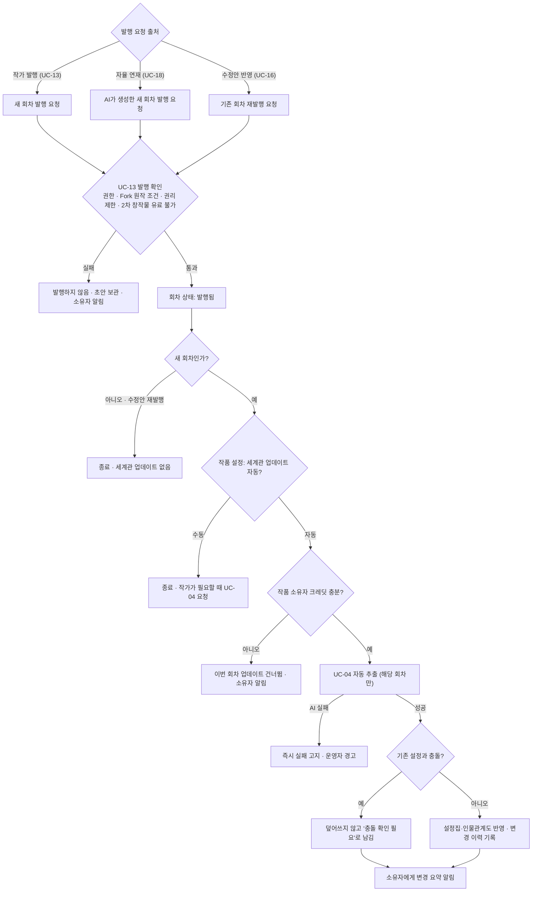
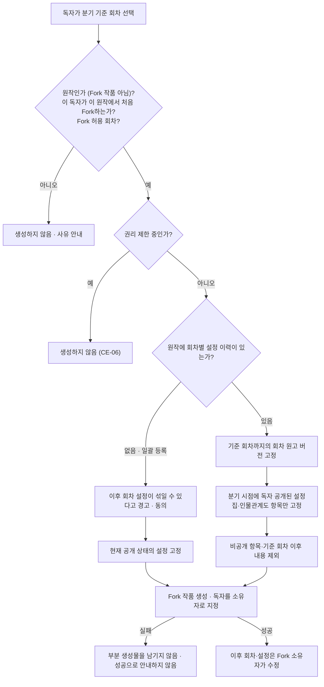

# STORYFORK 활동 다이어그램
> [다이어그램 목차](./README.md) · [유스케이스 문서](../usecase.md) · [명세 목차](../usecase-spec/README.md)
여러 유스케이스에 걸친 처리 흐름을 정리합니다. 피드백 처리 흐름(UC-14~16)은 [유스케이스 문서 5절](../usecase.md#5-피드백-처리-흐름)에 있습니다.
## 1. 회차 발행과 자동 처리
회차가 발행될 때 이어지는 자동 처리입니다. 세계관 자동 업데이트(UC-04)는 **새 회차**일 때만 실행하고, 수정안 반영에 따른 재발행에서는 실행하지 않습니다(BR-11).

- 공개 전환(떡밥 공개)도 이 업데이트에서 함께 반영되며, 전환 회차를 이력에 남깁니다(BR-10).
- 자율 연재는 다음 실행 시점에 다시 처음부터 이 흐름을 탑니다.
## 2. Fork 생성과 고정 범위
Fork를 만들 때 무엇을 고정하는지 보여 줍니다(UC-08, BR-04).

예를 들어 원작 10화 종료 시점에서 Fork하고, 원작이 30화에서 떡밥을 공개했다면 이렇게 됩니다.
| 항목 | 원작 | 10화 기준 Fork |
|---|---|---|
| 1~10화 원고 | 원작 소유자가 계속 수정 가능 | 분기 시점 버전으로 불변 |
| 10화 시점 공개 설정 | 이후 바뀔 수 있음 | 분기 시점 상태로 불변 |
| 10화 시점 비공개 설정 | 30화에서 공개로 전환 | 포함하지 않음. 30화의 공개 전환도 들어오지 않음 |
| 11화 이후 | 원작 전개 | Fork 소유자가 새로 창작 |
외부 2차 창작물도 Fork 원작이 될 수 있으며 같은 규칙을 따릅니다.
