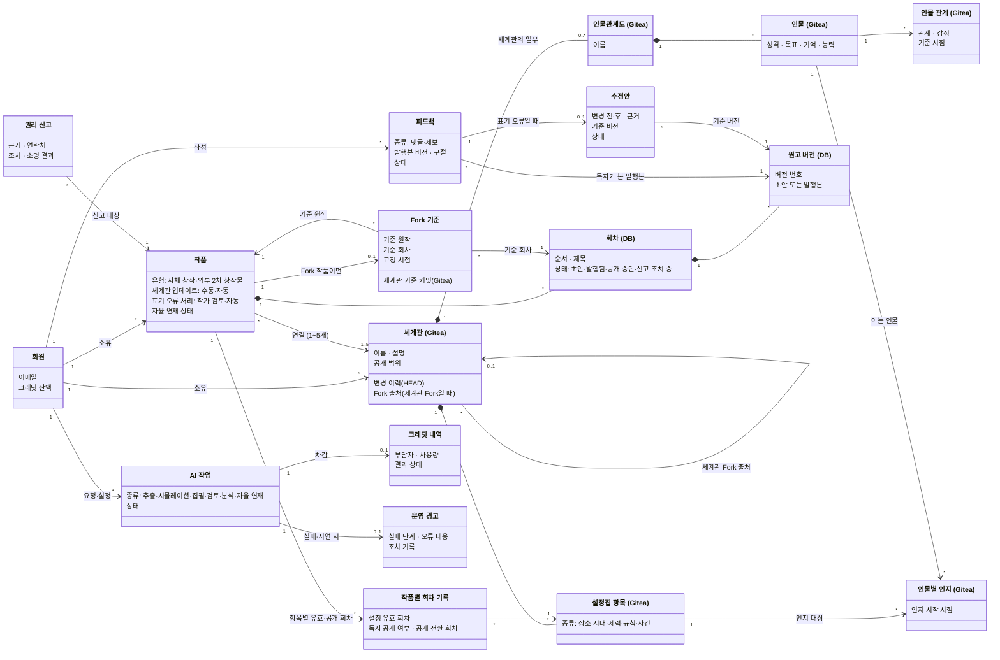

# STORYFORK 도메인 클래스 다이어그램
> [다이어그램 목차](./README.md) · [유스케이스 문서](../usecase.md) · [명세 목차](../usecase-spec/README.md)
유스케이스에 나오는 업무 개념과 관계를 정리한 **개념 모델**입니다. DB 테이블·ERD·코드 클래스가 아니며, 속성은 유스케이스 이해에 필요한 것만 적습니다. 저장 위치는 확정 결정(세계관·인물관계도는 Gitea, 회차 원고는 DB)을 따릅니다.

## 관계 읽는 법
- **작품 → 세계관 1~5개:** 작품은 세계관 없이 만들 수 없고 최대 5개까지 연결합니다(UC-24). 세계관끼리의 충돌은 설정 검토(UC-12)로 찾아 해결합니다. 연결 목록은 첫 회차 발행 전까지만 바꿀 수 있습니다.
- **세계관 공유:** 한 세계관을 여러 작품이 쓸 수 있고 수 제한은 없습니다. 공개 세계관을 쓰는 작품은 고치지 않으면 원본을 참조하고, 고치려면 세계관 전체를 세계관 Fork로 복사해 연결을 교체하며(BR-12), 이용 허가가 철회되면 철회 시점 상태로 고정됩니다(UC-05).
- **Fork:** Fork 작품도 작품이며, `Fork 기준`이 원작과 기준 회차를 가리킵니다. 고정한 세계관·원고는 BR-04를 따르며, 분기 시점의 세계관 버전을 Gitea 커밋 ID로 참조합니다(브랜치 운용은 미정). 원작이 삭제되어도 유지됩니다. 작품 운영 설정은 넘겨받지 않습니다.
- **공개 두 단계:** 세계관 공개(`세계관.공개 범위`)와 독자 공개(`작품별 회차 기록`)는 다릅니다. 같은 항목도 작품마다 공개 회차가 다릅니다(BR-10). 독자 공개와 `인물별 인지`도 서로 독립입니다(UC-06).
- **세계관 Fork:** 다른 사용자 세계관을 고치면 세계관 전체가 작가 소유로 복사되고 `세계관 Fork 출처`를 가리킵니다. 원본 업데이트는 받지 않습니다(BR-12). 플랫폼 기본 세계관만으로 만든 세계관은 출처가 없습니다.
- **버전:** 세계관·인물관계도는 변경할 때마다 HEAD 위에 새 버전을 쌓고(덮어쓰기·머지 없음), 회차 시점(유효·공개·인지 회차)은 작품별 기록(`작품별 회차 기록`)에 둡니다(BR-10).
- **인물관계도:** 세계관의 일부입니다. 인물관계도만 바꾸려면 인물관계도만 담은 세계관을 만들어 연결합니다. Fork에서도 같은 방식으로 정리합니다.
- **Fork 제한:** `Fork 기준.기준 원작`은 Fork가 아닌 작품만 가리키며, 한 독자는 한 원작에서 1번만 Fork합니다(BR-14).
- **피드백:** 댓글은 AI 작업을 만들지 않습니다. 제보만 `AI 작업`과 `크레딧 내역`을 만듭니다.

## 미정
- Fork 고정의 Gitea 브랜치 운용, 크레딧 차감 시점.
