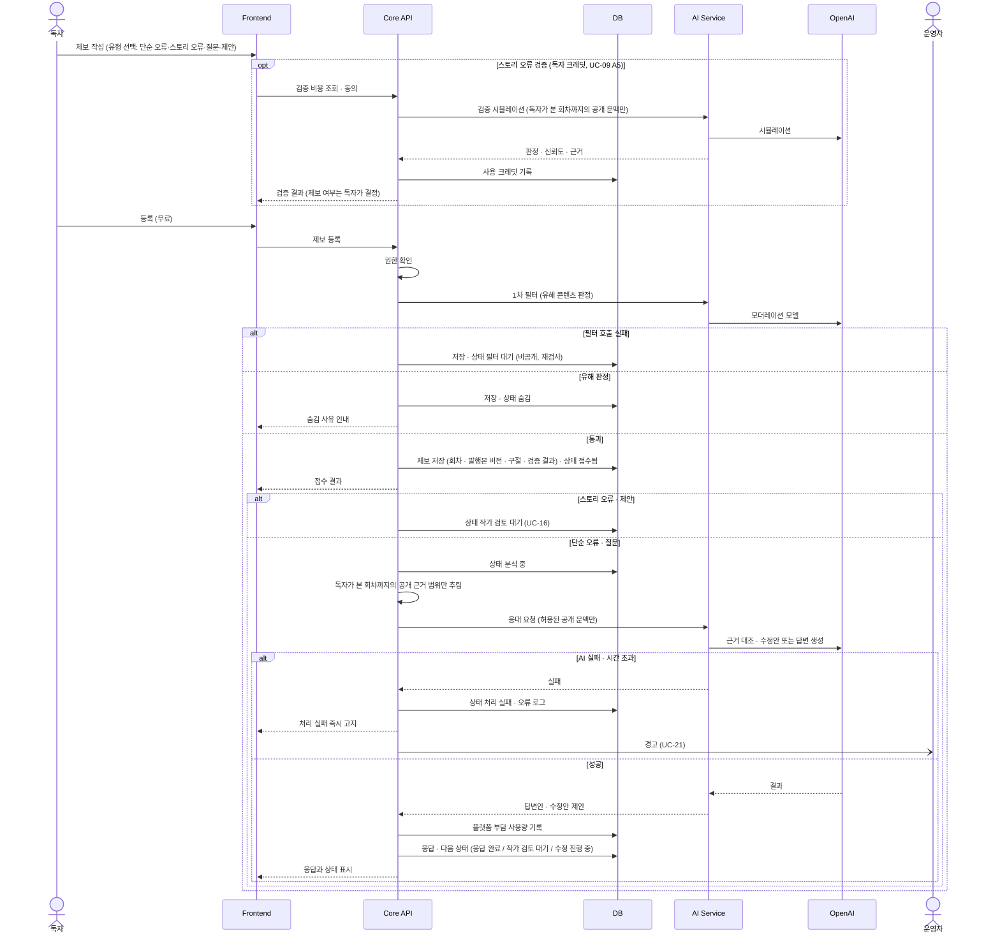
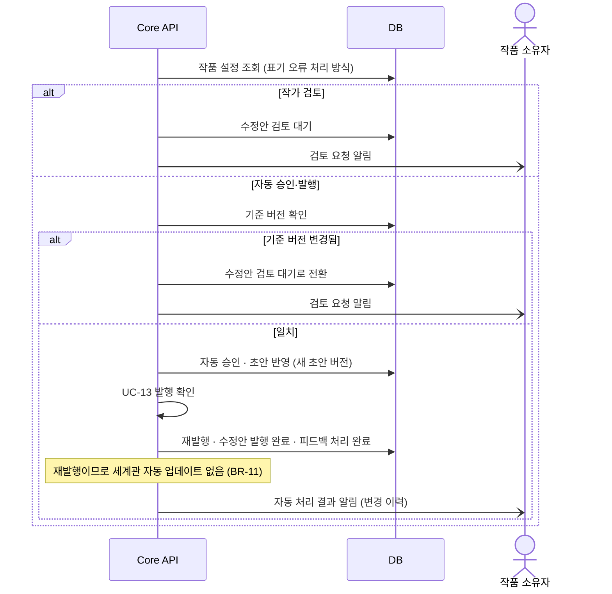
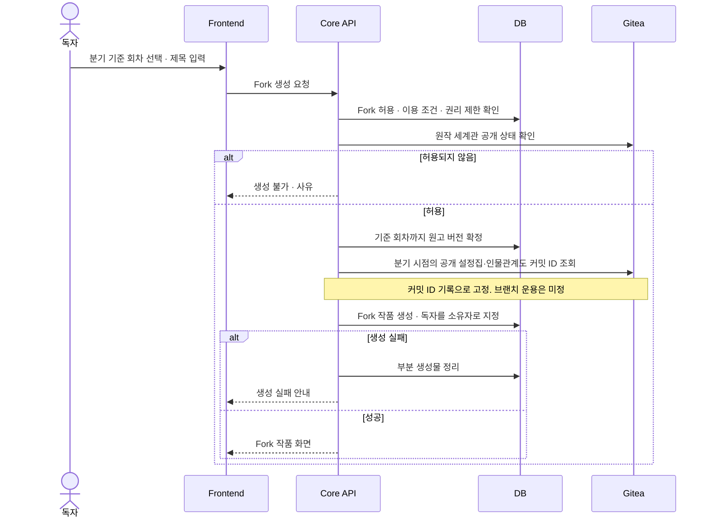

# STORYFORK 시퀀스 다이어그램
> [다이어그램 목차](./README.md) · [유스케이스 문서](../usecase.md) · [명세 목차](../usecase-spec/README.md)
서비스 사이의 호출 순서와 책임을 정리합니다. 호출 방향은 `Frontend → Core API → AI Service → OpenAI`이며, 권한·정본·발행·크레딧은 Core API가 판단하고 저장합니다([공통 지침](../../AGENTS.md)). 메시지 이름은 동작 설명이며 API URL·DTO가 아닙니다.
## 1. 독자 제보 접수·응대 (UC-14·15)

- 피드백 분석은 검증만 하며 세계관·설정을 바꾸지 않습니다(BR-11).
- 유형은 독자가 고르며 AI로 분류하지 않습니다(BR-15).
- AI Service는 DB·Gitea에 직접 쓰지 않습니다.
## 2. 표기 오류 수정안 자동 승인·발행 (UC-16 A4)

## 3. Fork 생성 (UC-08)

## 4. AI 자율 연재 1회 실행 (UC-18)

```mermaid
sequenceDiagram
  participant TR as Core API 내장 스케줄러
  participant CO as Core API
  participant DB as DB
  participant GT as Gitea
  participant AI as AI Service
  participant LLM as OpenAI
  actor W as 작품 소유자
  TR->>CO: 소유자가 정한 실행 일정 도래
  CO->>DB: 자율 연재 상태 · 월 한도 · 소유자 크레딧 · 미승인 초안 확인
  alt 미승인 초안 있음 (발행 전 확인 켬)
    CO->>DB: 이번 실행 건너뜀
  else 한도 · 크레딧 부족
    CO->>DB: 자율 연재 중단됨
    CO-)W: 중단 알림
  else 실행
    CO->>GT: 세계관 공개·허용 문맥 조회
    CO->>DB: 허용된 독자 반응 조회 (켠 경우, 필터 통과 공개 댓글·제안, 작성자 정보 제외)
    CO->>AI: 다음 회차 생성 요청
    AI->>LLM: 생성
    alt 생성 실패
      AI-->>CO: 실패
      CO->>DB: 오류 로그 (이번 회차 발행 안 함, 연속 3회면 중단됨)
      CO-)W: 실패 알림
    else 생성 성공
      AI-->>CO: 회차 초안
      CO->>DB: 초안 저장 · 실제 사용량 차감 기록
      CO->>AI: 1차 필터 (유해 콘텐츠 판정)
      CO->>CO: UC-13 발행 확인
      alt 필터 판정 · 발행 확인 실패 · 발행 전 확인 켬
        CO->>DB: 초안으로 보관
        CO-)W: 확인 요청 또는 사유 알림
      else 통과
        CO->>DB: 새 회차 발행
        opt 세계관 업데이트 자동
          CO->>AI: 해당 회차 설정 추출 (UC-04)
          AI-->>CO: 추출 결과
          CO->>GT: 충돌 없는 항목 반영 · 변경 이력
        end
        CO-)W: 발행 결과 · 사용 크레딧 알림
      end
    end
  end
```

- 실행 일정은 Core API 내장 스케줄러 하나로 처리하며 별도 worker·큐는 두지 않습니다. 새 실행 계층이므로 구현 전 팀 공유가 필요합니다.
