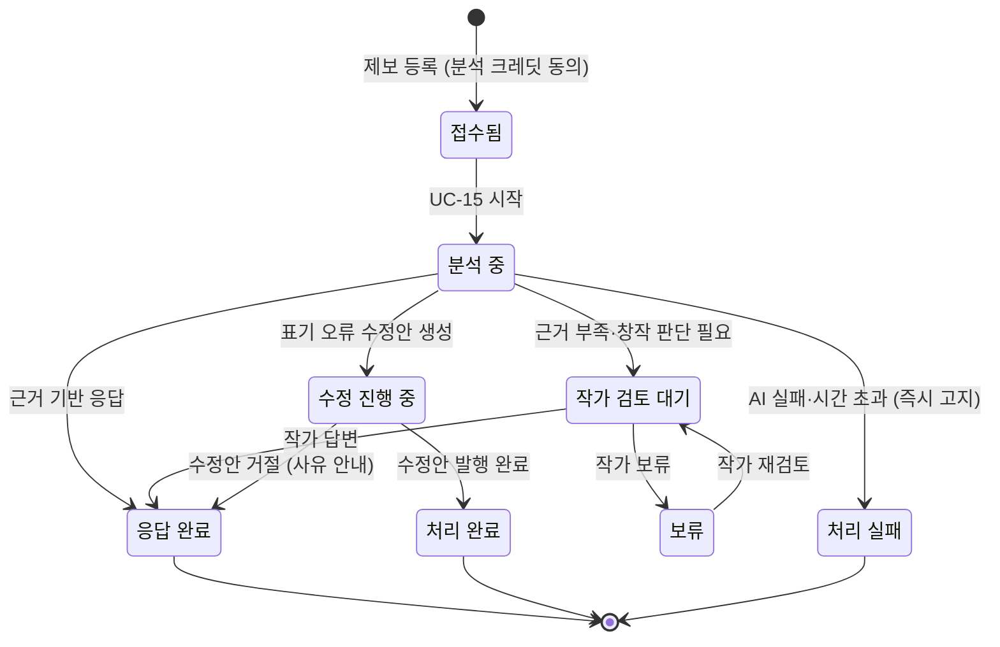
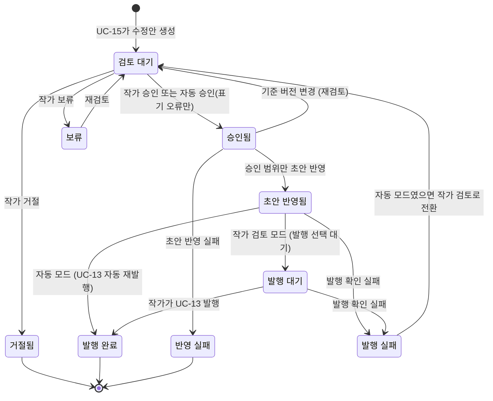
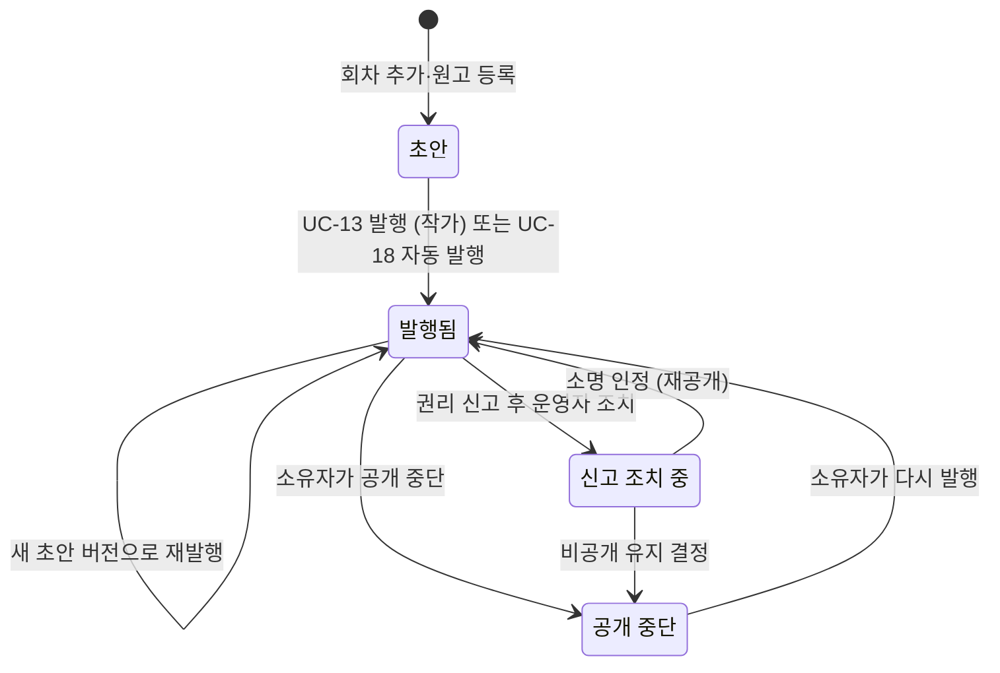
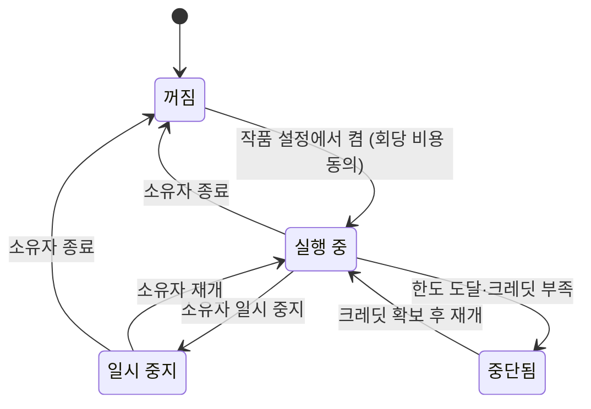
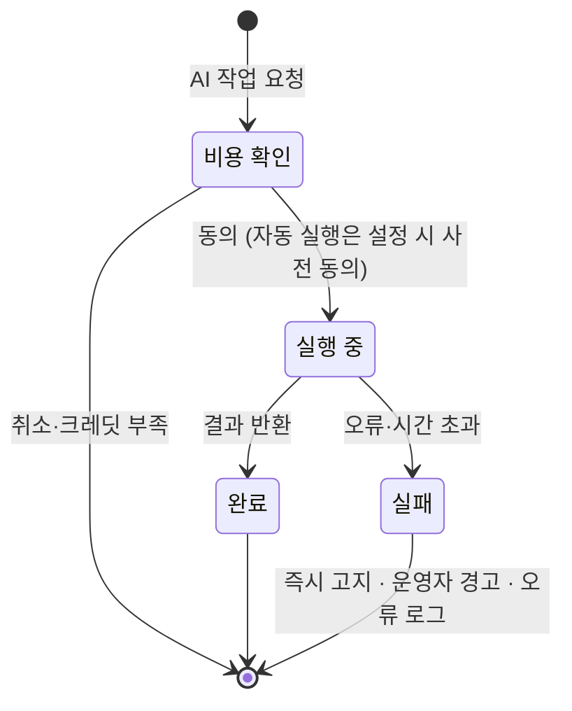

# STORYFORK 상태 다이어그램
> [다이어그램 목차](./README.md) · [유스케이스 문서](../usecase.md) · [명세 0.4 처리 상태 이름](../usecase-spec/README.md#04-처리-상태-이름)
유스케이스 명세에서 쓰는 처리 상태와 그 전이를 정리합니다. 상태 이름은 명세 0.4절과 같습니다. 상태 코드·저장 방식은 구현 설계에서 정합니다.
## 1. 피드백(제보)
댓글은 AI 분석 없이 `등록됨` 하나로 끝나므로 그리지 않습니다. 제보는 질문·오류 제보·제안입니다(UC-14·15).

- `처리 실패`는 기다리게 두지 않고 바로 독자에게 알리며, 운영자에게 경고를 보냅니다(UC-21). 자동 재처리는 하지 않고 독자가 다시 제보할 수 있습니다.
- `수정 진행 중`의 세부 진행은 아래 수정안 상태를 따릅니다.
- **미정:** 보류의 최대 기간, 실패한 제보의 크레딧 복구 기준(UC-17).
## 2. 수정안(PR)
작품 설정의 표기 오류 처리 방식에 따라 작가 검토와 자동 승인·발행이 갈립니다(UC-16).

- 수정안 반영에 따른 재발행은 세계관 자동 업데이트를 실행하지 않습니다(BR-11).
- **미정:** 보완된 수정안의 재승인 절차, 자동 처리 결과를 되돌리는 절차.
## 3. 회차

- 초안은 회차 안에서 버전으로 계속 쌓이며, 독자는 `발행됨` 상태의 발행본만 봅니다.
- **미정:** 공개 중단·신고 조치가 기존 Fork에 미치는 영향, 신고 조치의 상세 절차(검토 예정).
## 4. AI 자율 연재

- 회차 하나의 생성이 실패해도 상태는 `실행 중`을 유지하고, 그 회차만 발행하지 않습니다(UC-18 E2).
- **미정:** 실행 주기·트리거, 연속 실패 시 자동 중지 조건.
## 5. AI 작업 (공통)
추출·시뮬레이션·집필·검토·피드백 분석·자율 연재가 공통으로 따릅니다(UC-17, CE-04).

- **미정:** 크레딧 차감 시점(선차감·후정산), 실패 시 복구, 시간 초과 기준.
