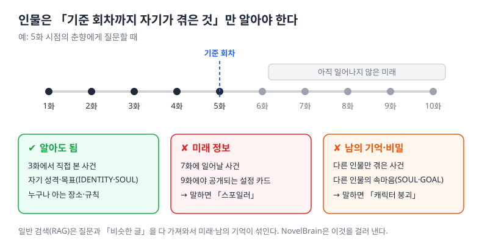
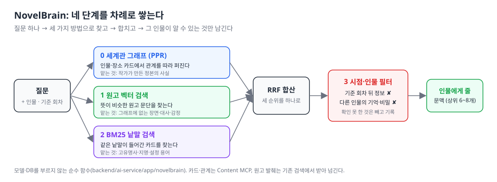
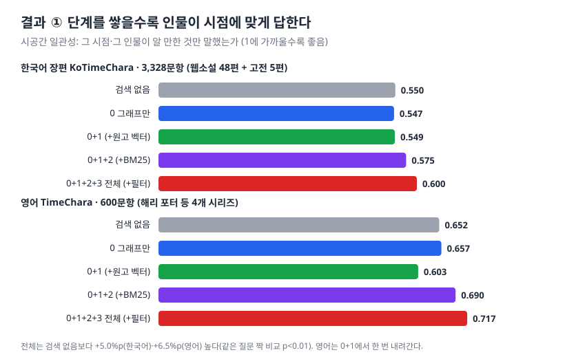
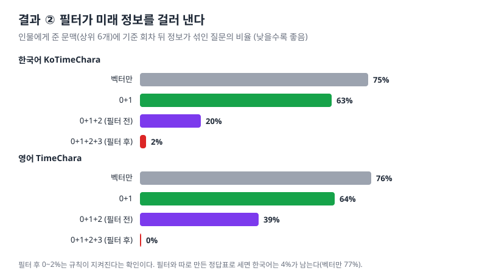
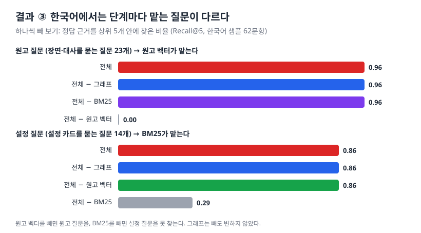
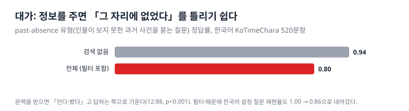

# NovelBrain 한눈에 보기

> 처음 보는 사람을 위한 요약이다. 숫자와 조건, 검정, 한계 전체는 [평가 결과 상세](novelbrain.md)에 있고,
> 동작 규칙은 [인물 시뮬레이션·NovelBrain 계약](../design/character-simulation-contract.md#novelbrain--차례로-쌓는-4단계)이 정본이다.
> 그림의 숫자는 모두 상세 문서의 표에서 그대로 가져왔다.

## 한 줄 요약

**NovelBrain은 인물 시뮬레이션에서 "이 인물이 지금 시점에 알 수 있는 것만" 찾아 주는 검색기다.**
세계관 그래프, 원고 검색, 낱말 검색을 합친 뒤 미래 정보와 다른 인물의 기억을 걸러 낸다.
한국어 장편 3,328문항과 영어 600문항으로 평가했고, 인물이 시점에 맞게 답하는 비율이 검색 없이 답할 때보다 **+5~6.5%p** 올랐다.

## 1. 왜 필요한가

STORYFORK의 인물 시뮬레이션은 인물마다 따로 AI 에이전트를 두고 장면을 이어 간다.
이때 인물이 **아직 일어나지 않은 일**(스포일러)이나 **자기가 보지 못한 일, 남의 속마음**(캐릭터 붕괴)을 말하면 안 된다.

일반 검색(RAG)은 질문과 뜻이 비슷한 글을 가져올 뿐 "언제 일어난 일인지", "누가 본 일인지"는 따지지 않는다.
그래서 미래 회차나 다른 인물의 기억이 섞인다. NovelBrain은 이 문제를 막으려고 만들었다.

## 2. 어떻게 동작하나

단계마다 앞 단계가 놓치는 것을 하나씩 막는다.

| 단계 | 하는 일 | 쉽게 말하면 | 막는 것 |
|---|---|---|---|
| 0 세계관 그래프 (PPR) | 질문에 나온 인물·장소 카드에서 출발해, 그 회차 시점의 관계를 따라 중요도를 퍼뜨린다 | "춘향 → 이몽룡 → 광한루"처럼 연결된 설정을 따라간다 | 기준선: 작가가 만든 정본의 사실 |
| 1 원고 벡터 검색 | 원고 문단을 뜻으로 찾는다 | "슬퍼하는 장면"을 물으면 슬픈 장면을 찾는다 | 그래프에 적히지 않은 장면·대사·감정 |
| 2 BM25 낱말 검색 | 설정 카드에서 같은 낱말을 찾고, 세 결과의 순위를 RRF로 합친다 | 고유명사는 뜻보다 글자가 같아야 찾힌다 | 벡터가 놓치는 이름·지명·설정 용어 |
| 3 시점·인물 필터 | 기준 회차 뒤 정보와 다른 인물의 기억·비밀을 뺀다. 확인할 수 없는 것도 빼고 따로 기록한다 | "5화의 춘향"에게는 5화까지 춘향이 겪은 것만 준다 | 미래 정보, 남의 기억 |

- **위치:** `backend/ai-service/app/novelbrain/`. 모델과 DB를 부르지 않는 순수 함수다(`ppr`, `bm25_rank`, `rrf`, `filter_for_character`, `recall`).
- **데이터 출처:** 카드와 관계는 Content MCP로, 원고 발췌는 기존 검색으로 받아서 넘긴다. AI 서비스는 DB에 직접 접속하지 않는다.
- **쓰는 곳:** 인물 시뮬레이션의 인물 턴과 나레이션. 전지적 나레이션은 필터 없이 2단계까지만 쓴다.

## 3. 어떻게 평가했나

**질문:** 단계를 하나씩 쌓을 때마다 실제로 좋아지는가? 단계를 하나씩 빼면 무엇이 나빠지는가?

| 데이터 | 무엇을 재나 | 규모 |
|---|---|---|
| **KoTimeChara** (직접 만든 한국어 평가 세트) | 한국어 장편에서 인물이 시점에 맞게 답하는가 | 웹소설 48편 + 고전 5편, **3,328문항** |
| **TimeChara** (공개 벤치마크) | 같은 내용을 영어로(해리 포터, 반지의 제왕 등) | **600문항** |
| 한국어 샘플 | 어떤 단계가 어떤 질문을 찾는가 | 저장소 샘플 3편, 62문항 |
| NarrativeQA, MuSiQue (공개) | 긴 글에서 근거 문단을 찾는가 | 각 100문항 |

- **문항 유형:** 미래 사건을 묻는 질문(future), 겪은 일을 묻는 질문(past), **그 자리에 없었던 일**을 묻는 질문(past-absence) 등이 정해진 비율로 섞여 있다.
- **채점:** 같은 질문을 구성(검색 없음, 그래프만, 0+1, 0+1+2, 전체)마다 풀게 하고 공개 채점 기준으로 맞았는지 본다.
  구성 사이 비교는 **같은 질문끼리 짝지어** "한쪽만 맞은 질문 수"를 세는 방식이다.
- **비용:** 모델 `gpt-5.6-luna`, 총 약 30달러.

## 4. 결과

### ① 단계를 쌓을수록 인물이 시점에 맞게 답한다

- 한국어 장편에서는 쌓을수록 꾸준히 올랐다: 0.547 → 0.549 → 0.575 → **0.600**(검색 없음 0.550).
- 영어에서는 원고 벡터를 더한 단계(0+1)에서 한 번 내려갔다가, BM25와 필터를 더하면서 가장 높아졌다(**0.717**).
- 오른 폭은 +5%p 안팎이다. 크지는 않지만 수천 문항에서 짝 비교로 확인한 차이다.

### ② 필터가 미래 정보를 걸러 낸다

- 필터를 걸기 전에는 인물에게 준 문맥의 **20~76%**에 미래 정보가 섞여 있었다.
- 필터를 건 뒤에는 0~2%로 줄었다. 필터와 따로 만든 정답표로 다시 세도 **4%**만 남는다(필터 없는 벡터 검색은 77%).
- 필터는 점수도 올렸다. 한국어에서 필터를 건 쪽만 맞은 질문이 290개, 안 건 쪽만 맞은 질문이 204개였다(p<0.001).

### ③ 한국어에서는 단계마다 맡는 질문이 다르다

- **원고 질문**(장면, 대사)은 원고 벡터만 찾는다. 원고 벡터를 빼면 0.96 → **0.00**.
- **설정 질문**(설정 카드 내용)은 BM25가 찾는다. BM25를 빼면 0.86 → **0.29**.
- 그래프는 빼도 변하지 않았다. 한국어 장편 점수에서도 그래프를 뺀 쪽이 오히려 조금 높았다(0.615 대 0.600). 그래프가 실제로 이득을 주는지는 아직 확인하지 못했다.

## 5. 대가와 한계

**공짜는 아니다.**
- 문맥을 받으면 인물이 "안다, 봤다"고 답하는 쪽으로 기울어서, **보지 못한 과거 일**을 묻는 질문의 정답률이 0.94에서 0.80으로 내려갔다.
- 필터가 엄격해서, 인물과 관계로 이어지지 않은 사건·물건 카드는 보이지 않는다. 그래서 한국어 설정 질문 재현율이 1.00에서 0.86으로 내려갔다.
  작가가 관계를 빠뜨리면 인물은 그 설정을 모르는 것으로 처리된다.

**결과를 읽을 때 주의할 점**
- **같은 모델이 문제를 만들고 답하고 채점했다**(KoTimeChara). 그래서 절대 점수보다 구성 사이의 차이로 읽어야 한다.
  정답표는 근거 문장이 원문에 있는지만 자동으로 대조했고, 사람이 검수하지는 않았다.
- 인물이 장면을 "봤다"는 판정은 **발췌에 그 인물 이름이 나오는지**로 근사한다. 별칭, 호칭, 대명사는 놓친다.
- 영어 TimeChara의 세계관은 정답 라벨과 같은 정보로 만들어서, 실제 작품보다 유리한 조건이다.
- 웹소설은 앞쪽 25화만 썼다. 후반부의 복잡한 시점은 따로 재지 않았다.

## 6. 용어 풀이

| 용어 | 뜻 |
|---|---|
| 기준 회차 | 시뮬레이션이 진행되는 시점. 인물은 이 회차까지의 일만 안다 |
| PPR (Personalized PageRank) | 출발점에서 연결을 따라 중요도를 퍼뜨려, 가까운 설정일수록 높게 매기는 방법 |
| 벡터 검색 | 글을 숫자 벡터로 바꿔 **뜻이 비슷한** 글을 찾는 방법(모델 `multilingual-e5-small`) |
| BM25 | **같은 낱말이 많이 든** 글을 찾는 고전적 검색 방법 |
| RRF | 여러 검색 결과의 순위를 하나로 합치는 방법 |
| 시공간 일관성 | 인물이 그 시점·그 자리에서 알 만한 것만 말했는지(맞으면 1, 틀리면 0) |
| Recall@5 | 정답 근거를 상위 5개 결과 안에 찾은 비율 |
| 짝 비교, p값 | 같은 질문에서 두 구성 중 한쪽만 맞은 수를 비교한다. p가 작을수록 우연이 아닐 가능성이 크다(보통 0.05 미만) |

## 더 보기

- [평가 결과 상세](novelbrain.md): 모든 표, 검정, 데이터 구성, 한계
- [평가 스크립트와 재현 방법](../../backend/ai-service/eval/novelbrain/README.md)
- [인물 시뮬레이션·NovelBrain 계약](../design/character-simulation-contract.md)
