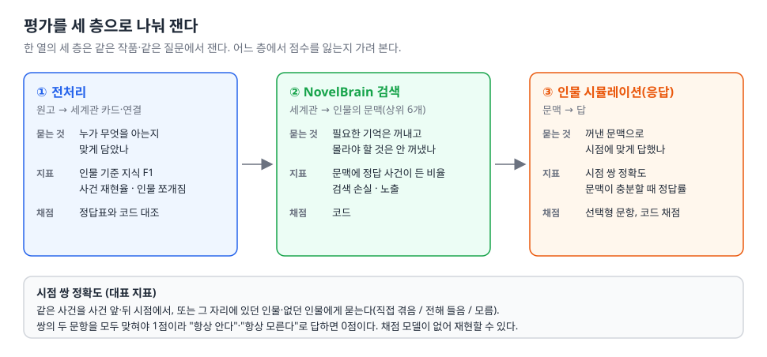
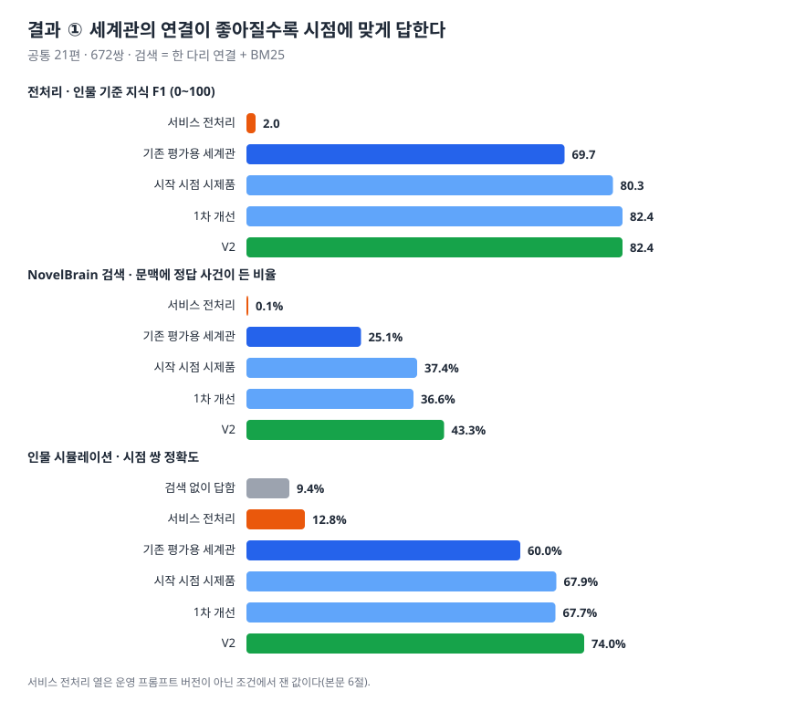
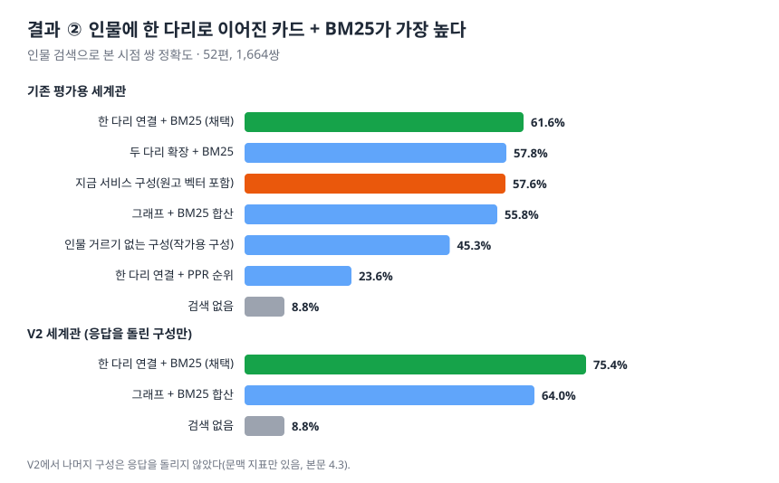
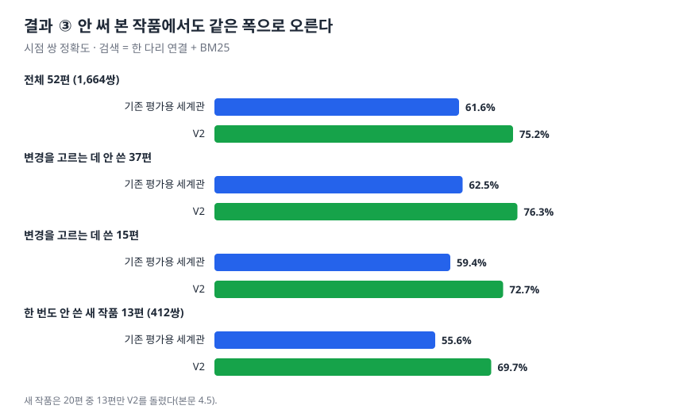

# NovelBrain 전처리·검색 평가 보고서 (2026-11-26)

> 대상: 평가 폴더(`backend/ai-service/eval/novelbrain/`) 안의 **전처리 시제품 V2**와 **검색 구성 비교**다. 서비스 코드(`app/**`)에는 반영하지 않았다. 반영에 필요한 결정은 [7절](#7-서비스-반영에-필요한-결정)에 있다.
> 근거: 평가 코드와 집계 결과는 [PR #960](https://github.com/SKNETWORKS-FAMILY-AICAMP/SKN34-FINAL-4TEAM/pull/960)에 있다([8절](#8-근거-자료)). 미측정 칸은 본문에 표시했다.
> 원문·작품 제목·인물 이름은 싣지 않는다(작품은 id와 집계 수치만).
> 지금 서비스가 쓰는 4단계 NovelBrain의 평가는 [NovelBrain 평가 결과](novelbrain.md)([한눈에 보기](novelbrain-overview.md))에 있다. 그 문서의 시공간 일관성(채점 모델이 채점)과 이 문서의 시점 쌍 정확도(코드가 채점)는 다른 지표라 숫자를 나란히 견주지 않는다.

## 1. 한 줄 결론

NovelBrain은 **인물이 그 시점에 아는 것만 꺼내 주는 장치**로서 꼭 필요하고, 성능을 정하는 것은 순위 알고리즘이 아니라 **NovelBrain이 읽는 세계관의 연결 품질(전처리)**이다. 그래서 검색은 단순하게 고정하고(인물에 이어진 카드 + BM25) 전처리를 개선했다(V2로 확정).

## 2. 결정 사항

평가 폴더 안에서 내린 결정이다. 서비스에 적용할지는 7절의 결정이 먼저다.

| 항목 | 결정 | 근거 |
|---|---|---|
| 전처리 | **V2(2차 개선판)로 확정** | 3차 탐색에서 채택할 변경이 없었다(5절) |
| 검색 후보 | 인물에 한 다리로 이어진 카드만 | 원고 벡터 검색은 몰라야 할 내용이 문맥에 77% 섞임 |
| 시점 거르기 | 현재 회차 이후 제외 | 몰라야 하는 쪽 정답률 88~95% 유지 |
| 순위 | BM25 | 검색 손실 0(4절) |
| 뺀 것 | PPR 순위, 원고 벡터 통로, 두 다리 확장 | 4절 표 |
| 대표 지표 | 시점 쌍 정확도(코드 채점) | 채점 모델이 없어 재현 가능 |
| 채점 모델(자유 질문) | `gpt-6.2-sol` 하나 | 채점 모델마다 척도가 달라 섞어 읽을 수 없음 |

## 3. 평가 방법

**평가 세트(KoTimeChara)**: 한국어 장편 53편(웹소설 앞쪽 25화, 고전 10~14회차), 질문이 있는 작품 52편. 정답표(누가 어느 회차에 무엇을 겪고 들었나)는 모델이 만들었고 사람 검수 전이다.

**세 층으로 나눠 잰다.** 한 열의 세 층은 같은 작품·같은 질문에서 잰다.

| 층 | 묻는 것 | 지표 | 채점 |
|---|---|---|---|
| 전처리 | 세계관이 "누가 무엇을 아는가"를 맞게 담았나 | 인물 기준 지식 F1, 사건 재현율, 인물 쪼개짐·섞임 | 정답표와 코드 대조 |
| NovelBrain(검색) | 필요한 기억을 꺼내고, 몰라야 할 것은 안 꺼냈나 | 문맥에 정답 사건이 든 비율, 검색 손실, 노출 | 코드 |
| 인물 시뮬레이션(응답) | 꺼낸 문맥으로 시점에 맞게 답했나 | 시점 쌍 정확도, 문맥이 충분할 때 정답률 | 선택형 코드 채점 |

- **시점 쌍 정확도**: 같은 인물·같은 사건을 사건 앞과 뒤 시점에서 묻거나, 같은 사건을 그 자리에 있던 인물과 없던 인물에게 묻는다. 세 선택지(직접 겪음 / 전해 들음 / 모름) 중 하나를 고르고, 쌍의 두 문항을 모두 맞혀야 1점이다. "항상 안다"·"항상 모른다"로 답하면 0점이 된다.
- **검색 손실**: 인물에 이어진 카드 전체에는 정답 사건이 있는데 상위 6개 문맥에서 빠진 비율. 순위 방식을 개선해 얻을 수 있는 상한이다.
- **응답 모델**: `gpt-6-luna`, 추론 강도 `low`로 고정.

**비교한 세계관(전처리 버전)**

| 이름 | 무엇인가 | 결과 파일의 키 |
|---|---|---|
| 서비스 전처리 | `app.manuscript_extraction`을 그대로 불러 같은 작품에 실행한 기준선(`kt_world_svc.py`) | `svc` |
| 기존 평가용 세계관 | [NovelBrain 평가](novelbrain.md#45-kotimechara-한국어-장편의-인물-시점-독립-라벨)에서 쓴 세계관(`kt_world.py`) | `old` |
| 시작 시점 시제품 · 1차 개선 · V2 | 전처리 시제품(`kt_world2.py`)의 세 시점 | `v00` · `v03` · `v04` |

**비교한 검색 구성**

| 이름 | 무엇인가 | 결과 파일의 키 |
|---|---|---|
| 한 다리 연결 + BM25 | 인물에 한 다리로 이어진 카드만 후보로 두고 BM25로 정렬 | `link_bm25` |
| 두 다리 확장 + BM25 | 후보를 두 다리까지 넓힘 | `link2_bm25` |
| 한 다리 연결 + PPR 순위 | 그래프(PPR) 순위에 시점·인물 필터만 건 것 | `link_ppr` |
| 그래프 + BM25 합산 | 지금 서비스 구성에서 원고 벡터만 뺀 것 | `no_vector` |
| 지금 서비스 구성(원고 벡터 포함) | 서비스 `recall` 3단계(그래프 + 원고 벡터 + BM25 + 시점·인물 필터) | `s3` |
| 인물 거르기 없는 구성 | 서비스 `recall` 2단계(필터 없음) | `s2` |
| 검색 없음 | 문맥 없이 답함 | `zero` |

## 4. 결과

### 4.1 층 × 전처리 버전 (공통 21편, 672쌍, 검색 = 한 다리 연결 + BM25)

| 층 | 지표 | 서비스 전처리 | 기존 평가용 세계관 | 시작 시점 시제품 | 1차 개선 | **V2** |
|---|---|---:|---:|---:|---:|---:|
| 전처리 | 인물 기준 지식 F1 | 2.0 | 69.7 | 80.3 | 82.4 | **82.4** |
| | 사건 재현율 | 14.0% | 64.5% | 84.4% | 86.6% | **86.6%** |
| | 뒤 회차 들음 정확도 / 재현율 | 없음 | 없음 | 없음 | 42.5 / 27.5% | **42.5 / 27.5%** |
| | 인물 쪼개짐 | 21.1% | 5.1% | 8.8% | 4.9% | **4.1%** |
| | 인물 섞임 | 0.0% | 0.0% | 1.2% | 1.1% | **1.2%** |
| NovelBrain | 문맥에 정답 사건이 든 비율 | 0.1% | 25.1% | 37.4% | 36.6% | **43.3%** |
| | 검색 손실 | 0.0 | 0.0 | 0.0 | 0.0 | **0.0** |
| 인물 시뮬레이션 | 시점 쌍 정확도 | 12.8% | 60.0% | 67.9% | 67.7% | **74.0%** |
| | 문맥이 충분할 때 정답률 | - | 88.8% | 90.0% | 91.5% | **92.8%** |
| 기준 | 검색 없이 답함 | 9.4% | | | | |

구간별 판정(같은 쌍끼리 부호 검정):

| 구간 | 시점 쌍 변화 | 판정 |
|---|---|---|
| 서비스 전처리 → 기존 평가용 세계관 | +47.2%p | 확실 (33:350, p<0.0001) |
| 기존 평가용 세계관 → 시작 시점 시제품 | +7.9%p | 확실 (86:139, p=0.0005) |
| 시작 시점 시제품 → 1차 개선 | −0.1%p | 변화 없음 (90:89) |
| 1차 개선 → V2 | +6.3%p | 확실 (38:80, p=0.0001) |

읽는 법:
- **검색 손실이 0이다.** BM25 순위는 병목이 아니다. 꺼낼 것이 세계관에 없는 것이 문제이지, 있는 것을 못 꺼내는 것이 아니다.
- **문맥이 충분하면 응답은 89~93% 맞힌다.** 이 값은 버전마다 비슷하다. 점수가 오른 것은 문맥에 정답 사건이 든 문항이 늘었기 때문이다(25% → 43%).
- **지식 F1이 올라도 최종 점수가 안 오를 수 있다**(1차 개선). 그래서 세 층을 함께 본다.
- **시제품은 인물 쪼개짐을 줄인 대신 섞임이 생겼다**(서로 다른 인물이 한 카드로 합쳐진 비율 0.0% → 1.2%).
- **서비스 전처리 열은 운영 조건과 다를 수 있다.** 운영 프롬프트 버전이 아니라 코드에 있는 프롬프트로 돌린 값이다(6절).

### 4.2 전체 52편 (기존 평가용 세계관 → V2, 1,664쌍)

| 묶음 | 한 다리 연결 + BM25 | 그래프 + BM25 합산 | 인물 기준 지식 F1 |
|---|---|---|---|
| 전체 52편 | 61.6% → 75.2% | 55.8% → 64.1% | 70.4 → 83.9 |
| 변경을 고르는 데 안 쓴 37편 | 62.5% → 76.3% (280:117, p<0.0001) | 57.4% → 65.2% | 70.5 → 84.4 |
| 변경을 고르는 데 쓴 15편 | 59.4% → 72.7% | 51.9% → 61.3% | 70.3 → 82.5 |

안 쓴 37편에서 같은 폭으로 올랐다. 몰라야 하는 쪽은 나빠지지 않았다(1,059 → 1,090문항 정답). 그림은 4.5에 있다.

### 4.3 검색 구성 비교

기존 평가용 세계관, 52편 1,664쌍:

| 구성 | 시점 쌍 정확도 | 결정 |
|---|---:|---|
| 한 다리 연결 + BM25 | 61.6% | **채택** |
| 두 다리 확장 + BM25 | 57.8% | 제외 |
| 지금 서비스 구성(원고 벡터 포함) | 57.6% | 제외 |
| 그래프 + BM25 합산 | 55.8% | 제외 |
| 인물 거르기 없는 구성 | 45.3% | 제외 |
| 한 다리 연결 + PPR 순위 | 23.6% | 제외 |
| 검색 없음 | 8.8% | |

V2 세계관 52편(3,328문항), 문맥 지표는 모델 호출 없이 잰 값:

| 구성 | 문맥에 정답 사건이 든 비율 | 검색 손실 | 노출(느슨한 기준) | 시점 쌍 정확도 |
|---|---:|---:|---:|---:|
| 한 다리 연결 + BM25 | 44.5% | 0.1 | 50.9% | 75.4% |
| 두 다리 확장 + BM25 | 45.6% | 0.1 | 65.9% | 미측정(어림 64.7%) |
| 그래프 + BM25 합산 | 31.6% | 12.9 | 34.6% | 64.0% |
| 지금 서비스 구성(원고 벡터 포함) | 31.3% | 14.5 | 33.7% | 미측정(어림 63.3%) |
| 인물 거르기 없는 구성 | 31.8% | 16.2 | 78.3% | 미측정 |
| 한 다리 연결 + PPR 순위 | 1.3% | 43.3 | 7.1% | 미측정 |

- 세계관이 바뀌어도 구성의 순위는 같다. 세계관이 풍부해질수록 한 다리 연결 + BM25와 다른 구성의 격차가 벌어진다(그래프 + BM25 합산과의 차이 5.8%p → 11.4%p). 그래프 + BM25 합산의 검색 손실도 V2에서 커진다(52편 12.9, 공통 21편 10.7).
- 두 다리 확장은 꺼내는 양은 비슷하지만 노출이 늘어 점수가 낮다.
- 문맥 재현과 노출을 함께 보면 통계적으로 차이가 확실한 17쌍의 순서를 17개 모두 맞힌다. 2%p 이하 차이는 못 가리고, 절대 점수는 평균 6.8%p 틀린다.
- 지금 서비스 구성과 두 다리 확장의 V2 시점 쌍은 응답을 돌리지 않았다(어림값). PPR 순위는 시작 시점 시제품 세계관 5편에서만 돌렸고 14.4%였다(같은 5편의 한 다리 연결 + BM25는 64.4%).
- **V2 52편의 값이 두 가지다.** 4.2의 75.2%·64.1%와 이 표의 75.4%·64.0%는 같은 세계관·같은 구성의 두 집계이고 각각 2쌍이 다르다(한 다리 연결 + BM25 기준 1,252쌍 대 1,254쌍 정답). 차이의 원인은 확인하지 않았다.

### 4.4 NovelBrain이 없거나 약하면

| 조건 | 결과 |
|---|---|
| 검색 없이 답함 | 시점 쌍 9.4% |
| 원고를 그대로 벡터 검색 | 몰라야 할 내용의 문맥 노출 0.77 |
| 인물 거르기를 뺌 | 시점 쌍 45.3% (넣으면 57.6%, 기존 세계관) |

### 4.5 과적합 확인

수집 폴더에서 한 번도 안 쓴 새 웹소설 20편(6개 장르)을 골라 정답표를 만들고, 그중 13편(412쌍)에 V2를 코드·프롬프트 수정 없이 적용했다(나머지 7편은 시간 부족으로 미실행).

| 지표 | 기존 평가용 세계관 | V2 | 참고: 기존 37편(안 쓴 작품) |
|---|---:|---:|---|
| 인물 기준 지식 F1 | 70.7 | 81.1 | 70.5 → 84.4 |
| 사건 재현율 | 67.4% | 89.7% | 65.3 → 89.1% |
| 한 다리 연결 + BM25 | 55.6% | 69.7% (97:39, p<0.0001) | 62.5 → 76.3% |
| 그래프 + BM25 합산 | 53.2% | 58.0% (84:64, p=0.12) | 57.4 → 65.2% |

- 한 다리 연결 + BM25는 13편 중 12편이 올랐다. 상승 폭(+14.1%p)은 기존 작품(+13.6~13.8%p)과 같다.
- 알아야 하는 쪽(278 → 323문항)과 몰라야 하는 쪽(351 → 367문항)이 모두 올랐다.
- 그래프 + BM25 합산 구성은 새 작품에서 상승을 확정하지 못했다.
- 새 작품은 기존 세트보다 절대 점수가 낮다(기존 세계관 기준 56.6% 대 61.6%).
- 뒤 회차 들음은 새 작품에서 더 약하다(정확도 27.5%, 재현율 17.9%).

### 4.6 회차 칸(설정집 완성도)

V2 뒤에 "모든 카드에 회차 칸을 채우는" 단계를 더했다. 원문에서 그 대상이 나온 문장을 모아 회차별 설명을 쓰고, 문장마다 근거 인용을 원문과 코드로 대조한다(통과율 95~96%).

| 카드 종류 | 본문 + 회차 칸 글자 수(중앙값), 전 → 후 |
|---|---|
| 장소 | 4 → 82 |
| 사물 | 3 → 112 |
| 조직 | 4 → 120 |
| 능력 | 5 → 119 |
| 규칙 | 5 → 83 |

시점 쌍은 변하지 않았다(42편, 76.6% → 76.3%). 시뮬레이션이 회차 칸을 읽게 하면: 통째로 보이면 누설(2,688문항 중 101건), 그 인물이 아는 사건에 기댄 문장만 보이면 77.0%에 누설 10건이다.

## 5. 전처리 V2 요약과 3차 탐색 결과

V2 워크플로우(회차별 호출, 역할마다 분리): 인물 추출 → 사건 추출(행동·대화 단위, `@` 대상과 역할) → 자리 확인 → 관계 → 인물 문서(정체·성격·말투·목표·행적) → 합치기(코드가 후보 제시, 모델이 확정) → 뒤 회차 들음. 모든 인용은 원문과 코드로 대조한다. 추론 강도는 전 단계 `low`, 들음 단계만 `high`.

3차 탐색(이미 쓴 15편, 480쌍)에서는 채택한 변경이 없다. 오답 144건의 원인:

| 쪽 | 원인 | 건수 |
|---|---|---:|
| 알아야 하는데 틀림(89) | 사건은 있는데 인물에 안 이어짐(고전 직함 분열 19 포함) | 47 |
| | 문맥에 사건이 있는데 "모른다"고 답함(응답) | 30 |
| | 그 밖 | 12 |
| 몰라야 하는데 틀림(55) | 비슷한 앞 내용과 혼동 | 21 |
| | 세계관이 인물을 사건에 이음(상당수는 정답표의 이중 표기) | 15 |
| | 그 밖 | 19 |

- 알아야 하는 쪽 오답 89건 중 44건은 같은 문맥으로 다시 물으면 맞힌다(응답 흔들림).
- 시험한 가설(합치기 완화, 자리 거리 조건, 연결 되살리기, 들음 입력 축소)은 모두 흔들림 범위 안이라 기각했다.
- 응답 설정을 바꿔도 오르지 않았다: `gpt-6-luna` low 71.7%, medium 70.0%, `gpt-6.1-terra` low 71.5%.

비용: 회차당 호출 약 12건, 정가 환산 약 $0.0048(회차 칸 단계 포함 약 $0.0054).

## 6. 한계

- **서비스에 반영하지 않았다.** 이 문서의 수치는 평가 폴더의 시제품과 검색 구성으로 잰 값이고, 서비스의 전처리와 `recall`은 그대로다.
- **정답표가 사람 검수 전이다.** 참여자 누락과 한 인물의 이중 표기가 확인됐다. 절대 수치보다 같은 조건 안의 차이로 읽는다. 실제 천장은 모른다.
- **서비스 전처리 열은 운영 조건과 다를 수 있다.** 게이트웨이 모델과 코드에 있는 프롬프트로 돌렸다(운영 프롬프트 버전 아님).
- **버전마다 세계관을 한 번씩만 만들었다.** 같은 코드를 다시 돌리면 시점 쌍 160개 기준 ±5%p가 흔들리고, 합치기 결과에 따라 작품 하나의 지식 F1이 10~20점 움직인다.
- **들음이 약하다.** 뒤 회차 들음 정확도 37~43%, 재현율 22~28%.
- **고전 주인공의 호칭 분열을 풀지 못했다.** 작가 확인 단계가 필요하다.
- **앞쪽 25화만 썼다.** 수백 화 연재에서의 동작은 확인하지 않았다.
- **"문맥에 정답 사건이 든 비율"은 글자 겹침으로 잰 값**이라 절대값이 아니라 버전 간 차이로 읽는다.
- **자유 질문의 시점 일관성 점수(`gpt-6.2-sol` 채점)는 V2 세계관에서 아직 재지 않았다.**
- 고전은 5편뿐이다. 영문 TimeChara·해리 포터 평가는 V2에 적용하지 않았다.

## 7. 서비스 반영에 필요한 결정

1. 서비스 전처리를 V2 방식으로 바꿀지(Content 적재 계약 변경, 설계 문서 수정이 먼저)
2. 검색 구성을 "한 다리 연결 + BM25"로 바꿀지(원고 벡터 통로·PPR 순위 제거)
3. 인물이 아닌 카드의 회차 칸을 저장할지, 독자에게 회차만큼 공개할지(DEC-53·54)
4. 시뮬레이션이 회차 칸을 읽게 할지(문장 단위 거르기 필요)
5. 고전 호칭 합치기에 작가 확인 흐름을 둘지

## 8. 근거 자료

평가 코드와 집계 결과는 [PR #960](https://github.com/SKNETWORKS-FAMILY-AICAMP/SKN34-FINAL-4TEAM/pull/960)(브랜치 `feat/novelbrain-preprocess-eval`)의 `backend/ai-service/eval/novelbrain/`에 있다. 실행 방법은 [평가 폴더 README](../../backend/ai-service/eval/novelbrain/README.md#전처리-시제품v2연결-평가)를 본다.

| 무엇 | 파일 |
|---|---|
| 전처리 시제품 V2 | `ko_timechara/kt_world2.py` |
| 서비스 전처리 기준선 | `ko_timechara/kt_world_svc.py` |
| 전처리 연결 평가(지식 F1·사건 재현·쪼개짐) | `ko_timechara/kt_linkeval.py` |
| 층별 집계·검색 구성 비교 | `ko_timechara/kt_layers.py` |
| 시점 쌍 문항·코드 채점 | `ko_timechara/kt_pairs.py` |
| 4.1 표(공통 21편) | `results/ko-timechara-layers-main.json` |
| 4.3 표(검색 구성, 52편) | `results/ko-timechara-layers-nb-main.json`, `results/ko_timechara-pairs-pairs-luna.json` |
| 4.5 새 작품의 시점 쌍 | `results/ko_timechara-pairs-pairs-nw-v2-b1.json`~`b3.json`(V2), `nw-w-b1.json`~`b4.json`(기존 평가용 세계관) |

- **결과 파일과 대조한 값**: 4.1 표 전체와 구간별 부호 검정, 4.3의 두 표, 4.5의 V2 시점 쌍(69.7%·58.0%)과 새 작품 20편의 기존 세계관 점수(56.6%). 나머지 값(4.2의 37편·15편 구분, 4.5의 지식 F1·사건 재현율·부호 검정, 4.6, 5절)은 작업 보고서에서 옮긴 값이고 이 문서를 쓰면서 결과 파일과 다시 대조하지 않았다.
- 원문·정답표·질문·응답은 git이 무시하는 `.data`에만 있다.
- 그림(`assets/novelbrain-preprocess/*.svg`)은 이 문서의 표 값으로 그렸다.
