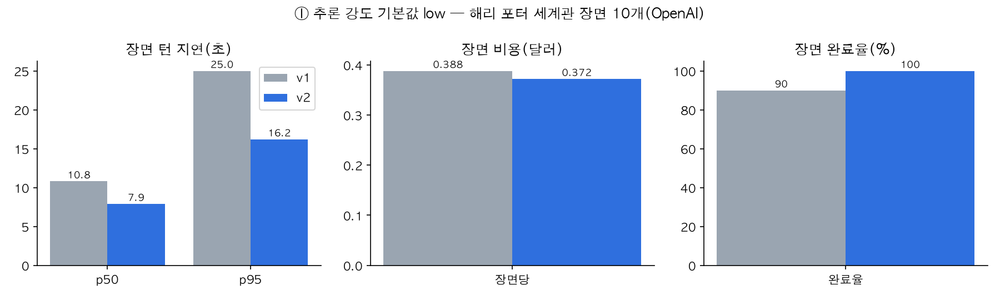
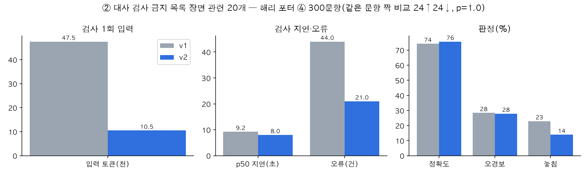
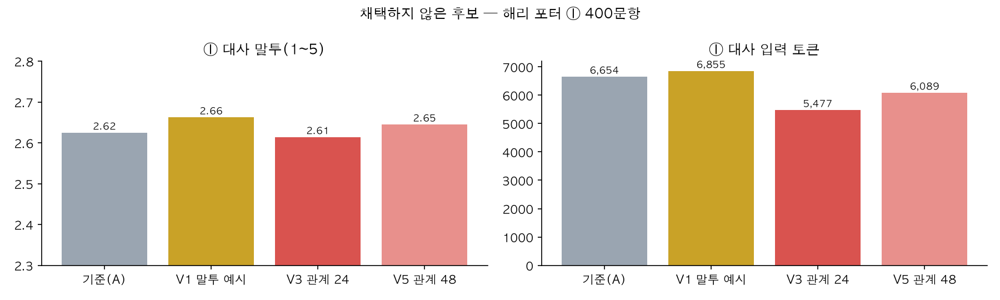

# 인물 시뮬레이션 v2 보고서 — v1과 무엇이 달라졌나

> 대상 브랜치 `feat/simulation-original-eval`(#642 속도 측정 위). 수치는 [속도·품질 평가](simulation.md)와 [원문 기반 평가](simulation-original.md)의 실제 실행 결과이고, 그림은 `backend/ai-service/eval/simulation/v2_charts.py`가 결과 집계에서 다시 그린다.

## 한 줄 요약

v2는 **품질을 유지한 채 더 빠르고 싸다**. 장면 턴 p50 10.8초 → 7.9초, 대사 검사 입력 4.75만 → 1.05만 토큰(−78%), 검사 오류 44 → 21건이고, 측정한 품질 지표(시점 정확도·검사 판정)는 짝 비교에서 차이가 없었다.

## v1 → v2 변경

| 구분 | v1 | v2 | 근거 |
|---|---|---|---|
| 추론 강도 | 지정하지 않음(모델 기본) | 네 호출(계획·인물 턴·나레이션·검사) 모두 `reasoning.effort=low`. `SIMULATION_REASONING_EFFORT`로 바꿀 수 있다 | 해리 포터 장면·품질 측정(아래 1) |
| 대사 검사 입력 | 금지 목록 전체(해리 포터 평균 수백 개) | 검사할 문단·직전 장면 6줄과 겹침이 큰 20개만(`service.FORBIDDEN_LIMIT`, #646) | 해리 포터 ④ 300문항 짝 비교(아래 2) |
| 프롬프트 문구 | Langfuse 버전 1 | **그대로**(바꾸지 않음) | — |
| 강제 연출 생략·나레이션 검사 생략·세계관 캐시 | 꺼짐 | **꺼짐 유지** | 품질 미측정(아래 4) |

코드 변경: `app/simulation/agent.py`(빈 값이면 `low`), `app/simulation/service.py`의 `check_payload`·`relevant`, `scene_agent.py`가 이를 부름. 계약은 [character-simulation-contract](../design/character-simulation-contract.md)에 적었다.

## 1. 추론 강도 기본값 low

| 지표(해리 포터 세계관, 장면 10개) | v1(A) | v2(B) |
|---|---|---|
| 장면 턴 p50 / p95 | 10.8초 / 25.0초 | **7.9초 / 16.2초** |
| 장면당 비용 | 0.388달러 | 0.372달러 |
| 장면 완료율 | 90% | **100%** |
| 시공간 정확도(150문항, 최종) | 0.45 | 0.45 (15:15, p=1.0) |
| 첫 응답 시공간 / 성격(1~7) | 0.38 / 5.66 | 0.44 / 5.76 |

얇은 세계관(표본 200문항)에서는 v2가 0.72로 v1 0.78보다 낮았으나 통계적으로 유의하지 않았다(p=0.15). 장편 세계관에서는 차이가 없었다.

## 2. 대사 검사의 금지 목록 장면 관련 20개

| 지표(해리 포터 ④ 300문항: 원작 대사 150 + 미래·비목격 사실 주입 150) | v1 | v2 |
|---|---|---|
| 검사 1회 입력 | 47,502 토큰 | **10,494 토큰(−78%)** |
| 검사 p50 지연 | 9.2초 | 8.0초 |
| 오류(입력 초과·응답 실패) | 44건 | **21건** |
| 정확도 / 오경보 / 놓침(근거가 입력에 있던 주입) | 74.2% / 28.4% / 22.9% | 75.6% / 27.9% / 13.9% |
| 같은 문항 짝 비교 | — | 24↑ 24↓ (p=1.0) |

한계: 장면 관련 여부를 두 글자 조각의 겹침으로 고르므로 다른 말로 바꿔 쓴 누설은 20개 밖으로 밀려 놓칠 수 있다(코드에 `ponytail:` 주석). 독백·나레이션 검사는 평가하지 않아 v1 그대로다.

## 3. 채택하지 않은 후보

| 후보 | 결과 | 결정 |
|---|---|---|
| V1 이전 원작 대사를 말투 예시로 | ① 말투 +0.04(p=0.28), 시점 위반 1.0% → 2.75%, ③ 나레이션 입력 +36%·이득 없음 | 미채택 |
| V3 관계 24개 / V5 48개 | 입력 −18% / −9%, 바뀐 문항의 말투 −0.11(p=0.048) | 미채택 |
| V4 = V2 + V3 | ④는 V2와 같음 | 미채택(V2만) |

## 4. v2에서도 남은 것

- **품질 미측정 스위치**: 강제 연출 생략(C)·나레이션 검사 생략(E)은 B와 함께 켜면 장면 p50 6.8초·장면당 0.054달러지만, 나레이션 누설 위험을 재지 않아 기본값으로 켜지 않았다.
- **개선 여지가 큰 곳**(v2 기준선): ② 연출 완전 일치 35%, ④ 오경보 28%, ③ 나레이션 문체 1.96/5. 연출·검사는 지시문 문구를 바꿔야 해 Langfuse 새 프롬프트 버전으로 시험한다.
- **평가 데이터**: 공개판은 [HuggingFace `tgv5612/ko-original-sim-eval`](https://huggingface.co/datasets/tgv5612/ko-original-sim-eval)(고전·근대 소설·SCP, CC BY-SA 3.0). 해리 포터 문항은 저작권 때문에 로컬(`.data`)에만 있고 집계만 저장소에 있다. 정답표는 사람 검수 전이다.
- 평가 도구의 설정 `A`는 "스위치 미지정"이므로 v2부터는 B와 같다. v2에서는 추론 강도를 '지정하지 않음'으로 보낼 수 없어 v1을 그대로 재현할 수는 없다(다른 값은 `SIMULATION_REASONING_EFFORT`로 지정).
