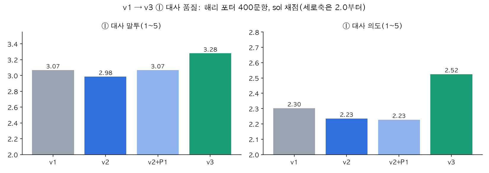
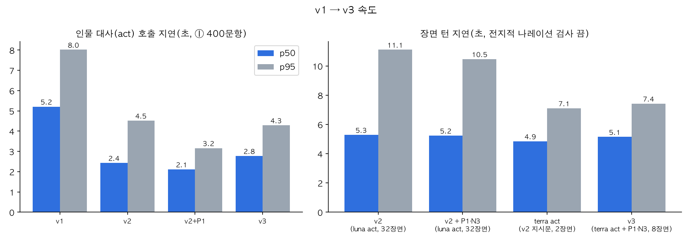
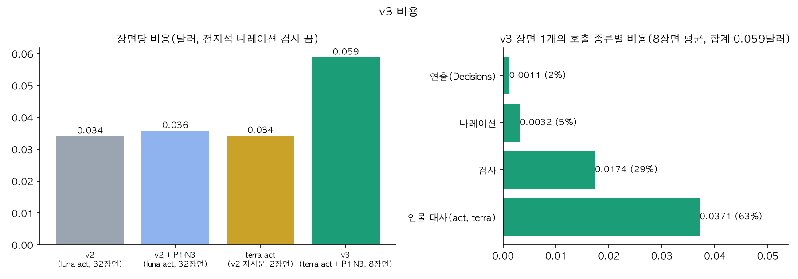
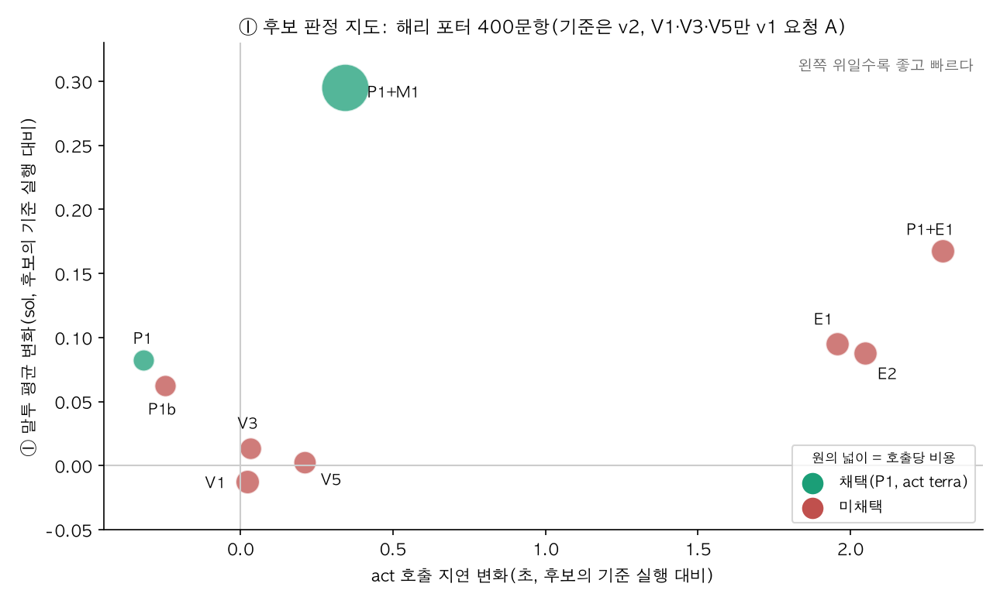

# 인물 시뮬레이션 v3 보고서 — v2와 무엇이 달라졌나

> 대상 브랜치 `feat/simulation-original-eval`. 수치는 [원문 기반 평가](simulation-original.md)(§13·§14·§15·§16)와 해리 포터 장면 실행의 실제 결과이고, 그림은 `backend/ai-service/eval/simulation/v3_charts.py`가 `results/*.json` 집계에서 다시 그린다. 해리 포터 문항·응답은 저작권 때문에 로컬(`.data`)에만 있고 이 문서와 집계에는 숫자만 있다. **품질 수치는 채점 모델 `gpt-6.2-sol` 기준이 주이고 luna 채점은 참고다**(§14).

## v3가 무엇인가

**v3 = v2(추론 강도 `low` + 대사 검사 금지 목록 20개) + 인물 대사(act) 기본 모델 `gpt-6.1-terra` + 지시문 P1(act)·N3(narrate)**.

- **act 모델 terra는 코드로 서비스에 반영됐다**(2026-11-23 사용자 결정, `agent.ACT_MODEL` 상수 하나. luna로 되돌리려면 `SIMULATION_ACT_MODEL=gpt-6-luna`). 나레이션·검사·계획·연출은 luna·Decisions 그대로다([계약](../design/character-simulation-contract.md), [원문 평가 §16](simulation-original.md#16-인물-대사act-기본-모델을-gpt-61-terra로-2026-11-23-사용자-결정)).
- **P1·N3는 코드가 아니라 Langfuse 새 버전이라 아직 production이 아니다.** 운영 화면에서 등록·승격해야 쓰인다(절차는 [6장](#6-운영-화면에서-p1n3-반영하는-절차)). 지금 서비스가 도는 구성은 「v2 + act terra」다.

## 한 줄 요약

v3는 **① 대사 품질이 눈에 띄게 오르고 비용이 오른다**. 해리 포터 ① 400문항의 같은 문항 짝 비교(sol)에서 말투 2.98 → 3.28(+0.29, 139↑ 37↓, p<0.001)·의도 2.23 → 2.52(+0.29, 138↑ 71↓, p<0.001), 시점 위반 18 → 13건/400(차이 없음). act 호출 지연 p50은 2.4 → 2.8초(v2 대비 약 +0.3초, 같은 P1의 luna 2.1초 대비로는 +0.7초)이고 호출당 비용은 0.0015 → 0.0073달러(약 5배)다. 장면 8개를 한 번씩(전지적 나레이션 검사 끔) 돌리면 **8개 모두 완료**하고 턴 p50 5.15초(v2 5.29초)이며 장면당 비용은 0.034 → 0.059달러(+72%), 비용의 63%가 act다. 다만 **v3 장면 수치는 8장면 × 1회라 완료율·꼬리 지연의 변화를 가르지 못하고**, 채점은 모델 채점(사람 검수 전)이며, 지시문 P1·N3는 평가 세트 등록 문제(6장)가 풀려야 승격할 수 있다.

## v1 → v2 → v3 변경

| 구분 | v1 | v2 | v3 | 반영 |
|---|---|---|---|---|
| 추론 강도 | 지정하지 않음 | 네 호출 모두 `low` | `low` 그대로 | 코드(v2) |
| 대사 검사 입력 | 금지 목록 전체 | 장면 관련 20개(#646) | 그대로 | 코드(v2) |
| **인물 대사(act) 모델** | luna | luna | **`gpt-6.1-terra`** | **코드 반영(2026-11-23)** |
| act 지시문 `character_simulation.act` | 시드(버전 1) | 시드(버전 1) | **P1**(시드 + 말투 지침 한 문단) | 운영 화면 등록·승격 대기 |
| 나레이션 지시문 `character_simulation.narrate` | 시드(버전 1) | 시드(버전 1) | **N3**(시드 + 지문 문체 지침 한 문단) | 운영 화면 등록·승격 대기 |
| 나레이션·검사·계획·연출 모델 | luna·Decisions | 그대로 | 그대로 | — |

코드 변경은 `app/simulation/agent.py`의 `ACT_MODEL` 하나다. 평가 도구는 act를 그 모델의 단가로 세고 기록에 모델을 남기도록 따라갔다(`orig_variants.priced`, [평가 README](../../backend/ai-service/eval/simulation/README.md)).

## 1. 품질 — ① 대사·③ 나레이션

| ① 해리 포터 대사 400문항(sol) | v1 | v2 | v2+P1 | **v3(P1+M1)** |
|---|---|---|---|---|
| 말투(1~5) | 3.07 | 2.98 | 3.07 | **3.28** |
| 의도(1~5) | 2.30 | 2.23 | 2.23 | **2.52** |
| 시점 위반(건/400) | 12/400 | 18/400 | 12/400 | 13/400 |
| v2 대비 말투 | +0.08 (88↑ 63↓, p=0.050) | 기준 | +0.08 (92↑ 59↓, p=0.009) | **+0.29 (139↑ 37↓, p<0.001)** |
| v2 대비 의도 | +0.07 (85↑ 76↓, p=0.529) | 기준 | -0.01 (81↑ 90↓, p=0.541) | **+0.29 (138↑ 71↓, p<0.001)** |

- **v3의 ①은 `P1+M1` 실행이다**: act 지시문 P1과 act 모델 terra다. M1은 원래 act·나레이션을 함께 terra로 바꾼 후보인데 ①의 입력에는 나레이션이 들어가지 않으므로 ① 수치는 act terra의 효과다.
- **A/B 선택**(순서를 바꿔 두 번 물어 두 번 같은 쪽일 때만 승패, sol): P1+M1 대 P1 66.2%(241:123, p<0.001), P1 대 v2 57.4%(206:153, p=0.006). v3 대 v2의 직접 A/B는 돌리지 않았다.
- **시점 위반**은 v2 18건 → v3 13건으로 차이가 없다(같은 요청을 다시 재도 4건 ↔ 11건으로 갈릴 만큼 잡음이 크다, [§13.4](simulation-original.md)).
- **③ 나레이션(N3)**: 지문 160문항 문체 2.59 → 2.83(+0.24, 43↑ 10↓, p<0.001), 정보 변화 없음(1.21 → 1.21). 독백 40문항은 변화가 없다(문체 −0.13, p=0.38). 나레이션에 terra를 쓰는 이득은 어느 채점에서도 없어 나레이션은 luna에 둔다([§14.5](simulation-original.md)).
- **채점 계열에 따라 효과 크기가 다르다**: act terra의 이득은 luna 채점에서 P1 대비 말투 +0.09(p=0.051)로 작고 sol에서 +0.21(p<0.001)이다. 생성 모델(luna)과 같은 계열의 채점이 자기 글을 더 후하게 본 것인지 사람 검수 없이 가르지 못한다([§14.9](simulation-original.md)).

## 2. 속도

| act 호출 지연(① 400문항) | v1 | v2 | v2+P1 | **v3** |
|---|---|---|---|---|
| p50 / p95 | 5.2초 / 8.0초 | 2.4초 / 4.5초 | 2.1초 / 3.2초 | **2.8초 / 4.3초** |

terra는 같은 P1 지시문의 luna보다 act 호출이 약 0.7초 느리다(p50 2.11 → 2.78초). v2(P1 없음)와 견준 v3의 +0.3초(2.43 → 2.78초)에는 P1이 출력을 줄여 act를 0.3초 빠르게 한 몫(2.43 → 2.11초)이 섞여 있다. v1의 5.2초는 추론 강도를 지정하지 않은 요청이라 v2의 `low`가 줄인 것이다.

| 해리 포터 장면 실행(전지적 나레이션 검사 끔) | 장면 | 완료 | 턴 p50 / p95 | 턴당 재생성 | 턴당 모델 호출 |
|---|---|---|---|---|---|
| v2 (luna act) | 32 | 30/32 | 5.29초 / 11.11초 | 5.6% | 2.79 |
| v2 + P1·N3 (luna act) | 32 | 27/32 | 5.24초 / 10.47초 | 6.3% | 2.83 |
| terra act (v2 지시문, 장면 2개) | 2 | 2/2 | 4.85초 / 7.11초 | 0.0% | 2.78 |
| **v3 (terra act + P1·N3)** | 8 | **8/8** | **5.15초 / 7.42초** | 4.9% | 2.71 |

- **v3 장면 8개는 모두 완료했다**(해리 포터 장면 8개를 한 번씩, 41턴, 오류·정지 없음). 턴 p50은 v2와 같다(5.15초 대 5.29초).
- **꼬리(p95)가 7.4초로 낮은 것은 개선으로 읽지 않는다**: v3는 41턴 표본이고 v2·P1+N3는 약 200턴이다. 완료 8/8도 표본이 작아 P1+N3의 27/32(84%, 비트 셋 흐름 장면 hp-3-flow에서 정지가 몰렸다, [§13.8](simulation-original.md))와 가르지 못한다(8/8의 95% 구간 하한 약 68%). P1+N3 승격 전에 필요하다고 한 확인(조건당 80장면)은 아직 못 채웠다.
- 장면 전체 흐름(전지적 나레이션 검사 포함)의 지연은 v3에서 재지 않았다. v1 → v2는 장면 턴 p50 10.8 → 7.9초였고([v2 보고서](simulation-v2.md)) v3는 v2보다 act 턴마다 약 +0.3초(P1과 terra를 합친 값)가 더해진다(추정).

## 3. 비용

- **호출당(① act)**: v2 0.0015달러 → v3 0.0073달러(약 5배: terra 단가 입력 1.00·캐시 0.05·출력 5.00달러/1M 토큰은 제3자 출처로 공식 단가 확인 전, luna는 0.20·0.02·1.20).
- **장면당(나레이션 검사 끔)**: v2 0.034달러 → **v3 0.059달러(+72%)**, 장면 8개 합계 0.47달러. 호출 종류별로는 act 63%·검사 29%·나레이션 5%·연출 2%다(오른쪽 그림). 턴당으로는 0.0055 → 0.0115달러(약 2.1배)이고 v3 8장면의 평균 턴 수(5.1)가 v2 32장면(6.2)보다 적어 장면당 증가폭이 더 작게 보인다.
- **운영 기본 흐름(전지적 나레이션 검사 포함)**: v2는 장면당 0.372달러이고 대부분이 전지적 나레이션 검사다(입력 약 30만 토큰, [v2 보고서](simulation-v2.md)). 그 위에 act terra의 추가분 장면당 약 0.03~0.04달러가 얹혀 v3는 **약 0.40~0.41달러(+8~10%)로 추정**한다(측정 아님). 비용을 움직이는 큰 값은 act 모델이 아니라 나레이션 검사이고, 검사를 끄는 스위치(`SIMULATION_SKIP_NARRATION_CHECK`)는 누설 위험을 재지 않아 기본값으로 켜지 않았다.
- OpenAI 장부: 이 보고서를 위한 측정은 장면 2개 0.0685달러 + 장면 8개 0.4706달러(30.0978 → 30.6368달러, 상한 35달러)다.

## 4. 채택하지 않은 후보

그림은 ① 후보의 말투 변화(sol)와 act 지연 변화다(원의 넓이는 호출당 비용). 오른쪽으로 갈수록 느리고 위로 갈수록 말투가 좋아진다. P1은 지연 없이 말투를 되찾고, act terra(P1+M1)는 크게 올리고 약간 느려진다. 나머지는 이득이 없거나 지연이 크다. 나레이션·연출·장면 구조·외부 제공사 후보는 그림에 없고 아래 표에 있다.

| 후보 | 결과 | 판정 | 근거 |
|---|---|---|---|
| E1·P1+E1: act만 추론 강도 medium | ① 말투 +0.10(p=0.016), P1 위에서 +0.09(p=0.022)·의도 +0.16(p<0.001), act 지연 p50 2.1 → 4.7초 | 미채택(지연 +2.6초) | [§13.4](simulation-original.md)·[§14.4](simulation-original.md) |
| E2: act에 추론 강도 지정 안 함(v1 요청) | v2 대비 말투 +0.09(p=0.023)로 v1과 같고 act 지연 p50 4.5초 | 미채택(지연) | [§13.4](simulation-original.md) |
| V1: 이전 원작 대사를 말투 예시로 | ① 말투 −0.01(p=0.61, v1 요청 기준), ③ 나레이션 입력 +36%·문체 −0.10(p=0.040) | 미채택 | [§8](simulation-original.md) |
| V3·V5: 관계 24개·48개만 | ① 말투 +0.01(p=0.44)·0.00(p=0.93, v1 요청 기준), 입력 −18%·−9%, V3는 응답 오류 6건 | 미채택 | [§8](simulation-original.md) |
| P1b: P1 + 비트 진행 문단 | base2 대비 말투 +0.06(p=0.085), P1과 −0.03(p=0.39)로 이득 근거 없음 | 미채택 | [§14.7](simulation-original.md) |
| N3+M1: 나레이션도 terra | ③ 문체 −0.10(p=0.38), 호출당 비용 약 5배 | 미채택(이득 없음) | [§14.5](simulation-original.md) |
| ② 연출 후보 9종(D1~D4와 조합 D12·D13·D14·D123·D124: 입력 보강·질문 한 번·새 지시문) | 완전 일치 30.8~36.9% 대 기준 35.1%(목표 +10%p 미달) | 미채택 | [§13.6](simulation-original.md) |
| V4: 초안 한 번 → 턴별 병렬 수정 | 장면 완성 32.2 → 18.1초이나 첫 턴 2.9 → 10.3초, 완료율 68.8%(턴 방식 91~95%) | 미반영 | [V4 보고서](simulation-v4-draft-parallel.md) |
| Hemmingway `hemmingway-1`(act) | ① 20문항 말투 2.70·의도 1.75 대 P1 3.10·2.50, A/B 1승 19패, 지연 4.2초, 호출당 0.0058달러 | 탈락 | [§15](simulation-original.md) |

## 5. 한계와 남은 것

- **채점은 모델 채점이고 사람 검수 전이다.** sol이 luna보다 일관되지만(재채점 r 0.89 대 0.74) 일관성이 사람과의 일치는 아니다. terra의 이득이 luna 채점에서 작고 sol에서 큰 것이 계열 선호 때문인지는 사람이 읽어 봐야 가른다(검수 표본: `orig_cli.py review-pair`).
- **v3의 장면 단위 측정은 좁다.** 8장면 × 1회(전지적 나레이션 검사 끔)이고 나머지 장면 수치는 act terra만 바꾼 2장면과 luna로 잰 ⑤(32장면)다. 운영 기본 흐름의 v3 지연·비용은 재지 않았고 비용 +8~10%는 추정이다.
- **P1·N3는 아직 서비스에 없다.** 승격 전 확인(§13.8: 비트 셋 흐름 장면을 포함해 조건당 80장면)을 못 채웠다. 운영 화면의 승격은 시뮬레이션 평가 세트를 Langfuse에 올려 평가를 통과해야 하는데(6장), 이 평가는 항목 24·46개의 간이 회귀 평가라 §13.8의 장면 확인을 대신하지 못한다.
- **terra 단가는 제3자 출처**(공식 단가 확인 전)이고, Langfuse에 `gpt-6.1-terra` 모델 정의가 없으면 운영 화면의 act 비용이 비어 보일 수 있다(6장 끝).
- 평가 데이터: 공개판은 [HuggingFace `tgv5612/ko-original-sim-eval`](https://huggingface.co/datasets/tgv5612/ko-original-sim-eval)이고 해리 포터 문항은 로컬뿐이라 다시 재려면 로컬 데이터가 필요하다. 정답표는 사람 검수 전이다.
- 재현: `cd backend/ai-service && uv run --with matplotlib python eval/simulation/v3_charts.py`(그림), v3 장면 실행은 `orig_cli.py scenes --runs P1+N3 --skip-narration-check`와 같은 구성이다(기본 act 모델이 terra라 P1+N3가 v3다. 결과 파일은 act 모델 이름이 붙은 `orig-hp-scenes-P1+N3-gpt-6.1-terra.json`으로 써서 옛 luna 결과를 덮어쓰지 않는다. 이 보고서의 `orig-hp-scenes-v3.json`은 같은 구성을 장부 상한을 두고 돌려 만든 것이다).

## 6. 운영 화면에서 P1·N3 반영하는 절차

P1·N3는 코드 시드(`prompt.ACT_INSTRUCTIONS`·`NARRATE_INSTRUCTIONS`, Langfuse 버전 1)를 바꾸지 않고 **Langfuse 프롬프트의 새 버전**으로 올린다. develop의 운영 LLMOps(operations-service `/api/v1/operations/llmops/prompts…`, 관리자 `LLM Ops` 화면)를 쓰고, 승격 게이트의 회귀 평가는 **시뮬레이션 평가 세트**(`simulation.act`·`simulation.narrate`)로 돈다(2026-11-23 사용자 승인으로 더했다. 세트·생성·채점 방식은 [운영 LLMOps 계약](../design/operations-llmops-contract.md)). 이 문서는 절차만 적었고 실제 등록·승격은 하지 않았다.

- **프롬프트 이름·본문 위치**: `character_simulation.act`에 P1, `character_simulation.narrate`에 N3. 본문은 [원문 평가 §13.9](simulation-original.md#139-채택-제안의-새-프롬프트-버전-본문)의 코드 블록 그대로다(코드로는 `orig_variants.ACT_V1`·`NARRATE_V3`, 평가는 이 문자열로 쟀다). 두 프롬프트는 코드 문자열이 버전 1로 등록돼 있어야 목록에 보인다(Langfuse 키가 있는 AI 서비스가 시작되거나 처음 부를 때 등록한다).
- **평가 방식**: 세트는 원문 평가 공개 세트의 저작권 만료·자유 이용 문항이다(`simulation.act` 대사 24, `simulation.narrate` 나레이션 24·독백 22). 평가는 업무 Agent 틀이 아니라 **실제 서비스 호출**(`agent.act`·`narrate`에 그 버전 본문, act는 terra·구조화 출력 그대로)로 만들고 **원문 평가 루브릭**으로 채점해 act는 `voice`·`intent`·`pov_ok`, narrate는 `style`·`info`·`pov_ok`(시점 위반이 없으면 1)를 Run 점수로 남긴다(점수는 모두 0~1: 1~5점은 (점수 − 1)/4, `pov_ok`는 그대로이고 원문 평가의 1~5 기록·이 보고서의 수치는 그대로다). 지표마다 기준 Run 평균 − `EVAL_TOLERANCE`(기본 0.1, 1~5점으로는 0.4점) 이상이어야 통과다. 채점 모델은 `EVALUATION_JUDGE_MODEL`(예 `gpt-6.2-sol`, 비면 `OPENAI_MODEL`)이다.

1. **평가 세트 등록(자동)**: compose의 1회성 작업 `ai-eval-seed`가 `docker compose up`(배포 포함)마다 `python -m app.evaluation.seed`(멱등)로 `simulation.act`·`simulation.narrate`를 올린다. 결과는 `docker compose logs ai-eval-seed`로 보고, 손으로 돌리려면 `cd backend/ai-service && uv run --locked --extra dev python -m app.evaluation.seed`.
2. **새 버전 등록**: 관리자 사이드바 `LLM Ops` → `프롬프트·모델`(보기 `프롬프트`) → 목록에서 `character_simulation.act`를 열고 「새 버전 등록」의 `새 버전 본문`에 P1 본문 전체를 붙인 뒤(`변경 메모`에 「P1: 말투 지침(원문 평가 §13.9)」처럼 적고) `새 버전 등록`을 누른다. `character_simulation.narrate`에는 N3로 같은 일을 한다. 새 버전은 라벨 없이 생기고 production은 그대로다(API `POST /llmops/prompts/{name}`, 201).
3. **기준 Run 만들기**: `LLM Ops` → `평가·누설 검사`의 「회귀 평가 실행」에 `데이터셋` `simulation.act`·`프롬프트 이름` `character_simulation.act`·`버전` `1`(현재 production)을 넣고 `평가 실행`. 이 Run이 새 버전의 기준(그 production 버전의 가장 최근에 끝난 Run)이 되고, 나중에 `production 복원`이 막히지 않게 이전 버전의 통과 평가도 남긴다. narrate도 같다. 점수 눈금이 0~1이 되기 전에 1~5점으로 만든 Run이 있어도 기준은 production 버전의 가장 최근에 끝난 Run이라 이 단계의 새 Run이 옛 Run을 대신한다. **이 Run이 끝나 점수(`passed`)가 보인 뒤에 4단계를 접수한다**: 평가 API는 202를 먼저 돌려주므로 기준 Run이 아직 돌고 있을 때 접수하면 새 버전은 기준 없이(지표 비교 없이) 통과한다.
4. **새 버전 평가**: 같은 화면에 `데이터셋` `simulation.act`·`프롬프트 이름` `character_simulation.act`·`버전` 새 번호(예 `2`)를 넣고 `평가 실행`. Run이 끝나면 점수 `voice`·`intent`·`pov_ok`와 `passed`가 보인다(narrate는 `simulation.narrate`·`character_simulation.narrate`). 다른 호출의 지시문으로 돌리면(예 `simulation.act`에 `character_simulation.narrate`) 422다.
5. **후보 등록·서비스 반영**(#705로 바뀜): `프롬프트 상세`의 버전 표에서 그 버전 행의 `후보 등록` → `서비스에 반영`(확인 창). 평가 통과는 더 요구하지 않지만 이 절차대로 평가·지표를 먼저 본다.
6. **되돌리기**: 이전 버전(시드 버전 1) 행을 `후보 등록`한 뒤 `서비스에 반영`.
7. **승격 뒤 확인**: `LLM Ops · 추적·지표`에서 `character_simulation` 요청의 generation에 새 프롬프트 버전과 모델(act는 `gpt-6.1-terra`)이 찍히는지 본다. 평가 실행기(`orig_cli.py run`)는 코드 시드를 읽지 않고 이 프로세스의 지시문만 바꿔 재므로 Langfuse 경로까지의 확인은 이 단계다.
8. **함께 확인할 것**: (가) `LLM Ops · 프롬프트·모델`의 「모델」 보기에 `gpt-6.1-terra` 정의(모델 이름·매칭 패턴·입력/출력 단가, 토큰당 USD)가 없으면 act generation의 비용이 비어 보일 수 있다(`POST /llmops/models`). (나) 채점 모델을 `gpt-6.2-sol`로 하려면 루트 `.env`에 `EVALUATION_JUDGE_MODEL`을 정하고 AI 컨테이너(요청을 받는 `ai-service`와 채점하는 `ai-jobs-worker`, 둘 다)를 다시 띄운다(compose가 AI 환경에 넘긴다). 바꾼 뒤 첫 비교는 채점 모델이 다른 Run과 견주게 되니 3단계의 기준 Run을 새 채점 모델로 먼저 만든다. (다) 허용 오차: 기본 0.1이다. 아래 로컬 확인의 잡음(표준오차 0.03~0.08)보다 크지만 act 의도는 1.3배쯤이라 낫지도 나쁘지도 않은 변경이 가끔 불통과가 될 수 있다. 바꾸려면 루트 `.env`의 `EVAL_TOLERANCE`를 정하고 같은 두 컨테이너를 다시 띄운다(Compose가 넘기며 비면 0.1).

**로컬 확인**(2026-11-23, Langfuse 없이 같은 서비스 코드·실제 OpenAI, 채점 `gpt-6.2-sol`, 공개 세트의 홀수 번째 항목: act 12·narrate 23, 지시문마다 v1과 새 본문을 한 번씩). 점수는 운영 Run 기록과 같은 0~1이다. 실행 때는 1~5점으로 기록했고 아래는 같은 항목별 기록을 (점수 − 1)/4로 바꿔 허용 오차 0.1로 **다시 판정만** 한 값이다(추가 호출 없음). act v1 → P1은 `voice` 0.417 → 0.458(+0.042)·`intent` 0.333 → 0.250(−0.083)·`pov_ok` 0.833 → 0.917(+0.083)로 **통과 예상**(항목별로 `intent`는 2↑ 4↓ 6=)이고, narrate v1 → N3는 `style` 0.283 → 0.304(+0.022)·`info` 0.087 → 0.065(−0.022)·`pov_ok` 1.000 → 1.000으로 **통과 예상**(`info`는 2↑ 4↓ 17=)이다. 처음 1~5점 기록과 허용 오차 0.05로 판정했을 때는 둘 다 불통과였다(P1 `intent` −0.33점, N3 `info` −0.09점). 같은 항목을 두 지시문으로 돌린 차이의 표준오차는 0~1 눈금에서 act 의도 0.077·말투 0.042·시점 0.083, narrate 문체 0.035·정보 0.027이다. 차이가 표준오차 안이라 P1·N3가 낫거나 나쁘다는 근거는 아니고(지시문의 품질 근거는 원문 평가 §13·§14) 이 게이트가 큰 퇴보만 막는다는 뜻이다. 표본이 작아(12·23항목) 전체 세트(24·46항목)로 돌린 Run은 다를 수 있어 '예상'이다. (narrate는 세트의 중복 문항을 고친 뒤 바뀐 4항목만 다시 돌리고 나머지 19항목은 같은 문항의 앞선 실행 기록을 썼다.)
