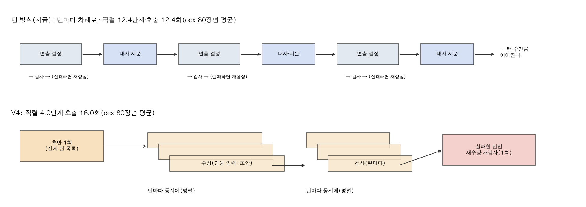
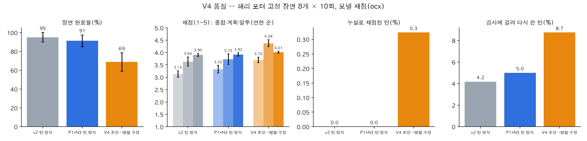
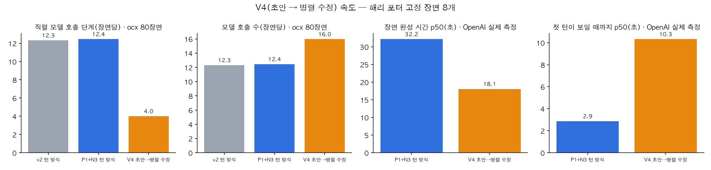

# 인물 시뮬레이션 V4 시험 — 슈퍼바이저 초안 한 번 → 턴별 병렬 수정

> 대상 브랜치 `feat/simulation-original-eval`. **평가 전용**이다: 서비스 코드(`app/`)는 바꾸지 않았고 입력 조립과 모델 호출은 서비스 함수를 그대로 부른다. 수치는 `backend/ai-service/eval/simulation/results/`의 `v4-hp-ocx.json`(ocx, 장면 80개 × 3조건)·`v4-hp-openai.json`(OpenAI 실제 속도, 장면 8개 × 2조건)·`v4-hp-ocx-hp3flow.json`(어려운 장면 한 곳 확대)이고, 그림은 `eval/simulation/v4_charts.py`가 집계에서 다시 그린다. 해리 포터 문항·응답은 저작권 때문에 `.data`에만 있고 이 문서와 집계에는 숫자만 있다.

## 한 줄 요약

V4는 **장면 완성 시간을 절반으로 줄인다**(OpenAI 장면 8개: 중앙값 32.2 → 18.1초, 95분위 83.7 → 21.7초, 직렬 모델 호출 단계 18 → 3.8). 그러나 **첫 턴이 보일 때까지는 2.9 → 10.3초로 늘고, 장면 완료율이 68.8%(ocx 장면 80개)로 턴 방식 91.3%~95.0%보다 낮다**(p<0.001). 완료율을 되돌리는 방법을 찾기 전에는 서비스 반영을 권하지 않는다. 모델 채점(종합·계획·말투)은 턴 방식과 같거나 높고 누설·앞뒤 이어짐은 차이가 없었다.

## 1. 구조



| 단계 | 하는 일 | 모델 호출 |
|---|---|---|
| 초안 | 슈퍼바이저 1회: 계획 입력(모드·전제·비트·참여 인물 이름)만으로 장면 전체를 턴 목록으로 쓴다. 턴 = 종류(대사·나레이션·독백)·화자·시점·본문·observed(다른 인물에게 보이는 것)·비트 끝남 표시. 지시문에 P1·N3의 말투·문체 규칙을 넣었다 | 1 |
| 병렬 수정 | 턴마다 동시에: 대사는 그 인물이 아는 것만 담은 서비스 입력(`character_view`)에 초안 한 줄(`draft`)을 더해 `agent.act`로, 나레이션·독백은 `narrator_view`·`narration_input`에 더해 `agent.narrate`로 한 번 고친다(말투를 맞추고 그 인물이 모르는 사실을 지운다). 앞선 턴은 초안 줄로만 보인다 | 턴 수 |
| 병렬 검사 | 서비스 검사(`agent.check`, 금지 목록 장면 관련 20개)를 수정본에 턴마다 동시에 한 번. 서버 규칙(행동 묘사의 인칭·문체, 같은 인물의 되풀이 대사)이 먼저 거른다 | 턴 수(전지적 나레이션 검사는 끔) |
| 재수정 | 검사에 걸린 턴만 피드백을 주고 한 번 더 고쳐 다시 검사한다. 그래도 실패면 그 턴을 실패로 세고 장면은 `stopped(check_failed)`다 | 실패한 턴 × 2 |
| 앞뒤 맞추기 | **넣지 않았다**: 모델 채점이 '앞 줄에서 이어지지 않는다'고 본 턴 비율이 V4 2.0%로 턴 방식(1.1%~3.3%)과 같은 수준이었다 | 0 |

- **완료(`completed`)의 정의**는 턴 방식과 같다: 모든 턴이 검사를 통과하고, 흐름 모드는 모든 비트를 검사가 '끝남'으로 확인하고, IF 모드는 검사가 장면 완결을 확인한 경우다. 그렇지 않으면 `stopped`(`check_failed`·`beat_rejected`·`goal_unconfirmed`), 모델 호출·응답 검증 실패는 `failed`이고 숨기지 않는다. 초안이 장면이 될 수 없으면(예: 장면 인물이 아닌 화자) 이유를 알려 한 번만 다시 쓰게 한다.
- **평가 때만 끼운 것**: 초안 지시문과 수정용 act·나레이션 지시문(P1·N3 + 「초안 고치기」 한 문단). 코드 시드와 Langfuse 프롬프트는 그대로다. 코드: `sim_v4.py`(초안 검증·장면 상태 조립은 순수 함수, 병렬 흐름), `sim_scene_judge.py`(장면 채점), `v4_report.py`(집계·검정), `v4_cli.py`(실행·채점·집계).

## 2. 비교 방법

- **같은 장면 묶음**: 해리 포터 고정 장면 8개(흐름 4·IF 4) × 10회 = 80장면씩, 세 조건: v2 턴 방식(base), P1+N3 턴 방식, V4. 기존 §13의 ⑤ 장면 확인(OpenAI, 32장면)과 같은 장면이다.
- **ocx(금액 0)**: 생성·수정·검사·초안·채점은 로컬 OpenCodex로, 연출(Decisions)만 OpenAI로 돌렸다. 나레이션 검사는 세 조건 모두 껐다(입력이 커서). ocx는 지연이 OpenAI와 달라 **시간은 참고용**이다. 실제로 장면 6개를 함께 돌리자 V4의 병렬 호출이 게이트웨이에서 줄을 서서(장면 완성 p50 42.3초 vs 턴 방식 29.3초) 병렬의 이득이 보이지 않았다.
- **OpenAI 실제 속도**: P1+N3 턴 방식과 V4를 같은 장면 8개 × 1회씩 **장면을 하나씩 차례로** 돌렸다(호출 지연이 겹치지 않게). 실제 금액을 장부에 셌다(두 조건 합계 약 0.65달러, 연출 호출 포함). 게이트(V4의 품질이 크게 나쁘지 않을 때만 측정)에는 완료율 때문에 못 미치지만, 속도 이득의 크기를 알아야 개선할 가치를 판단할 수 있어 쟀다.
- **채점**: 기존 고정 장면에는 원문 장면이 없어 ⑤ 설계의 「원문 비교 종합」은 낼 수 없다(원문 장면 세트는 범위 변경으로 빠진 상태다). 대신 계획·설정 기준 모델 채점 한 번(ocx `gpt-6-luna`, 생성 모델과 같은 계열이라 자기 선호가 섞일 수 있다): 종합(1~5)·계획 충실도(1~5), 턴마다 말투(인물 soul 기준 1~5)·앞뒤 이어짐·시점 누설(그 턴에서 드러나면 안 되는 사실 후보 8개 중). 세 조건에 같은 입력·같은 채점기를 썼다. 채점 값은 멈춘 장면의 쌓인 턴까지 포함하고, 완료된 장면만 본 값은 따로 적는다.
- **유의성**: 완료 수는 Fisher 정확 검정, 장면별 값은 평균 차이의 순열 검정(2만 번)이다. 장면 8개를 반복한 값이라 장면 효과로 묶여 p는 낙관적이다.

## 3. 결과

### 3.1 장면 80개 × 3조건(ocx)



| 조건 | 완료 | 멈춘 이유 | 종합 | 계획 | 말투 | 누설 턴 | 이어지지 않은 턴 | 다시 쓴 턴 | 턴/장면 | 호출/장면 | 직렬 단계 | 입력·출력 토큰/장면 | 어림 달러/장면 |
|---|---|---|---|---|---|---|---|---|---|---|---|---|---|
| v2 턴 방식(base) | 76/80 (95.0%) | check_failed 1·failed 2·turn_limit 1 | 3.13 | 3.64 | 3.90 | 0.0% | 3.3% | 4.2% | 4.5 | 12.3 | 12.3 | 126천·1.0천 | 0.026 |
| P1+N3 턴 방식 | 73/80 (91.3%) | check_failed 1·failed 4·turn_limit 2 | 3.32 | 3.73 | 3.92 | 0.0% | 1.1% | 5.0% | 4.5 | 12.4 | 12.4 | 128천·0.9천 | 0.027 |
| V4 초안→병렬 수정 | 55/80 (68.8%) | check_failed 7·failed 9·goal_unconfirmed 9 | 3.70 | 4.38 | 4.01 | 0.3% | 2.0% | 8.7% | 7.7 | 16.0 | 4.0 | 255천·2.6천 | 0.054 |

- **완료율**: V4 55/80은 P1+N3 73/80(p<0.001)·base 76/80(p<0.001)보다 낮다. 완료된 장면만 보면 종합·계획·말투가 base 3.16·3.66·3.87(74장면), P1+N3 3.37·3.82·3.92(68장면), V4 3.75·4.42·4.01(55장면)이다.
- **채점(멈춘 장면의 턴 포함)**: V4가 P1+N3보다 종합 0.38(p<0.001)·계획 0.65(p<0.001)·말투 0.09(p=0.022) 높다. 다만 V4 장면이 더 길고(턴 7.7 vs 4.5) 계획 전체를 한 번에 설계하므로 계획 충실도가 높은 것은 구조상 당연하고, 채점 모델은 긴 장면에 후할 수 있다. 시점 누설은 V4 0.3%·턴 방식 0.0%(p=0.494), 이어지지 않은 턴은 2.0% vs 1.1%(p=0.363)로 차이가 없다. 말투 흐트러짐(뒤 절반 − 앞 절반 말투 점수)은 세 조건 모두 −0.03~−0.02이고 같은 인물의 되풀이 대사는 0.0%다.
- **다시 쓴 턴**: V4 8.7%로 턴 방식 5.0%보다 많다(p=0.003): 초안이 그 인물이 모를 사실이나 말투를 담은 경우가 있다.
- **호출·토큰**: V4는 호출 16.0회(턴 방식 12.4회)로 많지만 **직렬 단계는 4.0**(재수정이 있으면 5, 없으면 3; 턴 방식 12.4, 모든 호출이 차례로 이어진다). ocx 장면은 V4가 더 길어(7.7턴 vs 4.5턴) 토큰이 2배지만 OpenAI 측정은 턴당 토큰이 같았다(§3.2).



### 3.2 OpenAI 실제 속도(장면 8개 × 2조건, 차례로)

| 조건 | 완료 | 장면 완성 시간 평균·p50·p95(초) | 첫 턴이 보일 때까지 p50·p95(초) | 턴/장면 | 호출/장면 | 직렬 단계 | 입력·출력 토큰/장면 | 달러/장면 |
|---|---|---|---|---|---|---|---|---|
| P1+N3 턴 방식 | 8/8 | 35.4 · 32.2 · 83.7 | 2.9 · 6.1 | 6.5 | 18.0 | 18.0 | 177천·1.8천 | 0.0376 |
| V4 초안→병렬 수정 | 5/8 (check_failed 1·goal_unconfirmed 2) | 17.8 · 18.1 · 21.7 | 10.3 · 16.5 | 7.4 | 14.3 | 3.8 | 196천·2.8천 | 0.0425 |

- 장면 완성 시간은 V4가 평균 17.8초로 턴 방식 35.4초의 절반이다(평균 차이 -17.6초, p=0.034). 턴 방식은 장면이 길수록 선형으로 늘고(3턴 13초 ~ 16턴 84초) V4는 턴 수와 무관하게 13~22초다(초안 6.6초 + 병렬 수정·검사 약 11.0초, 재수정이 있으면 더). 95분위 차이가 특히 크다.
- **첫 턴이 보일 때까지는 V4가 느리다**: 초안이 끝나야 첫 턴이 나온다. p50 2.9 → 10.3초(p<0.001). 화면이 턴을 하나씩 흘려 보이는 지금 방식에서는 기다림이 먼저 길어진다.
- 완료는 8/8 vs 5/8(p=0.200, 표본이 작다). 장면당 비용은 턴 방식 0.0376달러, V4 0.0425달러(+13%, 호출 수는 줄고 입력이 큰 검사 호출은 턴마다 있다). 호출당 지연 p50은 act·수정 2.8초(턴 방식 2.1), 나레이션 2.0초(2.1), 검사 3.8초(3.0)로 V4의 호출이 약간 느리다(동시에 보내는 호출이 많다).

### 3.3 V4 지시문을 세 번 고쳤다(ocx)

| 판 | 장면 | 완료 | 멈춘 이유 | 턴/장면 | 호출 | 초안을 다시 쓴 장면 |
|---|---|---|---|---|---|---|
| 1판(처음) | 27 | 13 (48%) | check_failed 7·failed 4·goal_unconfirmed 3 | 10.0 | 23.2 | 8 |
| 2판(화자는 장면 인물만, IF 전제·비트 끝남 명시, 5~10턴으로 짧게, 재수정은 다시 쓰기 허용) | 24 | 15 (62.5%) | check_failed 3·failed 3·goal_unconfirmed 3 | 7.5 | 15.8 | 1 |
| 3판(최종, observed에 새로 드러난 사실을 구체적으로, 나레이션 observed를 비우지 않기) | 80 | 55 (68.8%) | check_failed 7·failed 9·goal_unconfirmed 9 | 7.7 | 16.0 | 2 |

1·2판은 같은 장면의 일부(8장면 × 3회 안팎)이고 3판만 80장면 전체다. 지시문을 고쳐 완료율이 48 → 69%로 올랐지만 턴 방식(91~95%)에는 못 미친다.

### 3.4 V4가 완료하지 못한 장면(80개 중 25개, 3판)

- **`goal_unconfirmed` 9**: 검사가 비트 끝남·IF 장면 완결을 확인하지 못했다. 초안이 한 번에 정한 비트 구분과 검사 모델이 보는 '끝남'이 어긋나는 경우다. 턴 방식은 검사가 '아직'이라고 하면 다음 턴을 이어 쓰며 스스로 고치지만 V4에는 그 순환이 없다.
- **`check_failed` 7**: 말투 섞임 6(대사 밖 행동 묘사의 인칭·합쇼체 등 서버 규칙 포함), 알 수 없는 정보 언급 1. 한 번 더 고쳐도 남은 경우다(턴 방식은 재생성 2회까지).
- **`failed` 9**: 나레이션 수정 응답이 비어 있어 검증에 실패 5, 검사 응답이 요청한 검사·근거 ref와 어긋남 3, 호출 실패 1. 검사 응답 확인 불가·호출 실패는 턴 방식에서도 나는 종류(§3.5)이고 V4는 턴이 많아 장면당 노출이 크다. 나레이션 수정 응답이 비는 실패는 턴 방식 160장면에서는 없었고 V4에서만 났다(「초안 고치기」 지시 탓으로 보인다).
- 장면별 완료(10회 중): hp-1-if 5·hp-1-flow 7·hp-2-if 5·hp-3-flow **1**·hp-3-if 10·hp-4-flow 9·hp-5-if 9·hp-5-flow 9. 비트 셋인 hp-3-flow가 특히 어렵다.

### 3.5 ⑤ 재확인: base vs P1+N3(장면 80 × 2, ocx)

기존 OpenAI 32장면 확인(완료 30/32 vs 27/32, p=0.43)을 같은 장면 묶음 80장면으로 넓혀 ocx로 다시 쟀다.

- 완료 76/80(95.0%) vs 73/80(91.3%), Fisher p=0.534. OpenAI 32장면과 합치면 106/112 vs 100/112(p=0.22)다. 채점은 P1+N3가 종합 0.19(p=0.078)·계획 0.09(p=0.529)·말투 0.02(p=0.679)로 같거나 조금 높고 이어지지 않은 턴은 1.1% vs 3.3%(p=0.074), 다시 쓴 턴은 5.0% vs 4.2%(p=0.656)로 차이가 없다.
- 멈춘 이유: base는 비트 진행 위반 1·검사 응답 확인 불가 1·호출 실패 1·턴 한도 1, P1+N3는 검사 응답 확인 불가 3·호출 실패 1·말투 섞임+비트 진행 위반 1·턴 한도 2다. 호출·응답 검증 실패는 두 조건 모두 있는 종류다.
- 장면별로 보면 P1+N3의 비완료 7개 중 5개가 hp-3-flow(비트 셋)에 있다(base 8/10 → P1+N3 5/10). 기존 OpenAI 4회에서도 hp-3-flow#3이 한도에 걸렸다.

**어려운 장면 hp-3-flow 확대(30회, ocx)**: 비완료가 몰린 비트 셋 흐름 장면 하나만 base·P1+N3·P1 단독·N3 단독을 30회씩 더 돌렸다(장면을 결과를 본 뒤에 골랐으니 p는 낙관적이다). 집계: `results/v4-hp-ocx-hp3flow.json`.

| 조건(hp-3-flow, 30회) | 완료 | 멈춘 이유 | 종합 | 계획 | 말투 | 완료 vs base |
|---|---|---|---|---|---|---|
| base(v2) | 18/30 (60.0%) | check_failed 3·turn_limit 9 | 2.83 | 2.93 | 3.84 | - |
| N3 단독 | 15/30 (50.0%) | check_failed 7·failed 1·turn_limit 7 | 2.83 | 2.83 | 3.85 | p=0.604 |
| P1 단독 | 12/30 (40.0%) | check_failed 7·failed 1·turn_limit 10 | 2.73 | 2.73 | 3.85 | p=0.196 |
| P1+N3 | 9/30 (30.0%) | check_failed 4·failed 3·turn_limit 14 | 2.59 | 2.55 | 3.88 | p=0.037 |
| P1b 단독 | 13/30 (43.3%) | check_failed 7·failed 1·turn_limit 9 | 2.97 | 3.10 | 3.84 | p=0.301 |
| P1b+N3 | 16/30 (53.3%) | check_failed 11·failed 1·turn_limit 2 | 3.13 | 3.13 | 3.88 | p=0.795 |

- 이 장면은 base도 60%만 완료한다(턴 한도 정지 9). **P1+N3는 30%로 낮고(p=0.037, 사후 선택) 한도 정지가 14건**이다. P1 단독 40%·N3 단독 50%로 각각 조금씩 낮고 둘이 겹치면 더 낮다. P1의 「앞 줄에 곧바로 이어지는 짧은 반응」 지침이 비트를 여럿 진행하는 데 방해가 된다는 가설과 맞지만 이 표본으로 입증된 것은 아니다. ①에서 얻은 말투 이득(+0.17)과 이 장면의 완료율을 함께 보고 승격을 정해야 한다.
- 시험 후보 **P1b** = P1 + 한 문단(세 문장, 「장면 계획에 현재 비트(direction.currentBeat)가 있으면 이번 대사가 그 비트가 말하는 일을 한 걸음 진전시키거나 마무리하게 하세요. IF 장면이면 premise가 사실인 채로 이야기를 앞으로 진행하세요. 앞 줄에 곧바로 반응하더라도 같은 말을 되풀이하지 말고 비트가 요구하는 내용을 말이나 행동으로 보태세요.」, `orig_variants.ACT_BEAT`). **P1b+N3는 이 장면에서 16/30(53%)으로 base와 같은 수준(p=0.795)이고 한도 정지가 14 → 2건**으로 줄었지만 검사 실패가 4 → 11건으로 늘었다. 80장면 묶음 전체에서는 P1b+N3가 72/80(90.0%)으로 P1+N3(73/80)와 같고(p=1.000) base와도 구분되지 않는다(p=0.369; 검사 실패 6 vs 1). P1b는 이 장면의 실패를 보고 만든 것이라 같은 장면의 개선은 낙관적이고, ① 대사 말투는 다시 재지 않았다(미검증).

## 4. 장단점

**장점**
- 장면 완성 시간이 턴 수와 무관하게 13~22초로 일정하다: 중앙값 약 절반, 95분위는 약 1/4. 직렬 모델 호출 단계가 18 → 3.8로 준다.
- 완료된 장면의 채점은 턴 방식과 같거나 높다(종합·계획·말투), 누설·이어짐 차이 없음. 계획(비트·전제)을 처음부터 끝까지 한 번에 설계해 비트 순서가 안정적이다.
- 모델 호출은 서비스 함수(`act·narrate·check`)와 입력 조립을 그대로 쓰므로 누설 방어(인물이 아는 것만 보는 입력, 서버 검사)가 유지된다.

**단점**
- **완료율 68.8%**(턴 방식 91~95%): 초안이 정한 비트 구분과 검사의 '끝남'이 어긋나면 되돌릴 방법이 없다. 턴 방식의 자기 교정(검사가 아직이라 하면 다음 턴을 이어 쓴다)이 없다.
- 첫 턴이 보일 때까지 약 10초(턴 방식 약 3초).
- 인물이 서로의 **수정본**이 아니라 **초안 줄**에 반응한다(상호작용이 약해질 수 있다). 이번 채점의 이어짐(2.0%)에서는 드러나지 않았지만 모델 채점 한계가 있다.
- 장면 길이가 초안이 정한 대로 고정된다(턴 방식은 검사가 끝났다고 할 때까지 이어진다). 호출은 늘고 장면당 비용이 약 +13%(OpenAI 측정)다.

## 5. 서비스에 반영하려면(계약 변경)

현재 계약(`docs/design/character-simulation-contract.md` 「무대(Stage): 턴마다 멈추는 실행」)은 한 턴을 쓸 때마다 `interrupt(awaitingScene)`로 멈추고 작가가 `resume.scene`(next·edit·redo·stop)로 이어 가며 `step` 이벤트가 턴마다 누적 결과를 흘린다. V4는 이 전제를 바꾼다.

- **턴 단위 개입이 사라진다**: 장면 전체를 한 번에 만들어 턴이 준비되는 대로 흘리므로(첫 턴은 초안 뒤), 작가의 next·메모는 생성 중에 받을 수 없다. 작가는 만들어진 장면을 보고 edit·redo·stop만 한다.
- **redo의 뜻이 달라진다**: k번째 턴부터 다시 쓰면 뒤의 턴이 앞 줄과 어긋난다. 그 턴만 수정(병렬 수정 한 번)하거나, 작가의 지시를 넣은 초안을 k번째 턴부터 다시 쓰는 두 방법이 필요하다.
- **작가 메모(`memo`)·장면 중 지시**는 초안 입력으로 들어가야 하고 반영하려면 초안을 다시 쓴다.
- **SSE**: `step`은 지금처럼 누적 결과를 쓸 수 있으나 첫 `step`이 초안 뒤에 나온다. 초안 단계를 알리는 새 상태(예: `drafting`)가 없으면 화면은 10초 가까이 빈 무대를 본다. 사용량 장부(`UsageLedger`)의 span이 턴이 아니라 장면 단위가 된다.
- **완료 판정·실패 표시**: 비트를 확인하지 못한 장면(`goal_unconfirmed`)은 화면에 어떻게 보일지 정해야 한다(턴 방식에는 없는 종류의 멈춤이다).

## 6. 남은 위험과 개선 후보

- **누설**: 슈퍼바이저는 인물의 지식 범위 없이 초안을 쓰고 수정 단계가 그것을 지운다. 이번 80장면에서 채점 누설은 0.3%(1턴)로 거의 없었지만 서비스 검사 규칙 밖의 간접 누설은 못 본다. 초안 지시문이 인물이 모르는 일을 쓰지 않게 하는 데도 한계가 있다.
- **완료율 개선 후보**(미시험): ① 나레이션 수정이 비워 오는 `observed`를 초안 값으로 채워 입력에 함께 주기(실패 5건), ② 재수정을 턴 방식의 재생성 횟수(2회)와 맞추기(말투 섞임 6건), ③ `goal_unconfirmed`일 때 확인되지 않은 비트부터 초안을 다시 쓰기(구조 변경: 직렬 단계 3 → 6 정도, 9건), ④ 초안 앞부분만 먼저 만들어 첫 턴을 일찍 보이기(첫 턴 시간). ①·②만으로 약 80%까지는 갈 것으로 보이지만 어림이고, 턴 방식 수준(91% 이상)에는 ③이 필요해 보인다.
- **상호작용 약화**: 인물이 서로의 수정본에 반응하지 않는다. 같은 입력의 두 번째 수정(앞 턴 수정본을 보고 다시)이 필요하면 직렬 단계가 늘어 이득이 줄어든다.
- **비용**: OpenAI 측정에서 턴 방식보다 약 13% 비싸다(호출 수는 적지만 큰 입력의 검사가 턴마다 있다).

## 7. 한계·재현

- 채점 모델이 생성 모델과 같은 계열(자기 선호)이고 사람 검수 전이다. 채점은 계획·설정 기준이라 원문 장면과의 비교(⑤ 설계)가 아니다.
- 장면은 해리 포터 고정 장면 8개뿐이라 hp-3-flow 같은 한 장면의 효과가 크다. ocx 시간은 참고용이고, OpenAI 속도는 장면 8개 × 1회(p95는 8개 중 최댓값 수준)다.
- V4 지시문은 같은 장면으로 세 번 고쳤다(과적합 위험): 1·2판은 부분 표본이고 3판만 80장면이다.
- 나레이션 검사는 끈 구성이다(운영 기본 흐름은 켠다). 켜면 두 방식 모두 장면당 비용이 크게 늘고(0.35달러 안팎) V4의 검사 병렬 이득이 커질 수 있지만 재지 않았다.

```bash
cd backend/ai-service
set -a; . <키 파일>; set +a      # ocx 실행도 연출(Decisions)은 OpenAI라 키가 필요하다(값은 출력하지 않는다)
uv run --locked --extra dev python eval/simulation/v4_cli.py run --cond base P1+N3 v4 --rounds 10 --via ocx --workers 6 --concurrency 12
uv run --locked --extra dev python eval/simulation/v4_cli.py judge --cond base P1+N3 v4 --via ocx
uv run --locked --extra dev python eval/simulation/v4_cli.py report --cond base P1+N3 v4 --via ocx
uv run --locked --extra dev python eval/simulation/v4_cli.py run --cond P1+N3 v4 --rounds 1 --via openai --workers 1     # 실제 속도(OpenAI, 장면을 차례로)
uv run --locked --extra dev python eval/simulation/v4_cli.py report --cond P1+N3 v4 --via openai
uv run --locked --extra dev python eval/simulation/v4_cli.py run --cond base P1+N3 P1 N3 P1b P1b+N3 --ids hp-3-flow --rounds 30 --via ocx --workers 6   # 어려운 장면 확대
uv run --locked --extra dev python eval/simulation/v4_cli.py report --cond base P1+N3 P1 N3 P1b P1b+N3 --ids hp-3-flow --rounds 30 --via ocx --suffix=-hp3flow
uv run --with matplotlib python eval/simulation/v4_charts.py                                                          # 그림
```
