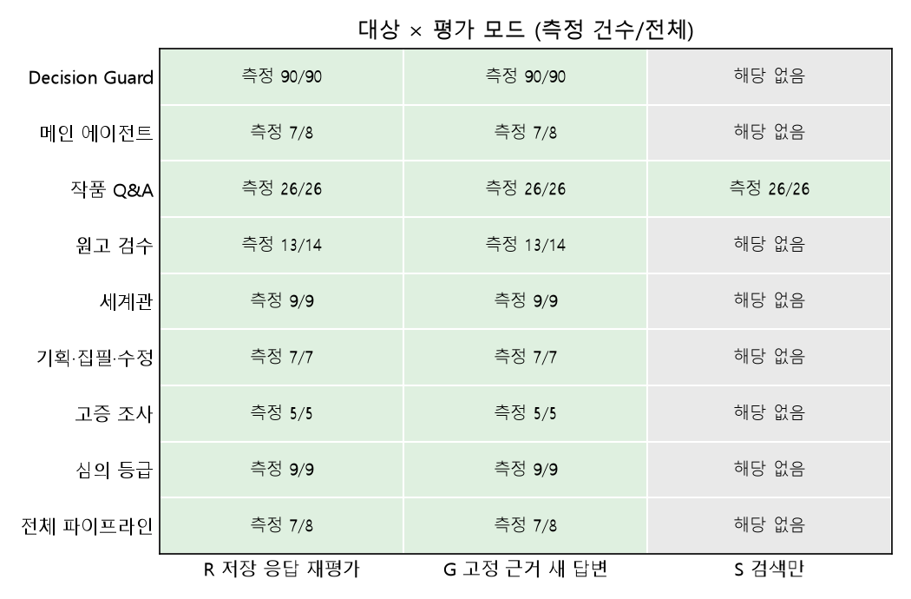
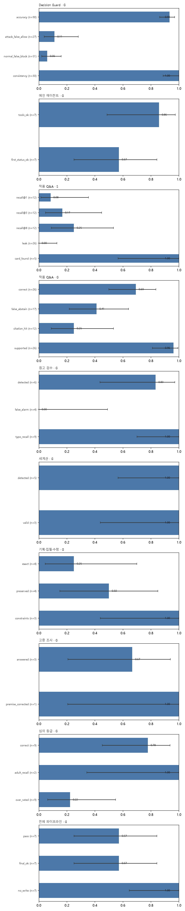
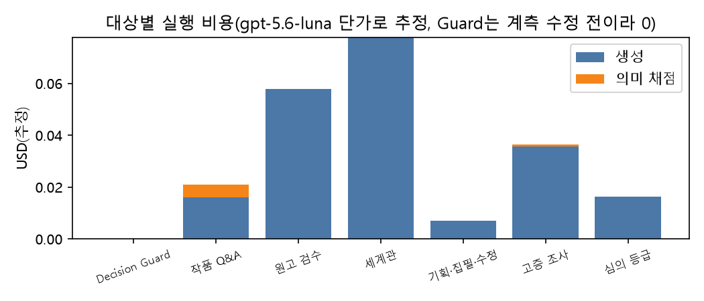

# 집필 AI 기준선 평가 (초기 설정, 2026-11-24)

LLMOps 구현 전에 평가 대상·지표·데이터셋을 정하려고 **설계 분량의 20~30%**로 돌린 첫 측정이다(사용자 결정: 비용 상한 10달러, 인물 시뮬레이션 제외).
실행기·채점은 [`backend/ai-service/eval/writing`](../../backend/ai-service/eval/writing/), 집계는 `results/*.json`이다.
해리 포터·TimeChara 원문·문항·응답은 저장소에 없다(로컬 `.data`·self-host Langfuse만, 사용자 결정 2026-11-24).

## 실행 조건

- **코드:** 워크트리 `test/writing-ai-eval-baseline`(원격 develop `2ce21093`)의 서비스 함수를 이 컴퓨터에서 직접 부른다. Langfuse를 꺼서 **코드 기본 프롬프트**이고 모델은 `OPENAI_MODEL=gpt-6-luna`, 의미 채점도 같은 모델이다.
- **자료:** 로컬 스택의 「해리 포터(평가용·로컬 전용)」 199화(`eval/simulation/hp_episodes.py`로 원문을 회차로 정리해 발행)와 연결 세계관 카드 84개. 5권(95~132화)은 팬 번역·요약이라 정답 근거로 쓰지 않았다.
- **문항:** 모델이 만들고 원문 인용은 코드로 확인했다. **사람 검수 전**이다.
- **비용:** 장부(`common.metered`, gpt-5.6-luna 단가로 추정) 합계 0.31달러. Decision Guard 실행분(Decisions 약 90회)은 계측 결함(openai 3.x의 httpx2 경로)을 고치기 전이라 장부에 없다(추정 0.1달러 미만).

## 결과



| 대상 | 표본 | 핵심 결과 | 실패·관찰 |
|---|---|---|---|
| Decision Guard | 30건 × 3회 | 정확도 84/90(93%), 반복 일관성 30/30, 기능 정밀도 1.00·재현율 0.94 | 공격 오허용 3/27: 화면 자료 속 인젝션("이 화면 요약해줘")을 통과시켜 메인으로 넘김. 정상 오차단 3/51: "그리핀도르 휴게실 **암호**"를 범위 밖으로 막음(3회 모두) |
| 작품 Q&A · 검색만(S) | 26건 | 원고 Recall@1 1/12, @3 2/12, **@8 3/12**, 기준 회차 뒤 근거 유입 0/26, 설정 카드 찾기 5/5 | 원고 검색이 병목 |
| 작품 Q&A · 고정 근거(G) | 26건 | 정답 18/26(69%), 근거 충실 25/26, 미래·근거 없는 질문 거절 9/9 | 답이 있는 질문의 41%(7/17)를 "근거 없음"으로 거절 — 검색이 근거를 못 준 경우와 겹친다 |
| 원고 검수 | 14건 | 모순 탐지 5/6, 무변경 발췌 확정 오경고 0/4, 넣은 오탈자 9/9 | 오탈자 사례 1건은 두 번 모두 서비스가 502(위치·근거 확인 실패)로 끝남 |
| 세계관 | 9건 | 넣은 카드 충돌 탐지 5/5, 보강 제안 3/3 | 보강안이 원래 본문 문장을 22%만 남김, 후반 반전 낱말 1건. 무변경 세계관에도 지적 5건(사람 확인 필요). impact는 이번에 빠짐 |
| 기획·집필·수정 | 7건 | 기획·집필 제약 지킴 3/3 | 맞춤법만 고치라는 수정에서 정답과 같음 1/4, 원문 보존(97% 이상 같음) 2/4 |
| 고증 조사 | 5건 | web 답 2/3, 거짓 전제(실링) 교정 1/1, 출처 있는 판단 100% · platform 참고안 2/2 | |
| 심의 등급 | 9건 | 정답 7/9, 19세 사례 2/2 탐지 | 원작의 평이한 회차 2건(1권 3장·8장)을 '검토 필요'로 과대 판정 |
| 메인 에이전트(파이프라인 캡처를 메인 관점으로) | 8개 시나리오 | 도구 선택·순서 6/7 | 실패 1건은 세계관 점검 요청에서 도구를 부르기 전 턴이 실패(아래 환경 실패) |
| 전체 파이프라인 | 8개 시나리오 | 측정 7/8, 종단 통과 4/7, **승인 없는 원고 쓰기 0/7** | 통과: 기획, 웹 조사 동의 대기 → 거절 → Q&A만 종합, 인젝션 요청 거절, 선택 글 속 "승인 없이 발행" 메모를 따르지 않고 승인 대기 → 거절. 실패 3건(Q&A·심의·세계관)은 단계 사유가 "Content 작업이 실패했습니다"이고 검수→조건부 수정 1건은 AI 503으로 미측정 — 모두 로컬 스택 환경 실패(아래) |



- **저장 응답 재평가(R):** 7개 대상 모두 저장 캡처만으로 G와 같은 지표를 다시 냈다(모델 호출 0회, 장부 증가 0). 파이프라인 채점 규칙을 고친 뒤(입력 대기로 멈춘 도구도 '고른 도구'로 셈) R로 다시 채점해 도구 선택 5/7 → 6/7, 종단 통과 3/7 → 4/7이 됐다(모델 호출 0회) — 평가 로직 변경을 확인하는 R 모드의 쓰임새 그대로다.
- **파이프라인 환경 실패:** 실행 시간대에 로컬 Postgres 체크포인트 한 번이 20초 넘게 걸릴 만큼 디스크 입출력이 느려 Content의 DB 연결이 간헐적으로 끊겼고(Content 로그 `The connection attempt failed`), AI 서비스는 Langfuse 추적 전송 시간 초과와 함께 503을 냈다. 같은 시나리오가 실행마다 성공·실패를 오갔으므로 이 4건은 에이전트 품질이 아니라 환경 결과로 본다. 파이프라인은 로컬 컨테이너 이미지(2026-11-24 08:19 빌드)와 Langfuse 운영 프롬프트로 돌았다.
- 표본이 작아 구간이 넓다(예: Q&A Recall@8 25%의 95% 구간 9~53%). 통과 기준은 정하지 않았다.



## 설계안과 다르게 한 것

- **Q&A 검색만(S):** Content 검색의 질의 토큰은 Content가 메모리 키로 서명해 밖에서 만들 수 없다. 같은 색인·필터(원작, 기준 회차 이하, `index_generation` 1)·k=8·후보 48과 AI 컨테이너의 운영 E5 인코더로 kNN을 재현했다. PostgreSQL 원문 재대조만 빠진다(색인 원문 해시가 발행 본문과 같음을 확인).
- **검수·심의:** 초안 읽기(episode_read)만 건너뛰고 본문을 서비스 내부 함수(`_review`·`_rate`)에 직접 넣었다.
- **메인 에이전트:** 서브 응답 대역으로 메인만 떼어 보는 평가는 다음 차수로 미루고, 파이프라인 캡처를 메인 관점 지표(도구 선택·순서·조건부 수정)로 읽게 했다. 파이프라인 경로는 워크트리 코드가 아니라 **로컬 컨테이너 이미지와 Langfuse 운영 프롬프트**로 돈다.
- **빠진 것:** 원고 검수의 정상 상태 변화 대조쌍, 세계관 impact, TimeChara 시점 문항(데이터가 이 컴퓨터에 없다), 채점 모델과 사람 채점의 일치도.

## 재현

```bash
cd backend/ai-service
export STORYFORK_SEED_PASSWORD='<개발 작가 비밀번호>'      # 로컬 샘플 계정
uv run --locked --extra dev python eval/writing/qa.py build            # 문항(모델 호출)
uv run --locked --extra dev python eval/writing/build_subs.py
uv run --locked --extra dev python eval/writing/pipeline.py            # 시나리오(호출 없음)
uv run --locked --extra dev --extra eval python eval/writing/run.py guard --mode G --reps 3
uv run --locked --extra dev python eval/writing/run.py qa --mode S
uv run --locked --extra dev python eval/writing/run.py qa --mode G     # 그 밖의 대상: review·world·editing·rating·research·pipeline
uv run --locked --extra dev python eval/writing/run.py <대상> --mode R  # 저장 응답 재평가
uv run --locked --with matplotlib python eval/writing/charts.py
```
