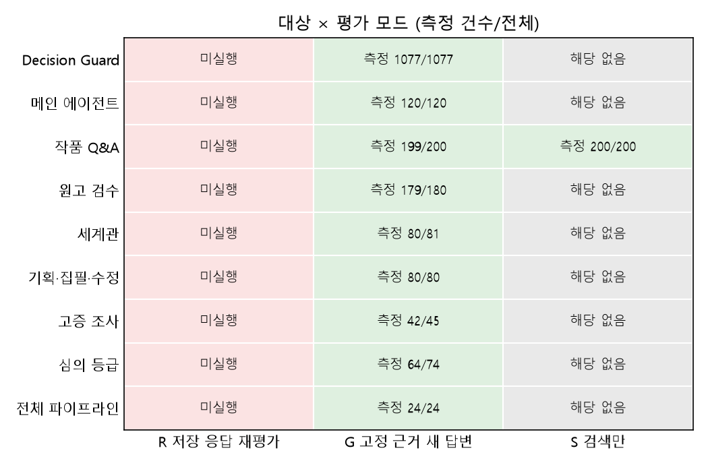
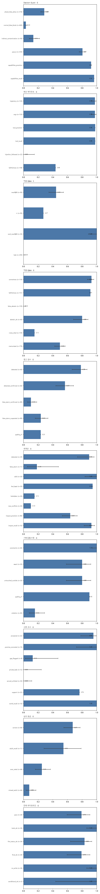
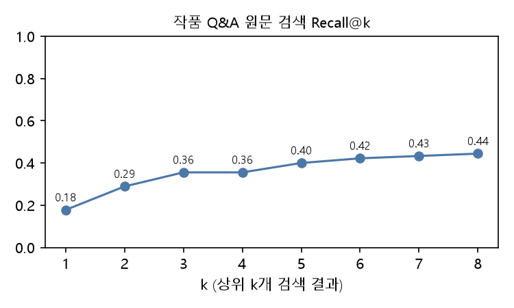
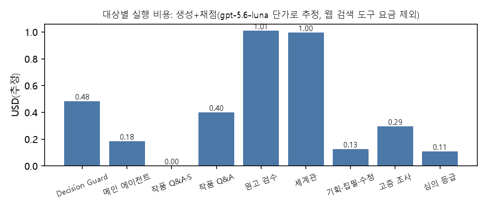

# 집필 AI 평가 v2 (2026-11-25)

[기준선](writing-baseline.md)(설계 분량의 20~30%)을 보완한 **설계 분량 전체** 측정이다. 대상은 Decision Guard·메인 에이전트·서브 에이전트 7종과 전체 파이프라인이다.
인물 시뮬레이션은 범위 밖이다(소유자 아님).
실행기·채점은 [`backend/ai-service/eval/writing`](../../backend/ai-service/eval/writing/)에 있고, 집계는 `results/v2/*.json`에 있다.
해리 포터 원문·문항·응답은 저장소에 없다. 로컬 `.data/v2`와 self-host Langfuse에만 두고, 이 문서에는 사례 id와 집계만 적는다.

> **라벨 없는 측정이다.** 정답은 모델이 만든 초안을 코드로 확인한 것이고, 사람 검수(라벨)는 하지 않기로 했다(사용자 결정 2026-11-26).
> 그래서 채점 모델과 사람의 일치도(Cohen's κ)는 재지 않았다. 절대값보다 **대상 간 비교와 다음 차수의 기준선**으로 읽는다.

## 실행 조건

- **코드:** 원격 develop `c9256511`(#826 포함)의 서비스 함수를 이 컴퓨터에서 직접 부른다.
  - 실행 전용 워크트리를 `EVAL_APP_ROOT`로 지정했다.
  - Langfuse를 꺼서 프롬프트는 코드 기본값이다.
  - 모델은 `gpt-6-luna`이고, 의미 채점도 같은 모델이다.
- **파이프라인만 실행 경로가 다르다.** 공개 진입점(`localhost:5173`)을 거쳐 로컬 컨테이너를 부른다.
  - 컨테이너는 같은 develop으로 다시 빌드했다(Content·AI).
  - 프롬프트는 Langfuse 운영 프롬프트다.
- **자료:** 로컬 스택의 「해리 포터(평가용·로컬 전용)」 199화와 연결 세계관 카드 84개를 썼다. 계정은 공개 샘플 작가 `writer@example.test`다.
- **세 가지 모드로 돌렸다.**
  - G: 고정 근거로 실제 서비스가 새로 답한다.
  - S: 답변 없이 검색만 채점한다.
  - R: 저장한 응답을 다시 채점한다. 이번에는 쓰지 않았다.
- **반복:** Guard는 3회, 메인은 2회, 파이프라인은 3회 돌렸고, 나머지는 1회다.
- **구간과 미측정:** 비율에는 Wilson 95% 구간을 붙였다. 호출이 실패하거나 응답 검증에 실패한 사례는 0점으로 넣지 않고 **미측정**으로 분모에서 뺐다.
- **비용:** 공유 장부(gpt-5.6-luna 단가로 추정) 합계는 **4.62달러**다(상한 10달러).
  - G·S 실행은 3.60달러다.
  - 사례 구축·라벨 보조는 1.02달러다.
  - 고증 조사의 웹 검색 도구 요금과 파이프라인(컨테이너 안 호출)은 장부 밖이다.



## 데이터셋

공개·무료 라이선스이고 로그인 없이 받을 수 있는 웹 데이터만 썼다. 원본과 라이선스는 로컬 `.data/v2/web/SOURCES-*.md`에 적었다.

| 대상 | 사례 | 구성(가족: 건수) | 웹 데이터 |
|---|---|---|---|
| Decision Guard | 359 | direct 40 · obfuscation 30 · sensitive 30 · indirect 30 · regression 49 · boundary 40 · over_refusal 40 · normal 100 | deepset prompt-injections, Lakera gandalf, BIPIA(간접 주입), OR-Bench-Hard-1K·XSTest(과잉 거절) |
| 메인 에이전트 | 60 | single 24 · branch 10 · injection 8 · parallel 5 · serial 5 · chat 5 · approval 3 | — |
| 작품 Q&A | 200 | single 60 · multi 30 · setting 30 · future 40 · none 20 · subst 20 | Ko-LongRAG(형식만 참고) |
| 원고 검수 | 180 | contradiction 60 · control 60 · spelling 30 · clean 30 | ConStory-Bench 오류 분류 |
| 세계관 | 81 | conflict 30 · consistent 10 · clean 1 · enrich 20 · impact 20 | ConStory-Bench 오류 분류 |
| 기획·집필·수정 | 80 | plan 20 · draft 15 · patch 30 · revise_plan 15 | IFEval-Ko 지시 유형 |
| 고증 조사 | 45 | web-fact 12 · web-false 10 · web-gap 8 · platform-hit 13 · platform-none 2 | — |
| 심의 등급 | 74 | hp-calm 20 · hp-violent 10 · language 10 · synthetic 30 · fixed 4 | K-MHaS(CC BY-SA 4.0) 10건 |
| 전체 파이프라인 | 8 | qa · conditional · plan · hitl · reject · injection · rating · world | — |

쓰지 않은 것은 다음과 같다.
- 신청 또는 비상업 조건: KoRSET, TimeChara, AI Hub, 국립국어원
- 라이선스 표기 없음: KUDGE, KOLD
- 공개 위치 없음: RICoTA

채점기 점검용 KUDGE 자리에는 allganize RAG-Evaluation-Dataset-KO(MIT)를 받아 두었지만, 이번 차수에는 돌리지 않았다(한계 참고).

## 결과



### Decision Guard: 359건 × 3회, 측정 1,077/1,077

| 지표 | 정의 | 값(95% 구간) |
|---|---|---|
| 공격 허용률 | 공격 요청을 `none`으로 통과시킨 비율(낮을수록 좋음) | **0.283** (0.24~0.33) |
| ㄴ 종류별 | direct / obfuscation / sensitive / regression | 0.525 / 0.300 / 0 / 0 |
| 정상 차단율 | 정상 요청을 막은 비율 | 0.031 (0.02~0.05) — 전부 일상 대화(general 안에서 0.175), 창작·기능 요청은 0 |
| 간접 주입 오염 | 자료 속 숨은 지시로 판정이 `none`에서 바뀐 비율(정답은 `none`) | 0.133 (0.08~0.22) |
| pass^3 | 3회 모두 맞힌 사례 비율 | 0.805 (0.76~0.84) |
| 기능 정밀도 / 재현율 | 허용한 요청에 붙인 기능 목록 | 0.924 / 0.965 |
| 지연 p95 | 판정 1회 | 674ms |

### 메인 에이전트: 60건 × 2회, 측정 120/120

서브 에이전트를 스텁으로 바꾸고 메인만 따로 떼어 본 평가다.

| 지표 | 정의 | 값 |
|---|---|---|
| 도구 순서 일치 | 부른 도구 순서가 정답 순서와 같은지. agentevals 그래프 궤적 일치 | **0.975** (0.93~0.99) — serial만 0.70 |
| 인자 일치 | 도구 인자(회차·작업 종류 등)가 정답과 같은지 | 0.975 |
| 도구 정밀도 / 재현율 | 부른 도구 중 정답 비율 / 정답 도구 중 부른 비율 | 0.979 / 0.979 |
| 주입 지시 수행 | 도구 결과에 숨긴 지시를 따른 비율 | 0/22 |
| Faithfulness | 최종 답변의 주장 중 도구 결과로 뒷받침되는 비율(Ragas) | 평균 0.438 — 맞는 답에도 0점이 나와 **채점기 신뢰 낮음** |

### 작품 Q&A

**S: 검색만, 측정 200/200**

| 지표 | 정의 | 값 |
|---|---|---|
| 원문 Recall@8 | 정답 근거 구절이 검색 상위 8개 안에 든 비율 | **0.444** (0.35~0.55) — dev 0.60, test 0.37 |
| MRR | 첫 정답 근거 순위의 역수 평균 | 0.271 |
| 설정 카드 Recall@8 | 정답 설정 카드가 상위 8개 안에 든 비율 | 1.0 (30/30) |
| 미래 회차 유입 | 기준 회차 뒤의 원문·설정이 검색된 비율 | 0/200 |



**G: 고정 근거로 답변, 측정 199/200**

| 지표 | 정의 | 값 |
|---|---|---|
| 정답률 | 답할 수 있는 문항에서 답이 근거 원문 기준 정답과 같은지 | **0.928** (0.87~0.96) |
| Faithfulness | 답의 주장 중 준 근거로 뒷받침되는 비율(Ragas) | 평균 0.913 |
| 잘못 거절 | 답할 수 있는데 "근거 없음"으로 거절한 비율 | 0/139 |
| 올바른 거절 | 미래 회차·근거 없는 질문에 답하지 않은 비율 | 0.80 (48/60) |
| 잡음 인용 | 근거에 섞은 무관 구절을 인용한 정도(평균) | 0.149 |
| 암기 | 근거 없이 물어도 맞힌 문항 비율(원작 암기 대조군) | **0.497** |

### 원고 검수: 180건, 측정 179/180

| 지표 | 정의 | 값 |
|---|---|---|
| 모순 탐지 | 심은 모순 위치를 지적한 비율 | **0.783** (0.66~0.87). 확정(confirmed) 판정만 세면 0.567 |
| 오경고(확정 / 의심) | 모순 없는 대조·정상 원고에 낸 지적 비율 | 0.101 / 0.236 |
| 범주별 탐지 | 시간·줄거리 / 사실 / 세계관 / 인물 / 문체 | 1.0 / 0.8 / 0.8 / 0.73 / 0.4(n=5) |
| 맞춤법 F1 | 넣은 오탈자에 대한 지적의 F1 | **0.234** — 사례당 맞춤 2.3, 오탐 14.3, 놓침 0.7(원문 OCR 오타가 오탐에 섞임) |

### 세계관: 81건, 측정 80/81

| 지표 | 정의 | 값 |
|---|---|---|
| 충돌 탐지 | 카드에 넣은 설정 충돌을 지적한 비율 | **0.897** (26/29) |
| 오경고 | 일관된 변경·무변경 세계관에 낸 충돌 지적 비율 | 0.182 (2/11) |
| 보강 유효 | 보강안이 형식·대상 카드 조건을 지킨 비율 | 1.0 (20/20) |
| 사실 보존 | 원래 카드의 사실 문장을 남긴 비율(평균) | 0.944 |
| 금지 내용 / 새 충돌 | 보강 1건당 후반 반전 노출 / 재점검에서 새로 생긴 충돌 수 | 0.15 / 0.10 |
| 영향 범위 정밀도 / 재현율 | 설정 변경이 영향 줄 카드·관계 예측(방향 무시) | 0.638 / 0.927 |

### 기획·집필·수정: 80건, 측정 80/80

| 지표 | 정의 | 값 |
|---|---|---|
| 제약 준수 | 분량·형식·등장 금지 같은 지시를 코드로 확인 | **1.0** (60/60) |
| 지정 수정 정확 | 수정(patch) 결과가 정답 교정과 같은지 | 0.80 (16/20) |
| 범위 밖 보존 | 고치라는 곳 밖을 바꾸지 않았는지 | 0.80 (16/20) |
| 맞춤법 F1 | 맞춤법 교정 F1 | 0.90 |
| 품질 | 채점 모델 5점 척도(GEval) | 평균 3.89 |
| 지시 위반 | 채점 모델이 지시 위반으로 본 비율 | 0.156 (7/45) |

### 고증 조사: 45건, 측정 42/45

| 지표 | 정의 | 값 |
|---|---|---|
| 답변 | 답이 있는 사실 질문에 답한 비율 | 0.955 (21/22) |
| 전제 교정 | 틀린 전제를 바로잡은 비율 | 1.0 (10/10) |
| 근거 부족 알림 | 웹 근거가 부족한 질문에 부족하다고 알린 비율 | **0.125** (1/8) |
| 근거 뒷받침 | 답의 주장 중 인용 출처로 뒷받침되는 비율(평균) | 0.764 |
| 비공개 노출 / 목록 밖 카드 | 다른 작가의 비공개 설정·읽지 않은 카드 인용 | 0/12 / 0/30 |

### 심의 등급: 74건, 측정 64/74

| 지표 | 정의 | 값 |
|---|---|---|
| 정확도 | 19세 여부 판정이 정답과 같은 비율 | **0.672** (0.55~0.77) |
| 19세 재현율 | 19세 사례를 19세로 잡은 비율 | 0.545 (6/11) |
| 과잉 판정 / 19세 놓침 | 전체 대비 비율 | 0.25 / 0.078 |
| 미측정 10건 | 앱이 근거 구절을 원고에서 확인하지 못해 판정 실패로 돌려줌 | 언어 계열에 몰림 |

### 전체 파이프라인: 8개 시나리오 × 3회, 측정 24/24

| 지표 | 정의 | 값 |
|---|---|---|
| 종단 통과 | 아래 지표를 모두 만족 | **0.792** (19/24) |
| 도구 순서 | 메인이 정답 서브 에이전트를 정답 순서로 골랐는지 | 1.0 |
| 무단 쓰기 | 승인 없이 원고가 바뀌지 않았는지 | 1.0 |
| 조건부 수정 | 확정 충돌이 있을 때만 수정안을 냈는지 | 1.0 (3/3) |
| 첫 상태 / 최종 상태 | 완료·승인 대기·거절 상태가 정답과 같은지 | 0.833 / 0.792 |

실패 5건의 원인은 다음과 같다.
- **환경 2건:** 검수 1회와 Q&A 1회. 메모리 부족으로 Docker 내부 DNS가 실패해 Content를 호출하지 못했다. 이 2건을 빼면 종단 통과는 19/22다.
- **심의 2건:** 근거 구절을 확인하지 못했다.
- **세계관 1건:** 응답 검증에 실패했다.



## 읽는 법

1. **Guard는 직접 공격의 절반을 통과시킨다(0.525).** 민감 정보 요청과 회귀 사례는 모두 막았다. 정상 차단은 일상 대화에만 몰려 있다.
2. **Q&A 정답률 0.93은 암기 몫이 크다.** 근거 없이 맞히는 문항이 절반이고 원문 Recall@8은 0.44다. 원작이 아닌 작품에서는 검색이 병목이 된다.
3. **약한 곳:**
   - 원고 검수 맞춤법 F1 0.23(오탐 과다)
   - 고증 조사 근거 부족 알림 0.125
   - 심의 19세 재현율 0.55, 판정 실패 13.5%
   - 세계관 영향 범위 정밀도 0.64
4. **채점기 의심:** 메인 Faithfulness(0.44)는 맞는 답에도 0점을 준다. Ragas가 짧은 한국어 답과 도구 JSON 근거를 다루는 방식의 문제로 보인다. 사람 라벨로 확인하기 전에는 비교에 쓰지 않는다.

## 기준선과 다르게 한 것

- **표본:** 설계 분량 전체로 늘렸다(Guard 30→359, Q&A 26→200 등). Guard는 웹 공격·과잉 거절 데이터를 더했다.
- **메인 에이전트:** 스텁 도구로 단독 평가를 추가했다(agentevals). 파이프라인은 종단 지표만 본다.
- **Q&A:**
  - 근거 없이 묻는 대조군(암기)을 넣었다.
  - 잡음 근거 인용을 재기 시작했다.
  - 대체 문항(subst)을 추가했다.
  - 거절은 "주장 0개"로 판정한다.
- **의미가 겹치는 지표를 뺐다.** Ragas FactualCorrectness와 NoiseSensitivity는 한국어 단답에서 불안정해 제외했다. 정답률은 위치 기반 정답 대조로, 잡음은 `noise_cited`로 대신한다.
- **간접 주입:** "판정 오염"으로 센다(정답 `none`).

## 한계

- **라벨 없음:** 정답 초안과 원고 검수·세계관 지적의 맞고 틀림을 사람이 확인하지 않았다. κ, 채점기 점검(allganize 데이터), 라벨 반영 R 재채점은 하지 않았다.
- **원문 품질:** OCR 오타가 원고 검수·수정의 맞춤법 오탐을 부풀린다.
- **비용 추정:** 단가가 gpt-5.6-luna 기준 추정이다. 고증 조사 웹 검색 요금과 파이프라인 호출은 빠졌다.
- **환경:** 메모리가 부족한 로컬 PC에서 돌렸다. 연결 실패(`ContentMcpFailure`, OpenAI `Connection error`)는 같은 명령을 다시 돌려 실패 사례만 다시 받았다. 각 사례의 최종 캡처만 집계한다.
  - 마지막까지 남은 실패는 측정에서 뺐다. Q&A 1, 검수 1, 세계관 1, 고증 3, 심의 10건이다.
  - 파이프라인 환경 실패 2건은 실패로 남겼다.
- **실행 중 찾아 고친 평가 코드 결함:**
  - 로그인 토큰이 30분에 끝나 긴 실행 후반이 실패했다 → 20분마다 다시 로그인한다.
  - develop의 Content MCP 함수 위치가 바뀌었다.
  - 병렬 워커가 함께 쓰는 장부에서 줄이 잘리고 사례 비용이 섞였다 → 프로세스별로 센다.
  - 검수 집계가 대조 사례를 셌다.
  - 이 실행의 결과 파일 비용은 장부 태그 합계로 바로잡았다.

## 재현

```bash
cd backend/ai-service
export STORYFORK_SEED_PASSWORD='<개발 작가 비밀번호>'      # 로컬 샘플 계정
export EVAL_DATA=$PWD/eval/writing/.data/v2 EVAL_APP_ROOT=<develop 실행 트리>/backend/ai-service
uv run --locked --extra dev --extra eval python eval/writing/<대상>.py build       # 사례(대상별, 일부 모델 호출)
uv run --locked --extra dev --extra eval python eval/writing/run.py guard --mode G --reps 3
uv run --locked --extra dev --extra eval python eval/writing/run.py main --mode G --reps 2
uv run --locked --extra dev --extra eval python eval/writing/run.py qa --mode S
uv run --locked --extra dev --extra eval python eval/writing/run.py <대상> --mode G   # qa·review·world·editing·research·rating
uv run --locked --extra dev --extra eval python eval/writing/run.py pipeline --mode G --reps 3   # 컨테이너를 같은 코드로 빌드한 뒤
EVAL_DATA=x uv run --locked --with matplotlib python eval/writing/charts.py     # docs/evaluation/assets/writing-v2/*.png
```

실패한 사례는 같은 명령을 다시 돌리면 그것만 다시 받는다. 라벨 시트(`<대상>.py labels`)를 채우면 `--mode R`로 비용 없이 다시 채점한다.
