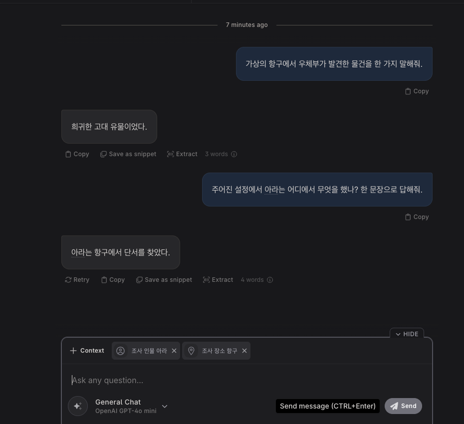
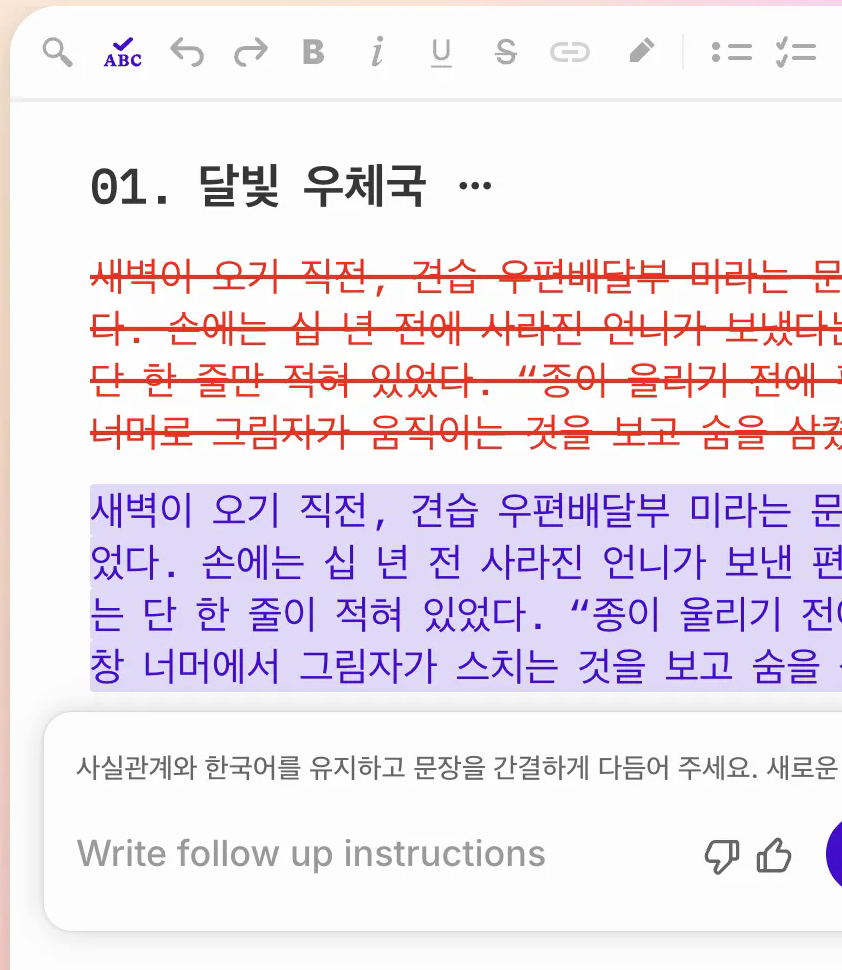
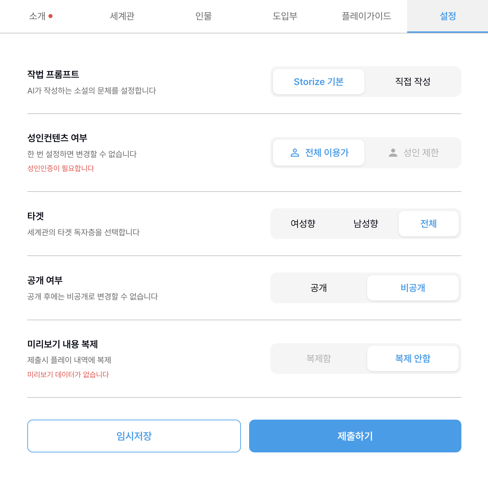

# 직접 관찰 근거와 재현·검증 범위

[공통 색인](README.md) · [세 서비스 비교](comparison.md)

## 근거 표기

- **[화면]** 당시 버튼·라벨·설정이 화면에 표시됨. 클릭 결과나 서버 동작을 뜻하지 않는다.
- **[조작]** 가상 데이터로 입력·클릭·저장 후 표시되는 결과를 확인. 일부 항목은 다시 열어 확인했다.
- **[실행]** AI 생성 요청을 시도하고 본문·응답을 확인. 화면상의 토큰·크레딧·정산을 함께 기록하되 실제 비용을 확인하지 못한 항목은 구분했다.
- **[공식문서]** 해당 사이트가 설명한 기능이나 약관 문구. 조사 계정에서 동작을 재현했다는 뜻이 아니다.
- **[미확인]** 버튼 실행, 실패 원인, 원시 API 요청, 서버 권한, 지속 저장 또는 계정·플랜별 차이를 확인하지 못한 경우.

아래 스크린샷은 조사용 가상 데이터만 남도록 잘라낸 정적 증거다. 작품 소유 계정의 로그인 여부나 현재 표시를 증명하지 않으며 개인정보·키·결제 정보를 싣지 않는다. 실제 페이지는 로그인·권한 및 당시 탭 상태에 따라 달라진다.

## Novelcrafter

| 항목 | 당시 확인·결과 | 증거·한계 |
|---|---|---|
| [조작] Codex·장면 | 가상 인물과 장소, 이름 등장과 장면 연결, Matrix의 시간 라벨, Progression 입력 UI를 확인 | 앞뒤 장면 AI 전송·장기 저장·한국어 형태소 매칭은 미확인. 저장 중 `Sync failed / INTERNAL_SERVER_ERROR`가 한 번 있었고 해당 Description은 Retry 뒤 비어 있었다. |
| [실행] 일반 Chat | GPT-4o mini. 가상의 항구에서 우체부가 찾은 물건을 묻자 “희귀한 고대 유물이었다.” | 미리보기 시스템 메시지 109단어. 응답이 나왔다는 사실과 정확한 청구는 별개. |
| [실행] Codex 선택 Chat | 인물 아라·장소 항구 두 문맥 칩을 선택해 “아라는 어디에서 무엇을 했나?”를 질문했고 “아라는 항구에서 단서를 찾았다.” 응답을 확인 | . 미리보기는 기존 대화를 포함한 178단어였고 인물 설명은 보였지만 장소가 별도 항목으로 전송됐는지는 미확인. |
| [실행 시작·미완료] Scene Beat | 원래 의도한 GPT-4o mini가 아닌 GPT-4o 생성이 버튼 혼동으로 시작돼 즉시 Stop·Discard; 화면 0 words | 생성 성공·API 전송·비용은 미확인. 조사용 Beat의 가상 지시와 길이 400→200은 남았고 본문은 바뀌지 않았다. |
| [화면] 비용 | 시험 전후 지출·잔액 화면을 확인했고 자동 충전은 꺼져 있었다. 비용 경계는 사용자가 허용한 최대 $20이었다. | 대시보드 기간과 반영 지연·반올림으로 각 요청·총 실제 비용과 청구 프로젝트는 미확인. 계정별 잔액은 공유 문서에서 생략하며 현재 조건은 다시 확인한다. |

세부 경로와 버튼 설명은 [Novelcrafter 명세](novelcrafter.md), 외부 서비스의 기재는 [공식 문서 색인](https://www.novelcrafter.com/help/docs)을 참조한다.

## Sudowrite

| 항목 | 당시 확인·결과 | 증거·한계 |
|---|---|---|
| [조작] Story Bible·문서 | 가상 인물·세계 요소를 작성하고 Outline 챕터와 문서, 앞 문서와 뒤 문서를 연결 | UI의 `Looked at`은 참고 문맥 표시이지 실제 모델에 전달된 원문 전체의 증거가 아니다. |
| [실행] Quick Edit | 기본 모드에서 원문과 수정안을 비교하고 Reject해 원문을 남김 | . 저장된 이미지는 Reject **전** 화면; Accept는 실행하지 않았다. |
| [실행] AI 결과와 의미 | Write·Rewrite·Brainstorm·Chat이 응답. “보냈다는 편지”가 “보낸 편지”로 바뀌거나 입력하지 않은 이름이 추가된 사례 | 소수의 한국어 샘플이므로 제품의 전반적 오류율이나 성능으로 일반화하지 않는다. |
| [화면] 크레딧 | 체험 10,000→6,893, 총 3,107 소모. 마지막 기본 Quick Edit과 Chat은 활동 내역상 각각 0 | [실험 장부](sudowrite.md#ai-실험-장부-전후-잔액결과직접-조작-증거)의 값은 당시 입력·설정에 대한 사례이며 고정 요금이 아니다. |

## 스토라이즈

| 항목 | 당시 확인·결과 | 증거·한계 |
|---|---|---|
| [조작] 비공개 임시저장 | 가상 세계관의 공개 기본값을 비공개로 바꾸고 저장·이탈·재진입·불러오기 후 비공개를 확인 | . 제출·공개와 다르며 실제 공개 후 되돌리기는 미시험. |
| [실행 시도] 텍스트 미리보기 | Gemini 2.5 Flash, 1배 10샤프심 표시. 최초 버튼·Enter와 별도 재시험 버튼·Enter 모두 AI 본문은 화면에 표시되지 않았다 | 재시험은 각 약 3.5초 관찰. 계측의 새로고침 대조도 실패해 요청 전송·HTTP 상태·콘솔 오류·원인 미확인. 대기 후 늦게 왔는지도 확인하지 못함. |
| [화면] 보너스 | 조사 당시 가입 보너스 잔액 5,000, 구매·사용 0이며 전후 변동 없음 | 확인된 차감 0. 후속 과금이나 장래 자동 전환까지 보장하지 않음. |
| [공식문서] 약관 제14·16·17조 | 비공개 전환 제한·사전 통지, 저작권과 독점적 이용 허락 문구가 있다 | 제작 화면의 ‘공개 후 비공개 불가’ 경고와 약관 설명은 다르다. [원문](https://storize.kr/policy/service)을 읽고 서비스에 확인하며 법적 결론으로 단정하지 않는다. |

## 재검증할 때

현재 기능·가격·조건은 서비스 화면과 공식 문서로 다시 확인한다. 실패를 진단할 때에는 테스트 대상과 입력, 전후 UI 상태, 기다린 시간, 검증된 수단으로 관찰한 요청 여부·오류, 사용량 및 미확인 항목을 각각 분리해 기록한다. 사용자 원고와 계정 정보는 증거에 포함하지 않는다.
