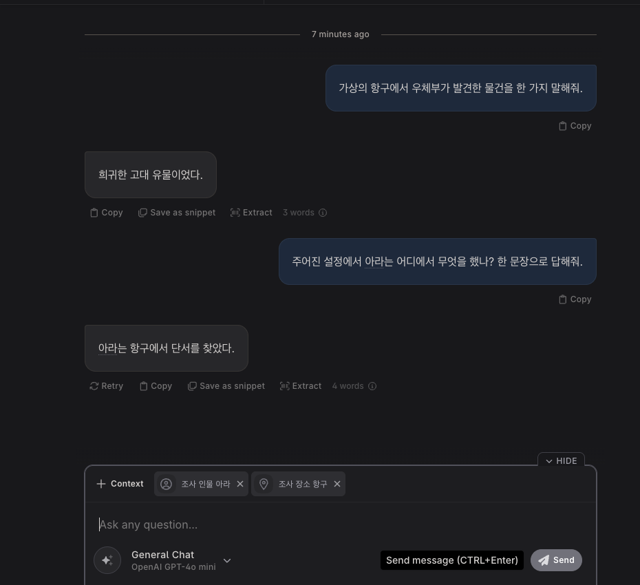

# Novelcrafter 사용자 온보딩·화면별 기능 명세서

[공통 색인](README.md) · [세 서비스 비교](comparison.md)

기준: 2026-11-01 실측 보고 두 건 및 아래 공식 도움말. 화면·플랜·문서는 바뀔 수 있으며 제품 전체를 전수 조사한 명세는 아니다. [실측]은 제공받은 실측 보고에 따른 관찰이며 이번 작성에서 재실행하지 않았다. [공식문서]는 링크한 공식 본문에 근거한다. [미검증]은 실행·정확성 또는 현재 지원 여부를 확인하지 못한 내용이다. 원본의 출처를 연결할 수 없는 인용 표식은 사용하지 않았다.

## 15분 입문: AI 없이

1. [실측] Novels(작품 목록) → Create Novel(작품 생성)에서 Title(제목), Author / Pen name(필명), Language(언어)를 지정한다. Series는 선택이며 미선택 시 순번이 비활성화됐다. Korean을 선택할 수 있었다.
2. [실측] Plan(구상) → Create first Scene(첫 장면 만들기): Act 1(막), Chapter 1(장), Scene 1(장면)이 함께 만들어졌다. Grid(격자), Outline(개요), Matrix(교차표) 보기로 전환한다.
3. [실측] Codex(설정집) → New Entry에서 Character(인물)와 Location(장소)을 만든다. 장면 카드 Codex에서 인물을 지정하면 카드에 이름이 나타난다.
4. [실측] 장면 연필 또는 Write(집필)로 들어가 가상 본문을 적는다. Scene summary(장면 요약)와 본문은 별도다. `/`에서 Scene Beat(장면 지시), Codex Progression(설정 변화) 등을 볼 수 있다.
5. [실측] Review(검토)에서 분량·등장 분포를 살핀다. 가상 원고 10단어에서 총 10단어 및 인물·장소 각각 1회가 표시됐다.
6. [공식문서] First Steps Tutorial(첫 단계 안내)은 작품 목록 오른쪽 위, 작품 안 왼쪽 아래의 프로필 옆에 있다. AI 온보딩을 선택하면 요약·채팅 과제가 추가될 수 있다. [공식 튜토리얼](https://www.novelcrafter.com/help/getting-started/quick-start/first-steps-tutorial)
7. [실측] AI는 별도 연결·비용 판단 후 사용한다. 초기엔 미연결이었고 후속 GPT-4o mini 일반 Chat 및 Codex 문맥 Chat 각각 1회가 성공했다. 비용과 청구 프로젝트는 확인되지 않았으므로 무료의 증거가 아니다.

## 질문하기 좋은 버튼 색인

| 버튼·기능 | 어디서·무엇을 하는가 | 주의·상세 |
|---|---|---|
| `Create first Scene` | Plan에서 첫 Act·Chapter·Scene 만들기 | 구조 조작은 B |
| `Grid` / `Outline` / `Matrix` | 같은 이야기 구조를 다른 방식으로 보기 | Matrix의 시간은 라벨이지 자동 달력 증거가 아님; B |
| `New Entry` / `Aliases` | Codex 설정 항목과 다른 이름 작성 | 한국어 조사·별칭 감지는 미검증; C |
| `Relations` | 항목 연결 | 연결 관계가 실제 AI에 동반 전달되는지 미검증; C |
| `Mentions` / `Tracking` | 항목이 나온 위치와 자동 감지·AI 포함 조건 | UI 설정만으로 서버 보안 강제를 보장하지 않음; C |
| `Codex Progression` | 특정 장면에 설정 변화 연결 | 앞뒤 실제 AI 요청 비교 미검증; C |
| `Scene Beat` / `Context` | 짧은 장면 지시와 참조 대상을 지정 | 생성 모델/드롭다운과 실행 버튼을 구분; D |
| `Preview` / `Tweak and generate` | 프롬프트 입력 확인과 생성 설정 | 미리보기와 실제 요청 전체는 다름; F |
| `Chat` / `Send` | 문맥을 골라 이야기 질문 | 요청 때마다 외부 AI 비용 가능; E·후속 AI 실측 |
| `Review` | 분량·인물 등장 분포 보기 | 개연성 자동 검증 결과와 혼동하지 않음; E |
| `Import` / `Export` / `Restore version` | 파일 반입·반출·이력 복원 | 실제 파일 왕복·복원은 미검증; G |

## 화면 인벤토리

| 영어 / 한국어 | 목적 및 진입 |
|---|---|
| Novels / 작품 목록 | 생성·검색·Import [실측] |
| Series / 시리즈 | 상단 Series → 목록·New Series; 생성 결과 미검증 [실측][미검증] |
| Settings / 설정 | 작품 왼쪽 위 톱니바퀴 → Metadata·Writing·Collaboration·Export [실측] |
| Plan / 구상 | 작품 → Plan → Grid·Outline·Matrix [실측] |
| Codex / 설정집 | 작품 사이드바 → Codex → New Entry [실측] |
| Write / 집필 | Write 또는 장면 연필 → 본문 [실측] |
| Chat / 대화 | 작품 → Chat → General Chat [실측] |
| Snippets / 조각글 | 사이드바 Snippets → 재사용 텍스트 [실측] |
| Review / 검토 | 작품 → Review → 분량·등장 분포 [실측] |
| Prompts / 프롬프트 | Prompts → 지시·모델 구성 [실측] |
| Import / Export | 작품 목록·Plan Import / 사이드바 Export [실측] |
| AI Connections / AI 연결 | 프로필 → AI Connections [실측] |

다음 기능은 관찰 당시의 입력·결과·제약이다. 메뉴가 표시되거나 활성화됐다는 사실은 실행 성공, 무료 호출 또는 모든 플랜에서의 제공을 뜻하지 않는다.

## ② 화면·메뉴별 기능 명세

## A. 작품 목록, 생성, 시리즈, 작품 설정

### 작품 목록과 새 작품

**위치:** Novels → `Create Novel` / `Import`

**[실측] 확인 메뉴와 동작**

- 상단: `Novels`, `Series`, `Prompts`, 프로필, 튜토리얼 진행, Help.
- 작품 목록: 이름·시리즈 검색, 날짜 정렬, 그룹화, Grid/List 전환.
- 새 작품 입력: **Title**, **Author / Pen name**, 선택적 **Series**, **Series index**, **Language**. 작품 생성 단계에서 시리즈를 선택하지 않았을 때 Series index가 비활성화되어 있었습니다.
- 빈 계정의 시작 화면은 새 작품 생성 또는 기존 원고 가져오기를 제시했고, 가져오기 확장자로 `.docx`, `.md`, `.html`을 표시했습니다.
- `Series` 목록에는 기존 항목 없이 `New Series`가 보였습니다. 눌렀지만 새 화면이나 폼으로 변하지 않아 **시리즈 생성 결과는 미검증**입니다.

### 작품별 설정

**위치:** 작품 왼쪽 위 톱니바퀴 → Metadata, Writing, Collaboration, Export

- **Metadata [실측]:** 제목, 필명, 시리즈와 순번, 표지 업로드. 별도의 Danger Zone에 Archive/Delete가 있으나 실행하지 않았습니다.
- **Writing [실측]:** 장면 Labels/Markers, 서술 시제 `Past`/`Present`, 작품 언어, 기본 POV. POV는 `1st`, `2nd`, `3rd`, `3rd Limited`, `3rd Omniscient`와 선택적 인물로 구성됩니다. 화면은 시제와 POV가 AI 본문 생성에 전달된다고 설명합니다.
- **Collaboration [실측]:** 협업자 목록에 이름·역할과 `Add collaborator`가 있었습니다. 초대나 공유는 하지 않았습니다.
- **작품별 AI 기본값 [실측]:** Prompt Library에서 `Set up now`를 눌렀을 때 계정 전체 기본값 또는 **Specific Project**를 선택할 수 있었고, 프로젝트 기본값이 계정 기본값보다 우선한다고 설명했습니다. `Save and continue`는 누르지 않았으며 재진입했을 때 해당 기본값 목록은 남아 있지 않았습니다.

### 시리즈 Codex

**[미검증]** 실제 시리즈를 생성하거나 책 간 공유·전파하지 않았습니다.

---

## B. Plan: 구조, Grid, Outline, Matrix

**위치:** Plan

### 확인한 메뉴 전체

**[실측]**

- 보기 전환: **Grid / Matrix / Outline**
- Grid: 장면 검색, `View`, `New Act`, `Create from Outline`, `Import`, 전체 `Actions`.
- Act: 접기, 제목, 새 Chapter, 원고에서 편집, Act Actions.
- Chapter: 제목, 원고에서 편집, Chapter Actions, 장면 추가.
- Scene 카드: 요약 입력, 원고에서 편집, Scene Actions, Codex 연결, Label.
- Grid `View`: 자동 감지 Codex 참조 표시, 수직/수평 축, 카드 너비와 높이.
- Outline: Act·Chapter를 접고 펼치는 계층형 장면 요약 보기. 실제 전환해 같은 두 장면을 확인했습니다.
- Chapter Actions: `Automatic Numbering`, `New…`, `Organize…`, `Copy Text…`, `Export Chapter`, 삭제 메뉴. 조사 작품이 한 Chapter뿐이어서 이전 Chapter와 합치기와 이동 항목은 비활성화되어 있었습니다.

**[미검증]** 실제 드래그 이동, 분할, 병합은 하지 않았습니다.

### Scene Actions

**[실측]** 장면 메뉴에서 다음을 확인했습니다.

- `Set custom POV`, `Add Subtitle`
- AI: `Include in AI Context`, `Summarize Scene`, `Detect Characters`, `Chat with Scene`
- `New…`, `Organize…`, `Versions/History…`, `Copy Text…`, `Export Scene`
- 빈 장면에서는 `Delete Scene`, 본문이 있는 장면에서는 `Archive Scene`이 표시됐습니다.
- 빈 장면에서는 요약·인물 탐지가 비활성화됐고, 본문 입력 후에는 메뉴가 활성화됐습니다. **활성화가 무과금 또는 실행 가능을 뜻하지는 않습니다.**
- `Set custom POV` 대화상자는 작품 기본 POV와 같은 다섯 가지 인칭과 선택적 인물을 보여줬습니다. 저장은 하지 않았습니다.
- `Versions/History → Scene Contents`를 열자 두 시점의 편집 이력, `Load more`, `Restore version`이 표시됐습니다. 복원은 하지 않았습니다.

### 아웃라인 프리셋

**위치:** Plan → `Create from Outline`

**[실측]** 텍스트를 붙여 넣는 `Write`와 파싱 결과를 보여주는 `Preview`가 있으며 다음 프리셋을 확인했습니다.

1. 3 Act Structure
2. Save the Cat
3. Hero’s Journey
4. Freytag’s Pyramid
5. Dan Harmon’s Story Circle
6. Fichtean Curve
7. Derek Murphy’s 24 chapters
8. Story Clock

`3 Act Structure`를 선택하자 3개 Act와 18개 Chapter가 텍스트에 채워졌고 Preview에 계층으로 표시됐습니다. **Create는 누르지 않았습니다.** 새 아웃라인은 현재 작품의 끝에 추가된다고 화면에 명시됐습니다.

### Matrix

**위치:** Plan → 보기 선택 → `Matrix`

**[실측]**

- `Show` 선택지: Characters, Locations, Objects/Items, Lore, Subplots, Others, 사용자 카테고리, Labels, 라벨 그룹 `Time`, POV, Custom.
- 빈 유형은 비활성화됐고, 가상 인물과 장소를 만든 뒤 해당 축은 선택 가능했습니다.
- Characters 축에서 장면 1의 수동 연결 인물과 장면 2의 본문 자동 감지 인물·장소가 카드에 보였습니다.
- 가상 `Temporal setting` 프리셋 적용 후 Time 축에 **Past / Flashback / Present / Flashforward / Future**가 표시됐습니다. Scene 2와 Present의 교차점 `Add Scene`을 누르니 장면 카드에 `Time: Present`가 붙었습니다.
- `Swap Layout`과 View 설정이 표시됐으나 축 교환의 결과는 시험하지 않았습니다.

---

## C. Codex: 세계관 데이터와 AI 문맥

**위치:** 작품 왼쪽 사이드바 → `Codex`

**조건:** 조사용 Character 1개와 Location 1개를 만들었습니다.

### 유형과 항목 구성

**[실측] `New Entry` 메뉴**

- 기본 유형: **Character, Location, Object/Item, Lore, Subplot, Other**
- Quick create: **Global Entry, Style Guide, Story Genre**
- 항목 공통 화면: 유형·이름·Tags/Labels·Mentions 수와 `Details / Research / Relations / Mentions / Tracking`.
- 사이드바 메뉴: `Custom Categories`, `Custom Details`, `Display Settings`, 전체 접기/펼치기, **전체 또는 유형별 Codex Export**.

### Details: 별칭·설명·필드

- **별칭 [실측]:** `Aliases/Nicknames` 입력란에는 대체 이름과 쉼표가 없는 구절을 넣을 수 있다고 도움말에 표시됐습니다. `아라`를 입력한 상태는 재진입 후에도 보였습니다. **별칭만으로 매칭되는지는 별도 시험하지 않았습니다.**
- **Description [실측]:** AI가 읽는 필드로 표시되며 짧고 구체적인 설명을 권장합니다. History, Copy, Progressions, Add details가 있습니다.
- **Research [실측]:** 화면은 `Notes`가 사용자에게만 보이고 새 본문 생성에는 사용되지 않는다고 안내합니다. **[미검증]** 실제 모델 전송·접근 통제는 확인하지 않아 이 안내를 비밀 정보 보호의 보장으로 간주할 수 없습니다. `External`에는 Google Docs·Notion 등 외부 URL을 입력하는 칸과 Add 버튼이 있습니다. 외부 URL을 추가하지는 않았습니다.
- **저장 실패 사례 [실측]:** 처음 가상 인물의 Description을 입력하던 중 `Sync failed / INTERNAL_SERVER_ERROR`가 한 번 표시됐다. `Retry` 뒤 이름은 나타났지만 Description은 비어 있어 저장 성공으로 보지 않았다. 이후 다른 내용이 재진입 후 표시된 사례가 있어도 모든 필드의 장기 저장을 검증한 것은 아니다.

### 사용자 정의 Detail과 Category

**위치:** Codex 사이드바 메뉴 → `Custom Details` / `Custom Categories`

**[실측] Detail 메뉴**

- 형식: **Text, Line, Dropdown, Codex Reference**
- Quick create: Story Role, Backstory, Fighting Style, Occupation, Physical Appearance, Pronouns, Voice Sheet.
- Dropdown 시험 화면: 이름, 적용할 6개 유형, 목록에 값 표시 여부, `General / AI / Options`.
- AI 필드 옵션: **모든 AI 문맥에 포함 / NSFW 프롬프트에만 포함 / Never include**.
- Options: Dropdown 값 추가와 정렬. 조사용 Dropdown **조사 분류**를 만들었지만 값은 추가하지 않았습니다.

**[실측] Category 메뉴**

- 이름, 색, 연관 태그, 적용 유형, 연관 Dropdown Detail 값.
- 조사용 카테고리 **조사 카테고리**를 만들었습니다. Matrix의 Show 목록에는 나타났지만 조건에 맞는 항목이 없어 비활성화됐습니다.
- 화면은 적어도 하나의 연관 조건이 필요하다고 안내했습니다. 실제 자동 분류 결과는 검증하지 않았습니다.

### Relations: 항목 간 연결

**위치:** Codex 항목 → `Relations → Add Entry`

- **[실측]** 가상 장소 **조사 장소 항구**에서 `Add Entry → 조사 인물 아라`를 선택하자 관계 목록에 인물 1개가 나타났습니다. `Invert relationship`, `Remove Reference` 버튼도 확인했습니다. 뒤집기와 제거는 하지 않았습니다.
- **[미검증]** Relations에 따른 두 항목의 자동 동반 전달은 확인하지 않았습니다. 후속 Chat의 두 항목은 수동으로 선택한 별도 시험입니다.

### Tracking, Mentions, AI Context

**위치:** Codex 항목 → `Tracking` / `Mentions`

**[실측] Tracking 선택지**

- 이름·별칭 추적 켜기/끄기, 대소문자 구분, 제외할 문구.
- AI Context 네 가지:
  1. **Always include**
  2. **Include when detected**, 기본값
  3. **Don’t include when detected**
  4. **Never include**
- 화면은 3번이 자동 감지 시에는 제외하지만 관계나 장면 문맥의 수동 지정으로는 들어올 수 있고, 4번은 AI에 아예 보이지 않는다고 설명했습니다.

**[실측] 등장 추적 시험**

- Scene 2에 `조사 인물 아라 가 조사 장소 항구 에서 단서를 찾았다.`를 입력했습니다.
- Write에서 두 이름이 Codex 참조로 표시됐고, 인물의 `Mentions → Manuscript`에는 **1 mention**, `Chapter 1 - Scene 2`, 주변 문장과 Open 버튼이 나타났습니다.
- Mentions의 다른 탭은 **Summaries / Codex / Snippets / Chats**였습니다.
- 이 시험은 이름 뒤에 띄어쓰기를 둔 예시입니다. **한국어 조사·어미가 붙은 형태소 매칭 정확도는 검증하지 않았습니다.**

### Progression: 장면 이후의 설정 변화

**위치:** Write 본문에서 `/ → Codex Progression`

- **[실측]** Progression을 삽입하고 대상 인물 **조사 인물 아라**를 선택하자 `ADD TO: DESCRIPTION`으로 바뀌었습니다. 메뉴에는 대상 `Description`, `Replace, not add`, 삭제가 표시됐습니다. 나중에 인물 Details에 **1 Progression**, Matrix에 해당 장면의 `Add to: Description`이 나타났습니다.
- **[미검증]** 앞뒤 장면의 실제 AI 프롬프트를 비교하지 않았습니다. 이는 **장면 순서 기준**이지 달력 날짜나 복잡한 비선형 시간 자동 계산을 검증한 결과가 아닙니다.

---

## D. Write: 원고 편집, Beat, Section, 표시 방식

**위치:** Write 장면

### 기본 편집 화면

**[실측]**

- 문서 범위 선택: **전체 소설, Snippets, Full Act, Chapter**.
- 현재 선택 범위의 단어 수·페이지 수·읽기 시간.
- Act/Chapter 제목과 Actions, Scene 본문, Scene summary, Label, Codex, Scene Actions.
- `Focus` 버튼과 `Format` 패널.
- Format에서 글꼴, 글자 크기, 줄 높이, 들여쓰기, Chicago Style, 문단 간격, 페이지 폭, 정렬, Scene divider, 커서 위치, 타자기 모드, 화면 배치, Codex 주석 색, **읽기 속도와 페이지당 단어 수**를 확인했습니다. 설정은 변경하지 않았습니다.
- 10단어의 가상 본문 입력 후 상단과 장면에 `10 words`가 표시됐습니다.

### `/` 명령 메뉴

**[실측] 전체 표시 목록**

- AI: **Scene Beat**, **Continue Writing**
- Codex: **Codex Progression**
- Formatting: **Horizontal Rule**, **Section**
- Other: **Note**

#### Scene Beat

- **[실측]** Scene Beat를 삽입하면 지시를 적는 영역, `200 / 400 / 600` 선택, `Context`, `Set up AI`, `Clear Beat`가 보였습니다.
- `Context` 메뉴: Full Novel Text, Full Outline, Acts, Chapters, Scenes, Codex Entries, Entries by Type/Detail/Category/Tag. Full Novel Text에는 비용이 커질 수 있다는 경고가 붙었습니다.
- `Codex Entries → 조사 인물 아라`를 선택하자 Beat에 인물 이름이 문맥 칩으로 나타났습니다.
- 모델 호출 버튼을 누르지 않았습니다. 당시 미연결 상태에서 `Set up AI`가 표시됐습니다.

**[미검증]** Scene Beat 정상 생성 결과와 Apply·Retry·Section은 실행하지 못했습니다. 후속 시험에서 잘못 시작된 생성을 Stop 후 Discard한 사실은 확인했습니다.

#### Section

**[실측]** `/` 메뉴에 Section과 Note가 나타났습니다. 삽입·편집은 시험하지 않았습니다.

---

## E. Chat, Snippets, Review

### Chat

**위치:** Chat

- **[실측]** 스레드 이름 입력란과 빈 스레드 안내가 있었지만, 본 화면에 **AI Connection Required**가 표시됐습니다.
- 사이드바 `Chats`: 스레드 검색, New thread, 메뉴. 초기 관찰에서는 전송하지 않았으나 후속 시험에서 일반 Chat과 Codex 문맥 Chat이 각각 1회 성공했습니다.
- **[미검증]** 초기 미연결 관찰에서 메시지 바를 확인하지 못했습니다. 후속 시험에서 General Chat 두 응답은 확인했습니다. 커스텀 프롬프트에 같은 입력이 모두 있다고 일반화할 수 없습니다.

### Snippets

**위치:** 작품 사이드바 → `Snippets`

- **[실측]** 검색, `New Snippet`, 메뉴. 새 입력 화면에 이름·Content, Open Snippet, Extract, History, Copy가 보였습니다.
- 빈 상태의 안내는 Snippet을 장면에 빠르게 삽입할 수 있는 작은 텍스트로 설명했습니다.
- **[미검증]** 내용을 저장하거나 실제 장면에 삽입하지 않았습니다.

### Review

**위치:** Review

**[실측] 확인 메뉴**

- `Total Word Count`
- `Word Counts by scene`: Scenes / Chapters
- `Character Distribution by Scene`
- `Appearance Heatmap`: Cells / Timeline, Sort By의 `Similarity (beta)`

**실제 결과:** 가상 원고 입력 전 총 0단어였고, 입력 후 **총 10단어**, 두 장면 분량 그래프, 인물·장소의 등장 수 각 1이 표시됐습니다. `Timeline` 보기 버튼을 선택했습니다.

**[미검증]** beta 유사도 정렬의 알고리즘과 대규모 원고에서의 정확성은 확인하지 않았습니다.

---

## F. Prompts: 프롬프트, 입력, 문맥, 모델

**위치:** Prompt Library

### 확인한 기본 메뉴 전체

**[실측]**

- **Model Collections:** Default Chat, Default Summarization, Default Text Replacements, Default Writing.
- **Scene Beat Completions:** General Purpose.
- **Scene Summarizations:** Default.
- **Text Replacements:** Expand, Rephrase, Shorten.
- **Workshop Chats:** Developmental Editor, General Chat, Scene Beats from Summary.
- **Prompt Components:** AdditionalContext, AdditionalInstructions, Chat/DefaultContext, Chat/DefaultInstructions, Codex, Personas, SeriesContext.
- 기본 시스템 프롬프트는 직접 편집하려면 `Clone`하라는 안내가 있었습니다. 복제하지 않았습니다.

### Developmental Editor 상세

**[실측]**

- `General`: Presets, Models, 모델 컬렉션 연결, Type, Moderation.
- `Instructions`: 최소 하나의 System message와 필요한 User/AI message에 대한 안내.
- `Advanced`: 입력, 포함된 Component와 Preview.
- Preview 입력에서 **Genre**, 피드백 유형 **Pacing / Dialogue / Characterization / Structural / Developmental**, 추가 Instructions, 추가 Context를 확인했습니다.
- Context 선택지에는 전체 원고·아웃라인, Act/Chapter/Scene, Codex 개별 항목과 Type/Detail/Category/Tag가 있었습니다. 당시 값이 없는 분류는 비활성화됐습니다.
- 이 화면의 Preview는 **입력과 구성 미리보기**입니다. 실제 모델로 나간 최종 요청을 캡처한 증거는 아닙니다.

---

## G. 가져오기, 내보내기, 발행

### 원고 가져오기

**위치:** 작품 목록 `Import` 또는 Plan → `Import`

**[실측]** Import 대화상자에는 다음이 있었습니다.

- 형식: **Word `.docx`, Markdown `.md`, HTML `.html`**
- 파일 선택.
- `Import as chapter summaries / novel outline`.
- 장면 구분자 필수 여부. 기본적으로 켜져 있었고 `---`, `* * *` 등의 예시가 표시됐습니다.
- `Preview Import`. 가져온 내용은 현재 작품 끝에 추가된다고 안내했습니다.

### 내보내기

**위치:** 사이드바 `Export` 또는 작품 Export 설정

**[실측]**

- Act/Chapter/Scene별 체크.
- 형식: **Word `.docx`, Markdown `.md`, HTML `.html`**.
- Summary와 Prose 포함 여부, Act 제목, Scene 부제, Scene divider.
- 전체 프로젝트 ZIP에 **Codex / Snippets / Chats**를 각각 포함하는 스위치.
- 파일은 실제로 내보내지 않았습니다.

### 출판·배포

- **[실측]** 조사한 Export 화면에서는 원고·프로젝트 내보내기를 확인했습니다. 외부 판매처에 직접 출판하거나 배포하는 화면은 확인하지 못했습니다.
- **[미검증]** 현재 버전에서 직접 발행·배포 또는 출판용 조판이 **없다고 단정하지 않습니다**.

## 후속 AI 실측: 일반 Chat과 Codex 문맥 Chat

2026-11-01 가상 조사 작품에서 사용자가 연결한 OpenAI 모델로 다음을 확인했다. 아래 앱의 미리보기는 사용자에게 보이는 문맥 표시이며 실제 네트워크 페이로드 전체를 확인한 것은 아니다.

| 기능 | 입력과 문맥 | 실제 결과 |
|---|---|---|
| 일반 Chat [실행] | GPT-4o mini, 전체 원고·별도 Codex 미선택. 가상의 항구에서 우체부가 발견한 물건을 한 가지 질문 | “희귀한 고대 유물이었다.” 시스템 메시지 미리보기 109단어 |
| Codex 문맥 Chat [실행] | GPT-4o mini. `조사 인물 아라`, `조사 장소 항구`를 문맥 칩으로 선택. “아라는 어디에서 무엇을 했나?” 질문 | “아라는 항구에서 단서를 찾았다.” 미리보기는 이전 대화를 포함해 178단어였고 아라의 설명을 확인했다. 장소가 별도 항목으로 전달됐는지는 확인하지 못했다. |
| Scene Beat [실행 시작·미완료] | 모델 선택 버튼을 잘못 눌러 GPT-4o 생성이 미리보기 전에 시작 | 즉시 Stop → Discard, 0 words 표시. 정상 생성 및 결과 채택은 미검증이고 API 전송·과금 여부는 미확인. |

**실수와 남은 상태:** 잘못 시작한 Scene Beat 결과는 본문에 적용하지 않았다. 다만 조사용 Scene 2의 기존 Beat에 가상 지시문이 남고 길이 선택이 400에서 200으로 바뀌었다. 본문은 그대로이며 남은 데이터는 삭제하거나 되돌리지 않았다. 본문의 이전 관찰은 최초 AI 미연결 시점이다.

**비용:** 사용자가 이번 시험에 허용한 상한은 총 $20이었다. 자동 충전이 꺼져 있음을 확인했으나, 조회 기간의 사용량과 이번 시도의 대응은 확정하지 못했다. 반올림·반영 지연과 중단된 요청 때문에 **각 요청의 실제 비용·총액과 청구 프로젝트는 미확인**이며, 화면의 $0.00 표시는 무료 증거가 아니다. GPT-4o mini 외에 잘못 시작된 GPT-4o 요청은 전송 여부도 미확인이다. 계정별 잔액·한도는 공유 문서에서 생략하고 사용 전 다시 확인한다.

## AI 연결·비용·공개 계정 위험

- [실측] 프로필 → AI Connections에서 여러 공급자를 선택할 수 있었다. 당시 화면은 연결 자격 증명이 브라우저에 로컬 저장되며 다른 브라우저·기기에서는 다시 입력해야 한다고 안내했다. 저장의 보안성 전반은 검증하지 않았다.
- [공식문서] Novelcrafter 자체 모델이 아닌 외부 공급자 또는 로컬 모델을 연결하며 소프트웨어와 AI 비용은 분리된다. [AI 제공 안내](https://www.novelcrafter.com/help/faq/ai-connections/does-novelcrafter-provide-its-own-ai)
- [공식문서] 체험 안내는 21일, 결제정보 불필요, 가입 즉시 시작이라고 설명한다. [무료체험](https://www.novelcrafter.com/help/billing/general/free-trial) [실측] 구독을 별도로 시작하면 즉시 결제가 시작된다는 경고가 있었다. 현재 조건은 확인해야 한다.
- [실측] 후속 조사 General Chat에서 GPT-4o mini로 가상의 항구에 관한 질문에 한 문장 응답을 받았다. Full Novel Text와 별도 Codex 문맥은 선택하지 않았고 시스템 메시지 미리보기는 109단어였다.
- [미검증] 실제 청구액·청구 프로젝트·무료 여부 및 사용량 반영 시점. 짧게 답하라는 지시는 강제 출력 토큰 상한이 아니다. 단일 Chat 성공은 다른 생성 기능이 검증됐다는 뜻이 아니다.
- 공유·공개 계정과 공용 브라우저에서는 다른 사람이 원고·채팅·연결을 볼 수 있거나 AI 비용을 발생시킬 위험을 고려한다. 권한과 비용 부담자를 확인하고 무단 호출·결제 변경·비밀 공유를 피한다. 비공개 원고를 외부 AI에 보내기 전에 권리와 공급자의 데이터 정책을 확인한다.

## 안전한 Aside 시연 시나리오

아래는 실행 안내이지 이번 문서 작성 중 시연한 기록이 아니다. **[공식문서]** Scene Beat에서 모델/재생 아이콘은 전송, 그 옆 드롭다운은 모델·프롬프트 변경이다. 재생 아이콘을 모델 선택 버튼으로 착각하지 않도록 현재 화면을 확인한다. [본문 생성 안내](https://www.novelcrafter.com/help/docs/write/generating-prose)

1. 사용자가 승인한 전용 브라우저와 가상 작품만 사용한다. 기존 작품·다른 탭을 건드리거나 개인 정보·비밀·실제 원고를 입력하지 않는다.
2. [실측] Plan에서 가상 장면을 Grid → Outline → Matrix로 살펴본다. 새 데이터가 필요하면 사전 허가 후 가상 내용만 만든다.
3. [실측] Codex의 가상 인물·장소와 Tracking, Mentions를 열어 본문에 등장한 이름과 위치를 비교한다. 한국어 조사 처리까지 일반화하지 않는다.
4. [실측] Write의 `/` 및 Scene Beat → Context 선택지를 살펴본다. 모델 재생/생성, 요약·인물 탐지·텍스트 변환은 누르지 않는다. 변경 확인도 승인 없이 하지 않는다.
5. [실측] Review에서 분량·분포를 본다. Export는 선택지만 확인한다. 가져오기, 저장·삭제·복원, 공유·초대·구독 및 유료 호출은 별도 승인 없이 실행하지 않는다.
6. AI 전송은 별도 승인과 공급자·모델·청구 귀속·예산·문맥 확인 후에만 고려하고 확인되지 않으면 중단한다.

## 자주 묻는 질문

**AI 없이 사용할 수 있나요?** [실측] 초기 미연결 상태에서 구조·설정집·직접 집필·Review를 확인했다. 모든 기능·플랜의 사용 가능 범위는 미검증이다.

**Scene summary와 Scene Beat는 같은가요?** [실측] 별도 입력 영역이다. [공식문서] Beat에는 본문 생성 지시를 쓴다. [본문 생성](https://www.novelcrafter.com/help/docs/write/generating-prose)

**태그만 쓰면 AI가 그 정보를 아나요?** [공식문서] 태그는 정리용이며 AI에 보낼 정보는 Description 또는 Detail에도 적는다. [Codex 구조](https://www.novelcrafter.com/help/docs/codex/anatomy-codex-entry)

**생성 결과는 자동으로 본문에 들어가나요?** [공식문서] 기본 생성 후 Apply, Retry, Discard, Section을 선택할 수 있고 Retry는 재요청하며 이전 응답을 삭제한다. [미검증] 이 네 동작을 실제 시험하지 않았다. [본문 생성](https://www.novelcrafter.com/help/docs/write/generating-prose)

**Chat이 전체 원고를 자동으로 읽나요?** [공식문서] 기본 General Chat에서 전체 원고·아웃라인, 일부 장면, Snippets, Codex 등을 문맥으로 선택할 수 있다. 실제 전송값과 다른 프롬프트에는 일반화하지 않는다. [Chat 안내](https://www.novelcrafter.com/help/docs/chat/the-chat-interface)

**가져오면 기존 장을 덮어쓰나요?** [실측] Import 대화상자는 현재 작품 끝에 추가된다고 안내했다. [미검증] 실제 변환과 서식 보존은 시험하지 않았다.

**직접 출판할 수 있나요?** [실측] Export는 확인했으나 외부 판매처 직접 발행 화면은 보지 못했다. [미검증] 기능이 없다는 뜻은 아니다.

## 남은 확인

- [미검증] Scene Beat 정상 생성·채택, 장면 요약·인물 탐지, 요청 원문 전체 및 Progression의 실제 반영. 일반 Chat과 Codex 선택 Chat은 각각 한 차례 성공했다. 잘못 시작된 Scene Beat의 Stop·Discard만 확인했다.
- [미검증] 시리즈 생성·공유 전파, 협업 권한, 발행, Import/Export 실제 결과와 서식 보존.
- [미검증] 한국어 조사·어미 및 별칭만의 감지, Category 자동 분류, Relations의 실제 AI 문맥, 구조 이동·분할·병합, Section, 이력 복원.
- [미검증] 시간 라벨은 확인했으나 날짜·지속시간 계산, 모바일, 플랜별 차이와 모든 조건부 메뉴는 확인하지 않았다. 찾지 못한 것과 기능이 없는 것은 다르다.

## 확인한 공식 자료

- [Plan 인터페이스](https://www.novelcrafter.com/help/docs/plan/the-plan-interface): Grid·Matrix·Outline, 검색과 구조 생성.
- [Codex 구조](https://www.novelcrafter.com/help/docs/codex/anatomy-codex-entry): 태그·Description·Research·Relations·Mentions·Tracking.
- [본문 생성](https://www.novelcrafter.com/help/docs/write/generating-prose): Beat와 생성 후 선택지.
- [Chat 인터페이스](https://www.novelcrafter.com/help/docs/chat/the-chat-interface): 기본 General Chat 문맥 선택.
- [첫 단계](https://www.novelcrafter.com/help/getting-started/quick-start/first-steps-tutorial) · [무료체험](https://www.novelcrafter.com/help/billing/general/free-trial) · [AI 제공 안내](https://www.novelcrafter.com/help/faq/ai-connections/does-novelcrafter-provide-its-own-ai).
