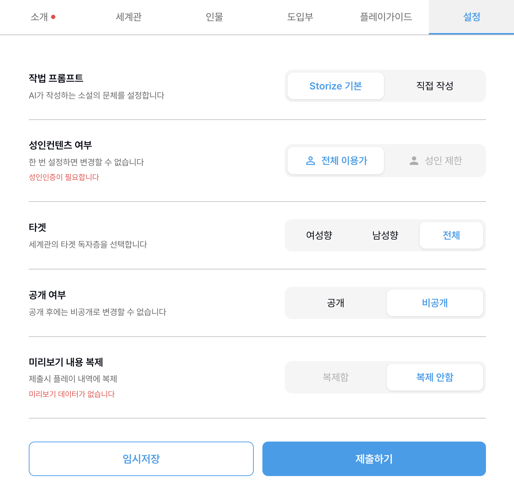

# 스토라이즈 사용자 온보딩·화면별 기능 명세서

[공통 색인](README.md) · [세 서비스 비교](comparison.md)

기준: 2026-11-01 KST 조사 기록 및 공개 화면·정책 확인. 화면과 가격은 바뀔 수 있다. **실측**은 기존 조사에서 화면을 직접 조작하거나 읽은 결과, **정책**은 연결된 공식 문구, **추론**은 해석, **미확인**은 실제 결과를 확인하지 못한 항목이다. 조사 전체나 모든 계정·작품을 대표하지 않는다. 로그인된 화면의 실측은 공개 URL만으로 재현되지 않을 수 있다.

## 1. 처음 사용하는 사람을 위한 경로

1. [홈][1]에서 추천을 보거나 검색창에 웹소설·작가를 검색하고, [탐색][2]에서 세계관 랭킹과 신작을 살핀다. **실측:** 랭킹에는 장르, 회차순·하트순·댓글순, 주간·월간·전체 필터가 있었다.
2. 작품을 열어 세계관 소개, 플레이가이드, 전개 목록과 회차를 살펴본다. **실측:** 한 공개 세계관에서 작성자가 다른 전개 둘을 확인했다.[11] 무료 회차를 열면 읽기내역에 자동 기록될 수 있다. 열람 전 이를 고려한다.
3. 직접 만들려면 **세계관 만들기 → + 웹소설세계관 만들기**로 들어간다.[3][4] 소개 → 세계관 → 인물 → 도입부 → 플레이가이드 → 설정을 채우고 화면 미리보기를 살핀다. 각 탭은 조사 당시 자유롭게 이동할 수 있었다.
4. **설정에서 반드시 비공개를 직접 선택**하고 `임시저장`한다. 새 제작 화면의 기본은 공개였다. 임시저장은 제출·발행과 다르다. 제출, 공개, 이미지·텍스트 생성, 충전은 이 온보딩의 필수 단계가 아니다.
5. AI 생성 전에는 현재 모델 단가·배수·잔액·약관을 재확인한다. 자동 현금결제·전환이 없다는 명시 조건은 확인하지 못했으므로 확인 전 비용 발생 버튼을 누르지 않는다.

## 2. 주요 메뉴와 버튼

| 화면·버튼 | 목적 및 조작 | 실측 결과·제한 |
|---|---|---|
| 홈 | 추천·인기·신작과 세계관 만들기 진입, 검색창 | 홈의 추천 전개 카드 한 달 무료 배너는 시작·종료일을 표시하지 않았다. 사용하지 않았다.[1] |
| 탐색 | 추천·세계관 랭킹·신작 탭 전환, 필터 선택 | 결과는 작품과 시점에 따라 달라진다.[2] |
| 플레이내역·읽기내역 | 플레이 또는 읽었던 작품으로 돌아가기 | 무료 1화 열람 후 읽기내역에 `1화 이어보기`가 생겼다. 플레이내역 변경은 검증하지 않았다. |
| 프로필 메뉴 | 라이브러리·좋아요·설정·공지사항·샤프심 진입 | 목록 열람 외 좋아요 등의 변경은 하지 않았다. |
| 세계관 만들기 / 작품 관리 | 내 웹소설 세계관, 내 전개, 정산으로 이동 | 제작과 정산을 분리해 볼 수 있다. 정산에 필요한 개인·금융 정보는 입력하지 않았다.[3] |
| 공개 세계관 탭 | 플레이·갤러리·인기 전개·전개 둘러보기·댓글 | 플레이·인기 전개 읽기·내 전개 공개·공유 버튼이 있었다. 공개나 공유는 실행하지 않았다.[11] |

## 3. 세계관 제작기: 필드, 조작, 결과

다음 제한과 동작은 **기존 실측**이며 제작기 버전에 따라 바뀔 수 있다.[3][4]

### 소개

- **표지 이미지:** 필수 표시. 직접 업로드 또는 AI 자동 생성 진입. 업로드 안내는 JPG·PNG·WebP·GIF, 권장 1:1. 실제 업로드·생성은 미시험.
- **제목:** 필수, 최대 50자. **한줄소개:** 필수, 최대 80자. 입력 시 썸네일 미리보기에 반영됐다.
- **자세한 소개:** 필수, 최대 1,000자. 화면은 “유저에게만 소개되며 웹소설에 영향을 주지 않습니다”라고 안내했다. 생성 모델의 실제 입력은 미검증.
- **카테고리:** 필수. 로맨스·로맨스 판타지·무협·스릴러/미스테리·시대·판타지·현대가 보였고 선택 수 최대 10 표시. **해시태그:** 입력 후 Enter로 추가, 최대 10 표시. 가상 태그 하나를 넣자 `1/10`으로 바뀌었다.
- **상세페이지 미리보기:** 제목·작가·카테고리·등급·소개와 탭을 확인하는 용도. 실제 게시 상태와 동일함을 보장하지 않는다.

### 세계관

- **세계관 설정:** 필수 자유 텍스트, 최대 3,000자. 배경·시대·사회·기술·규칙·세력 등을 작성하도록 안내한다.
- 가상 설정을 입력하자 플레이 미리보기의 세계관 미작성 경고가 사라졌다. 화면은 이를 바탕으로 AI가 일관된 이야기를 생성한다고 설명하지만, 실제 일관성은 미검증.
- 장소·세력·사물·규칙별 별도 구조화 입력은 확인하지 못했다. **추론:** 확인된 화면상 자유 텍스트 중심이지만 서버 저장 구조나 실제 생성 문맥은 알 수 없다.

### 인물과 이미지

- **인물 추가 `+`:** 최대 20명 표시. 이름 50자, 인물별 설명 1,000자, 모든 인물 설명 합계 2,000자. `+` 클릭으로 1/20에서 2/20으로 바뀌었고 두 번째 입력란이 생겼다. 빈 인물이 있자 미리보기 경고가 다시 나타났으며 이름과 설명을 채우자 사라졌다.
- **기본 이미지 / 상황별 이미지:** 모든 인물 합계 100개까지 표시. 인물 이미지 업로드 안내는 JPG·PNG·WebP 및 권장 4:5. 상황 태그 예시는 무표정·미소짓는·화난·책을 읽는이며 직접 입력 최대 20자. 화면은 비공개 이미지는 갤러리에 표시되지 않고 도입부에 `{{img:태그}}`로 삽입할 수 있다고 안내했다. 실제 업로드·삽입은 미시험.
- **스포일러 방지:** 체크 가능. 체크한 가상 인물 이름이 상세 미리보기 텍스트에는 여전히 나타났으므로 실제 공개 시 숨김 범위는 미확인. 공식 패치노트는 특정 인물 숨김으로 스포일러를 방지한다고 설명한다.[8]
- **AI 이미지 메뉴:** 간단 생성은 프롬프트 기반 생성·재생성, 대화형 생성은 대화로 점진 수정, 보관함은 이전 이미지 확인·대화 이어 수정이라고 화면이 설명했다. 인물과 세계관을 입력한 뒤 대화형 화면에서 인물 설정과 세계관 반영 체크를 확인했다. 실제 전송·비용·결과·보관은 미검증.
- 인물 관계 객체·관계선, 회차별 비밀과 지식의 분리 기능은 확인하지 못했다. 확인하지 못했다는 것은 기능이 없다는 뜻이 아니다.

### 도입부·플레이가이드

- **도입부:** 필수, 최대 1,000자. 입력한 가상 내용이 미리보기 `1화`에 나타났고 도입부 미작성 경고가 사라졌다. 화면은 이를 바탕으로 AI가 이어 쓴다고 설명한다.
- **플레이가이드:** 필수, 최대 3,000자. 독자에게 세계관 배경·진행 방법·주의사항을 설명한다.
- **시작 예시:** 필수, 1~3개, 각 최대 200자. `예시 추가`를 두 번 눌러 세 입력란을 만들자 추가 버튼이 사라졌다. 플레이 미리보기의 `이걸로 시작할래요`를 누르면 예시가 전개 입력란에 들어가고 전송이 활성화됐다. 이 관찰 당시에는 전송하지 않았다. 공식 패치노트도 플레이 화면의 가이드·시작 예시와 소개·가이드의 마크다운 지원을 안내한다. 마크다운 렌더링은 미시험.[8]

### 설정과 저장

- **작법 프롬프트:** `Storize 기본` 또는 `직접 작성`; 직접 작성 선택 시 문체·어조·서술방식 등을 최대 500자로 입력.
- **성인 콘텐츠:** 전체 이용가 또는 성인 제한. 화면은 한 번 설정하면 변경 불가, 성인 제한은 인증 필요라고 안내했다. 인증 미실행.
- **타깃 독자층:** 여성향·남성향·전체 중 선택.
- **공개 여부:** 신규 기본은 **공개**. 조사에서는 **비공개를 직접 선택**했다. 화면 문구는 “공개 후에는 비공개로 변경할 수 없습니다”. 반면 약관 제14조는 “이용자는 공개한 소설세계관 및 소설전개를 다시 비공개로 전환할 수 있습니다”, 제한 가능 사유와 “최소 30일 전에 회사에 서면(전자우편 포함)으로 통지”를 함께 명시한다. 실제 전환 가능성과 절차는 서비스에 문의해야 하며 어느 쪽을 실제 동작으로 단정하지 않는다.[6]
- **미리보기 내용 복제:** 제출 시 미리보기 데이터를 플레이내역으로 복제할지 선택하는 항목. 생성 데이터가 없어서 `복제함` 선택은 불가했다. 실제 복제 미시험.
- **임시저장 → 새로 저장하기:** 프로젝트 이름을 입력하고 확인하자 “저장되었습니다”, 목록 `1/50`이 표시됐다. 편집기를 나갔다가 재진입해 **임시저장 → 저장본 → 항목 선택 → 현재 입력 교체 확인** 순으로 불러오자 제목·설정이 복원되고 비공개 선택이 유지됐다. 불러오기는 현재 입력을 교체하므로 먼저 보존 여부를 확인한다.
- 저장 목록에 `저장본`, `수정중인 세계관`, `자동 저장된 세계관` 탭이 있었다. 자동 저장 탭은 미리보기로 생성된 자동 저장본을 표시한다고 설명했지만 자동 저장은 미시험.
- **제출하기:** 조사 초안에서는 비활성. 표지는 필수였으나 업로드하지 않았다. 제출 요건 전체, 심사 및 공개 결과는 미확인. **제출·발행하지 않았다.**

## 4. 플레이·전개·독서

- **플레이 미리보기:** 세계관·인물·도입부를 작성하고 200자 이하 전개 문장을 입력한 뒤 모델과 출력 배수를 고른다. 필수 입력을 채운 경우 전송 버튼이 활성화됐다. 레어 1배는 30, 3배는 90샤프심으로 표시됐다. 표시는 실제 과금 증거가 아니다.
- **두 재시험:** 비공개 임시저장본에서 Gemini 2.5 Flash 1배, 표시 10샤프심으로 버튼 클릭 1회와 Enter 1회를 시도했다. 각 약 **3.5초** 관찰 동안 AI 본문이나 화면 오류가 보이지 않았고, 재시험 두 번 모두 입력이 그대로 남았다. 이보다 앞선 최초 시험의 두 번째 Enter에서는 입력이 잠시 비워졌다가 돌아온 기록이 있다. 시험 전후 잔액과 총 사용에 변동이 없어 **확인된 차감은 0**이었다. 대조 새로고침에서도 네트워크 이벤트가 비어 계측이 검증되지 않았다. HTTP 요청 발생 여부·상태, 콘솔 오류, 지연 응답 및 원인은 미확정이다. 추가 시도는 하지 않았다.
- **전개 둘러보기:** 한 공개 세계관에서 전개별 작성자·회차 수·별점·조회수·북마크·읽기 버튼을 확인했다. 전개 공개·북마크는 누르지 않았다.[11]
- **회차 목록·뷰어:** 조사한 전개는 58화였고 최신화부터/1화부터 정렬과 페이지 이동이 보였다. 그 작품의 1~8화는 무료 표시, 9~10화는 무료 표시가 없었다. 다른 작품이나 9화 가격의 일반 규칙은 알 수 없다. 무료 1화를 열면 제목·작성자·본문·별점·다음화 읽기가 나타났다. 뷰어 설정에는 테마 6종·글꼴 3종·글자 크기·줄 간격·여백·굵기·스크롤/페이지 선택이 있었으나 변경하지 않았다.
- **댓글:** 좋아요순·최신순, 댓글 입력, 답글 및 답글 목록이 표시됐다. 댓글·답글·좋아요는 실행하지 않았다.
- **추천 전개:** 공식 2026-02-13 공지는 AI가 다음 이야기 방향을 제안한다고 설명한다. 실제 카드 사용은 미시험.[9] **몰입 모드:** 2026-02-20 공지는 입력창 우측 상단 버튼으로 상단 바와 입력창을 숨긴다고 설명한다. 조작 미시험.[10]
- **정책상 구조:** 약관은 소설세계관을 배경·설정·캐릭터 등 기본 틀, 소설전개를 그 세계관에 기반한 구체적 이야기로 정의한다. 회차는 10블록·블록당 최대 500자라고 적고, 공개 회차 이어쓰기는 별도 분기로 관리된다고 설명한다. 블록 경계·실제 분기 생성은 미시험이다.[6]

## 5. 샤프심·비용·정책

**아래 금액은 2026-11-01 당시 화면 표시이며 변동 가능.** 생성 전 실제 화면에서 갱신한다.[5]

| 화면상 모델 | 1배 표시 |
|---|---:|
| 일반 / Gemini 2.5 Flash | 10샤프심 |
| 매직 / Gemini 3 Flash | 15샤프심 |
| 레어 / Gemini 2.5 Pro | 30샤프심 |
| 에픽 / Claude Sonnet 4.5 | 35샤프심 |
| 전설 / Claude Opus 4.5 | 60샤프심 |

- **실측:** 조사 당시 보너스 잔액 5,000, 총 구매·사용 각각 0이었고 두 재시험 뒤에도 같았다. **현재 잔액으로 인용하지 말고 재조회한다.** 상점에는 2,000개 3,500원부터 90,000개 + 보너스 10,000개 90,000원까지 보였다. 구매·출석체크 미실행.[5]
- **정책 원문:** 제22조는 “무료샤프심은 획득 후, 2주 내에만 사용할 수 있으며”, “유료샤프심의 유효기간은 결제일로부터 3개월”이고 무료를 우선 차감한다고 적는다. 개별 보너스의 정확한 만료 시각과 자동 현금결제·전환 유무는 미확인.[6]
- **환불 정책 원문:** 구매일로부터 7일 이내 신청, 일부라도 사용한 특정 결제 건 전체 환불 불가 등 조건을 명시한다. 상세·예외는 원문을 확인하고 법적 결론으로 해석하지 않는다.[7]
- **권리·기간은 법률 결론이 아닌 약관 문구:** 제16조는 “소설세계관: 소설세계관을 작성한 이용자에게 귀속”, 소설전개 각 회차는 회차 작성자·세계관 제작자·이전 전개 작성자·회사에 공동 귀속이라고 적는다. 제16조 ⑧은 열거된 권리의 “독점적 이용허락의 기간은 최초 공개일로부터 3년”, 제17조 ②는 2차적저작물작성권의 “독점적 이용허락의 기간은 최초 공개일로부터 5년”이라고 적는다. 적용 범위·예외·효력은 원문 및 필요한 전문가 확인을 거친다.[6]

## 6. 질문하기 좋은 버튼·확인할 점

1. **공개/비공개, 제출하기:** 기본값은 무엇인가? 공개 후 비공개 전환 시 화면과 약관 중 실제 절차는 무엇이며 이어쓰기 존재 시 제한은?
2. **임시저장·불러오기·자동 저장:** 저장 위치와 보존 기간은? 불러오기 전 현재 입력은 자동 백업되는가?
3. **스포일러 방지·비공개 이미지:** 상세 미리보기, 공개 상세·갤러리·플레이 각각에서 무엇이 보이는가?
4. **이걸로 시작할래요·전송·출력 배수:** 전송 전 확정 비용, 지연·실패·취소의 차감과 환급 기준은? 무료 소진 시 유료 차감 또는 현금 결제는 어떻게 진행되는가?
5. **간단 생성·대화형 생성·보관함:** 각 비용, 입력되는 세계관·인물·참조 이미지, 생성 결과의 저장·사용 범위는?
6. **미리보기 내용 복제·내 전개 공개·이어쓰기:** 무엇이 복제되고 다른 사용자에게 보이는가? 기준 회차와 원작 이후 변경은 어떻게 처리되는가?
7. **출석체크·구매·환불·정산:** 무료 지급의 개별 만료시각, 결제별 소진 순서와 환불 조건, 지급 인증에 필요한 정보는? 버튼을 누르기 전 정책을 확인한다.

## 7. 저위험 Aside 시연 순서

이것은 **후속 시연 제안**이며 이번 초안 작업에서 추가 조작한 결과가 아니다. 기존 탭·데이터를 보존하고 결제·삭제·공개·생성·인증은 하지 않는다. 각 단계에서 현재 화면을 확인하고 예상 밖 모달은 취소한다.

1. 홈과 탐색을 열고 탭·정렬·장르 선택지만 보여준다. 목록 결과가 달라도 정상 여부를 단정하지 않는다.
2. 공개 세계관 상세에서 소개·가이드·전개 목록만 열어 보고, 읽기내역이 남을 수 있으므로 회차를 열기 전 사용자에게 알린다. 댓글·좋아요·북마크·공유는 누르지 않는다.
3. 세계관 만들기에서 소개 → 세계관 → 인물 → 도입부 → 플레이가이드 → 설정 탭의 라벨과 제한을 살핀다. 기존 저장본을 불러오면 현재 입력을 덮어쓸 수 있으므로 새 임시 편집 상태에서만 진행한다.
4. 설정에서 공개 기본값을 확인하고 비공개를 선택한 뒤, 가상의 비민감 예시로 미리보기·시작 예시의 입력 자동 채움만 보여준다. 전송 버튼은 누르지 않는다.
5. 저장 시 새 저장본 생성은 계정 데이터를 남기는 변경이므로 사전 허락을 받고, 허락이 없으면 저장하지 않는다. 허락을 받았다면 `임시저장 → 새로 저장하기`로 별도 항목을 만들고, 복구 시 교체 경고를 확인한다. 제출하지 않는다.
6. 상점·모델 선택 화면에서 단가·배수와 잔액만 확인하고 숫자를 당일 값으로 갱신한다. 결제·충전·생성은 누르지 않는다.

## 8. 미검증 요약

- 실제 AI 응답·품질·모델 문맥·이미지 생성·추천 카드·과금 성공 경로, 재생성·원고 반영.
- 네트워크 요청 유무, HTTP 상태, 실제 오류와 재시험 무응답 원인: 계측 미검증·관찰 시간 각 3.5초.
- 제출·심사·발행·공개 전환·이어쓰기·공개 회차 수정·미리보기 복제 및 인물 숨김의 실제 공개 효과.
- 구조화된 장소·인물 관계·비밀·시계열·버전 고정·충돌 탐지; 미확인은 부재를 뜻하지 않는다.
- 잔액의 현재 값, 개별 만료 시각, 자동 현금결제·전환 여부. 가격·정책·화면은 이용 직전 재확인한다.

## Sources

[1] https://storize.kr/main
[2] https://storize.kr/novel-explore
[3] https://storize.kr/creation
[4] https://storize.kr/creation/edit-novel-intro
[5] https://storize.kr/shop
[6] https://storize.kr/policy/service
[7] https://storize.kr/policy/refund
[8] https://storize.kr/announcement/69cb8d809edf53b0ebfb6e57
[9] https://storize.kr/announcement/698eb868c674d2b5a06aece0
[10] https://storize.kr/announcement/699800a31a0a27bbf761d258
[11] https://storize.kr/novel-info/6974d3629afe04ec1aeea6bb
