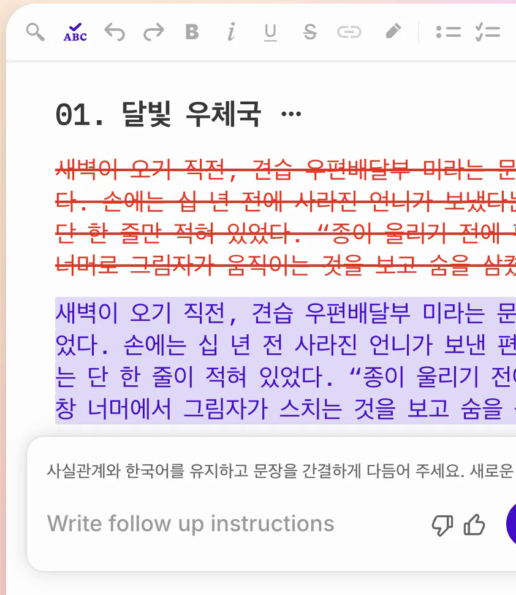

# Sudowrite 사용자 온보딩·화면별 기능 명세서

[공통 색인](README.md) · [세 서비스 비교](comparison.md)

> **근거 범위:** 제공된 2026-11-01 선행 실험 기록을 정리하고, 공식 온보딩·기능 문서 원문을 추가 확인했다. 앱 동작은 이번 초안 작성에서 재실행하지 않았다. 화면·요금·계정별 사용 가능 범위는 달라질 수 있다. 실험에는 가상 자료를 사용했다.

## 빠른 버튼 색인

| 궁금한 버튼·위치 | 목적 / 들어갈 항목 | 결과와 주의 | 상세 |
|---|---|---|---|
| 홈 `New` | 빈 프로젝트·가져오기·폴더·시리즈 선택 | 기존 데이터 변경·가져오기는 승인 후 | A·F |
| `Story Bible` | 설정 기록, 직접 입력 또는 일부 생성 | 생성별 참고 필드는 다름 | B |
| `Add Character`·`Add Element` | 인물·세계 설정 카드 | 숨김의 실제 AI 입력 강제는 미검증 | B |
| `Add Chapter`·`Link it` | 챕터 개요 작성·본문 연결 | Outline과 본문은 별개 | C |
| `Connect it` | 이전 문서 연결 | 참고량은 문맥과 모델 조건에 따름 | C |
| `Draft`·`Scenes` | 장면·지시·시점과 모델 설정 | 챕터 생성은 유료 가능, 선행 시험 미실행 | C |
| `Write` | 커서에서 이어쓰기; 모드·길이·모델 설정 | 결과는 History 카드; 비용 발생 가능 | D |
| `Rewrite` | 선택 글을 방식에 따라 재작성 | Enter 즉시 실행 사례; Insert 대상 주의 | D |
| `Quick Edit` | 선택 글에 수정 지시 | 기본 무료, 수정안 Accept/Reject; 고품질은 크레딧 | D |
| `Chat only`·`Allow edits` | 질문·대화 / 프로젝트 편집 | 전자는 기본 무료, 후자는 크레딧 | D |
| `#`·`Looked at` | 대화 문맥 지정 / 표시된 참고 문맥 | 표시는 실제 전송 페이로드 검증이 아님 | D |
| `History`·`Insert`·`Copy` | 결과 열람·삽입·복사 | 삽입 전 선택 범위·커서 확인 | D |
| `Brainstorm` | 맥락·예시를 넣어 아이디어 생성 | Story Bible 자동 참고 안 함; 비용 가능 | E |
| `Describe`·`Feedback` | 감각 묘사 / 피드백 | 생성 미실행, Feedback 자격 확인 | E |
| `Canvas` | 시각적 이야기 구조 | 생성 및 Outline 동기화 미검증 | E |
| `Portraits`·`Images` | 인물·세계 이미지 업로드 또는 생성 | 공식 생성 비용 이미지당 5,000크레딧 | B |
| `Explore Plugins` | 사용자 제작 도구 탐색 | 설치·실행 비용과 전달 문맥 확인 | F |
| `Import`·`Export` | 원고·설정 이동과 백업 | 원고 내보내기는 Story Bible 미포함. 개별 Export는 Outline·Characters·Worldbuilding이며 나머지 필드는 별도 보존 필요 | F |
| `Find and Replace` | 프로젝트·문서·Bible 검색·치환 | Replace All 실행 전 범위와 백업 확인 | F |

## 공식 안내를 바탕으로 한 첫 시작

1. 홈에서 프로젝트를 열거나 빈 프로젝트를 만들고 왼쪽 문서 목록, 가운데 편집기, 오른쪽 Chat·History를 살핀다.[1][2]
2. 짧은 가상 원고를 직접 작성한다. Story Bible에 아이디어와 Genre·Style·Synopsis·Characters 등을 직접 채우거나 필요한 항목만 생성한다. 공식 안내는 구조화된 설정을 모아 두고 이를 후속 집필에 활용하는 흐름을 설명한다.[1][4]
3. 이야기를 계획한다면 Outline과 Scenes를 다듬고, 필요할 때만 Draft를 사용한다. 반드시 순서대로 모든 항목을 완성해야 하는 것은 아니다.[4]
4. 막힌 문장은 Write, 선택한 문장은 Rewrite 또는 Quick Edit, 질문은 Chat을 사용한다. 도구마다 보는 문맥은 다르므로 History의 표시와 결과를 확인하고 수동 검토한다.[3][5][7]
5. 원고 내보내기에는 Story Bible이 포함되지 않는다. Outline·Characters·Worldbuilding은 개별 Export가 있고, Braindump·Genre·Style·Synopsis 등 다른 필드는 복사하는 등 별도 보존해야 한다. 개인정보나 비공개 원고를 서비스에 제공할 권한과 이용조건도 먼저 확인한다.[9]

## Aside 안전 시연 제안 — 실행 전 사용자 승인

1. 기존 탭·작품은 건드리지 않고 사용자가 지정한 가상 프로젝트에서 메뉴와 잔액만 읽는다. 로그인·2FA·카드·비밀값은 입력하거나 채팅으로 요구하지 않는다.
2. 가상 문서에서 Story Bible, Outline, 이전 문서 연결과 History를 열어 보여준다. 삭제·공유·발행·Import/Export는 누르지 않는다.
3. AI 실행이 허용된 경우에도 먼저 모드·예상 비용과 남은 무료 크레딧을 읽고 별도 승인을 받는다. 무료임이 화면에서 확인된 Chat only 또는 기본 Quick Edit만 소량 시연하고, Quick Edit은 비교 후 Reject한다. 무료 상태가 불명확하면 실행하지 않는다.
4. 결과·활동 내역·전후 잔액을 함께 확인한다. 유료 생성, Higher Quality, Allow edits, 플러그인·이미지 생성은 별도 명시적 승인 없이는 실행하지 않는다. 실제 청구나 사용량은 계정 화면에서 최종 확인한다.

---
## 선행 조사 기록에 근거한 화면별 관찰

**선행 조사 기록 기준: 2026년 11월 1일.** Sudowrite는 작품 설정과 챕터 구조, 원고 편집, AI 결과와 참고 문맥을 한 프로젝트 안에 결합한 집필 환경입니다. STORYFORK 관점에서는 특히 **문맥 표시, 결과 채택 경계, 인물·세계관 구조**가 참고할 만합니다.

## 조사 범위와 당시 상태

- **조사 대상:** 온보딩에서 자동 생성된 첫 프로젝트의 이름을 바꾼 가상 조사 프로젝트 1개. 가상 문서 2개와 가상 Story Bible만 사용했습니다.
- **AI 사용:** 이전 승인에 따라 무료체험 크레딧으로 핵심 기능을 시험했습니다. 이후 유료 기능 실행 금지 지시를 받은 뒤에는 무료로 확인된 기본 Quick Edit과 Chat only만 실행했습니다.
- **잔액:** 무료체험 최초 **10,000 → 최종 6,893크레딧**, 총 **3,107크레딧** 사용. 이 수치는 다른 서비스의 무료 샤프심이 아니라 Sudowrite 무료체험 크레딧이다. 마지막 Quick Edit과 Chat 시험은 각각 **0크레딧**으로 기록됐습니다.
- **보존:** 기존 작품 수정·삭제, 결제·구독, 카드·자격 증명 입력, 공유·발행은 하지 않았습니다. 조사 프로젝트와 지정 탭은 그대로 남겨뒀습니다.
- **남은 화면 변경:** Feedback 메뉴 조사 중 상단 표시가 `Feedback Pro`에서 `Feedback Pro Beta Read`로 바뀌었습니다. 초기와 똑같은 표시로 되돌리는 방법은 확인하지 못했습니다. Feedback 실행은 하지 않았습니다.
- **범위:** 주요 메뉴와 몇 가지 AI 결과를 직접 확인했지만, 모든 메뉴·설정·AI 경로를 실행한 완전한 전수 검증은 아닙니다.

### 검증 표기

- **[실측]** 선행 조사에서 직접 클릭·입력하거나 화면 상태를 확인.
- **[실행]** 선행 조사에서 가상 원고로 AI를 실행하고 결과·사용량을 확인.
- **[문서]** 공식 문서로만 확인. 실제 동작까지 검증한 것은 아님.
- **[제안]** STORYFORK에 대한 해석이나 권고.
- **[미검증]** 동작이나 조건을 확인하지 못함.

앱 실측과 실행은 제공된 선행 조사 기록을 인용한 것으로, 이번 초안 작성 중 재실행한 것이 아닙니다. 홈·플러그인 등 위치는 따로 적었습니다.

---

## 화면·메뉴별 상세 기능 명세

## A. 홈, 프로젝트와 문서

### 프로젝트 생성과 관리

**[실측 | 홈 → New]** 다음 항목을 확인했습니다.

- `Blank Project`: 빈 프로젝트.
- `Generate Project`: 생성형 프로젝트 시작 메뉴.
- `Import Project`: 기존 원고 가져오기.
- `Folder`: 폴더.
- `Series`: 시리즈.

**[실측 | 프로젝트 카드 → More options]** 두 문서가 있는 조사 프로젝트에서 `Export as 2 docs`, `Export as 1 doc`, `Duplicate`, `Add cover`, `Move to...`, `Delete`가 나타났습니다. 내보내기·삭제는 실행하지 않았습니다.

**[실측 | 프로젝트 왼쪽 New]** `Folder`, `Blank document`, 기존 Outline 챕터가 선택지로 나타났습니다. `Blank document`로 두 번째 가상 문서를 만들었습니다.

- 문서 옆 메뉴에는 `Rename`, `Duplicate`, `Export (.docx)`, `Delete`가 있었습니다.
- 두 문서를 전환해도 **같은 프로젝트의 Story Bible**이 유지됐습니다.
- 빈 문서에서는 `First Draft`가 활성화됐고, 글을 입력한 뒤에는 비활성화됐습니다.

**[문서 | 홈 → Series]** 같은 Series 폴더의 같은 계층에 있는 프로젝트는 Characters와 Worldbuilding을 공유하며, 공유 카드의 수정이 다른 프로젝트에도 반영되는 구조로 설명됩니다. 실제 Series 생성·공유는 미검증입니다.[12] [Series Support](https://docs.sudowrite.com/using-sudowrite/1ow1qkGqof9rtcyGnrWUBS/series-support/3vfbZPCB1ANLm75FXmJf28)

## B. Story Bible

### 기본 구성

**[실측 | 왼쪽 문서 목록 아래 → Story Bible]** 일곱 섹션을 확인하고 가상 설정을 직접 입력했습니다.

- `Braindump`: 아이디어·설정 자유 입력.
- `Genre`: 장르·세부 장르·트로프.
- `Style`: 원하는 문체.
- `Synopsis`: 인물·목표·갈등 등의 이야기 요약.
- `Characters`: 인물 카드.
- `Worldbuilding`: 세계 요소 카드.
- `Outline`: Act와 챕터 요약.

**[실측 | Style]** 초기 화면에서 `Featured Styles`, `Match My Style`, `Custom`이 보였습니다. `Custom`을 선택하자 자유 입력란으로 전환됐습니다.

**[실측 | Synopsis]** 내용을 입력하고 필드에 초점을 두자 `Rewrite`가 나타났습니다. 해당 필드의 AI 재작성은 실행하지 않았습니다.

**[문서]** Story Bible 필드는 후속 생성 단계에 서로 다르게 영향을 주며, 모든 정보가 매 AI 요청에 항상 포함된다는 뜻은 아닙니다. [Story Bible](https://docs.sudowrite.com/using-sudowrite/1ow1qkGqof9rtcyGnrWUBS/what-is-story-bible/jmWepHcQdJetNrE991fjJC)

### Characters

**[실측 | Characters → Add Character]** `Blank Character`, `Generate Character`, `Surprise Me`가 나타났습니다. `Blank Character`로 가상 인물 **미라**를 만들었습니다.

**역할 선택지:** `Custom...`, `Protagonist`, `Antagonist`, `Supporting Character`, `Minor Character`, `Love Interest`.

**Protagonist 카드에서 확인한 필드:**

- 이름, 역할, `Portraits`
- `Pronouns`, `Groups`, `Other Names`
- `Personality`, `Motivations`, `Internal Conflict`
- `Strengths`, `Weaknesses`, `Character Arc`
- `Physical Description`, `Dialogue Style`, `Add Trait`

**[실측 | Characters → Customize Traits]** Protagonist의 기본 특성 8개와 `Add a new default trait`, `Add to Current Protagonists`, `Save New Defaults`를 확인했습니다. 기본값 변경이나 저장은 하지 않았습니다.

**[실측 | 인물 카드 눈 아이콘]** `Hide element from Sudowrite`를 누르자 `Make element visible to Sudowrite`로 바뀌었습니다. 다시 눌러 보이는 상태로 복구했습니다. **숨김이 모든 AI 경로의 실제 입력에서 강제되는지는 시험하지 않았습니다.**

**[실측 | Characters 섹션 메뉴]** `Copy Characters`, `Customize Traits`, `Import`, `Export`, `Collapse All`, `Delete All`을 확인했습니다. [Characters 공식 문서](https://docs.sudowrite.com/using-sudowrite/1ow1qkGqof9rtcyGnrWUBS/characters/a7tdE1ZB8KvAwMD3Mopwpd)

### Worldbuilding

**[실측 | Worldbuilding → Add Element]** `Blank Element`, `Generate Element`, `Surprise Me`를 확인했습니다. 빈 요소를 만들어 **달빛 우체국**을 `Setting`으로 지정했습니다.

**유형 메뉴:** `Custom...`, `Setting`, `Organization`, `Lore`, `Key Event`, `Clue`, `Magic System`, `Item`, `Technology`, `Government`, `Economy`, `Culture`, `Religion`.

**Setting에서 확인한 항목:** `Other Names`, `Sensory Description`, `Location`, `Images`, `Add Trait`. 묘사와 위치를 직접 입력했습니다.

섹션 메뉴에는 `Copy Worldbuilding`, `Customize Traits`, `Import`, `Export`, `Collapse All`, `Delete All`이 있었습니다. **각 유형의 모든 기본 특성은 미검증**입니다. [Worldbuilding 공식 문서](https://docs.sudowrite.com/using-sudowrite/1ow1qkGqof9rtcyGnrWUBS/worldbuilding/uc5NfWSz4x8Wm3S19LZeo8)

### 인물 초상화

**[실측 | Characters → 인물 카드 → Portraits]**

- `Generate`, `Upload` 탭.
- 생성 입력: `Appearance details`, `Style`.
- 스타일: `Painterly`, `Cinematic Realism`, `Bright Editorial`, `Storybook`. 화면에는 최대 4개 선택으로 표시.
- 업로드 탭: 이미지 선택·드롭 영역.

**생성·업로드는 하지 않았습니다.** **[문서]** 공식 안내는 인물 및 세계 이미지 생성 비용을 장당 5,000크레딧으로 설명합니다.[10] [Portraits & Images](https://docs.sudowrite.com/using-sudowrite/1ow1qkGqof9rtcyGnrWUBS/portraits--images/8FB59VFrbbhcmBRYNicXis)

## C. Outline, 문서 연결, Scenes·Draft

### Outline과 문서 연결

**[실측 | Story Bible → Outline]**

- `Add Chapter`로 `1. 문 없는 우체국`을 만들고 요약을 입력했습니다.
- `Add Act`와 챕터의 `Generate` 버튼이 보였습니다.
- 섹션 메뉴에는 `Copy Outline`, `Outline History`, `Collapse All`, `Rewrite`, `Import`, `Export`, `Delete`가 있었습니다.
- 첫 문서의 제목 옆 연결 메뉴에서 `Is this document in your Outline? → Link it`을 선택하자 `Linked to 1. 문 없는 우체국 in your Outline`이 표시됐습니다.

**[실측 | 두 번째 문서 → 제목 옆 연결 메뉴]** `Does this document continue another one? → Connect it`에서 첫 문서를 지정하자 **`Continues from the end of 01. 달빛 우체국`**이 표시됐습니다.

이 상태에서 실행한 Write 결과에는 현재 문서 **29 words**, 앞 문서 **115 words**가 `Looked at`으로 표시됐습니다. 이는 **UI가 두 문서를 참고했다고 표시한 사실**이지, 실제 모델 요청의 원문 전체를 검사했다는 뜻은 아닙니다.

**[문서]** 연결된 이전 문서는 Write·Draft 문맥에 활용될 수 있지만, 문맥 용량에 따라 실제 포함량이 달라질 수 있습니다.[13] [Chapter Continuity](https://docs.sudowrite.com/using-sudowrite/1ow1qkGqof9rtcyGnrWUBS/chapter-continuity/4KL8gFeLZQ6GSBjDWtSbV6)

### POV와 시제

**[실측 | Outline → POV·시제 선택기]**

- POV: `3rd person limited`, `3rd person objective`, `3rd person omniscient`, `1st person`, `2nd person`.
- 시제: `Past`, `Present`, `Future`.
- 조사 프로젝트의 초기 표시는 `3rd person ltd. POV`, `Past tense`.

**[문서]** 전체 챕터 공통 또는 챕터별 설정과 연결된 Draft와의 동기화가 설명됩니다. 챕터별 전환은 직접 시험하지 않았습니다. [POV and Tense](https://docs.sudowrite.com/using-sudowrite/1ow1qkGqof9rtcyGnrWUBS/setting-pov-and-tense/5gKBNzBQLB7C8yuBhHQ983)

### Scenes와 Draft

**[실측 | 편집기 오른쪽 위 → Draft]**

- `Scenes`에 가상 장면을 직접 입력.
- `Extra Instructions`를 누르면 추가 입력란이 펼쳐짐.
- POV, 시제, Prose Mode, `Plan Draft All Scenes` 확인.
- 모델 선택창에 `Muse`, `Excellent`, `Basic`, `Advanced` 표시. 조사 화면의 Draft 기본 표시는 `Excellent`.

**[미검증]** 장면 검사, 자동 수정 제안, 예상 비용 산출, 챕터 Draft 생성은 실행하지 않았습니다. 공식 흐름은 [Scenes & Draft](https://docs.sudowrite.com/using-sudowrite/1ow1qkGqof9rtcyGnrWUBS/scenes--draft/49p5MTVxTKkVFEC5rVUzpY)에 설명돼 있습니다.

## D. 집필·대화·결과 채택

### Write

**[실측 | 상단 Write 오른쪽 메뉴]**

- 모드: `Auto`, `Guided`, `Tone Shift`, `Write settings`.
- 설정: Creativity, 카드 수 1~6개, 카드 길이 약 50~1,500단어 및 `Max words`, Prose Mode, `Key Details`.
- 모델 창: `Muse`, `Excellent`, `Basic`, `Advanced`.
- 처음 본 설정은 `Excellent`, 카드 2개, 약 150단어였습니다. 시험에만 `Basic`, 카드 1개, 약 50단어를 사용하고 원래 값으로 복구했습니다.
- `Key Details`에 지시를 넣으면 Write 버튼에 해당 설정 사용 표시가 나타났습니다. 시험 후 지시를 지웠습니다.

**[실측 | Guided 선택]** “Tell Sudowrite what should come next”, `Suggestions` 토글, 지시 입력란, `See examples`가 열렸습니다. 지시 제출이나 Suggestions 생성은 하지 않았고 `Auto`로 되돌렸습니다.

**[실행]** Auto 결과와 비용은 아래 실험 장부에 정리했습니다. [Write 공식 문서](https://docs.sudowrite.com/using-sudowrite/1ow1qkGqof9rtcyGnrWUBS/write/pvxUvbQqYybfEosqx1sXjY)

### Rewrite

**[실측 | 본문 선택 → Rewrite]** `Rephrase`, `Shorter`, `More descriptive`, `Show, not tell`, `More inner conflict`, `More intense`, `Customize...`를 확인했습니다.

방식 목록에서 `Rephrase`를 선택한 뒤 **Enter를 누르자 생성이 바로 시작**됐습니다. 결과 카드에 `Outline`과 `Synopsis`가 `Looked at`으로 표시됐습니다.

**[실측 | History 카드 → Insert]** 나중에 원래 선택 범위가 사라진 상태에서 `Insert`를 누르자 기존 글을 교체하지 않고 **현재 커서 위치에 추가**됐습니다. 곧바로 Undo해 가상 원고를 복구했습니다. **선택이 유지될 때 교체되는지는 미검증**입니다.

**[문서상 주의]** 공식 본문은 600단어 이하 선택문의 Rewrite가 Synopsis를 참고한다고 하지만, 같은 문서의 영상 전사는 Story Bible을 참고하지 않는다고 설명합니다.[6] 이번 카드에 Synopsis가 표시된 한 사례만으로 모든 길이·조건을 일반화할 수 없습니다. [Rewrite 공식 문서](https://docs.sudowrite.com/using-sudowrite/1ow1qkGqof9rtcyGnrWUBS/rewrite/9hkeezeUsCiUCG4dRdEqjS)

### Quick Edit

**[실측 | 본문 선택 → Quick Edit]**

1. 가상 원고를 선택하면 `Comment`, `Rewrite`, `Describe`, `Expand`, `Quick Edit`가 나타났습니다.
2. `Quick Edit`을 열면 수정 지시 입력란, `Higher Quality: For complex tasks`, `Edit`이 표시됐습니다.
3. 기본 옵션으로 실행하자 원문과 수정안이 본문 안에 함께 표시되고, 추가 지시 입력란과 `Reject`·`Accept`가 나타났습니다.
4. `Reject` 후 원문만 남았습니다.

**[문서]** 기본 Quick Edit은 무료이며, Higher Quality 모드는 크레딧을 사용합니다. 공식 문서는 선택 가능 분량을 최대 1,000단어로 설명합니다. [Quick Edit 공식 문서](https://docs.sudowrite.com/using-sudowrite/1ow1qkGqof9rtcyGnrWUBS/quick-edit/2asL35fds36oHAFJN7bYzz)

### Chat과 문맥 지정

**[실측 | 오른쪽 Chat → 모드 전환]**

- `Chat only`: 화면에 `Free`, 질문·대화용.
- `Allow edits`: 화면에 `Uses credits`, 편집용. 실행하지 않았습니다.

**[실측 | Chat 입력란의 `#`]** 멘션 선택기에 `Outline`, 인물 **미라**, 세계 요소 **달빛 우체국**, 두 문서가 나타났습니다. `미라`를 선택하면 메시지에 `#미라` 링크가 붙었습니다.

**[실행]** 멘션 질문에 대한 답변은 인물 카드에 적어 둔 성격·동기를 정확히 요약했습니다. 다만 **원고 선택도 함께 붙어 있었고 기존 대화도 있는 상태**였으므로, 인물 카드만 유일한 문맥이었다고 단정할 수 없습니다. [Chat 공식 문서](https://docs.sudowrite.com/using-sudowrite/1ow1qkGqof9rtcyGnrWUBS/chat/5vbuELXf6LZQnGfVzsEXCV)

### History

**[실측 | 오른쪽 History]**

- 결과 카드에 생성문, `Insert`, `Copy`, 평가, 즐겨찾기와 일부 `Looked at` 문맥이 표시됐습니다.
- `Filter view options`에서 `All activity`, `Favorites`를 확인했습니다. Favorites에 저장된 결과가 없다는 안내를 본 뒤 `All activity`로 복구했습니다.
- `Looked at`은 사용자가 참고 대상을 살피는 데 유용하지만, **원시 요청 페이로드를 검증한 증거와는 다릅니다.**

## E. Brainstorm, Describe, Feedback, Canvas

### Brainstorm

**[실측 | 상단 Brainstorm]** 카테고리 11개:

`dialogue`, `characters`, `world building`, `plot points`, `names`, `places`, `objects`, `descriptions`, `article ideas`, `tweets`, `Something Else`.

`plot points`를 선택하자 `Give me a list of`, 선택 사항 `Context`, `Examples`, `Add another`, `Start`가 나타났습니다. 실행 결과와 비용은 아래 장부에 있습니다.

**[문서]** 공식 문서는 Brainstorm이 Story Bible 대신 해당 패널에 제공한 맥락과 예시를 사용한다고 설명합니다.[8] [Brainstorm](https://docs.sudowrite.com/using-sudowrite/1ow1qkGqof9rtcyGnrWUBS/brainstorm/5xJUutV75BLU6u9LZndcDs)

### Describe

**[실측 | Describe 옵션]** `Sight`, `Smell`, `Taste`, `Sound`, `Touch`, `Metaphor`가 켜진 상태로 표시됐습니다. 생성은 하지 않았습니다. [Describe 공식 문서](https://docs.sudowrite.com/using-sudowrite/1ow1qkGqof9rtcyGnrWUBS/describe/aTHZdZBjRmH8AspqrPdPcP)

### Feedback

**[실측 | Feedback 오른쪽 선택 메뉴]**

- 유형: `Developmental`, `Line`, `Dialogue`, `Copy`, `Beta Read`, `Add Custom Type`.
- Developmental 세부 항목: `Consistency`, `Believability`, `Pacing`, `Clarity`, `Originality`.
- Beta Read: `Maya`는 감정 반응, `Anton`은 구조·동기, `Joan`은 설득력이 부족한 부분에 초점을 둔 설명이 표시됐습니다.

상단에 `Pro`가 표시됐고 **실행하지 않았습니다.** 공식 문서도 Professional·Max 전용으로 설명합니다. [Feedback](https://docs.sudowrite.com/using-sudowrite/1ow1qkGqof9rtcyGnrWUBS/feedback/7Ew1KgpEwabQSgvijq8QNr)

### Canvas

**[실측 | More Tools → Canvas]** 별도 2차원 화면에서 예시 카드와 `Fill me in`, `Generate full outline`을 확인했습니다. `Story Structure`에는 다음 네 구조가 있었습니다.

- `The Hero’s Journey`
- `Hollywood Beats`
- `Story Circle`
- `Romance Outline`

생성은 하지 않았습니다. Canvas와 Story Bible Outline의 **자동 양방향 동기화는 미검증**입니다. [Canvas 공식 문서](https://docs.sudowrite.com/using-sudowrite/1ow1qkGqof9rtcyGnrWUBS/canvas/pQGLNzeYo1kLhGo14rdBy6)

## F. 검색·플러그인·가져오기·내보내기

### Find and Replace

**[실측 | 편집기 왼쪽 위 → Find and Replace]**

- 범위: `Project`, `Document`, `Story Bible`.
- 가상 인물 `미라`를 Project 범위로 검색하자 **총 8건**: Story Bible 5건, 두 문서에서 3건.
- Story Bible 범위에서는 `1 of 5 (Braindump)`가 표시됐습니다.
- `Replace`, `Replace All`은 확인만 하고 실행하지 않았습니다.

### 플러그인

**[실측 | More Tools → Explore Plugins | [디렉터리](https://editor.sudowrite.com/app/plugins)]**

- 분류: `Narrative & Plot`, `Character Development`, `Editing & Revision`, `Scene Enhancement`, `World-Building`, `Analysis & Feedback`, `Marketing`, `Genre-Specific`, `Multi-Lingual`.
- 탐색: `Popular`, `Newest`, `Added`, `Yours`, 검색.
- 카드에 이름·제작자·설명·사용자 수와 `Add` 표시.
- `Create Plugin`은 자연어 설명 입력과 `Generate Plugin...`으로 시작했습니다.

플러그인 **설치·생성·실행은 하지 않았습니다.** **[문서]** 고급 제작에는 프롬프트, 문맥 변수, 모델 및 생성 설정이 설명돼 있습니다.[14] [플러그인 제작](https://docs.sudowrite.com/using-sudowrite/1ow1qkGqof9rtcyGnrWUBS/how-do-i-build-plugins/a3iVxJb4UZLKfSxf8BG3mY)

### 가져오기와 내보내기

**[실측 | 홈 → New → Import Project]**

- `Import Document`: `TEXT`, `DOC`, `DOCX`, `RTF`, `ODT` 표시.
- `Import Scrivener`: Scrivener 백업 ZIP 입력 절차.
- Document 화면에 챕터 분리·Story Bible 생성과 베타 기간 무료 설명이 표시됐습니다.

**[실측 | Characters → Import]** 파일 선택·드롭, 텍스트 붙여넣기, `Download Template`과 `.txt`, `.doc`, `.docx`, `.rtf`, `.odt`, `.csv` 표시.

**[실측 | 내보내기 메뉴]** 프로젝트의 `Export as 2 docs`·`Export as 1 doc`, 문서의 `Export (.docx)`, Characters·Worldbuilding·Outline의 `Export`를 확인했습니다. **실제 파일 업로드·다운로드나 왕복 보존은 시험하지 않았습니다.**

**[문서]** 문서에 따르면 가져오기에는 새 프로젝트와 Story Bible을 만드는 방식과 기존 프로젝트에 문서만 추가하는 방식이 있다.[11] 프로젝트 원고 내보내기에 Story Bible이 기본 포함되지 않으므로, Outline·Characters·Worldbuilding을 별도로 내보내야 합니다. [Importing Files](https://docs.sudowrite.com/using-sudowrite/1ow1qkGqof9rtcyGnrWUBS/importing-files/rbGUgrZM6tNuXFG1hjDFyS) · [Exporting Files](https://docs.sudowrite.com/using-sudowrite/1ow1qkGqof9rtcyGnrWUBS/exporting-files/3NtVWXcnwYaRCmPW2iwcCB)

---

## AI 실험 장부: 전후 잔액·결과·직접 조작 증거

**공통 위치:** 가상 조사 프로젝트의 원고, 오른쪽 History·Chat, 오른쪽 위 설정의 `Recent Activity`. 아래 비용은 **이번 입력과 설정의 실측값**이며 일반 가격표가 아닙니다.

### 1. Write Auto: 첫 이어쓰기

- **조건·조작:** 첫 가상 문서에서 `Basic`, 카드 1개, 약 50단어, 한국어 지시로 실행.
- **잔액:** **10,000 → 9,954**, `Write (Auto) Basic 46`.
- **성공:** 한국어 결과 카드가 생성됐고 `Looked at`에 세계관·장르·원고·시점·모델이 표시됐습니다.
- **품질상 한계:** 마지막 문장이 “미라는 무릎을 세우고”에서 끊겼습니다. 생성 성공과 완성도는 별개였습니다.
- **증거:** History 카드와 Recent Activity. 선행 조사 기록에 기술된 화면.

### 2. Chat only: 사실과 불확실성 구분

- **조건·조작:** 미라와 달빛 우체국의 확인된 사실 및 불확실한 점을 한국어로 요청.
- **잔액:** **9,954 → 9,954**, `Chat Messages 1 0`.
- **성공:** 견습 배달부, 편지, 문 없는 우체국, 그림자 등을 요약하고 실종 경위 등을 불확실한 점으로 분리했습니다.
- **한계:** 진행 중 `Checking 01. 달빛 우체국...`, 완료 후 `Checked Manuscript`가 표시됐습니다. Story Bible의 모든 설정을 종합했다고 단정할 수 없습니다. 또한 원문의 “언니가 보냈다는 편지”를 답변에서는 “언니가 보낸 편지”로 더 확정적으로 표현했습니다.
- **증거:** Chat 응답과 Completed tasks, Recent Activity.

### 3. Brainstorm: 플롯 아이디어

- **조건·조작:** `plot points`에서 문 없는 우체국에 들어가는 방법에 대한 맥락과 예시를 입력하고 `Start`를 한 번 누름.
- **잔액:** **9,954 → 8,384**, 활동 내역에 **1,049 + 521 = 1,570**.
- **성공:** 아이디어 6개가 표시됐습니다. 예를 들어 기억을 손바닥에 적으면 문 윤곽이 나타난다는 제안이 있었습니다.
- **미검증:** 한 번의 Start 뒤 비용 항목이 두 건 나타난 이유와 각 내부 단계는 화면에서 확인할 수 없었습니다. 어떤 아이디어도 원고에 채택하지 않았습니다.
- **증거:** Brainstorm 결과와 History, Recent Activity의 두 항목.

### 4. Rewrite: Rephrase

- **조건·조작:** 가상 원고 선택 → `Rewrite` → 카드 1개 → `Rephrase`에서 Enter. **Enter 후 즉시 실행**됐습니다.
- **잔액:** **8,384 → 6,941**, `Rewrite 1,443`.
- **성공:** 재작성 카드가 생성됐고 `Looked at`에 `Outline`, `Synopsis`가 표시됐습니다.
- **품질상 한계:** “새벽이 오기 직전”이 “달빛이 사라지기 직전”으로 바뀌는 등 의미 변화가 있었습니다.
- **채택 시험:** 선택이 사라진 뒤 `Insert`는 교체가 아니라 커서 위치 삽입이었습니다. Undo 후 원문을 복구했습니다. 선택 유지 상태에서의 교체는 미검증입니다.
- **증거:** Rewrite 카드, `Looked at`, 삽입 후 Undo, Recent Activity.

### 5. Write Auto: 앞 문서 연결 후

- **조건·조작:** 두 번째 가상 문서를 첫 문서에 `Continues from`으로 연결하고 `Basic`으로 짧은 이어쓰기 실행.
- **잔액:** **6,941 → 6,893**, `Write (Auto) Basic 48`.
- **성공:** 결과 카드에 현재 문서 **29 words**와 앞 문서 **115 words**가 모두 `Looked at`으로 표시됐습니다.
- **품질상 한계:** 입력에 없던 언니 이름 **“소희”**를 새로 만들었습니다. 설정으로 받아들이기 전에 검토가 필요합니다.
- **증거:** 문서 연결 표시, Write 결과 카드의 문서명·단어 수, Recent Activity.

### 6. Quick Edit: 기본 무료 모드

- **조건·조작:** 첫 가상 원고 전체 선택 → `Quick Edit`. `Higher Quality`는 끈 상태로 “사실관계와 한국어를 유지하고 문장을 간결하게 다듬어 주세요. 새로운 설정을 만들지 마세요” 입력 → `Edit`.
- **잔액:** **6,893 → 6,893**, `Quick Edit 0`.
- **성공:** 원문과 수정안이 본문에 함께 표시됐고 `Reject`, `Accept`, 추가 지시 입력란이 나타났습니다. `Reject` 후 원문만 남았습니다.
- **품질상 한계:** “언니가 **보냈다는** 편지”가 “언니가 **보낸** 편지”로 바뀌어, 사실관계를 유지하라는 지시에도 불확실성의 뉘앙스가 달라졌습니다.
- **증거:** 선행 조사 기록에는 **Reject 전** 비교 화면이 언급됩니다. Reject 후 원문과 활동 내역을 다시 확인했습니다. `Accept` 동작은 미검증입니다.

### 7. Chat only: `#미라` 멘션

- **조건·조작:** Chat only의 `#` 선택기에서 인물 **미라**를 지정하고 성격·동기를 각각 한 문장으로 요약하도록 요청.
- **잔액:** **6,893 → 6,893**, `Chat Messages 1 0`.
- **성공:** 응답은 “호기심이 강하고 신중하지만 가족을 위해 위험을 감수”한다는 성격과 “실종된 언니를 찾고 편지의 진실을 알고 싶다”는 동기를 요약했습니다. 입력해 둔 카드 내용과 일치합니다.
- **미검증:** 원고 선택과 기존 대화도 함께 존재했습니다. 답변이 Story Bible을 근거로 들었더라도 **인물 카드만 전달됐는지**, 실제 요청에 어떤 데이터가 포함됐는지는 확인하지 못했습니다.
- **증거:** `#미라` 링크가 붙은 메시지와 응답, Recent Activity의 0크레딧.

**합계:** 최초 10,000 − 46 − 1,570 − 1,443 − 48 = **6,893**. 두 Chat 시험과 기본 Quick Edit은 각각 0으로 기록됐습니다.

---

## 미검증·주의 사항

- 선행 기록은 소수 한국어 시험이며 생성 품질과 가격의 일반 기준이 아니다. 결과의 완성도·사실관계는 매번 검토한다. 특히 “보냈다는”이 “보낸”으로 바뀐 사례는 불확실성의 **semantic drift(의미 변형)**이다.
- Guided·Tone Shift·Describe·Scenes 생성·Draft·Quick Edit Accept·Chat Allow edits·Feedback·Canvas 생성·플러그인 사용·이미지 업로드/생성·Series 공유·파일 왕복은 선행 실험에서 실행하지 않았다. 실제 요청 페이로드, 숨김 정책 강제, 선택 유지 중 Rewrite 교체도 미검증이다.
- 무료체험의 만료·자동 결제·소진 후 동작은 확인하지 않았다. 가격·계정 조건은 사용 전에 공식 화면에서 다시 확인한다. 기본 무료라는 기능도 이용 가능 조건이나 변경 가능성을 확인한다.
- 공식 문서는 프로젝트 원고 Export에서 Story Bible이 빠진다고 명시한다. Outline·Characters·Worldbuilding의 개별 CSV 외 Braindump·Genre·Style·Synopsis 등은 별도 보존해야 한다. 이미지의 CSV 포함·왕복 보존은 확인되지 않았다.[9]

## Sources

[1] https://docs.sudowrite.com/getting-started/dQph1snuwbfMWG9wRjsNug/quick-start/2A4FjtiocrtxHPUyz6WZgR
[2] https://docs.sudowrite.com/getting-started/dQph1snuwbfMWG9wRjsNug/interface/ubBg2ZEoAwasV98E3ZBwjn
[3] https://docs.sudowrite.com/getting-started/dQph1snuwbfMWG9wRjsNug/the-basics/po46R9SPcwQ6D7Uzq7tbkP
[4] https://docs.sudowrite.com/using-sudowrite/1ow1qkGqof9rtcyGnrWUBS/what-is-story-bible/jmWepHcQdJetNrE991fjJC
[5] https://docs.sudowrite.com/using-sudowrite/1ow1qkGqof9rtcyGnrWUBS/quick-edit/2asL35fds36oHAFJN7bYzz
[6] https://docs.sudowrite.com/using-sudowrite/1ow1qkGqof9rtcyGnrWUBS/rewrite/9hkeezeUsCiUCG4dRdEqjS
[7] https://docs.sudowrite.com/using-sudowrite/1ow1qkGqof9rtcyGnrWUBS/chat/5vbuELXf6LZQnGfVzsEXCV
[8] https://docs.sudowrite.com/using-sudowrite/1ow1qkGqof9rtcyGnrWUBS/brainstorm/5xJUutV75BLU6u9LZndcDs
[9] https://docs.sudowrite.com/using-sudowrite/1ow1qkGqof9rtcyGnrWUBS/exporting-files/3NtVWXcnwYaRCmPW2iwcCB
[10] https://docs.sudowrite.com/using-sudowrite/1ow1qkGqof9rtcyGnrWUBS/portraits--images/8FB59VFrbbhcmBRYNicXis
[11] https://docs.sudowrite.com/using-sudowrite/1ow1qkGqof9rtcyGnrWUBS/importing-files/rbGUgrZM6tNuXFG1hjDFyS
[12] https://docs.sudowrite.com/using-sudowrite/1ow1qkGqof9rtcyGnrWUBS/series-support/3vfbZPCB1ANLm75FXmJf28
[13] https://docs.sudowrite.com/using-sudowrite/1ow1qkGqof9rtcyGnrWUBS/chapter-continuity/4KL8gFeLZQ6GSBjDWtSbV6
[14] https://docs.sudowrite.com/using-sudowrite/1ow1qkGqof9rtcyGnrWUBS/how-do-i-build-plugins/a3iVxJb4UZLKfSxf8BG3mY
