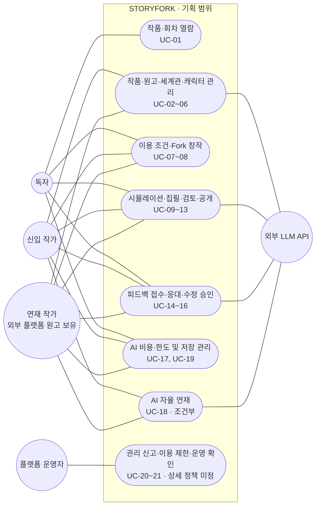
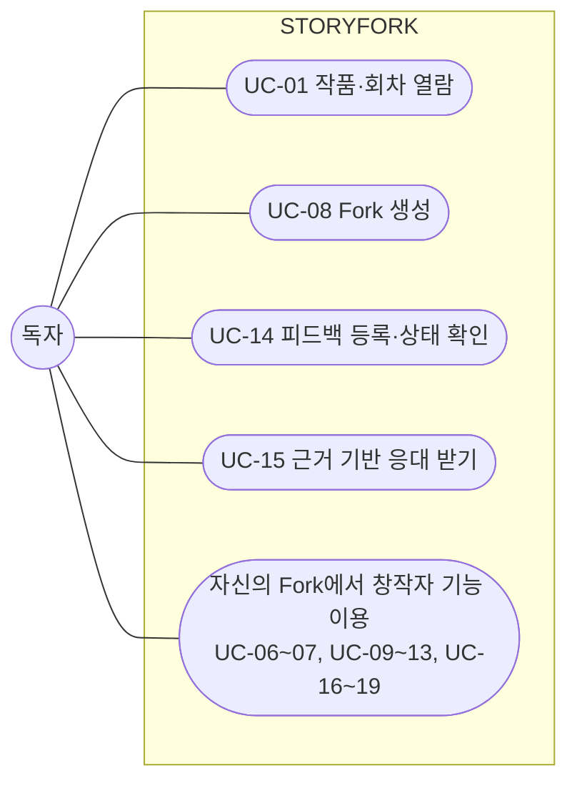
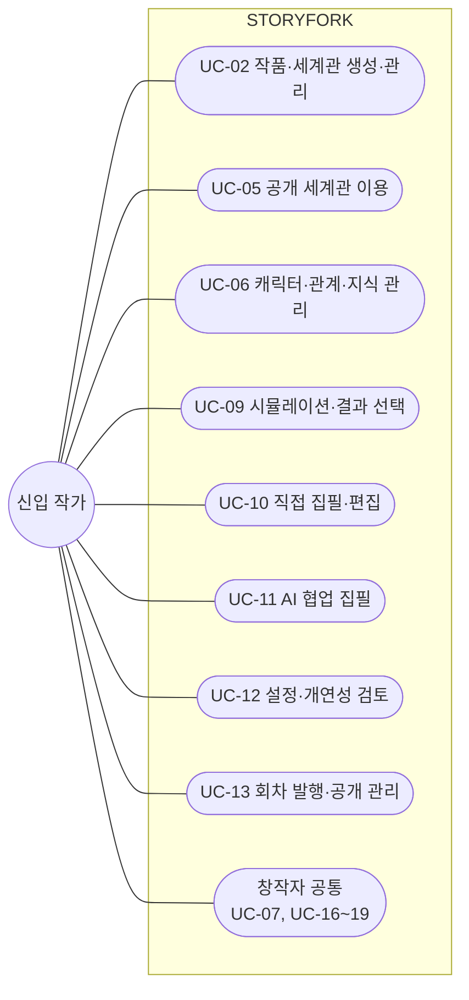
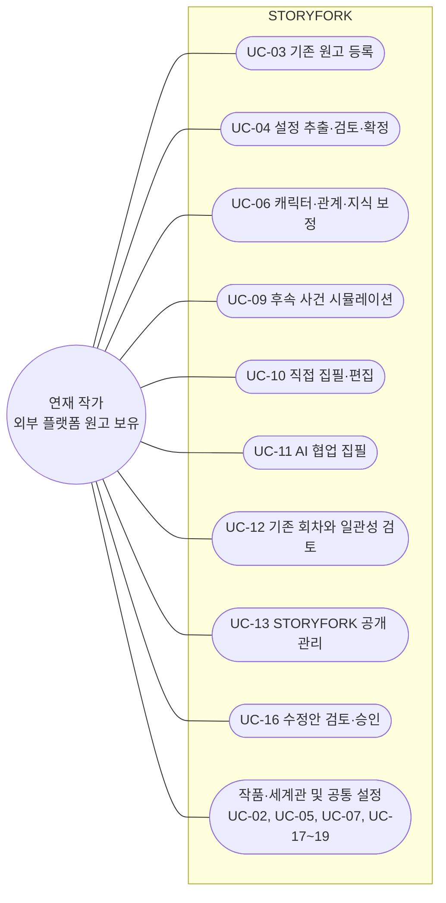
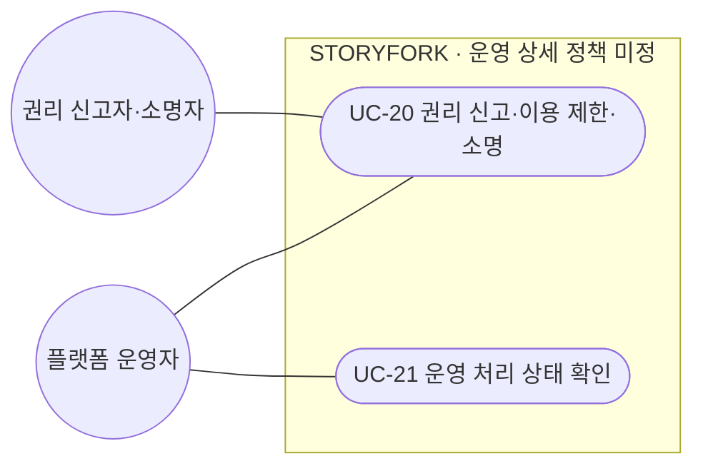
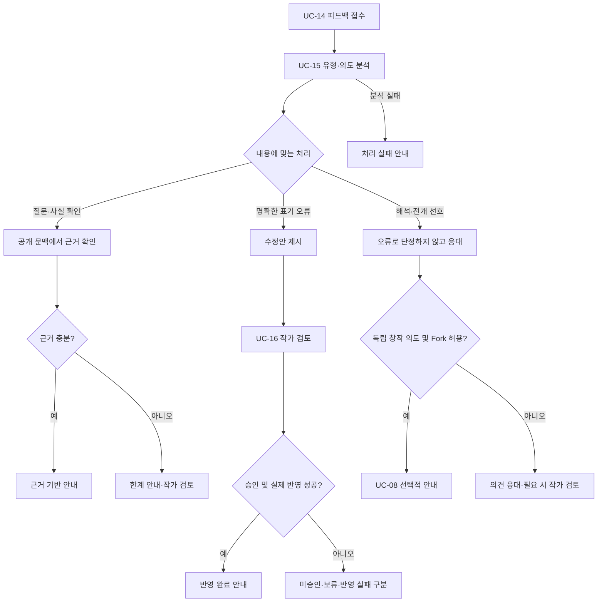

# STORYFORK 유스케이스

> **문서 상태: 기획 기반 초안 — 업무 기능 미구현**
> 현재 구현은 Frontend·Core API·AI Service의 시작 화면과 Health 확인뿐입니다. 아래 내용은 개발할 사용자 목표와 상호작용을 정리한 것이며, 구현 완료나 상세 정책 확정을 뜻하지 않습니다.

## 문서 기준

- **기획 근거:** [프로젝트 기획서 v1.4](./SKN34-final-4Team.pdf). 주요 사용자 시나리오 12쪽, 전체 구조 13쪽, 핵심 기능 14~19쪽, 운영·비용·권리 20~22쪽을 기준으로 합니다. 쪽수는 PDF의 1-based 페이지 번호입니다.[1]
- **사용자 확정 정의:** **연재 작가란 다른 플랫폼에서 이미 소설을 연재하여 기존 작품·원고를 보유한 작가**입니다. STORYFORK에서 처음 연재를 시작한 사람이라는 의미로 사용하지 않습니다.
- **형식 참고:** 3TEAM 문서의 전체·액터별 다이어그램, UC 목록, 사전조건·기본·대안·예외 흐름 구성을 참고합니다. 해당 팀의 액터·기능·정책·요구사항 ID는 가져오지 않습니다.[2]
- **범위 구분:** `핵심`은 기획서의 창작·피드백 기능, `지원`은 그 이용에 필요한 흐름, `조건부`는 상세 정책을 확정해야 하는 기능입니다. 모두 기획 단계이며 개발 우선순위나 이번 배포 범위를 의미하지 않습니다.
- **명세 수준:** 기획서의 기능 목표를 사용자 행동으로 풀어 쓴 초안입니다. 권한 검사·결과 확인·오류 표시 등 구체적인 흐름은 검토 대상 명세이며, 별도 요구사항 정의서의 확정 계약으로 간주하지 않습니다.
- **용어:** 회차 = 에피소드, 원고 = 집필 중 또는 등록한 텍스트, 발행본 = 독자에게 공개한 회차, PR = 작품 내 수정 제안. PR은 GitHub 연동을 의미하지 않습니다.
- **식별자:** `UC-01` 등의 번호는 이 문서의 유스케이스 ID이며, 아직 없는 요구사항 정의서의 ID를 대신 만들어 붙인 것이 아닙니다.

---

## 1. 전체 유스케이스

### 1.1 시스템 범위와 사용자 목표

STORYFORK의 범위는 **작품 열람 → 창작 기반 준비 → 전개 탐색 → 집필·공개 → 피드백 처리**입니다. 기획서가 정의한 세계관·캐릭터 관리, 다중 인물 시뮬레이션, Fork, 집필, 피드백을 하나의 창작 흐름으로 연결합니다.[1]

| 사용자 | 시작점 | 이루려는 목표 |
|---|---|---|
| 독자 | 이용 가능한 작품·회차 | 작품을 읽고 질문·오류를 제보하거나, 허용된 회차에서 다른 전개의 독립 작품을 창작 |
| 신입 작가 | 아이디어·새로운 세계관·인물 구상 | 구상을 장면과 회차로 발전시켜 첫 작품을 집필 |
| 연재 작가 | **다른 플랫폼에서 연재한 기존 소설·원고** | 기존 원고에서 설정을 정리하고, 맥락을 유지한 후속 집필·설정 검토·독자 피드백 관리에 활용 |
| 플랫폼 운영자 | 승인된 운영 업무와 접수된 신고 | 필요한 범위의 처리 상태를 확인하고 권리 침해에 따른 공개·이용 제한 및 소명 처리 |

사용자 구분은 기획서 9·12·13쪽을 바탕으로 하되, 연재 작가의 출발점은 위 사용자 확정 정의를 적용합니다. 기획서의 초기 검증 대상은 창작 의향이 있는 독자와 신입 작가이며, 연재 작가의 장편·복잡한 설정 지원은 확장 대상으로 구분되어 있습니다.[1]

### 1.2 전체 다이어그램

다이어그램은 Mermaid `flowchart`로 표현한 **유스케이스 관계도**입니다. 원형은 액터, 둥근 항목은 사용자 목표, 사각 경계는 STORYFORK를 뜻합니다. 실선은 참여 관계이며 실행 순서나 필수 호출을 뜻하지 않습니다. `조건부` 영역의 존재만으로 자동화·결제 정책이 확정되지는 않습니다.

독자가 집필·공개·비용 관리에 참여하는 것은 **본인이 만든 Fork 작품의 창작자일 때**입니다. 다른 사람의 원작을 편집하거나 수정안을 승인하는 권한을 얻는다는 뜻이 아닙니다. 권리 신고자의 참여는 액터별 운영 다이어그램에서 별도로 표시합니다.

### 1.3 대표 이용 흐름

1. **독자:** 작품·회차 열람 → Fork 허용 여부 확인 → 기준 회차 선택 → 독립 작품 생성 → 직접 집필 또는 시뮬레이션·AI 협업 → 검토 후 공개.
2. **신입 작가:** 새 작품·세계관 생성 또는 허용된 세계관 이용 → 인물·관계 정리 → 사건 구상 → 직접 집필 또는 AI 지원 → 회차 검토·발행.
3. **연재 작가:** 외부 플랫폼에서 보유한 원고 등록 → 회차·순서 확인 → AI 설정 추출 → 작가 검토·확정 → 후속 회차 집필·검토 또는 등록 작품의 피드백 관리.
4. **독자 피드백:** 질문·의견·오류 제보 → 유형·의도 분석 → 공개 근거 확인 → 근거 안내 / 작가 검토 / 수정안 제안 → 실제 처리 상태 안내.

위 흐름의 기능 근거는 기획서 12·14~19쪽이며, AI 사용은 직접 집필이나 Fork 생성의 필수 조건이 아닙니다.[1]

---

## 2. 액터별 상세

### 2.1 액터와 권한의 구분

| 액터·역할 | 구분 | 참여 범위와 제한 |
|---|---|---|
| 독자 | 주 사용자 액터 | 공개·이용 조건 내 열람, 피드백, 허용된 Fork 생성. 타인의 원작·비공개 설정 수정 불가 |
| 신입 작가 | 주 사용자 액터 | 새 작품을 시작하는 이용 상황. 소유하거나 이용을 허락받은 세계관·작품에서 창작 |
| 연재 작가 | 주 사용자 액터 | 외부 플랫폼에서 이미 연재한 원고를 가져오는 이용 상황. 기존 원고를 보유해도 AI 처리·재공개·Fork 허용 권한은 별도 확인 |
| 작품 소유자 / 창작자 | 공통 권한 역할 | 신입 작가·연재 작가·Fork를 만든 독자에게 작품별로 적용. 해당 작품의 집필·공개·수정안 승인 등을 결정 |
| 세계관 소유자 / 이용자 | 공통 권한 역할 | 세계관 수정 권한과 다른 작품에서의 이용 권한을 구분. 공개된 세계관이라고 누구나 정본을 수정할 수 있는 것은 아님 |
| 플랫폼 운영자 | 운영 액터 | 기획서 전체 구조의 운영 역할. 승인된 업무 범위에서 상태·신고를 처리하며, 작가 대신 창작 결정을 내리거나 모든 비공개 원고를 임의 열람하지 않음 |
| 권리 신고자·소명자 | 조건부 운영 참여 액터 | 권리 침해 중단 요청 또는 자신의 콘텐츠에 대한 소명. 비회원 접수·본인 확인 방식은 미정 |
| 외부 LLM API | 보조 외부 시스템 | 허용 문맥에서 설정 추출·시뮬레이션·집필·검토·응대 제안을 반환. 권한·발행·크레딧을 최종 확정하지 않음 |

사람 한 명이 독자이면서 작가일 수 있습니다. **신입·연재 작가는 별도 계정 등급이나 상하 권한이 아니라 시작 상황의 차이**이며, 작품 소유권·이용 권한은 대상 작품마다 판단합니다.

다중 인물 에이전트·스토리 계획 에이전트·설정 검토 에이전트·피드백 에이전트는 STORYFORK 내부 협력 역할이지 외부 사용자 액터가 아닙니다. Frontend·Core·AI Service 역시 구현 구성요소이므로 사용자 액터로 나누지 않습니다. 기획서의 내부 에이전트 구성을 서비스 수와 동일시하지 않습니다.[1]

### 2.2 독자

- **목표:** 작품 감상, 질문·오류 제보와 결과 확인, 허용된 원작에서 자신의 이야기 창작.
- **진입:** 이용 가능한 작품·회차를 선택합니다.
- **권한 전환:** UC-08 완료 후 생성된 Fork에 한해 창작자 공통 권한을 사용합니다. 신입 작가 계정으로 전환하거나 원작 수정 권한을 받는 절차가 아닙니다.

- **기본 여정:** UC-01 → UC-08 → UC-10 또는 UC-09·UC-11 → 필요 시 UC-12 → UC-13.
- **피드백 여정:** UC-14 → UC-15 → 필요한 경우 해당 작품 소유자의 UC-16 → UC-14에서 처리 결과 확인.
- **경계:** Fork 허용이 없으면 분기하지 않습니다. 다른 전개를 선호한다는 이유만으로 원작을 오류로 판정하거나 강제 수정하지 않습니다.

### 2.3 신입 작가

- **목표:** 보유한 아이디어를 새로운 작품·세계관·인물과 실제 회차로 구체화합니다.
- **진입:** 신규 생성 또는 이용이 허용된 공개 세계관 활용입니다.

- **기본 여정:** UC-02 또는 UC-05 → UC-06 → UC-10 또는 UC-09·UC-11 → UC-12 → UC-13.
- **선택:** 이미 작성한 초안이 있다면 UC-03·UC-04를 이용할 수 있습니다. 원고 등록 기능을 연재 작가 전용 권한으로 제한하지 않습니다.
- **공통:** UC-07로 이용 조건을 정하고, UC-16으로 자신의 작품에 대한 수정 제안을 검토합니다. AI·저장 관련 UC-17~19는 해당 기능의 조건이 갖추어진 경우에만 이용합니다.

### 2.4 연재 작가 — 외부 플랫폼 원고 보유자

- **목표:** 다른 플랫폼에서 연재한 자신의 기존 소설을 기반으로 설정 정리, 후속 집필, 일관성 검토와 피드백 처리를 지원받습니다.
- **진입:** 신규 세계관을 처음부터 만드는 것보다 **기존 원고 등록과 추출 결과 검토**가 대표 출발점입니다.
- **권리:** 작가 본인의 글이어도 출판·독점 연재 계약 등에 따라 AI 처리, 재공개, 파생 창작 허용 범위는 다를 수 있으므로 필요한 권한 확인을 전제로 합니다. 실제 계약 판단을 AI가 대신 확정하지 않습니다.

- **기본 여정:** UC-03 → UC-04 → UC-06 → UC-09·UC-10·UC-11 중 필요한 기능 → UC-12.
- **공개 선택:** 등록 원고를 집필 지원에만 쓰는 것과 STORYFORK 독자에게 공개하는 것은 별도입니다. 공개를 선택하고 권한이 갖추어진 경우에만 UC-13으로 연결합니다.
- **피드백 경계:** 이번 명세의 피드백은 STORYFORK에 접수된 질문·댓글·제보입니다. 다른 플랫폼의 댓글 자동 수집·동기화는 포함하지 않습니다.
- **외부 연동 제외:** 원고를 어떻게 전달할지의 입력 형식은 미정입니다. 외부 플랫폼 로그인·스크래핑·API 연동·자동 게시·연재 이력 동기화·원고 내보내기를 지원한다고 가정하지 않습니다.

### 2.5 플랫폼 운영자·권리 신고자

운영자의 존재는 기획서 13쪽, 권리 중단·소명 흐름은 20쪽에 근거합니다. 구체적인 운영 화면과 권한 체계는 미정입니다.[1]

- **운영자 목표:** 접수된 신고와 처리 상태를 확인하고, 승인된 절차에 따라 해당 콘텐츠의 공개·AI·Fork 이용을 제한하거나 재개합니다.
- **신고자·소명자 목표:** 침해 근거 또는 소명 자료를 제출하고 실제 처리 상태를 확인합니다.
- **제한:** 운영 권한은 원고 무제한 열람·원작 임의 수정 권한과 같지 않습니다. 대시보드, 모델 관리, 결제 환불 기능을 참고 문서에서 그대로 도입하지 않습니다.

### 2.6 외부 시스템과 창작자 공통 기능

| 구분 | 관련 유스케이스 | 모델링 원칙 |
|---|---|---|
| 외부 LLM API | UC-04, UC-09, UC-11, UC-12, UC-15, 조건부 UC-18 | 허용된 최소 문맥을 받아 제안 반환. 현재 OpenAI Agents SDK 기반을 선택했으나 업무 모델 호출은 미구현 |
| 외부 연재 플랫폼 | 없음 | 연재 작가가 원고를 보유하게 된 출처이지, 현재 명세에 확정된 API 연동 액터가 아님 |
| 결제 제공자·스케줄러 | 미정 | 결제 수단·자동 연재 실행 방식이 정해지기 전에는 확정 액터로 추가하지 않음 |
| 작품 소유자의 공통 선택 | UC-07, UC-13, UC-16 | 자신의 작품의 이용 조건·공개·수정 승인. Fork 소유자는 원작이 아닌 자신의 Fork에 대해서만 행사 |
| AI·저장 이용 | UC-17~19 | AI 비용 확인, 조건부 자동 연재, 저장 관리. 가격·주기·복구 정책은 미정 |

---

## 3. 유스케이스 목록과 기획 기능 대응

### 3.1 전체 목록

`창작자`는 해당 작품의 소유자 또는 적법한 작업 권한을 가진 사용자입니다. 공동 집필 참여자 체계는 아직 확정하지 않습니다. `독자 요청에서 시작`은 시스템 내부 처리의 트리거를 설명한 것이며, 시스템을 독립 사용자 액터로 추가한 것이 아닙니다.

| ID | 유스케이스 | 주 액터 | 보조 액터 | 구분 | 기획 근거 |
|---|---|---|---|---|---|
| UC-01 | 작품·회차 열람 | 독자 | — | 지원 | 12·20쪽 |
| UC-02 | 작품·세계관 생성·관리 | 창작자 | — | 핵심 | 14쪽 |
| UC-03 | 기존 원고 등록 | 연재 작가, 원고 보유 창작자 | — | 핵심 | 14쪽 + 연재 작가 정의 |
| UC-04 | 원고의 설정 추출·검토·확정 | 창작자 | 외부 LLM API | 핵심 | 14~15쪽 |
| UC-05 | 허용된 공개 세계관 이용 | 창작자 | 세계관 소유자 | 핵심 | 14쪽 |
| UC-06 | 캐릭터·관계·시점별 지식 관리 | 창작자 | — | 핵심 | 15쪽 |
| UC-07 | 작품·세계관 공개 및 Fork 허용 조건 설정 | 작품·세계관 소유자 | — | 핵심 | 14·17·20쪽 |
| UC-08 | 원작 회차 기반 Fork 생성 | 독자 | — | 핵심 | 12·17쪽 |
| UC-09 | 다중 인물 시뮬레이션 실행·결과 선택 | 창작자 | 외부 LLM API | 핵심 | 16쪽 |
| UC-10 | 직접 집필·편집 | 창작자 | — | 핵심 | 18쪽 |
| UC-11 | AI 협업 집필 | 창작자 | 외부 LLM API | 핵심 | 18쪽 |
| UC-12 | 설정 충돌·개연성 검토 | 창작자 | 외부 LLM API | 핵심 | 12·15~18쪽 |
| UC-13 | 회차 발행·공개 관리 | 작품 소유자 | — | 핵심 | 12·18·20쪽 |
| UC-14 | 독자 피드백 등록·처리 상태 확인 | 독자 | — | 핵심 | 12·19쪽 |
| UC-15 | 피드백 분석·근거 기반 맞춤형 응대 | 독자 요청에서 시작 | 외부 LLM API, 작품 소유자 | 핵심 | 7·12·19쪽 |
| UC-16 | 수정안 검토·승인·반영 | 작품 소유자 | — | 핵심 | 7·19쪽 |
| UC-17 | AI 이용 비용·한도 확인 | AI 이용 창작자 | — | 지원·금액 정책 미정 | 20~21쪽 |
| UC-18 | AI 자율 연재 설정·실행 | 작품 소유자 | 외부 LLM API | 조건부 | 18쪽 |
| UC-19 | 저장 사용량 확인·정리·확장 | 창작자 | — | 조건부 | 20~21쪽 |
| UC-20 | 권리 침해 신고·이용 제한·소명 | 신고자·소명자, 운영자 | — | 지원·절차 미정 | 20·22쪽 |
| UC-21 | 운영 처리 상태 확인 | 운영자 | — | 지원·상세 미정 | 13쪽 |

기획 근거 열은 [프로젝트 기획서](./SKN34-final-4Team.pdf)의 해당 페이지를 가리킵니다.[1]

### 3.2 핵심 기능 6개와 UC 대응

| 기획서 핵심 기능 | 포함 유스케이스 | 성공 결과 |
|---|---|---|
| ① 작품 및 세계관 생성·관리 | UC-02~05, 이용 조건은 UC-07 | 신규 또는 등록 원고에서 시작한 작품에 검토된 설정과 허용된 세계관이 연결됨 |
| ② 캐릭터 프로필 및 관계 관리 | UC-06 | 기준 시점별 인물 정보·관계·지식이 구분됨 |
| ③ 다중 AI 에이전트 기반 스토리 시뮬레이션 | UC-09 | 사용자가 검토할 전개 후보와 선택 결과를 얻음 |
| ④ Fork 기반 스토리 분기 및 독립 창작 | UC-07~08 | 허용된 회차의 기준 정보로 원작과 독립된 작품이 생성됨 |
| ⑤ 스토리 집필 및 편집 | UC-10~13, 조건부 UC-18 | 사용자가 선택한 집필 방식으로 원고를 만들고 별도 공개 절차를 거침 |
| ⑥ 독자 피드백 분석 및 맞춤형 응대 | UC-14~16 | 유형에 맞는 근거 안내·작가 검토·승인된 수정과 실제 처리 상태가 제공됨 |

이 여섯 기능은 기획서 14~19쪽의 구성을 따릅니다. UC-17·UC-19~21은 이를 지원하는 이용·운영 흐름으로 구분합니다.[1]

---

## 4. 핵심 유스케이스 명세

이 절의 사전조건은 **목표로 하는 업무 계약**입니다. 현재 인증·권한 검사·저장·버전 관리가 구현되어 있다는 뜻이 아닙니다. 기능에 공통으로 적용할 경계는 6절, 미확정 정책은 7절에서 구분합니다.

### 4.1 작품 및 세계관 생성·관리

#### UC-02 작품·세계관 생성·관리

- **주 액터 / 목표:** 창작자 / 새 이야기의 작품과 세계관을 구성하고 관리합니다.
- **사전조건:** 신규 생성 또는 대상 작품·세계관을 변경할 권한이 있습니다.
- **트리거:** 새 작품 생성 또는 기존 작품·세계관 편집을 선택합니다.
- **기본 흐름**
  1. 작품의 기본 정보와 세계관을 입력하거나 기존에 사용할 수 있는 세계관을 선택합니다.
  2. 장소·시대·규칙·주요 사건을 정리합니다.
  3. 공통 세계관 설정과 해당 작품에서 발생한 사건·설정 변화를 구분합니다.
  4. 사용자가 내용을 확인하고 저장합니다.
- **대안:** 공개 세계관을 활용하면 UC-05, 기존 원고에서 시작하면 UC-03·UC-04로 연결합니다.
- **예외:** 권한 부족이나 저장 실패 시 완료로 표시하지 않으며 기존 저장본을 보존합니다.
- **사후조건:** 작품과 사용할 세계관 정보가 준비됩니다. 생성·저장만으로 독자 공개나 Fork 허용이 되지 않습니다.

#### UC-03 기존 원고 등록

- **주 액터 / 목표:** 연재 작가 또는 원고 보유 창작자 / 기존 소설을 STORYFORK의 창작 지원에 사용할 준비를 합니다.
- **사전조건:** 등록할 원고를 보유하고, 요청한 저장·AI 처리에 필요한 권한을 갖추었습니다.
- **트리거:** 기존 원고 등록을 선택합니다.
- **기본 흐름**
  1. 사용자가 대상 작품을 선택하거나 생성하고 기존 원고를 제공합니다.
  2. 시스템이 읽을 수 있는 내용과 회차 구분·순서를 제시합니다.
  3. 사용자가 누락·순서·내용을 확인하고 등록 범위를 확정합니다.
  4. 등록 결과와 실패한 항목이 있으면 그 범위를 구분하여 안내합니다.
  5. 사용자가 설정 추출을 원하면 UC-04로 진행합니다.
- **대안:** 일부 회차만 등록하면 이후 검토에 사용할 수 있는 문맥이 해당 범위로 제한됨을 안내합니다. 설정을 직접 정리하고 AI 추출을 생략할 수 있습니다.
- **예외:** 읽기 실패·지원하지 않는 입력·권한 불충족이면 해당 원고를 등록 완료로 처리하지 않습니다. 같은 원고를 다시 등록했을 때의 덮어쓰기·중복 정책은 확정 전입니다.
- **사후조건:** 확인한 원고가 창작 지원의 입력으로 준비됩니다. **등록은 STORYFORK 공개, 외부 플랫폼 동기화 또는 AI 학습 동의가 아닙니다.**
- **미정:** 지원 파일 형식, 직접 입력 방식, 크기·회차 수 제한, 중복 처리.

#### UC-04 원고의 설정 추출·검토·확정

- **주 액터 / 목표:** 창작자 / 기존 원고의 세계관·캐릭터·사건을 검토 가능한 설정으로 정리합니다.
- **사전조건:** 원고 등록 완료, 대상 범위 접근·AI 처리 권한, 해당 AI 이용 조건 확인.
- **트리거:** 등록 원고에서 설정 추출을 요청합니다.
- **기본 흐름**
  1. 사용자가 분석할 작품·회차 범위를 선택합니다.
  2. 시스템이 허용된 원고만 전달하여 세계관·인물·관계·주요 사건의 후보를 추출합니다.
  3. 후보와 관련 원고 근거, 불명확하거나 충돌하는 항목을 구분해 제시합니다.
  4. 사용자가 잘못된 추출을 수정하고 채택·제외할 항목을 선택합니다.
  5. 확인한 설정만 작품·세계관·캐릭터 정보에 반영합니다.
- **대안:** 근거가 부족한 항목은 미확정 상태로 남기거나 사용자가 직접 보완합니다. 이미 존재하는 설정은 새 추출 결과와 비교 후 선택합니다.
- **예외:** AI 실패·시간 초과는 원고 등록 실패와 구분합니다. 추출이 실패해도 등록 원고나 기존 확정 설정을 덮어쓰지 않습니다.
- **사후조건:** 추출 후보와 사용자 확정 설정이 구분됩니다. AI가 추출했다는 이유만으로 정본이 되지 않습니다.

#### UC-05 허용된 공개 세계관 이용

- **주 액터 / 목표:** 창작자 / 이용이 허용된 세계관을 자신의 작품 창작에 활용합니다.
- **사전조건:** 대상 세계관의 공개·이용 조건을 확인할 수 있습니다.
- **트리거:** 기존 공개 세계관을 작품에 사용하기로 선택합니다.
- **기본 흐름**
  1. 사용자가 세계관 내용과 허용 범위를 확인합니다.
  2. 시스템이 해당 사용자·작업의 이용 가능 여부를 확인합니다.
  3. 사용자가 대상 작품과 적용할 세계관을 확인합니다.
  4. 작품에서 발생하는 사건·변화는 공통 세계관의 정본과 구분하여 관리합니다.
- **대안:** 이용 조건이 맞지 않으면 사용을 중단하거나 직접 새로운 세계관을 생성합니다.
- **예외:** 공개되어 있어도 요청한 AI 처리·파생 이용 권한이 없으면 해당 사용을 허용하지 않습니다.
- **사후조건:** 자신의 작품에서 세계관을 활용할 수 있지만 타인 세계관의 정본 수정 권한은 부여되지 않습니다.
- **미정:** 공유 세계관 업데이트 수용 방식과 작품·세계관의 상세 관계 모델. Fork의 기준 고정 원칙은 별도로 유지합니다.

### 4.2 캐릭터 프로필 및 관계 관리

#### UC-06 캐릭터·관계·시점별 지식 관리

- **주 액터 / 목표:** 창작자 / 인물의 기본 특성과 사건 진행에 따른 상태·지식을 일관되게 관리합니다.
- **사전조건:** 작품·세계관이 준비되어 있고 대상 정보를 변경할 권한이 있습니다.
- **트리거:** 캐릭터를 등록하거나 특정 회차 시점의 상태를 편집합니다.
- **기본 흐름**
  1. 성격·목표·기억·능력 등 캐릭터 프로필을 입력하거나 확인합니다.
  2. 관계·감정·보유 정보를 해당 사건·회차 시점에 맞춰 정리합니다.
  3. 작가가 아는 설정, 독자에게 공개된 정보, 해당 인물이 아는 사실을 구분합니다.
  4. 사용자가 변경 내용을 확인하고 저장합니다.
- **대안:** UC-04의 추출 결과나 UC-09의 시뮬레이션 결과를 참고하되, 사용자가 채택한 변경만 반영합니다.
- **예외:** 시점·근거가 불분명하면 임의로 과거 사실을 확정하지 않고 사용자 확인을 요청합니다. 권한·저장 실패 시 기존 상태를 보존합니다.
- **사후조건:** 집필·검토·시뮬레이션에서 대상 시점의 인물 정보를 사용할 수 있습니다. 한 인물에게 모든 비공개 설정을 공유하지 않습니다.

### 4.3 다중 AI 에이전트 기반 스토리 시뮬레이션

#### UC-09 다중 인물 시뮬레이션 실행·결과 선택

- **주 액터 / 목표:** 창작자 / 사건 조건에 따른 인물 행동과 인과관계를 탐색하고 집필에 사용할 전개를 선택합니다.
- **사전조건:** 사용 가능한 작품·기준 시점·인물 정보가 준비되고 AI 처리 권한 및 UC-17의 실행 조건을 확인했습니다.
- **트리거:** 사용자가 사건·상황·등장인물을 정해 시뮬레이션을 요청합니다.
- **기본 흐름**
  1. 작품, 기준 회차·시점, 참여 인물, 상황과 원하는 전개 방향을 설정합니다.
  2. 시스템이 허용된 세계관·사건 이력과 각 인물의 성격·목표·기억·보유 정보를 구분합니다.
  3. 스토리 계획 역할이 사건·환경을 조정하고 인물별 역할이 자신의 정보 범위에서 행동·상호작용을 생성합니다.
  4. 행동·대화·사건 전개와 검토할 결과를 사용자에게 제시합니다.
  5. 사용자가 결과를 선택·수정하거나 버립니다.
  6. 선택한 결과를 UC-10·UC-11의 집필 재료로 사용합니다.
- **대안:** 조건을 바꿔 재실행할 수 있으나 추가 비용·한도를 다시 확인합니다. 시뮬레이션 없이 직접 집필할 수 있습니다.
- **예외:** AI 실패·시간 초과·한도 초과 시 처리 상태를 구분합니다. 일부만 생성된 결과를 완료된 회차나 확정 인물 상태처럼 반영하지 않습니다.
- **사후조건:** 사용자 선택 결과가 집필 재료로 남습니다. **시뮬레이션의 임시 기억·관계 변화는 원작·Fork 정본에 자동 반영되지 않습니다.**
- **미정:** 인물 수·진행 횟수·분량 한도, 취소 지원 방식, 장기 실행·부분 결과 보관 정책.

### 4.4 Fork 기반 스토리 분기 및 독립 창작

#### UC-07 작품·세계관 공개 및 Fork 허용 조건 설정

- **주 액터 / 목표:** 적법한 권한을 가진 작품·세계관 소유자 / 다른 이용자에게 허용할 사용 범위를 정합니다.
- **사전조건:** 해당 콘텐츠를 관리하고 그 이용을 허락할 권한이 있습니다.
- **트리거:** 공개·이용·Fork 조건의 설정 또는 변경을 선택합니다.
- **기본 흐름**
  1. 대상 작품·세계관과 공개 범위를 선택합니다.
  2. 열람, 세계관 이용, AI 처리, Fork 생성, Fork 작품 공개·유료 공개의 권한을 구분해 확인합니다.
  3. Fork가 허용되는 회차·범위를 확인하고 적용할 조건을 정합니다.
  4. 시스템이 실제 적용한 조건과 이용자에게 안내할 내용을 표시합니다.
- **대안:** 작품 열람은 허용하되 Fork는 허용하지 않는 등 권한을 구분합니다. 세부 설정 항목과 화면은 후속 확정 대상입니다.
- **예외:** 소유·허락 권한이 없으면 설정할 수 없습니다. 등록자가 체크했다는 사실만으로 외부 IP에 대한 적법한 권한을 보장하지 않습니다.
- **사후조건:** 이후 열람·AI·Fork·공개 요청은 해당 이용 조건을 확인해야 합니다.
- **미정:** 허용 철회·조건 변경이 이미 생성된 Fork에 미치는 영향, 재Fork 허용, 유료 공개·배분 조건.

#### UC-08 원작 회차 기반 Fork 생성

- **주 액터 / 목표:** 독자 / 허용된 원작의 특정 회차 이후를 독립적으로 창작할 작품을 만듭니다.
- **사전조건:** 대상 회차를 이용할 수 있고, 해당 지점의 Fork 생성이 허용되어 있습니다.
- **트리거:** 원작의 특정 회차 종료 시점에서 Fork를 선택합니다.
- **기본 흐름**
  1. 독자가 원작·기준 회차·이용 조건을 확인합니다.
  2. 시스템이 해당 시점의 Fork 권한과 허용 문맥을 확인합니다.
  3. 기준 회차까지 필요한 원고 버전, 공개 세계관·인물 상태와 사건 범위를 고정합니다.
  4. 기준 원작·회차와 연결된 별도 작품을 생성합니다.
  5. 사용자는 자신의 Fork에서 새 사건을 구성하고 직접 집필하거나 AI 지원을 선택합니다.
- **대안:** AI를 사용하지 않고 무료 Fork 생성·직접 집필만 진행할 수 있습니다.
- **예외:** 허용되지 않은 회차·이용 제한 콘텐츠·권한 없는 요청은 거부합니다. 기준 정보가 불완전하거나 생성에 실패하면 성공으로 안내하지 않습니다.
- **사후조건:** Fork 이후 사건·인물 변화는 원작과 분리됩니다. 원작의 후속 수정·회차가 자동 유입되지 않으며, 원작 비공개 정보와 기준 시점 이후 내용은 복제 범위에서 제외합니다.
- **미정:** 기준 정보를 전체 복사할지 불변 버전 참조로 보관할지는 기술 설계 대상이며, 특정 DB 구조를 여기서 확정하지 않습니다.

### 4.5 스토리 집필 및 편집

#### UC-10 직접 집필·편집

- **주 액터 / 목표:** 창작자 / AI를 필수로 사용하지 않고 자신의 원고를 작성·수정합니다.
- **사전조건:** 대상 원작 또는 Fork 작품의 편집 권한이 있습니다.
- **트리거:** 회차 초안을 만들거나 기존 편집 대상을 엽니다.
- **기본 흐름**
  1. 작품·회차와 참고할 설정을 확인합니다.
  2. 사용자가 원고를 직접 작성·편집합니다.
  3. 필요한 경우 시뮬레이션 결과를 참고하거나 UC-11·UC-12를 선택합니다.
  4. 저장 결과를 확인하고, 공개하려면 별도로 UC-13을 수행합니다.
- **대안:** AI를 사용하지 않고 끝까지 집필할 수 있습니다. Fork에도 같은 집필 흐름을 적용합니다.
- **예외:** 저장 실패는 미저장으로 표시하고 기존 저장본을 보존합니다. 발행본과 편집 초안이 충돌하면 묵시적으로 덮어쓰지 않습니다.
- **사후조건:** 초안 저장과 독자에게 보이는 발행본을 구분합니다.
- **미정:** 편집기 입력 형식, 자동 저장·이력 보관·동시 편집 세부 방식.

#### UC-11 AI 협업 집필

- **주 액터 / 목표:** 창작자 / 자신의 방향에 맞는 장면·대화·원고·편집 제안을 얻습니다.
- **사전조건:** 대상 작품의 편집·AI 처리 권한과 UC-17의 이용 조건을 확인했습니다.
- **트리거:** 사용자가 집필 방향이나 편집 요청을 입력합니다.
- **기본 흐름**
  1. 대상 장면·회차, 요청 범위와 사용자가 정한 방향을 확인합니다.
  2. 허용된 설정·기존 원고·선택된 시뮬레이션 결과를 필요한 만큼 사용합니다.
  3. AI가 장면·대화·원고 또는 편집 제안을 반환합니다.
  4. 사용자가 제안을 검토하고 채택·수정·거절합니다.
  5. 선택한 내용만 편집 초안에 반영하고 저장 결과를 확인합니다.
- **대안:** 일부 제안만 채택하거나 직접 집필로 돌아갑니다. 재생성을 요청하면 별도 실행·비용으로 확인합니다.
- **예외:** 실패·중단·미완료를 성공한 원고 생성으로 표시하지 않습니다. 기존 초안·발행본을 AI 출력으로 자동 교체하지 않습니다.
- **사후조건:** 사용자 선택이 반영된 초안을 얻습니다. 생성 완료는 저장·승인·발행 완료와 다릅니다.

#### UC-12 설정 충돌·개연성 검토

- **주 액터 / 목표:** 창작자 / 원고가 기준 설정·인물 지식·사건 이력과 충돌하는지 검토합니다.
- **사전조건:** 검토할 원고와 접근 가능한 비교 기준, AI 이용 조건이 준비되어 있습니다.
- **트리거:** 사용자가 검토 범위를 정해 설정·개연성 검토를 요청합니다.
- **기본 흐름**
  1. 작품·회차·비교 기준 시점을 확인합니다.
  2. 인물의 기억·지식, 관계, 수치, 사건 선후관계와 원고를 비교합니다.
  3. 충돌 의심 지점과 관련 근거, 창작적 해석이 필요한 부분을 구분해 제시합니다.
  4. 사용자가 오류 수정·설정 보완·의도한 변화 유지 중 판단을 내립니다.
  5. 수정이 필요하면 UC-10·UC-11에서 반영합니다.
- **대안:** 의도한 반전이나 Fork의 새로운 전개는 원작과 다르다는 이유만으로 오류로 확정하지 않습니다.
- **예외:** 비교 문맥 부족은 검토 한계로 표시합니다. AI 실패를 ‘충돌 없음’으로 대체하지 않습니다.
- **사후조건:** 근거와 사용자 판단이 남으며, 검토 결과만으로 설정·원고를 자동 수정하지 않습니다.

#### UC-13 회차 발행·공개 관리

- **주 액터 / 목표:** 작품 소유자 / 검토한 회차를 허용된 범위에서 독자에게 공개합니다.
- **사전조건:** 발행할 원고와 공개 권한이 있으며, Fork라면 원작의 관련 이용 조건을 충족합니다.
- **트리거:** 사용자가 발행 또는 공개 상태 변경을 선택합니다.
- **기본 흐름**
  1. 대상 작품·회차·원고와 공개 범위를 확인합니다.
  2. 원고 보유와 공개·유료 공개 권한이 구분되어 있음을 확인합니다.
  3. 사용자가 발행할 내용을 최종 확인합니다.
  4. 시스템이 권한과 적용 조건을 확인한 뒤 공개 처리합니다.
  5. 실제 공개 결과를 사용자에게 안내합니다.
- **대안:** 공개하지 않고 초안으로 보관할 수 있습니다. 등록 원고를 집필 지원에만 사용하는 연재 작가에게 공개를 강제하지 않습니다.
- **예외:** 권한 미충족·권리 제한·발행 실패 시 완료로 안내하지 않습니다. AI 생성이나 수정 승인만으로 발행이 성공했다고 표시하지 않습니다.
- **사후조건:** 독자가 열람할 발행본과 작업 중 초안을 구분합니다. 외부 연재 플랫폼에는 자동 게시하지 않습니다.
- **미정:** 유료 열람·결제·정산, 공개 철회와 기존 Fork에 대한 영향, 발행 후 수정·버전 노출 방식.

### 4.6 독자 피드백 분석 및 맞춤형 응대

#### UC-14 독자 피드백 등록·처리 상태 확인

- **주 액터 / 목표:** 독자 / 작품에 질문·의견·오류를 전달하고 실제 처리 결과를 확인합니다.
- **사전조건:** 대상 작품·회차의 접근 및 피드백 작성 조건을 충족합니다.
- **트리거:** 독자가 댓글·질문·오류 제보를 작성합니다.
- **기본 흐름**
  1. 대상 작품·회차와 질문 또는 의견을 입력합니다.
  2. 필요하면 문제라고 생각한 구절·상황을 함께 제시합니다.
  3. 시스템이 접수 결과를 안내하고 UC-15의 분석·응대로 연결합니다.
  4. 독자가 응답과 작가 검토·수정 제안 등 실제 처리 상태를 확인합니다.
- **대안:** 다른 전개를 직접 창작하려는 의도라면 허용된 경우에만 UC-08을 선택적으로 안내합니다.
- **예외:** 접수 실패와 접수 후 분석 실패를 구분합니다. 아직 검토 중인 제보를 해결 완료로 표시하지 않습니다.
- **사후조건:** 피드백·대상 회차·응답·처리 상태가 연결됩니다. 외부 플랫폼의 댓글을 자동 수집했다고 간주하지 않습니다.

#### UC-15 피드백 분석·근거 기반 맞춤형 응대

- **주 액터 / 목표:** UC-14를 요청한 독자 / 질문·의견의 성격에 맞는 근거와 안내를 받습니다.
- **보조 액터:** 외부 LLM API, 창작 판단이 필요한 경우 작품 소유자.
- **사전조건:** 피드백 접수 완료, 응대에 사용할 공개 작품·회차 범위 확인.
- **트리거:** 접수된 피드백에 대한 분석·응대를 시작합니다.
- **기본 흐름**
  1. 질문, 명확한 표기 오류 제보, 개인적 해석, 전개 선호 등 유형과 요청 의도를 구분합니다.
  2. 사실 확인이 필요하면 설정 검토 역할이 허용된 공개 원고·설정에서 근거를 확인합니다.
  3. 확인 가능한 질문에는 관련 근거와 함께 답변합니다.
  4. 오타·맞춤법·명백한 숫자 표기 오류는 수정안으로 제시하고 UC-16의 작가 검토로 연결합니다.
  5. 근거가 부족하거나 창작적 판단이 필요한 사안은 단정하지 않고 작가 검토로 전달합니다.
  6. 응답과 현재 처리 상태를 독자에게 안내합니다.
- **대안:** 개인적 해석·전개 선호는 오류로 단정하지 않습니다. 독자가 다른 전개를 직접 쓰고자 하고 Fork가 허용될 때만 분기 창작을 안내합니다.
- **예외:** 원고 근거를 확인할 수 없으면 그 한계를 표시합니다. AI 실패는 처리 실패로 표시하며, 허구의 인용·정상 응답으로 대체하지 않습니다. 작가 비공개 설정·후속 비공개 회차를 응답에 노출하지 않습니다.
- **사후조건:** 근거 안내·작가 검토·수정안 제안·반영 완료를 구분합니다. AI 응답은 작가의 승인이나 원작 변경을 대신하지 않습니다.

분류가 항상 하나로 결정된다는 뜻은 아닙니다. 질문과 수정 요청이 섞이면 각각 필요한 처리를 수행하며, 근거가 부족한 오류 제보를 자동 승인 경로로 보내지 않습니다.

#### UC-16 수정안 검토·승인·반영

- **주 액터 / 목표:** 해당 작품 소유자 / 근거 있는 수정 제안을 검토하고 반영 여부를 결정합니다.
- **사전조건:** 대상 원고와 연결된 수정 제안이 있고, 검토자가 해당 작품의 승인 권한을 갖습니다.
- **트리거:** 작가가 수정 제안 상세를 엽니다.
- **기본 흐름**
  1. 원문, 수정안, 제보 내용과 근거를 비교합니다.
  2. 작가가 승인·거절·보류 또는 수정안 보완을 선택합니다.
  3. 승인한 경우 시스템이 대상 버전·권한을 다시 확인합니다.
  4. 승인 범위의 변경만 반영하고 실제 저장·공개 처리 결과를 확인합니다.
  5. 독자에게 승인 여부와 실제 반영 상태를 구분하여 안내합니다.
- **대안:** 제안을 거절하거나 원고를 직접 수정할 수 있습니다. 창작 판단이 필요한 사안은 작가가 별도로 검토합니다.
- **예외:** 제안 이후 원고가 변경되었다면 이전 버전 기준 수정안을 그대로 덮어쓰지 않고 재검토합니다. 승인은 됐지만 반영에 실패하면 ‘반영 완료’로 표시하지 않습니다.
- **사후조건:** 승인 주체와 실제 변경 결과가 구분되며, 원작 수정이 기존 Fork의 고정 기준에 자동 반영되지 않습니다.
- **미정:** 보완된 제안의 재승인 절차, 승인 후 공개 반영 시점과 세부 상태명.

---

## 5. 지원·조건부 유스케이스

핵심 창작·피드백 흐름과 구분해 기록합니다. 기획서에 없는 결제 제공자, 요금, 자동 실행 주기, 관리자 기능을 임의로 추가하지 않습니다.

### UC-01 작품·회차 열람

- **주 액터 / 목표:** 독자 / 허용된 작품·회차를 읽고 공개 설정·Fork 조건을 확인합니다.
- **기본 흐름:** 작품·회차 선택 → 열람 권한 확인 → 공개 원고 열람 → 필요 시 UC-08 또는 UC-14 선택.
- **예외·사후조건:** 접근 불가·비공개·권리 제한 회차는 노출하지 않습니다. 유료 열람 방식과 비회원 범위는 미정이며, 열람했다고 AI·Fork·수정 권한을 얻지 않습니다.

### UC-17 AI 이용 비용·한도 확인

- **주 액터 / 목표:** AI 이용 창작자 / 실행 전에 필요한 비용·범위·한도를 확인하고 이용 여부를 선택합니다.
- **기본 흐름:** AI 작업·인물 수·분량 등 확인 → 필요한 크레딧·한도 안내 → 사용자 실행 동의 → 실제 실행·이용 결과 확인.
- **대안·예외:** 이용 조건을 충족하지 못하면 AI 실행을 진행하지 않습니다. 재생성·재시뮬레이션은 별도 사용으로 안내하며, 실패 작업은 성공과 구분하고 복구 정책에 따라 처리합니다.
- **경계:** Fork 생성·직접 집필의 무료 방향과 AI 창작 지원 과금을 구분합니다. 작품 구매는 AI 무제한 이용권이 아닙니다. 독자 피드백 응대 비용의 부담 주체를 창작자 과금과 동일하게 가정하지 않습니다.
- **미정:** 가격·무료 제공량·차감 시점·예약/정산·오류 복구·충전/결제 방식. 구체적인 금액이나 자동 환급 조건은 확정하지 않습니다.[1]

### UC-18 AI 자율 연재 설정·실행 — 조건부

- **주 액터 / 목표:** 작품 소유자 / 설정한 조건 안에서 다음 회차 생성과 연재를 지원받습니다.
- **기획 흐름:** 소유자가 연재 조건·허용 문맥·이용 한도를 설정 → AI가 세계관과 허용된 독자 반응을 참고해 다음 회차 생성 → 합의된 검토·발행 조건에 따라 처리 → 실제 결과 확인.
- **적용:** 원작과 Fork 모두 기획 대상이지만, 해당 작품의 이용 권한을 전제로 합니다. 연재 작가라는 사용자 분류와 AI 자율 연재라는 집필 방식은 다른 개념입니다.
- **안전 경계:** 자동 생성과 자동 발행은 구분합니다. **자동 발행 권한·검토·중단 정책이 정해지기 전에는 무인 공개가 승인된 것으로 보지 않습니다.**
- **미정:** 실행 주기·트리거·중단/재개·회차별 승인·예산·독자 반응 반영 범위. 투표·좋아요 기능, 별도 스케줄러·worker, 외부 플랫폼 자동 연재는 이 문서로 확정하지 않습니다.[1]

### UC-19 저장 사용량 확인·정리·확장 — 조건부

- **주 액터 / 목표:** 창작자 / 저장 한도와 사용량을 확인하고 공간 관리 방법을 선택합니다.
- **기획 흐름:** 사용량 확인 → 한도 도달·초과 예정 안내 → 사용자가 정리 또는 확장 선택 → 실제 처리 결과 확인.
- **예외·경계:** 한도 초과를 이유로 기존 작품을 자동 삭제하지 않습니다. 확장 결제가 실패했다면 용량이 늘어난 것처럼 안내하지 않습니다.
- **미정:** 용량·요금·계산 단위, 삭제 확인·보관/복원 정책, 결제 방식.[1]

### UC-20 권리 침해 신고·이용 제한·소명

- **주 액터 / 목표:** 신고자·소명자, 플랫폼 운영자 / 권리 문제를 접수하고 적법한 절차에 따라 공개·이용을 처리합니다.
- **기획 흐름:** 대상 콘텐츠와 근거 접수 → 권한 있는 운영자 검토 → 필요한 공개·AI·Fork 이용 제한 → 소명 접수·검토 → 유지·재개 등 실제 상태 안내.
- **예외·경계:** 등록·Fork 허용 설정만으로 이용권이 생기지 않습니다. 신고만으로 AI가 법적 결론을 내리거나 원고를 임의 삭제하지 않습니다. 적법한 중단 요청·구체적 침해 정황에 대한 필요한 조치는 운영 정책에 따릅니다.
- **미정:** 접수 자격·확인 자료·처리 기한·제한 범위·소명/재개 기준과 기존 Fork에 대한 영향.[1]

### UC-21 운영 처리 상태 확인

- **주 액터 / 목표:** 플랫폼 운영자 / 허가된 범위에서 작업·피드백·신고의 실제 처리 상태를 확인합니다.
- **기획 흐름:** 승인된 운영 권한으로 대상 조회 → 완료·실패·검토 대기 등 상태 확인 → 필요한 담당 검토나 UC-20 처리로 연결.
- **예외·경계:** 상태 확인이 비공개 원고 전체 열람이나 원작 변경 권한을 포함하지 않습니다. 실패를 성공으로 변경하거나 정본을 임의 수정하지 않습니다.
- **미정:** 운영자 세부 역할, 조회 항목, 재처리 권한과 운영 화면. 기획서 13쪽의 운영 역할을 넘는 관리자 기능 목록은 후속 설계 대상입니다.[1]

---

## 6. 공통 규칙과 서비스 책임

| 경계 | 적용 원칙 |
|---|---|
| 이용자 역할 | 독자·신입 작가·연재 작가는 이용 상황이며, 실제 작업 권한은 작품·세계관별로 판단 |
| 원고·공개 | 기존 원고 등록, AI 처리, 학습 이용, STORYFORK 공개, 외부 플랫폼 게시를 각각 구분 |
| 외부 원고 | 연재 작가가 원고를 보유했다는 사실만으로 AI 처리·재공개·Fork를 허락할 권한을 추정하지 않음 |
| Fork 기준 | 분기 회차까지의 필요한 원고 버전·공개 설정·인물 상태·허용 문맥 고정. 원작 후속 변경 자동 유입 금지 |
| 정보 범위 | 작가 비공개 정보·독자 공개 범위·캐릭터별 지식을 분리. AI에 작업별 최소 문맥만 제공 |
| 세계관 이용 | 공통 세계관의 정본 수정 권한과 특정 작품에서 이용하는 권한을 구분 |
| AI와 사용자 결정 | 추출 후보·시뮬레이션·AI 초안·검토 의견은 제안. 사용자 선택·승인·실제 저장·공개를 구분 |
| 피드백 | 사실·표기 오류와 해석·전개 선호를 구분. 근거 부족·의견 차이를 자동 오류 판정하지 않음 |
| 상태 | 접수 성공·AI 처리 중/실패·작가 검토·승인·반영 성공/실패를 구분. 세부 상태 코드와 저장 방식은 별도 설계 |
| 비용·실패 | 실행 전 비용·한도 확인. 추가 실행과 오류 복구를 구분하며, 구체적인 차감·복구 정책은 미정 |
| 데이터 보존 | 실패·권한 거부·한도 초과를 이유로 기존 원고·확정 설정을 임의 덮어쓰거나 자동 삭제하지 않음 |

위 규칙은 기획서의 권리·승인·비용 방향과 [공통 지침](../AGENTS.md)의 경계를 유스케이스에 적용한 것입니다. 상세 정책의 확정 여부는 7절을 따릅니다.[1]

서비스는 기존 세 구성으로 유지합니다. 유스케이스 하나당 별도 서버를 만드는 설계가 아닙니다.

| 구성 | 목표 책임 | 넘지 않는 경계 |
|---|---|---|
| Frontend | 입력·열람·편집·검토·선택·상태 표시 | 공개 Core API만 호출. 클라이언트 표시만으로 권한·비용 확정 금지 |
| Core API | 작품·세계관·회차 버전·Fork 정본, 권한·승인·발행·크레딧의 최종 판단과 저장 | 외부 AI의 제안을 검증 없이 정본·과금 결과로 취급하지 않음 |
| AI Service | 허용 문맥에서 추출·시뮬레이션·집필·검토·응대 제안 | 정본 직접 수정, 권한·발행·과금 최종 확정 금지 |

현재 실제 실행 범위는 [아키텍처 문서](./architecture.md)를 참고합니다. 이 표는 업무 기능이 구현되었을 때의 책임 기준입니다.

---

## 7. 미확정 사항과 이번 문서의 제외 범위

### 7.1 후속 합의가 필요한 사항

| 주제 | 미확정 내용 | 관련 UC |
|---|---|---|
| 계정·권한 | 가입·인증 방식, 비회원 열람·피드백·신고 범위, 공동 집필, 운영자 역할 | 전체 |
| 기존 원고 입력 | 지원 형식·회차 구분·크기·중복·재등록·등록본 수정 방식 | UC-03~04 |
| 작품·세계관 모델 | 세계관 공유와 작품 관계, 캐릭터 기본 정보와 작품별 상태, 변경 수용 방식 | UC-02, UC-05~06 |
| Fork 정책 | 허용 회차 설정, 철회·원작 삭제·권리 제한의 기존 Fork 영향, 재Fork | UC-07~08, UC-20 |
| 집필·버전 | 자동 저장·버전 보관·동시 수정·발행본 변경·수정안 충돌 처리 | UC-10~13, UC-16 |
| 피드백 공개 범위 | 대상 회차 이후 스포일러 범위, 피드백·답변 공개 수준, 작가 검토 상태와 안내 방식 | UC-14~16 |
| AI 비용·한도 | 인물 수·진행 횟수·생성량·가격·차감/복구, 추출·피드백 비용 부담 주체 | UC-04, UC-09, UC-11~12, UC-15, UC-17~18 |
| 자동 연재 | 생성·검토·발행 권한, 실행·중단·재개 조건, 반응 반영 방식 | UC-18 |
| 수익·저장 | 유료 열람·판매 배분·보상 크레딧·충전/환불·저장 용량·확장 요금 | UC-13, UC-17, UC-19 |
| 권리·운영 | 접수·증빙·제한·소명·재개 절차, 처리 상태 조회·재처리 권한 | UC-20~21 |

기획서에 제시된 수익 배분안·인기작 크레딧·저장 공간 확장은 운영 검토 항목으로 유지합니다. 세부 금액·지급 기준·법적 판단을 확정 정책처럼 쓰지 않습니다.[1]

### 7.2 이번 문서에서 구현·확정하지 않는 것

- API URL·DTO·DB 테이블·ERD·기술 스택 변경과 실제 업무 기능 구현.
- 외부 연재 플랫폼의 로그인·원고/댓글 자동 수집·동기화·자동 게시.
- 정기 실행 서버·큐·worker·에이전트별 독립 서버 증설.
- 구체적인 로그인 제공자·결제사·요금제·정산·환불·보상 알고리즘.
- 인기순 추천·투표·랭킹·알림·고객센터·모델 운영 화면을 별도 확정 기능으로 추가하는 것.
- 데이터셋 수집·AI 학습·타사 IP 제공. 기획서의 데이터 후보는 이용 조건 확인 전 구현 승인으로 간주하지 않습니다.

다음 단계에서는 **미확정 정책 합의 → 유스케이스별 요구사항·수용 기준 확정 → 화면·입출력 계약 → ERD와 구현** 순서로 구체화합니다.

## Sources

[1] ./SKN34-final-4Team.pdf — STORYFORK 프로젝트 기획서 v1.4 — PDF 24쪽
[2] https://github.com/SKNETWORKS-FAMILY-AICAMP/SKN34-FINAL-3TEAM/blob/7188b696e6e28d537d015a0e7c4eab3346a65976/docs/design/usecase.md — 3TEAM 유스케이스 — 문서 구성·표기 참고, 7188b696 기준
