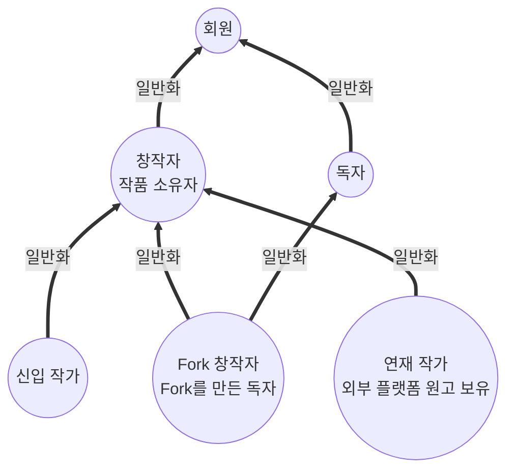
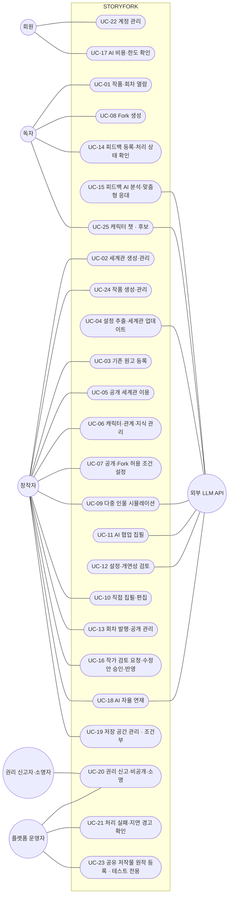
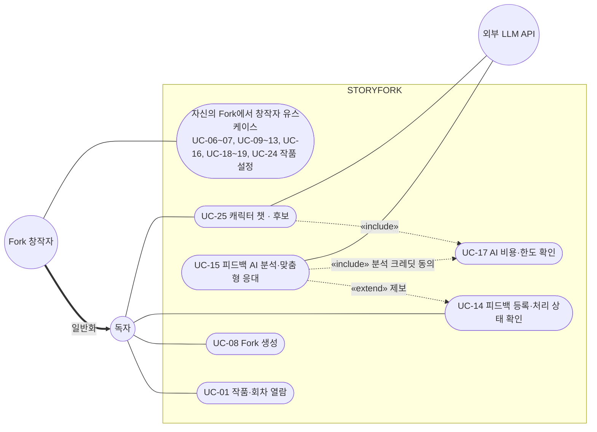
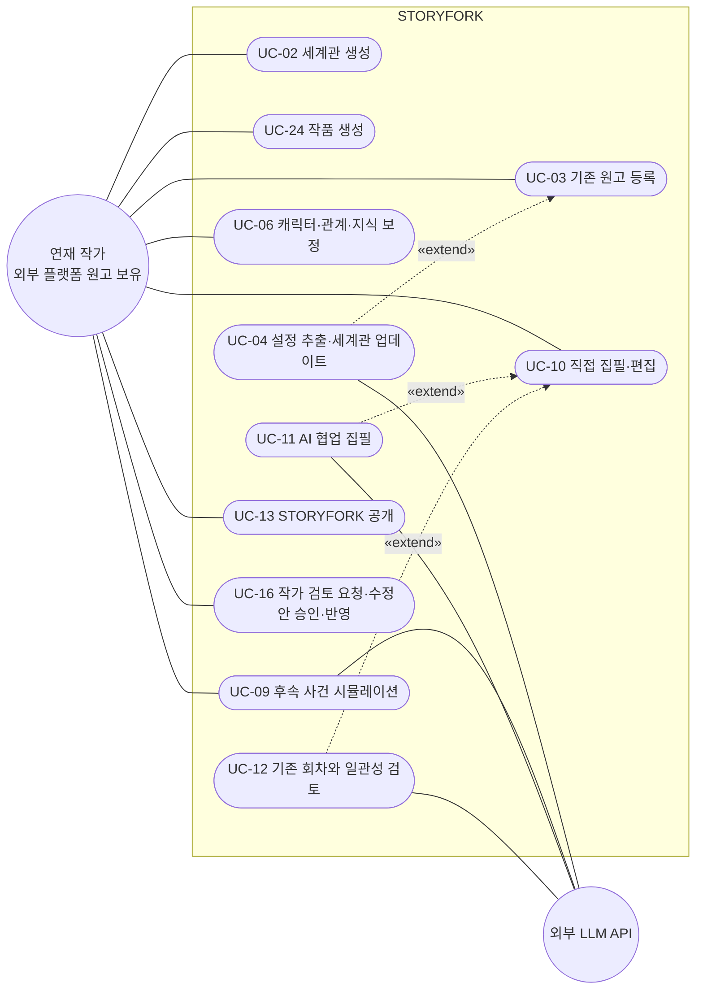
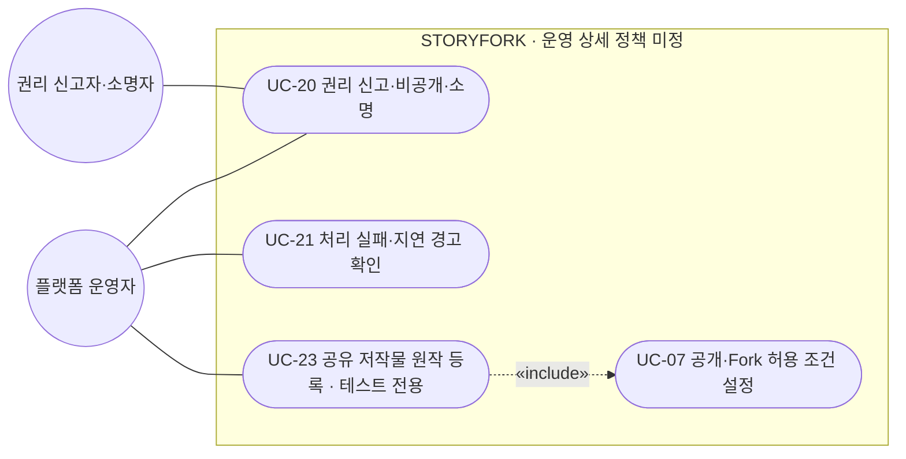
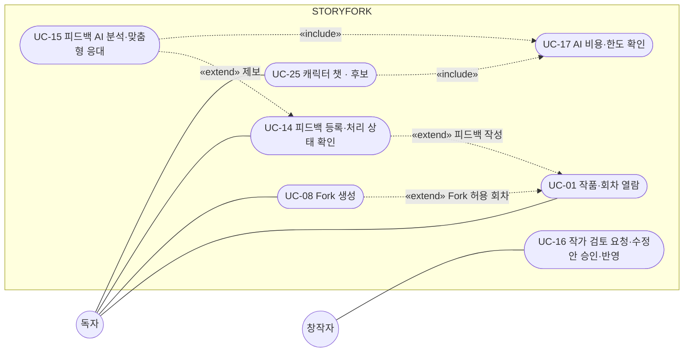
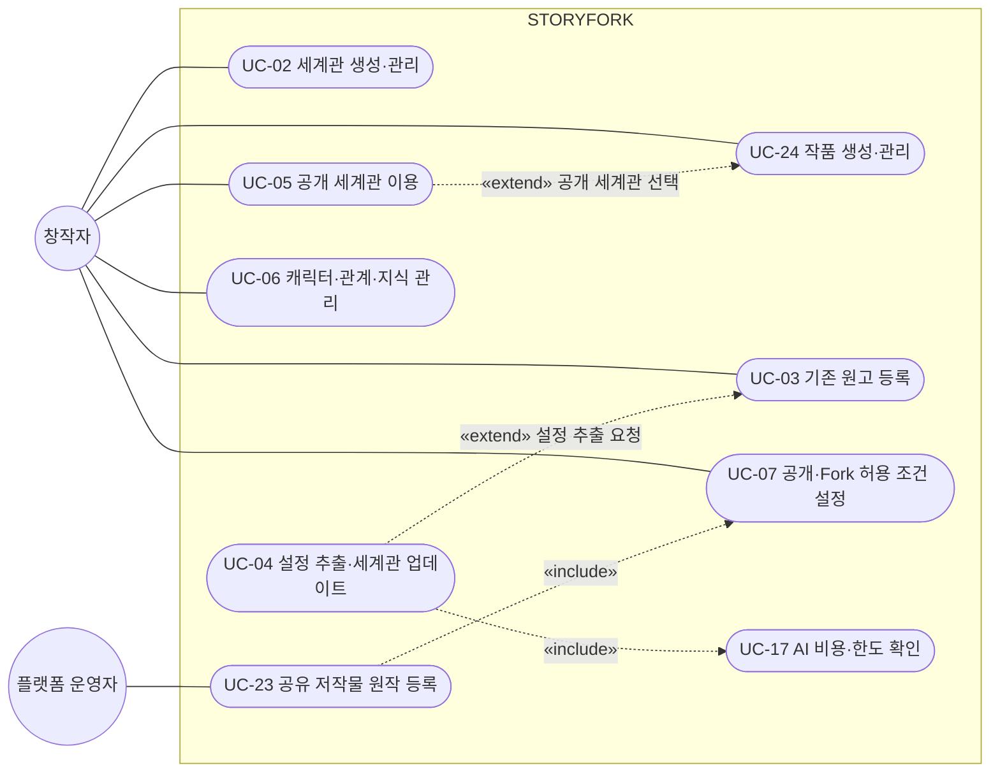
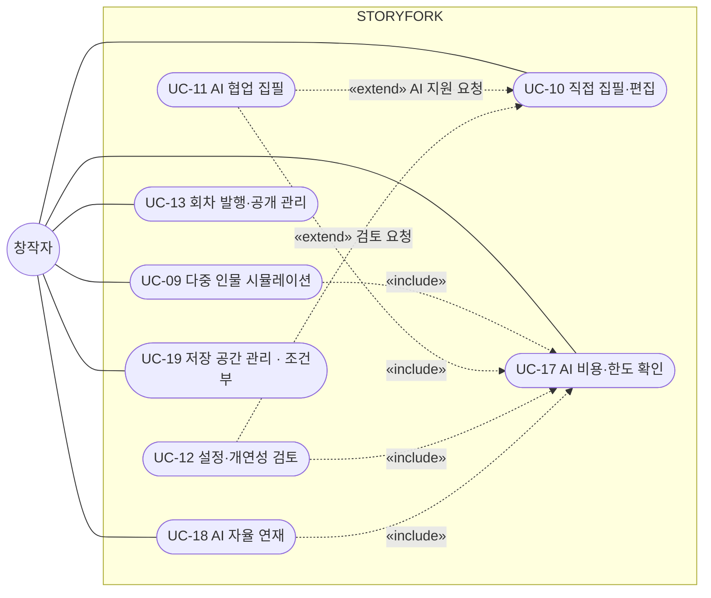
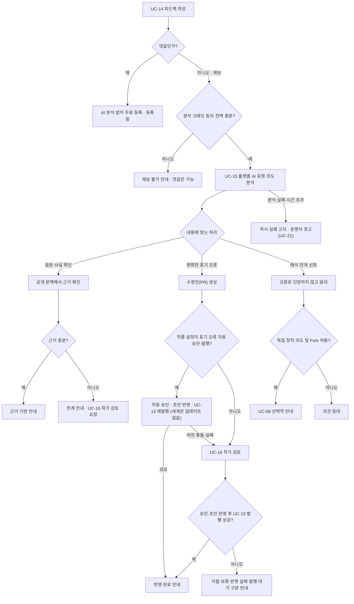

# STORYFORK 유스케이스

> **문서 상태: 기획 기반 초안 v5 — 업무 기능 미구현**
> 현재 구현은 Frontend·Core API·AI Service의 시작 화면과 Health 확인뿐입니다. 아래 내용은 개발할 사용자 목표와 상호작용을 정리한 것이며, 구현 완료를 뜻하지 않습니다. 팀이 확정한 정책은 [6.2절](#62-확정된-정책과-기술-결정)에, 남은 미정 사항은 [7절](#7-미확정-사항과-제외-범위)에 있습니다.

## 문서 기준

- **기획 근거:** [프로젝트 기획서 v1.4](./SKN34-final-4Team.pdf). 주요 사용자 시나리오 12쪽, 전체 구조 13쪽, 핵심 기능 14~19쪽, 운영·비용·권리 20~22쪽을 기준으로 합니다. 쪽수는 PDF의 1-based 페이지 번호입니다.[1]
- **기획 변경 반영:**
  - 독자 피드백의 분석·응대는 **운영자가 아니라 플랫폼(AI)이 수행**하고, 창작 판단과 수정 승인은 작품 소유자가 합니다. 운영자는 처리 실패 확인·권리 처리 같은 예외 업무를 맡습니다.
  - **세계관과 작품을 따로 생성**하며, 작품은 세계관을 반드시 연결해야 만들 수 있습니다.
  - **AI 자율 연재는 자동 발행**하며, 원작·Fork 구분 없이 작품 소유자가 작품 설정에서 켭니다.
  - **AI 크레딧은 작업을 요청하거나 자동 실행을 설정한 사용자가 부담**합니다. 피드백 분석은 제보한 독자가 부담합니다.
  - 기획서 13쪽 그림 8 등 개정이 필요한 곳은 [7.3절](#73-기획서관련-문서-개정-필요-항목)에 있습니다.
- **사용자 확정 정의:** **연재 작가란 다른 플랫폼에서 이미 소설을 연재하여 기존 작품·원고를 보유한 작가**입니다. STORYFORK에서 처음 연재를 시작한 사람이라는 의미로 사용하지 않습니다.
- **형식 참고:** 3TEAM 문서의 전체·액터별 다이어그램, UC 목록, 명세 구성을 참고합니다. 해당 팀의 액터·기능·정책·요구사항 ID는 가져오지 않습니다.[2]
- **범위 구분:** `핵심`은 기획서의 창작·피드백 기능, `지원`은 그 이용에 필요한 흐름, `조건부`는 상세 정책을 확정해야 하는 기능, `테스트 전용`은 검증 환경에서만 쓰는 기능, `후보`는 기획서 근거 없이 UI 프로토타입에서 제안되어 채택 여부를 정해야 하는 기능입니다. 개발 우선순위나 배포 범위를 의미하지 않습니다.
- **용어:** 회차 = 에피소드, 원고 = 집필 중 또는 등록한 텍스트, 발행본 = 독자에게 공개한 회차, 설정집 = 세계관의 장소·시대·규칙·사건 등 설정 항목, 인물관계도 = 세계관의 등장인물과 인물 간 관계, PR = 작품 내 수정 제안(GitHub 연동 아님), 작품 Fork = 독자가 원작 회차에서 분기해 만든 작품(UC-08), 세계관 Fork = 다른 사용자의 세계관을 작가 소유로 복사한 세계관(출처 기록, 원본 업데이트 없음, BR-12), 기본 세계관 = 플랫폼이 장르별로 제공하는 시작용 세계관(복사하면 원본 관계 없는 새 세계관).
- **식별자:** `UC-xx`는 이 문서의 유스케이스 ID입니다. 기능 ID(`F-xxx-nn`)는 [요구사항 정의서](./SKN34-final-4Team_요구사항정의서.xlsx)를 따릅니다.
- **상세 명세:** 각 유스케이스의 사전조건·기본/대안/예외 흐름·사후조건은 [유스케이스 명세서](./usecase-spec/README.md)에 있습니다.
- **보조 다이어그램:** 상태·활동·시퀀스·도메인 클래스 다이어그램은 [보조 다이어그램](./diagrams/README.md)에 있습니다.
- **UI 프로토타입:** `frontend/index.html`의 정적 프로토타입은 화면 흐름 견본이며 정책 근거가 아닙니다. 화면과 유스케이스의 대응, 프로토타입 정정 목록은 [UI 프로토타입 대응](./prototype-alignment.md)에 있습니다.

---

## 1. 전체 유스케이스

### 1.1 시스템 범위와 사용자 목표

STORYFORK의 범위는 **작품 열람 → 창작 기반 준비 → 전개 탐색 → 집필·공개 → 피드백 처리**입니다.[1]

| 사용자 | 시작점 | 이루려는 목표 |
|---|---|---|
| 독자 | 이용 가능한 작품·회차 | 작품을 읽고 질문·오류를 제보하거나, 허용된 회차에서 다른 전개의 독립 작품을 창작 |
| 신입 작가 | 아이디어·새로운 세계관·인물 구상 | 세계관을 만들고 장면과 회차로 발전시켜 첫 작품을 집필 |
| 연재 작가 | **다른 플랫폼에서 연재한 기존 소설·원고** | 기존 원고에서 설정을 정리하고, 맥락을 유지한 후속 집필·설정 검토, STORYFORK에 공개한 회차의 독자 피드백 처리 |
| 플랫폼 운영자 | 처리 실패 경고·권리 신고 | 자동 처리 실패의 원인 확인, 권리 문제에 따른 비공개·소명 처리, 테스트용 공유 저작물 등록 |

기획서의 초기 검증 대상은 창작 의향이 있는 독자와 신입 작가이며, 연재 작가는 확장 대상입니다.[1]

### 1.2 액터 계층

액터 간 일반화(굵은 화살표, 자식 → 부모)를 먼저 정의해 전체도의 중복 연결을 줄입니다. 독자·신입 작가·연재 작가는 **계정 등급이 아닌 이용 상황**이며, 실제 권한은 작품·세계관마다 판단합니다.

- **창작자:** 해당 작품·세계관의 소유자 또는 적법한 작업 권한을 가진 사용자. 창작자 유스케이스는 신입 작가·연재 작가·Fork 창작자가 모두 상속합니다.
- **Fork 창작자:** UC-08로 Fork를 만든 독자. 자신의 Fork에 대해서만 창작자 권한을 가지며 원작 수정 권한은 얻지 않습니다.
- 운영자·권리 신고자·외부 LLM API는 이 계층과 별도입니다.

### 1.3 전체 다이어그램

Mermaid에는 UML 유스케이스 전용 문법이 없어 `flowchart`로 표기합니다. 원형은 액터, 둥근 항목은 유스케이스, 사각 경계는 STORYFORK, 실선은 참여(연관) 관계입니다. include/extend는 [2.7절](#27-유스케이스-간-관계)의 영역별 다이어그램에 표시합니다.

- **창작자 연결 생략:** UC-04·UC-11·UC-12는 각각 UC-03·UC-10을 확장하므로 기반 유스케이스를 통해 창작자가 참여합니다. UC-04 자동 모드는 회차 발행 후 시스템이 시작합니다. UC-15는 UC-14의 제보(질문·오류 제보·제안)를 확장해 시작하며, 댓글은 분석하지 않습니다.
- **독자의 창작 참여:** 독자가 집필·공개·자율 연재에 참여하는 것은 Fork 창작자로서 자신의 Fork에 대해서입니다(1.2절 일반화).
- **회원과 UC-17:** 독자(피드백 분석)와 창작자(AI 창작 지원) 모두 크레딧을 쓰므로 공통 부모인 회원에 연결합니다.
- **로그인:** UC-22는 대부분의 유스케이스의 사전조건이지만 include로 그리지 않습니다.
- **후보 유스케이스:** UC-25는 UI 프로토타입에서 제안된 기능으로, 채택 전까지 구현 범위가 아닙니다.

### 1.4 대표 이용 흐름

1. **독자:** UC-01 열람 → Fork 허용 확인 → UC-08 Fork 생성 → (Fork 창작자로서) UC-10 직접 집필 또는 UC-09·UC-11 → (선택) UC-12 → UC-13 공개 또는 UC-18 자율 연재.
2. **신입 작가:** UC-02 세계관 생성 (또는 UC-05 공개 세계관 선택) → UC-24 작품 생성 → UC-06 → UC-10 또는 UC-09·UC-11 → (선택) UC-12 → UC-13.
3. **연재 작가:** UC-02 세계관 생성 → UC-24 작품 생성 → UC-03 원고 등록 → UC-04 설정 추출 → UC-06 보정 → UC-09·UC-10·UC-11 후속 집필 → (선택) UC-12 → (선택) UC-13 공개 → UC-16 피드백 처리.
4. **독자 피드백:** UC-14 작성(제보는 분석 크레딧 동의, 댓글은 무료)·접수 → UC-15 AI 분류·근거 확인·응대 → 필요 시 UC-16 작가 검토(표기 오류는 작품 설정에 따라 자동 승인·발행 가능) → UC-14에서 실제 처리 상태 확인. AI 처리가 실패하면 즉시 실패로 안내합니다.

AI 사용은 직접 집필이나 Fork 생성의 필수 조건이 아닙니다.[1]

---

## 2. 액터별 상세

### 2.1 액터와 권한의 구분

| 액터·역할 | 구분 | 참여 범위와 제한 |
|---|---|---|
| 회원 | 추상 액터 | 계정 관리(UC-22), AI 크레딧 확인(UC-17). 독자와 창작자의 공통 부모. 가입은 아직 회원이 아닌 방문자가 시작 |
| 독자 | 주 사용자 액터 | 공개·이용 조건 내 열람, 피드백(분석 크레딧 부담), 허용된 Fork 생성. 타인의 원작·비공개 설정 수정 불가 |
| 창작자(작품 소유자) | 주 사용자 액터 | 자신이 소유하거나 작업 권한을 가진 세계관·작품의 창작·공개·조건 설정·자동 처리 설정·수정 승인 |
| 신입 작가 | 창작자의 하위 액터 | 새 작품을 시작하는 이용 상황 |
| 연재 작가 | 창작자의 하위 액터 | 외부 플랫폼에서 연재한 원고를 가져오는 이용 상황. 원고를 보유해도 AI 처리·재공개·Fork 허용 권한은 별도 확인 |
| Fork 창작자 | 독자이자 창작자 | 자신의 Fork에만 창작자 권한 행사. 자율 연재 등 작품 설정도 자신의 Fork에서 사용 |
| 세계관 소유자 / 이용자 | 권한 역할 | 세계관 정본 수정 권한과 다른 작품에서의 이용 권한을 구분 |
| 플랫폼 운영자 | 운영 액터 | 처리 실패·지연 경고와 오류 로그 확인(UC-21), 권리 신고 검토·소명 판단(UC-20), 테스트용 공유 저작물 등록(UC-23). **개별 피드백 응대와 창작 결정은 하지 않으며 비공개 원고를 임의 열람하지 않음** |
| 권리 신고자·소명자 | 운영 참여 액터 | 권리 침해 신고 또는 자신의 콘텐츠에 대한 소명. 비회원 접수·본인 확인 방식은 미정 |
| 외부 LLM API | 보조 외부 시스템 | 허용 문맥에서 추출·시뮬레이션·집필·검토·응대 결과를 반환. 권한·발행·크레딧을 확정하지 않음 |

기획서의 네 가지 AI 에이전트(인물 에이전트, 스토리 계획 에이전트, 세계관·설정 검토 에이전트, 집필 및 피드백 응대 에이전트)는 STORYFORK 내부 역할이지 외부 액터가 아닙니다. Frontend·Core·AI Service와 저장소(DB·Gitea)도 구현 구성요소이므로 액터로 나누지 않습니다.[1]

### 2.2 독자

- **목표:** 작품 감상, 질문·오류 제보와 결과 확인, 허용된 원작에서 자신의 이야기 창작.
- **권한 전환:** UC-08 완료 후 생성된 Fork에 한해 창작자 유스케이스를 이용합니다. 작품 설정(UC-24)에서 자율 연재 등 자동 처리도 켤 수 있습니다.

- **비용:** 피드백 분석 크레딧은 제보한 독자가 부담합니다. 크레딧이 없으면 제보(질문·오류 제보·제안)는 할 수 없고 댓글만 달 수 있습니다. Fork 생성과 직접 집필은 무료입니다.
- **경계:** Fork 허용이 없으면 분기하지 않습니다. 다른 전개를 선호한다는 이유만으로 원작을 오류로 판정하거나 강제 수정하지 않습니다.

### 2.3 신입 작가

- **목표:** 보유한 아이디어를 새로운 세계관·작품·인물과 실제 회차로 구체화합니다.
- **기본 여정:** UC-02 세계관 생성 (또는 UC-05 공개 세계관 선택) → UC-24 작품 생성 → UC-06 → UC-10 또는 UC-09·UC-11 → (선택) UC-12 → UC-13.
- **선택:** 이미 작성한 초안이 있다면 UC-03·UC-04를 이용할 수 있습니다. 원고 등록을 연재 작가 전용으로 제한하지 않습니다.
- 신입 작가는 창작자를 상속하므로 별도 다이어그램 없이 [2.7절](#27-유스케이스-간-관계)의 창작자 유스케이스를 모두 이용합니다.

### 2.4 연재 작가 — 외부 플랫폼 원고 보유자

- **목표:** 다른 플랫폼에서 연재한 자신의 기존 소설을 기반으로 설정 정리, 후속 집필, 일관성 검토, 독자 피드백 처리를 지원받습니다.
- **권리:** 작가 본인의 글이어도 출판·독점 연재 계약 등에 따라 AI 처리, 재공개, 파생 창작 허용 범위가 다를 수 있습니다. 계약 판단을 AI가 대신 확정하지 않습니다.

- **기본 여정:** UC-02 → UC-24 → UC-03 → UC-04 → UC-06 → UC-09·UC-10·UC-11 → UC-12.
- **원고 입력:** `.txt` 파일 업로드 또는 STORYFORK 에디터 직접 입력·붙여넣기만 지원합니다.
- **설정 갱신:** 설정집·인물관계도는 기본적으로 작가가 요청할 때만 AI로 추출합니다. 작품 설정에서 자동을 켜면 새 회차가 발행될 때마다 실행되며 크레딧을 씁니다. 작가 대부분이 설정집을 먼저 만들고 작품을 쓴다는 전제에서 비용을 줄이기 위한 기본값입니다.
- **피드백 경로:** 기획서 문제 정의(6쪽)의 연재 작가 과제는 독자 피드백 처리입니다. 피드백은 **STORYFORK에 공개(UC-13)한 회차**에 접수된 것만 대상이며, UC-14~15를 거쳐 UC-16에서 처리합니다. 다른 플랫폼의 댓글 자동 수집·동기화는 포함하지 않습니다.
- **공개 선택:** 등록 원고를 집필 지원에만 쓰면 피드백 기능은 이용할 수 없습니다. 공개를 강제하지 않습니다.
- **외부 연동 제외:** 외부 플랫폼 로그인·스크래핑·API 연동·자동 게시·연재 이력 동기화를 가정하지 않습니다.

### 2.5 플랫폼 운영자·권리 신고자

독자 피드백의 분석·응대는 플랫폼(AI)이 수행합니다. 운영자는 자동 처리로 해결할 수 없는 예외와 플랫폼 단위 업무를 맡습니다.

| 업무 | 담당 | 비고 |
|---|---|---|
| 피드백 접수·유형 분류·근거 확인·응대·수정안 생성·상태 안내 | 플랫폼(AI) | UC-14~15 |
| 수정안 승인·거절, 창작 판단이 필요한 제보 검토 | 작품 소유자 | UC-16. 표기 오류는 작품 설정에 따라 자동 승인·발행 |
| AI 처리 실패·지연 시 사용자에게 즉시 실패 고지 | 플랫폼 | 대기 상태로 두지 않음 |
| 실패·지연 경고와 오류 로그 확인, 원인 수정 | 운영자 | UC-21. 응답 내용을 대신 작성하지 않음 |
| 권리 신고 접수 시 빠른 검토·조치(비공개 등), 소명 검토와 재공개 결정 | 운영자 | UC-20. 상세 절차는 검토 예정 |
| 검증용 저작권 만료 작품의 원작 등록 | 운영자 | UC-23 · 테스트 전용. 기획서 22쪽 근거 |

- **외부 2차 창작물:** 일반 사용자가 다른 플랫폼의 2차 창작물을 올리는 것은 UC-23이 아니라 UC-24·UC-03입니다. 무료 공개만 가능하며 권리 책임은 등록자에게 있고, 원작자·저작권 문제가 제기되면 운영자가 빠르게 조치하고 소명 절차를 엽니다(UC-20). 외부 2차 창작물도 Fork 원작이 될 수 있습니다.
- **제한:** 운영 권한은 원고 무제한 열람·원작 임의 수정 권한과 같지 않습니다. 대시보드, 모델 관리, 결제 환불 기능을 참고 문서에서 그대로 도입하지 않습니다.
- **미정:** 악성·부적절 피드백의 신고·숨김 처리는 기획서에 없는 기능이므로 추가 여부를 7절에서 결정합니다.

### 2.6 외부 시스템

| 구분 | 관련 유스케이스 | 모델링 원칙 |
|---|---|---|
| 외부 LLM API | UC-04, UC-09, UC-11, UC-12, UC-15, UC-18, UC-25(후보) | 허용된 최소 문맥을 받아 결과 반환. 업무 모델 호출은 미구현 |
| 외부 연재 플랫폼 | 없음 | 연재 작가가 원고를 보유하게 된 출처이지, 연동 액터가 아님 |
| 결제 제공자·스케줄러 | 미정 | 결제 수단·자율 연재 실행 방식이 정해지기 전에는 액터로 추가하지 않음 |

UC-15의 피드백 유형 분류는 외부 LLM 또는 WBS 3.5의 자체 분류 모델로 수행할 수 있습니다. 자체 모델과 저장소(DB·Gitea)는 내부 구성요소이므로 액터로 추가하지 않습니다.

### 2.7 유스케이스 간 관계

점선은 `«include»`(기반 → 항상 포함되는 유스케이스) 또는 `«extend»`(확장 → 기반 유스케이스, 조건부 수행)입니다.

#### 열람·Fork·피드백

#### 창작 기반

#### 집필·시뮬레이션·비용

| 관계 | 의미 |
|---|---|
| UC-08, UC-14 «extend» UC-01 | 열람 중 Fork 허용 회차 또는 피드백 작성을 선택할 때 수행. UC-14의 상태 확인은 내 피드백 화면에서 독립적으로 시작 |
| UC-15 «extend» UC-14 | 제보(질문·오류 제보·제안)일 때만 AI 분석·응대. 댓글은 분석하지 않음 |
| UC-15 «include» UC-17 | 제보 등록 전에 제보자가 분석 크레딧에 동의 |
| UC-15 → UC-16 (UML 관계 아님) | UC-15가 수정안·작가 검토 요청을 검토 대기 항목으로 만들고, 작품 소유자가 UC-16을 독립적으로 시작해 처리. 표기 오류 자동 승인·발행이 설정된 작품은 소유자 개입 없이 처리 |
| UC-02 → UC-24 (UML 관계 아님) | 작품은 연결할 세계관이 있어야 생성할 수 있음(UC-24 사전조건) |
| UC-05 «extend» UC-24 | 작품 생성 중 공개 세계관을 선택할 때 수행 |
| UC-04 «extend» UC-03 | 원고 등록 후 설정 추출을 요청할 때 수행. 자동 모드에서는 새 회차 발행(UC-13) 후 시스템이 시작. 수정안 반영 재발행은 제외 |
| UC-11, UC-12 «extend» UC-10 | 편집 중 AI 집필 지원이나 검토를 요청할 때 수행 |
| UC-04, UC-09, UC-11, UC-12, UC-15, UC-18, UC-25 «include» UC-17 | AI 실행 전 비용·한도 확인. 자동 실행(UC-04 자동 모드, UC-18)은 설정할 때 한 번 동의 |
| UC-23 «include» UC-07 | 공유 저작물 등록 시 공개·Fork 허용 조건을 함께 설정. 독자 노출은 UC-13 발행 후 |

---

## 3. 유스케이스 목록과 기획 기능 대응

### 3.1 전체 목록

| ID | 유스케이스 | 주 액터 | 보조 액터 | 구분 | 관련 기능 ID | 기획 근거 |
|---|---|---|---|---|---|---|
| UC-01 | 작품·회차 열람 | 독자 | — | 지원 | F-PUB-01·03·04 | 12·20쪽 |
| UC-02 | 세계관 생성·관리 | 창작자(세계관 소유자) | — | 핵심 | F-WLD-01·02, F-RGT-01, F-SET-02·03 | 14쪽 |
| UC-03 | 기존 원고 등록 | 창작자(대표: 연재 작가) | — | 핵심 | F-WLD-05, F-SET-04 | 14쪽 + 연재 작가 정의 |
| UC-04 | 설정 추출·세계관 업데이트 | 창작자 | 외부 LLM API | 핵심 | F-WLD-06·07, F-SET-03 | 14~15쪽 |
| UC-05 | 허용된 공개 세계관 이용 | 창작자 | — | 핵심 | F-WLD-03·08, F-RGT-03 | 14쪽 |
| UC-06 | 캐릭터·관계·시점별 지식 관리 | 창작자 | — | 핵심 | F-CHR-01~06, F-OPS-02 | 15쪽 |
| UC-07 | 공개·Fork 허용 조건 설정 | 작품·세계관 소유자 | — | 핵심 | F-RGT-01~03, F-FRK-01 | 14·17·20쪽 |
| UC-08 | 원작 회차 기반 Fork 생성 | 독자 | — | 핵심 | F-FRK-01~07, F-OPS-04 | 12·17쪽 |
| UC-09 | 다중 인물 시뮬레이션 실행·결과 선택 | 창작자 | 외부 LLM API | 핵심 | F-SIM-01~10, F-OPS-03 | 16쪽 |
| UC-10 | 직접 집필·편집 | 창작자 | — | 핵심 | F-WRT-01·05·08·11, F-WLD-04 | 18쪽 |
| UC-11 | AI 협업 집필 | 창작자 | 외부 LLM API | 핵심 | F-WRT-02~06·08 | 18쪽 |
| UC-12 | 설정 충돌·개연성 검토 | 창작자 | 외부 LLM API | 핵심 | F-REV-01~04, F-SIM-09 | 12·15~18쪽 |
| UC-13 | 회차 발행·공개 관리 | 작품 소유자 | — | 핵심 | F-PUB-02, F-RGT-03 | 12·18·20쪽 |
| UC-14 | 독자 피드백 등록·처리 상태 확인 | 독자 | — | 핵심 | F-FBK-01·10·11, F-CRD-02 | 12·19쪽 |
| UC-15 | 피드백 AI 분석·맞춤형 응대 | 독자(UC-14 제보 시) | 외부 LLM API | 핵심 | F-FBK-02~06·08·09·12 | 7·12·19쪽 |
| UC-16 | 작가 검토 요청·수정안 승인·반영 | 작품 소유자 | — | 핵심 | F-FBK-06~08·10, F-WRT-11, F-SET-01 | 7·19쪽 |
| UC-17 | AI 이용 비용·한도 확인 | 회원 | — | 지원·금액 정책 미정 | F-CRD-01~03 | 20~21쪽 |
| UC-18 | AI 자율 연재 설정·자동 발행 | 작품 소유자(원작·Fork) | 외부 LLM API | 핵심·실행 주기 미정 | F-WRT-09·10, F-SET-01 | 18쪽 |
| UC-19 | 저장 사용량 확인·정리·확장 | 창작자 | — | 조건부 | F-STO-01 | 20~21쪽 |
| UC-20 | 권리 침해 신고·비공개·소명 | 신고자·소명자, 운영자 | — | 지원·절차 일부 미정 | F-RPT-01·02, F-SET-04 | 20·22쪽 |
| UC-21 | 처리 실패·지연 경고 확인 | 운영자 | — | 지원 | F-OPS-05, F-ALT-01·02 | 13쪽 |
| UC-22 | 회원 계정 관리 | 회원 | — | 지원 | F-ACT-01~08 | 요구사항 정의서 REQ01 |
| UC-23 | 공유 저작물 원작 등록 | 운영자 | — | 테스트 전용 | F-RGT-04·05 | 22쪽 |
| UC-24 | 작품 생성·관리 | 창작자(작품 소유자) | — | 핵심 | F-WLD-03·04·08, F-WRT-07, F-SET-01·04 | 14·18·19쪽 |
| UC-25 | 캐릭터 챗 | 독자 | 외부 LLM API | 후보 | 없음(요구사항 정의서 미반영) | 기획서 근거 없음 · UI 프로토타입 U27 |

변경 이력: UC-22·UC-23은 v2에서 추가했습니다. v3에서는 UC-02를 세계관 생성·관리로 좁히고 작품 생성·관리를 UC-24로 분리했으며, UC-21 이름을 실제 역할에 맞게 바꿨습니다. v4에서는 댓글과 제보를 나누고(UC-15가 UC-14를 extend), 피드백이 세계관을 바꾸지 않는 규칙(BR-11)과 처리 상태 이름을 정했습니다. v5에서는 UI 프로토타입을 대조해 UC-25(후보)를 추가하고, 탐색·읽기 편의·집필 보조 화면을 기존 명세의 대안 흐름과 미정 사항에 반영했습니다. 기존 번호는 요구사항 정의서와의 추적을 위해 유지합니다.

### 3.2 핵심 기능 6개와 UC 대응

| 기획서 핵심 기능 | 포함 유스케이스 | 성공 결과 |
|---|---|---|
| ① 작품 및 세계관 생성·관리 | UC-02~05, UC-24, 이용 조건은 UC-07 | 세계관을 먼저 만들고, 그 세계관에 연결된 작품에 검토된 설정이 쌓임 |
| ② 캐릭터 프로필 및 관계 관리 | UC-06 | 기준 시점별 인물 정보·관계·지식과 공개 전환 이력이 구분됨 |
| ③ 다중 AI 에이전트 기반 스토리 시뮬레이션 | UC-09 | 사용자가 검토할 전개 후보와 선택 결과를 얻음 |
| ④ Fork 기반 스토리 분기 및 독립 창작 | UC-07~08, 테스트용 UC-23 | 분기 시점의 회차·공개 세계관이 고정된 독립 작품이 생성됨 |
| ⑤ 스토리 집필 및 편집 | UC-10~13, UC-18 | 선택한 집필 방식으로 원고를 만들고, 직접 발행하거나 자율 연재로 자동 발행 |
| ⑥ 독자 피드백 분석 및 맞춤형 응대 | UC-14~16 | 플랫폼이 유형에 맞게 응대하고, 승인된 수정과 실제 처리 상태가 제공됨 |

UC-17·UC-19~22는 이를 지원하는 이용·운영 흐름입니다.[1] UC-25는 채택 여부를 정하지 않은 후보입니다.

---

## 4. 유스케이스 명세

각 유스케이스의 상세 명세는 [유스케이스 명세서](./usecase-spec/README.md)에 있습니다. 명세의 사전조건은 목표로 하는 업무 계약이며, 인증·권한 검사·저장·버전 관리가 구현되어 있다는 뜻이 아닙니다.

---

## 5. 피드백 처리 흐름

UC-14~16의 분기를 한눈에 보기 위한 활동 흐름입니다. 분류가 항상 하나로 결정된다는 뜻은 아니며, 질문과 수정 요청이 섞이면 각각 필요한 처리를 수행합니다.

---

## 6. 공통 규칙·확정 결정·서비스 책임

### 6.1 공통 규칙

| 경계 | 적용 원칙 |
|---|---|
| 이용자 역할 | 독자·신입 작가·연재 작가는 이용 상황이며, 실제 작업 권한은 작품·세계관별로 판단 |
| 원고·공개 | 기존 원고 등록, AI 처리, 학습 이용, STORYFORK 공개, 외부 플랫폼 게시를 각각 구분 |
| 외부 원고 | 원고를 보유했다는 사실만으로 AI 처리·재공개·Fork를 허락할 권한을 추정하지 않음 |
| 외부 2차 창작물 | 무료 공개만 허용. 권리 책임은 등록자. Fork 원작이 될 수 있음. 원작자·저작권 문제가 제기되면 운영자가 빠르게 조치하고 소명 절차를 엶 |
| Fork 기준 | 분기 전 회차와 분기 시점의 세계관·인물관계도는 불변. 분기 시점에 공개된 항목만 포함. 원작의 후속 변경(공개 전환 포함)은 기존 Fork에 반영하지 않음. 분기 이후는 Fork 소유자가 수정. 작품 운영 설정·공개 조건은 넘기지 않음 |
| 정보 범위 | 독자 공개 범위와 인물별 인지 여부를 별도 속성으로 관리. AI에 작업별 최소 문맥만 제공 |
| 세계관 이용 | 공통 세계관의 정본 수정 권한과 특정 작품에서 이용하는 권한을 구분. 고치려면 세계관 Fork로 복사 |
| 변경 이력 | 세계관·인물관계도의 모든 변경과 공개 전환(떡밥 공개)을 회차와 함께 이력으로 남김. 변경은 현재 HEAD 위에 새 버전으로 쌓고 덮어쓰기·머지하지 않음 |
| AI와 사용자 결정 | AI 결과는 제안. 사용자 선택·승인과 실제 저장·공개를 구분. 단, 작품 소유자가 켠 자동 처리(세계관 자동 업데이트, 표기 오류 자동 승인·발행, 자율 연재)는 그 설정을 사전 승인으로 보고 결과를 변경 이력에 남김 |
| 피드백 | 플랫폼(AI)이 응대하고 작품 소유자가 창작 판단·승인. 사실·표기 오류와 해석·전개 선호를 구분. 댓글은 AI 분석 없이 무료 |
| 피드백과 세계관 | 피드백 분석은 공개 근거를 대조하는 검증일 뿐 세계관을 바꾸지 않음. 수정안 반영에 따른 재발행은 세계관 자동 업데이트를 실행하지 않음 |
| 운영 | 운영자는 예외·권리·플랫폼 단위 업무만 수행. 개별 응대·창작 결정·비공개 원고 임의 열람 금지 |
| 상태·실패 | 상태 이름은 [명세 0.4절](./usecase-spec/README.md#04-처리-상태-이름)을 따름. AI 실패·지연은 즉시 사용자에게 알리고 대기 상태로 두지 않으며 운영자에게 경고 |
| 비용 | AI 크레딧은 요청하거나 자동 실행을 설정한 사용자가 부담. 피드백 분석은 제보자, 자율 연재·세계관 자동 업데이트는 작품 소유자. Fork 생성·직접 집필은 무료 |
| 데이터 보존 | 실패·권한 거부·한도 초과를 이유로 기존 원고·확정 설정을 임의 덮어쓰거나 자동 삭제하지 않음 |

### 6.2 확정된 정책과 기술 결정

| 주제 | 결정 | 관련 UC |
|---|---|---|
| 세계관·작품 | 세계관은 작품과 별도로 생성. 작품은 세계관을 1~5개 연결해야 생성하며, 세계관 간 충돌은 설정 검토(UC-12)로 해결. 연결 목록은 첫 회차 발행 전까지만 변경(다른 사용자 세계관을 자기 세계관 Fork로 교체하는 것은 예외). 장르 기본 세계관을 복사해 시작할 수 있음. 세계관 필수 항목은 이름만, 연결 작품 수 제한 없음, 연결된 작품이 없을 때만 삭제, 변경 이력 무기한 | UC-02, UC-12, UC-24 |
| 공개 세계관 이용 | 고치지 않고 쓰면 원본을 그대로 참조(최신 공개본 자동 반영). 고치려면 세계관 전체를 세계관 Fork로 복사해 수정하고 작품 연결을 Fork로 교체. 세계관 Fork는 원본 업데이트를 받지 않고 출처를 기록하며, 원본 소유자가 Fork를 허용한 경우만 가능. 새로 추출한 설정도 자기 세계관에 저장. 이용 허가를 철회해도 기존 연결은 유지하되 철회 시점 상태로 고정, 새 연결만 차단 | UC-05 |
| 설정 갱신 | 설정집·인물관계도 갱신은 기본 수동(작가 요청 시 UC-04 실행). 작품 설정에서 자동을 켜면 새 회차 발행 때마다 자동 반영. 이미 발행한 회차를 재발행하면 추출 후 작가가 확인한 항목만 반영. 피드백 수정안 반영에 따른 재발행은 제외. 공개 전환도 같은 업데이트에서 함께 반영 | UC-02, UC-04, UC-06 |
| 공개·비공개 설정 | 세계관 공개(다른 작가의 이용 가능 여부)와 독자 공개(작품별 공개 회차)를 구분. 세계관에서는 항목의 공개·비공개만 정하고, 비공개 항목은 떡밥이 풀리는 회차에서 작품별로 공개 전환하며 그 회차를 이력에 남김. 다른 작품에서 공개된 항목도 이용 작품에는 비공개로 들어와 그 작품의 회차 기준으로 따로 공개 | UC-02, UC-05, UC-06, UC-08 |
| 공개·이용 조건 | 공개 범위는 비공개·공개 두 가지. 작품 권한: 열람·AI 처리·작품 Fork 생성·Fork 작품 공개·유료 공개. 세계관 권한: 이용·세계관 Fork·AI 처리·유료 공개(이용과 Fork는 따로 허용) | UC-07 |
| AI 기능 | 모든 AI 기능은 작가가 골라 쓰는 도구이며 발행 전 검토(UC-12)도 필수가 아님. 크레딧이 있는 제보의 분석과 작품 소유자가 켠 자동 처리만 자동 실행 | 전체 |
| 작품 비공개 전환 | UC-07에서 작품을 비공개로 바꾸면 발행된 모든 회차를 바로 숨김. 회차 하나는 UC-13 공개 중단 | UC-07, UC-13 |
| Fork 제한 | 원작에서만 Fork 가능, 한 독자는 한 원작에서 1번만, Fork의 Fork 불가. 회차별 설정 이력이 없는 원작(일괄 등록)은 현재 설정으로 고정하고 경고 | UC-03, UC-08 |
| 세계관 조합 | 기존 세계관 여러 개에서 항목을 골라 자기 세계관을 새로 만들 수 있음. 플랫폼 기본 세계관만 쓰면 원본 관계 없는 새 세계관, 다른 사용자 세계관이 섞이면 세계관 Fork(출처 기록). 인물관계도는 세계관과 따로 만들어 추가할 수 있고, Fork에서도 인물관계도만 새로 정리 가능 | UC-02, UC-06, UC-08 |
| 시점 단위 | 인물 상태·인지·공개 전환 등 모든 시점은 회차 단위로 관리 | UC-04, UC-06, UC-08 |
| Fork 범위 | Fork는 기준 회차 종료 시점에서 분기하고 다음 회차부터 작성. Fork에는 분기 시점에 공개된 세계관·인물관계도만 포함. 분기 전 회차·세계관은 불변, 이후는 수정 가능. Fork는 분기 시점 버전을 참조하며 작품 운영 설정은 넘기지 않음 | UC-08 |
| 자율 연재 | 자동 발행. 원작·Fork 모두 작품 설정에서 켬. 크레딧은 작품 소유자 부담 | UC-18 |
| 표기 오류 처리 | 작품 설정에서 "작가 검토" 또는 "자동 승인·발행" 중 선택 | UC-16, UC-24 |
| AI 비용 | 요청하거나 설정한 사용자 부담. 피드백 분석은 제보자 부담이며, 크레딧이 없으면 제보는 못 하고 댓글만 가능 | UC-14, UC-17 |
| 외부 2차 창작물 | 무료 공개만. 권리 책임은 등록자. Fork 가능. 같은 IP는 먼저 올린 작품을 원본으로 인정하고 다른 작품도 허용. 외부 IP의 2차 창작 허용 범위를 따르되 플랫폼은 직접 확인하지 않음. 원작 작가임이 확인된 신고는 즉시 비공개, 그 밖의 신고는 운영자가 빠르게 조치 | UC-03, UC-13, UC-20, UC-24 |
| 처리 실패 | 실패·지연 시 사용자에게 즉시 고지(대기 없음), 운영자에게 경고와 오류 로그 | UC-21 |
| 공유 저작물 | 저작권 만료 작품 등록은 검증·테스트 전용 | UC-23 |
| 인증 | 이메일·비밀번호 로그인, JWT 토큰 인증. 소셜 로그인은 추후 연동 | UC-22 |
| 원고 입력 | `.txt` 파일 업로드, STORYFORK 에디터 직접 입력·붙여넣기 | UC-03 |
| 저장 | 세계관·인물관계도·인물 정보(작품별 상태·인지 포함)는 Gitea(Git 저장소)로 변경 이력 관리. 회차(에피소드) 원고는 DB | UC-02, UC-06, UC-10 |

Gitea는 새 외부 서비스이며, 현재 WBS에 구축 작업이 없습니다. [아키텍처 문서](./architecture.md)는 현재 실행 구조만 설명하므로 저장 구조는 구현 착수 시 그 문서에 반영합니다.

### 6.3 서비스 책임

서비스는 기존 세 구성으로 유지합니다. 유스케이스 하나당 별도 서버를 만드는 설계가 아닙니다.

| 구성 | 목표 책임 | 넘지 않는 경계 |
|---|---|---|
| Frontend | 입력·열람·편집·검토·선택·상태 표시 | 공개 Core API만 호출. 클라이언트 표시만으로 권한·비용 확정 금지 |
| Core API | 작품·세계관·회차 버전·Fork 정본, 권한·승인·발행·크레딧의 최종 판단과 저장. DB·Gitea 접근을 소유 | 외부 AI의 결과를 검증 없이 정본·과금 결과로 취급하지 않음 |
| AI Service | 허용 문맥에서 추출·시뮬레이션·집필·검토·응대 결과 반환 | 정본 직접 수정, DB·Gitea 직접 쓰기, 권한·발행·과금 최종 확정 금지 |

---

## 7. 미확정 사항과 제외 범위

### 7.1 후속 합의가 필요한 사항

| 주제 | 미확정 내용 | 관련 UC |
|---|---|---|
| 계정·권한 | 토큰 만료·갱신·로그아웃 시 무효화 방식, 본인 확인 방식, 비회원 열람·신고 범위, 공동 집필, 운영자 세부 역할, 가입 약관·선택 동의 항목, 탈퇴 시 데이터 보존·삭제 기준 | UC-22, 전체 |
| 탐색·읽기 편의 | 검색 대상·정렬 기준, 장르·해시태그 운영 방식, 좋아요·관심 소설·감정 반응·댓글 좋아요의 저장과 노출, 이어 읽기 기록 보관 | UC-01, UC-14 |
| 캐릭터 챗 | 채택 여부, 인물이 아는 범위(독자가 읽은 회차 기준 여부), 크레딧, 대화 기록 보관, Fork 안내 연결 | UC-25 |
| 원고 입력 | 크기·회차 수 한도, 회차 구분 규칙, 지원 인코딩, 중복·재등록, `.pdf` 등 추가 형식 지원 | UC-03 |
| 세계관·작품 모델 | 장르 목록, 자동 반영된 세계관 변경의 알림 여부, 장르 기본 세계관의 제공 범위·관리 주체, 세계관 Fork의 원본 변경 알림·원하는 항목만 골라 가져오기(미확정) | UC-05~06, UC-24 |
| Fork 정책 | 고정 수단(분기 시점 버전을 참조하는 원칙은 확정, Gitea 브랜치·커밋 참조 등 구현 수단은 미정), 허용 철회·원작 삭제·권리 제한의 기존 Fork 영향, 기준 회차까지 읽어야 Fork할 수 있는지 | UC-07~08, UC-20 |
| 집필·버전 | 자동 저장·동시 수정·버전 복원, 집필 보조 화면(보드·타임라인·사전·개요)의 저장 위치와 정본 관계 | UC-10~13, UC-16 |
| 피드백 | 스포일러 범위, 피드백·답변 공개 수준, 알림 채널, 악성·부적절 피드백 처리, 제보 무료 제공량 | UC-14~16 |
| AI 비용 | 가격, 무료 제공량, 차감 시점, 오류 복구, 충전·결제, 실행 중 작업 중단 기능 제공 여부 | UC-17 |
| 자율 연재 | 실행 주기·트리거, 독자 반응 반영 기준, 자동 중지 조건, 스케줄러 도입, 발행 전 소유자 확인 옵션 | UC-18 |
| 수익·저장 | 유료 열람·판매 배분·보상 크레딧·저장 용량·확장 요금 | UC-13, UC-17, UC-19 |
| 권리·운영 | 신고 자격·증빙, 신고 조치의 상세 절차(검토 예정), 원작 작가 확인 방법, 허위 신고 대응, 소명 기한, 권리 침해 외 신고 유형(유해물·인격권 침해) 포함 여부, 플랫폼 면책 범위(이용약관·법률 검토), 지연 기준 시간, 경고 채널, 로그 보관 기간 | UC-20~21 |

### 7.2 이번 문서에서 구현·확정하지 않는 것

- API URL·DTO·DB 테이블·ERD와 실제 업무 기능 구현.
- 외부 연재 플랫폼의 로그인·원고/댓글 자동 수집·동기화·자동 게시.
- 에이전트별 독립 서버 증설. 자율 연재용 스케줄러·worker는 실행 방식이 정해진 뒤 별도로 결정.
- 구체적인 결제사·요금제·정산·환불·보상 알고리즘.
- 인기순 추천·투표·랭킹·알림·고객센터·모델 운영 화면을 별도 확정 기능으로 추가하는 것. UI 프로토타입의 랭킹(U25), 홈 추천 섹션, 문의·공지·이벤트(U34~U35E), 결제 내역(U33), 운영 데이터·전처리·AI 상태(A01·A02·A05), 격리 점검(A06) 화면은 시연용이며 확정 기능이 아닙니다([UI 프로토타입 대응](./prototype-alignment.md)).
- 데이터셋 수집·AI 학습·타사 IP 제공.

### 7.3 기획서·관련 문서 개정 필요 항목

| 문서 | 개정 내용 |
|---|---|
| 기획서 13쪽 그림 8 | 운영자 설명을 "독자 피드백 관리 및 맞춤형 응대"에서 처리 실패 확인·권리 처리 중심으로 변경 |
| 기획서 14쪽 | 세계관 선행 생성, 설정 갱신 수동 기본값과 자동 옵션 |
| 기획서 18쪽 | 자율 연재 자동 발행, Fork 작품 적용, 비용 부담 주체 |
| 기획서 20~22쪽 | 외부 2차 창작물 무료 공개·권리 책임·운영자 신속 조치, 피드백 분석 비용 제보자 부담 |
| 기획서 개정 이력 | 위 변경을 담은 버전 추가 |
| WBS | 5.6 운영자 화면 범위 조정, Gitea 구축·세계관 저장 작업 추가 |
| 요구사항 정의서 | UC-17·19·20 기능 ID 추가, UC-22~24 연결, UC-02 분리, F-WRT-09 자동 발행 반영 |
| architecture.md | 구현 착수 시 DB·Gitea 저장 구조 반영 |
| 요구사항 정의서 (v5) | UC-25 채택 시 기능 ID 추가, UC-01 탐색·읽기 편의 기능 ID 검토 |
| UI 프로토타입 | [UI 프로토타입 대응](./prototype-alignment.md) 3절의 정정 항목(P-01~P-14)을 문서 기준으로 수정 |

다음 단계는 **남은 미정 사항 합의 → 요구사항·수용 기준 확정 → 화면·입출력 계약 → ERD와 구현** 순서입니다.

## Sources

[1] ./SKN34-final-4Team.pdf — STORYFORK 프로젝트 기획서 v1.4 — PDF 24쪽
[2] https://github.com/SKNETWORKS-FAMILY-AICAMP/SKN34-FINAL-3TEAM/blob/7188b696e6e28d537d015a0e7c4eab3346a65976/docs/design/usecase.md — 3TEAM 유스케이스 — 문서 구성·표기 참고, 7188b696 기준
