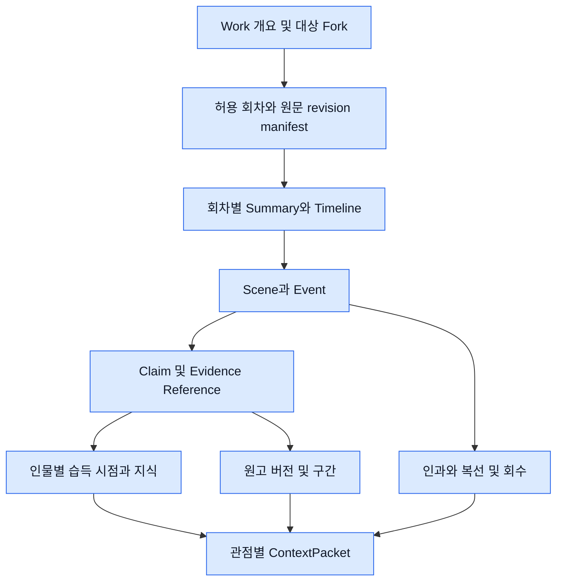
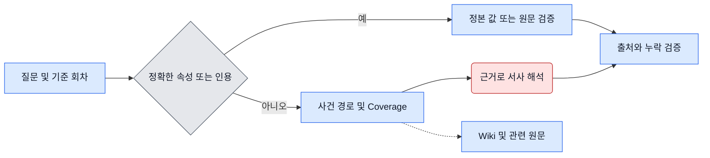
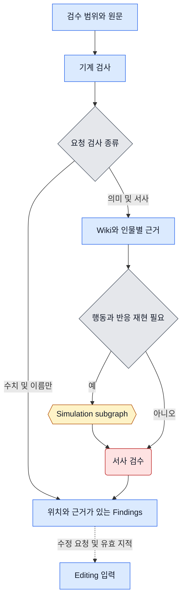
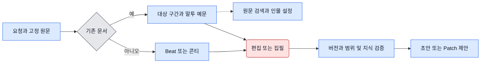
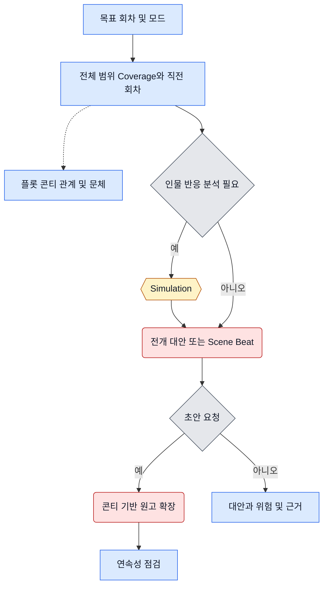
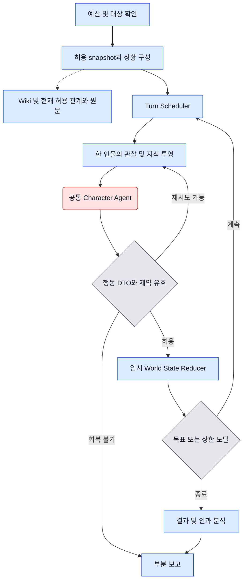
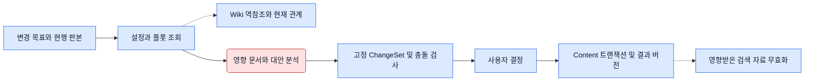
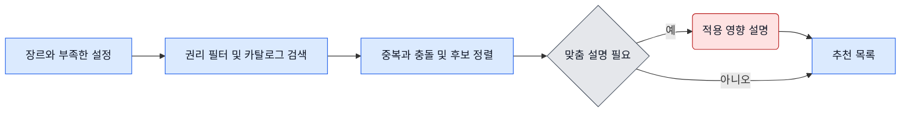

# 회차 문맥, 시뮬레이션, 집필 기능

“10화까지 읽은 독자가 아는 사실”과 “10화 시점의 카이가 아는 사실”은 서로 다른 입력이다. 모든 기능은 Content가 승인한 작품·Fork·판본에서 시작한다. 요청 범위와 인물 관점을 각각 좁힌 뒤 필요한 자료만 모델에 전달한다. [검색 계약 및 합성 예제](07-retrieval-contract-and-mocks.md)

### 6. Story Context와 Wiki의 연결



Wiki의 논리 키는 `(대상 work/Fork, source_revision, local_id)`다. Episode contains Scene, Scene contains Event, Entity participates_in Event, Event precedes/causes Event, Character learns Claim, PlotPoint foreshadows Event, Event pays_off PlotPoint, Scene establishes WorldRule로 탐색한다. 이야기 속 시간과 독자에게 공개된 회차·장면 순서는 별도 필드다. `Event changes Relationship`은 해당 장면의 **텍스트 주장**으로 기록하며 역사적 Neo4j 관계 snapshot으로 승격하지 않는다. Entity·장소·조직은 출처가 확인된 ID로 연결한다. 노드와 간선 모두 `evidence_refs, source_revision, canonical_status, valid_from_scene?, visible_from_episode`를 갖는다.

문맥은 작품 개요 → Fork가 상속한 공개 기준판과 독립 변경 → 회차 요약·사건 시간선 → 장면과 원인 → 인물별 지식 → 원문 구간 순으로 좁힌다. 작품 전체 요약도 작성 근거 중 하나가 미래 회차면 과거 질문에 재사용할 수 없다. 설정 변경 영향은 `rule ← establishes ← scene → event → downstream plot/episode`를 순회한다. 출처 revision이 변경되거나 회차가 삭제되면 역참조되는 요약·간선·지식과 캐시를 차단하고 재검증 후 새 세대로 공개한다. 추출 추론과 사용자 승인 사실을 별도로 유지한다.

**Coverage 판정.** 권한 내 요청 구간의 예상 회차 번호와 Content manifest의 존재·판본을 먼저 대조한다. 예컨대 1~100화는 100개 상태를 확인하되, 모델에는 회차군 요약·직전 회차 상세·관련 근거만 넣는다. `verified`는 회차 존재, Wiki 판본 일치, 그 작업에 필요한 사건·원문 검증까지 만족할 때 부여한다. 전체 회차 종합이나 연속성 검수의 `complete`는 expected>0, verified=expected, 필수 근거 누락 0개다. 순번 구멍·삭제는 Content가 공개 가능한 범위의 gap만 표시한다. 열람 불가 회차의 존재도 숨긴다. 요청이 한 문장의 정확 인용이면 그 원문만 확인하고 작품 전체 coverage라고 표시하지 않는다. 생성은 제한된 초안으로 반환 가능하나 중요한 변경의 적용이나 “오류 없음” 확정은 중단한다.

`ContextPacket={scope_ref,manifest_ref,basis_episode,viewpoint,overview_ref,episode_summaries,scene_events,knowledge_by_actor,open_threads,style_spans,evidence_refs,coverage,conflicts,gaps}`. Agent마다 필요한 필드만 투영한다. 독자용은 공개된 사건만, 작가용은 명시 허용된 초안까지, 인물용은 당시 인물의 관찰·학습 사실만 쓴다. 단일 LLM 호출에 여러 인물의 비밀을 섞지 않는다.

### 7. Story Context & Q&A

2026-11-09 TASK 11은 아래 흐름을 합성 Content·FakeLLM에서 구현했다. 정확 조회는 선택된 설정 값/인용의 판본·UTF-16 span·SHA-256을 요구한다. 해석은 별도 질문과 검색 조건을 받아 주장별 ref를 검증하며, 불완전 근거에는 확인된 원문만 반환한다. 현재 관계의 과거 snapshot·운영 색인·실제 provider는 연결하지 않았다. [실제 DTO·상태·검증과 한계](task11-handoff.md).



“나이가 몇 살인가”는 허용된 설정의 값과 출처로 응답한다. “왜 그 인물이 배신했나”는 원인·대사·반대 증거를 함께 확인한다. `Answer={claims:[{text,status,refs}],coverage,gaps}`. 현재 관계는 관계 도구, 특정 장면의 정확 인용은 원고 검색 후 Content 원문, 복선은 Wiki 경로를 사용한다. 증거가 없으면 질문 범위를 좁히거나 확인 가능한 내용만 돌려준다. 저장·승인 없음.

### 8. Review

2026-11-09 TASK 12는 이 중 Mechanical만 합성 Content에서 구현했다. 명칭·수치 검사 구간과 설정 기준은 명시 입력하며, 수치의 기준 출처 회차·대상 회차·지정 회차가 같을 때만 숫자 불일치를 확정한다. 미등록 이름·강조 반복·요청에 등록한 제한 맞춤법 후보는 suspected다. 선택된 원문과 Finding 위치의 revision·UTF-16 span·hash를 보존하고 자동 수정하지 않는다. [실제 계약·수용 증거·제외 범위](task12-handoff.md).



Mechanical은 등록 용어·별칭, 날짜·나이의 기준 시점, 중복 어절, 검증 가능한 맞춤법·숫자 규칙을 사용한다. 사전 미등재 방언·의도적 문체는 의심으로 남긴다. 포괄적 한국어 교정률은 평가 전 미정이다. Semantic은 설정·지식·감정·인과·미회수 복선을 확인하고 행동 해석이 필요한 경우만 Simulation을 위임한다. 결과 `Finding={issue_id,issue_type,severity,status,target_location,description,evidence_refs,confirmed_or_suspected,explanation,suggested_fix?,simulation_refs[],confidence_basis}`. 산술 위반과 정본/원문 일치가 확인된 오류만 confirmed, 가상 반응 차이는 suspected다. 결과 자체에 승인 불필요, 원문 수정에는 필요하다.

### 9. Writing & Editing



신규 텍스트·콘티 확장·다음 화는 `generated_text`, 새 문서로 저장 요청 시 `document_create_proposal`, 문장·문단·대사·감정·문체 변경은 `change_set`이다. 선택 span 원본 해시와 before/after를 함께 반환한다. 같은 문단의 문체와 말투는 한 번에 편집해 겹치는 patch를 방지한다. 원문이나 화자 식별이 모호하면 선택을 요청한다. 원문 스타일 샘플은 같은 작품의 허용 판본에 한정한다.

### 10. Story Development와 다음 회차



`insight / alternative_plot`은 요청 개수만큼 `{idea,character_reaction,scene,impact,risk,unresolved_hook,refs}`를 반환한다. `expansion / next_episode_planning`은 콘티의 장면 목표·행동·대사·전후 인과를 분석해 `BeatPlan`을 만든다. `next_episode_draft`는 같은 packet·미회수 복선·인물별 상태·시뮬레이션 결과를 재사용하여 Writing에 위임한다. 명시된 시뮬레이션이 실패하면 완료한 초안으로 표시하지 않는다. 직전 회차의 인용/인물 지식 규칙은 결정적으로 검사하고, 서사 연속성 평가가 요청된 경우 Review를 추가한다. 인사이트/초안은 창작 제안이고 원고로 저장할 때만 승인이 필요하다.

### 11. Simulation 실행과 행동 검증



**한 턴은 한 인물의 행동 하나다.** 기본 두 인물이 교대하며 최대 세 턴, 한 시나리오를 실행한다. 비교 요청에만 두 시나리오를 독립 초기 상태로 시작한다. 상태 갱신 순서가 중요하므로 같은 시나리오에서 두 인물을 병렬 호출하지 않는다. 각 행동당 무효 재생성 최대 1회. 따라서 기본 최대 6회, 비교 최대 12회, 전체 Simulation 상한 14회와 남은 run 예산 중 작은 값을 따른다. Call이 timeout되어도 예약은 소모된 것으로 처리한다. Scenario Builder·Scheduler·Reducer·기본 Analyzer는 모델 0회다.

```text
SimulationInput = {scope_ref, snapshot_ref, scenario, active_ids, goal, constraints, budget}
CharacterState = {id, profile_ref, values, motivation, goal, voice_refs, emotion,
                  location, resources, beliefs:[{fact_id,learned_at,source_ref}], observations[]}
SimulationState = {simulation_id, scenario_id, snapshot_ref, active_character_ids,
                   turn_index, temporary_world_state, character_states, character_knowledge,
                   action_history, event_history, budget_usage, stop_reason?, partial_result?}
SimulationReport = {simulation_id, scenario_id, source_refs, hypothetical:true,
                    turns[], outcomes[], causal_links[], contradictions[], limitations[],
                    stop_reason, budget_usage, partial_result}
```

Character Agent 시스템 지시에는 “지정된 배우 한 명으로 입력에 있는 관찰·믿음·물리 제약 안에서 다음 행동 하나를 제안한다”를 둔다. 데이터 영역에는 해당 인물의 목표·감정·말투 예문과 보이는 상황만 넣는다. 다른 인물의 미발화 의도, 독자만 아는 사실, 미래 사건, 전역 비밀 목록은 제외한다. 출력은 아래 Action schema를 만족해야 한다. `used_fact_ids`에는 행동의 판단 근거를, `disclosed_fact_ids`에는 상대에게 실제로 전달한 사실만 넣는다.

```json
{
  "type": "object", "additionalProperties": false,
  "required": ["actor_id","turn","kind","target_ids","text","used_fact_ids","disclosed_fact_ids"],
  "properties": {
    "actor_id":{"type":"string"}, "turn":{"type":"integer","minimum":1},
    "kind":{"enum":["speak","move","observe","wait"]},
    "target_ids":{"type":"array","items":{"type":"string"},"uniqueItems":true},
    "text":{"type":"string","maxLength":800},
    "used_fact_ids":{"type":"array","items":{"type":"string"},"uniqueItems":true},
    "disclosed_fact_ids":{"type":"array","items":{"type":"string"},"uniqueItems":true}
  }
}
```

Validator는 배우·턴·허용 대상, 근거 ID 부분집합, 공개 가능한 사실, 이동 가능성·자원·규칙·이전 행동과 중복을 확인한다. 자유문에 숨은 누설은 ID 검사만으로 보장할 수 없다. 비공개 사실을 프롬프트에서 제거하고, 생성문을 허용 근거와 대조해 미확인 지식 사용은 폐기한다. 오류만 요약해 한 번 재생성하며 정답 비밀을 오류 메시지에 넣지 않는다.

Reducer는 검증한 action을 `(scenario_id,turn)`에서 한 번만 반영한다. `move`는 허용된 위치 이동, `speak`는 들을 수 있는 대상의 관찰에 발화 추가, 검증된 공개 사실만 시뮬레이션 지식에 추가한다. 다른 사람의 주장과 세계의 사실을 구분한다. 원본 packet은 읽기 전용이다. 목표 달성, 무행동 반복, 인물 소진, 한도·시간 초과, 취소, 검증 실패 시 종료 사유와 마지막 성공 턴을 반환한다. Analyzer는 전후 상태 차이·인과·규칙 위반·목표 달성도를 요약한다. Review는 대안 행동과 원고의 차이를 검토하고 Development/Writing은 beat 후보로 쓰며 World는 예측 영향으로 인용한다.

### 12. World & Plot Management



예를 들어 마법 규칙 하나가 3·5화 플롯에 영향을 주면 `impact=[{target,reason,source_refs,base_version}]`을 먼저 만든다. 각 대상별 수정 또는 현행 유지 이유와 누락 범위를 제시한다. 영향이 확인되고 승인할 수 있는 문서만 `ChangeSet`에 넣는다. 설정·콘티·플롯 소유권이나 같은 트랜잭션 지원이 불분명하면 분석까지만 반환한다. 다른 서비스 또는 Neo4j와 묶는 변경은 현재 지원 범위 밖이다.

### 13. Template Recommendation

2026-11-10 TASK 13은 이 흐름을 합성 카탈로그에서 구현했다. Content가 허용한 공개 설정의 장르·언어·태그를 읽고, 단순 추천은 고정 카탈로그 설명으로 반환한다. 기존 적용 ID·버전은 중복으로, 카탈로그 `conflicts_with`와 기존 설정 태그의 교집합은 명시 충돌 조건으로 표시한다. 자유문에서 충돌·적용 변경을 추측하지 않는다. `customize=true`인 경우에만 공개 요약과 권리 확인된 후보를 모델 대역에 전달하고, 응답 직전에 철회·만료·갱신·Content 권한을 재확인한다. [DTO·호출·검증과 한계](task13-handoff.md).



`Recommendations.items[]={template_id,version,name,purpose,reason,relevance,expected_change,conflicts,license_ref,evidence_refs}`. 단순한 검색 결과는 고정 설명으로 반환한다. 라이선스·버전 미확인 후보는 제외하고 적합한 항목이 없으면 빈 목록과 이유를 반환한다. 적용은 별도 요청이다.

각 흐름의 상태는 위 입력 packet, 해당 결과 DTO, 오류·사용량만 유지한다. Simulation의 턴 루프 외에는 재귀 호출을 두지 않는다. 태스크 간 추가 호출은 상위 DAG가 승인한다. 기능별 Fixture 입력과 조건부 호출 횟수·승인 검증은 [A~G 수용 시나리오](05-implementation-roadmap.md)에 정의한다.
