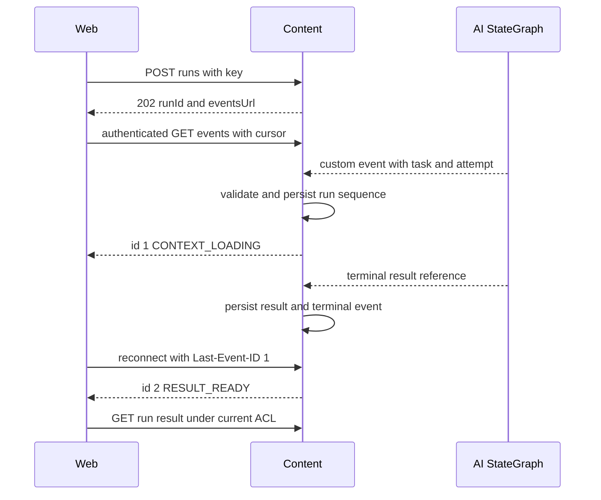
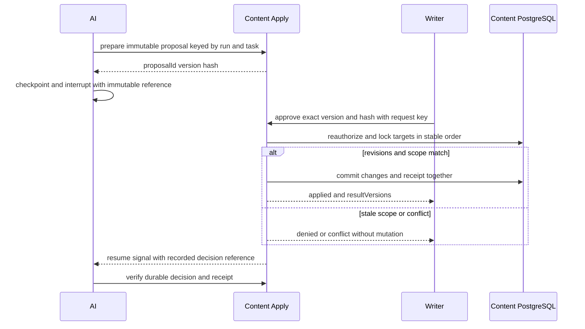
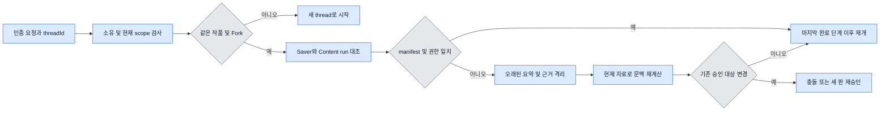

# Content API, 진행 스트림, 승인 및 재개

> **2026-11-11 현행:** 생성·분류는 GPT-6 Luna, 현재 관계는 Content→Neo4j, 원문은 Elasticsearch E5, RAG 추적은 Langfuse다. 위키는 목업이며 템플릿은 RAG 밖이다. [실연동 인수보고](live-rag-handoff.md) 참조. 아래 TASK별 결과는 당시 기록이다.

2026-11-10 TASK 23: Content의 별도 Run SSE·cursor replay·410·polling 결과 참조·취소 CAS를 구현했다.
custom stream의 고정 이벤트만 받고 결과/terminal event와 기존 승인 결정을 같은 transaction에 기록한다.
사용자 결정으로 자동 이벤트 삭제와 외부 코드 리뷰 전송은 하지 않는다.
실제 전문 Agent/결과 본문 resolver·UI 소비자는 미연결이다. [현재 계약](task23-contract.md) · [검증](task23-handoff.md).

2026-11-10 TASK 22: B/proposals/{pid}의 approve/reject/revise 공개 경로와 기존 Content 결정 transaction을 연결했다.
전체 baseVersions·키·판/hash 대조, 실제 PG의 동시 결정/전체 rollback을 검증했다. AI의 선택적 준비 seam 뒤
읽기 전용 interrupt와 영수증 기반 resume를 연결했다. 사용자 결정으로 revise는 **200 revision_requested 영수증**이며
아래 목표안의 202 새 run 자동 생성은 이번에 구현하지 않는다. 실제 준비 전송·후보 resolver·자동 복구는 미연결이다.
[현재 API·읽기 전용 재개 계약](task22-contract.md) · [검증/한계](task22-handoff.md).

2026-11-09 TASK 10에서 공개 Run·상태·thread의 최소 API와 실제 5분 서명 grant의 Content↔AI HTTP 재검증을 구현했다. 당시 계약은 [TASK 10](task10-api-contract.md), 현재 SSE/결정/재개 구현은 위 TASK 22·23 계약을 우선한다. TASK 09 절은 당시 합성 구현의 기록이다. 실제 전문 Agent/원고 읽기·유료 모델은 연결하지 않는다.

**Content가 작업과 제안을 소유하고, AI가 재개 가능한 실행을 소유한다.** 지시서의 “Core 정본 조회 / Core Apply”는 이 저장소에서 Content의 인가·조회·적용과 Core 회원 인증의 조합이다. 사용자가 보는 성공 상태의 근거는 Content의 적용 영수증이다.

## 공개·내부 API 제안

기존 `/api/v1/works/{id}/proposals`와 `/{pid}/accept`는 호환 유지한다. 새 공통 진입점 `B=/api/v1/works/{id}/ai`를 Content로 라우팅한다. 기능별 endpoint는 화면별 문서화가 쉽지만 streaming·취소·멱등 처리 중복이 생긴다. 공통 `POST B/runs`의 `operation`별 판별 유니온으로 스키마를 검증하고, **승인**은 독립 endpoint로 둔다. 아래는 모두 목표 계약이다.

| 작업 / Method·Path | Request → Response | 버전·재시도·SSE 및 Mock |
|---|---|---|
| 실행 `POST B/runs` | `{threadId?,operation,prompt?,target,options} → 202 {runId,threadId,status,statusUrl,eventsUrl}` | Idempotency-Key 필수. scope·target 종류와 baseRevision 검사. 같은 키/같은 body는 같은 run, 다른 body는 409. Mock도 같은 ID 수명주기 |
| 대화 `GET B/threads/{threadId}` | `?cursor&limit → {threadId,scope,messages[],nextCursor}` | 매 조회 회원·작품·thread 인가. 오래된 비공개 인용 제거. 읽기 재시도 가능 |
| 상태 `GET B/runs/{runId}` | `→ {runId,threadId,status,tasks:[{taskId,status}],coverage?,result?,proposalId?,lastEventId,error?}` | bearer 소유자만, 현재 권한으로 재필터. SSE 만료 시 기준점. 부분 결과와 오류 유지 |
| 스트림 `GET B/runs/{runId}/events` | `Last-Event-ID? → text/event-stream` | cursor 검증. 재연결 시 같은 run 참조, 실행 생성 없음. fixture도 동일 이벤트 순서 |
| 취소 `POST B/runs/{runId}/cancel` | `{reasonCode?} → {runId,status}` | 키와 취소 상태 CAS. 이미 취소는 같은 결과, 적용 커밋 후에는 409와 현재 상태. 실행 중단 신호 후 최종 상태 SSE |
| 제안 `GET B/proposals/{pid}` | `→ {proposalId,version,hash,operations,evidence,coverage,status}` | 모든 대상 열람 권한 재확인. 버전이 바뀌면 새 diff 제시 |
| 승인 `POST B/proposals/{pid}/approve` | `{version,hash,baseVersions} → {proposalId,status,receipt?,resultVersions?}` | Idempotency-Key와 명시적 승인 필요. 범위·hash·버전 불일치 409. 권한 변경 시 거부. commit 뒤 SSE |
| 거절 `POST B/proposals/{pid}/reject` | `{version,hash,reason?} → {status:rejected}` | 키·revision 고정. stale/기결정 409, 동일 요청 재전송은 기존 결과 |
| 재수정 `POST B/proposals/{pid}/revise` | `{version,hash,instruction} → 202 {threadId,runId,proposalId}` | 같은 대상·목적 내 새 불변 판 생성, 이전 판 승인 불가. 범위 변경은 새 run. SSE로 새 판 준비 알림 |

| `operation` | 판별 유니온 추가 인자 | `result` 타입 |
|---|---|---|
| `ask / simulate` | basisEpisode·질문 또는 characterIds·scenario·maxTurns | Answer / SimulationReport |
| `next_draft / next_insights` | 회차 범위·targetEpisode·콘티 참조 또는 count·대안 조건 | GeneratedText/BeatPlan 또는 Insights |
| `review / edit / expand_conti` | 판본·span·checkTypes 또는 voice/style·planId | Findings / ChangeSet / GeneratedText |
| `world_plot_change / recommend_template` | settingId·영향 범위 또는 genre·tone·license 조건 | ImpactReport+ChangeSet / Recommendations |
| `auto` | 자연어·선택한 UI scope | 허용된 작업만 분류, 모호하면 명확화 응답 |

모든 공개 경로는 Core 인증 및 Content의 owner/thread/run/proposal/대상 ACL을 공유한다. 권한 밖 객체의 존재를 숨길 때 404, 미인증 401, 알려진 작업 권한 부족 403, 잘못된 입력 422, 버전/키 충돌 409, 사용자 한도 429, 필수 의존 장애 503이다. 요청 접수 후 실패는 200 상태 조회의 `status=failed,error={code,retryable,taskId?}`로 구분한다. Mock은 별도 환경의 대역 인증 주체·정본·제안 저장소를 사용한다. mock Evidence가 있는 run의 실제 Content 적용은 차단한다.

**서버 간 계약 후보.** Content가 run과 요청 해시를 먼저 기록한다. `POST /internal/v1/ai/runs`는 `{runId,threadRef,grantRef,operation,targetRefs,budget}`를 받고 같은 run을 중복 실행하지 않는다. AI가 반환하는 task 결과 `{runId,taskId,attempt,outputSchema,resultRefs,evidenceRefs,usage,error?}`를 Content가 run 소유·판본·허용 타입에 맞춰 수락한다. scope 없는 내부 토큰만으로 원고를 읽을 수 없게 서비스 자격과 만료가 짧은 작업별 위임을 함께 검증한다. 정본 조회는 Content가 grant에서 주체를 복구한다. [#163의 읽기 전용 MCP](https://github.com/SKNETWORKS-FAMILY-AICAMP/SKN34-FINAL-4TEAM/issues/163)는 transport 후보이며 원고 쓰기·승인을 노출하지 않는다. 일회성 내부 호출은 TLS와 서비스 인증 적용을 전제로 한다. 모델·브라우저에는 토큰/직접 DB 접근을 주지 않는다.

## TASK 09 합성 내부 Run HTTP 계약

2026-11-09에 아래 내부 경계를 구현했다. 이 절은 위 공개 API·실제 Content/MCP 목표와 달리 **서버가 주입한 FixtureContent만** 검증한 계약이다. 실제 grant 발급·서명·최대 TTL·갱신·철회 전송 방식은 #163의 미결 사항이며 이번 구현으로 확정하지 않는다. 기본 `create_app()`에서는 서비스 인증 후 `503 run_service_unconfigured`로 종료한다. fixture를 켜는 환경 변수나 HTTP 발급 경로는 없다.

| 경로 | 구현한 입출력·인증 |
|---|---|
| `POST /internal/v1/ai/runs` | `X-Internal-Token`과 아래 DTO. `202 {runId,threadRef,status:pending,isMock:true,...}`. 메모리 실행 task를 예약한다. |
| `GET /internal/v1/ai/runs/{runId}` | `X-Internal-Token`·`X-Grant-Ref`·`X-Thread-Ref` 필수. 매번 현재 위임·manifest를 확인해 `200 {runId,threadRef,status,isMock,tasks,coverage,result,error}` 반환. |
| `POST /internal/v1/ai/runs/{runId}/cancel` | 조회와 같은 인증·재인가. 실행 중이면 취소·늦은 결과 차단, 이미 취소/완료면 현재 종료 상태 반환. 실제 적용 상태는 없다. |

```json
{
  "runId": "run1", "threadRef": "thread1", "grantRef": "synthetic-grant",
  "workId": "w1", "forkId": null, "basisEpisode": 3, "operation": "ask",
  "targetRefs": [{"work_id": "w1", "kind": "manuscript", "document_id": "m1", "revision": "r1"}],
  "budget": {"modelCalls": 1, "inputTokens": 4000, "outputTokens": 1000, "timeoutMs": 20000}
}
```

`targetRefs`는 기존 SourceVersion 계약의 snake_case 필드를 재사용한다. 상위 요청은 camelCase이며 추가 필드는 거부한다. Scope·Query·prompt·handler·plan은 HTTP로 입력받지 않는다. FixtureContent는 미리 등록한 전체 DTO와 대조하고 Content 대역의 subject·scope·만료/active·manifest를 복원한다. work/Fork/회차·thread/run·operation·targetRefs·budget 치환은 원문 조회 전에 거부한다. Query의 문서/kind 필터와 target 판본 집합이 일치해야 하며, 같은 문서/kind에 복수 판본이 있으면 이 단계에서는 거부한다. 실제 Content adapter는 FixtureContent에서 사용할 수 없다.

예산은 설계 02의 상한(20회·입력 48,000·출력 12,000·120,000ms) 안에서 기존 DAG Validator/TaskRunner에 전달한다. 기존 계획의 예약 시간 합계보다 작은 예산은 계획 실패로 끝나며 자동으로 계획을 변경하지 않는다. 실행 전체 timeout도 별도로 감싼다. 서비스 토큰 미설정/공백/오류/중복은 403, 위임 불일치·만료·철회는 403, 접수 전 Content 대역 장애는 503, 유효한 위임의 미접수 run은 404, 중복 run·같은 thread의 활성 run은 409, DTO 오류는 422다. 입력 오류는 grant·본문 없이 `invalid_request`만 반환한다.

접수 후의 거부는 상태 조회 `200 status=denied,error.code=refused`, timeout은 `200 status=failed,error.code=timeout`, 일반 실패는 `execution_failed`, Scope 의존 장애는 `dependency_unavailable`이다. `partial/clarification/cancelled/proposal`을 성공으로 바꾸지 않는다. `result`는 기존 GraphResponse, `tasks`는 TaskResult 계약을 재사용한다. 내부 grant·원문을 오류/로그/체크포인트에 추가하지 않으며 검증된 합성 인용 본문은 권한 재검증 후 응답에만 실린다.

중복 claim·상태·결과는 단일 프로세스 메모리에만 존재한다. 재시작·다중 worker·영속 lease·grant 갱신·SSE·승인·실제 저장·공개 nginx는 지원하지 않는다. lifespan 종료 때 실행 task를 취소·회수한다. [TASK 09 실제 검증](task09-handoff.md).

## Checkpointer와 복원

**기존 요청 보호를 그대로 적용한다.** 웹의 상태 변경 POST는 Bearer와 기존 CSRF 발급 절차의 `X-CSRF-TOKEN`을 함께 보낸다. AI 측 callback은 공개 nginx 라우트로 노출하지 않는다. 기존 이어쓰기가 외부 전송과 API 비용에 대한 `data.consent`를 확인하므로 새 실행에도 `options.modelConsent={providers,purpose,maxCalls,noticeVersion}` 계약을 둔다. 서버는 사용자에게 표시한 동의 범위와 허용 예산을 검증한다. 분류기만 쓰는 호출도 외부 전송에 포함한다. 동의 누락 시 유료 호출 0회로 중단하고 필요한 동의를 안내한다. [Content 보안 설정](../../backend/content-service/src/main/kotlin/ai/storyfork/content/auth/config/ContentSecurityConfig.kt) · [기존 생성 흐름](../../backend/content-service/src/main/kotlin/ai/storyfork/content/proposal/service/ProposalService.kt)

| Content가 보존할 업무 레코드 후보 | 유일성·복구 조건 |
|---|---|
| thread와 run | thread에 회원·작품·Fork·saver 참조를 결합. run을 기존 ai_job에 연결. (subject,work,operation,key)에 request hash와 원 응답을 저장. 접수와 내부 dispatch 의도를 한 트랜잭션에 기록하고 미전달 건은 같은 runId로 재전달 |
| 실행 단계·진행 | (run,task,attempt)와 lease generation. 늦은 실행의 쓰기는 generation 비교로 거부. 비용 예산 예약과 완료된 모델 호출을 재개 후 재사용. 진행 이벤트는 (run,seq) 유일 |
| 제안 판·결정 | (proposal,version) 불변 manifest와 hash. 같은 판의 최종 결정 한 건. 업무 `ai_job.status`의 기존 running/completed/failed CHECK에 새 run 상태를 그대로 쓰지 않고 호환 가능한 별도 실행 상태로 매핑 |
| 적용 영수증 | 결정과 변경 이력을 application에 연결. 각 대상의 이전/결과 revision과 승인자를 기록. 실패 후 부분 커밋은 0건. 조회/재전송 때 ID만으로 권한을 복구하지 않는다 |

AI 재개와 사용자 승인 사이에는 중단 등록 경쟁이 있다. 승인 이벤트가 checkpoint 저장보다 먼저 도착해도 Content의 결정은 영속한다. 대기 중단을 등록한 직후에도 같은 판의 기존 결정을 조회하고, 이미 결정됐으면 해당 interrupt에 한 번만 resume한다. 오래된 판의 신호는 새 판을 재개시키지 않는다.

AsyncPostgresSaver는 기존 PostgreSQL 인스턴스의 분리된 `langgraph` schema 후보에 둔다. Content 업무 Flyway는 run/thread/승인 연결만 소유한다. 배포용 관리 계정으로 schema·권한 및 고정 버전 saver `setup()`을 한 번 직렬 실행하는 방향이다. 런타임 계정은 DDL 금지, 모든 풀 연결의 search_path를 고정하고 시작 때 schema·버전을 확인한다. saver 내부 SQL을 업무 Flyway에 복사하지 않는다. 풀 상한은 서비스 전체 연결 예산에서 산정하고 대기 timeout·종료 close·마이그레이션 롤백 리허설을 둔다. [기존 Saver 스키마 조사](../design/erd/ai-service/postgres-saver.md) · [LangGraph persistence](https://docs.langchain.com/oss/python/langgraph/persistence)

Content의 업무 checkpoint는 Fork 기준판, saver의 checkpoint는 한 사용자 작업의 재개 위치다. `threadId`는 Content가 subject/work/Fork에 결합한 불투명 ID다. 동시 활성 run은 thread당 하나만 허용하는 기본안을 쓴다. 서버가 한 번 실행 lease를 얻고 만료 시 같은 run/attempt를 대조해 재개한다. 이전 작업·결과 참조 및 짧은 허용 요약만 유지한다. 사용자 입력도 원고를 포함할 수 있으므로 암호화·열람 ACL·삭제 기한을 적용한다. 원문 복사·provider secret·권한 토큰·무제한 messages를 저장하지 않는다. 큰 결과는 소유권 있는 결과 참조로 남긴다. 로그아웃으로 재연결을 멈추고, 권한 철회·탈퇴 시 접근 차단 후 Saver의 thread와 blobs/writes, 캐시·요약까지 삭제하는 보존 정책을 마련한다. TTL·백업 삭제 기한은 운영 전 결정한다.

TASK 21 구현 상태: 고정 Saver 3.2.0/psycopg 3.3.2 전용 풀·lifespan, 조회 전용 schema/version/권한 검사,
별도 관리 setup, thread session lock, Main/TaskRunner 참조·비용 복원을 개발 후보로 구현했다.
PUBLIC TEMP와 schema CREATE가 없어야 시작하며 공유 DB의 권한을 runtime에서 바꾸지 않는다.
권한 회수 조율이 어려우면 별도 DB가 대안이다. 실제 승인·SSE·Content 자동 복구·grant 갱신·보존/삭제는 후속이다.
[관리·재개 계약](../../backend/ai-service/docs/checkpoints.md) · [TASK 21 검증](task21-handoff.md).

### 14. SSE 진행 시퀀스

TASK 23의 실제 delivery는 AI 내부 custom DTO→상태 snapshot→Content 영속 기록→공개 SSE다.
아래 흐름의 publisher는 기존 작품 잠금을 재사용하며, 자동 보관 만료/삭제 없이 없는 과거 cursor만 410으로 처리한다.
결과는 본문 대신 안전한 참조만 영속화한다. 세부 시간/상태/취소 전달 계약은 [TASK 23](task23-contract.md)을 따른다.



AI 노드의 custom stream writer가 단계 변경만 보낸다. Content publisher가 run별 단조 증가 `seq`와 `(run,task,attempt,phase,step)` 유일 키를 부여한다. durable run 결과 및 terminal event를 같은 Content 트랜잭션으로 기록한다. 독립 task 간 도착 순서는 실제 진행 순서이며 task 내부 step만 엄격하게 증가한다. Web은 이미 본 seq 이하는 무시하고 gap이 있으면 재구독한다. cursor 보관 기간 만료는 410, 상태 GET 후 최신 cursor로 재연결한다. polling으로도 최종 결과 확인 가능하다. [LangGraph custom streaming](https://docs.langchain.com/oss/python/langgraph/streaming)

```text
id: 17
event: progress
data: {"runId":"example-run","taskId":"sim-1","seq":17,"code":"SIMULATING","step":2,"status":"running"}
```

| event code | 서버의 고정 한국어 문구 |
|---|---|
| ANALYZING / CONTEXT_LOADING | 요청을 분석하고 있습니다. / 회차별 맥락을 확인하고 있습니다. |
| RELATIONS_LOADING / TEXT_LOADING / TEMPLATE_SEARCH | 인물 관계를 확인하고 있습니다. / 관련 원고를 찾고 있습니다. / 세계관 템플릿을 찾고 있습니다. |
| SIMULATING / REVIEWING | 인물의 행동을 시뮬레이션하고 있습니다. / 설정과 플롯을 검수하고 있습니다. |
| DRAFTING / EDITING / PROPOSAL_PENDING | 초안을 작성하고 있습니다. / 선택한 문단을 수정하고 있습니다. / 변경안을 확인해 주세요. |
| RESULT_READY / APPLIED / PARTIAL / FAILED / CANCELLED | 결과가 준비되었습니다. / 변경사항을 저장했습니다. / 일부 결과가 준비되었습니다. / 작업을 완료하지 못했습니다. / 작업을 취소했습니다. |

이벤트에는 비공개 원고·자유 생성 진행 문구·모델 reasoning을 넣지 않는다. 인증된 fetch SSE, 프록시 buffering 해제와 idle timeout보다 짧은 heartbeat, 로그아웃 시 AbortController를 사용한다. 네트워크 단절과 사용자의 명시적 취소는 별개다. 긴 Simulation은 턴·총 상한만 표시한다.

### 15. HITL과 Core Apply 시퀀스



`interrupt()` 앞에서는 원고 수정·과금 등 외부 부수효과를 일으키지 않는다. 읽기 전용 interrupt 노드 **이전 단계**에서 Content가 동일한 run/task 키로 제안 초안을 한 번만 기록한다. 실제 승인·적용은 사용자 결정 API의 Content 트랜잭션이 담당한다. `Command(resume=decisionRef)`는 같은 thread의 중단을 이어가며 영수증을 읽는다. 재개 노드가 처음부터 다시 실행되어도 DB에 원고를 두 번 추가하지 않는다. 재개 신호 유실 시 재시작한 AI는 영수증 조회로 수렴한다. [LangGraph interrupts](https://docs.langchain.com/oss/python/langgraph/interrupts)

```text
ChangeSet = {proposal_id,proposal_version,run_id,work_id,fork_id?,affected_documents[],
             operations:[{op:create|replace_span|update_fields,target_type,target_id,
               base_version,patches:[{original_text_range?,before_hash?,proposed_content}],
               allowed_fields?,evidence_refs[]}], evidence_refs[],proposal_hash,
             idempotency_key,status,created_at}
Receipt = {decision_id,proposal_id,proposal_version,proposal_hash,actor_ref,
           application_id,outcome,result_versions:[{target_id,before,after}],committed_at}
```

제안 hash는 서버가 고정한 직렬화 버전·scope·대상·base·순서 있는 operations·근거를 포함하며 가변 status나 시간은 제외한다. 같은 판을 제자리에서 편집할 수 없다. 범위 선택을 바꾸면 선택 범위가 고정된 새 판을 미리 보고 승인한다. 생성 대상은 Content가 예약한 안정한 ID와 “아직 없음” 전제 조건을 쓴다. Content가 알지 못하는 필드·발행·권한 변경 op는 거부한다.

`draft → pending → rejected | revision_requested | approved`. 재수정은 새 판을 pending으로 만든다. 승인과 같은 DB 내 변경/결과 기록은 한 트랜잭션으로 처리하며 외부에는 `applied`가 보인다. 버전이 달라지면 `conflict`, 검증·저장 장애는 rollback 후 별도 시도 기록에 `failed`. 일시 장애는 같은 키로 결과를 먼저 조회한다. 승인 전 최신 ACL·인물/공개 문맥·모든 base revision·원문 hash·범위를 재확인한다. 같은 key+payload의 재전송은 현재 열람권 확인 후 원 영수증, 같은 key+다른 payload는 409. 다른 키로 같은 판을 이중 승인해도 proposal/version 결정 유일성으로 원고를 한 번만 쓴다. 취소·거절·수정·승인은 같은 판을 잠가 순서를 결정한다.

PG 다중 문서는 **같은 Content 트랜잭션 관리자와 변경 서비스가 지원하는 대상만** 전체 성공/전체 롤백한다. 저장된 각 결과 버전과 대상 수를 대조하고 커밋 뒤 검색 자료를 무효화한다. 원고+Neo4j 등 서로 다른 저장소 조합은 `unsupported_atomic_scope`로 사전 거부하고 사용자에게 독립적으로 승인 가능한 단위를 표시한다. 버전 충돌을 자동 재작성·보상해 사용자의 수정을 지우지 않는다. 기존 accept는 그대로 두고 새 경로만 멱등 영수증 계약을 사용한다.

TASK 17의 현재 구현은 앞 절 중 **Content PG 원고 변경** 계약이다. `ChangeProposalService`가 불변 판과
결정/적용 영수증·실패 시도를 분리해 보존하고, 기존 `ProposalService.accept`는 그대로 유지한다.
HTTP 준비·재생성, AI 결과 자동 연결, 설정·콘티·플롯 writer, interrupt/resume 자동 연결은 추가하지 않았다.
기존 Content 문맥의 정확한 draft 또는 발행 원문 발췌 근거만 검증한다. 실제 Wiki·Mock 검색 근거의 적용은 허용하지 않는다.
[구현 DTO·범위·로컬 단위와 CI 대기](task17-handoff.md).

TASK 18의 Python `WritingChangeSet`/`DocumentCreateProposal`은 Mock AI 후보다. Content의 proposal ID/판/hash를
발급한 불변 manifest가 아니다. Content가 draft·작품 revision과 제목+본문 전체 hash 및 예약 ID를 재검증해 prepare하는
실 변환·transport는 후속이며, 현재 AI 결과에서 실제 승인 API나 DB를 호출하지 않는다([계약](task18-handoff.md)).

### 16. 멀티턴 복원

TASK 20 검색 무효화 이벤트 설계(미연결): Content가 지원 대상의 적용 영수증과 결과 판본을 같은 PG 트랜잭션에
기록하고, 커밋이 확인된 뒤 `ContentChangeCommitted.v1`을 전달한다. 최소 payload는
`event_id=application_id`, `work_id`, `proposal_id/version`, `receipt_ref`,
`targets[{document_id,kind,before_revision,after_revision}]`이며 본문·토큰·인물 비밀을 넣지 않는다.
rollback·승인 대기·Mock 후보 생성에는 이벤트를 발행하지 않는다. 실제 outbox/전송 구현은 이 단계 범위 밖이다.

소비자는 이벤트 대상 원문의 역참조 Wiki/요약·원고 Vector·문맥 캐시를 우선 조회 불가로 표시하고,
현재 Content manifest의 판본·권한과 재대조한 새 세대가 준비된 뒤에만 공개한다. event_id로 중복을 제거하되
역순 이벤트는 최신 manifest를 기준으로 판정하며 과거 세대를 되살리지 않는다. 누락/처리 실패는 해당 범위를
unverified/partial로 유지하고 운영자가 재처리한다. 이는 캐시 무효화 계약 설계이며 실제 DB 인덱스·이벤트 버스·
consumer·정본 쓰기를 구현하거나 기존 Neo4j 현재 관계를 무효화 대상으로 덮어쓴 것이 아니다.



권한 상실은 즉시 종료하며 복원·정본 재조회도 하지 않는다. 사용자 전환 시 이전 thread의 존재를 노출하지 않는다. 생성 도중 장애가 나면 완료한 작업의 출력 참조·모델 호출 기록을 먼저 확인한다. 사용량이나 외부 실행 여부가 불명인 비멱등 단계는 `needs_review` 사유로 중단하고, 재시도 가능성이 확인된 읽기 작업만 자동 재개한다.

## TASK 24 구현 상태 (2026-11-10)

집필실의 인증 Run/SSE/cancel/proposal 결정 소비와 최소 선택·결과 계약을 연결했다.
실제 전문 실행 조립·후보 자동 준비는 미연결이다. [현재 계약](task24-contract.md)·[검증](task24-handoff.md)을 따른다.
