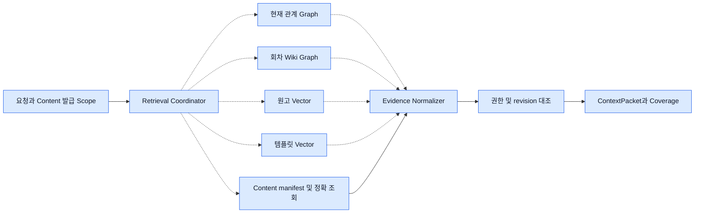

# 검색 계약과 Fixture

네 어댑터는 **동일한 Scope·Evidence 규약**을 사용한다. Content는 다섯 번째 검색 엔진으로 집계하지 않는다. 허용된 자료 목록과 정확한 원문·버전·현재 관계를 확인하는 기준이다. 개발자는 아래 합성 자료와 대역만으로 라우팅, 누락 처리, 인용 검증, 승인 전 차단을 재현할 수 있다.

### 5. 필요한 검색 경로와 정본 확인



## 입력과 반환 규약 v1

아래는 구현용 타입 표기다. `Id`는 경계에서 검증하는 불투명 문자열이다. 원작의 `fork_id=null`은 원작만 일치시키며 와일드카드로 해석하지 않는다. Fork의 `work_id`와 `fork_id`는 대상 Fork 작품 PK다. 원작에서 상속한 근거는 Content가 허용한 출처 참조로만 연결한다.

```text
Scope = {grant_ref, subject_ref, work_id, fork_id?, world_id?, basis_episode,
         audience: owner|reader|character, character_id?, purpose, manifest_ref}
Query = {scope, operation, query_text?, entity_ids[], episode_range?,
         document_ids[], top_k, token_budget, deadline, required_fields[],
         source_kinds[], language?, genre?}
RetrievalPort.search(query: Query) async -> RetrievalResult
CanonicalAdapter.manifest(scope) -> {expected_episodes[], source_versions, scope_digest}
CanonicalAdapter.read(scope, typed_target, revision, span?) -> VerifiedSource
RetrievalResult = {status: ok|partial|unavailable|unsupported|denied,
                   evidence[], gaps[], conflicts[], coverage?, next_cursor?, is_mock}
Gap = {source_ref?, episode_number?, code: missing|stale|unsupported|timeout|unverified}
Coverage = {manifest_ref, requested_range, expected_count, verified_count,
            episodes:[{number, episode_id?, expected_rev?, indexed_rev?, state, refs[]}],
            missing_ranges[], critical_gaps[], checked_at, is_mock}
```

`grant_ref`는 서버 전용 단기 위임 참조다. 클라이언트·모델이 만든 Scope는 무효다. 검색 전에 서버가 scope·작업·시점·공개·인물 지식 필터를 적용한다. 반환 단계에서 Content와 다시 확인한다. 대상 범위를 벗어난 행 한 건이라도 반환한 adapter 응답은 격리하고 보안 실패로 처리한다. 사용자에게 다른 작품의 ID·제목·존재를 내보내지 않는다. 정상 0건, 미지원, timeout을 구분한다.

| Evidence 필드 | 자료형·의미 |
|---|---|
| `id, retrieval_type, source_backend, is_mock, retrieved_at` | 안정적 출처 키, relationship/wiki/manuscript/template 또는 정확 조회 canonical, 제공사/fixture 이름, bool, UTC timestamp |
| `work_id?, fork_id?, episode_id?, scene_id?, document_id?, entity_ids[]` | 정본과 결합할 식별자. 카탈로그 템플릿은 작품 식별자 null, `template_id`와 catalog_revision·license_ref 필수 |
| `source_revision, source_span?, as_of_episode?, evidence_refs[]` | source_kind와 불투명 버전 쌍. 범위는 원본 문자열 **UTF-16 code unit [start,end)**, 개행·정규화 원본 그대로. quote hash는 해당 원문 UTF-8 바이트 SHA-256. Python은 명시 변환, 대리쌍 경계 분할 거부 |
| `content, fact_or_relation?, canonical_status, known_by?, visible_from?, visible_to?` | 최소 발췌와 주장. `verified_source / inferred / disputed / hypothetical`. 원문에 적힌 대사와 등장인물 주장의 진실성을 분리. `known_by` 미정은 인물에게 숨김 |
| `retrieval_score?, score_kind?, confidence_basis?, source_hash?` | cosine·순위·그래프 거리 같은 점수 의미를 함께 기록. 사실 확률로 변환하지 않는다. 추론·충돌에는 근거와 반대 근거를 함께 보존 |

### TASK 01에서 사용할 Content 읽기 계약

[ContentReadPort와 CanonicalAdapter](../../backend/ai-service/app/retrieval/content_client.py)는 내부 Python 계약이다. 현재 호출 가능한 구현은 [합성 Content 대역](../../backend/ai-service/app/retrieval/mock_content.py)이다. 기존 이어쓰기 API는 기존 ContextService를 사용한다.

1. **발급.** Content가 Core에서 확인한 주체와 실행 목적에 대해 작품 소유·공개·Fork 체크포인트를 검사하고 특정 작업의 grant와 manifest를 고정한다. 호출자는 작품 ID나 관점을 바꿔 위임 범위를 넓힐 수 없다. 서버 측 포트는 작업에 바인딩된 위임을 매번 확인한다. `scope_digest`는 응답 혼선을 검출하는 값이며, 권한의 근거는 Content의 위임 기록이다.
2. **검색 전.** `manifest(scope)`는 허용된 회차와 `(출처 작품 ID, 자료 종류, 문서 ID, 판본)`만 반환한다. Fork 자체 자료와 상속 원본의 고정판을 구분한다. 대역은 작가에게만 자체 초안을 열고, 인물 시점에는 해당 시점에 공개되고 `known_by`가 명시된 자료 단위만 연다. 공개 범위나 인물 지식이 섞인 본문은 Content가 분리·검증한 단위가 생길 때까지 목록에서 제외한다.
3. **검색 후.** 검색 결과의 판본과 UTF-16 구간, 인용이 있으면 원문 UTF-8 SHA-256을 `read`에 넘긴다. Content가 읽는 시점의 위임·판본·구간을 함께 재검사한다. 소비자는 모든 후보가 확인된 뒤 검증된 원문만 모델 입력에 넣는다. 검색기가 돌려준 원문, Scope 및 grant는 모델 입력에서 제외한다.
4. **실패.** 만료·철회·위조·비허용 판본이나 잘못된 구간은 `denied`, 전송 장애는 `unavailable`이다. 유효한 위임으로 요청해도 현재·과거 Studio 관계 읽기는 `unsupported`다. 조회 결과가 없는 경우는 빈 허용 목록이다. 합성 원문에는 항상 `is_mock=true`가 붙는다.

실제 전송은 [#163](https://github.com/SKNETWORKS-FAMILY-AICAMP/SKN34-FINAL-4TEAM/issues/163)에서 내부 HTTP 또는 읽기 전용 MCP와 서비스 인증·위임 만료/철회를 확정한 뒤 연결한다. 작품과 독립 Studio world의 연결은 [#109](https://github.com/SKNETWORKS-FAMILY-AICAMP/SKN34-FINAL-4TEAM/issues/109), 관계의 현재 상태 한정은 [#132](https://github.com/SKNETWORKS-FAMILY-AICAMP/SKN34-FINAL-4TEAM/issues/132)를 따른다.

### TASK 02 구현 상태 — DTO·네 Port·합성 fixture

2026-11-09 로컬 구현. 시작 브랜치는 `feat/54-canonical-read-scope`, 기준 HEAD는 `6d86cc7`이며 시작 작업 트리는 clean이었다. 기존 TASK 01 위에 변경했으며 develop 재기반·기존 API 변경은 하지 않았다.

| 파일 | 구현 범위 |
|---|---|
| [contracts.py](../../backend/ai-service/app/retrieval/contracts.py) | Pydantic `Query/Evidence/Gap/Conflict/Coverage/RetrievalResult`, 비동기 `RetrievalPort`와 relationship/wiki/manuscript/template 네 Port |
| [story.json](../../backend/ai-service/tests/fixtures/story.json) | 합성 1~3화·카이/리나/암호·현재 관계·템플릿, 다른 작품/Fork·미래·비공개·stale/timeout/conflict/missing/unauthorized 변형 |
| [test_retrieval_contract.py](../../backend/ai-service/tests/test_retrieval_contract.py) | 공통 반환 스키마, mock 표시, coverage, UTF-16·UTF-8 SHA-256, 기존 Content 대역의 인가·판본·정확 인용 계약 |

`Scope`, `SourceVersion`, `CanonicalAdapter`, `MockContentReadPort`는 TASK 01 구현을 재사용한다. `CanonicalAdapter`는 contracts에서도 같은 클래스를 내보내며 중복 구현하지 않는다. Evidence의 `source_revision`은 기존 `SourceVersion`의 `(work_id, kind, document_id, revision)`을 보존한다. 템플릿 fixture의 `catalog` 출처 식별자는 합성 카탈로그 전용이며 Content 읽기 권한을 부여하지 않는다.

회차 범위는 양 끝 포함, 원문 span은 UTF-16 `[start,end)`이다. 점수와 score kind를 함께 요구하며 점수를 사실 확률로 바꾸지 않는다. `known_by=null`은 지식 미확인으로 보존한다. Coverage는 승인 manifest의 대상 회차별 항목을 누락 상태까지 담고, 개수·중복·요청 범위를 검증한다. 미완전 coverage나 gap이 있으면 `ok`를 거부한다. 정상 0건은 `ok`·빈 evidence이며, 실패 상태는 evidence를 담을 수 없다. mock evidence/coverage를 실제 결과로 표시할 수 없다.

TASK 02 완료 당시에는 네 Port의 구체 검색 구현·후보 필터·전체 응답 격리가 없었다(후속 TASK 03 상태는 아래 참조). 테스트의 I/O 없는 Stub은 같은 async 반환 계약만 확인하며, 인가 부정 사례는 실제 기존 합성 Content 대역으로 검증한다. DTO의 `verified_source` 값 자체는 검증 증명이 아니며, 소비자는 여전히 Content manifest/read로 모든 후보를 확인해야 한다. 결과를 모으는 Coordinator·Normalizer는 이번 단계에서 구현하지 않았다. Query에는 서버 Scope가 있으므로 모델 입력이나 로그로 DTO 전체를 직렬화하지 않는다.

설계 근거는 [05 구현 순서의 1단계](05-implementation-roadmap.md#구현-순서와-수용-기준), 이 문서의 입력·반환 규약 및 Fixture 절, DEC-36·37·41이다. [#56](https://github.com/SKNETWORKS-FAMILY-AICAMP/SKN34-FINAL-4TEAM/issues/56)(담당 kyo-135), [#125](https://github.com/SKNETWORKS-FAMILY-AICAMP/SKN34-FINAL-4TEAM/issues/125)(담당 미지정)는 2026-11-09 조회 당시 open이었다. #56의 종전 Core 읽기 표현에는 현재 Content 소유권을 적용했다.

검증은 `backend/ai-service`에서 다음 선택 단위만 실행했다.

```powershell
python -B -m pytest -p no:cacheprovider -o addopts= -q -m 'not integration' tests/test_retrieval_contract.py tests/test_canonical_read.py tests/test_generation.py
```

결과: **90 passed, 1 deselected**(TASK 02 48개 + 기존 42개, HTTP 통합 1개 제외). Red는 contracts 모듈 미구현과 미완전 coverage의 `ok` 허용 실패로 확인한 뒤 Green으로 전환했다. 표준 `uv run --locked --extra dev ...`는 sandbox의 uv interpreter cache 쓰기 권한 오류로 실패해 기존 설치 Python으로 실행했다. 따라서 locked 환경 재현 확인은 대기다. 기본 asyncio 이벤트 루프조차 이 환경에서 대기해 중단했으며, I/O 없는 async Stub의 반환 계약은 coroutine 완료 값으로 검사했다. 실제 비동기 I/O를 검증한 결과는 아니다.

`ponytail-review` 자체 점검에서 제거할 추가 계층·의존성은 없었다. CodeRabbit CLI는 발견했으나 설치 출처를 확인하지 못해 외부 리뷰는 실행하지 않았다. 통합·시스템·브라우저·빌드·실제 모델 품질/검색 성능 평가는 미실행이다. production 의존성·lockfile·설정·DB·서비스 등록·정본 데이터는 변경하지 않았다. 유료 호출·실 사용자 원고 전송은 없으며 합성 증거만 `is_mock=true`로 사용했다.

제안 커밋: `feat: 검색 DTO와 네 Port의 합성 계약 추가`(#56·#125). 새 로컬 커밋·push·PR·배포는 수행하지 않았다. TASK 03은 새 요청 시 착수 가능하지만 이번 작업에서는 시작하지 않는다. 실제 Content 전송·서비스 인증·위임 수명(#163)과 작품↔Studio 연결(#109)은 기존 결정 대기이며, 추천은 결정 전 합성 대역 유지다. 실제 연결은 계약 확정 후 별도 단계에서 진행한다. 관계 정본 읽기는 계속 `unsupported`다.

### TASK 03 구현 상태 — 네 합성 검색기

2026-11-09 로컬 구현. 시작 브랜치는 `feat/54-canonical-read-scope`, HEAD는 `6d86cc7`이다. 시작 시 TASK 02의 `contracts.py`, `test_retrieval_contract.py`, `tests/fixtures/story.json`과 이 문서·기능표가 미커밋 상태였으며 그대로 보존·확장했다. develop 재기반이나 다른 변경 덮어쓰기는 하지 않았다.

| 파일 | 동작·범위 |
|---|---|
| [relationships.py](../../backend/ai-service/app/retrieval/relationships.py) | `RelationshipGraphRetriever`와 명시 주입한 합성 `MockRelationshipGraph`. 같은 Content Scope·작품·world에 바인딩한 작가 개인의 현재 보기만 지원. 허용 카드 양 끝·방향·라벨·현재 CAS token을 보존하고 history/snapshot/회차 제한 조회는 unsupported |
| [episode_wiki.py](../../backend/ai-service/app/retrieval/episode_wiki.py) | `EpisodeWikiRetriever`. 회차·장면·사건·지식 습득·복선의 합성 Evidence와 판본·인과 참조를 보존. 누락/stale/비허용 출처를 참조한 파생 경로도 제거하고 partial로 구분 |
| [manuscript.py](../../backend/ai-service/app/retrieval/manuscript.py) | `ManuscriptVectorRetriever`. 미리 분할한 합성 문단 chunk를 작품/Fork·문서·종류(manuscript/draft/conti)·회차·revision으로 필터링한 뒤 Content의 UTF-16 구간·UTF-8 SHA-256 확인. 다른 회차로 span을 확장하지 않음 |
| [templates.py](../../backend/ai-service/app/retrieval/templates.py) | `TemplateVectorRetriever`. 서버가 명시한 허용 라이선스와 공개·활성/만료·언어·장르를 검사하는 별도 카탈로그. Evidence의 work/fork/document ID는 null. 반환 직전 철회·권리 변경도 폐기 |
| [_mock.py](../../backend/ai-service/app/retrieval/_mock.py), [contracts.py](../../backend/ai-service/app/retrieval/contracts.py), [fixture](../../backend/ai-service/tests/fixtures/story.json), [단위 테스트](../../backend/ai-service/tests/test_mock_retrievers.py) | Mock 전용 공통 인가·정확 인용·고정 순위/상한, Query의 선택적 source_kinds/language/genre, 명시적 합성 Studio 연결·언어/권리 메타데이터, 부정/회귀 계약 |

모든 결과·Evidence는 `is_mock=true`다. 이 표시는 실제 원고 적용 금지이며 `apply` 등 쓰기 작업은 unsupported다. 실행 router·실제 Content 적용 경로에 등록하지 않았다. 기존 CanonicalAdapter의 현재/과거 관계 읽기는 여전히 unsupported다. 합성 관계 binding은 #109의 실제 작품↔Studio 계약이나 #163의 실제 전송·서비스 인증·위임 수명을 확정하지 않는다.

Mock의 검색어는 검증된 발췌의 대소문자 무시 부분 문자열로 비교하고, fixture rank→ID 순서로 재현한다. Wiki의 `scene_id`, JSON 문자열인 `fact_or_relation`의 kind/fact/actor, `evidence_refs`의 노드 ID로 장면·지식·인과를 보존한다. 추론·disputed 표시는 그대로 유지하며 진실로 승격하지 않는다. 실제 semantic/Vector 검색, Wiki 추출이나 원고 chunk 생성기는 구현하지 않았다. Wiki의 missing/stale gap은 요청 문서·회차 범위 안에서만 기록하며 전체 Coverage 집계는 TASK 04에 남긴다.

검색 corpus에 있는 다른 작품·미래·비공개 행은 Content manifest로 사전 제외한다. 허용된 출처와 응답의 work/fork/document/회차 메타데이터가 모순되거나 span/hash가 위조된 경우에는 성공분을 포함한 응답 전체를 denied로 폐기한다. 반환 본문은 후보의 캐시 문자열을 사용하지 않고 Content 정확 조회 결과로 교체한다. 인물 known_by·공개 범위도 합성 Content 행에서 얻는다. 시작·정확 조회·반환 직전에 위임과 manifest를 재확인하며 캐시·원문 로그는 만들지 않는다.

`top_k`와 deadline은 검사한다. Mock의 `token_budget`은 본문·관계/사실 문자열의 UTF-8 byte 수를 상한으로 쓰는 보수적 대역이며 정확한 모델 토큰 수나 metadata를 포함한 전체 ContextPacket 예산이 아니다. 상한 초과·필수 필드 부족은 unverified gap/partial, 알 수 없는 필수 필드·작업은 unsupported, timeout/전송 실패는 unavailable다. 실제 tokenizer·통합 예산은 모델/Coordinator 단계에서 연결한다.

설계 근거는 [05 구현 순서 1단계](05-implementation-roadmap.md#구현-순서와-수용-기준), 이 문서의 입력/반환 규약·네 Adapter 책임·Fixture 절, DEC-36·37·41과 [#132 현재 관계 계약](../design/worldstudio-independent-schema.md#현재-관계-mvp-계약--132)이다. [#56](https://github.com/SKNETWORKS-FAMILY-AICAMP/SKN34-FINAL-4TEAM/issues/56)(kyo-135), [#125](https://github.com/SKNETWORKS-FAMILY-AICAMP/SKN34-FINAL-4TEAM/issues/125)(담당 미지정)를 다시 조회했으며 모두 open이었다. 실제 소유권은 #56의 종전 Core 표현보다 현재 Content 서비스 경계를 따른다.

`backend/ai-service`에서 다음 선택 단위를 실행했다.

```powershell
python -B -m pytest -p no:cacheprovider -o addopts= -q -m 'not integration' tests/test_mock_retrievers.py tests/test_retrieval_contract.py tests/test_canonical_read.py tests/test_generation.py
```

결과: **127 passed, 1 deselected**(TASK 03 37개 + 기존 90개, HTTP 통합 1개 제외). Red는 검색 모듈 부재, 요청 밖 원고까지 읽는 prefilter 부재, 반환 중 템플릿 철회 미반영, 요청 밖 Wiki 누락 gap으로 확인한 뒤 Green으로 바꿨다. 권한 철회/만료/주체 교체, 타 Fork/미래/비공개·인물 지식, old revision·누락 의존 경로, timeout, 라이선스 철회/만료, 캐시 오염·조회 후 변경, 방향·CAS·정확 span을 검증했다. 네 검색기의 공통 계약 검사에 실제 네 구현체를 사용했고 소켓 생성/연결 spy로 외부 네트워크 호출 0회를 확인했다.

`uv run --offline --no-cache --locked --extra dev ...`도 interpreter 임시 cache 쓰기 권한 오류로 실패했다. 기존 설치 Python으로 단위를 실행했으므로 locked 환경 재현은 대기다. I/O 없는 async 검색은 coroutine 완료 값으로 검사했으며 실제 비동기 네트워크 실행의 증거는 아니다. 로컬 통합·시스템·브라우저·전체 suite·빌드·실 모델/DB 평가와 CodeRabbit 외부 리뷰(설치 출처 미확인)는 미실행이다. `ponytail-review` 자체 점검으로 중복된 템플릿 선택 ID 집합 계산을 루프 밖으로 옮겼으며 추가 계층·의존성은 도입하지 않았다.

production 의존성·lockfile·설정·정본 DB·Neo4j·인덱스·실제 provider 호출/인프라 설치·유료 호출·실 사용자 원고 전송은 모두 0건이다. 실제 품질/recall/부하·권리 계약이 검증된 것은 아니다. 권한 밖 노출 방지와 Mock 계약의 단위 증거로만 해석한다.

제안 커밋: `feat: 네 합성 검색기의 범위와 근거 검증 구현`(#56·#125). TASK 02 미커밋분과 이번 변경은 작업 트리에 남기고 새 로컬 커밋·push·PR·배포는 하지 않았다. 다음 TASK 04는 새 요청 시 착수 가능하며 자동 시작하지 않는다. 추천은 실제 연결 결정 전 합성 대역 유지이고, 대안인 실제 Content/검색기 연결은 #109/#163·권리·환경 계약 확정 후 별도 승인 단계에서 수행한다.

### TASK 04 구현 상태 — Coordinator·문맥 투영·Coverage

2026-11-09 로컬 구현. 브랜치 `feat/54-canonical-read-scope`, 시작 HEAD `6d86cc7`. TASK 02·03의 미커밋 파일과 문서 변경을 보존하면서 확장했다. develop 재기반·기존 API 교체는 하지 않았다.

| 파일 | 변경·동작 |
|---|---|
| [coordinator.py](../../backend/ai-service/app/retrieval/coordinator.py) | `RetrievalCoordinator`, `ContextPacket/ContextItem`, 경로 선택·async 병렬 실행·deadline·정본 재검증·중복 제거·예산/누락·확정 판정 보류 |
| [episode_wiki.py](../../backend/ai-service/app/retrieval/episode_wiki.py) | 질문 관련 top-k와 독립된 `coverage(query)` 전체 합성 색인 읽기 |
| [_mock.py](../../backend/ai-service/app/retrieval/_mock.py) | inventory 모드에서 회차 자체의 원문 근거를 유지한다. 일반 검색의 파생 경로 제거는 그대로 유지 |
| [test_retrieval_coordinator.py](../../backend/ai-service/tests/test_retrieval_coordinator.py) | 전체/부분 coverage·보안 격리·점수·인용·병렬 실행·캐시 키·projection·철회 단위 검사 |
| 이 문서·[기능표](../feature-roadmap.md) | 내부 호출 계약·검증 결과·한계를 기록. 서비스 흐름 완료 체크는 승격하지 않음 |

내부 `Query.operation`은 quote→원고, current→현재 관계, templates→카탈로그, review/full_context→Wiki+원고와 별도 전체 Wiki 조회, context→Wiki+원고다. search에서는 required_fields의 템플릿 필드→카탈로그, 장면/지식/사건 참조→Wiki, span/hash→원고 순으로 경로를 좁힌다. 알 수 없는 operation은 unsupported다. 이는 내부 읽기 계약이며 자연어 Router·Agent/DAG는 구현하지 않았다. 선택된 독립 검색은 `asyncio.gather`로 병렬 실행하고 각 호출은 남은 deadline으로 제한한다. 재시도·Mock 자동 대체·무한 재검색은 없다.

현재 Coordinator는 기존 합성 Content 대역 전용이다. source revision·문서/작품/Fork·허용 시점·인물 knownBy·UTF-16 span·UTF-8 hash와 실제 반환 본문을 Content에서 재확인한다. 한 Adapter에 범위 밖/위조 항목이 섞이면 성공분도 노출하지 않고 packet 전체를 denied로 폐기한다. 현재 관계/Catalog는 반환 직전 해당 공급자를 한 번 더 읽어 현재 CAS/라이선스와 일치하는지 확인한다. 현재 관계의 과거 복원은 계속 미지원이다. grants/Scope 원문은 ContextPacket에 포함하지 않고 scope digest만 기록한다.

전체 coverage는 manifest 중 요청 범위·허용 출처가 있는 회차를 분모로 삼으며, top-k를 분자로 쓰지 않는다. Mock Wiki의 별도 coverage는 유한한 주입 fixture를 한 번 전수 검증한다. 실 provider의 페이지/대용량 전체 확인 계약은 아직 구현하지 않았다. 정상 1~3화는 3/3, 2화 Wiki 누락은 2/3이다. 누락된 회차 범위와 그 누락을 원인으로 하는 다른 회차의 인과 경로 미확인은 구분한다. 회차 자체의 원문/색인 판본이 확인되어도 인과 참조가 없으면 critical gap을 남기므로 complete/확정 판정을 허용하지 않는다. 분모 0건도 complete로 표시하지 않는다. 필수 Wiki 장애·stale·disputed는 확정을 보류하고, 독립된 선택 자료 장애는 확보한 자료와 partial로 반환한다. can_conclude는 읽기 판단 가능성일 뿐 실제 저장 승인 권한이 아니다.

Evidence는 `(source kind/출처 문서, id, revision, span)`을 기준으로 중복 제거하며 원고의 동일 판본·동일 span은 chunk ID가 달라도 한 번만 담는다. 공급자 순서를 유지하고 cosine·rank 등 서로 다른 점수를 산술 합산하지 않는다. 같은 근거의 상태/주장이 상충하면 disputed와 conflict 참조를 남기고 확정을 보류한다. ContextItem은 요청한 필드만 투영하되 판본·hash·retrieval_type·canonical_status는 항상 포함한다. Agent에는 packet 전체가 아니라 context slice를 전달해야 한다. 사용량은 projection의 `exclude_none=True` JSON 기준 UTF-8 byte 상한이며 모델 tokenizer의 정확한 토큰 수는 아니다. 예산으로 제외된 ID를 기록하고 하위 공급자가 이미 제외해 ID를 모르면 확인 가능한 허용 회차 범위를 보수적으로 기록한다.

캐시 본문·관계 snapshot은 저장하지 않는다. `cache_key(query)`는 subject/grant/purpose/audience/character/work/fork/world/basis/manifest를 담은 Scope digest, 전체 Query와 index_generation을 결합한 SHA-256이다. 권한/철회는 매번 확인하므로 키가 같아도 이전 성공을 재사용하지 않는다. 실제 캐시 도입에는 Content의 grant epoch·삭제/철회 전파 계약이 먼저 필요하다.

근거는 [02 실행·실패 제어](02-ai-architecture.md), [03 Coverage 판정과 ContextPacket](03-rag-simulation-design.md), [06 결정 7·10·15](06-design-decisions.md), 이 문서의 입력/반환·정규화 계약과 DEC-36·37·41이다. [#56](https://github.com/SKNETWORKS-FAMILY-AICAMP/SKN34-FINAL-4TEAM/issues/56)(kyo-135), [#125](https://github.com/SKNETWORKS-FAMILY-AICAMP/SKN34-FINAL-4TEAM/issues/125)(담당 미지정)를 다시 조회했으며 모두 open이었다. 실제 내부 인증/위임·Studio 연결의 #163/#109 결정은 여전히 대기다.

검증은 AI 서비스 디렉터리에서 선택 단위만 실행했다.

```powershell
python -B -m pytest -p no:cacheprovider -o addopts= -q -m 'not integration' tests/test_retrieval_coordinator.py tests/test_mock_retrievers.py tests/test_retrieval_contract.py tests/test_canonical_read.py tests/test_generation.py
```

결과: **152 passed, 1 deselected**(TASK 04 25개 + 기존 127개, HTTP 통합 1개 제외). 모듈 부재 Red를 먼저 확인했고 예산 누락 기록·인과 critical gap의 추가 실패를 확인한 뒤 수정했다. 회차 색인 누락과 인과 참조 누락의 missing_ranges를 분리해 회귀를 통과했다. 테스트는 sandbox 기본 asyncio 대기 문제 때문에 승인된 호스트 실행으로 수행했으며 Event 기반 양방향 대기 테스트로 독립 경로의 실제 중첩 실행을 확인했다. 외부 모델/DB/검색기 호출은 없었다. `uv run --offline --no-cache --locked --extra dev ...`는 Python 3.11을 찾지 못해 실패했고 설치된 Python으로 검사했다. locked 환경 재현은 대기다.

`ponytail-review` 자체 점검을 수행했으며 검색 DB·LangGraph·캐시 저장 계층·새 의존성을 추가하지 않았다. CodeRabbit 외부 리뷰는 설치 출처 미확인으로 미실행이다. 통합·시스템·브라우저·전체 suite·빌드·실 검색 품질/성능 평가는 미실행이다. production 의존성·lockfile·설정·DB/DDL·실제 provider/유료 호출·원고 적용은 변경/실행하지 않았다. Mock 근거는 모두 is_mock=true이며 실제 원고에 적용할 수 없다.

제안 커밋: `feat: 검색 문맥 조립과 전체 회차 근거 검증 구현`(#56·#125). 기존 미커밋분과 함께 작업 트리에 남기며 새 로컬 커밋·push·PR·배포는 하지 않았다. TASK 05는 새 요청 시 착수 가능하고 자동 시작하지 않는다. 실제 연결/캐시는 Content 위임·인덱스 세대·삭제 전파 계약 확정 후 별도 단계에서 진행하는 것을 추천하며, 그전에는 현재 합성 대역과 매 요청 재검증을 유지한다.

### TASK 13 — 합성 카탈로그 추천 연결

2026-11-10 `Template`에 선택적 `purpose`, `expected_change`, `conflicts_with` metadata를 추가했다. `TemplateVectorRetriever.search(query, *, tags=())`는 명시 태그가 있으면 교집합 후보만 기존 rank/ID 순위·top-k 처리 **전에** 통과시킨다. 기존 `search(query)` 호출은 그대로 동작하며 임베딩·실 Vector DB는 연결하지 않았다. 추천 Agent는 Content의 공개 설정에서 언어·장르·태그를 확인한 뒤 새로운 Query를 만들고, 원래 자유문·원고·문서/인물 필터를 검색 입력으로 재사용하지 않는다. 공개 설정 요약은 선택적 맞춤 설명에만 사용한다. 권리·판본·만료는 검색 전후와 설명 반환 직전에 검증한다. [추천 DTO·TDD·단위 결과](task13-handoff.md).

### 네 Adapter의 책임

| Adapter / 입력 제약 | 자료 모양과 반환 | 누락·갱신·확인 정책 |
|---|---|---|
| `RelationshipGraphRetriever` / Content가 결합을 확인한 world·현재 graph_version, 양 끝의 공개 허용 카드 | 현재 World→Relation→Source/Target. 유향·무향, 동맹·적대·가족·소속은 원본 payload의 방향과 라벨을 보존. 사용자 확정 관계와 Wiki 추론을 구별. 소속·조직·장소 등은 허용된 카드가 있을 때만 | current-only. 현재 version과 완료 상태 재확인. 과거 유효 구간·변경 이력 조회에는 unsupported. 회차 제한 요청에서 현재 관계가 당시에도 같았다고 추측하지 않는다. 행 단위 공개·지식 증명이 없으면 원작자 개인의 현재 보기 외 사용 차단. [관계 계약](../design/worldstudio-independent-schema.md) |
| `EpisodeWikiRetriever` / manifest와 회차 범위·시점·관점 | Episode/Scene/Event/Claim/Knowledge/Rule/PlotPoint와 인용 경로. 필수 사건 및 회차별 색인 revision 반환 | 전체 범위 확인과 질문 연관 top-k는 별도 질의. 오래된 revision·삭제 출처 및 파생 경로는 무효화. 본문으로 확인되지 않은 추론은 inferred |
| `ManuscriptVectorRetriever` / work·fork·문서 종류·버전 prefilter | 회차/장면 안의 문단 단위 chunk, 긴 문단은 문장 경계로 분할, 겹침은 직전 한 문장까지. `chunk_id,document_id,revision,span,embedding_model,index_generation,score` 반환. 콘티는 source_kind로 분리 | 다른 회차·문서·권한 경계 넘는 overlap 금지. 겹친 span 병합, 같은 revision에서 재정렬. 정확 대사·전체 원문은 Content로 읽는다. 새 색인 준비 전 구버전 차단. BM25·reranker는 평가 후 선택 |
| `TemplateVectorRetriever` / 독립 카탈로그, 이용자 권리·라이선스·언어·장르 필터 | 템플릿 ID/버전, 이름, 태그, 목적, 이미 사용하는 설정과의 중복·충돌 근거. 요청에는 비공개 원고 대신 허용 태그와 요약을 사용 | 철회·만료된 항목 차단. 카탈로그 데이터는 작품 memory에 자동 합치지 않는다. 적용 요청이 오면 별도 변경안 생성 |

Normalizer는 같은 `(source_kind,id,revision,span)`을 중복 제거한다. 정확 인용은 검증된 원문을 우선하고, 의도별로 Wiki의 사건 경로·관계 방향·원고 유사 구간·템플릿 적합도를 각기 해석한다. 서로 다른 점수의 산술 평균은 사용하지 않는다. 상충 주장은 출처별로 반환하고 적은 점수 차만으로 정본을 결정하지 않는다. 캐시 키에 subject/grant epoch·purpose·관점·character·작품/Fork·회차 범위·manifest·query·index_generation을 포함한다. 권한 변경·삭제에는 즉시 접근을 닫고 캐시에서 내보낼 때도 재검증한다.

## Fixture와 교체 절차

현재 Neo4j 관계를 읽은 결과는 run에서 허용된 동안만 사용한다. PostgreSQL의 Evidence·Saver·감사 기록에는 관계 본문을 snapshot으로 복제하지 않고 world/관계 ID·CAS token과 확인 결과만 남긴다. 재개 때 token이 바뀌면 현재 상태를 새로 확인한다. 과거 관계를 재구성하는 용도로 Wiki나 검색 캐시를 사용하지 않는다. V2 marker가 없는 기존 world는 `migration_required`이며 이 설계에서 자동 이관하지 않는다.

다음 YAML은 테스트 전용 약식 seed다. FixtureDataProvider는 여기의 별칭을 테스트 ID로, manifest를 서버 승인 읽기 목록으로 변환한다. mock provider는 고정 순위로 필터링 후 `is_mock=true`를 모든 결과에 붙인다. Mock에서도 Content 대역을 통해 source span을 확인한다.

```yaml
fixture_version: 1
scope: {subject_ref: author-A, work_id: w1, fork_id: null, basis_episode: 3}
manifest: [{episode: 1, revision: r1}, {episode: 2, revision: r2}, {episode: 3, revision: r3}]
sources:
  - {id: m1, episode: 1, revision: r1, text: "카이는 문을 닫았다."}
  - {id: m2, episode: 2, revision: r2, text: "리나만 암호를 들었다."}
  - {id: m3, episode: 3, revision: r3, text: "카이는 암호를 물었다."}
wiki:
  - {id: e1, episode: 1, kind: event, ref: m1, revision: r1}
  - {id: e2, episode: 2, kind: learns, fact: password, known_by: [lina], ref: m2, revision: r2}
  - {id: e3, episode: 3, kind: asks, actor: kai, ref: m3, revision: r3, caused_by: e2}
relationship: [{id: rel1, source: kai, target: lina, label: 동료, graph_version: 7, temporal: current}]
manuscript: [{id: c2, doc: m2, revision: r2, span: [0, 12], rank: 1}]
template: [{id: magic1, revision: t2, name: 대가가 있는 마법, license_ref: demo_allowed, tags: [마법, 제약]}]
variants:
  fork: {work_id: f1, fork_id: f1, episode: 3, fact: "카이는 떠났다", revision: f3}
  conflict: {claim: "카이도 암호를 들었다", status: disputed, contradicts: e2}
  missing: {omit_wiki_episode: 2}
  stale: {override_chunk_revision: old2}
  unauthorized: {inject_result_from: other_author_fork}
  outage: {backend: wiki, error: timeout}
```

예를 들어 2화까지 카이 시점으로 질의하면 `e2`의 암호 내용은 카이 입력과 그 인물용 citation에 모두 없어야 한다. 원작자에게 같은 회차의 대사를 물으면 `m2/r2`에서 `[0,12)` 원문을 검증한다. 현재 관계가 확인되어도 “2화 관계 복원” 요청은 unsupported다. 2화 Wiki가 빠지면 3화까지의 coverage는 2/3이고 완전한 검수로 표시하지 않는다.

| 계약 검증 | Mock과 실 Adapter 공통 기대값 |
|---|---|
| 같은 요청·고정 버전 | 식별자, 범위, schema, visibility, 정렬 tie-break 재현. 실 검색 순위는 동일 문자열 순위 대신 기대 관련 문서 recall 및 노출 금지로 검증 |
| 권한·Fork·지식·삭제 | 교차 사용자·다른 Fork·미래 회차·라이선스 철회 자료가 결과/캐시/로그/인용에 0건. 삭제한 근거를 참조한 Wiki 경로도 차단 |
| 잘못된 데이터 | 누락→coverage gap, stale→원문 재조회 또는 stale, 충돌→disputed, timeout→unavailable. 실 장애에 Mock 결과를 대입하지 않는다 |
| 공급자 선택 | 단위/CI fixture 명시, 개발은 요청되지 않은 외부 호출 금지, 운영은 허용된 real만 등록. 운영에서 mock 설정·표시 누락이면 기동/작업 거부 |
| 교체 | 같은 Port에 실제 adapter 바인딩 → 고정 corpus로 계약 검증 → 권한 필터·시점·품질 평가 → 제한 트래픽 관측 → 문제 시 해당 capability 중지. Agent와 DAG 입력 형식 유지 |

실제 DB 단계에는 권리 확인된 corpus, chunk·임베딩 세대 관리, 변경 이벤트 재처리 및 삭제 전파, 인덱스 교체, 백업·복구, 지연·recall과 동시 부하 측정이 필요하다. Mock으로 확인되는 것은 분기·계약·격리 규칙이다. 실제 검색 품질이나 사업 데이터 coverage의 증거는 별도로 수집해야 한다.
