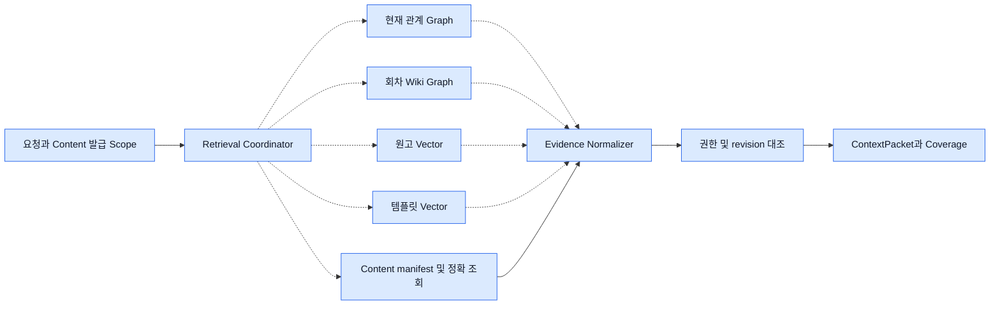

# 검색 계약과 Fixture

네 어댑터는 **동일한 Scope·Evidence 규약**을 사용한다. Content는 다섯 번째 검색 엔진으로 집계하지 않는다. 허용된 자료 목록과 정확한 원문·버전·현재 관계를 확인하는 기준이다. 개발자는 아래 합성 자료와 대역만으로 라우팅, 누락 처리, 인용 검증, 승인 전 차단을 재현할 수 있다.

### 5. 필요한 검색 경로와 정본 확인



## 입력과 반환 규약 v1

아래는 구현용 타입 표기다. `Id`는 경계에서 검증하는 불투명 문자열이다. 원작의 `fork_id=null`은 원작만 일치시키며 와일드카드로 해석하지 않는다. Fork의 `work_id`와 `fork_id`는 대상 Fork 작품 PK다. 원작에서 상속한 근거는 Content가 허용한 출처 참조로만 연결한다.

```text
Scope = {grant_ref, subject_ref, work_id, fork_id?, world_id?, basis_episode,
         audience: owner|reader|character, character_id?, purpose, manifest_ref}
Query = {scope, operation, query_text?, entity_ids[], episode_range?,
         document_ids[], top_k, token_budget, deadline, required_fields[]}
RetrievalPort.search(query: Query) async -> RetrievalResult
CanonicalAdapter.manifest(scope) -> {expected_episodes[], source_versions, scope_digest}
CanonicalAdapter.read(scope, typed_target, revision, span?) -> VerifiedSource
RetrievalResult = {status: ok|partial|unavailable|unsupported|denied,
                   evidence[], gaps[], conflicts[], coverage?, next_cursor?, is_mock}
Gap = {source_ref?, episode_number?, code: missing|stale|unsupported|timeout|unverified}
Coverage = {manifest_ref, requested_range, expected_count, verified_count,
            episodes:[{number, episode_id?, expected_rev?, indexed_rev?, state, refs[]}],
            missing_ranges[], critical_gaps[], checked_at, is_mock}
```

`grant_ref`는 서버 전용 단기 위임 참조다. 클라이언트·모델이 만든 Scope는 무효다. 검색 전에 서버가 scope·작업·시점·공개·인물 지식 필터를 적용한다. 반환 단계에서 Content와 다시 확인한다. 대상 범위를 벗어난 행 한 건이라도 반환한 adapter 응답은 격리하고 보안 실패로 처리한다. 사용자에게 다른 작품의 ID·제목·존재를 내보내지 않는다. 정상 0건, 미지원, timeout을 구분한다.

| Evidence 필드 | 자료형·의미 |
|---|---|
| `id, retrieval_type, source_backend, is_mock, retrieved_at` | 안정적 출처 키, relationship/wiki/manuscript/template 또는 정확 조회 canonical, 제공사/fixture 이름, bool, UTC timestamp |
| `work_id?, fork_id?, episode_id?, scene_id?, document_id?, entity_ids[]` | 정본과 결합할 식별자. 카탈로그 템플릿은 작품 식별자 null, `template_id`와 catalog_revision·license_ref 필수 |
| `source_revision, source_span?, as_of_episode?, evidence_refs[]` | source_kind와 불투명 버전 쌍. 범위는 원본 문자열 **UTF-16 code unit [start,end)**, 개행·정규화 원본 그대로. quote hash는 해당 원문 UTF-8 바이트 SHA-256. Python은 명시 변환, 대리쌍 경계 분할 거부 |
| `content, fact_or_relation?, canonical_status, known_by?, visible_from?, visible_to?` | 최소 발췌와 주장. `verified_source / inferred / disputed / hypothetical`. 원문에 적힌 대사와 등장인물 주장의 진실성을 분리. `known_by` 미정은 인물에게 숨김 |
| `retrieval_score?, score_kind?, confidence_basis?, source_hash?` | cosine·순위·그래프 거리 같은 점수 의미를 함께 기록. 사실 확률로 변환하지 않는다. 추론·충돌에는 근거와 반대 근거를 함께 보존 |

### 네 Adapter의 책임

| Adapter / 입력 제약 | 자료 모양과 반환 | 누락·갱신·확인 정책 |
|---|---|---|
| `RelationshipGraphRetriever` / Content가 결합을 확인한 world·현재 graph_version, 양 끝의 공개 허용 카드 | 현재 World→Relation→Source/Target. 유향·무향, 동맹·적대·가족·소속은 원본 payload의 방향과 라벨을 보존. 사용자 확정 관계와 Wiki 추론을 구별. 소속·조직·장소 등은 허용된 카드가 있을 때만 | current-only. 현재 version과 완료 상태 재확인. 과거 유효 구간·변경 이력 조회에는 unsupported. 회차 제한 요청에서 현재 관계가 당시에도 같았다고 추측하지 않는다. 행 단위 공개·지식 증명이 없으면 원작자 개인의 현재 보기 외 사용 차단. [관계 계약](../design/worldstudio-independent-schema.md) |
| `EpisodeWikiRetriever` / manifest와 회차 범위·시점·관점 | Episode/Scene/Event/Claim/Knowledge/Rule/PlotPoint와 인용 경로. 필수 사건 및 회차별 색인 revision 반환 | 전체 범위 확인과 질문 연관 top-k는 별도 질의. 오래된 revision·삭제 출처 및 파생 경로는 무효화. 본문으로 확인되지 않은 추론은 inferred |
| `ManuscriptVectorRetriever` / work·fork·문서 종류·버전 prefilter | 회차/장면 안의 문단 단위 chunk, 긴 문단은 문장 경계로 분할, 겹침은 직전 한 문장까지. `chunk_id,document_id,revision,span,embedding_model,index_generation,score` 반환. 콘티는 source_kind로 분리 | 다른 회차·문서·권한 경계 넘는 overlap 금지. 겹친 span 병합, 같은 revision에서 재정렬. 정확 대사·전체 원문은 Content로 읽는다. 새 색인 준비 전 구버전 차단. BM25·reranker는 평가 후 선택 |
| `TemplateVectorRetriever` / 독립 카탈로그, 이용자 권리·라이선스·언어·장르 필터 | 템플릿 ID/버전, 이름, 태그, 목적, 이미 사용하는 설정과의 중복·충돌 근거. 요청에는 비공개 원고 대신 허용 태그와 요약을 사용 | 철회·만료된 항목 차단. 카탈로그 데이터는 작품 memory에 자동 합치지 않는다. 적용 요청이 오면 별도 변경안 생성 |

Normalizer는 같은 `(source_kind,id,revision,span)`을 중복 제거한다. 정확 인용은 검증된 원문을 우선하고, 의도별로 Wiki의 사건 경로·관계 방향·원고 유사 구간·템플릿 적합도를 각기 해석한다. 서로 다른 점수의 산술 평균은 사용하지 않는다. 상충 주장은 출처별로 반환하고 적은 점수 차만으로 정본을 결정하지 않는다. 캐시 키에 subject/grant epoch·purpose·관점·character·작품/Fork·회차 범위·manifest·query·index_generation을 포함한다. 권한 변경·삭제에는 즉시 접근을 닫고 캐시에서 내보낼 때도 재검증한다.

## Fixture와 교체 절차

현재 Neo4j 관계를 읽은 결과는 run에서 허용된 동안만 사용한다. PostgreSQL의 Evidence·Saver·감사 기록에는 관계 본문을 snapshot으로 복제하지 않고 world/관계 ID·CAS token과 확인 결과만 남긴다. 재개 때 token이 바뀌면 현재 상태를 새로 확인한다. 과거 관계를 재구성하는 용도로 Wiki나 검색 캐시를 사용하지 않는다. V2 marker가 없는 기존 world는 `migration_required`이며 이 설계에서 자동 이관하지 않는다.

다음 YAML은 테스트 전용 약식 seed다. FixtureDataProvider는 여기의 별칭을 테스트 ID로, manifest를 서버 승인 읽기 목록으로 변환한다. mock provider는 고정 순위로 필터링 후 `is_mock=true`를 모든 결과에 붙인다. Mock에서도 Content 대역을 통해 source span을 확인한다.

```yaml
fixture_version: 1
scope: {subject_ref: author-A, work_id: w1, fork_id: null, basis_episode: 3}
manifest: [{episode: 1, revision: r1}, {episode: 2, revision: r2}, {episode: 3, revision: r3}]
sources:
  - {id: m1, episode: 1, revision: r1, text: "카이는 문을 닫았다."}
  - {id: m2, episode: 2, revision: r2, text: "리나만 암호를 들었다."}
  - {id: m3, episode: 3, revision: r3, text: "카이는 암호를 물었다."}
wiki:
  - {id: e1, episode: 1, kind: event, ref: m1, revision: r1}
  - {id: e2, episode: 2, kind: learns, fact: password, known_by: [lina], ref: m2, revision: r2}
  - {id: e3, episode: 3, kind: asks, actor: kai, ref: m3, revision: r3, caused_by: e2}
relationship: [{id: rel1, source: kai, target: lina, label: 동료, graph_version: 7, temporal: current}]
manuscript: [{id: c2, doc: m2, revision: r2, span: [0, 12], rank: 1}]
template: [{id: magic1, revision: t2, name: 대가가 있는 마법, license_ref: demo_allowed, tags: [마법, 제약]}]
variants:
  fork: {work_id: f1, fork_id: f1, episode: 3, fact: "카이는 떠났다", revision: f3}
  conflict: {claim: "카이도 암호를 들었다", status: disputed, contradicts: e2}
  missing: {omit_wiki_episode: 2}
  stale: {override_chunk_revision: old2}
  unauthorized: {inject_result_from: other_author_fork}
  outage: {backend: wiki, error: timeout}
```

예를 들어 2화까지 카이 시점으로 질의하면 `e2`의 암호 내용은 카이 입력과 그 인물용 citation에 모두 없어야 한다. 원작자에게 같은 회차의 대사를 물으면 `m2/r2`에서 `[0,12)` 원문을 검증한다. 현재 관계가 확인되어도 “2화 관계 복원” 요청은 unsupported다. 2화 Wiki가 빠지면 3화까지의 coverage는 2/3이고 완전한 검수로 표시하지 않는다.

| 계약 검증 | Mock과 실 Adapter 공통 기대값 |
|---|---|
| 같은 요청·고정 버전 | 식별자, 범위, schema, visibility, 정렬 tie-break 재현. 실 검색 순위는 동일 문자열 순위 대신 기대 관련 문서 recall 및 노출 금지로 검증 |
| 권한·Fork·지식·삭제 | 교차 사용자·다른 Fork·미래 회차·라이선스 철회 자료가 결과/캐시/로그/인용에 0건. 삭제한 근거를 참조한 Wiki 경로도 차단 |
| 잘못된 데이터 | 누락→coverage gap, stale→원문 재조회 또는 stale, 충돌→disputed, timeout→unavailable. 실 장애에 Mock 결과를 대입하지 않는다 |
| 공급자 선택 | 단위/CI fixture 명시, 개발은 요청되지 않은 외부 호출 금지, 운영은 허용된 real만 등록. 운영에서 mock 설정·표시 누락이면 기동/작업 거부 |
| 교체 | 같은 Port에 실제 adapter 바인딩 → 고정 corpus로 계약 검증 → 권한 필터·시점·품질 평가 → 제한 트래픽 관측 → 문제 시 해당 capability 중지. Agent와 DAG 입력 형식 유지 |

실제 DB 단계에는 권리 확인된 corpus, chunk·임베딩 세대 관리, 변경 이벤트 재처리 및 삭제 상태 전파(소프트 삭제, 행은 보존), 인덱스 교체, 백업·복구, 지연·recall과 동시 부하 측정이 필요하다. Mock으로 확인되는 것은 분기·계약·격리 규칙이다. 실제 검색 품질이나 사업 데이터 coverage의 증거는 별도로 수집해야 한다.
